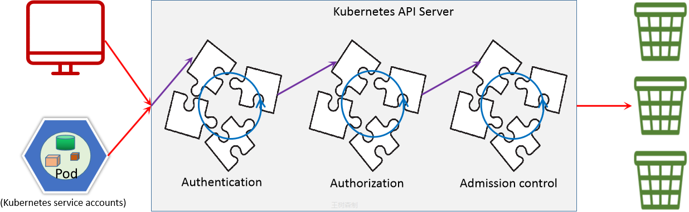
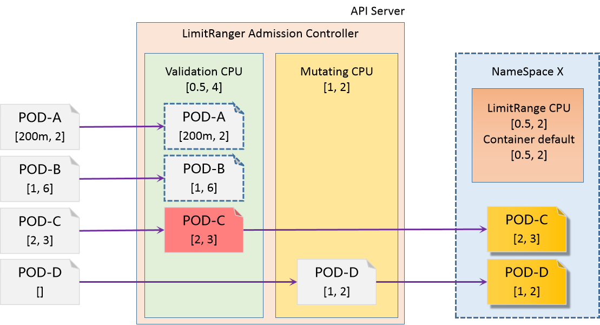

[← 返回 Kubernetes 目录]({{ '/subjects/Kubernetes/' | relative_url }})



# 32 准入控制

RBAC 回答“谁有权请求什么操作”，准入控制（Admission Control）则在请求通过认证和授权之后，对**创建、修改等写入请求**继续检查或修改对象。只要一个准入控制器拒绝请求，API Server 就不会持久化该对象。读请求不经过这一步；准入控制也不能取代运行时的安全隔离。



## 32.1 处理顺序与常用控制器

API Server 先执行变更型准入（Mutating Admission），再执行验证型准入（Validating Admission）。变更型控制器可补默认值或注入字段；验证型控制器只决定接受或拒绝。动态扩展分别使用 `MutatingAdmissionWebhook` 与 `ValidatingAdmissionWebhook`；Webhook 故障时的 `failurePolicy`、超时和可用性会直接影响写入请求，部署时应谨慎设置。

- **LimitRanger**：在名称空间内为容器补默认资源请求/限制，并检查单个对象是否越界。
- **ResourceQuota**：限制名称空间内的资源总量、对象个数等；它不会自动给每个容器补默认值。
- **PodSecurity**：按名称空间标签执行 Pod Security Standards 的 `privileged`、`baseline` 或 `restricted` 级别，可分别配置 `enforce`、`audit` 与 `warn`。
- **NamespaceLifecycle、ServiceAccount、DefaultStorageClass** 等：分别处理名称空间生命周期、服务账户与默认存储类等行为。

某个版本实际启用哪些控制器，应查看相应版本的 API Server 配置与官方文档，不能根据另一版本的帮助输出推断。kubeadm 部署的静态 Pod 清单通常位于 `/etc/kubernetes/manifests/kube-apiserver.yaml`；手工修改会触发控制平面重建，操作前应备份并安排维护窗口。

```bash
# 只读检查；显式启用的插件不代表默认启用插件的完整列表
sudo grep -n 'admission-plugins' /etc/kubernetes/manifests/kube-apiserver.yaml
kubectl version
```

## 32.2 LimitRange 与 ResourceQuota 配合

两者关注的维度不同：LimitRange 约束**单个容器或 Pod**，ResourceQuota 约束**整个名称空间**。先用 LimitRange 补齐未声明的资源请求，再用 ResourceQuota 控制整体预算，才能避免未设置请求的 Pod 意外绕过预算或在配额校验时被拒绝。



在测试名称空间中保存为 `admission-resources.yaml` 并应用：

```yaml
apiVersion: v1
kind: LimitRange
metadata:
  name: container-limits
  namespace: admission-demo
spec:
  limits:
    - type: Container
      defaultRequest:
        cpu: 100m
        memory: 128Mi
      default:
        cpu: 500m
        memory: 512Mi
      min:
        cpu: 50m
        memory: 64Mi
      max:
        cpu: "1"
        memory: 1Gi
---
apiVersion: v1
kind: ResourceQuota
metadata:
  name: team-budget
  namespace: admission-demo
spec:
  hard:
    requests.cpu: "2"
    requests.memory: 4Gi
    limits.cpu: "4"
    limits.memory: 8Gi
    pods: "20"
```

```bash
kubectl create namespace admission-demo
kubectl apply -f admission-resources.yaml
kubectl -n admission-demo describe limitrange container-limits
kubectl -n admission-demo describe resourcequota team-budget
kubectl -n admission-demo run check-defaults --image=nginx:1.27
kubectl -n admission-demo get pod check-defaults -o yaml
```

观察 `resources.requests` 与 `resources.limits` 是否被补齐，再尝试创建超出 `max` 或配额的对象，比较两类拒绝信息。已有 Pod 不会因为后来新增 LimitRange 而自动改写；配额统计也有短暂同步延迟。

## 32.3 Pod 安全策略：使用 Pod Security Admission

旧笔记中的 `PodSecurityPolicy`（PSP）在 Kubernetes v1.21 标记弃用，**v1.25 起已删除**。因此不能在现代集群中继续创建 PSP 对象、为 PSP 绑定 ClusterRole，或通过 `--enable-admission-plugins=PodSecurityPolicy` 启用它。这些命令属于历史版本背景，不是当前操作步骤。现行的内置替代机制是 Pod Security Admission（PSA），通过名称空间标签选择 Pod Security Standards 的级别。

下面先用 `warn` 和 `audit` 观察影响，再决定是否切换为 `enforce`；版本号应与正在运行的集群版本相匹配，避免随新版本升级悄然改变规则。

```bash
kubectl label namespace admission-demo \
  pod-security.kubernetes.io/warn=restricted \
  pod-security.kubernetes.io/audit=restricted \
  pod-security.kubernetes.io/warn-version=latest \
  pod-security.kubernetes.io/audit-version=latest --overwrite

kubectl -n admission-demo run security-check --image=nginx:1.27 --dry-run=server -o yaml
```

如果该 Pod 不符合 `restricted`，服务器会返回警告。修正容器的 `securityContext`、非 root 用户、能力集和 seccomp 配置并重新验证；部署工作负载前，再评估系统组件、存储插件与监控 Agent 是否需要独立的名称空间策略。确认兼容后才启用阻断：

```bash
kubectl label namespace admission-demo \
  pod-security.kubernetes.io/enforce=restricted \
  pod-security.kubernetes.io/enforce-version=latest --overwrite
kubectl get namespace admission-demo --show-labels
```

PSA 只覆盖 Pod 安全标准，不负责所有组织策略。需要校验镜像来源、特定标签、跨对象关系等时，可使用 `ValidatingAdmissionPolicy`（受集群版本影响）或 Webhook，并为准入服务设计高可用与回退策略。

完成实验后删除测试名称空间即可；删除前确认其中没有需要保留的工作负载：

```bash
kubectl delete namespace admission-demo
```



<nav class="article-end" aria-label="章节导航">
  <a href="{{ '/subjects/Kubernetes/31-security-rbac.html' | relative_url }}">← 上一章：授权机制与 RBAC</a>
  <a href="{{ '/subjects/Kubernetes/' | relative_url }}">返回 Kubernetes 目录</a>
  <a href="{{ '/subjects/Kubernetes/33-cluster-nodes.html' | relative_url }}">下一章：节点增删与 Token 管理 →</a>
</nav>
