[← 返回 Kubernetes 目录]({{ '/subjects/Kubernetes/' | relative_url }})



# 34 集群备份、恢复与迁移

备份工作的目标不是“生成文件”，而是在约定的时间内恢复可用业务。Kubernetes 同时包含集群控制面状态、声明式资源和应用持久化数据；只备份其中一项，通常不足以完成灾难恢复。本篇区分 etcd 快照、资源备份、卷数据备份与跨集群迁移，最后给出验证顺序。

## 1 容灾目标与备份边界

**RPO** 是可接受的最大数据回退时间，决定备份或复制频率；**RTO** 是从故障发生到业务恢复可接受的时长。越低的 RPO/RTO 通常需要更复杂的复制、自动切换和演练。先按业务分级确定目标，再决定是备份恢复、主备还是多活；“多活”也要解决数据一致性和故障域，不意味着天然零丢失。

| 方案 | 主要机制 | 典型取舍 |
| --- | --- | --- |
| 备份与恢复 | 定期保存资源与数据，故障后重建 | 成本较低，恢复和回退窗口较长 |
| 主备 | 备用环境持续准备，故障时切换 | 切换较快，但仍需验证复制延迟与备用容量 |
| 多活 | 多地点同时承接请求 | 可用性高，数据协调、冲突处理与运维复杂 |

对 Kubernetes 而言，应把备份分成三层：① Git 中的清单、Helm values、CRD 等配置；② etcd 中的集群状态和证书、密钥等控制面依赖；③ PVC 背后的业务数据及外部数据库。直接 `kubectl get ... -o yaml` 导出部分对象只能作为辅助清单，可能混入 `status`、生成字段和 Secret，既不是完整的 etcd 快照，也不会备份卷里的文件。复制不是备份：误删除或错误写入也可能被同步到副本。

备份文件应有独立故障域、访问控制、加密、保留期和定期恢复测试。仅看备份任务 `Completed` 不足以证明应用能够恢复。

## 2 etcd 快照与控制面恢复

etcd 通过 Raft 在成员之间复制 Kubernetes 的 API 状态。多数派可用是集群继续提交写入的前提，但高可用副本仍会共同保留误操作后的状态，因此必须做独立快照。etcd 快照不包含 PV 内的数据；恢复快照还可能把 API 对象回退到与实际存储系统不一致的时间点，需设计协调顺序。


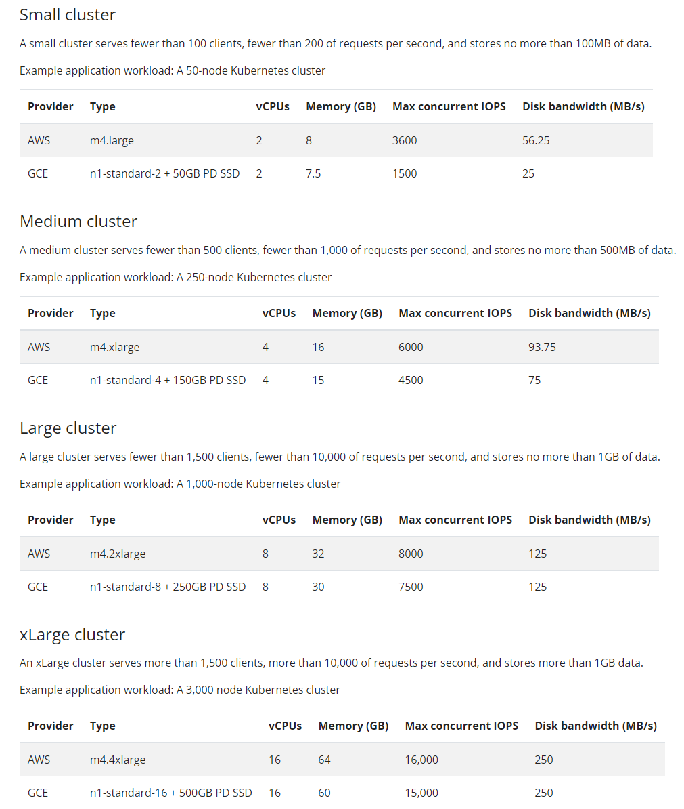

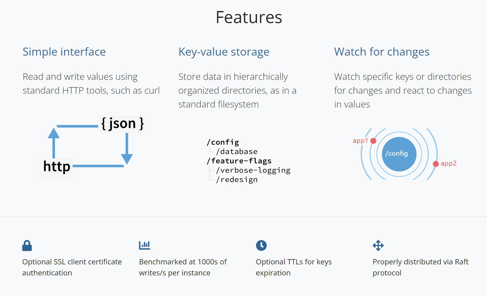

### 2.1 快照前先核对拓扑

区分 kubeadm 的堆叠式 etcd 与独立 etcd 集群，记录成员名、Peer URL、客户端 URL、证书路径、静态 Pod 清单和 Kubernetes/etcd 版本。还应确认快照存放位置独立于源数据盘，并准备好受控的加密与离线副本。`etcdctl` 用于在线快照与成员查询；较新版本的离线快照检查和恢复使用 `etcdutl`，工具版本应与集群 etcd 版本兼容。

```bash
export ETCDCTL_API=3
etcdctl \
  --endpoints=https://127.0.0.1:2379 \
  --cacert=/etc/kubernetes/pki/etcd/ca.crt \
  --cert=/etc/kubernetes/pki/etcd/healthcheck-client.crt \
  --key=/etc/kubernetes/pki/etcd/healthcheck-client.key \
  endpoint status --cluster --write-out=table
```

路径是 kubeadm 常见示例，独立部署应以本机配置为准。证书私钥具有高权限，不能随意上传或混入网页附件。

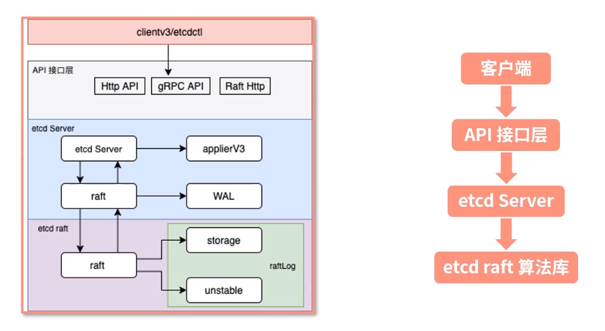

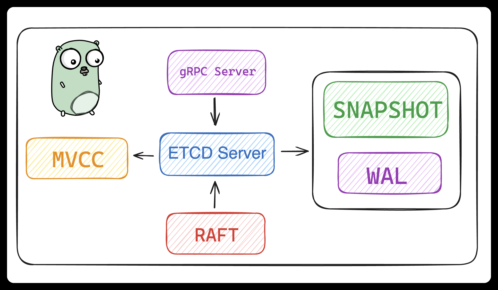

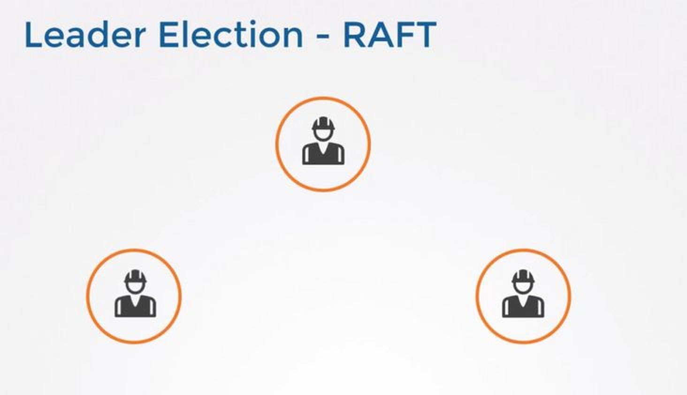

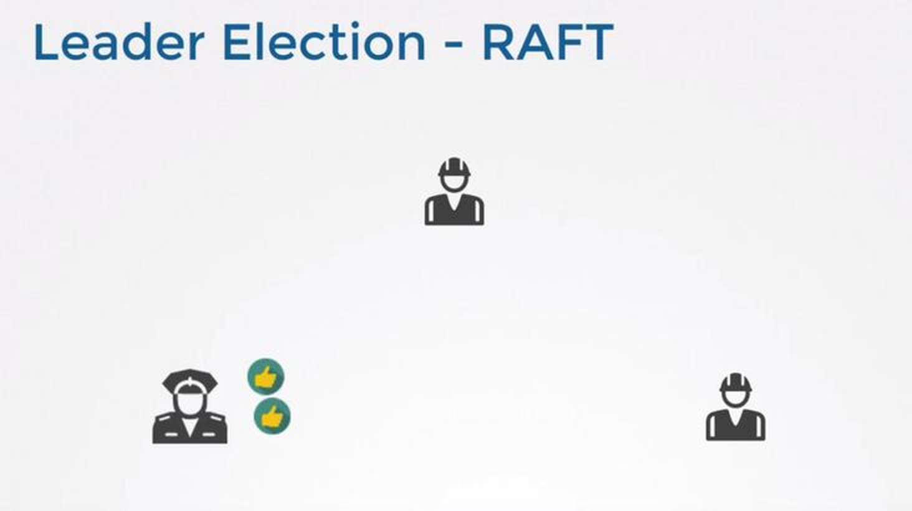

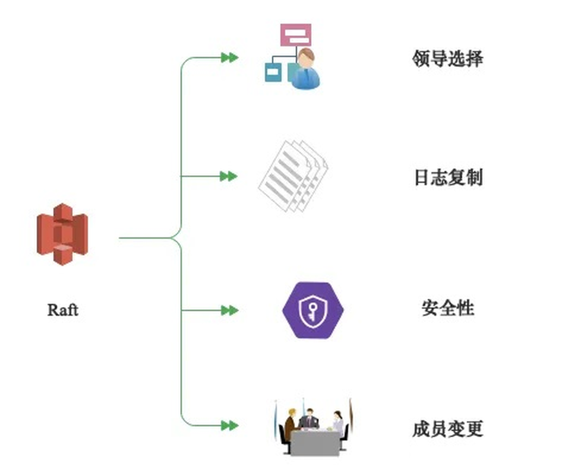


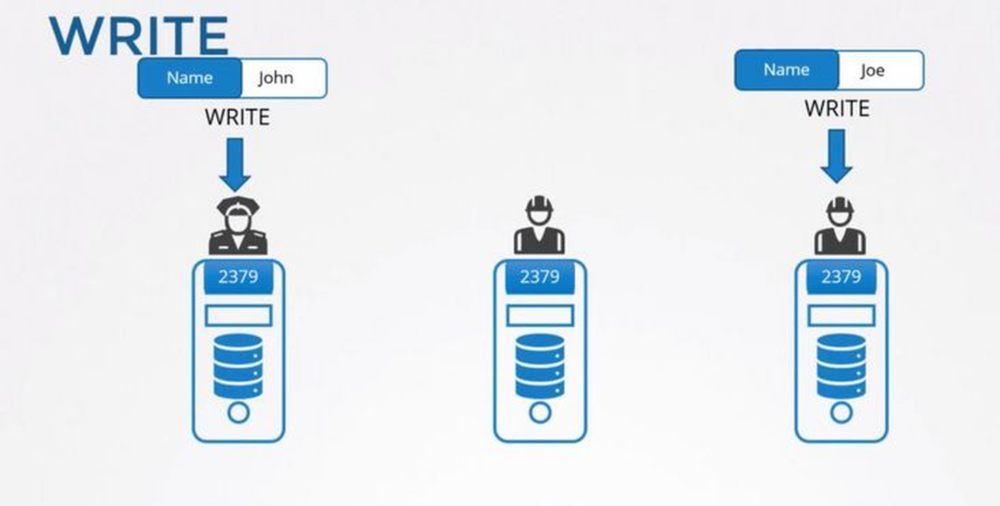

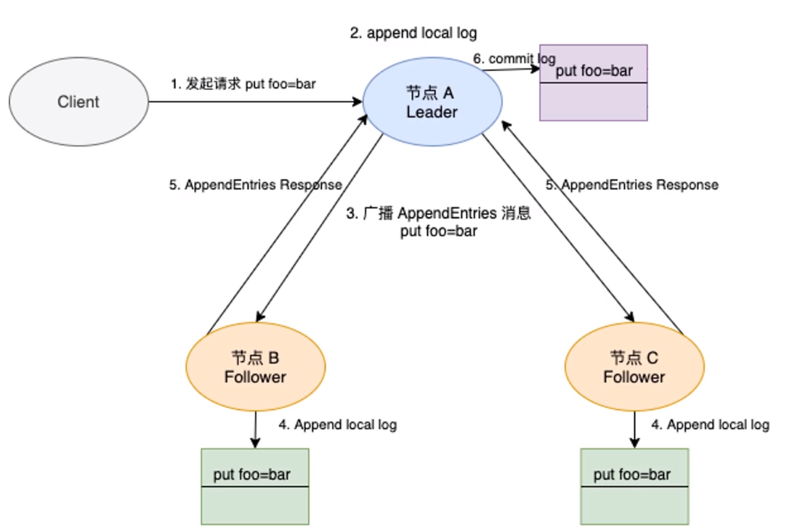


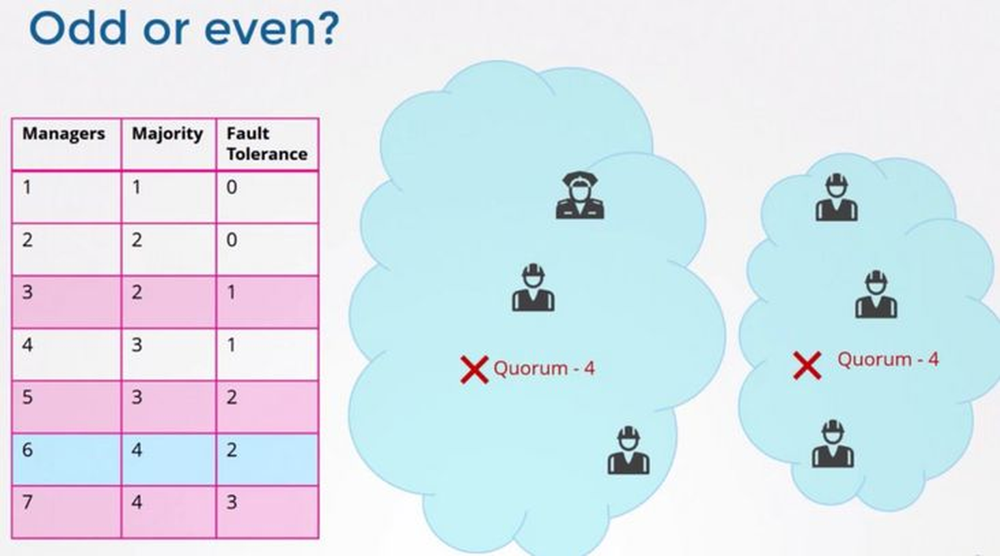

### 2.2 保存并检查快照

从健康成员保存快照，命令结束后检查文件大小、哈希、快照状态与备份存储中的副本。不能仅复制运行中的 `member` 数据目录代替一致性快照。

```bash
etcdctl \
  --endpoints=https://127.0.0.1:2379 \
  --cacert=/etc/kubernetes/pki/etcd/ca.crt \
  --cert=/etc/kubernetes/pki/etcd/healthcheck-client.crt \
  --key=/etc/kubernetes/pki/etcd/healthcheck-client.key \
  snapshot save /backup/etcd-2026-10-19.db

etcdutl snapshot status /backup/etcd-2026-10-19.db --write-out=table
```

### 2.3 恢复原则

恢复是控制面级操作，先保留现有数据与静态 Pod 清单的副本，再停止会继续写入旧状态的组件。按当前拓扑为每个 etcd 成员分别从**同一份快照**恢复到新的数据目录，并正确填写成员名、初始集群映射与 Peer URL；随后让 etcd 指向新目录，启动并确认多数派健康，最后恢复 API Server、控制器与调度器。不能把单节点的 `snapshot restore` 结果直接复制成所有成员的数据目录，也不能混用旧成员数据。

```bash
etcdutl snapshot restore /backup/etcd-2026-10-19.db \
  --name=<当前成员名> \
  --data-dir=<新数据目录> \
  --initial-cluster=<成员名与PeerURL映射> \
  --initial-advertise-peer-urls=<当前成员PeerURL>
```

上面的尖括号是需要按真实拓扑填写的槽位，不是可直接执行的一键恢复命令。恢复后检查 `endpoint health`、`member list`、API Server 就绪、节点和关键工作负载，并处理快照时点之后创建/删除的卷与外部资源。若集群由 kubeasz 等部署工具管理，也应优先核对该工具为特定版本提供的备份/恢复流程，而不是把 kubeadm 路径套用过去。

## 3 Velero：资源与卷的备份

Velero 在集群中运行控制器和插件，通过 Kubernetes API 备份选定资源，并把备份元数据放入对象存储。它可以结合 CSI 快照或文件系统备份保护 Pod 卷，但**默认有资源备份并不等于所有 PVC 数据都已备份**。是否包含卷数据、使用哪种方式、备份可否跨集群恢复，取决于存储驱动、插件和安装参数。etcd 快照适合控制面整体恢复；Velero 更适合按命名空间、标签或资源选择备份与迁移，两者互补。

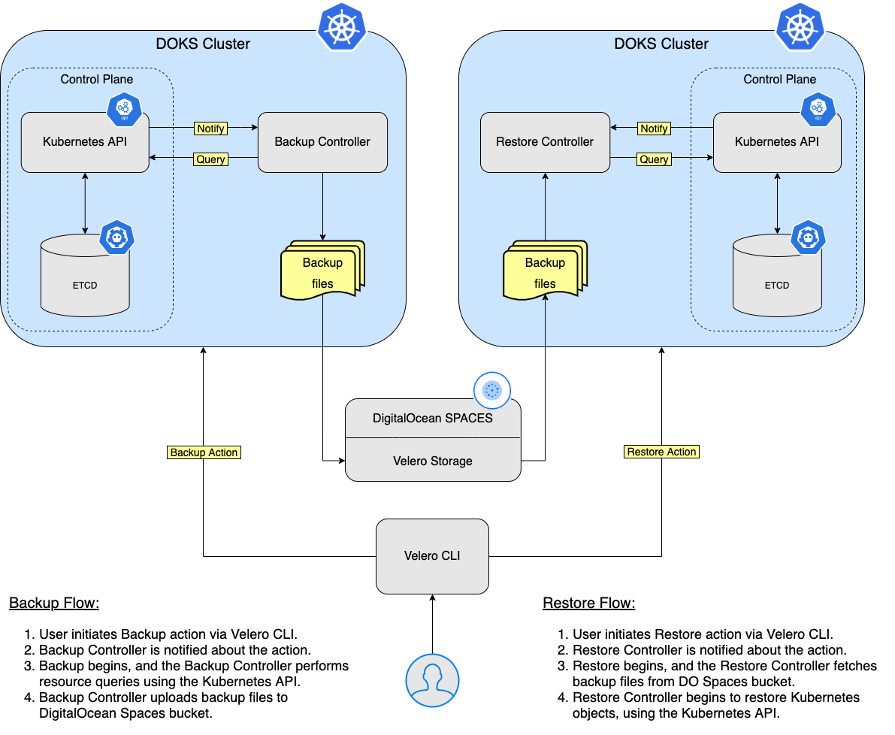

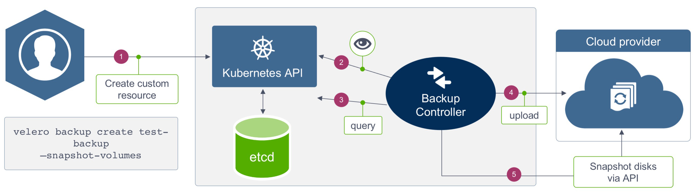

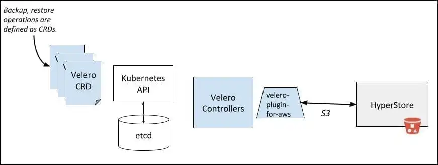

### 3.1 选择卷数据策略

**CSI 快照** 通常依赖存储系统的快照能力，创建速度快，但快照不一定天然位于独立故障域；是否能移动到另一集群要看后端及数据移动能力。**文件系统备份（FSB）** 借助节点代理读取 Pod 卷中的文件并写入备份存储，跨环境更灵活，但大数据量的耗时、一致性和文件权限需要评估。数据库应配合应用一致性手段，例如暂停写入、逻辑备份或存储快照前后钩子，不能仅凭文件复制推断事务一致。

先决定 BackupStorageLocation、卷快照位置或 FSB 仓库、保留策略与加密，再安装与当前 Kubernetes/Velero 版本相容的插件。MinIO 可提供 S3 兼容对象存储，但它自己也需要独立的备份和可用性设计。原实验把访问密钥直接写进命令和文档，这会扩大暴露范围；实际部署应使用受控凭据文件或秘密管理。

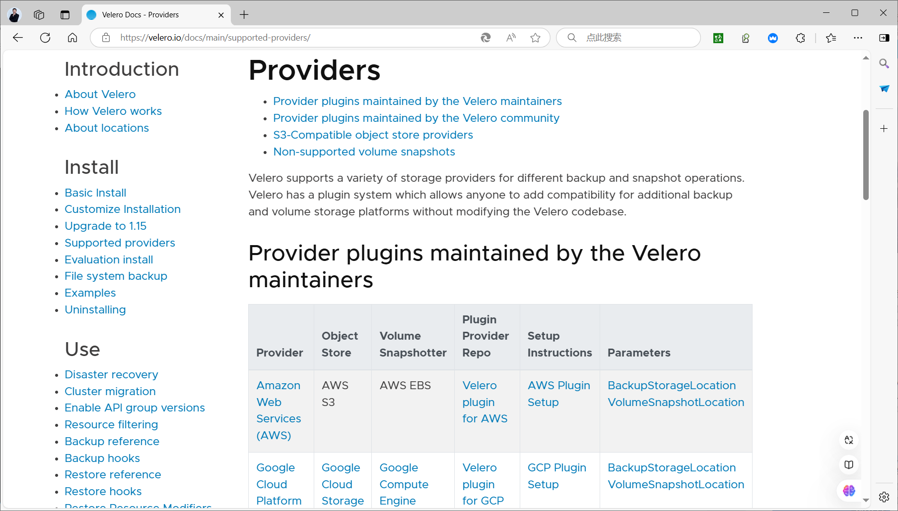

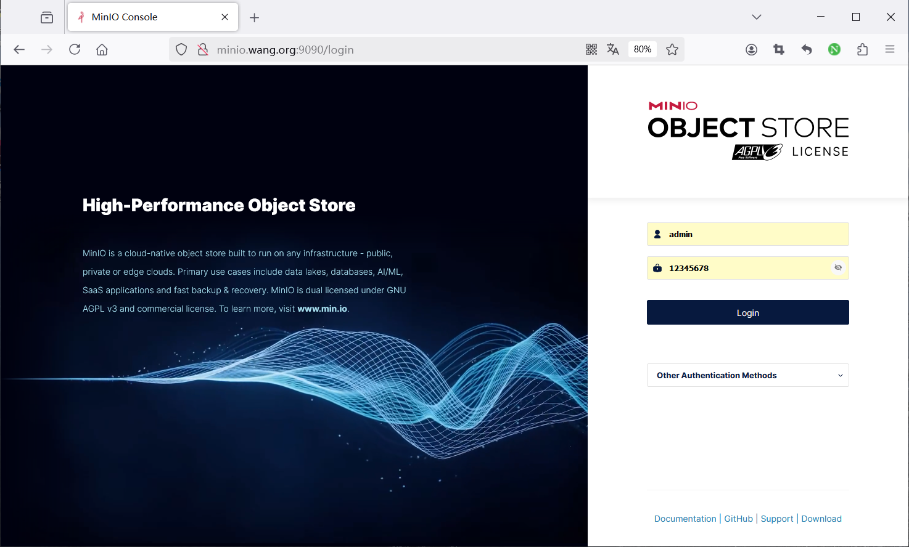

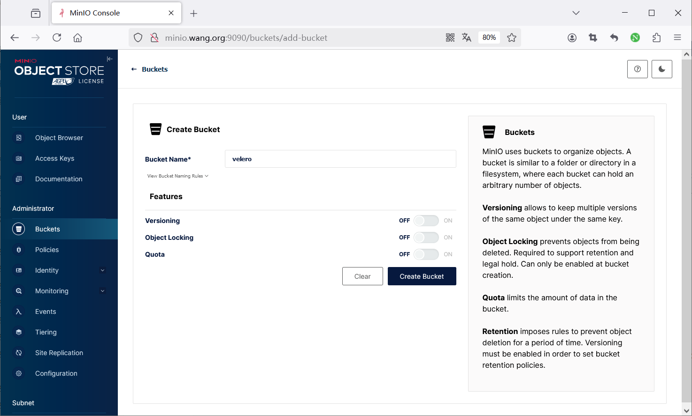

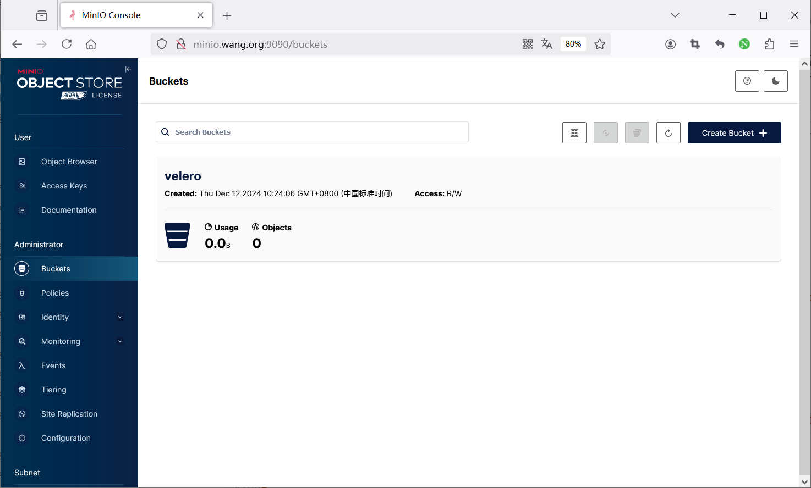

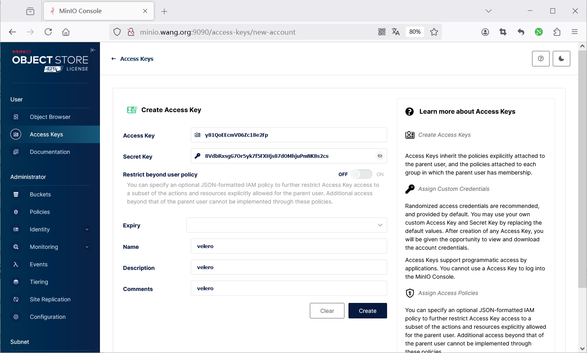

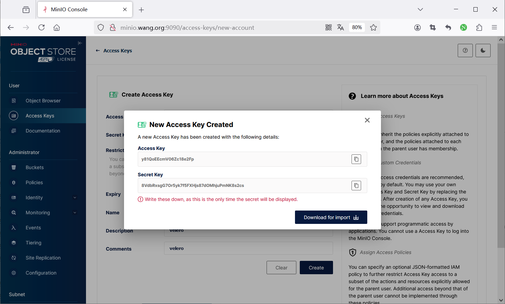

### 3.2 安装与一次可验证的备份

先核对 CLI、Server 和对象存储插件的版本兼容矩阵，再选用 Helm 或 `velero install`，不要混用不同年代的安装参数。以下命令展示 S3 兼容后端的配置形状；`<...>` 需要按部署环境填写，`credentials-velero` 必须存放在受限路径且不提交到仓库。

```bash
velero install \
  --provider aws \
  --plugins velero/velero-plugin-for-aws:<兼容版本> \
  --bucket <备份Bucket> \
  --secret-file ./credentials-velero \
  --backup-location-config \
    region=<区域>,s3ForcePathStyle=true,s3Url=https://<对象存储地址> \
  --use-volume-snapshots=false \
  --use-node-agent

kubectl get pods -n velero
velero backup-location get
```

如果选择 CSI 快照，应按对应驱动和插件配置卷快照位置，而非照抄上面关闭快照的示例。创建一次限定命名空间的备份，并明确是否包含文件系统卷数据：

```bash
velero backup create app-backup \
  --include-namespaces app \
  --default-volumes-to-fs-backup \
  --wait
velero backup describe app-backup --details
velero backup logs app-backup
```

核对备份中的资源数量、卷备份结果、错误和警告，再在备份存储中确认对象存在。对不支持 FSB 的卷或不运行在 Pod 中的数据，应另行设计快照或数据库备份。定期任务可用 Velero Schedule，但应先通过一次手动恢复再设定频率和保留期。

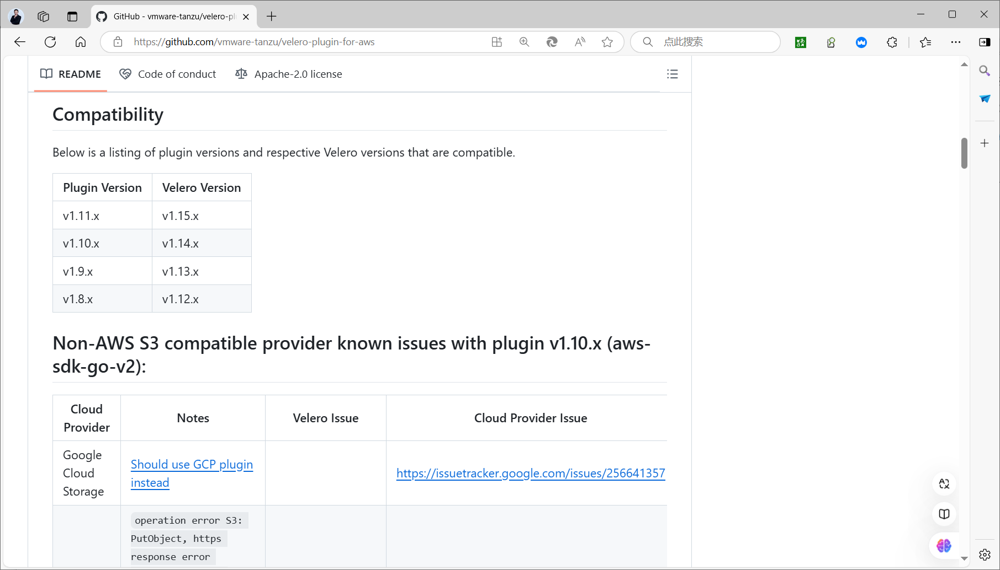

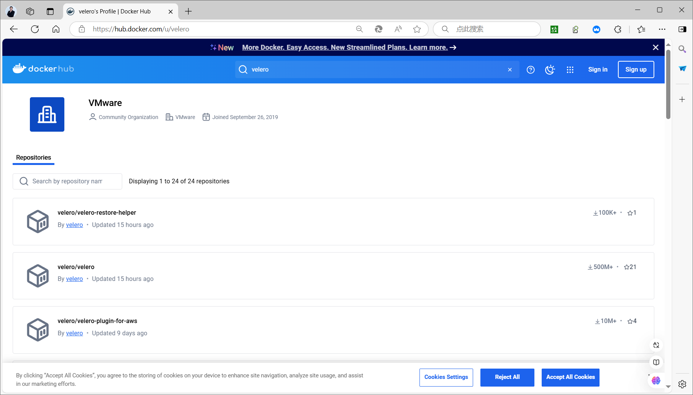

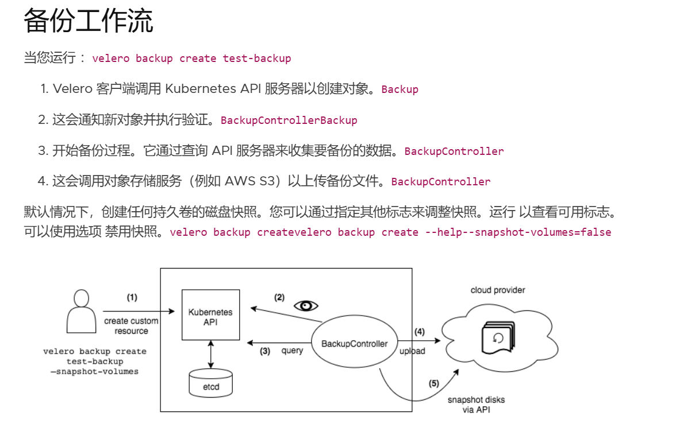

## 4 恢复演练与跨集群迁移

### 4.1 在隔离环境中恢复

恢复演练先建立空的测试命名空间或测试集群，核对目标集群的 CRD、StorageClass、CSI 驱动、镜像拉取凭据及对象存储访问。还原前明确已有同名资源的处理方式：Velero 通常不会简单覆盖已有对象，所以“恢复成功”不等于运行中的配置已经回滚。若要覆盖，先按变更流程停写、备份当前状态并清理冲突资源。

```bash
velero backup get
velero restore create app-restore --from-backup app-backup --wait
velero restore describe app-restore --details
velero restore logs app-restore
kubectl get pods,pvc -n app
```

完成后检查 PVC 已绑定、Pod 就绪、服务入口可访问、数据库或文件中的测试记录正确，且恢复时点符合 RPO。尤其要对比业务数据，而不是只看对象数量。若后端卷从快照恢复，原存储系统与目标集群的快照能力必须匹配。


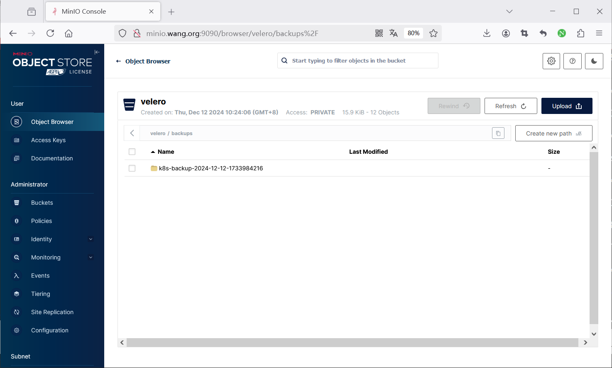

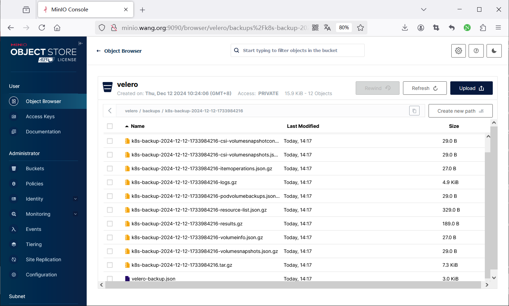

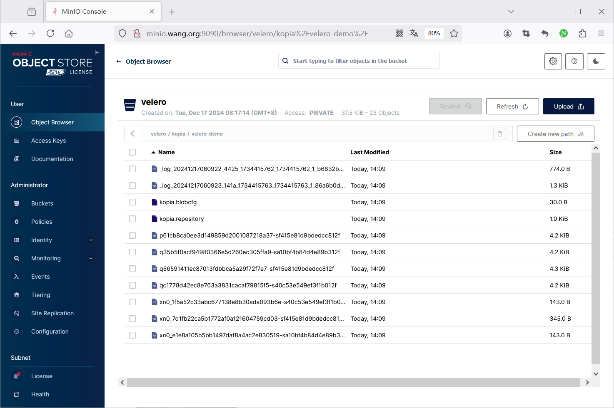


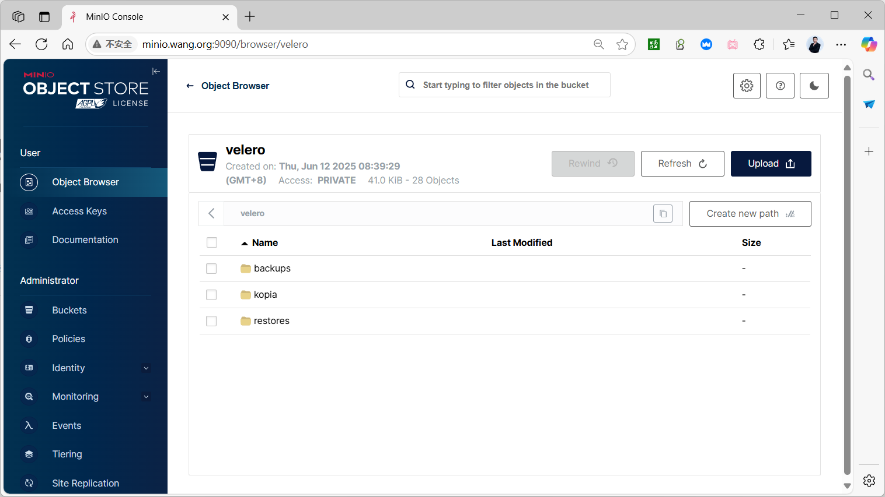


### 4.2 跨集群迁移

源集群先完成一次可验证的备份，将对象和卷数据放在目标集群可读取的独立存储位置。目标集群安装兼容版本的 Velero、相同或可映射的 CRD 与存储驱动，配置 BackupStorageLocation 指向同一备份库，再检查备份列表并恢复。不要直接把源集群的节点 IP、集群证书、StorageClass 名称和私有镜像凭据原样带到新集群；这些环境依赖要逐项映射。切流前做增量数据同步或停写窗口，最后用业务检查与回滚计划收尾。

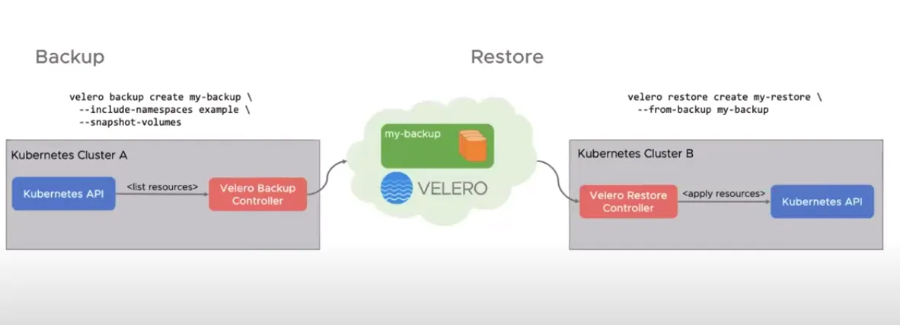

### 4.3 演练判定

一次演练至少记录备份时间、快照或文件备份范围、恢复开始与完成时间、数据最后写入时间、失败对象、业务请求验证和实际 RPO/RTO。只有这些证据都可复现，备份策略才算具备可恢复性。



<nav class="article-end" aria-label="章节导航">
  <a href="{{ '/subjects/Kubernetes/33-cluster-nodes.html' | relative_url }}">← 上一篇：集群节点管理</a>
  <a href="{{ '/subjects/Kubernetes/' | relative_url }}">返回 Kubernetes 目录</a>
  <a href="{{ '/subjects/Kubernetes/35-certificates.html' | relative_url }}">下一篇：证书续期与故障处理 →</a>
</nav>
