[← 返回 Kubernetes 目录]({{ '/subjects/Kubernetes/' | relative_url }})



# 34 集群备份、恢复与迁移

# 2 Kubernetes 备份和还原

## 2.1 Kubernetes 集群的容灾架构与方案
```text
https://help.aliyun.com/zh/ack/distributed-cloud-container-platform-for-kubernetes/use-cases/disaster-recovery-architecture-and-scheme-based-on-kubernetes-container-cluster?spm=a2c4g.11186623.help-menu-85222.d_3_2_0.d67169eejnjqVX
```

在进行系统架构设计时，必须考虑到信息系统和基础设施可能遇到的各种潜在威胁，例如：硬件故障、软件系统崩溃、人为操作失误、安全攻击、自然灾害等。为了确保Kubernetes集群系统能够在各种异常故障场景下快速恢复并保持业务连续性，必须为系统设计一套完善的容灾方案。

### 2.1.1 容灾目标

Disaster

Recovery Point (RPO)Recovery Time (RTO)

Time

Data Loss Downtime

Recovery time objective（RTO）：服务中断与服务恢复之间可接受的最大延迟时间。决定服务停机的可接受时长。Recovery point objective（RPO）：自上一个数据恢复点以来可接受的最大时间量。决定可接受的数据最大丢失量或重建。对于RTO和RPO来说，数值越低表示服务停机的时间和数据丢失量越少，但是越低的RTO和RPO意味着资源成本和运维复性越高。因此，您需要考虑实际业务成本及运维成本制定适当的RTO和RPO。

### 2.1.2 容灾策略

#### 2.1.2.1 策略概述

备份与恢复模式Backup & Restore

双活模式Active-Active主备模式Active-Standby

**PRO/RTO**：小时PRO/RTO：分钟PRO/RTO：实时

重要性低的应用在灾难发生后创建资源

重要性高的应用数据同步使用小规模资源运行。

业务核心关键应用业务无损失，无数据丢失。

并恢复应用与数据

Standby应用

成本高

成本低

在灾难发生后扩容

**资源运行应用**：如上图所示，提供了三种常见的容灾策略：备份与恢复、主备、双活。不同容灾策略的成本和收益均有所差异，您需要根据业务的重要性、数据丢失风险、可投入成本等进行综合评估，选择合适的容灾策略。

#### 2.1.2.2 备份与恢复（Backup-Restore）

User

User

Location 1 Location 2

Location 1 Location 2

Application

Application

Application

Data

Data

Data

Backup

Restore

灾难发生（恢复）

系统正常运行（备份）

如上图所示，在备份与恢复模式下，系统运行时会备份应用和数据，故障或灾难发生时，系统会将备份的应用和数据在另一地点进行恢复，并切换业务流量。由于数据无法实时备份，在恢复数据时会有一定的数据丢失，并且如果数据量较大时，恢复时间可能较长。

#### 2.2.2.3 主备（Active-Standby）

User

User

Location 1 Location 2

Location 1 Location 2

Application

Application

Application

Application

Application

Application

Application

Application

Application

Application

Database

Database

Database Secondary

Primary

Database Secondary

Primary

系统正常运行

灾难发生（切换）

如上图所示，在主备容灾模式下，主Location处理所有的业务流量，备用Location可以启动较少的应用实例以节省成本，并周期性发送测试流量以验证系统有效性。在故障或灾难发生时，系统进行数据库主备切换，扩容备用Location中的应用实例数量，并将业务流量切换到备用Location上。

#### 2.2.2.4 双活（Active-Active）

User

User

Location 1 Location 2

Location 1 Location 2

Application

Application

Application

Application

Application

Application

Application

Application

Application

Application

Application

Application

Database

Database

Database Secondary Database Secondary

Primary

Primary

系统正常运行

灾难发生（切换）

如上图所示，在双活容灾模式下，两个Location启动相同的应用实例数，同时处理业务流量。在故障或灾难发生时，系统进行数据库主备切换，并将业务流量全部切换到正常的Location上。常见的两地三中心容灾模型, 比如: 阿里巴巴部分核心业务系统。

方案说明：

以杭州的两个同城数据中心构建双活体系，通过自研的分布式存储和数据库同步技术，实现数据的实时同步以及应用的灵活调度，让业务可以在两个中心均衡运行。异地灾备中心选择在其他地区，依靠先进的异步复制和数据一致性校验等手段，确保关键业务数据能在异地有可靠备份和可恢复性，像淘宝、天猫的交易数据、商家信息等都是重点保障对象。

应用场景：

在面对电商大促等超高并发业务场景以及偶发的机房制冷故障等意外情况时，同城双活中心能够高效协同，分担流量压力，保障购物流程顺畅进行，消费者下单、支付、查询订单等操作不受影响。而异地灾备中心也为数据安全上了一道坚固的保险，万一出现极端的区域性灾难，能迅速恢复业务数据，重启关键业务运营，维持庞大的电商生态正常运转。

## 2.2 Kubernetes 备份还原说明

在 Kubernetes 中，备份和还原是一个重要的操作，尤其是在生产环境中，确保集群状态的持久性和可恢复性至关重要。

Kubernetes 的备份和还原可以通过多种方式实现，具体取决于你想要备份的内容。以下是常见的备份和还原方法：

### 2.2.1 备份和还原的内容

在 Kubernetes 中，需要备份的内容主要包括以下几部分：

**集群资源**：如 Deployment、Service、ConfigMap、Secret、PersistentVolumeClaim 等。ETCD 数据库：Kubernetes 集群的状态存储在 ETCD 中，备份 ETCD 可以恢复整个集群的状态。持久化存储数据：如 PersistentVolume 中的数据。

根据你的需求，可以选择备份部分或全部内容。

### 2.2.2 备份和还原方法

#### 2.2.2.1 方法 1：备份 Kubernetes 资源

如果你只需要备份 Kubernetes 的资源（如 Deployment、Service、ConfigMap 等），可以使用kubectl 导出资源。

**备份 Kubernetes 资源**

1. 导出所有命名空间资源：使用以下命令导出所有命名空间中的常见的资源。
```text
kubectl get all --all-namespaces -o yaml > all-resources.yaml
```

2. 导出特定命名空间资源：如果只需要备份特定命名空间的常见的资源，可以指定命名空间。
```text
kubectl get all -n <namespace> -o yaml > namespace-resources.yaml
```

3. 备份 Secrets 和 ConfigMaps：备份 Secrets 和 ConfigMaps 时需要特别注意，因为它们可能包含敏感信息。
```text
kubectl get secrets,configmaps -n <namespace> -o yaml > secrets-
configmaps.yaml
```

**还原 Kubernetes 资源**

1. 创建命名空间（如果需要）：在还原资源之前，确保目标命名空间存在。
```text
kubectl create namespace <namespace>
```

2. 应用资源：使用 kubectl apply 命令还原资源。
```text
kubectl apply -f all-resources.yaml
```

#### 2.2.2.2 方法 2：备份 ETCD

ETCD 是 Kubernetes 的核心存储组件，存储了集群的所有状态信息。备份 ETCD 是最彻底的备份方式，可以恢复整个集群的状态。

**备份 ETCD**

1. 检查 ETCD 配置：确保你能够访问 ETCD 集群，并获取 ETCD 的配置信息（如证书、端口等）。
```text
kubectl get pods -n kube-system -l component=etcd
```

2. 使用 etcdctl 备份 ETCD：使用 etcdctl 工具备份 ETCD 数据。
```text
ETCDCTL_API=3 etcdctl --endpoints=https://127.0.0.1:2379 \
--cacert=/etc/kubernetes/pki/etcd/ca.crt \
--cert=/etc/kubernetes/pki/etcd/server.crt \
--key=/etc/kubernetes/pki/etcd/server.key \
snapshot save /backup/etcd-snapshot.db
```

这会生成一个快照文件 /backup/etcd-snapshot.db 。

3. 验证备份：使用以下命令验证备份文件的完整性。
```text
ETCDCTL_API=3 etcdctl --write-out=table snapshot status /backup/etcd-
snapshot.db
```

**还原 ETCD**

1. 停止 Kubernetes API Server：在还原 ETCD 之前，需要停止 Kubernetes API Server，以确保集群状态不会被修改。
```bash
systemctl stop kubelet
docker stop $(docker ps -q --filter name=k8s_kube-apiserver)
```

2. 还原 ETCD 数据：使用 etcdctl 还原 ETCD 数据。
```text
ETCDCTL_API=3 etcdctl snapshot restore /backup/etcd-snapshot.db \
--data-dir=/var/lib/etcd-restore
```

3. 更新 ETCD 配置：将还原后的数据目录配置到 ETCD 的启动参数中。
```text
--data-dir=/var/lib/etcd-restore
```

4. 启动 Kubernetes API Server：启动 Kubernetes API Server 和 kubelet。
```bash
systemctl start kubelet
docker start $(docker ps -a -q --filter name=k8s_kube-apiserver)
```

#### 2.2.2.3 方法 3：备份持久化存储数据

如果你的应用依赖 PersistentVolume（PV）和 PersistentVolumeClaim（PVC），还需要备份持久化存储中的数据。

**备份持久化存储数据**

1. 找到 PVC 对应的 PV：使用以下命令找到 PVC 对应的 PV。
```bash
kubectl get pvc -n <namespace>
kubectl get pv <pv-name>
```

2. 备份数据：使用工具（如 rsync 或 tar ）备份 PV 中的数据。
```text
rsync -av /mnt/data /backup/data
```

**还原持久化存储数据**

1. 创建新的 PV 和 PVC：在目标集群中创建新的 PV 和 PVC。
```bash
kubectl apply -f new-pv.yaml
kubectl apply -f new-pvc.yaml
```

2. 恢复数据：将备份的数据恢复到新的 PV 中。
```text
rsync -av /backup/data /mnt/data
```

#### 2.2.2.4 方法 4：使用工具自动化备份

为了简化备份和还原过程，可以使用一些开源工具，如：

**Velero**：一个 Kubernetes 备份和还原工具，支持备份资源和持久化存储数据。Stash：一个 Kubernetes 的备份工具，专注于备份应用数据。

**使用 Velero 备份和还原**

1. 安装 Velero：下载并安装 Velero CLI。
```bash
wget https://github.com/vmware-tanzu/velero/releases/download/v1.10.0/velero-v1.10.0-linux-amd64.tar.gz
tar -xvf velero-v1.10.0-linux-amd64.tar.gz
sudo mv velero-v1.10.0-linux-amd64/velero /usr/local/bin/
```

2. 配置 Velero：配置 Velero 与云存储（如 AWS S3、GCP Storage）集成。
```text
velero install --provider aws --bucket my-bucket --secret-file
./credentials-velero
```

3. 备份资源：使用 Velero 备份 Kubernetes 资源。
```text
velero backup create my-backup --include-namespaces my-namespace
```

4. 还原资源：使用 Velero 还原 Kubernetes 资源。
```text
velero restore create --from-backup my-backup
```

## 2.3  ETCD 备份和还原

### 2.3.1 ETCD 特性和原理

#### 2.3.1.1 ETCD 介绍


Etcd由CoreOS团队在2013年6月创建的一个开源的、高可用的分布式key-value 数据存储系统。Etcd 在 2018年底作为孵化项目加入CNCF,并于2020年11月成功毕业。

Etcd 的名字来源于 Unix 系统中的 /etc 目录，etcd 可以理解为 "etc distributed"，即“分布式的/etc”。它扩展了传统 /etc 目录的功能，使其能够在分布式环境中存储和管理配置信息。体现了它作为分布式配置存储的核心功能。Etcd 的设计理念是将传统的单机配置管理扩展到分布式环境中，为现代分布式系统提供高可用、一致性的配置管理解决方案。Etcd 可以用于配置共享和服务的注册发现以及一致性保障（如数据库选主、分布式锁等)。类似项目有zookeeper和consul。

Etcd 基于Raft协议开发,使用Go语言实现。

**官方网站**


- <https://etcd.io/>


**GitHub 网站**


- <https://github.com/etcd-io/etcd>


**官方文档**


- <https://etcd.io/docs/v3.5/>


**硬件要求**


- <https://etcd.io/docs/v3.5/op-guide/hardware/>


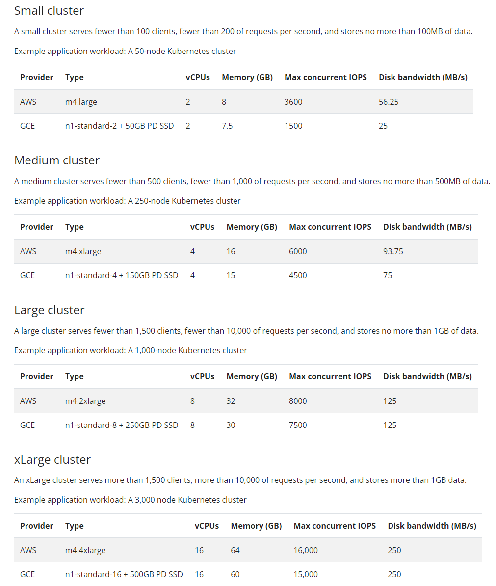

#### 2.3.1.2 ETCD 特性和应用场景

##### 2.3.1.2.1 ETCD 特性

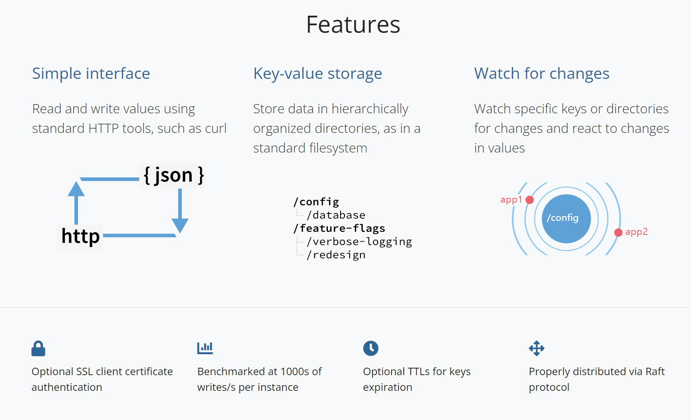

1. 简单接口：

curl 可访问的基于gRPC的用户的API（HTTP + JSON）。

2. 简单的键值对数据模型：以键值对（key-value）的形式来存储数据，

将数据存储在分层组织的目录中，就像在标准文件系统中一样。这种模型非常简洁直观，方便用户使用。无论是配置信息、服务发现中的相关记录，还是分布式锁等各种应用场景下的数据，都可以方便地以键值对的形式存入和取出。例如，在 Kubernetes 中，存储着众多关于集群资源（如 Pod、Service 等）的配置信息，以键值对的形式被 etcd 管理着。

3. 支持监听机制：客户端可以通过 Watch 机制来监听某个键或者键范围的变化情况。一旦相关键对应的数据发生改变（比如值被更新、键被删除等），客户端能及时收到通知，进而可以根据这些变化来触发相应的业务逻辑调整，这在实现配置自动更新、服务状态实时感知等场景中非常有用。

4. 安全可靠：支持 TLS（Transport Layer Security）加密通信，确保在网络传输过程中数据的保密性和完整性，防止数据被窃取或篡改。同时，还可以设置访问认证机制，通过用户名、密码或者基于证书等方式来限制对数据的访问权限，保障数据存储的安全性。

用于密钥过期的可选 TTL

5. 快速：

单实例每秒1000次写操作

6. 采用 Raft 实现数据分布：采用 Raft 一致性算法来保证在分布式环境下多个节点之间数据的强一致性。即使面对部分节点出现故障、网络分区等复杂情况，各个正常节点上存储的数据始终能保持一致，这使得基于 etcd 存储的数据在分布式集群的各个节点中都是可靠且同步的。

##### 2.3.1.2.2 应用场景

1. 键值对存储

ETCD是一个用于键值对存储的数据库。

2. 服务发现：在分布式系统中，众多服务实例会动态地启动、停止或者迁移，使用 etcd 可以帮助服务客户端快速准确地找到服务提供者的地址等相关信息。服务实例在启动时可以将自己的相关信息（如 IP 地址、端口、服务状态等）以键值对的形式注册到 etcd 中，而客户端通过查询 etcd 中对应的键值信息就能获取到服务的位置，实现服务的发现与调用，像微服务架构中的服务注册与发现场景经常会用到 etcd 来做这件事。

3. 配置管理：分布式系统往往有着复杂的配置，并且这些配置可能需要动态地调整和同步到各个相关节点。将配置文件内容以键值对拆分后存储在 etcd 中，各个节点上的应用程序可以从 etcd 获取配置信息并按照其来运行。而且当配置发生变化时，借助 Watch 机制，节点能及时得知变化并更新自身配置，实现配置的集中管理和动态更新，许多大规模分布式应用都会采用这种方式来管理配置。

4. 集群状态存储：对于像 Kubernetes 这样的大规模集群，需要一个地方来存储整个集群的各种状态信息，例如节点状态、Pod 状态、资源分配情况等。etcd 就充当了这个角色，它将这些关键的集群状态数据以键值对的形式安全可靠地存储起来，供集群内各个组件查询、更新以及依赖这些数据来协同工作，是保障集群正常运转的重要基础设施之一。

5. 消息发布订阅

ETCD可以保存生产者注册主题并发布该主题的消息,支持订阅者订阅主题,如何消息变化,则主动通知给该主题的订阅者。

6. 分布式锁：多个进程或者线程在分布式环境下可能需要争抢某些共享资源，这时可以利用 etcd 实现分布式锁机制。通过在 etcd 中创建特定的键值对来表示锁资源，不同的进程尝试去创建这个键值对，只有成功创建的那个进程相当于获取到了锁，可以操作对应的共享资源，操作完成后再删除该键值对来释放锁，从而保证在分布式场景下对共享资源访问的互斥性。

**与其他类似工具的比较**

与传统的关系数据库相比，etcd 更专注于分布式环境下简单、高效的数据存储和一致性保障，它不像关系数据库那样有着复杂的表结构、SQL 查询等功能，而是以轻量级的键值对形式服务于分布式系统的关键需求，更适合用于存储配置、状态等相对简洁的数据，并且在分布式一致性方面有专门的优化和优势。

与同样用于分布式存储的 Zookeeper 相比，虽然两者都能用于服务发现、分布式锁等场景，但 etcd 在使用的简易性、与容器生态（特别是 Kubernetes）的融合度以及性能等方面表现出色。例如，etcd 的API 相对更简洁易懂，而且由于其在 Kubernetes 中的广泛应用，已经成为容器编排领域存储关键数据的主流选择之一，而 Zookeeper 更多地在传统分布式系统场景中有着深厚的应用基础。

#### 2.3.1.3 ETCD 版本

etcd 目前有 V2.X 和 V3.X两个大版本。接口不一样、存储不一样，两个版本的数据互相隔离。

以下是 etcd 的 V2.X 和 V3.X 版本之间的主要区别：

数据模型

**V2.X**：使用平面键值存储，数据存储在一个简单的键值对空间中。键值存储类似于文件系统的结构，将键组织在一个扁平的命名空间中，使用目录来模拟层次结构，虽然可以使用 / 来分隔键，以模拟层次结构，但本质上是将所有键值对放在一个平面的存储区域内。为了模拟层次结构，它使用 / 字符在键中进行分隔，例如 /service/instance1 和/service/instance2 ，看起来像是有一个 /service 目录，但实际上并没有真正的目录概。

念，只是一种约定俗成的表示方法。存储的数据结构相对简单，适合于存储较小规模的数据，例如配置信息等。

**V3.X**：采用了分层的键值存储模型，引入了 Range 概念，表示键值对的范围，它允许存储和操作多个键值对的集合，而不是单个键值对。它将键值对组织成一个真正的层次结构，类似于文件系统的目录和文件，支持范围查询。例如，可以存储 /service/instance1 和 /service/instance2 ，并且可以对 /service 下的键值对进行范围查询，以查找该目录下的所有实例。存储的数据是基于多版本的键值存储，每个键可以存储多个历史版本的值，并且通过MVCC（多版本并发控制）来管理这些版本，提高了数据一致性和并发处理能力。更适合存储大规模数据，能够更好地处理复杂的数据存储和检索需求，例如分布式系统中的元数据存储。

API 设计

**V2.X**：提供了简单的 HTTP + JSON 的 API，使用 /v2/keys 作为核心 API 端点。支持基本的 CRUD（创建、读取、更新、删除）操作，操作相对简单直接，但对于复杂操作的支持有限。由于其 API 设计较为简单，对于一些高级功能的扩展能力有限，例如大规模的事务处理、复杂的检索和监控功能等。

**V3.X**：引入了新的 gRPC API，提供了更丰富和强大的功能。在 gRPC 中，使用 Protocol Buffers 作为消息格式，通过 HTTP/2 进行传输。HTTP/2 本身支持二进制数据传输，因此 gRPC 的数据传输是基于二进制的。由于使用二进制协议，gRPC 在性能方面具有优势，尤其在网络带宽和数据传输速度上。例如，对于相同的数据内容，gRPC 的消息大小可能比使用 JSON 表示的 REST API 小得多，因为二进制格式避免了文本表示的冗余字符和格式信息。可以通过 gRPC 流式传输，实现更高效的数据传输和实时监控，比如通过 Watch 服务可以实现对键值对变化的实时监听。支持批量操作、事务操作等高级特性，允许用户在一个事务中对多个键值对进行原子性的操作，增强了数据操作的可靠性和一致性。

性能和存储效率

**V2.X**：在处理大规模数据和高并发场景时性能可能会下降，因为其存储结构和 API 设计的限制。存储的数据可能会占用更多的空间，因为没有很好的历史数据管理机制，旧的数据不会自动清理，容易导致存储膨胀。对于长时间运行的集群，可能会出现性能瓶颈，特别是在集群节点数量较多或数据量较大时。

**V3.X**：性能上有显著提升，特别是在高并发读写、大数据量存储和复杂操作方面。MVCC 机制可以更好地管理存储，自动清理过期的版本，优化了存储资源的利用，减少了存储成本。能够更好地支持分布式系统中的大规模集群，提高了 etcd 在分布式环境下的稳定性和可靠性。

**安全特性**：**V2.X**：安全特性相对较弱，对于一些高级的安全需求支持不够完善。主要通过基本的 HTTP 认证和简单的 ACL（访问控制列表）来实现安全防护，但在复杂的网络环境和分布式环境下，这种安全防护可能不够充分。

**V3.X**：增强了安全特性，提供了更完善的认证和授权机制。支持 TLS 加密，保障数据传输的安全性，在分布式环境中可以更好地防止数据泄露和非法访问。

**功能特性**：**V2.X**：功能较为基础，主要侧重于键值存储和简单的分布式一致性服务，适用于一些简单的配置管理和服务发现场景。缺乏一些高级的分布式系统所需的功能，如复杂的分布式锁、分布式事务等。

**V3.X**：提供了更多的高级功能，例如分布式锁可以通过 etcd 的事务和键值存储特性更灵活地实现，同时支持租约机制，允许为键值对设置租约，当租约到期时自动删除键值对，可用于实现心跳和资源回收等功能。还可以实现线性一致性读，保证读取操作的一致性，对于分布式系统中的强一致性需求提供了更好的支持。

综上所述，V3.X 版本在多个方面对 V2.X 进行了改进和升级，使其更适合在大规模、高并发、复杂的分布式系统中作为核心的一致性存储和服务发现组件。然而，从 V2.X 升级到 V3.X 可能需要对使用 etcd 的应用程序进行一定的修改，因为 API 和数据模型都发生了变化。但这些修改是值得的，因为它可以带来更好的性能、更高的安全性和更强大的功能，为分布式系统的开发和维护带来更大的便利。

#### 2.3.1.4 ETCD 架构

##### 2.3.1.4.1 ETCD 相关术语

术语描述备注

Raft 算法，etcd

Raft

etcd 有 etcd-raft 模块

实现一致性的核心

Raft 算法会涉及多

Raft 中涉及多个节点,这些节点共同参与 Raft 算法的运行，确保数。

Node

据的一致性和可靠性。

个 Node节点实例

Cluster etcd 集群拥有多个 etcd Member

etcd 实例，管理

可处理客户端请求

着对应的

Member

Node 节点

同一个集群中的另

其他成员

Peer

一个Member

Raft 中的领导协调节点，用

Leader

Leader 节点协调整个集群

于处理数据提交

Follower Raft 中的

从属节点竞争 Leader 失败

Candidate候选节点当 Follower 接收 Leader 节点的消息超时会转变为 Candidate。

Client客户端向 etcd 发起请求的客户端

Term任期某个节点成为 Leader，到下一次竞选的时间。

Lease租期设置关键数据key的租期，过期删除。

在 etcd 中，watch 机制允许客户端订阅一个或多个键（key）或键范围（key range）的变化。 当这些被监控的键发生了任何修改操。

**Watch监测机制**：作（例如创建、更新、删除）时，etcd 会将这些事件推送给订阅了相应 watch 的客户端。

##### 2.3.1.4.2 ETCD 的核心组件

ETCD 分为下面部分

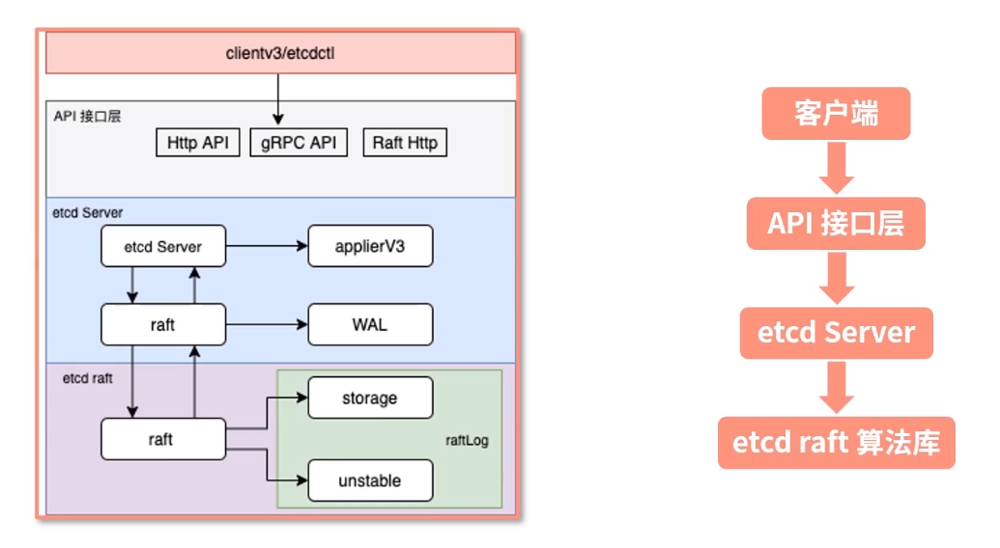

**层级相关内容**

包括 client v2 和 v3 两个大版本 API 客户端库，提供了简洁易用的 API，同时支持负载均。

客户

衡、节点间故障自动转移，可极大降低业务使用 etcd 复杂度，提升开发效率、服务可用。

端层

性。如 clientv3 库和 etcdctl 等工具

提供客户端访问服务端的通信协议和接口定义,以及服务端节点之间相互通信的协议客户端访问协议：client 访问 etcd server 的 API 分为 v2 和 v3 两个大版本。

API

v2 API 使用 HTTP/1.x 协议，v3 API 使用 gRPC 协议，同时 v3 通过 etcd grpc-gateway。

接口

组件也支持 HTTP/1.x 协议，便于各种语言的服务调用。

层

**节点间通信协议**：server 之间通信协议，是指节点间通过 Raft 算法实现数据复制和Leader 选举等功能时使用的 HTTP 协议。

业务

etcd 核心特性实现层，如典型的 KVServer 模块、MVCC 模块、Auth 鉴权模块、Lease。

逻辑

租约模块、Compactor 压缩模块等

层

etcd

Raft 算法层实现了 Leader 选举、日志复制、ReadIndex 等核心算法特性，用于保障。

Raft

etcd 多个节点间的数据一致性、提升服务可用性等，是 etcd 的基石和亮点。

层

用于处理 etcd 支持的各类功能的事务，包括数据索引、节点状态变更、监控与反馈、事。

etcd

件处理与执行等等，是 etcd 对用户提供的大多数 API 功能的具体实现。

存储

实现了快照、预写式日志 WAL（Write Ahead Log）。

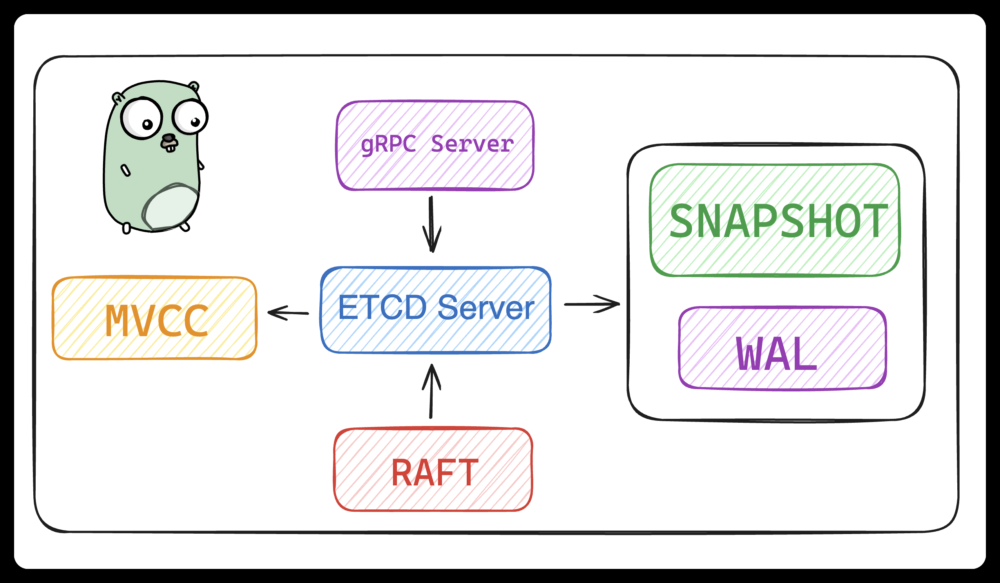

**Client**：etcdctl 或者其它客户端

gRPC Server：etcd与其他etcd节点之间的通信和信息的同步。

**ETCD Server**：对外接受和处理客户端的请求。

**Snapshot**：快照，以防WAL日志过多用于存储某一时刻etcd的所有数据。

**WAL**：Write Ahead Log（预写式日志），是 etcd 的数据存储方式。除了在内存中存有所有数据的状态以及节点的索引以外，etcd 就通过 WAL 进行持久化存储。WAL 中，所有的数据提交前都会事先记录日志。Snapshot 是为了防止数据过多而进行的状态快照；Entry 表示存储的具体日志内容。

**Raft**：负责Leader的选举和数据一致性算法。

**MVCC**：多版本控制，etcd的键值对的每一次操作行为都会被记录存储。这些数据底层存储在BoltDB数据库中。在 etcd 中，applier v3 是 etcd v3 版本中用于处理和应用事务操作的一个关键组件，在整个 etcd 系统的状态机实现里扮演重要角色。

**核心功能**

事务应用：负责接收并执行来自 etcd 集群中各个节点的事务请求。这些事务请求可以包含一系列的操作，如创建、更新或删除键值对等。applier v3 会按照请求的顺序依次应用这些操作，确保etcd 的键值存储状态能够准确反映这些事务的结果。状态更新：在应用事务的过程中，applier v3 会相应地更新 etcd 的状态。这包括更新内存中的键值存储数据结构，以及可能涉及到的持久化存储（如 WAL 日志）的更新，以保证即使在节点故障后，数据也能恢复到正确的状态。

**工作原理**

请求接收：applier v3 从 etcd 的网络层接收客户端或其他节点发来的事务请求。这些请求首先会经过一定的验证和预处理，确保请求格式正确且符合 etcd 的协议规范。操作执行：对于每个事务请求，applier v3 会解析其中包含的具体操作。例如，如果是一个写操作，它会在 etcd 的键值存储中更新相应的键值对；如果是读操作，它会从键值存储中检索并返回所需的数据。在执行操作的过程中，applier v3 会遵循 etcd 的一致性协议（如 Raft）来保证数据的一致性和正确性。事件发布：在操作执行完成后，applier v3 可能会发布一些事件，通知其他组件（如 Watcher机制）有相关的状态变化。这使得客户端能够及时了解到 etcd 中键值对的变更情况。

**与其他组件的协作**

Raft 模块：applier v3 与 etcd 的 Raft 模块紧密协作。Raft 模块负责在集群节点间达成一致性，确定事务请求的执行顺序。applier v3 则在 Raft 确定了顺序后，实际应用这些事务。例如，当一个新的 Raft 日志条目被提交时，applier v3 会根据日志条目中记录的事务操作来更新etcd 的状态。存储模块：applier v3 依赖 etcd 的存储模块来持久化数据。在应用事务操作后，它会与存储模块交互，将状态变化写入 WAL 日志和快照文件。同时，在 etcd 启动或恢复过程中，applier v3会从存储模块加载数据，重建键值存储的状态。

#### 2.3.1.5 ETCD工作原理

##### 2.3.1.5.1 如何选举Leader节点

ETCD节点状态有三种

Leader 领导人：

领导者状态，选举出来的节点,所有数据提交都必须先提交到 Leader上。

Leader 处理所有的客户端请求，在通常情况下，系统中只有一个Leader 并且其他节点都是Follower。

基于Heartbeat Interval (默认100ms)定期发送心跳信息。

Follower 跟随者：

跟随者状态，该状态意味着选举结束

Follower 不会发送任何请求，只是简单地响应来自 Leader和Candidate 的请求。

如果一个客户端与 Follower 联系，那么 Follower 会把请求重定向至 Leader。

Candidate 候选人：

候选人状态，该状态意味着将进行一次新的选举,

如果 Follower 在一段时间Election Timeout (默认1s)内接收不到来自 Leader 的消息，那么它就会变成 Candidate 并发起一次选举。获得集群中大多数选票（超过 n/2+1）的候选人将成为新的Leader。

**选举流程**：针对 Etcd ，Raft 通过领导选举机制选举出一个 Leader，由它全权管理日志复制来实现一致性。

一个 Raft 集群包含若干个服务器节点，每一个节点都有一个唯一标识 ID。只有在 Candidate 或者 Follower 状态下的节点才有可能发起一个选举流程。


假设集群中有三个节点，集群节点启动之初节点中并没有被选举出的Leader。所有节点都以 Follower 角色启动,并随机生成自已的选举超时时间计时器 Timer,使用随机时间是为了防止同时参与选举导致无法过半数Raft算法使用随机Timer来初始化Leader选举流程。比如说在上面三个节点上都运行了计时器Timer（每个Timer的持续时间是随机的）率先完成了Timer的第一个节点，它就会向其他两个节点发送成为Leader的请求，其他节点接收到请求后会以投票回应如果在一个选举超时期间内，发起新的选举流程的节点得到了超过半数的节点投票，那么状态就切换到Leader状态,即第一个节点被选举为Leader。


成为Leader后，该节点会以固定时间间隔向其他节点发送通知，确保自己仍是Leader。有些情况下当Follower们收不到Leader的通知后，比如说Leader节点宕机或者失去了连接，其他节点会重复之前选举过程选举出新的Leader。

##### 2.3.1.5.2 Etcd 如何保证数据一致性


所有的分布式系统，都面临的一个问题是多个节点之间的数据共享问题，每个成员可以分别工作，但总是需要共享一些必须的信息，比如谁是 leader， 都有哪些成员，依赖任务之间的顺序协调等。所以分布式系统依赖一个可靠的共享存储服务，而 Etcd 就是这样一个服务。根据 CAP 理论,etcd 在满足网络分区容忍性的基础上，优先满足了一致性C，即使用CP模式。

Etcd Cluster 是一个分布式系统，由多个 Nodes 相互通信构成整体对外服务，每个 Node 都存储了完整的数据，并且通过 Raft 协议保证每个 Node 维护的数据是一致的。Etcd Cluster 中的每个 Node 都维护了一个状态机，并且任意时刻，Cluster 中只存在唯一的有效的主节点Leader Node。由 Leader 处理所有来自客户端写操作，通过 Raft 协议保证写操作对状态机的改动会可靠的同步到其他Follower Nodes。

ETCD 基于事务写入数据

事务隔离级别

未提交读(Read Uncommitted)

能够读取到其他事务中还未提交的数据，这可能会导致脏读的问题。

ETCD 默认不支持此级别

读已提交(Read Committed)

只能读取到已经提交的数据

即别的事务一提交,当前事务就能读取到被修改的数据

这可能导致不可重复读的问题

可重复读(Repeated Read)

一个事务中，同一个读操作在事务的任意时刻都能得到同样的结果。其他事务的提交操作对本事务不会产生影响。会产生幻读，即读取过程中，即使有其它提交的事务后续修改数据，仍只能读取到未修改前的旧数据。

串行化(SerializableSnapshot)

串行化执行事务，即一个事务的执行会阻塞其他事务。该隔离级别通过牺牲并发能力换取数据的安全，属于最高的隔离级别。

也是ETCD默认的隔离级别

##### 2.3.1.5.3 用户从集群中哪个节点读写数据

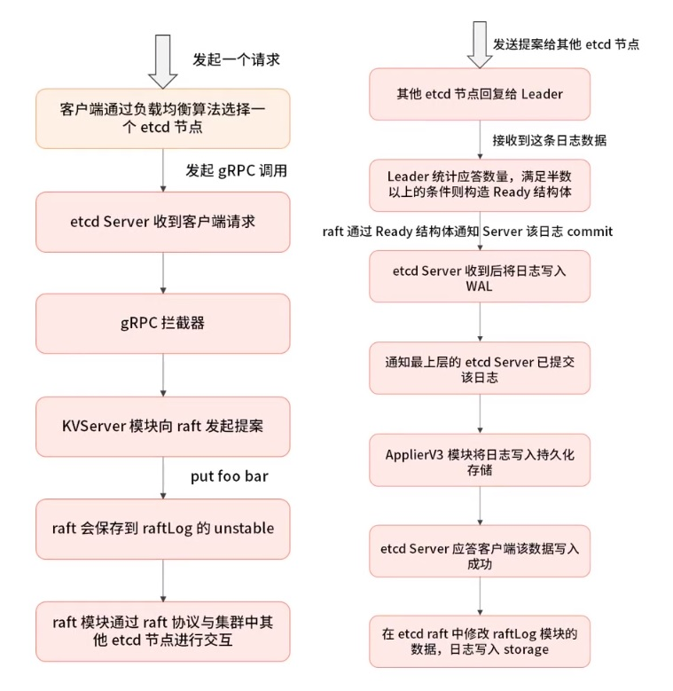

为了保证数据的强一致性，etcd集群中所有的数据流向都是一个方向，从 Leader （主节点）流向Follower，也就是所有 Follower 的数据必须与 Leader 保持一致，如果不一致会被覆盖。用户可以对etcd集群中的所有节点进行读写，读取非常简单因为每个节点保存的数据是强一致的。对于写入来说，etcd集群中的节点会选举出Leader节点，如果写入请求来自Leader节点即可直接写入然后Leader节点会把写入分发给所有Follower。如果客户端提交写入请求到其他Follower节点,那么会将写入请求会给转发给Leader节点，最终由Leader节点写入之后再分发给集群上的所有其他节点。下面的图示中1、3节点都有写入请求，节点1为Leader所以3的写入请求会转发给1，写入完成后再同步给所有节点。


##### 2.3.1.5.4 客户端发起写请求及集群节点处理流程

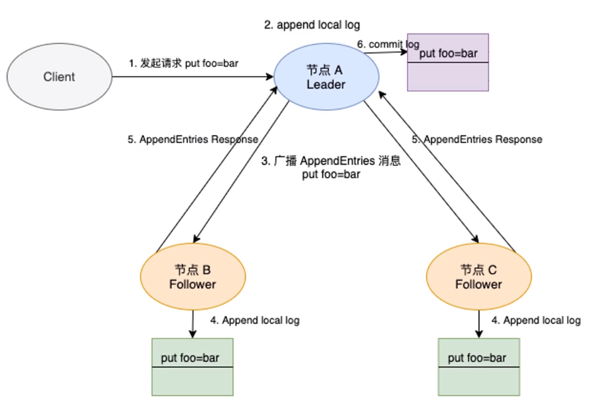

1. 客户端发起请求，请求内容为put foo=bar 。

2. 通过API接收请求,发现是写请求,转发请求给Leader,节点 A（作为 Leader）将请求内容put foo=bar 追加到本地日志（append local log）。

3. 节点 A 向其他节点（节点 B 和节点 C）广播AppendEntries 消息，消息内容为put foo=bar 。

4. 节点 B 和节点 C（均为 Follower）收到AppendEntries 消息后，将put foo=bar 追加到本地日志（Append local log）。

5. 节点 A 收到节点 B 和节点 C 的AppendEntries Response （即节点 B 和节点 C 告知节点 A 已成功追加日志）。

6. 节点 A 提交日志（commit log）

通过以上流程，确保了客户端的请求在 etcd 集群的多个节点间进行了同步和处理，实现了数据的一致性和可靠性。其中，Leader 节点负责协调和广播操作，Follower 节点接收并记录操作，最终共同完成数据的存储和处理。

##### 2.3.1.5.5 判断写入是否成功

etcd认为写入请求被Leader节点处理并分发给了多数节点后，就是一个成功的写入。如何界定多数节点呢？很简单，假设总结点数是N，那么界定多数节点的公式是  Quorum=N/2+1。

**关于节点数的最佳实践**

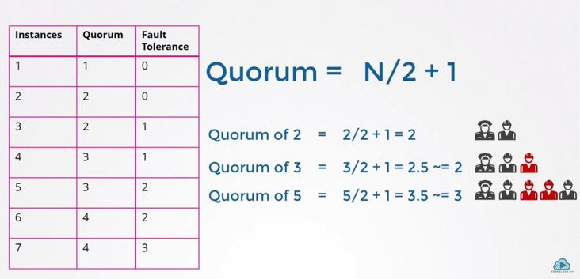

关于如何确定etcd集群应该有多少个节点的问题，上图的左侧的图表给出了集群中节点总数(Instances)对应的Quorum数量，用Instances减去Quorom就是集群中容错节点（允许出故障的节点）的数量。所以在集群中推荐的最少节点数量是3个，因为1和2个节点的容错节点数都是0，一旦有一个节点宕掉整个集群就不能正常工作了。当决定集群中节点的数量时，强烈推荐奇数数量的节点。

比如，6个节点的集群它的容错能力并没有比5个节点的好，他们的容错节点数一样，一旦容错节点超过2后，由于Quorum节点数小于4整个集群也变为不可用的状态了。

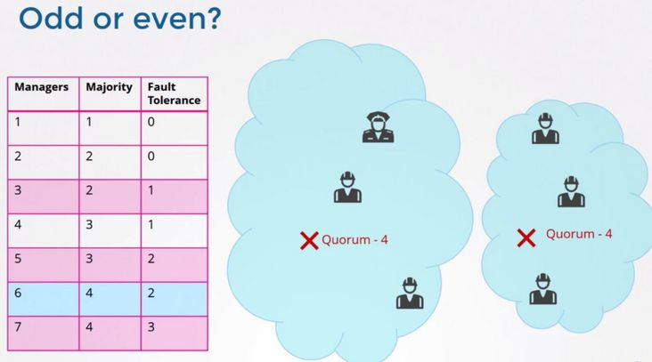

所以在决定集群中的节点数时，奇数要优于偶数。

#### 2.3.1.6 ETCD 访问

可以通过两种方式访问ETCD

通过 HTTP API接口直接访问 etcd通过 etcdctl客户端命令行操作和访问 etcd 中的数据。

### 2.3.2 etcdctl 工具

#### 2.3.2.1 etcdctl 和 etcdutl 工具安装

##### 2.3.2.1.1 范例: 包安装 etcdctl 工具：包安装的版本可能不被新的k8集群支持（不建议）
```sql
#查看K8s集群使用的当前ETCD版本
[root@master1 ~]#kubectl get pod -n kube-system      etcd-master1.bowen.org -o
yaml |grep image:
image: registry.aliyuncs.com/google_containers/etcd:3.6.4-0
image: registry.aliyuncs.com/google_containers/etcd:3.6.4-0
[root@master1 ~]#kubectl exec -n kube-system etcd-master1.bowen.org --
/usr/local/bin/etcd --version
etcd Version: 3.6.4
Git SHA: 5400cdc
Go Version: go1.23.11
Go OS/Arch: linux/amd64

#系统仓库内置的etcdctl工具版本和K8s的ETCD版本不一致
[root@ubuntu2404 ~]#apt update && apt -y install etcd-client
[root@ubuntu2404 ~]#etcdctl version: 3.4.30
API version: 3.4

[root@ubuntu2204 ~]#apt update && apt -y install etcd-client

[root@ubuntu2204 ~]#etcdctl version
etcdctl version: 3.3.25
API version: 2

#查看帮助
[root@ubuntu2204 ~]#etcdctl --help
NAME:
etcdctl - A simple command line client for etcd.

WARNING:
Environment variable ETCDCTL_API is not set; defaults to etcdctl v2.
Set environment variable ETCDCTL_API=3 to use v3 API or ETCDCTL_API=2 to use
v2 API.

USAGE:
etcdctl [global options] command [command options] [arguments...]

VERSION:
3.3.25

COMMANDS:
backup          backup an etcd directory
cluster-health  check the health of the etcd cluster
mk              make a new key with a given value
mkdir           make a new directory

rm              remove a key or a directory
rmdir           removes the key if it is an empty directory or a key-value
pair
get             retrieve the value of a key
ls              retrieve a directory
set             set the value of a key
setdir          create a new directory or update an existing directory TTL
update          update an existing key with a given value
updatedir       update an existing directory
watch           watch a key for changes
exec-watch      watch a key for changes and exec an executable
member          member add, remove and list subcommands
user            user add, grant and revoke subcommands
role            role add, grant and revoke subcommands
auth            overall auth controls
help, h         Shows a list of commands or help for one command
```


GLOBAL OPTIONS:--debug                          output cURL commands which can be used to reproduce the request--no-sync                        don't synchronize cluster information before sending request--output simple, -o simple       output response in the given format (simple,`extended` or `json`) (default: "simple")--discovery-srv value, -D value  domain name to query for SRV records describing cluster endpoints--insecure-discovery             accept insecure SRV records describing cluster endpoints--peers value, -C value          DEPRECATED - "--endpoints" should be used instead--endpoint value                 DEPRECATED - "--endpoints" should be used instead--endpoints value                a comma-delimited list of machine addresses in the cluster (default: "http://127.0.0.1:2379,http://127.0.0.1:4001")--cert-file value                identify HTTPS client using this SSL certificate file--key-file value                 identify HTTPS client using this SSL key file--ca-file value                  verify certificates of HTTPS-enabled servers using this CA bundle--username value, -u value       provide username[:password] and prompt if password is not supplied.--timeout value                  connection timeout per request (default: 2s)--total-timeout value            timeout for the command execution (except watch) (default: 5s)--help, -h                       show help--version, -v                    print the versio


##### 2.3.2.1.2 范例: 二进制安装


- <https://github.com/etcd-io/etcd/releases>


范例:
```bash
#查看K8s集群使用的当前ETCD版本

[root@master1 ~]#kubectl get pod -n kube-system      etcd-master1.bowen.org -o
yaml |grep image:
image: registry.aliyuncs.com/google_containers/etcd:3.6.4-0
image: registry.aliyuncs.com/google_containers/etcd:3.6.4-0
[root@master1 ~]#kubectl exec -n kube-system etcd-master1.bowen.org --
/usr/local/bin/etcd --version
etcd Version: 3.6.4
Git SHA: 5400cdc
Go Version: go1.23.11
Go OS/Arch: linux/amd64

#指定下载K8s的ETCD版本一致的etcdctl工具版本
[root@master1 ~]#ETCD_VER=v3.6.4
[root@master1 ~]#ETCD_VER=v3.5.17
# choose either URL
[root@master1 ~]#GITHUB_URL=https://github.com/etcd-io/etcd/releases/download
[root@master1 ~]#GOOGLE_URL=https://storage.googleapis.com/etcd
[root@master1 ~]#DOWNLOAD_URL=${GITHUB_URL}

#代理下载
[root@master1 ~]#curl -L
https://mirror.ghproxy.com/${DOWNLOAD_URL}/${ETCD_VER}/etcd-${ETCD_VER}-linux-amd64.tar.gz -o /tmp/etcd-${ETCD_VER}-linux-amd64.tar.gz

[root@master1 ~]#curl -L ${DOWNLOAD_URL}/${ETCD_VER}/etcd-${ETCD_VER}-linux-
amd64.tar.gz -o /tmp/etcd-${ETCD_VER}-linux-amd64.tar.gz

[root@master1 ~]#tar xf /tmp/etcd-v3.5.17-linux-amd64.tar.gz -C /srv
[root@master1 ~]#ls /srv
etcd-v3.5.17-linux-amd64

[root@master1 ~]#ls /srv/etcd-${ETCD_VER}-linux-amd64/
Documentation  etcd  etcdctl  etcdutl  README-etcdctl.md  README-etcdutl.md
README.md  READMEv2-etcdctl.md

#验证
#注意：k8s-1.34以后版本etcdutl替换etcdctl工具实现还原
[root@master1 ~]#/srv/etcd-${ETCD_VER}-linux-amd64/etcdutl version
etcdutl version: 3.6.4
API version: 3.6

[root@master1 ~]#/srv/etcd-${ETCD_VER}-linux-amd64/etcdctl version
etcdctl version: 3.5.17
API version: 3.5

[root@master1 ~]#/srv/etcd-${ETCD_VER}-linux-amd64/etcd --version
etcd Version: 3.5.17
Git SHA: 507c0de
Go Version: go1.22.9
Go OS/Arch: linux/amd64
```

##### 2.3.2.1.3 范例: 将k8s集群内置的etcd的Pod的etcdctl工具导出至宿主机实现安装
```bash
[root@master1 ~]#kubectl  exec -n kube-system etcd-master1.bowen.org --  etcdctl
version
etcdctl version: 3.5.16
API version: 3.5

[root@master1 ~]#kubectl exec -it -n kube-system etcd-master1.bowen.org --
/usr/local/bin/etcdctl version
etcdctl version: 3.5.16
API version: 3.5

[root@master1 ~]#docker ps |grep etcd
25eef883ea42   a9e7e6b294ba                                         "etcd --
advertise-cl…"   About an hour ago   Up About an hour             k8s_etcd_etcd-
master1.bowen.org_kube-system_cd477d4acc2ceff619110f6adc21fe4e_6
f4810caf0375   registry.aliyuncs.com/google_containers/pause:3.10   "/pause"
About an hour ago   Up About an hour             k8s_POD_etcd-
master1.bowen.org_kube-system_cd477d4acc2ceff619110f6adc21fe4e_7

[root@master1 ~]#docker inspect  k8s_etcd_etcd-master1.bowen.org_kube-
system_cd477d4acc2ceff619110f6adc21fe4e_10|grep MergedDir
"MergedDir":
"/var/lib/docker/overlay2/ee01b1cc7506c82bd985671506e0aec7d8bcc767695c5f3c05e839
335aa8eb0f/merged",

[root@master1 ~]#ls
/var/lib/docker/overlay2/ee01b1cc7506c82bd985671506e0aec7d8bcc767695c5f3c05e8393
35aa8eb0f/merged/usr/local/bin/ -l
total 142240
-r-xr-xr-x 1 root root 23621784 Sep 13 21:34 etcd
-r-xr-xr-x 1 root root 23963200 Sep 13 21:34 etcd-3.4.18
-r-xr-xr-x 1 root root 23621784 Sep 13 21:34 etcd-3.5.16
-r-xr-xr-x 1 root root 17899672 Sep 13 21:34 etcdctl
-r-xr-xr-x 1 root root 17657440 Sep 13 21:34 etcdctl-3.4.18
-r-xr-xr-x 1 root root 17899672 Sep 13 21:34 etcdctl-3.5.16
-r-xr-xr-x 1 root root 20963874 Sep 13 21:34 migrate
-r-xr-xr-x 1 root root      836 Sep 13 21:33 migrate-if-needed.sh

#将Pod的etcdctl复制到宿主机目录中
[root@master1 ~]#docker cp k8s_etcd_etcd-master1.bowen.org_kube-
system_cd477d4acc2ceff619110f6adc21fe4e_6:/usr/local/bin/etcdctl /usr/local/bin/
Successfully copied 17.9MB to /usr/local/bin/

[root@master1 ~]#ls -l  /usr/local/bin/etcdctl
-r-xr-xr-x 1 root root 17899672 Sep 13 21:34 /usr/local/bin/etcdctl

[root@master1 ~]#/usr/local/bin/etcdctl version
etcdctl version: 3.5.16
API version: 3.5

[root@master1 ~]#ldd /usr/local/bin/etcdctl
not a dynamic executable

[root@master1 ~]#which etcdctl

/usr/local/bin/etcdctl
```

#### 2.3.2.2 etcdctl 和 etcdutl  工具说明


- <https://kubernetes.io/docs/tasks/administer-cluster/configure-upgrade-etcd/>


etcdctl 是一个命令行工具，用于与 etcd 分布式键值存储系统进行交互。etcd 是一个高可用的分布式键值存储系统，通常用于配置共享和服务发现。etcdctl 提供了多种命令，允许用户读取、写入、删除键值对，以及执行其他管理操作。

注意：k8s-1.34以后版本的etcdutl 工具替代etcdctl实现还原功能。

相关环境变量

在使用 etcdctl 时，可以通过设置环境变量来指定 etcd 集群的地址和认证信息：

ETCD_API: 新版变量 指定ETCD的版本,支持2和3两个版本ETCDCTL_API : 指定ETCD的版本,支持2和3两个版本ETCDCTL_ENDPOINTS : 指定 etcd 集群的地址，多个地址用逗号分隔。ETCDCTL_CACERT : 指定 CA 证书文件路径。ETCDCTL_CERT : 指定客户端证书文件路径。ETCDCTL_KEY : 指定客户端私钥文件路径。

假设 etcd 集群的地址为 http://127.0.0.1:2379 ，可以通过以下命令设置环境变量：
```bash
export ETCDCTL_ENDPOINTS=http://127.0.0.1:2379
```

然后可以使用 etcdctl 命令与 etcd 集群进行交互。

**常用选项**

1. --endpoints

说明: 指定 etcd 集群的地址。示例: etcdctl --endpoints=http://127.0.0.1:2379 get /mykey环境变量: ETCDCTL_ENDPOINTS

2. --cacert

说明: 指定 CA 证书文件路径。示例: etcdctl --cacert=/path/to/ca.crt get /mykey环境变量: ETCDCTL_CACERT

3. --cert

说明: 指定客户端证书文件路径。示例: etcdctl --cert=/path/to/client.crt get /mykey环境变量: ETCDCTL_CERT

4. --key

说明: 指定客户端私钥文件路径。示例: etcdctl --key=/path/to/client.key get /mykey环境变量: ETCDCTL_KEY

5. --user

说明: 指定用户名和密码进行认证。

示例: etcdctl --user=username:password get /mykey

6. --write-out -w

说明: 指定输出格式，支持 simple 、json 、table 、protobuf 等。示例: etcdctl get /mykey --write-out=json| -w=json默认值: simple

7. --prefix

说明: 指定键的前缀，用于获取或删除多个键。示例: etcdctl get --prefix /my。

8. --keys-only

说明: 只输出键，不输出值。示例: etcdctl get --keys-only /mykey

9. --limit

说明: 限制返回的键值对数量。示例: etcdctl get --prefix /my --limit=10

10. --rev

说明: 指定键的历史版本。示例: etcdctl get /mykey --rev=123

11. --consistency

说明: 指定读取的一致性级别，支持 l （线性化）和 s （串行化）。示例: etcdctl get /mykey --consistency=l默认值: l

12. --timeout

说明: 指定操作的超时时间。示例: etcdctl get /mykey --timeout=5s

13. --debug

说明: 启用调试模式，输出详细的调试信息。示例: etcdctl --debug get /mykey。

示例

假设 etcd 集群的地址为 http://127.0.0.1:2379 ，并且需要使用客户端证书进行认证，可以通过以下命令进行操作：
```text
etcdctl --endpoints=http://127.0.0.1:2379 --cacert=/path/to/ca.crt --
cert=/path/to/client.crt --key=/path/to/client.key get /mykey --write-out=json
```

常用子命令：数据库操作和非数据操作。

命令描述

endpoint status打印指定 etcd 实例的状态信息

get获取键值对

help帮助命令

lease grant创建 leases

lease keep-alive刷新 leases

lease list罗列所有有效的 leases

lease revoke撤销 leases

lease timetolive获取 lease 信息

lock获取一个命名锁

make-mirror指定一个 etcd 集群作为镜像集群

member add增加一个成员到集群

member list列出集群的所有成员。

member promote提升集群中的一个 non - voting 成员

member remove移除集群中的成员。

member update更新集群中的成员信息

migrate迁移 v2 存储中的键值对到 MVCC 存储。

move- leader转移 etcd 集群的 leader 给另一个 etcd 成员

put写入键值对

role add增加一个角色

role delete删除一个角色

role get获取某个角色的详细信息。

role_grant-permission给某个角色授予 key

role list罗列所有的角色

role revoke-permission撤销一个角色的 key

snapshot restore恢复快照

snapshot save存储某一个 etcd 节点的快照文件至指定位置。

snapshot status获取指定文件的后端快照文件状态

txn Txn 在一个事务内处理所有的请求。

user add增加一个用户

user delete删除某个用户

命令描述

user get获取某个用户的详细信息。

user grant-role将某个角色授予某个用户。

user list列出所有的用户

user passwd更改某个用户的密码。

user revoke-role撤销某个用户的角色。

watch监测指定键或前缀的事件

version输出 etcdctl 的版本

1. 写入键值对
```text
etcdctl put <key> <value>
```

示例：etcdctl put /bowen/mykey "Hello, etcd"说明：将指定的键值对写入 etcd ,可以创建或修改指定的键

2. 读取键值对
```text
etcdctl get <key>
```

示例：etcdctl get --prefix /bowen/mykey说明：读取指定以mykey开头键的值。

3. 删除键值对
```text
etcdctl del <key>
```

示例：etcdctl del /bowen/mykey说明：删除指定键及其对应的值。

4. 监听键值变化
```text
etcdctl watch <key>
```

示例：etcdctl watch /bowen/mykey说明：监听指定键的变化，当键的值发生变化时，会输出变化的内容。

5. 列出所有键
```text
etcdctl get --prefix ""
```

示例：etcdctl get --prefix ""说明：列出 etcd 中存储的所有键。

6. 列出指定前缀的键
```text
etcdctl get --prefix <prefix>
```

示例：etcdctl get --prefix /my说明：列出所有以指定前缀开头的键。

7. 列出键的详细信息
```text
etcdctl get <key> --write-out=json
```

示例：etcdctl get /mykey --write-out=json说明：以 JSON 格式输出键的详细信息，包括创建版本、修改版本等。

8. 列出所有成员
```text
etcdctl member list
```

示例：etcdctl member list说明：列出 etcd 集群中的所有成员。

9. 检查集群健康状态
```text
etcdctl endpoint health
```

示例：etcdctl endpoint health说明：检查 etcd 集群的健康状态。

10. 备份数据
```text
etcdctl snapshot save <filename>
```

示例：etcdctl snapshot save backup.db说明：将 etcd 数据备份到指定的文件中。

11. 恢复数据
```text
etcdctl snapshot restore <filename>
```

示例：etcdctl snapshot restore backup.db说明：从备份文件中恢复 etcd 数据。

#### 2.3.2.3 etcdctl 使用案例

范例: kubeadm安装Kubernetes检查ETCD的服务状态
```bash
[root@master1 ~]#kubectl get po -n kube-system      etcd-master1.bowen.org -o
yaml|grep hostNetwork
hostNetwork: true

#查看健康性
#k8s-v1.34以后版本
[root@master1 ~]#ETCD_API=3 etcdctl --endpoints=https://127.0.0.1:2379  --
cacert=/etc/kubernetes/pki/etcd/ca.crt --cert=/etc/kubernetes/pki/etcd/server.crt
--key=/etc/kubernetes/pki/etcd/server.key  -w table endpoint health
+------------------------+--------+-------------+-------+
|        ENDPOINT        | HEALTH |    TOOK     | ERROR |
+------------------------+--------+-------------+-------+

| https://127.0.0.1:2379 |   true | 13.141134ms |       |
+------------------------+--------+-------------+-------+

#旧版
[root@master1 ~]#ETCDCTL_API=3 etcdctl --endpoints=https://127.0.0.1:2379  --
cacert=/etc/kubernetes/pki/etcd/ca.crt --cert=/etc/kubernetes/pki/etcd/server.crt
--key=/etc/kubernetes/pki/etcd/server.key  -w table endpoint health
+------------------------+--------+-----------+-------+
|        ENDPOINT        | HEALTH |   TOOK    | ERROR |
+------------------------+--------+-----------+-------+
| https://127.0.0.1:2379 |   true | 8.03693ms |       |
+------------------------+--------+-----------+-------+

#查看节点状态和leader角色
#k8s-v1.34以后版本
[root@master1 ~]#ETCD_API=3 etcdctl --endpoints=https://127.0.0.1:2379   --
cacert=/etc/kubernetes/pki/etcd/ca.crt --cert=/etc/kubernetes/pki/etcd/server.crt
--key=/etc/kubernetes/pki/etcd/server.key -w table  endpoint status

#旧版
[root@master1 ~]#ETCDCTL_API=3 etcdctl --endpoints=https://127.0.0.1:2379   --
cacert=/etc/kubernetes/pki/etcd/ca.crt --cert=/etc/kubernetes/pki/etcd/server.crt
--key=/etc/kubernetes/pki/etcd/server.key -w table  endpoint status
+------------------------+------------------+---------+---------+-----------+---
--------+------------+
|        ENDPOINT        |        ID        | VERSION | DB SIZE | IS LEADER |
RAFT TERM | RAFT INDEX |
+------------------------+------------------+---------+---------+-----------+---
--------+------------+
| https://127.0.0.1:2379 | 8e9e05c52164694d |  3.5.12 |   18 MB |      true |
2 |       4496 |
+------------------------+------------------+---------+---------+-----------+---
--------+------------+

#百看成员
#k8s-v1.34以后版本
[root@master1 ~]#ETCD_API=3 etcdctl --endpoints=https://127.0.0.1:2379   --
cacert=/etc/kubernetes/pki/etcd/ca.crt --cert=/etc/kubernetes/pki/etcd/server.crt
--key=/etc/kubernetes/pki/etcd/server.key  --write-out=table member list
+------------------+---------+------------------+-------------------------+-----
--------------------+------------+
|        ID        | STATUS  |       NAME       |       PEER ADDRS        |
CLIENT ADDRS       | IS LEARNER |
+------------------+---------+------------------+-------------------------+-----
--------------------+------------+
| 99c2fd4fe11e28d9 | started | master1.bowen.org | https://10.0.0.100:2380 |
https://10.0.0.100:2379 |      false |
+------------------+---------+------------------+-------------------------+-----
--------------------+------------+

#旧版
[root@master1 ~]#ETCDCTL_API=3 etcdctl --endpoints=https://127.0.0.1:2379   --
cacert=/etc/kubernetes/pki/etcd/ca.crt --cert=/etc/kubernetes/pki/etcd/server.crt
--key=/etc/kubernetes/pki/etcd/server.key  --write-out=table member list
+------------------+---------+------------------+-----------------------+-------
------------------+
|        ID        | STATUS  |       NAME       |      PEER ADDRS       |
CLIENT ADDRS       |

+------------------+---------+------------------+-----------------------+-------
------------------+
| 8e9e05c52164694d | started | master1.bowen.org | http://localhost:2380 |
https://10.0.0.200:2379 |
+------------------+---------+------------------+-----------------------+-------
------------------+

#对ETCD数据碎片整理
#k8s-v1.34以后版本
[root@master1 ~]#ETCD_API=3 etcdctl --endpoints=https://127.0.0.1:2379  --
cacert=/etc/kubernetes/pki/etcd/ca.crt --cert=/etc/kubernetes/pki/etcd/server.crt
--key=/etc/kubernetes/pki/etcd/server.key  defrag
Finished defragmenting etcd member[https://127.0.0.1:2379]. took 36.799765ms

#旧版
[root@master1 ~]#ETCDCTL_API=3 etcdctl --endpoints=https://127.0.0.1:2379  --
cacert=/etc/kubernetes/pki/etcd/ca.crt --cert=/etc/kubernetes/pki/etcd/server.crt
--key=/etc/kubernetes/pki/etcd/server.key  defrag
Finished defragmenting etcd member[https://127.0.0.1:2379]
```

范例: kubeadm安装Kubernetes数据操作
```bash
#查看ETCD的数据
[root@master1 ~]#ETCDCTL_API=3 etcdctl --endpoints=https://127.0.0.1:2379   --
cacert=/etc/kubernetes/pki/etcd/ca.crt --cert=/etc/kubernetes/pki/etcd/server.crt
--key=/etc/kubernetes/pki/etcd/server.key get / --keys-only --prefix
/registry/apiextensions.k8s.io/customresourcedefinitions/analysisruns.argoproj.i
o
/registry/apiextensions.k8s.io/customresourcedefinitions/analysistemplates.argop
roj.io
/registry/apiextensions.k8s.io/customresourcedefinitions/bfdprofiles.metallb.io
/registry/apiextensions.k8s.io/customresourcedefinitions/bgpadvertisements.metal
lb.io
/registry/apiextensions.k8s.io/customresourcedefinitions/bgpconfigurations.crd.p
rojectcalico.org
......

[root@master1 ~]#ETCDCTL_API=3 etcdctl --endpoints=https://127.0.0.1:2379   --
cacert=/etc/kubernetes/pki/etcd/ca.crt --cert=/etc/kubernetes/pki/etcd/server.crt
--key=/etc/kubernetes/pki/etcd/server.key get / --prefix --keys-only |grep -Ev
"^$"|head
/registry/apiextensions.k8s.io/customresourcedefinitions/volumesnapshotclasses.s
napshot.storage.k8s.io
/registry/apiextensions.k8s.io/customresourcedefinitions/volumesnapshotcontents.
snapshot.storage.k8s.io
/registry/apiextensions.k8s.io/customresourcedefinitions/volumesnapshots.snapsho
t.storage.k8s.io
/registry/apiregistration.k8s.io/apiservices/v1.
/registry/apiregistration.k8s.io/apiservices/v1.admissionregistration.k8s.io
/registry/apiregistration.k8s.io/apiservices/v1.apiextensions.k8s.io
/registry/apiregistration.k8s.io/apiservices/v1.apps
/registry/apiregistration.k8s.io/apiservices/v1.authentication.k8s.io
/registry/apiregistration.k8s.io/apiservices/v1.authorization.k8s.io
/registry/apiregistration.k8s.io/apiservices/v1.autoscaling

#ETCD写入,读取和删除数据

#创建和修改
[root@master1 ~]#ETCDCTL_API=3 etcdctl --endpoints=https://127.0.0.1:2379  --
cacert=/etc/kubernetes/pki/etcd/ca.crt --cert=/etc/kubernetes/pki/etcd/server.crt
--key=/etc/kubernetes/pki/etcd/server.key  put /name bowen
OK

#查看
[root@master1 ~]#ETCDCTL_API=3 etcdctl --endpoints=https://127.0.0.1:2379  --
cacert=/etc/kubernetes/pki/etcd/ca.crt --cert=/etc/kubernetes/pki/etcd/server.crt
--key=/etc/kubernetes/pki/etcd/server.key  get /name
/name
bowen

#删除
[root@master1 ~]#ETCDCTL_API=3 etcdctl --endpoints=https://127.0.0.1:2379  --
cacert=/etc/kubernetes/pki/etcd/ca.crt --cert=/etc/kubernetes/pki/etcd/server.crt
--key=/etc/kubernetes/pki/etcd/server.key  del /name
1

#确认数据删除
[root@master1 ~]#ETCDCTL_API=3 etcdctl --endpoints=https://127.0.0.1:2379  --
cacert=/etc/kubernetes/pki/etcd/ca.crt --cert=/etc/kubernetes/pki/etcd/server.crt
--key=/etc/kubernetes/pki/etcd/server.key  get /name
[root@master1 ~]#

#跟踪数据变化
[root@master1 ~]#ETCDCTL_API=3 etcdctl --endpoints=https://127.0.0.1:2379  --
cacert=/etc/kubernetes/pki/etcd/ca.crt --cert=/etc/kubernetes/pki/etcd/server.crt
--key=/etc/kubernetes/pki/etcd/server.key  watch /name
PUT
/name
bowen-v1
PUT
/name
bowen-v2

#打开另一个终端执行下面操作,观察上面的变化
[root@master1 ~]#ETCDCTL_API=3 etcdctl --endpoints=https://127.0.0.1:2379  --
cacert=/etc/kubernetes/pki/etcd/ca.crt --cert=/etc/kubernetes/pki/etcd/server.crt
--key=/etc/kubernetes/pki/etcd/server.key  put /name bowen-v1
OK
[root@master1 ~]#ETCDCTL_API=3 etcdctl --endpoints=https://127.0.0.1:2379  --
cacert=/etc/kubernetes/pki/etcd/ca.crt --cert=/etc/kubernetes/pki/etcd/server.crt
--key=/etc/kubernetes/pki/etcd/server.key  put /name bowen-v2
OK
```

范例: 二进制安装检查ETCD的服务状态
```bash
#二进制安装检查ETCD的服务状态
[root@master1~]#ETCD_IPS="10.0.0.101 10.0.0.102 10.0.0.103"
[root@master1~]#for i in $ETCD_IPS;do ETCDCTL_API=3 etcdctl --
endpoints=https://$i:2379 --cacert=/etc/kubernetes/ssl/ca.pem --
cert=/etc/kubernetes/ssl/etcd.pem --key=/etc/kubernetes/ssl/etcd-key.pem endpoint
health;done

https://10.0.0.101:3379 is healthy: successfully committed proposal: took =
18.367426ms

https://10.0.0.102:2379 is healthy: successfully committed proposal: took =
15.362120ms
https://10.0.0.103:2379 is healthy: successfully committed proposal: took =
16.896772ms

#二进制安装查看成员
[root@master1~]#ETCD_IPS="10.0.0.101 10.0.0.102 10.0.0.103"
[root@master1~]#for i in $ETCD_IPS;do ETCDCTL_API=3 etcdctl --
endpoints=https://$i:2379 --cacert=/etc/kubernetes/ssl/ca.pem --
cert=/etc/kubernetes/ssl/etcd.pem --key=/etc/kubernetes/ssl/etcd-key.pem--write-
out=table member list;done

#二进制安装查看成员详细状态
[root@master1~]#ETCD_IPS="10.0.0.101 10.0.0.102 10.0.0.103"
[root@master1~]#for i in $ETCD_IPS;do ETCDCTL_API=3 etcdctl --
endpoints=https://$i:2379 --cacert=/etc/kubernetes/ssl/ca.pem --
cert=/etc/kubernetes/ssl/etcd.pem --key=/etc/kubernetes/ssl/etcd-key.pem -w json
endpoint status;done

#二进制安装对ETCD数据碎片整理
[root@master1~]#ETCD_IPS="10.0.0.101 10.0.0.102 10.0.0.103"
[root@master1 ~]#for i in $ETCD_IPS;do ETCDCTL_API=3 etcdctl  --
endpoints=https://$i:2379 --cacert=/etc/kubernetes/ssl/ca.pem --
cert=/etc/kubernetes/ssl/etcd.pem --key=/etc/kubernetes/ssl/etcd-key.pem
defrag;done
```

范例: 二进制安装Kubernetes数据访问
```bash
#二进制安装查看ETCD的数据
[root@master1~]#ETCDCTL_API=3 etcdctl get / --keys-only --prefix

#ETCD写入,读取和删除数据
#创建和修改
[root@master1~]#ETCDCTL_API=3 etcdctl put /name bowen

#查看数据
[root@master1~]#ETCDCTL_API=3 etcctl get /name

#删除
[root@master1~]#ETCDCTL_API=3 etcctl del /name

#ETCD利用watch跟踪数据变化
#不断跟踪数据变化
[root@master1~]#ETCDCTL_API=3 etcctl watch /name
PUT
/name
bowen-v1
PUT
/name
bowen-v2
#更新几次数据,上面命令可以看到变化的过程
[root@master1~]#ETCDCTL_API=3 etcctl put /name bowen-v1
[root@master1~]#ETCDCTL_API=3 etcctl put /name bowen-v2
```

### 2.3.3 使用 etcdctl 和 etcdutl 工具实现 ETCD 备份和还原
```text
https://etcd.io/docs/v3.4/op-guide/recovery/
https://etcd.io/docs/v3.5/op-guide/recovery/
https://kubernetes.io/docs/tasks/administer-cluster/configure-upgrade-etcd/#replacing-a-failed-etcd-member
https://kubernetes.io/docs/tasks/administer-cluster/configure-upgrade-etcd/#backing-up-an-etcd-cluster
```

ETCD 集群本身就具有高可用性,只有当ETCD集群节点出现超过半数以上的节点宕机才需要进行ETCD的还原。ETCD 数据备份和还原可以通过如下方式实现。

etcdctl 和 etcdutl velero

#### 2.3.3.1 备份和还原流程说明

准备ETCD相关工具和环境备份ETCD数据停止 Kubernetes 所有相关服务,包括etcd kube-apiserver kube-controller-manager kube-scheduler kubelet kube-porxy在所有ETCD节点还原数据启动 Kubernetes 所有相关服务,包括etcd kube-apiserver kube-controller-manager kube-scheduler kubelet kube-porxy验证还原。

#### 2.3.3.2 案例: 利用 etcdctl和etcdutl  命令实现备份还原数据

范例: 基于Kubeadm安装查看ETCD数据存放目录
```yaml
[root@master1 ~]#cat /etc/kubernetes/manifests/etcd.yaml
apiVersion: v1
kind: Pod
metadata:
annotations:
kubeadm.kubernetes.io/etcd.advertise-client-urls: https://10.0.0.100:2379
creationTimestamp: null
labels:
component: etcd
tier: control-plane
name: etcd
namespace: kube-system
spec:
containers:
- command:
- etcd
- --advertise-client-urls=https://10.0.0.100:2379
- --cert-file=/etc/kubernetes/pki/etcd/server.crt
- --client-cert-auth=true
- --data-dir=/var/lib/etcd  #Pod内数据存放位置
- --experimental-initial-corrupt-check=true
- --experimental-watch-progress-notify-interval=5s
- --initial-advertise-peer-urls=https://10.0.0.100:2380
- --initial-cluster=master1.bowen.org=https://10.0.0.100:2380

- --key-file=/etc/kubernetes/pki/etcd/server.key
- --listen-client-urls=https://127.0.0.1:2379,https://10.0.0.100:2379
- --listen-metrics-urls=http://127.0.0.1:2381
- --listen-peer-urls=https://10.0.0.100:2380
- --name=master1.bowen.org
- --peer-cert-file=/etc/kubernetes/pki/etcd/peer.crt
- --peer-client-cert-auth=true
- --peer-key-file=/etc/kubernetes/pki/etcd/peer.key
- --peer-trusted-ca-file=/etc/kubernetes/pki/etcd/ca.crt
- --snapshot-count=10000
- --trusted-ca-file=/etc/kubernetes/pki/etcd/ca.crt
image: registry.aliyuncs.com/google_containers/etcd:3.5.16-0
imagePullPolicy: IfNotPresent
livenessProbe:
failureThreshold: 8
httpGet:
host: 127.0.0.1
path: /livez
port: 2381
scheme: HTTP
initialDelaySeconds: 10
periodSeconds: 10
timeoutSeconds: 15
name: etcd
readinessProbe:
failureThreshold: 3
httpGet:
host: 127.0.0.1
path: /readyz
port: 2381
scheme: HTTP
periodSeconds: 1
timeoutSeconds: 15
resources:
requests:
cpu: 100m
memory: 100Mi
startupProbe:
failureThreshold: 24
httpGet:
host: 127.0.0.1
path: /readyz
port: 2381
scheme: HTTP
initialDelaySeconds: 10
periodSeconds: 10
timeoutSeconds: 15
volumeMounts:
- mountPath: /var/lib/etcd #Pod内数据存放位置
name: etcd-data
- mountPath: /etc/kubernetes/pki/etcd
name: etcd-certs
hostNetwork: true
priority: 2000001000
priorityClassName: system-node-critical
securityContext:
seccompProfile:
type: RuntimeDefault

volumes:
- hostPath:
path: /etc/kubernetes/pki/etcd
type: DirectoryOrCreate
name: etcd-certs
- hostPath:
path: /var/lib/etcd                 #Master节点的数据目录
type: DirectoryOrCreate
name: etcd-data
status: {}

#kubernetes 中的ETCD
[root@master1 ~]#docker ps |grep etcd
e4bca5720e4f   a8a176a5d5d6                                        "etcd --
advertise-cl…"   56 minutes ago   Up 56 minutes             k8s_etcd_etcd-
master1.bowen.org_kube-system_f25f12246bbb12000135554d28341de5_5
aca79e407c6e   registry.aliyuncs.com/google_containers/pause:3.7   "/pause"
56 minutes ago   Up 56 minutes             k8s_POD_etcd-
master1.bowen.org_kube-system_f25f12246bbb12000135554d28341de5_5
[root@master1 ~]#docker inspect k8s_etcd_etcd-master1.bowen.org_kube-
system_f25f12246bbb12000135554d28341de5_5
.......
"Args": [
"--advertise-client-urls=https://10.0.0.101:2379",
"--cert-file=/etc/kubernetes/pki/etcd/server.crt",
"--client-cert-auth=true",
"--data-dir=/var/lib/etcd",
"--experimental-initial-corrupt-check=true",
"--experimental-watch-progress-notify-interval=5s",
"--initial-advertise-peer-urls=https://10.0.0.101:2380",
"--initial-cluster=master1.bowen.org=https://10.0.0.101:2380",
"--key-file=/etc/kubernetes/pki/etcd/server.key",
"--listen-client-
urls=https://127.0.0.1:2379,https://10.0.0.101:2379",
"--listen-metrics-urls=http://127.0.0.1:2381",
"--listen-peer-urls=https://10.0.0.101:2380",
"--name=master1.bowen.org",
"--peer-cert-file=/etc/kubernetes/pki/etcd/peer.crt",
"--peer-client-cert-auth=true",
"--peer-key-file=/etc/kubernetes/pki/etcd/peer.key",
"--peer-trusted-ca-file=/etc/kubernetes/pki/etcd/ca.crt",
"--snapshot-count=10000",
"--trusted-ca-file=/etc/kubernetes/pki/etcd/ca.crt"
]
.......

[root@master1 ~]#tree /var/lib/etcd/
/var/lib/etcd/
└── member
├── snap
│   ├── 0000000000000011-000000000007050e.snap
│   ├── 0000000000000011-0000000000072c1f.snap
│   ├── 0000000000000011-0000000000075330.snap
│   ├── 0000000000000012-0000000000077a41.snap
│   ├── 0000000000000013-000000000007a152.snap
│   └── db
└── wal
├── 0000000000000002-000000000002d3bf.wal

├── 0000000000000003-000000000003f8dc.wal
├── 0000000000000004-0000000000053310.wal
├── 0000000000000005-0000000000065939.wal
├── 0000000000000006-0000000000076e99.wal
└── 0.tmp

3 directories, 12 files
```

范例: 基于kubeadm安装kubernetes 备份还原
```bash
#安装etcdctl或从etcd的Pod获取此工具，包安装的etcdctl版本和ETCD的版本不一致，建议其它使用方法
[root@master1 ~]#apt update && apt -y install etcd-client

#生成新Pod
[root@master1 ~]#kubectl create deployment myapp --image registry.cn-
beijing.aliyuncs.com/bowen/pod-test:v0.1 --replicas 3

[root@master1 ~]#kubectl get pod
NAME                     READY   STATUS    RESTARTS   AGE
myapp-547df679bb-cjsf9   1/1     Running   0          3s
myapp-547df679bb-fbc7s   1/1     Running   0          3s
myapp-547df679bb-x9sxp   1/1     Running   0          3s

#查看基于kubeadm安装的ETCD数据目录
[root@master1 ~]#tree /var/lib/etcd/
/var/lib/etcd/
└── member
├── snap
│   ├── 0000000000000018-000000000016bce6.snap
│   ├── 0000000000000018-000000000016e3f7.snap
│   ├── 0000000000000018-0000000000170b08.snap
│   ├── 0000000000000018-0000000000173219.snap
│   ├── 0000000000000018-000000000017592a.snap
│   └── db
└── wal
├── 000000000000000f-0000000000124eaa.wal
├── 0000000000000010-000000000013786c.wal
├── 0000000000000011-0000000000148d1e.wal
├── 0000000000000012-000000000015c00c.wal
└── 0000000000000013-000000000016e695.wal

3 directories, 11 files

[root@master1 ~]#ll /var/lib/etcd/member/snap/
total 18012
drwx------ 2 root root     4096 Nov 28 17:52 ./
drwx------ 4 root root     4096 Nov 26 08:06 ../
-rw-r--r-- 1 root root    15400 Nov 28 14:06 0000000000000018-
000000000016bce6.snap
-rw-r--r-- 1 root root    15400 Nov 28 15:03 0000000000000018-
000000000016e3f7.snap
-rw-r--r-- 1 root root    15400 Nov 28 15:59 0000000000000018-
0000000000170b08.snap
-rw-r--r-- 1 root root    15400 Nov 28 16:55 0000000000000018-
0000000000173219.snap

-rw-r--r-- 1 root root    15400 Nov 28 17:52 0000000000000018-
000000000017592a.snap
-rw------- 1 root root 18354176 Nov 28 17:52 db

#备份ETCD数据
[root@master1 ~]#ETCD_API=3 etcdctl --endpoints=https://127.0.0.1:2379   --
cacert=/etc/kubernetes/pki/etcd/ca.crt --cert=/etc/kubernetes/pki/etcd/server.crt
--key=/etc/kubernetes/pki/etcd/server.key   snapshot save etcd-backup-`date
+%F_%H-%M-%S`.db

[root@master1 ~]#ETCDCTL_API=3 etcdctl --endpoints=https://127.0.0.1:2379   --
cacert=/etc/kubernetes/pki/etcd/ca.crt --cert=/etc/kubernetes/pki/etcd/server.crt
--key=/etc/kubernetes/pki/etcd/server.key   snapshot save etcd-backup-`date
+%F_%H-%M-%S`.db
2023-11-28 18:40:07.132465 I | clientv3: opened snapshot stream; downloading
2023-11-28 18:40:07.370742 I | clientv3: completed snapshot read; closing
Snapshot saved at etcd-backup-2023-11-28_18-40-07.db

#验证备份结果
[root@master1 ~]#ll etcd-backup-2024-11-28_18-40-07.db
-rw-r--r-- 1 root root 18354208 Nov 28 18:40 etcd-backup-2024-11-28_18-40-07.db

#校验
#新版：1.34.X 使用etcdutl代替etcdctl
[root@master1 ~]#ETCD_API=3 etcdutl --write-out=table snapshot status etcd-
backup-2025-11-04_10-38-30.db

#旧版
[root@master1 ~]#ETCDCTL_API=3 etcdctl --write-out=table snapshot status etcd-
backup-2023-11-28_18-40-07.db
+----------+----------+------------+------------+
|   HASH   | REVISION | TOTAL KEYS | TOTAL SIZE |
+----------+----------+------------+------------+
| 882f55aa |  2674587 |       2496 |      18 MB |
+----------+----------+------------+------------+

#破坏Pod
[root@master1 ~]#kubectl delete deployments.apps myapp
[root@master1 ~]#kubectl get pod
No resources found in default namespace.

#还原前停止所有etcd节点和master节点的相关服务
#方法1: 在所有master节点执行
[root@master1 ~]#systemctl stop kubelet
[root@master1 ~]#docker stop $(docker ps -q --filter name=k8s_kube-apiserver)

#方法2:
[root@master1 ~]#ls /etc/kubernetes/manifests/
etcd.yaml  kube-apiserver.yaml  kube-controller-manager.yaml  kube-
scheduler.yaml

[root@master1 ~]#mv /etc/kubernetes/manifests/* /srv/
[root@master1 ~]#ls /srv
etcd.yaml  kube-apiserver.yaml  kube-controller-manager.yaml  kube-
scheduler.yaml

#还原前停止所有worker节点的相关服务(可选)
```
```bash
[root@node1~]#systemctl stop kubelet

#还原到指定的不存在的或者已存在但必须为空的临时目录
#新版：使用etcdutl代替etcdctl
[root@master1 ~]#ETCD_API=3 ./etcdutl  --data-dir=/tmp/etcd  snapshot restore
/srv/etcd-backup-2025-11-04_10-38-30.db
#旧版
[root@master1 ~]#ETCDCTL_API=3 etcdctl --data-dir=/tmp/etcd  snapshot restore
etcd-backup-2023-11-28_18-40-07.db
2023-11-28 18:43:45.197990 I | mvcc: restore compact to 2672772
2023-11-28 18:43:45.211729 I | etcdserver/membership: added member
8e9e05c52164694d [http://localhost:2380] to cluster cdf818194e3a8c32

#查看目录
[root@master1 ~]#tree /tmp/etcd
/tmp/etcd
└── member
├── snap
│   ├── 0000000000000001-0000000000000001.snap
│   └── db
└── wal
└── 0000000000000000-0000000000000000.wal

3 directories, 3 files

[root@master1 ~]#ll /tmp/etcd/member/wal/ -h
total 62M
drwx------ 2 root root 4.0K Nov 28 18:43 ./
drwx------ 4 root root 4.0K Nov 28 18:43 ../
-rw------- 1 root root  62M Nov 28 18:43 0000000000000000-0000000000000000.wal

#如果有原数据,先删除旧的数据目录
[root@master1 ~]#rm -rf /var/lib/etcd/member
[root@master1 ~]#ls /var/lib/etcd
[root@master1 ~]#

#将前面备份的临时目录的数据覆盖原etcd数据目录,实现还原
[root@master1~]#mv /tmp/etcd/member /var/lib/etcd/

#确认还原
[root@master1 ~]#tree /var/lib/etcd/
/var/lib/etcd/
└── member
├── snap
│   ├── 0000000000000001-0000000000000001.snap
│   └── db
└── wal
└── 0000000000000000-0000000000000000.wal

3 directories, 3 files

#启动所有相关的服务
#方法1:对应前面的方法1
[root@master1 ~]#systemctl start kubelet

[root@master1 ~]#docker start $(docker ps -a -q --filter name=k8s_kube-
apiserver)

#方法2: 对应前面的方法2
[root@master1 ~]#mv /srv/* /etc/kubernetes/manifests/

#建议重启所有节点的相关服务
[root@node1~]#systemctl start kubelet

#确认Pod等相关资源还原
[root@master1 ~]#kubectl get pod
NAME                     READY   STATUS    RESTARTS   AGE
myapp-547df679bb-fbkkq   1/1     Running   0          7m34s
myapp-547df679bb-flvm9   1/1     Running   0          7m34s
myapp-547df679bb-xh8hn   1/1     Running   0          7m34s
```

范例: 二进制安装kubernetes 备份还原
```bash
#安装etcdctl
[root@master1 ~]#apt update && apt -y install etcd-client

#备份
[root@master1~]#ETCDCTL_API=3 etcdctl snapshot save etcd-backup-`date +%F_%H-%M-
%S`.db

#校验
[root@master1 ~]#export ETCDCTL_API=3
[root@master1 ~]#etcdctl --write-out=table snapshot status etcd-backup.db
+----------+----------+------------+------------+
|   HASH   | REVISION | TOTAL KEYS | TOTAL SIZE |
+----------+----------+------------+------------+
| 75a52c9d |  2671572 |       1879 |      18 MB |
+----------+----------+------------+------------+

#还原前停止所有etcd节点和master节点的相关服务
[root@master1~]#systemctl stop  kube-apiserver etcd kube-controller-manager kube-
scheduler kubelet kube-porxy

#还原前停止所有worker节点的相关服务
[root@node1~]#systemctl stop kubelet kube-porxy

#还原到指定的不存在的或者已存在但必须为空的目录
[root@master1~]#ETCDCTL_API=3 etcdctl snapshot restore etcd-backup-`date +%F_%H-
%M-%S`.db --data-dir=/tmp/etcd

#再将上面目录的数据覆盖源etcd数据目录的数据,最终实现还原
[root@master1~]#rm -rf /var/lib/etcd/member
[root@master1~]#cp -av /tmp/etcd/member /var/lib/etcd/

#启动所有相关的服务
[root@master1~]#systemctl start etcd.service kube-apiserver kube-controller-
manager kube-scheduler kubelet kube-porxy

#还原前停止所有worker节点的相关服务
[root@node1~]#systemctl start kubelet kube-porxy

#注意:如果还原的无控制器的自主的Pod无法连网,再要删除重建Pod
```

#### 2.3.3.3 案例: kubeasz 项目的备份还原


- <https://github.com/easzlab/kubeasz/blob/master/docs/op/cluster_restore.md>

```bash
#注意:kubeasz 项目本质也是利用 etcdctl 实现ETCD的数据备份和还原
#备份
[root@master1~]#/etc/kubeasz/ezctl backup <集群名称>
#备份调用的是/etc/kubeasz/playbooks/94.backup.yml 实现

#备份数据存放在下面目录
[root@master1~]#ls /etc/kubeasz/clusters/<集群名称>/backup
snapshot.db snapshot_YYYYMMDDHHMM.db
#注意:如果有多次备份,snapshot.db为最新的一次备份文件,而snapshot_YYYYMMDDHHMM.db有所有多次
备份的文件

#还原
[root@master1~]#/etc/kubeasz/ezctl restore <集群名称>
#还原调用的是/etc/kubeasz/playbooks/95.restore.yml和/etc/kubeasz/roles/cluster-
restore实现

#注意:如果还原的无控制器的自主的Pod无法连网,再要删除重建Pod
```

推荐：使用配置文件进行部署，不允许线上修改配置，所有变更都必须配置文件进行定义，并且可追溯。

## 2.4 Velero 对 Kubernetes 集群备份还原和迁移

### 2.4.1 Velero 简介

#### 2.4.1.1 Velero介绍

Velero  (西班牙语，意思是“帆船)最初由 Heptio 公司开发，项目名称为 “Heptio Ark”。Heptio 由Kubernetes 的两位联合创始人 Craig McLuckie 和 Joe Beda 创立，旨在为 Kubernetes 用户提供一系列可靠的工具来增强集群的管理、运维能力。Ark 项目应运而生，其核心目标就是解决 Kubernetes 集群的备份和恢复这一关键需求，当时市场上缺乏功能完善且易于使用的针对 Kubernetes 的此类工具。

Heptio 在 2017 年将 Ark 开源发布，开源之后，吸引了大量 Kubernetes 用户以及开发者的关注。许多企业和开发者开始尝试使用 Ark 来保障自身集群内应用及数据的安全性，同时也积极向项目贡献代码、反馈使用过程中遇到的问题以及提出新的功能需求，社区围绕 Ark 开始逐渐活跃起来，不断推动其功能的完善和对更多存储、云平台环境等的适配。2018 年，随着 Heptio 被 VMware 收购，Ark 项目为了更好地体现其通用性以及适应更广泛的社区发展需要，被重命名为 “Velero”。后由 VMware Tanzu 对其进行维护和开发， 并于 2018 年捐赠给 CNCF，成为 CNCF 的孵化项目之一。

发展至今，Velero 已经成为 Kubernetes 云原生生态中不可或缺的一部分，众多企业将其作为保障集群业务连续性、进行数据保护和应用迁移的重要手段。其社区仍然保持着较高的活跃度，不断有开发者贡献新的功能特性、改进文档，而且与其他云原生相关项目之间也有着紧密的协作关系，一起助力云原生应用在 Kubernetes 平台上更安全、稳定地运行。Velero是一个云原生的灾难恢复和迁移工具，它本身也是开源的, 采用 Go 语言编写，可以安全的备份、恢复和迁移Kubernetes集群资源和持久卷。

特点

备份可以按集群资源的子集，按命名空间、资源类型标签选择器进行过滤，从而为备份和恢复的内容提供高度的灵活性支持复制当前 Kubernetes 集群的资源到其它 Kubernetes 集群,注意:只备份kubernetes中的元数据,不会备份PVC等数据内容通过聚合 API 服务器公开的资源可以轻松备份和恢复，即使它们存储在单独的 etcd 数据库中。

官网: https://velero.io/

Github 地址：https://github.com/vmware-tanzu/velero

官方文档：https://velero.io/docs/

#### 2.4.1.2  Velero 主要功能

备份功能

**集群资源备份**：能够备份 Kubernetes 集群中的各种资源对象，包括 Deployment、Service、ConfigMap、Secret、PersistentVolumeClaims 等几乎所有常见资源类型。例如，可以定期备份重要的应用部署配置以及相关的服务定义等，方便在需要时进行还原。

**持久卷数据备份**：除了资源对象本身，Velero 还支持对与应用相关联的持久卷（Persistent Volumes）中的数据进行备份。这对于保存有重要业务数据（如数据库文件、用户上传文件等）的应用来说至关重要，确保数据不会因意外删除、集群故障等情况丢失。

可基于文件系统备份(FileSystem Backup)备份Pod卷中的数据，并借助于restc或kopia上传到对象存储系统。支持基于快照备份PV，这种方式较之FSB能确保文件的一致性;它支持两种操作: 1 仅创建PV快照,2创建PV快照，并借助于restic或kopia上传到对象存储系统上。

恢复功能

**资源还原**：可以将之前备份的资源对象按照备份时的状态准确地还原到集群中，无论是因为误操作删除了某个关键服务，还是集群整体出现故障重建后，都能快速恢复应用部署和配置。数据恢复：与资源还原配合，能把持久卷中的数据也恢复到相应的存储位置，使整个应用恢复到备份时刻的可用状态，保障业务的连续性。

灾难恢复与迁移支持

**跨集群迁移**：方便将应用及数据从一个 Kubernetes 集群迁移到另一个集群，比如从测试环境集群迁移到生产环境集群，或者在进行数据中心迁移、云平台更换等场景下，实现平滑的资源和数据转移。灾难恢复预案：作为灾难恢复计划的关键部分，通过定期备份，在遇到如集群硬件故障、数据中心灾难等极端情况时，能快速依据备份在新的环境中恢复集群的关键业务应用，最大限度减少业务停机时间和损失。

#### 2.4.1.3 Velero 使用场景

灾备场景：

提供备份和恢复kubernetes集群的能力。

迁移场景：

提供复制和迁移集群资源到其他集群的能力，可用于快速实现开发,测试,生产等不同集群配置同步。需要将两个集群连接同一个对象存储服务。

#### 2.4.1.4 Velero 与 ETCD 备份比较

ETCD 备份是直接把集群的全部资源备份，而 Velero 可以支持对 Kubernetes 集群内对象级别进行备份。Velero 除了对 Kubernetes 集群进行整体备份外， 还可以支持对 Namespace、Type、Label、Pod 等对象进行分类备份或者恢复ETCD方式是直接对ETCD的数据库备份,无需连接API Server, 而 velero是通过API Server 进行备份,要求Kubernetes 是可用的才可以还原Velero 自身支持实现周期的定期备份,ETCD需要自行通过其它方式实现Velero 还支持将PV卷的数据进行备份,ETCD方式只能备份Kubernetes 集群的资源。

#### 2.4.1.5  Velero 组件

Velero 组件一共分三部分，分别是客户端和服务端,插件。

客户端：

运行在本地的 velero命令行工具，包括安装服务端、备份、定时任务备份、恢复等命令，特别需要注意的是，安装服务端时需要在机器上已配置好kubectl及集群kubeconfig。

**服务端**：就是一组运行在Kubernetes集群中（以Pod方式运行）controller 资源。

通过一组 CRD 实现的 Operator，包括： Backup Controller 和 Restore Contoller。这是整个工具的核心控制组件，负责与 Kubernetes API 服务器通信，协调备份和恢复任务的执行，管理备份记录等，同时也会和各种插件交互来完成具体的功能，比如和存储插件协作进行数据的存储和读取操作。

**插件（Plugins）**


- <https://velero.io/docs/main/supported-providers/>


**存储插件**：用于对接不同的存储后端，支持多种存储类型，像 Amazon S3、Google Cloud Storage、Azure Blob Storage、MinIO等云存储服务，以及一些本地的兼容 S3 协议的存储系统，如MinIO，实现备份数据的可靠存储和获取。卷快照插件：针对不同的存储提供商（如不同云平台对持久卷的管理机制不同），卷快照插件能够与相应的存储系统集成，实现对持久卷数据的快照创建和恢复，提高备份和恢复的效率，尤其是对于大容量数据的处理。

#### 2.4.1.6 Velero 后端存储

Velero 支持两种关于后端存储的CRD ，分别是BackupStorageLocation 和VolumeSnapshotLocation 。

BackupStorageLocation

主要用来定义 Kubernetes 集群资源的数据存放位置，也就是集群对象数据，不是 PVC 的数据。主要支持的后端存储是 S3 兼容的存储，比如：MinIO，阿里云 OSS，AWS S3，Azure Blob，Google Cloud 等。

VolumeSnapshotLocation

主要用来给 PV 做快照，这个需要使用 CSI 等存储机制。

如果是公有云需要云提供商提供插件。比如: 阿里云已经提供了插件，

也可以使用专门的备份工具 Restic ，把 PV 数据备份到阿里云 OSS 中去(安装时需要自定义选项)。Restic 是一款 GO 语言开发的数据加密备份工具，可以将本地数据加密后传输到指定的仓库。支持的仓库有 Local、SFTP、Aws S3、Minio、OpenStack Swift、Backblaze B2、Azure BS、Google Cloud storage、Rest Server。

#### 2.4.1.7 Velero 备份还原的工作流程

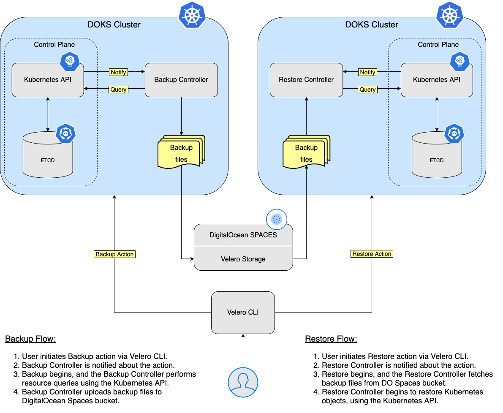

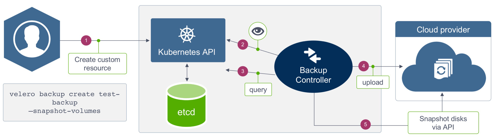

备份数据：

本地velero客户端发送备份命令，就会调用API Server创建Backup资源对象服务端的Backup Controller 收到通知有新的Backup对象创建并执行验证服务端的Backup Controller 开始执行备份过程，向API Server查询需要备份的数据。

服务端的Backup Controller 调用OSS对象存储服务，将备份数据保存到对象对象存储上默认情况下，BackupController还会为PV创建Snapshot(若PV支持)，用户可使用 --snapshot-volumes=false 选项禁用该功能Velero 会与 Kubernetes API 服务器交互，首先获取要备份的资源对象的清单信息，然后根据配置决定是否对关联的持久卷数据进行备份（通过调用相应的存储插件来操作）。对于持久卷数据备份，它会协调存储系统（如支持的云存储服务或本地存储解决方案）创建数据的快照或者复制数据到指定的备份存储位置。整个备份过程中会生成相应的备份记录，记录备份的资源范围、时间、状态等关键信息。

恢复数据：

本地velero客户端发送恢复指令，就会调用API Server创建Restore资源对象服务端的Restore Controller 收到通知有新的Restore对象创建并执行验证服务端的Restore Controller 调用对象存储，将指定的备份文件下载下来服务端的Restore Controller 开始执行恢复过程，根据备份数据调用API Server重新创建相关资源对象当执行恢复操作时，Velero 读取备份记录，先将资源对象的定义重新应用到 Kubernetes 集群中，创建相应的资源（如重新创建 Deployment 来启动应用副本等）。对于有持久卷数据需要恢复的情况，它会从备份存储位置获取数据并还原到对应的持久卷中，确保应用能够正常使用之前的数据。

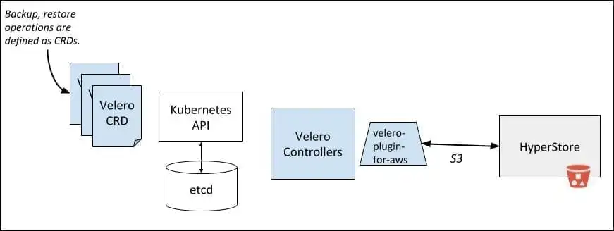

### 2.4.2 安装和使用 Velero Cli

#### 2.4.2.1 Velero CLI 二进制安装

软件包下载地址：


- <https://github.com/vmware-tanzu/velero/releases>


范例:  二进制安装 Velero CLI
```bash
#在K8s集群的Master节点上安装velero CLI
[root@master1 ~]# VERSION=v1.17.0
[root@master1 ~]# VERSION=v1.16.2
[root@master1 ~]# VERSION=v1.16.1
[root@master1 ~]# VERSION=v1.13.1

#直接下载
[root@master1 ~]# wget https://github.com/vmware-
tanzu/velero/releases/download/${VERSION}/velero-${VERSION}-linux-amd64.tar.gz
#如果下载失败,可以通过代理如下
[root@master1 ~]# wget https://githubfast.com/vmware-
tanzu/velero/releases/download/${VERSION}/velero-${VERSION}-linux-amd64.tar.gz

[root@master1 ~]# tar -zxvf velero-${VERSION}-linux-amd64.tar.gz
[root@master1 ~]# tree velero-${VERSION}-linux-amd64
velero-v1.16.1-linux-amd64
├── examples
│   ├── minio
│   │   └── 00-minio-deployment.yaml
│   └── nginx-app
│       ├── base.yaml
│       ├── README.md
│       └── with-pv.yaml
├── LICENSE
└── velero

3 directories, 6 files

[root@master1 ~]# mv velero-${VERSION}-linux-amd64/velero /usr/local/bin/
[root@master1 ~]# velero version
Client:
Version: v1.13.1
Git commit: ea5a89f83b89b2cb7a27f54148683c1ee8d57a37
<error getting server version: no matches for kind "ServerStatusRequest" in
version "velero.io/v1"> #提示错误，服务器端没有安装
```

#### 2.4.2.2 Velero CLI 命令用法说明

velero 能为 Kubernetes 集群资源提供一种简单、可配置且操作稳健的方式来备份应用状态及相关数据，其操作模式和 kubectl 有相似之处。

可用子命令如下：

backup ：用于处理备份相关的操作，比如创建、查看、管理备份等。backup-location ：针对备份存储位置进行相关操作，像配置、查看备份存储的位置等工作。bug ：用来报告 velero 的相关问题（比如遇到的故障、不符合预期的行为等）。client ：涉及 velero 客户端相关的命令操作。completion ：可以生成命令补全脚本，方便在命令行中更便捷地输入命令。create ：创建各种 velero 资源，像备份计划、备份任务等资源都可以通过它来创建。debug ：生成用于调试的相关文件包，辅助排查 velero 使用过程中出现的问题。delete ：删除 velero 相关资源，例如不再需要的备份、备份计划等资源都能用此命令删除。describe ：查看并描述 velero 相关资源的详细信息，帮助了解资源的具体配置和状态等情况。get ：获取 velero 相关资源的基本信息，比如列出已有的备份、备份计划等。help ：可以查看关于任何 velero 命令的帮助内容，就是你现在看到的这种详细的使用说明。install ：在 Kubernetes 集群中安装 velero 工具。plugin ：用于处理插件相关的操作，比如安装、查看、管理插件等（插件可以扩展 velero 的功能）。repo ：针对仓库进行相关操作，不过文档里没详细说具体仓库相关的操作内容，可能要进一步看对应子命令的帮助。restore ：处理资源恢复相关的操作，能将之前备份的数据等资源恢复到集群中。schedule ：用于创建和管理备份计划，设定按一定时间周期自动执行备份任务等。snapshot-location ：对快照存储位置进行操作（可能和备份过程中的某些快照存储相关）。uninstall ：从 Kubernetes 集群中卸载 velero 工具。version ：打印 velero 版本以及相关联的镜像信息。

**命令行选项**

可以用来控制 velero 的日志输出、配置文件使用、Kubernetes 集群连接等方面的行为，例如：

日志相关参数：像 --logtostderr 控制是输出日志到标准错误输出还是文件，--log_dir 可以指定日志文件存放的目录等。Kubernetes 集群连接相关参数：--kubeconfig 用于指定连接 Kubernetes API 服务器的配置文件路径，--kubecontext 用来确定使用的上下文等。

范例: 查看帮助
```bash
[root@master1 ~]#velero --help
Velero is a tool for managing disaster recovery, specifically for Kubernetes
cluster resources. It provides a simple, configurable, and operationally robust
way to back up your application state and associated data.
```


If you're familiar with kubectl, Velero supports a similar model, allowing you to execute commands such as 'velero get backup' and 'velero create schedule'. The same operations can also be performed as 'velero backup get' and 'velero schedule create'.

```bash
Usage:
velero [command]

Available Commands:
backup            Work with backups
backup-location   Work with backup storage locations
bug               Report a Velero bug
client            Velero client related commands
completion        Generate completion script
create            Create velero resources
debug             Generate debug bundle
delete            Delete velero resources
describe          Describe velero resources
get               Get velero resources
help              Help about any command
install           Install Velero
plugin            Work with plugins
repo              Work with repositories
restore           Work with restores
schedule          Work with schedules
snapshot-location Work with snapshot locations
uninstall         Uninstall Velero
version           Print the velero version and associated image

Flags:
--add_dir_header                   If true, adds the file directory to the
header of the log messages
--alsologtostderr                  log to standard error as well as files
(no effect when -logtostderr=true)
--colorized optionalBool           Show colored output in TTY. Overrides
'colorized' value from $HOME/.config/velero/config.json if present. Enabled by
default
--features stringArray             Comma-separated list of features to
enable for this Velero process. Combines with values from
$HOME/.config/velero/config.json if present
-h, --help                             help for velero

--kubeconfig string                Path to the kubeconfig file to use to
talk to the Kubernetes apiserver. If unset, try the environment variable
KUBECONFIG, as well as in-cluster configuration
--kubecontext string               The context to use to talk to the
Kubernetes apiserver. If unset defaults to whatever your current-context is
(kubectl config current-context)
--log_backtrace_at traceLocation   when logging hits line file:N, emit a
stack trace (default :0)
--log_dir string                   If non-empty, write log files in this
directory (no effect when -logtostderr=true)
--log_file string                  If non-empty, use this log file (no
effect when -logtostderr=true)
--log_file_max_size uint           Defines the maximum size a log file can
grow to (no effect when -logtostderr=true). Unit is megabytes. If the value is
0, the maximum file size is unlimited. (default 1800)
--logtostderr                      log to standard error instead of files
(default true)
-n, --namespace string                 The namespace in which Velero should
operate (default "velero")
--one_output                       If true, only write logs to their
native severity level (vs also writing to each lower severity level; no effect
when -logtostderr=true)
--skip_headers                     If true, avoid header prefixes in the
log messages
--skip_log_headers                 If true, avoid headers when opening log
files (no effect when -logtostderr=true)
--stderrthreshold severity         logs at or above this threshold go to
stderr when writing to files and stderr (no effect when -logtostderr=true or -
alsologtostderr=false) (default 2)
-v, --v Level                          number for the log level verbosity
--vmodule moduleSpec               comma-separated list of pattern=N
settings for file-filtered logging

Use "velero [command] --help" for more information about a command.
```

范例: 启用命令补全
```bash
#方法1
[root@ubuntu2204 ~]# echo 'source <(velero completion bash)' >> ~/.bashrc;exit
#方法2
[root@ubuntu2204 ~]# velero completion bash > /etc/bash_completion.d/velero;exit
```

#### 2.4.2.3 Velero CLI 集成 MinIO 存储

Velero支持很多种存储插件，可查看：https://velero.io/docs/main/supported-providers/获取插件信息

此处使用minio作为S3兼容的对象存储提供程序。您也可以在任意地方部署Minio对象存储，只需要保证K8S集群可以访问到即可。

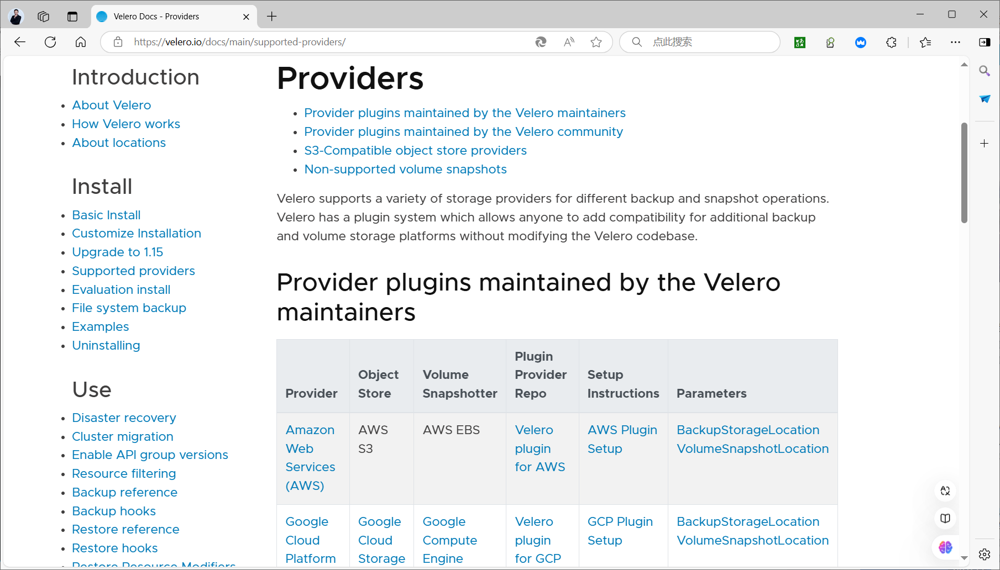

##### 2.4.2.3.1 安装部署 MinIO

范例: 二进制部署单机单磁盘
```bash
#下载
[root@ubuntu2204 ~]#wget https://dl.min.io/server/minio/release/linux-amd64/minio
#国内镜像下载
[root@ubuntu2204 ~]#wget https://dl.minio.org.cn/server/minio/release/linux-amd64/minio
[root@ubuntu2204 ~]#install minio  /usr/local/bin/

#准备数据目录,建议此目录为LVM
[root@ubuntu2204 ~]#mkdir -p /data/minio
```


#启动服务命令选项说明#示例: minio server /data/minio --console-address :9090 server #表示start object storage server--console-address #指定管理后面端口,管理后台登录用户和密码,默认为minioadmin/minioadmin.也可以通过还境变量MINIO_ROOT_USER（至少3个字符）和MINIO_ROOT_PASSWORD（至少8个字符）进行指定


#方式1:使用默认用户名和密码minioadmin/minioadmin执行启动#输出信息如下 Formatting 1st pool, 1 set(s), 1 drives per set. WARNING: Host local has more than 0 drives of set. A host failure will result in data becoming unavailable. WARNING: Detected default credentials 'minioadmin:minioadmin', we recommend that you change these values with 'MINIO_ROOT_USER' and 'MINIO_ROOT_PASSWORD'environment variables MinIO Object Storage Server Copyright: 2015-2023 MinIO, Inc. License: GNU AGPLv3 <https://www.gnu.org/licenses/agpl-3.0.html>Version: RELEASE.2023-08-29T23-07-35Z (go1.19.12 linux/amd64)

```bash
Status:         1 Online, 0 Offline.

S3-API: http://10.0.0.101:9000  http://10.10.53.81:9000  http://127.0.0.1:9000

RootUser: minioadmin
RootPass: minioadmin

Console: http://10.0.0.101:9090 http://10.10.53.81:9090 http://127.0.0.1:9090

RootUser: minioadmin
RootPass: minioadmin

Command-line: https://min.io/docs/minio/linux/reference/minio-mc.html#quickstart
$ mc alias set myminio http://10.0.0.101:9000 minioadmin minioadmin

Documentation: https://min.io/docs/minio/linux/index.html
Warning: The standard parity is set to 0. This can lead to data loss.

#方式2:指定用户和密码
[root@ubuntu2204 ~]#export MINIO_ROOT_USER=admin
[root@ubuntu2204 ~]#export MINIO_ROOT_PASSWORD=12345678
[root@ubuntu2204 ~]#minio server /data/minio --console-address :9090
```

范例: 容器化部署单机单磁盘
```bash
[root@ubuntu2204 ~]#apt update && apt -y install docker.io
[root@ubuntu2204 ~]#docker pull minio/minio

#可选
[root@ubuntu2204 ~]#mkdir -p /data/minio

#docker部署
[root@ubuntu2204 ~]#docker run -d \
-p 9000:9000 \
-p 9090:9090 \
--name minio \
--restart always \
-v /data/minio:/data \
-e "MINIO_ROOT_USER=admin" \
-e "MINIO_ROOT_PASSWORD=12345678" \
registry.cn-beijing.aliyuncs.com/bowen/minio:RELEASE.2024-11-07T00-52-
20Z server /data --console-address ":9090"
#minio/minio server /data --console-address ":9090"

#使用admin/12345678 登录MinIO 的 Console
http://minio.bowen.org:9090
```

范例：基于 Docker Compose 部署单节点
```bash
[root@ubuntu2404 ~]#cat docker-compose.yaml
version: '3.8'

services:
minio:
#image: minio/minio:RELEASE.2024-11-07T00-52-20Z
image: registry.cn-beijing.aliyuncs.com/bowen/minio:RELEASE.2024-11-
07T00-52-20Z

container_name: minio
restart: always
environment:
MINIO_ROOT_USER: 'admin'
MINIO_ROOT_PASSWORD: '12345678'
MINIO_ADDRESS: ':9000'
MINIO_CONSOLE_ADDRESS: ':9001'
ports:
- "9000:9000"
- "9001:9001"
networks:
- minio_net
volumes:
- ./data:/data
healthcheck:
test: ["CMD", "curl", "-f", "http://localhost:9000/minio/health/live"]
interval: 30s
timeout: 20s
retries: 3
command: server /data
#command: server --console-address ":9001" /data

networks:
minio_net:
driver: bridge

[root@ubuntu2404 ~]#apt update && apt -y install docker-compose python3-pip
[root@ubuntu2404 ~]#docker-compose version
docker-compose version 1.29.2, build unknown
docker-py version: 5.0.3
CPython version: 3.12.3
OpenSSL version: OpenSSL 3.0.13 30 Jan 2024

[root@ubuntu2404 ~]#docker-compose up -d

[root@ubuntu2404 ~]#docker-compose ps
Name               Command                  State
Ports
---------------------------------------------------------------------------------
---------------------------------------------------
minio   /usr/bin/docker-entrypoint ...   Up (healthy)   0.0.0.0:9000-
>9000/tcp,:::9000->9000/tcp,
0.0.0.0:9001-
>9001/tcp,:::9001->9001/tcp
[root@ubuntu2404 ~]#docker network ls
NETWORK ID     NAME             DRIVER    SCOPE
dc0d93c3c604   bridge           bridge    local
92408dddfe8e   host             host      local
f26890b252b5   none             null      local
6354afd6686a   root_minio_net   bridge    local
```

范例: kubernetes 部署 MinIO
```yaml
#velero默认带有一个部署MinIO的清单文件
[root@master1 ~]# VERSOIN=v1.16.1
[root@master1 ~]# cat velero-${VERSION}-linux-amd64/examples/minio/00-minio-
deployment.yaml

# Copyright 2017 the Velero contributors.
#
# Licensed under the Apache License, Version 2.0 (the "License");
# you may not use this file except in compliance with the License.
# You may obtain a copy of the License at
#
#     http://www.apache.org/licenses/LICENSE-2.0
#
# Unless required by applicable law or agreed to in writing, software
# distributed under the License is distributed on an "AS IS" BASIS,
# WITHOUT WARRANTIES OR CONDITIONS OF ANY KIND, either express or implied.
# See the License for the specific language governing permissions and
# limitations under the License.

---
apiVersion: v1
kind: Namespace
metadata:
name: velero

---
apiVersion: apps/v1
kind: Deployment
metadata:
namespace: velero
name: minio
labels:
component: minio
spec:
strategy:
type: Recreate
selector:
matchLabels:
component: minio
template:
metadata:
labels:
component: minio
spec:
volumes:
- name: storage
emptyDir: {}
- name: config
emptyDir: {}
containers:
- name: minio
image: minio/minio:latest
imagePullPolicy: IfNotPresent
args:
- server
- /storage
- --config-dir=/config
env:
- name: MINIO_ACCESS_KEY
value: "minio"
- name: MINIO_SECRET_KEY
value: "minio123"
ports:

- containerPort: 9000
volumeMounts:
- name: storage
mountPath: "/storage"
- name: config
mountPath: "/config"

---
apiVersion: v1
kind: Service
metadata:
namespace: velero
name: minio
labels:
component: minio
spec:
# ClusterIP is recommended for production environments.
# Change to NodePort if needed per documentation,
# but only if you run Minio in a test/trial environment, for example with
Minikube.
type: ClusterIP
ports:
- port: 9000
targetPort: 9000
protocol: TCP
selector:
component: minio

---
apiVersion: batch/v1
kind: Job
metadata:
namespace: velero
name: minio-setup
labels:
component: minio
spec:
template:
metadata:
name: minio-setup
spec:
restartPolicy: OnFailure
volumes:
- name: config
emptyDir: {}
containers:
- name: mc
image: minio/mc:latest
imagePullPolicy: IfNotPresent
command:
- /bin/sh
- -c
- "mc --config-dir=/config config host add velero http://minio:9000
minio minio123 && mc --config-dir=/config mb -p velero/velero"
volumeMounts:
- name: config
mountPath: "/config"
```

##### 2.4.2.3.2 创建 bucket

使用admin/12345678 登录MinIO 的 Console

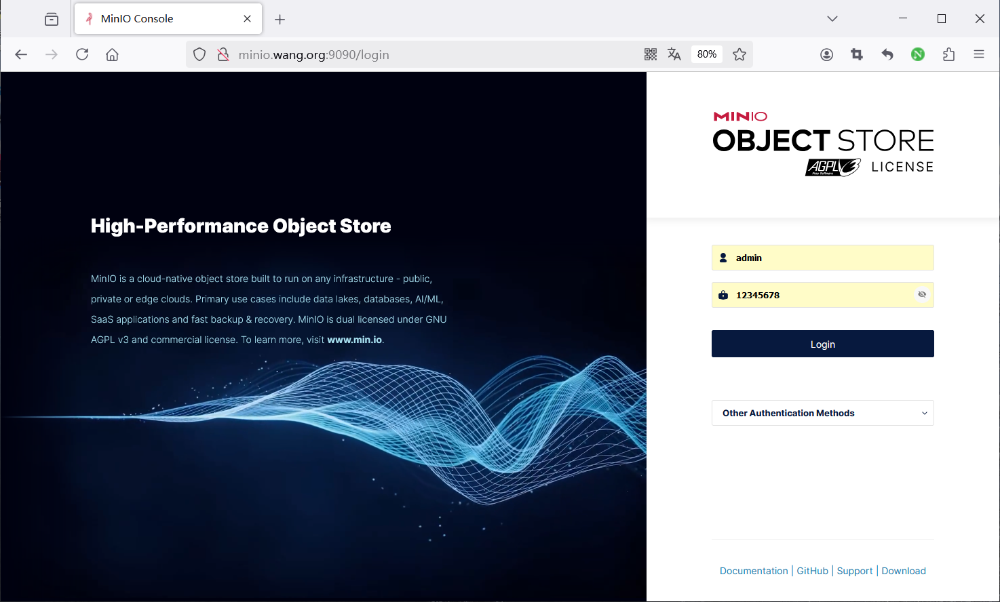

创建一个bucket名为: velero

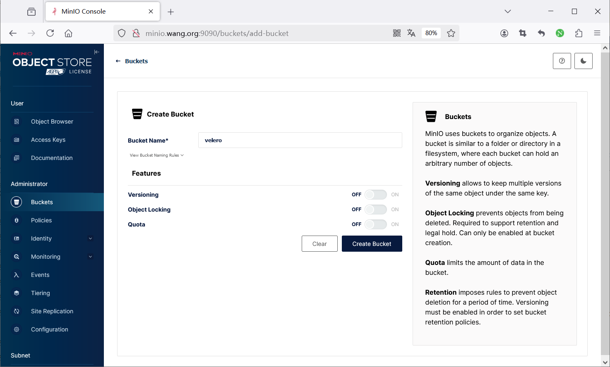

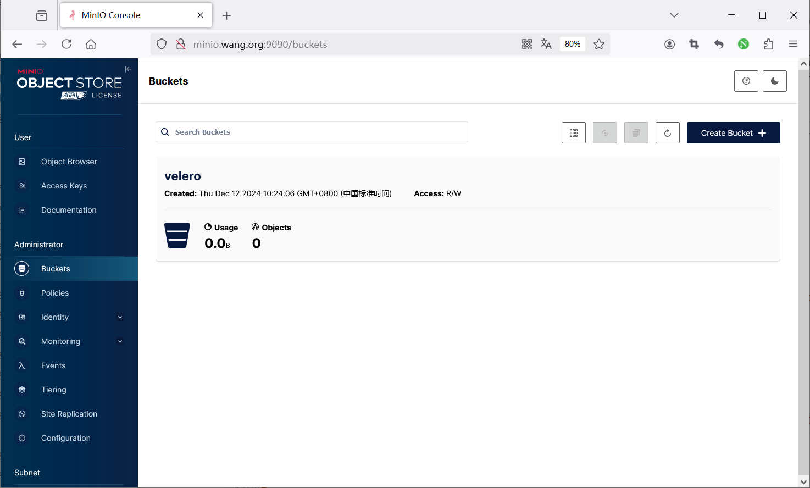

##### 2.4.2.3.3 创建Access Key并配置权限

**创建并记录 Access Key 和 Secret key**
```text
#Access Key
y81QoEEcmV06Zc18e2Fp
#Secret key
8VdbRxsgG7Or5yk7f5FXHjs87dOMhjuPmNK8s2cs
```

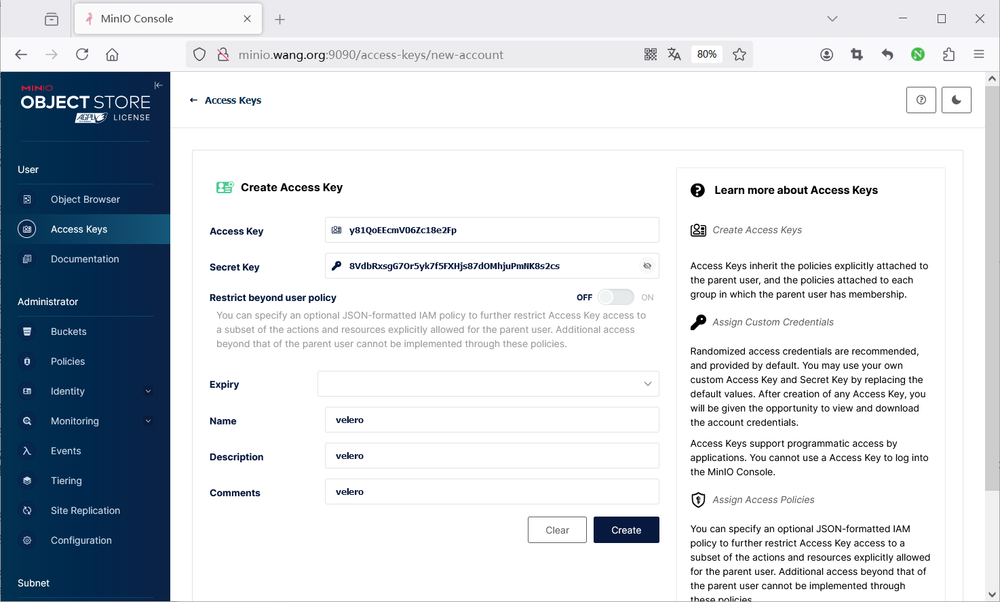

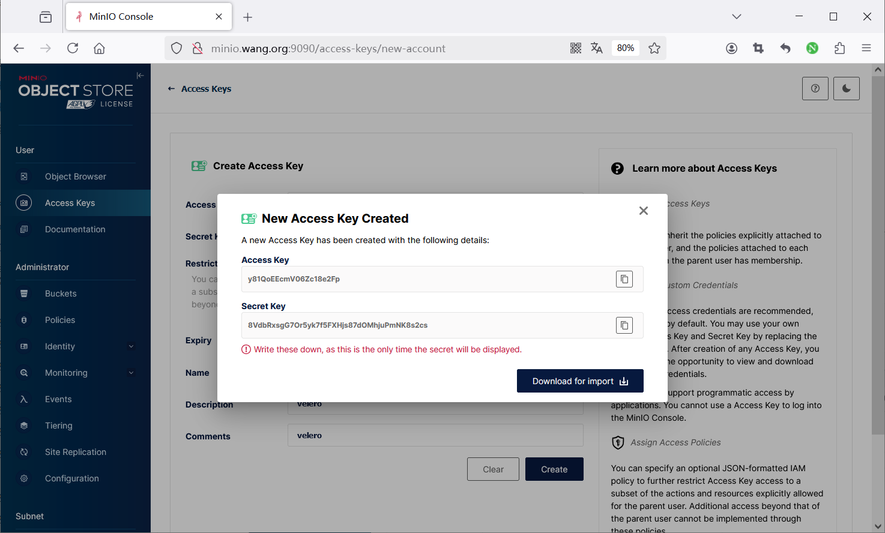

##### 2.4.2.3.4 配置 CLI 访问 MinIO 认证密钥
```bash
#在K8s集群的Master节点上MinIO的创建认证文件
[root@master1 ~]# cat > credentials-velero <<EOF
[default]
#aws_access_key_id = admin
#aws_secret_access_key = 12345678
aws_access_key_id = y81QoEEcmV06Zc18e2Fp
aws_secret_access_key = 8VdbRxsgG7Or5yk7f5FXHjs87dOMhjuPmNK8s2cs
EOF
```

### 2.4.3 安装 Velero Server

#### 2.4.3.1 安装 Velero Server 说明

There are two supported methods for installing the Velero server components:

the velero install CLI command the Helm chart

**aws插件**


- <https://github.com/vmware-tanzu/velero-plugin-for-aws>

```text
#查看兼容性
```

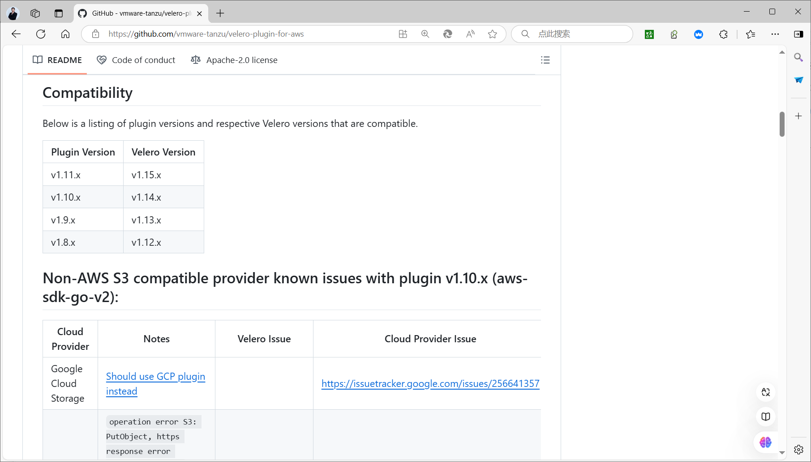

aws插件与velero版本对应关系：

Plugin Version Velero Version

v1.11.x v1.15.x

v1.10.x v1.14.x

v1.9.x v1.13.x

v1.8.x v1.12.x

v1.7.x v1.11.x

v1.6.x v1.10.x

v1.5.x v1.9.x

v1.4.x v1.8.x

v1.3.x v1.7.x

**velero 相关镜像**


- <https://hub.docker.com/u/velero>


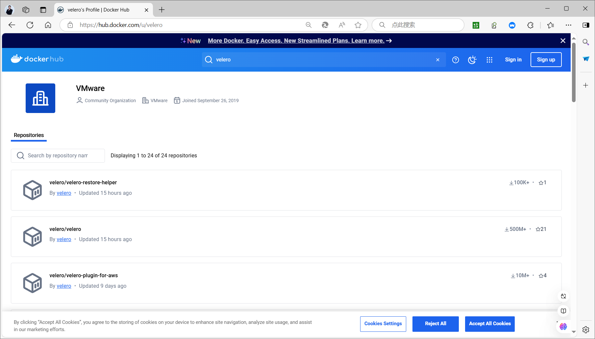

方法1：velero install 安装

velero install 命令用于在 Kubernetes 集群中安装 Velero，它有多个选项可用来定制化安装过程。

以下是一些常见选项及其说明：

--backup-location-config

用途：用于指定备份存储位置相关的配置信息。这是很关键的一个参数，因为 Velero 需要知道将备份数据存储到哪里，比如可以配置为使用对象存储服务（像 Amazon S3、Google Cloud Storage、Azure Blob Storage 等）或者其他兼容的存储后端。示例：
```text
--backup-location-config='{
"region": "us-west-1",
"s3ForcePathStyle": true,
"s3Url": "https://s3.amazonaws.com",
"bucket": "my-velero-bucket"
}'
```

上述示例配置展示了若使用 Amazon S3 作为备份存储时的部分配置情况，指定了区域、S3 的相关访问风格、S3 访问地址以及存储桶名称等内容，不同的存储后端配置内容会相应变化。

--image

用途：指定 Velero 组件所使用的镜像名称及版本。这样你可以选择使用特定版本的镜像，或者切换到符合你需求的自定义镜像（例如经过内部安全加固等处理后的镜像）。示例：表示使用 v1.10.0 版本的 Velero 官方镜像来进行安装。
```text
--image=velero/velero:v1.10.0
```

--init-image

用途：设置用于初始化相关操作的镜像（比如初始化存储资源等任务可能需要特定的初始化镜像来完成启动阶段的一些前置工作），和 --image 关注的主体组件不同，它侧重于初始化流程。示例：指定了在基于 AWS 相关环境进行初始化时的对应插件版本镜像，不同云环境或存储场景对应的初始化镜像根据需求选用。
```text
--init-image=velero/velero-plugin-aws:v1.10.0
```

--plugins

用途：用来指定要安装的插件列表。Velero 要适配不同的云平台、存储系统等需要对应的插件支持，通过该选项可以明确安装所需插件，确保能与相应的基础设施顺利协同工作。示例：表示同时安装适用于 AWS 和 GCP（Google Cloud Platform）的插件，方便 Velero 在两种云环境完成备份、恢复等操作。
```text
--plugins=velero/velero-plugin-aws,velero/velero-plugin-gcp
```

--namespace

用途：定义 Velero 组件将会被安装到的 Kubernetes 命名空间。默认情况下，通常安装到velero 命名空间示例：会把 Velero 相关组件安装到名为 my-backup-namespace 的命名空间内。
```text
--namespace=my-backup-namespace
```

--provider

用途：指明 Velero 所运行的底层基础设施提供商（如云平台等），这有助于 Velero 根据对应平台特性来进行适配性安装，比如针对 AWS、Azure、GCP 等不同平台，启用相应的特定功能模块或配置不同的资源访问方式。示例：告知 Velero 是运行在 AWS 环境下，后续的安装流程就会按照 AWS 相关的规范和接口来配置组件以及资源访问等事项。
```text
--provider=aws
```

--secret-file

用途：指定包含访问存储资源（比如存储桶等）所需的认证凭据等敏感信息的文件。这个文件内容一般是以加密或者符合安全规范的形式存储的，确保 Velero 在与存储后端交互时能够进行身份验证并获得相应权限。示例：指向了存储在 /path/to/secret/file 这个路径下的包含认证信息的文件。
```text
--secret-file=/path/to/secret/file
```

--use-restic

用途：决定是否启用 Restic 来处理持久卷数据的备份和恢复。Restic 是一个用于备份文件的工具，在 Velero 中启用它可以更精细地对应用中的持久卷数据进行备份和恢复操作，尤其适用于一些有复杂数据存储结构的应用场景。示例：表示在 Velero 安装过程中启用 Restic，后续 Velero 就可以利用它来处理持久卷相关的数据备份与恢复工作了。
```text
--use-restic=true
```

--use-node-agent

用途:启用 Velero 的 Node Agent 组件，该组件以 DaemonSet 形式部署在每个节点上。默认值为不启用此功能,即不会创建daemonset。

--use-node-agent` 用于在每个 Kubernetes 节点上部署 Node Agent（Restic）组件，实现对PVC/PV 数据的文件级备份。这个选项在私有云或不支持原生 VolumeSnapshot 的环境中尤为重要。

作用：

支持对 PVC（Persistent Volume Claim）数据的文件级备份，而非仅备份卷快照。在备份和恢复过程中执行自定义操作（如在 Pod 暂停状态下执行备份）。

适用场景：

需要备份无法通过卷快照捕获的临时文件或内存数据。使用不支持卷快照的存储后端（如 NFS）。

--snapshot-location-config

用途：这个选项主要用于指定 Velero 进行快照操作时的存储位置相关配置信息。在 Velero 执行备份任务过程中，有时候需要对存储卷等资源创建快照（例如对于支持快照功能的存储系统，像一些云平台提供的块存储服务等），以此来更高效、准确地备份数据，并且便于后续在需要恢复数据时可以基于快照进行还原操作。 此项配置必须使用 --use-volume-snapshots=true

允许你定义快照数据存放的具体位置以及与之相关的各种参数，例如存储的具体区域、存储后端的访问配置、对应的存储桶或存储目录等细节内容，确保 Velero 知道将快照数据保存到哪里以及如何去访问该存储位置来读写这些快照数据。

示例：展示了若 Velero 运行在 Amazon S3 存储相关环境下，配置快照存储位置时的一种可能形式（配置以 JSON 格式呈现，不同存储后端格式类似但具体参数会有变化）：
```text
--snapshot-location-config='{
"region": "us-west-1",
"s3ForcePathStyle": true,
"s3Url": "https://s3.amazonaws.com",
"bucket": "my-velero-snapshot-bucket"
}'
```

--use-volume-snapshots

用途：卷快照是通过云提供商（如 AWS EBS、GCP PD）或 CSI 驱动实现的块级备份。该选项用于指定 Velero 在执行备份和恢复操作时是否使用存储卷快照功能。在 Kubernetes 环境中，很多应用依赖存储卷来持久化数据，当进行数据备份和恢复时，利用存储卷快照可以高效地捕获某一时刻存储卷上数据的状态，使得后续恢复时能基于这个准确的快照还原数据，极大地提高备份与恢复的效率和准确性。

如果将 --use-volume-snapshots 设置为 true ，则 Velero 会尝试在满足条件（比如底层存储系统支持创建存储卷快照，像部分云平台提供的块存储服务等具备此功能）的情况下，对相关存储卷创建快照，并将其作为备份操作的一部分，在需要恢复时也会基于这些快照来还原数据到对应的存储卷上。相反，若将其设置为 false ，Velero 就不会利用存储卷快照机制来进行备份和恢复工作，而是可能采用其他方式（比如直接复制存储卷中的文件数据等相对来说更常规、但在某些情况下效率更低的方法）来完成数据的备份和恢复流程。

--use-volume-snapshots=false

作用：

仅备份 PVC 的元数据和挂载信息，不备份卷的实际数据。数据恢复时需依赖底层存储系统的持久化能力（如 NFS 共享存储）。

适用场景：

使用不支持卷快照的存储系统（如 NFS、CephFS）。依赖文件级备份（通过 Node Agent）而非块级快照。希望降低备份存储成本（仅保存元数据）。

--uploader-type=restic|kopia

用途：在 Velero 执行备份操作时，需要将备份的数据上传到指定的存储位置（比如对象存储等外部存储设施）进行保存，--uploader-type 这个选项就是用来指定采用何种上传机制或工具来完成数据的上传任务。Kopia 是开源的备份工具，旨在提供快速、高效且易于管理的备份解决方案，侧重于对数据进行高效的快照备份等功能。它也有自己的一套命令体系和存储组织逻辑，其社区也在不断发展，有一些用户贡献的扩展功能以及和不同存储集成的方法等。像可以利用 Kopia 对大量的磁盘文件做定期的快照备份，并能灵活地依据时间戳等条件来查找和恢复历史版本数据，适用于个人电脑数据备份、企业部分数据资产备份等场景。

当设置为 restic 时，表示选择使用 Restic 作为数据上传的工具。Restic 是一款专为备份文件而设计的工具，它具备很多特性，例如对数据加密支持良好、能够处理不同文件系统类型的数据备份、对增量备份有高效的实现方式等。选择 restic 作为上传器类型意味着 Velero 在备份过程中会调用 Restic 的功能来将集群中的数据（比如应用相关的配置文件、持久卷里的文件等）上传到预设的存储位置，Restic 会以它特有的数据组织和加密（如果配置了加密功能）等方式来处理这些数据，确保备份数据在传输和存储过程中的安全性、完整性以及后续可恢复性等。

--wait

用途：设置安装完成后是否等待 Velero 组件达到就绪状态才返回结果。如果设置为 true ，命令会一直阻塞，直到确认 Velero 相关组件都已经成功启动并且可以正常工作了才结束执行；如果设置为 false ，则命令执行完安装操作后立即返回，不关注后续组件是否就绪。常用于自动化部署脚本等场景，确保后续基于 Velero 的操作（如备份操作等）能马上开展。

方法2：通过 helm 安装
```bash
[root@master1 ~]# helm repo add vmware-tanzu https://vmware-tanzu.github.io/helm-charts
[root@master1 ~]# helm repo update

[root@master1 ~]# cat values.yaml
configuration:
provider: aws
backupStorageLocation:
name: default
bucket: your-s3-bucket-name
config:
region: your-aws-region
volumeSnapshotLocation:
name: default
credentials:
useSecret: false
accessKeyID: your-access-key
secretAccessKey: your-secret-access-key

[root@master1 ~]# helm install velero vmware-tanzu/velero --namespace velero -f
values.yaml
```

#### 2.4.3.2 安装 Velero Server

范例:  安装 Velero Server
```bash
#示例1: 支持资源和数据以文件方式备份,但不支持快照备份
#注意:minio.bowen.org需要coreDNS解析,不能用节点的hosts文件解析
[root@master1 ~]# velero install \
--provider aws \
#--image velero/velero:v1.13.1 \
#--image registry.cn-beijing.aliyuncs.com/bowen/velero:v1.13.1 \
--image registry.cn-beijing.aliyuncs.com/bowen/velero:v1.15.0 \
#--plugins velero/velero-plugin-for-aws:v1.9.1 \
#--plugins registry.cn-beijing.aliyuncs.com/bowen/velero-plugin-for-
aws:v1.9.1 \
--plugins registry.cn-beijing.aliyuncs.com/bowen/velero-plugin-for-
aws:v1.11.0 \
--backup-location-config
region=minio,s3ForcePathStyle="true",s3Url=http://minio.bowen.org:9000 \
--bucket velero \
--secret-file ./credentials-velero \
--namespace velero \
--use-node-agent \
--use-volume-snapshots=false \
--wait

#选项说明
--provider aws #指定云服务提供商为 AWS。尽管这里用的是aws，但 Velero 支持通过插件机制与其他
存储系统（如 MinIO）兼容。此选项告诉 Velero 使用 AWS 兼容的存储接口。
--backup-location-config #配置备份存储位置的参数，以逗号分隔的键值对形式提供。具体参数如下：
region=minio #指定存储区域名称。对于 MinIO，此值可以是任意字符串（如minio），因为 MinIO 不
使用传统的 AWS 区域概念。
s3ForcePathStyle="true" #强制使用路径风格的 S3 URL。路径风格的 URL 格式为
http://<host>/<bucket>/<key>，而不是虚拟主机风格的http://<bucket>.<host>/<key>。MinIO
要求启用此选项。
s3Url=http://minio.bowen.org:9000 #指定 MinIO 服务器的 URL。Velero 将通过此 URL 连接到
MinIO 服务，端口9000是 MinIO 的默认 API 端口。minio.bowen.org需要coreDNS解析,不能用hosts
文件解析
[root@master1 ~]#kubectl edit cm -n kube-system  coredns
......
hosts {
10.0.0.200 minio.bowen.org
fallthrough
}
loop
reload
loadbalance
}
.......
[root@master1 ~]#kubectl rollout restart deployment -n kube-system  coredns
```


--use-node-agent #启用 Velero 的 Node Agent组件，该组件以DaemonSet形式部署在每个节点上,可以支持对 PVC数据的文件级备份。--use-volume-snapshots=false #禁用卷快照功能。卷快照是通过云提供商（如 AWS EBS、GCP PD）或 CSI 驱动实现的块级备份。仅备份 PVC 的元数据和挂载信息，不备份卷的实际数据

```bash
#示例2：备份到Kubernetes中部署的MinIO
[root@master1 ~]# velero install \
--provider aws \
--image registry.cn-beijing.aliyuncs.com/bowen/velero:v1.15.0 \
--plugins registry.cn-beijing.aliyuncs.com/bowen/velero-plugin-for-
aws:v1.11.0 \
--backup-location-config
region=minio,s3ForcePathStyle="true",s3Url=http://minio.velero.svc.cluster,local
:9000 \
--bucket velero \
--secret-file ./credentials-velero \
--namespace velero \
--use-volume-snapshots=false

#示例3：启用CSI插件部署Velero,支持资源和数据以文件和快照方式的备份,但需要事先部署支持快照的sc
#注意:minio.bowen.org需要coreDNS解析,不能用hosts文件解析
#参考https://github.com/kubernetes-csi/csi-driver-nfs项目可以支持
[root@master1 ~]#velero install \
--provider=aws \
--image registry.cn-beijing.aliyuncs.com/bowen/velero:v1.13.1 \
#--image registry.cn-beijing.aliyuncs.com/bowen/velero:v1.15.0 \
--backup-location-config
region=minio,s3ForcePathStyle="true",s3Url=http://minio.bowen.org:9000 \
--secret-file=./credentials-velero \
--plugins=registry.cn-beijing.aliyuncs.com/bowen/velero-plugin-for-
aws:v1.11.0,registry.cn-beijing.aliyuncs.com/bowen/velero-plugin-for-
csi:v0.7.1 \
--bucket=velero \
--use-volume-snapshots=true  \
--features=EnableCSI \
--use-node-agent  \
--uploader-type=kopia

#执行install命令后会创建一系列清单，包括CustomResourceDefinition、Namespace、Deployment
等。
CustomResourceDefinition/backuprepositories.velero.io: attempting to create
resource
CustomResourceDefinition/backuprepositories.velero.io: attempting to create
resource client
CustomResourceDefinition/backuprepositories.velero.io: created
CustomResourceDefinition/backups.velero.io: attempting to create resource
CustomResourceDefinition/backups.velero.io: attempting to create resource client
CustomResourceDefinition/backups.velero.io: created
CustomResourceDefinition/backupstoragelocations.velero.io: attempting to create
resource
CustomResourceDefinition/backupstoragelocations.velero.io: attempting to create
resource client
CustomResourceDefinition/backupstoragelocations.velero.io: created
CustomResourceDefinition/deletebackuprequests.velero.io: attempting to create
resource
CustomResourceDefinition/deletebackuprequests.velero.io: attempting to create
resource client
CustomResourceDefinition/deletebackuprequests.velero.io: created
CustomResourceDefinition/downloadrequests.velero.io: attempting to create
resource
CustomResourceDefinition/downloadrequests.velero.io: attempting to create
resource client
```


CustomResourceDefinition/downloadrequests.velero.io: created CustomResourceDefinition/podvolumebackups.velero.io: attempting to create resource CustomResourceDefinition/podvolumebackups.velero.io: attempting to create resource client CustomResourceDefinition/podvolumebackups.velero.io: created CustomResourceDefinition/podvolumerestores.velero.io: attempting to create resource CustomResourceDefinition/podvolumerestores.velero.io: attempting to create resource client CustomResourceDefinition/podvolumerestores.velero.io: created CustomResourceDefinition/restores.velero.io: attempting to create resource CustomResourceDefinition/restores.velero.io: attempting to create resource client CustomResourceDefinition/restores.velero.io: created CustomResourceDefinition/schedules.velero.io: attempting to create resource CustomResourceDefinition/schedules.velero.io: attempting to create resource client CustomResourceDefinition/schedules.velero.io: created CustomResourceDefinition/serverstatusrequests.velero.io: attempting to create resource CustomResourceDefinition/serverstatusrequests.velero.io: attempting to create resource client CustomResourceDefinition/serverstatusrequests.velero.io: created CustomResourceDefinition/volumesnapshotlocations.velero.io: attempting to create resource CustomResourceDefinition/volumesnapshotlocations.velero.io: attempting to create resource client CustomResourceDefinition/volumesnapshotlocations.velero.io: created CustomResourceDefinition/datadownloads.velero.io: attempting to create resource CustomResourceDefinition/datadownloads.velero.io: attempting to create resource client CustomResourceDefinition/datadownloads.velero.io: created CustomResourceDefinition/datauploads.velero.io: attempting to create resource CustomResourceDefinition/datauploads.velero.io: attempting to create resource client CustomResourceDefinition/datauploads.velero.io: created Waiting for resources to be ready in cluster... Namespace/velero: attempting to create resource Namespace/velero: attempting to create resource client Namespace/velero: created ClusterRoleBinding/velero: attempting to create resource ClusterRoleBinding/velero: attempting to create resource client ClusterRoleBinding/velero: created ServiceAccount/velero: attempting to create resource ServiceAccount/velero: attempting to create resource client ServiceAccount/velero: created Secret/cloud-credentials: attempting to create resource Secret/cloud-credentials: attempting to create resource client Secret/cloud-credentials: created BackupStorageLocation/default: attempting to create resource BackupStorageLocation/default: attempting to create resource client BackupStorageLocation/default: created Deployment/velero: attempting to create resource Deployment/velero: attempting to create resource client Deployment/velero: created DaemonSet/node-agent: attempting to create resource DaemonSet/node-agent: attempting to create resource client


DaemonSet/node-agent: created Waiting for Velero deployment to be ready. Waiting for node-agent daemonset to be ready. Velero is installed! ⛵ Use 'kubectl logs deployment/velero -n velero' to view the status.

```bash
#查看velero创建的api对象
[root@master1 ~]#kubectl api-versions |grep velero
velero.io/v1
velero.io/v2alpha1

#查看生成的相关资源
[root@master1 ~]# kubectl api-resources --api-group=velero.io
NAME                      SHORTNAMES   APIVERSION           NAMESPACED   KIND
backuprepositories                     velero.io/v1         true
BackupRepository
backups                                velero.io/v1         true         Backup
backupstoragelocations    bsl          velero.io/v1         true
BackupStorageLocation
datadownloads                          velero.io/v2alpha1   true
DataDownload
datauploads                            velero.io/v2alpha1   true
DataUpload
deletebackuprequests                   velero.io/v1         true
DeleteBackupRequest
downloadrequests                       velero.io/v1         true
DownloadRequest
podvolumebackups                       velero.io/v1         true
PodVolumeBackup
podvolumerestores                      velero.io/v1         true
PodVolumeRestore
restores                               velero.io/v1         true         Restore
schedules                              velero.io/v1         true
Schedule
serverstatusrequests      ssr          velero.io/v1         true
ServerStatusRequest
volumesnapshotlocations   vsl          velero.io/v1         true
VolumeSnapshotLocation

#生成CRD
[root@master1 ~]#kubectl get  crds -l component=velero
NAME                                CREATED AT
backuprepositories.velero.io        2024-12-12T04:14:01Z
backups.velero.io                   2024-12-12T04:14:01Z
backupstoragelocations.velero.io    2024-12-12T04:14:01Z
datadownloads.velero.io             2024-12-12T04:14:01Z
datauploads.velero.io               2024-12-12T04:14:02Z
deletebackuprequests.velero.io      2024-12-12T04:14:01Z
downloadrequests.velero.io          2024-12-12T04:14:01Z
podvolumebackups.velero.io          2024-12-12T04:14:01Z
podvolumerestores.velero.io         2024-12-12T04:14:01Z
restores.velero.io                  2024-12-12T04:14:01Z
schedules.velero.io                 2024-12-12T04:14:01Z
serverstatusrequests.velero.io      2024-12-12T04:14:01Z
volumesnapshotlocations.velero.io   2024-12-12T04:14:01Z

[root@master1 ~]#kubectl get crd |grep velero
backuprepositories.velero.io                          2024-12-12T04:14:01Z
backups.velero.io                                     2024-12-12T04:14:01Z
backupstoragelocations.velero.io                      2024-12-12T04:14:01Z
datadownloads.velero.io                               2024-12-12T04:14:01Z
datauploads.velero.io                                 2024-12-12T04:14:02Z
deletebackuprequests.velero.io                        2024-12-12T04:14:01Z
downloadrequests.velero.io                            2024-12-12T04:14:01Z
podvolumebackups.velero.io                            2024-12-12T04:14:01Z
podvolumerestores.velero.io                           2024-12-12T04:14:01Z
restores.velero.io                                    2024-12-12T04:14:01Z
schedules.velero.io                                   2024-12-12T04:14:01Z
serverstatusrequests.velero.io                        2024-12-12T04:14:01Z
volumesnapshotlocations.velero.io                     2024-12-12T04:14:01Z

[root@master1 ~]#kubectl get all -n velero
NAME                         READY   STATUS    RESTARTS   AGE
pod/node-agent-8ks5z         1/1     Running   0          63s
pod/node-agent-lkhh2         1/1     Running   0          63s
pod/node-agent-tx8pn         1/1     Running   0          63s
pod/velero-ddd5bcb88-f5dbh   1/1     Running   0          63s

NAME                        DESIRED   CURRENT   READY   UP-TO-DATE   AVAILABLE
NODE SELECTOR   AGE
daemonset.apps/node-agent   3         3         3       3            3
<none>          63s

NAME                     READY   UP-TO-DATE   AVAILABLE   AGE
deployment.apps/velero   1/1     1            1           63s

NAME                               DESIRED   CURRENT   READY   AGE
replicaset.apps/velero-ddd5bcb88   1         1         1       63s

[root@master1 ~]#kubectl get backupstoragelocation -A
NAMESPACE   NAME      PHASE       LAST VALIDATED   AGE     DEFAULT
velero      default   Available   2s               2m31s   true

#查看运行日志
[root@master1 ~]# kubectl logs deployment/velero -n velero
Defaulted container "velero" out of: velero, bowen-velero-plugin-for-aws
(init), bowen-velero-plugin-for-csi (init)
time="2024-12-17T00:52:23Z" level=info msg="setting log-level to INFO"
logSource="pkg/cmd/server/server.go:191"
time="2024-12-17T00:52:23Z" level=info msg="Starting Velero server v1.13.1
(ea5a89f83b89b2cb7a27f54148683c1ee8d57a37-dirty)"
logSource="pkg/cmd/server/server.go:193"
time="2024-12-17T00:52:23Z" level=info msg="1 feature flags enabled [EnableCSI]"
logSource="pkg/cmd/server/server.go:195"
I1217 00:52:24.678531       1 request.go:690] Waited for 1.047160465s due to
client-side throttling, not priority and fairness, request:
GET:https://10.96.0.1:443/apis/storage.k8s.io/v1?timeout=32s
time="2024-12-17T00:52:25Z" level=info msg="registering plugin" command=/velero
kind=BackupItemAction logSource="pkg/plugin/clientmgmt/process/registry.go:104"
name=velero.io/crd-remap-version
.....

#查看备份位置信息
[root@master1 ~]#velero backup-location get

NAME      PROVIDER   BUCKET/PREFIX   PHASE       LAST VALIDATED
ACCESS MODE   DEFAULT
default   aws        velero          Available   2024-12-12 12:17:32 +0800 CST
ReadWrite     true

#示例4: 使用默认镜像
[root@master1 ~]#velero install \
--provider=aws \
--backup-location-config
region=minio,s3ForcePathStyle=true,s3Url=http://minio.bowen.org:9000 \
--secret-file=./credentials-velero \
--plugins=velero/velero-plugin-for-aws:v1.9.0,velero/velero-plugin.for-
csi:v0.7.0  \
--bucket=velero \
--use-volume-snapshots=true  \
--features=EnableCSI \
--snapshot-location-config region=minio  \
--use-node-agent  \
--uploader-type=kopia

#示例5: 使用restic上传插件
[root@ubuntu2204 ~]# velero install \
--provider aws \
--image registry.cn-beijing.aliyuncs.com/bowen/velero:v1.13.1 \
--plugins registry.cn-beijing.aliyuncs.com/bowen/velero-plugin-for-
aws:v1.11.0 \
--backup-location-config
region=minio,s3ForcePathStyle="true",s3Url=http://minio.bowen.org:9000 \
--bucket velero \
--secret-file ./credentials-velero \
--use-node-agent \
--privileged-node-agent \
--use-volume-snapshots=false \
--namespace velero \
--uploader-type=restic \
--wait
```

选项说明：

--kubeconfig (可选)：指定kubeconfig 认证文件，默认使用.kube/config--provider ：定义插件提供方--image ：定义运行velero的镜像，默认与velero客户端一致--plugins ：指定使用aws s3兼容的插件镜像--bucket ：指定对象存储Bucket桶名称--secret-file ：指定对象存储认证文件--use-node-agent ：启用文件系统备份，创建Velero Node Agent守护进程--uploader-type=restic ：使用Restic工具备份--privileged-node-agent : 节点代理需要在特权模式下运行--use-volume-snapshots ：是否启使用快照--namespace ：指定部署所在namespace名称，默认为velero--backup-location-config ：指定对象存储地址信息，需要注意的是如果指定域名的话，服务器端必须能解析到, s3ForcePathStyle 为 true 这通常用于兼容一些非标准的 S3 访问方式--wait ：指示安装过程要等待，直到 Velero 的部署及相关配置完成并处于可用状态才结束该命令的执行，便于使用者直接确认安装结果，避免后续立即使用时出现因为安装未完成导致的问题。

#### 2.4.3.3 卸载 Velero Server

如果想从集群中完全卸载Velero，则以下命令将删除由velero install 创建的所有资源:
```bash
#方法1
[root@master1 ~]#velero uninstall --namespace velero

#方法2
[root@master1 ~]#kubectl delete namespace/velero clusterrolebinding/velero
[root@master1 ~]#kubectl delete crds -l component=velero
```

### 2.4.4  案例: Velero 实现备份与恢复

#### 2.4.4.1 数据备份

##### 2.4.4.1.1 备份命令说明


- <https://velero.io/docs/v1.8/how-velero-works/>


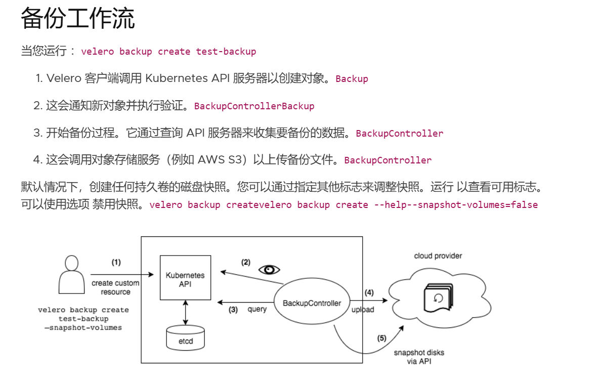
```text
velero create backup NAME [flags]
```

backup选项：

--exclude-namespaces stringArray : 要从备份中排除的名称空间

--exclude-resources stringArray : 要从备份中排除的资源，如
```text
storageclasses.storage.k8s.io
```

--include-cluster-resources optionalBool[=true] : 包含集群资源类型

--include-namespaces stringArray : 要包含在备份中的名称空间(默认’*'),多个名称空间,用逗号或空格隔开。

示例:
```text
--include-namespaces <命名空间1>,<命名空间2>,<命名空间3>
--include-namespaces "<命名空间1> <命名空间2> <命名空间3>"
```

--include-resources stringArray : 备份中要包括的资源。

--labels mapStringString : 给这个备份加上标签

-o, --output string : 指定输出格式，支持’table’、‘json’和’yaml’；

-l, --selector labelSelector : 对指定标签的资源进行备份。

--snapshot-volumes optionalBool[=true] : 对 PV 创建快照(需要PV支持)，默认为true

--snapshot-move-data optionalBool[=true] : 基于上面选项对 PV 创建快照后并上传到OSS中，默认为false

--storage-location string : 指定备份的位置

--ttl duration : 备份数据多久删掉，默认720H，即30天

--volume-snapshot-locations strings : 指定快照的位置，即指定是哪一个公有云的驱动。

--default-volumes-to-fs-backup :当备份 Kubernetes 资源（如 Pod、Deployment 等）时，Velero 会处理关联的 Volume（存储卷）。默认情况下：持久化卷（Persistent Volume, PV）：可以通过底层云存储提供商（如 AWS EBS、GCP PD 等）的快照机制进行备份（块级备份）。非持久化卷（如 EmptyDir、ConfigMap、Secret 等）：会被直接序列化到备份文件中（文件系统级备份）。使用选项强制将所有 Volume（包括 PV）的备份方式切换为文件系统级备份，而非使用云提供商的快照机制。
```text
# 结合 Volume 过滤（例如排除名为 "data-volume" 的 PV）
velero backup create my-backup --default-volumes-to-fs-backup --volume-
exclude=data-volume
```

**典型使用场景**

不支持快照的存储系统当 PV 使用的存储后端（如 NFS、CephFS 等）不支持云原生快照功能时，必须通过文件系统级备份来处理 Volume 数据。跨云平台迁移或本地测试需要将备份从一个云平台迁移到另一个不兼容快照格式的平台，或在本地环境（如Minikube）中恢复数据时，文件系统级备份更通用。细粒度控制备份内容希望统一所有 Volume 的备份方式，避免混合使用快照和文件备份带来的复杂性。

##### 2.4.4.1.2 创建测试应用

###### 2.4.4.1.2.1 无状态资源
```bash
[root@master1 ~]#kubectl create ns demo
[root@master1 ~]#kubectl create deployment myapp --image registry.cn-
beijing.aliyuncs.com/bowen/pod-test:v0.1 --replicas 3 -n demo

[root@master1 ~]#kubectl get pod -n demo
NAME                     READY   STATUS    RESTARTS   AGE
myapp-547df679bb-88bj7   1/1     Running   0          9s
myapp-547df679bb-ld99z   1/1     Running   0          9s
myapp-547df679bb-lssd9   1/1     Running   0          9s
```

###### 2.4.4.1.2.2 emptydir 存储资源
```yaml
[root@master1 ~]#kubectl create ns demo

#示例1:基于emtydir的数据存储
[root@master1 ~]#cat storage-emptydir-redis.yaml
apiVersion: v1
kind: Pod
metadata:
name: redis-emptydir-pod
spec:
containers:
- name: redis
image: registry.cn-beijing.aliyuncs.com/bowen/redis:7.2.5
ports:
- containerPort: 6379
name: redis
volumeMounts:
- mountPath: /data
name: data
volumes:
- name: data
emptyDir: {}

[root@master1 ~]#kubectl apply -f storage-emptydir-redis.yaml -n demo

#生成数据
[root@master1 ~]#kubectl exec -it -n demo redis-emptydir-pod -- sh
# redis-cli set name bowen

OK
# redis-cli bgsave
Background saving started
# pwd
/data
# ls
dump.rdb
```

###### 2.4.4.1.2.3  HostPath 存储资源
```yaml
[root@master1 ~]#cat storage-hostpath-redis.yaml
apiVersion: v1
kind: Pod
metadata:
name: hostpath-redis
spec:
nodeName: node1.bowen.org      #指定运行在指定worker主机上
volumes:
- name: redis-backup
hostPath:
path: /backup/redis       #宿主机的目录会自动创建
containers:
- name: hostpath-redis
image: registry.cn-beijing.aliyuncs.com/bowen/redis:6.2.5
volumeMounts:
- name: redis-backup
mountPath: /data
```

###### 2.4.4.1.2.4  PVC 存储资源
```yaml
#示例1:PV和PVC
#事先在PV所在的目标节点上准备目录，对于本地存储Kubernetes本身并不会自动创建路径，这是因为
Kubernetes不能控制节点上的本地存储，因此无法自动创建路径
[root@node2 ~]#mkdir -p /data/mysql

[root@master1 ~]#cat storage-sc-local-pv-pvc-mysql-pod.yaml
apiVersion: v1
kind: Secret
metadata:
name: mysql-pass
type: kubernetes.io/basic-auth
#type: Opaque  #也可以用Opaque类型
data:
password: MTIzNDU2             #key名称:password,value为123456
---
apiVersion: storage.k8s.io/v1
kind: StorageClass
metadata:
name: local-storage
provisioner: kubernetes.io/no-provisioner
volumeBindingMode: WaitForFirstConsumer  #延迟绑定，只有Pod启动后再绑定PV到Pod所在节
点，否则PVC处理Pending状态

---
apiVersion: v1
kind: PersistentVolume
metadata:
name: pv-sc-local
spec:
capacity:
storage: 100Gi
volumeMode: Filesystem
accessModes:
- ReadWriteOnce
persistentVolumeReclaimPolicy: Delete #因为静态置配，所以当PVC删除后，不会删除PV和数据
storageClassName: local-storage
local:
path: /data/mysql
nodeAffinity:
required:
nodeSelectorTerms:        #指定节点
- matchExpressions:
- key: kubernetes.io/hostname
operator: In
values:
- node2.bowen.org

---
apiVersion: v1
kind: PersistentVolumeClaim
metadata:
name: pvc-sc-local
spec:

storageClassName: local-storage
accessModes: ["ReadWriteOnce"]
resources:
requests:
storage: 100Gi

---
apiVersion: apps/v1
kind: Deployment
metadata:
name: mysql
spec:
selector:
matchLabels:
app: mysql
strategy:
type: Recreate
template:
metadata:
labels:
app: mysql
spec:
containers:
- image: registry.cn-beijing.aliyuncs.com/bowen/mysql:8.0.29-oracle
name: mysql
env:
- name: MYSQL_ROOT_PASSWORD
valueFrom:
secretKeyRef:
name: mysql-pass
key: password
- name: MYSQL_DATABASE
value: wordpress
- name: MYSQL_USER
value: wordpress
- name: MYSQL_PASSWORD
valueFrom:
secretKeyRef:
name: mysql-pass
key: password
ports:
- containerPort: 3306
name: mysql
volumeMounts:
- name: mysql-persistent-storage
mountPath: /var/lib/mysql
volumes:
- name: mysql-persistent-storage
persistentVolumeClaim:
claimName: pvc-sc-local

#示例2:基于storageclass的PVC的存储数据
```
```yaml
[root@master1 velero]#cat redis-pvc-sc.yaml
kind: PersistentVolumeClaim
apiVersion: v1
metadata:
name: redis-pvc

spec:
storageClassName: sc-nfs
accessModes:
- ReadWriteMany
resources:
requests:
storage: 2Gi

---
apiVersion: v1
kind: Pod
metadata:
name: redis-pvc-pod
spec:
containers:
- name: redis
image: registry.cn-beijing.aliyuncs.com/bowen/redis:7.2.5
ports:
- containerPort: 6379
name: redis
volumeMounts:
- mountPath: /data
name: data
volumes:
- name: data
persistentVolumeClaim:
claimName: redis-pvc

[root@master1 velero]#kubectl apply -f redis-pvc-sc.yaml -n demo
persistentvolumeclaim/redis-pvc created
pod/redis-pvc-pod created

[root@master1 ~]#kubectl get pod,pvc -n demo
NAME                READY   STATUS    RESTARTS   AGE
pod/redis-pvc-pod   1/1     Running   0          104s

NAME                              STATUS   VOLUME
CAPACITY   ACCESS MODES   STORAGECLASS   VOLUMEATTRIBUTESCLASS   AGE
persistentvolumeclaim/redis-pvc   Bound    pvc-09dc9e61-52a1-4a54-b936-
8ec582db3534   2Gi        RWX            sc-nfs         <unset>
104s

[root@master1 ~]#kubectl get pv
NAME                                       CAPACITY   ACCESS MODES   RECLAIM
POLICY   STATUS   CLAIM                   STORAGECLASS   VOLUMEATTRIBUTESCLASS
REASON   AGE
pvc-09dc9e61-52a1-4a54-b936-8ec582db3534   2Gi        RWX            Delete
Bound    demo/redis-pvc   sc-nfs         <unset>
118s

[root@master1 ~]#ls /data/sc-nfs/
demo-redis-pvc-pvc-09dc9e61-52a1-4a54-b936-8ec582db3534

#创建测试数据
[root@master1 ~]#kubectl exec -it -n demo redis-pvc-pod  -- sh
# ls /data
# redis-cli
127.0.0.1:6379> set name bowen

OK
127.0.0.1:6379> get name
"bowen"
127.0.0.1:6379> bgsave
Background saving started
127.0.0.1:6379> exit
# ls /data
dump.rdb

#在NFS存储中查看到数据文件
[root@master1 ~]#tree /data/sc-nfs/
/data/sc-nfs/
└── pvc-f1802b0f-271c-4409-b579-e53fae2b197f
└── dump.rdb

1 directory, 1 file
```

##### 2.4.4.1.3 备份
```yaml
[root@master1 ~]#TIME=`date +%F-%H-%M-%S`

#示例1:只备份demo名称空间的资源,不包括数据
[root@master1 ~]#velero backup create k8s-backup-$TIME --kubeconfig
~/.kube/config --include-namespaces=demo,default

#示例2:只备份demo名称空间的资源和相关数据
[root@master1 ~]#velero backup create k8s-backup-$TIME --kubeconfig
~/.kube/config --include-namespaces=demo --default-volumes-to-fs-backup --
snapshot-volumes=false

[root@master1 ~]#velero backup create k8s-backup-$TIME --kubeconfig
~/.kube/config --include-namespaces=demo --default-volumes-to-fs-backup --
snapshot-volumes=false --wait
Backup request "k8s-backup" submitted successfully.
Run `velero backup describe k8s-backup` or `velero backup logs k8s-backup` for
more details.

#示例3:创建本地快照,但不上传到远程MinIO的存储,可以执行下面命令
#提前安装https://github.com/kubernetes-csi/csi-driver-nfs,并创建
volumesnapshotclasses
[root@master1 ~]#cat storage-csi-nfs-volumesnapshotclasse.yaml
apiVersion: snapshot.storage.k8s.io/v1
kind: VolumeSnapshotClass
metadata:
name: nfs-csi
labels:
velero.io/csi-volumesnapshot-class: "true"
driver: nfs.csi.k8s.io
parameters:
parameters:
server: nfs.bowen.org #节点需要实现域名解析
share: /data/sc-nfs
deletionPolicy: Delete

[root@master1 ~]#kubectl apply -f storage-csi-nfs-volumesnapshotclasse.yaml
[root@master1 ~]#kubectl  get volumesnapshotclasses
NAME      DRIVER           DELETIONPOLICY   AGE

nfs-csi   nfs.csi.k8s.io   Delete           22s

#基于本地快照备份,但不上传远程存储
[root@master1 ~]#velero backup create k8s-backup-$TIME --kubeconfig
~/.kube/config --include-namespaces=demo  --snapshot-volumes
#显示completed
[root@master1 ~]#velero get backup
NAME                             STATUS      ERRORS   WARNINGS   CREATED
EXPIRES   STORAGE LOCATION   SELECTOR
k8s-backup-2024-12-19-18-59-53   Completed   0        0          2024-12-19
19:00:26 +0800 CST   29d       default            <none>

#可看到快照资源
[root@master1 ~]#velero get vsc

#可看到快照生成
[root@master1 ~]#ls /data/sc-nfs/
pvc-c0042afa-ac4f-4c78-b72f-c5a6e48fe617  snapshot-a301478b-2d03-4316-a02a-
1eca203e8c03

#示例4:创建本地快照并上传到远程存储,基于示例3准备操作后,执行下面命令,--snapshot-move-data表
示上传到远程存储并删除本地快照
[root@master1 ~]#TIME=`date +%F-%H-%M-%S`
[root@master1 ~]#velero backup create k8s-backup-$TIME --kubeconfig
~/.kube/config --include-namespaces=demo  --snapshot-volumes --snapshot-move-
data

[root@master1 ~]#velero get backup
NAME                             STATUS      ERRORS   WARNINGS   CREATED
EXPIRES   STORAGE LOCATION   SELECTOR
k8s-backup-2024-12-19-19-09-19   Completed   0        0          2024-12-19
19:09:41 +0800 CST   29d       default            <none>

# 部署 Velero 到集群（启用 Restic 插件）
velero install \
--provider aws \
--plugins velero/velero-plugin-for-aws:v1.7.0 \
--bucket velero \
--secret-file ./credentials-velero \
--backup-location-config
region=minio,s3ForcePathStyle="true",s3Url=http://minio.minio.svc.cluster.local:
9000 \
--use-restic \
--restic-pod-cpu-request="500m" \
--restic-pod-memory-request="256Mi"
```

选项：

--include-namespaces ：指定需要备份的命名空间--default-volumes-to-fs-backup : 默认不备份PV，使用此选项可以将PV的卷数据以文件方式上传至远程存储--selector ：标签选择器，如app=nginx

##### 2.4.4.1.4 查看备份
```bash
#创建新的资源backup
[root@master1 ~]#kubectl get backup -A
NAMESPACE   NAME           AGE
velero      k8s-backup     129m

#查看状态,正常为completed,如果为PartiallyFailed表示备份出现了部分错误
[root@master1 ~]#velero get backup
[root@master1 ~]#velero backup get
NAME         STATUS      ERRORS   WARNINGS   CREATED
EXPIRES   STORAGE LOCATION   SELECTOR
k8s-backup   Completed   0        6          2024-12-12 14:17:02 +0800 CST   29d
default            <none>

#如果有错误,会提示下面状态
[root@master1 ~]#velero backup get
NAME       STATUS            ERRORS   WARNINGS   CREATED              EXPIRES
STORAGE LOCATION   SELECTOR
k8s-backup   PartiallyFailed   1        0        2024-12-19 08:45:18 +0800 CST
29d       default            <none>

#如果有错误,可以查看备份详细信息
[root@master1 ~]#velero  describe  backup k8s-backup
Name:         k8s-backup
Namespace:    velero
Labels:       velero.io/storage-location=default
Annotations:  velero.io/resource-timeout=10m0s
velero.io/source-cluster-k8s-gitversion=v1.32.0
velero.io/source-cluster-k8s-major-version=1
velero.io/source-cluster-k8s-minor-version=32

Phase:  PartiallyFailed (run `velero backup logs k8s-backup` for more
information)

Errors:
Velero:    message: /no matches for kind "VolumeSnapshot" in version
"snapshot.storage.k8s.io/v1"
message: /no matches for kind "VolumeSnapshotContent" in version
"snapshot.storage.k8s.io/v1"
Cluster:    <none>
Namespaces: <none>

[root@master1 ~]#velero backup describe k8s-backup --details
Name:         k8s-backup
Namespace:    velero
Labels:       velero.io/storage-location=default
Annotations:  velero.io/resource-timeout=10m0s
velero.io/source-cluster-k8s-gitversion=v1.30.2
velero.io/source-cluster-k8s-major-version=1
velero.io/source-cluster-k8s-minor-version=30

Phase:  Completed
......

# 查看备份日志
[root@master1 ~]#velero backup logs k8s-backup
```

##### 2.4.4.1.5 MinIO 查看备份


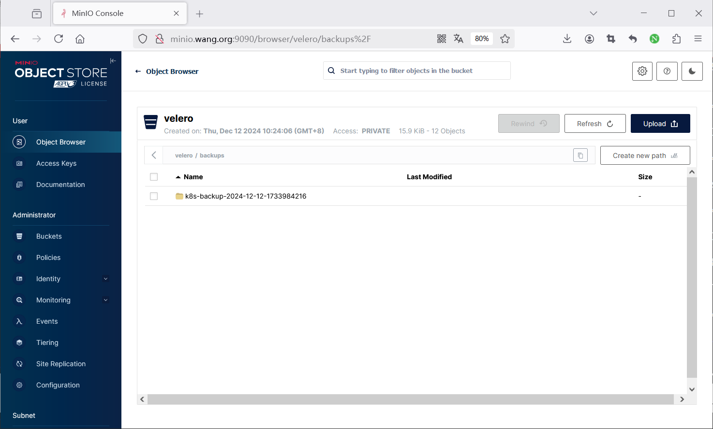

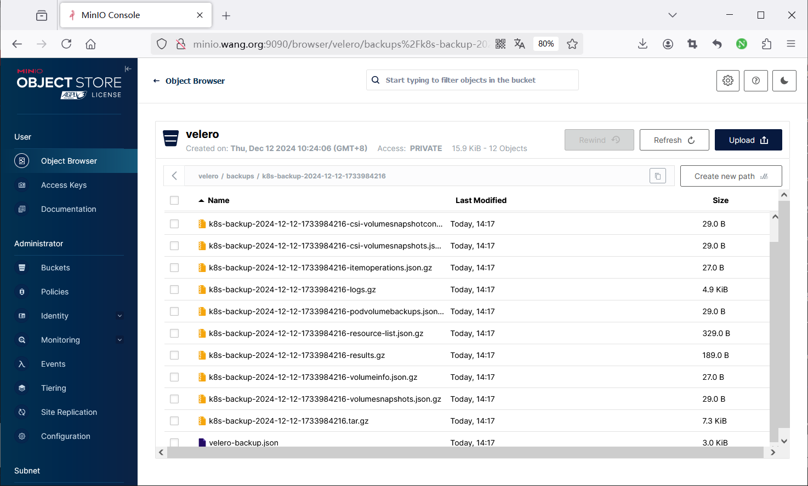

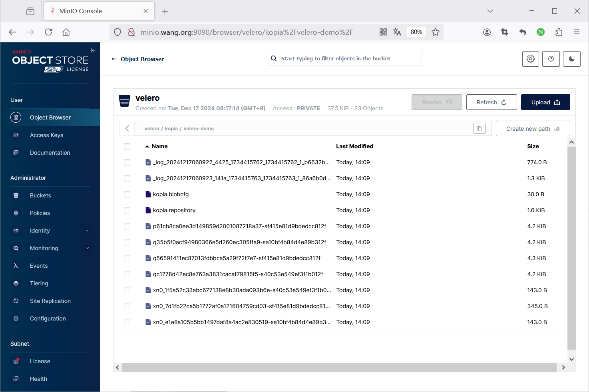

##### 2.4.4.1.6  定时备份

velero支持定时备份
```text
#Examples :
#Create a backup every 6 hours.
velero create schedule NAME --schedule="0 */6 * * *”
# Create a backup every 6 hours with the @every notation.
velero create schedule NAME --schedule="@every 6h"
#Create a daily backup of the web namespace.
velero create schedule NAME --schedule="@every 24h" --include-namespaces web
# Create a weekly backup, each living for 90 days(2160 hours).
velero create schedule NAME --schedule="@every 168h" --ttl 2160h@m0s
```

范例：定时备份
```bash
#每天备份一次
[root@ubuntu2204 ~]#velero schedule create k8s-backup-daily --schedule="@every
24h" --include-namespaces=demo --default-volumes-to-fs-backup --snapshot-
volumes=false  --wait

# 使用cron表达式备份，每天1点备份
[root@ubuntu2204 ~]#velero schedule create k8s-backup-daily --schedule="0 1 * *
*" --include-namespaces=demo --default-volumes-to-fs-backup --snapshot-
volumes=false  --wait

[root@master1 ~]#velero schedule get
NAME               STATUS    CREATED                         SCHEDULE    BACKUP
TTL   LAST BACKUP   SELECTOR   PAUSED
k8s-backup-daily   Enabled   2024-12-12 14:24:01 +0800 CST   * * * * *   0s
n/a           <none>     false

#手动触发定时任务
[root@ubuntu2204 ~]# velero backup create --from-schedule k8s-backup-daily  --
wait

#等一会儿可以查看备份成功
[root@master1 ~]#velero get backup
[root@master1 ~]#velero backup get
NAME                               STATUS      ERRORS   WARNINGS   CREATED
EXPIRES   STORAGE LOCATION   SELECTOR
k8s-backup-2024-12-17-1734415736   Completed   0        0          2024-12-17
14:09:21 +0800 CST   29d       default            <none>
k8s-backup-minute-20241217084453   Completed   0        9          2024-12-17
16:44:53 +0800 CST   29d       default            <none>
k8s-backup-minute-20241217084353   Completed   0        9          2024-12-17
16:43:53 +0800 CST   29d       default            <none
```


```bash
#删除定时备份任务
[root@master1 ~]#velero schedule delete k8s-backup-daily --confirm
Schedule deleted: k8s-backup-daily

#确认删除
[root@master1 ~]#velero schedule get
[root@master1 ~]#
```

#### 3.4.4.2 数据恢复

注意：

velero restore 恢复时不会覆盖已有的资源，只恢复当前集群中不存在的资源。已有的资源不会回滚到之前的版本，如需要回滚，需在restore之前提前删除现有的资源。

##### 2.4.4.2.1 模拟灾难
```bash
# 删除nginx-example命名空间和资源
[root@master1 ~]# kubectl delete namespace demo

# 检查是否删除
[root@master1 ~]# kubectl get all -n demo
No resources found in velero-test namespace.
```

##### 2.4.4.2.2 恢复资源
```bash
#恢复前查看备份名称
[root@master1 ~]#velero backup get
NAME           STATUS      ERRORS   WARNINGS   CREATED
EXPIRES   STORAGE LOCATION   SELECTOR
k8s-backup   Completed   0        0          2024-04-07 21:44:45 +0800 CST   29d
default            <none>

#恢复,在worker节点上可以提前下载相关镜像
[root@node3 ~]#docker pull velero/velero-restore-helper:v1.15.0

[root@master1 ~]#velero restore create --from-backup k8s-backup --wait
Restore request "k8s-backup" submitted successfully.
Waiting for restore to complete. You may safely press ctrl-c to stop waiting -
your restore will continue in the background.
```


Restore completed with status: Completed. You may check for more information using the commands `velero restore describe k8s-backup` and `velero restore logs k8s-backup`.

```bash
#如果恢复定时备份的数据
#使用如下命令恢复指定的备份
[root@master1 ~]#velero restore create --from-backup k8s-backup-daily-
20250612025049 --wait

#恢复定时备份k8s-backup-daily中的最近成功的备份版本
[root@master1 ~]#velero restore create --from-schedule k8s-backup-daily  --wait
```

##### 2.4.4.2.3 检查恢复的资源
```bash
#创建restores资源
[root@master1 ~]#kubectl get restores.velero.io -A
NAMESPACE   NAME                            AGE
velero      k8s-backup                      138m

#完成恢复后，会在MinIO存储中同时创建和一个和backups同级的restores的目录
```

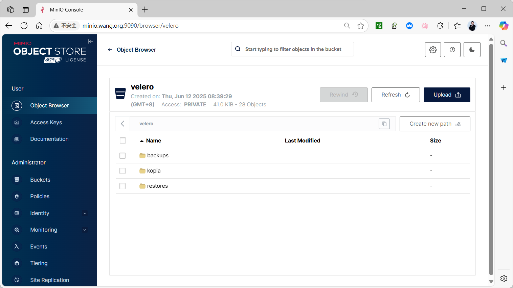


```bash
#查看恢复情况
[root@master1 ~]#velero restore get
NAME         BACKUP   STATUS      STARTED         COMPLETED         ERRORS
WARNINGS   CREATED                 SELECTOR
k8s-backup   Completed  2024-04-06 22:47:30 +0800 CST  2024-04-06 22:47:31 +0800
CST  0 1 2024-04-06 22:47:30 +0800 CST   <none>

#查看详细信息
[root@master1 ~]#velero restore describe k8s-backup --details

Name:         k8s-backup
Namespace:    velero
Labels:       <none>
Annotations:  <none>

Phase:                       Completed
Total items to be restored:  8
Items restored:              8

Started:    2024-12-12 15:30:23 +0800 CST
Completed:  2024-12-12 15:30:23 +0800 CST

Warnings:
Velero:     <none>
Cluster:    <none>
.....
[root@master1 ~]#velero restore logs k8s-backup
time="2024-12-12T07:30:23Z" level=info msg="starting restore"
logSource="pkg/controller/restore_controller.go:535" restore=velero/k8s-backup-
2024-12-12-1733984216-20241212153023
time="2024-12-12T07:30:23Z" level=info msg="Starting restore of backup
velero/k8s-backup-2024-12-12-1733984216" logSource="pkg/restore/restore.go:430"
restore=velero/k8s-backup-2024-12-12-1733984216-20241212153023
time="2024-12-12T07:30:23Z" level=info msg="Resource 'namespaces' will be
restored at cluster scope" logSource="pkg/restore/restore.go:2266"
restore=velero/k8s-backup-2024-12-12-1733984216-20241212153023
time="2024-12-12T07:30:23Z" level=info msg="Skipping restore of resource because
it cannot be resolved via discovery" logSource="pkg/restore/restore.go:2185"
resource=volumesnapshotclass.snapshot.storage.k8s.io restore=velero/k8s-backup-
2024-12-12-1733984216-20241212153023
time="2024-12-12T07:30:23Z" level=info msg="Skipping restore of resource because
it cannot be resolved via discovery" logSource="pkg/restore/restore.go:2185"
resource=volumesnapshotcontents.snapshot.storage.k8s.io restore=velero/k8s-
backup-2024-12-12-1733984216-20241212153023
time="2024-12-12T07:30:23Z" level=info msg="Skipping restore of resource because
it cannot be resolved via discovery" logSource="pkg/restore/restore.go:2185"
resource=volumesnapshots.snapshot.storage.k8s.io restore=velero/k8s-backup-2024-
12-12-1733984216-20241212153023
......

#检查资源恢复
#示例1
[root@master1 ~]#kubectl get pod -n demo
NAME                 READY   STATUS    RESTARTS   AGE
redis-emptydir-pod   1/1     Running   0          9s

[root@master1 ~]#kubectl exec -it -n demo redis-emptydir-pod -- sh
Defaulted container "redis" out of: redis, restore-wait (init)
# redis-cli get name
"bowen"

#示例2
[root@master1 ~]#kubectl get all -n demo
NAME                READY   STATUS    RESTARTS   AGE
pod/redis-pvc-pod   1/1     Running   0          51s
[root@master1 ~]#kubectl get pvc -n demo
NAME        STATUS   VOLUME                                     CAPACITY   ACCESS
MODES   STORAGECLASS   VOLUMEATTRIBUTESCLASS   AGE

redis-pvc   Bound    pvc-c1dda9c0-f49d-4493-a79c-a5a4627f7fa6   2Gi        RWX
sc-nfs         <unset>                 58s
[root@master1 ~]#kubectl exec -it -n demo redis-pvc-pod -- sh
Defaulted container "redis" out of: redis, restore-wait (init)
# ls /data
dump.rdb
# redis-cli get name
"bowen"

#NFS存储的数据也恢复
[root@master1 ~]#ls /data/sc-nfs/
pvc-a2d94be9-310e-4400-b5f3-fa9e207221f9
[root@master1 ~]#tree /data/sc-nfs/
/data/sc-nfs/
└── pvc-a2d94be9-310e-4400-b5f3-fa9e207221f9
└── dump.rdb
```

### 2.4.5 案例: Velero 实现跨 Kubernetes 集群的资源数据迁移

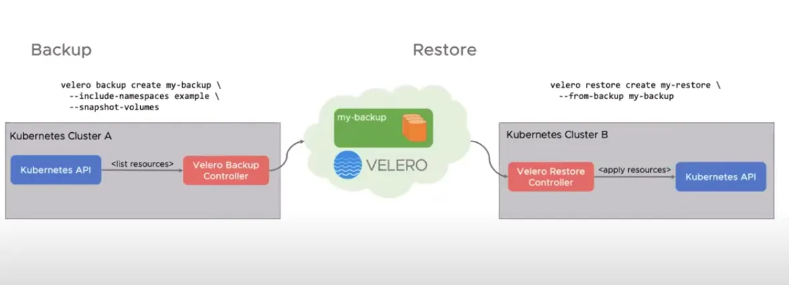

#### 2.4.5.1 迁移前准备

对旧的Kubernetes集群做好备份至MinIO的远程存储安装新的 Kubernetes 集群。

#### 2.4.5.2 新的 Kubernetes 集群安装  velero CLI 并配置 MinIO 认证

注意: 相同版本的 velero CLI和原MinIO相同的认证信息。

范例:
```bash
#在目标K8s集群的Master节点上安装相同版本的velero CLI
[root@master1 ~]# VERSION=v1.17.0
[root@master1 ~]# VERSION=v1.16.2
[root@master1 ~]# VERSION=v1.16.1
#直接下载
[root@master1 ~]# wget https://github.com/vmware-
tanzu/velero/releases/download/${VERSION}/velero-${VERSION}-linux-amd64.tar.gz
#如果下载失败,可以通过代理如下
[root@master1 ~]# wget https://githubfast.com/vmware-
tanzu/velero/releases/download/${VERSION}/velero-${VERSION}-linux-amd64.tar.gz

[root@master1 ~]# tar -zxvf velero-${VERSION}-linux-amd64.tar.gz
[root@master1 ~]# mv velero-${VERSION}-linux-amd64/velero /usr/local/bin/
[root@master1 ~]# velero version
Client:

Version: v1.16.1
Git commit: ea5a89f83b89b2cb7a27f54148683c1ee8d57a37
<error getting server version: no matches for kind "ServerStatusRequest" in
version "velero.io/v1">

[root@master1 ~]#cat credentials-velero
[default]
#aws_access_key_id = admin
#aws_secret_access_key = 12345678
aws_access_key_id = y81QoEEcmV06Zc18e2Fp
aws_secret_access_key = 8VdbRxsgG7Or5yk7f5FXHjs87dOMhjuPmNK8s2cs
```

#### 2.4.5.3 新的 Kubernetes 集群安装 Velero Server

使用和 2.4.3.2 相同的命令安装 Velero Server。

范例:
```bash
#示例1
[root@master1 ~]#velero install \
--provider aws \
--image registry.cn-beijing.aliyuncs.com/bowen/velero:v1.15.0 \
--plugins registry.cn-beijing.aliyuncs.com/bowen/velero-plugin-for-
aws:v1.11.0 \
--backup-location-config
region=minio,s3ForcePathStyle="true",s3Url=http://minio.bowen.org:9000 \
--bucket velero \
--secret-file ./credentials-velero \
--namespace velero \
--use-node-agent \
--use-volume-snapshots=false \
--wait

#示例2
[root@master1 ~]# velero install \
--provider aws \
--image registry.cn-beijing.aliyuncs.com/bowen/velero:v1.15.0 \
--plugins registry.cn-beijing.aliyuncs.com/bowen/velero-plugin-for-
aws:v1.11.0 \
--backup-location-config
region=minio,s3ForcePathStyle="true",s3Url=http://minio.bowen.org:9000 \
--bucket velero \
--secret-file ./credentials-velero \
--namespace velero \
--use-volume-snapshots=false
```

#### 2.4.5.4 新的 Kubernetes 集群下载 MinIO 上备份数据并恢复
```bash
#可以查看到原来旧的Kubernetes集群的备份名称信息
[root@master1 ~]#kubectl get backups.velero.io -n velero
NAME         AGE
k8s-backup   54s

[root@master1 ~]#velero backup-location get

NAME      PROVIDER   BUCKET/PREFIX   PHASE       LAST VALIDATED
ACCESS MODE   DEFAULT
default   aws        velero          Available   2025-06-12 10:04:45 +0800 CST
ReadWrite     true

[root@master1 ~]#velero backup get
NAME           STATUS    ERRORS   WARNINGS   CREATED             EXPIRES
STORAGE LOCATION   SELECTOR
k8s-backup   Completed   0        0          2024-04-07 21:44:45 +0800 CST   29d
default    <none>

#在worker节点上可以提前下载相关镜像,可选
[root@node3 ~]#docker pull velero/velero-restore-helper:v1.15.0

#基于上面查看到的备份名称进行恢复
[root@master1 ~]#velero restore create --from-backup k8s-backup --wait
Restore request "k8s-backup" submitted successfully.
Waiting for restore to complete. You may safely press ctrl-c to stop waiting -
your restore will continue in the background.
```


Restore completed with status: Completed. You may check for more information using the commands `velero restore describe k8s-backup` and `velero restore logs k8s-backup`.


#### 2.4.5.5  新的 Kubernetes 集群检查数据恢复情况
```bash
#查看恢复情况
[root@master1 ~]#velero restore get
NAME                   BACKUP   STATUS      STARTED
COMPLETED                       ERRORS   WARNINGS   CREATED
SELECTOR
k8s-backup       Completed   2024-04-06 22:47:30 +0800 CST   2024-04-06 22:47:31
+0800 CST   0        1          2024-04-06 22:47:30 +0800 CST   <none>

[root@master1 ~]#kubectl  get pod -n demo
NAME            READY   STATUS    RESTARTS   AGE
redis-pvc-pod   1/1     Running   0          6m23s

[root@master1 ~]#kubectl exec -it -n demo redis-pvc-pod -- sh
Defaulted container "redis" out of: redis, restore-wait (init)
# ls /data
dump.rdb
# redis-cli get name
"bowen"
# exit

[root@master1 ~]#ls /data/sc-nfs/
demo-redis-pvc-pvc-93f62187-03f6-4f1c-a0c9-4984a9ab0dd7

[root@master1 velero]#ll /data/sc-nfs/demo-redis-pvc-pvc-93f62187-03f6-4f1c-a0c9-
4984a9ab0dd7/
总计 16
drwxrwxrwx 3 lxd  root 4096 12月 17 12:13 ./
drwxr-xr-x 3 root root 4096 12月 17 12:07 ../
-rw------- 1 lxd   999  104 12月 17 11:41 dump.rdb
drwxr-xr-x 2 lxd  root 4096 12月 17 12:13 .velero/
```



<nav class="article-end" aria-label="章节导航">
  <a href="{{ '/subjects/Kubernetes/33-cluster-nodes.html' | relative_url }}">← 上一章：节点增删与 Token 管理</a>
  <a href="{{ '/subjects/Kubernetes/' | relative_url }}">返回 Kubernetes 目录</a>
  <a href="{{ '/subjects/Kubernetes/35-certificates.html' | relative_url }}">下一章：证书续期与故障处理 →</a>
</nav>
