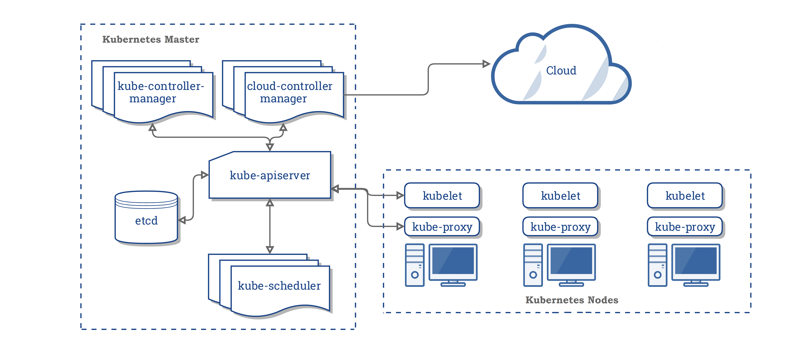

[← 返回 Kubernetes 目录]({{ '/subjects/Kubernetes/' | relative_url }})



# 35 证书续期与故障处理

Kubernetes 控制面、etcd、kubelet 与管理员之间通过 TLS 证书建立身份和加密通信。证书续期要先辨认“谁签发、谁使用、何时到期”，再按部署工具的流程操作；仅让某个证书文件变新，不等于运行中的进程已经加载，也不等于整个信任链健康。



## 1 认识 kubeadm 证书

kubeadm 常见的三套 CA 分别是集群 CA（API Server、客户端）、etcd CA（etcd 服务端、节点间及客户端）和 front-proxy CA（聚合 API 前端代理）。它们和各自签发的终端证书用途不同：`kubeadm certs renew all` 可更新 kubeadm 管理的终端证书，**不会把 CA 证书自动续成新的根信任链**；外部 CA 管理的集群也不能直接套用该命令。

| 证书或配置 | 主要用途 | 常见位置 |
| --- | --- | --- |
| `ca.crt` / `ca.key` | 集群根 CA | `/etc/kubernetes/pki/` |
| `apiserver.crt` | API Server 对客户端证明身份，SAN 须覆盖访问域名和 IP | `/etc/kubernetes/pki/` |
| `apiserver-etcd-client.crt` | API Server 访问 etcd | `/etc/kubernetes/pki/` |
| `apiserver-kubelet-client.crt` | API Server 访问 kubelet | `/etc/kubernetes/pki/` |
| `etcd/server.crt`、`etcd/peer.crt` | etcd 客户端入口与节点间通信 | `/etc/kubernetes/pki/etcd/` |
| `front-proxy-client.crt` | API 聚合层代理身份 | `/etc/kubernetes/pki/` |
| `admin.conf` 等 kubeconfig | 管理员、控制器、调度器连接 API Server 的凭据 | `/etc/kubernetes/` |

不同 Kubernetes/kubeadm 版本、外部 CA 与自定义部署会改变文件及有效期，不能把原实验里“终端证书一年、CA 十年”的输出当作所有集群的固定事实。`super-admin.conf` 在部分版本和初始化节点存在，包含强权限，存放与复制都应特别受控。前端代理 CA 是 Kubernetes API 聚合层使用的信任链，**不是一般 Ingress HTTPS 证书的 CA**。


## 2 到期检查与计划续期

在所有控制平面节点核对时间同步、kubeadm 版本、部署方式和证书来源，再执行检查。错误信息 `certificate has expired or is not yet valid` 既可能表示已过期，也可能是节点时钟偏移；`x509: certificate is valid for ...` 更可能是 SAN 与访问地址不匹配。

```bash
kubeadm certs check-expiration
openssl x509 -in /etc/kubernetes/pki/apiserver.crt -noout -dates -subject -issuer
openssl x509 -in /etc/kubernetes/pki/apiserver.crt -noout -ext subjectAltName
date -u
```

续期前保存 etcd 快照和受限访问的 `/etc/kubernetes` 备份，确认可回滚，预留维护窗口。kubeadm 管理的多控制平面集群需要在**每个控制平面节点**按顺序操作，而不是只在一台机器执行。续期某个证书可用 `kubeadm certs renew <名称>`；若经过变更评估需要全部更新，再用：

```bash
kubeadm certs renew all
kubeadm certs check-expiration
```

更新后按当前部署方式让相关静态 Pod/组件重新加载证书，逐台检查 etcd 健康、API Server 可访问性、控制器与调度器状态。若管理员使用的是复制到 `~/.kube/config` 的旧凭据，还需受控地更新该副本。不要在文档中建议对所有节点同时停掉控制面，也不要以 `kubectl get nodes` 一条命令代替完整验证。

## 3 已过期时分清故障位置

1. **管理员 kubeconfig 过期，而 API Server 仍正常**：先检查 `admin.conf` 的嵌入式客户端证书和本地 `~/.kube/config` 是否不同；按 kubeadm 管理流程续期并替换客户端副本，不要先删除工作节点。
2. **API Server 或 etcd 证书过期**：保留原证书、etcd 数据与清单备份，在控制平面节点使用匹配版本的 kubeadm 续期；随后按高可用拓扑逐台重启/验证。若 CA 本身到期，属于信任链轮换，不能当作普通 `renew all` 处理。
3. **某工作节点 kubelet 客户端证书轮换失败**：先看该节点的 `kubelet.conf`、`/var/lib/kubelet/pki/kubelet-client-current.pem`、kubelet 日志和 CSR；核对自动轮换配置、网络与 API Server 可用性。恢复时按官方步骤在拥有集群 CA 私钥的受控控制平面上为准确节点名重新签发临时 kubeconfig，再让 kubelet 恢复轮换。操作前备份原文件，不要把其他节点的身份文件直接复制过来。

`kubeadm certs renew all` 不负责 kubelet 客户端证书的正常轮换。kubelet 的服务端证书和客户端证书也不是同一回事。若是外部 CA、托管 Kubernetes 或 kubeasz 等工具部署，应遵循相应管理方的证书生命周期流程，避免 kubeadm 覆盖其管理的文件。

## 4 不采用“永久有效”证书

旧笔记末尾通过修改 kubeadm 源码，把终端证书改成 100 年、CA 改成 200 年，再重新编译。这只是当时的实验记录，不是推荐的运维方案：它会扩大私钥泄露后的风险窗口、破坏常规轮换机制，还可能导致不同节点运行不同版本工具。正确做法是记录到期日、提前告警、定期轮换和演练；若确需调整有效期，也应使用所选 kubeadm 版本公开支持的配置字段并经风险评估，而不是维护私有补丁以回避续期。

完成后记录各证书的新 `Not After`、签发者、SAN、组件加载情况和下一次告警时间。回滚时只能把与当时 etcd/组件状态相容的一整套配置恢复，不能随机混合新旧 CA 与终端证书。



<nav class="article-end" aria-label="章节导航">
  <a href="{{ '/subjects/Kubernetes/34-backup-restore.html' | relative_url }}">← 上一篇：集群备份、恢复与迁移</a>
  <a href="{{ '/subjects/Kubernetes/' | relative_url }}">返回 Kubernetes 目录</a>
  <a href="{{ '/subjects/Kubernetes/36-upgrade-optimization.html' | relative_url }}">下一篇：版本升级与性能优化 →</a>
</nav>
