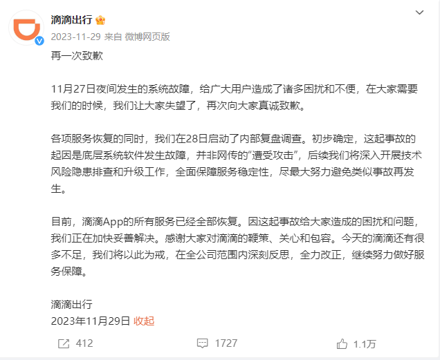
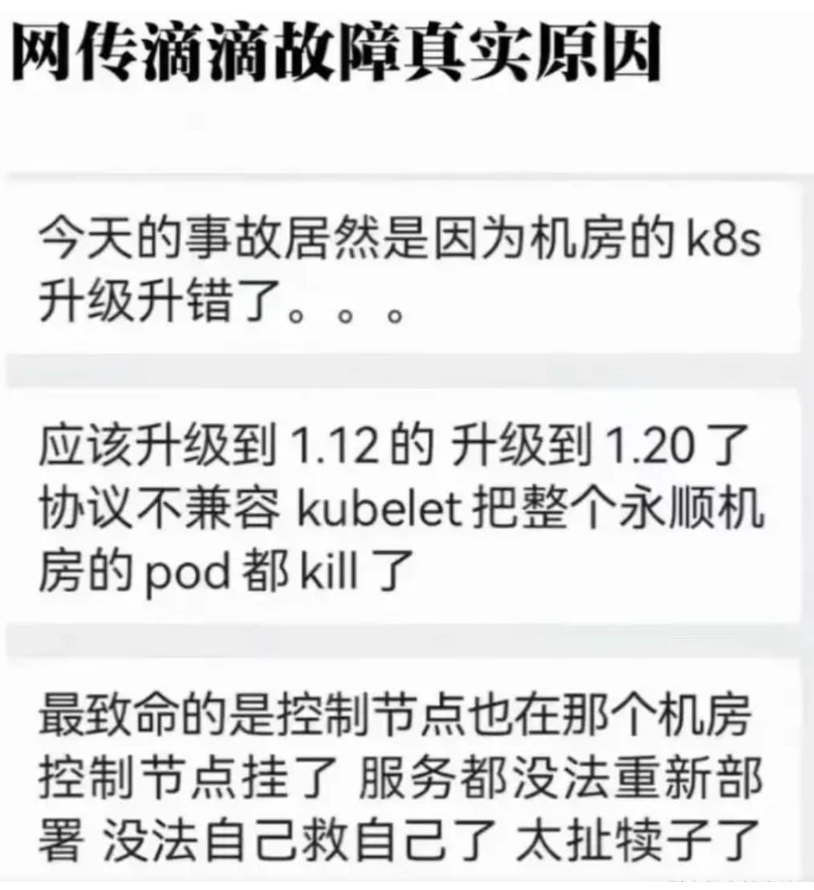
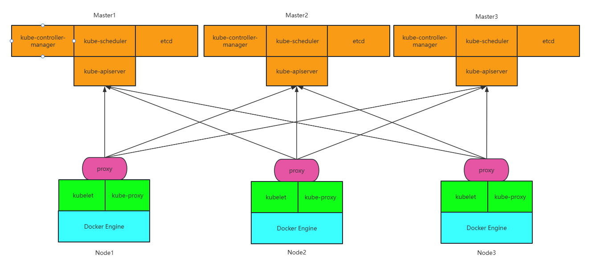

[← 返回 Kubernetes 目录]({{ '/subjects/Kubernetes/' | relative_url }})



# 36 版本升级与性能优化

# 4 Kubernetes 版本升级

2023年11月27日滴滴升级Kubernetes失败，造成数亿损失。





kubernetes 集群后期会更新和证书的有效期等原因，可能在某个阶段会对当前的软件版本进行调整，可能是版本升级，也可能是版本回退。但是这些场景的操作方法基本上是一样的。Kubernetes 集群支持大版本和小版本的升级,但是大版本只能升级到下一次版本,不支持跨版本升级。

比如:1.20.1可以升级到1.20.6和1.21.3,但不支持升级到1.22.0。

升级 kubernetes 集群前,必须先升级 kubeadm 版本。

注意: 升级有风险，有条件建议新建集群，而非升级。

生产环境应该业务相对空闲时,逐个节点离线升级后再上线,而非全部升级。

## 4.1 升级流程说明
<https://kubernetes.io/zh-cn/docs/tasks/administer-cluster/kubeadm/kubeadm-upgrade/>

本页介绍如何将 kubeadm 创建的 Kubernetes 集群从 1.33.x 版本 升级到 1.34.x 版本以及从 1.34.x 升级到 1.34.y（其中 y > x ）。略过次版本号的升级是 不被支持的。更多详情请访问版本偏差策略。升级 Kubernetes 集群是一个复杂的过程，需要谨慎操作，以确保集群的稳定性和数据的安全性。

升级 Kubernetes 的过程通常包括以下几个步骤：

升级工作的基本流程如下：

**升级第一台控制平面节点**

1. 更改软件包仓库，确定目标版本。
2. 升级 kubeadm，并验证升级计划。
3. 执行升级计划：`kubeadm upgrade apply`。
4. 腾空节点，升级 kubelet 和 kubectl，然后解除节点的保护。

**升级其他控制平面节点**

1. 更改软件包仓库并升级 kubeadm。
2. 执行 `kubeadm upgrade node`。
3. 腾空节点，升级 kubelet 和 kubectl，然后解除节点的保护。

**升级工作节点**

1. 更改软件包仓库并升级 kubeadm。
2. 执行 `kubeadm upgrade node`。
3. 腾空节点，升级 kubelet 和 kubectl，然后取消对节点的保护。

### 4.1.1 升级前的准备工作

#### 4.1.1.1 检查当前集群版本

首先，确认当前 Kubernetes 集群的版本。
```text
kubectl version #--short
```

#### 4.1.1.2 查看升级路径

Kubernetes 的升级路径是有限制的，通常只能升级到次要版本（例如，从 1.24.x 升级到1.25.x ）。不能跳过次要版本（例如，从 1.23.x 直接升级到 1.25.x 是不允许的）。

查看 Kubernetes 官方文档，确认升级路径：

Kubernetes 版本和版本偏差支持策略

范例：从1.27无法直接升级到1.34
```bash
[root@master1 ~]#kubectl version --short
Flag --short has been deprecated, and will be removed in the future. The --short
output will become the default.
Client Version: v1.27.3
Kustomize Version: v5.0.1

[root@master1 ~]#kubeadm  upgrade plan
[preflight] Running pre-flight checks.
[upgrade/config] Reading configuration from the "kubeadm-config" ConfigMap in
namespace "kube-system"...
[upgrade/config] Use 'kubeadm init phase upload-config kubeadm --config your-
config-file' to re-upload it.
error: [upgrade/init config] FATAL: this version of kubeadm only supports
deploying clusters with the control plane version >= 1.33.0. Current version:
v1.27.3
To see the stack trace of this error execute with --v=5 or higher
```

#### 4.1.1.3 备份集群

在升级之前，务必备份集群的状态，包括：

ETCD 数据：使用 etcdctl 备份 ETCD。Kubernetes 资源：使用 kubectl 导出资源。持久化存储数据：备份 PersistentVolume 中的数据。

### 4.1.2 升级 Kubernetes 控制平面

**控制平面包括以下组件**：API Server Controller Manager Scheduler ETCD。

#### 4.1.2.1 升级 kubeadm

如果使用 kubeadm 部署的 Kubernetes 集群，首先需要升级 kubeadm 。

1. 升级 kubeadm：使用包管理器（如 yum 或 apt ）升级 kubeadm 。
```bash
sudo apt-get update
sudo apt-get install -y kubeadm=1.25.0-00
```

2. 验证 kubeadm 版本：
```text
kubeadm version
```

#### 4.1.2.2 升级控制平面

1. 规划升级顺序：

如果集群有多个控制平面节点，逐个升级每个节点。

2. 升级第一个控制平面节点：
```bash
sudo kubeadm upgrade plan
sudo kubeadm upgrade apply v1.25.0
```

3. 升级其他控制平面节点：
```text
sudo kubeadm upgrade node
```

4. 升级 kubelet 和 kubectl：在每个控制平面节点上升级 kubelet 和 kubectl 。
```bash
sudo apt-get install -y kubelet=1.25.0-00 kubectl=1.25.0-00
sudo systemctl restart kubelet
```

### 4.1.3 升级工作节点

#### 4.1.3.1 升级工作节点

1. 规划升级顺序：

逐个升级工作节点，避免一次性升级所有节点导致服务中断。

2. 升级工作节点：
```text
sudo kubeadm upgrade node
```

3. 升级 kubelet：在每个工作节点上升级 kubelet 。
```bash
sudo apt-get install -y kubelet=1.25.0-00
sudo systemctl restart kubelet
```

#### 4.1.3.2 驱逐节点

在升级工作节点之前，需要将节点上的 Pod 驱逐到其他节点。

1. 标记节点为不可调度：
```text
kubectl cordon <node-name>
```

2. 驱逐节点上的 Pod：
```text
kubectl drain <node-name> --ignore-daemonsets --delete-emptydir-data
```

3. 升级完成后，标记节点为可调度：
```text
kubectl uncordon <node-name>
```

### 4.1.4. 验证升级

#### 4.1.4.1 检查集群状态

升级完成后，检查集群的状态。
```bash
kubectl get nodes
kubectl get pods --all-namespaces
```

#### 4.1.4.2 检查组件版本

确认所有组件已升级到目标版本。
```text
kubectl version --short
```

### 4.1.5. 常见问题及解决方案

#### 4.1.5.1 升级失败

如果升级过程中出现错误，可以尝试以下步骤：

回滚：如果升级失败，可以回滚到之前的版本。

检查日志：查看 kubelet 和 kubeadm 的日志，排查问题。
```text
journalctl -u kubelet -f
```

#### 4.1.5.2 节点无法加入集群

如果新版本的节点无法加入集群，可能是由于证书或配置问题。可以尝试重新生成证书。
```text
sudo kubeadm init phase upload-certs --upload-certs
```

### 4.1.6 升级总结

升级 Kubernetes 集群是一个分阶段的过程，需要谨慎操作：

1. 备份集群：确保在升级前备份 ETCD 和资源。

2. 升级控制平面：逐个升级控制平面节点。

3. 升级工作节点：逐个升级工作节点，并驱逐 Pod。

4. 验证升级：检查集群状态和组件版本。

通过以上步骤，可以安全地升级 Kubernetes 集群，确保集群的稳定性和高可用性。

### 4.1.1 升级 master 节点

**升级kubeadm、kubelet、kubectl版本**
```bash
apt-cache madison kubelet | kubeadm | kubectl
apt install kubelet=版本号 kubeadm=版本号 kubectl=版本号
```

**查看升级计划**
```text
kubeadm upgrade plan
```

**执行升级**
```text
kubeadm upgrade apply <版本号>
```

### 4.1.2 升级 worker节点

**查看软件版本**
```text
apt-cache madison kubelet | kubeadm
```

**更新软件版本**
```text
apt install kubelet=版本号 kubeadm=版本号
```

**升级node节点**
```text
kubeadm upgrade node
#注意：老版本需要有 "--kubelet-version 版本号" 参数，但是对于最新版的k8s来说，不需要任
何参数
```

## 4.2 范例: 升级 kubertnetes 集群版本

### 4.2.1 升级 master 节点

升级所有 master 的服务 kube-controller-manager、kube-apiserver、 kube-scheduler、kube-proxy

注意：不要同时升级master节点，需要保证升级时要有大于n/2个ETCD节点正常工作。

#### 4.2.1.1 先将需要升级的master节点下线服务
```bash
[root@ha1 ~]#vim /etc/haproxy/haproxy.cfg
listen  kubernetes-api-6443
bind 10.0.0.100:6443
mode tcp
#server master1 10.0.0.101:6443 check inter 3s fall 3 rise 3
server master2 10.0.0.102:6443 check inter 3s fall 3 rise 3
server master3 10.0.0.103:6443 check inter 3s fall 3 rise 3

[root@ha1 ~]#sytemctl restart haproxy
```

#### 4.2.1.2 验证 kubernetes 当前版本
```bash
[root@master1 ~]#kubeadm  version
kubeadm version: &version.Info{Major:"1", Minor:"22", GitVersion:"v1.22.1",
GitCommit:"632ed300f2c34f6d6d15ca4cef3d3c7073412212", GitTreeState:"clean",
BuildDate:"2021-08-19T15:44:22Z", GoVersion:"go1.16.7", Compiler:"gc",
Platform:"linux/amd64"}

[root@master1 ~]#kubelet --version
Kubernetes v1.22.1

[root@master1 ~]#kubectl version
Client Version: v1.22.1
Kustomize Version: v5.7.1
```

#### 4.2.1.3  在升级的 master 安装指定新版本 kubeadm kubelet  kubectl
```bash
#查看kubernetes可升级的版本列表
[root@master1 ~]#url -fsSL https://mirrors.aliyun.com/kubernetes-new/core/stable/v1.34/deb/Release.key |
gpg --dearmor -o /etc/apt/keyrings/kubernetes-apt-keyring.gpg

[root@master1 ~]#echo "deb [signed-by=/etc/apt/keyrings/kubernetes-apt-
keyring.gpg] https://mirrors.aliyun.com/kubernetes-new/core/stable/v1.34/deb/ /"
|
tee /etc/apt/sources.list.d/kubernetes.list

[root@master1 ~]#apt update
[root@master1 ~]#apt-cache  madison kubeadm kubelet kubectl

#同时升级多个软件
#升级到最新版本
[root@master1 ~]#apt -y install kubeadm kubelet kubectl
#升级到指定版本
[root@master1 ~]#apt -y install kubeadm=1.23.4-00 kubelet=1.23.4-00
kubectl=1.23.4-00

#验证升级的版本
[root@master1 ~]#kubectl version
[root@master1 ~]#kubeadm version
[root@master1 ~]#kubelet --version
```

#### 4.2.1.4 在升级的 master 节点验证升级计划

执行升级计划，可以了解升级的版本信息。
```bash
[root@master1 ~]#kubeadm  upgrade plan
[upgrade/config] Making sure the configuration is correct:
[upgrade/config] Reading configuration from the cluster...
[upgrade/config] FYI: You can look at this config file with 'kubectl -n kube-
system get cm kubeadm-config -o yaml'
[preflight] Running pre-flight checks.
[upgrade] Running cluster health checks
[upgrade] Fetching available versions to upgrade to
[upgrade/versions] Cluster version: v1.22.1
[upgrade/versions] kubeadm version: v1.23.4

W0224 15:40:12.644866  216106 version.go:103] could not fetch a Kubernetes
version from the internet: unable to get URL
"https://dl.k8s.io/release/stable.txt": Get
"https://dl.k8s.io/release/stable.txt": context deadline exceeded (Client.Timeout
exceeded while awaiting headers)
W0224 15:40:12.644967  216106 version.go:104] falling back to the local client
version: v1.23.4
[upgrade/versions] Target version: v1.23.4
W0224 15:40:22.671179  216106 version.go:103] could not fetch a Kubernetes
version from the internet: unable to get URL "https://dl.k8s.io/release/stable-
1.22.txt": Get "https://dl.k8s.io/release/stable-1.22.txt": context deadline
exceeded (Client.Timeout exceeded while awaiting headers)
W0224 15:40:22.671224  216106 version.go:104] falling back to the local client
version: v1.23.4
[upgrade/versions] Latest version in the v1.22 series: v1.23.4

Components that must be upgraded manually after you have upgraded the control
plane with 'kubeadm upgrade apply':
COMPONENT   CURRENT       TARGET
kubelet     5 x v1.22.1   v1.23.4
1 x v1.23.4   v1.23.4

Upgrade to the latest version in the v1.22 series:

COMPONENT                 CURRENT   TARGET
kube-apiserver            v1.22.1   v1.23.4
kube-controller-manager   v1.22.1   v1.23.4
kube-scheduler            v1.22.1   v1.23.4
kube-proxy                v1.22.1   v1.23.4
CoreDNS                   v1.8.4    v1.8.6
etcd                      3.5.0-0   3.5.1-0

You can now apply the upgrade by executing the following command:

kubeadm upgrade apply v1.23.4

_____________________________________________________________________
```


The table below shows the current state of component configs as understood by this version of kubeadm. Configs that have a "yes" mark in the "MANUAL UPGRADE REQUIRED" column require manual config upgrade or resetting to kubeadm defaults before a successful upgrade can be performed. The version to manually upgrade to is denoted in the "PREFERRED VERSION" column.

```text
API GROUP                 CURRENT VERSION   PREFERRED VERSION   MANUAL UPGRADE
REQUIRED
kubeproxy.config.k8s.io   v1alpha1          v1alpha1            no
kubelet.config.k8s.io     v1beta1           v1beta1             no
_____________________________________________________________________
```

#### 4.2.1.5 在升级的 master 节点开始升级

说明：
kubeadm upgrade 也会自动对 kubeadm 在节点上所管理的证书执行续约操作。 如果需要略过证书续约操作，可以使用标志 `--certificate-renewal=false`

注意：此步需要较高的内存，如果内存太小会出现OOM现象，建议2G以上内存。
```bash
#根据提示命令，更新到指定的软件版本
[root@master1 ~]#kubeadm upgrade apply v1.23.4 -y
#以下执行过程显示
[upgrade/config] Making sure the configuration is correct:
[upgrade/config] Reading configuration from the cluster...
[upgrade/config] FYI: You can look at this config file with 'kubectl -n kube-
system get cm kubeadm-config -o yaml'
W0224 15:43:03.772765  217110 utils.go:69] The recommended value for
"resolvConf" in "KubeletConfiguration" is: /run/systemd/resolve/resolv.conf; the
provided value is: /run/systemd/resolve/resolv.conf
[preflight] Running pre-flight checks.
[upgrade] Running cluster health checks
[upgrade/version] You have chosen to change the cluster version to "v1.23.4"
[upgrade/versions] Cluster version: v1.22.1
[upgrade/versions] kubeadm version: v1.23.4
[upgrade/confirm] Are you sure you want to proceed with the upgrade? [y/N]: y
[upgrade/prepull] Pulling images required for setting up a Kubernetes cluster
[upgrade/prepull] This might take a minute or two, depending on the speed of your
internet connection
[upgrade/prepull] You can also perform this action in beforehand using 'kubeadm
config images pull'
......
[bootstrap-token] configured RBAC rules to allow the csrapprover controller
automatically approve CSRs from a Node Bootstrap Token
[bootstrap-token] configured RBAC rules to allow certificate rotation for all
node client certificates in the cluster
[addons] Applied essential addon: CoreDNS
[addons] Applied essential addon: kube-proxy

[upgrade/successful] SUCCESS! Your cluster was upgraded to "v1.23.4". Enjoy!

[upgrade/kubelet] Now that your control plane is upgraded, please proceed with
upgrading your kubelets if you haven't already done so

#更新k8s核心组件镜像
[root@master1 ~]#grep image: /etc/kubernetes/manifests/*.yaml
/etc/kubernetes/manifests/etcd.yaml:    image:
registry.aliyuncs.com/google_containers/etcd:3.6.4-0
/etc/kubernetes/manifests/kube-apiserver.yaml:    image:
registry.aliyuncs.com/google_containers/kube-apiserver:v1.34.0
/etc/kubernetes/manifests/kube-controller-manager.yaml:    image:
registry.aliyuncs.com/google_containers/kube-controller-manager:v1.34.0
/etc/kubernetes/manifests/kube-scheduler.yaml:    image:
registry.aliyuncs.com/google_containers/kube-scheduler:v1.34.0

[root@master1 ~]#systemctl restart kubelet

#证书也自动更新
[root@master1 ~]#kubeadm  certs  check-expiration
[check-expiration] Reading configuration from the "kubeadm-config" ConfigMap in
namespace "kube-system"...
[check-expiration] Use 'kubeadm init phase upload-config kubeadm --config your-
config-file' to re-upload it.

CERTIFICATE                EXPIRES                  RESIDUAL TIME   CERTIFICATE
AUTHORITY   EXTERNALLY MANAGED
admin.conf                 Aug 28, 2026 06:24 UTC   364d            ca
no
apiserver                  Aug 28, 2026 06:24 UTC   364d            ca
no
apiserver-etcd-client      Aug 28, 2026 06:24 UTC   364d            etcd-ca
no
apiserver-kubelet-client   Aug 28, 2026 06:24 UTC   364d            ca
no
controller-manager.conf    Aug 28, 2026 06:24 UTC   364d            ca
no
etcd-healthcheck-client    Aug 28, 2026 06:24 UTC   364d            etcd-ca
no
etcd-peer                  Aug 28, 2026 06:24 UTC   364d            etcd-ca
no
etcd-server                Aug 28, 2026 06:24 UTC   364d            etcd-ca
no
front-proxy-client         Aug 28, 2026 06:24 UTC   364d            front-proxy-
ca          no
scheduler.conf             Aug 28, 2026 06:24 UTC   364d            ca
no
super-admin.conf           Aug 28, 2026 06:24 UTC   364d            ca
no

CERTIFICATE AUTHORITY   EXPIRES                  RESIDUAL TIME   EXTERNALLY
MANAGED
ca                      Aug 02, 2035 01:11 UTC   9y              no
etcd-ca                 Aug 02, 2035 01:11 UTC   9y              no
front-proxy-ca          Aug 02, 2035 01:11 UTC   9y              no
```

#### 4.2.1.6 验证master是否升级完成
```bash
#验证master是否升级
[root@master1 ~]#kubectl get nodes
NAME                 STATUS   ROLES                  AGE     VERSION
master1.bowen.org   Ready    control-plane,master   47h     v1.23.4
master2.bowen.org   Ready    control-plane,master   46h     v1.22.1
master3.bowen.org   Ready    control-plane,master   3h51m   v1.22.1
node1.bowen.org     Ready    <none>                 46h     v1.22.1
node2.bowen.org     Ready    <none>                 45h     v1.22.1
node3.bowen.org     Ready    <none>                 4h8m    v1.22.1

#验证kubernets相关镜像版本是否升级
[root@master1 ~]#docker images |grep v1.2
registry.cn-hangzhou.aliyuncs.com/google_containers/kube-apiserver
v1.23.4   62930710c963   7 days ago      135MB
registry.cn-hangzhou.aliyuncs.com/google_containers/kube-proxy
v1.23.4   2114245ec4d6   7 days ago      112MB

registry.cn-hangzhou.aliyuncs.com/google_containers/kube-controller-manager
v1.23.4   25444908517a   7 days ago      125MB
registry.cn-hangzhou.aliyuncs.com/google_containers/kube-scheduler
v1.23.4   aceacb6244f9   7 days ago      53.5MB
registry.cn-hangzhou.aliyuncs.com/google_containers/kube-apiserver
v1.22.1   f30469a2491a   6 months ago    128MB
registry.cn-hangzhou.aliyuncs.com/google_containers/kube-scheduler
v1.22.1   aca5ededae9c   6 months ago    52.7MB
registry.cn-hangzhou.aliyuncs.com/google_containers/kube-controller-manager
v1.22.1   6e002eb89a88   6 months ago    122MB
registry.cn-hangzhou.aliyuncs.com/google_containers/kube-proxy
v1.22.1   36c4ebbc9d97   6 months ago    104MB
```

#### 4.2.1.7  将其它master节点升级

依次更新其它的master节点

注意: 在反向代理上应该先将要更新的节点下线再升级。
```bash
#查看kubernetes可升级的版本列表
[root@master2 ~]#curl -fsSL https://mirrors.aliyun.com/kubernetes-new/core/stable/v1.34/deb/Release.key |
gpg --dearmor -o /etc/apt/keyrings/kubernetes-apt-keyring.gpg

[root@master2 ~]#echo "deb [signed-by=/etc/apt/keyrings/kubernetes-apt-
keyring.gpg] https://mirrors.aliyun.com/kubernetes-new/core/stable/v1.34/deb/ /"
|
tee /etc/apt/sources.list.d/kubernetes.list

[root@master2 ~]#apt update
[root@master2 ~]#apt-cache  madison kubeadm kubelet kubectl

#同时升级多个软件
#升级到最新版本
[root@master1 ~]#apt -y install kubeadm kubelet kubectl
#升级到指定版本
[root@master2 ~]#apt -y install kubeadm=1.23.4-00 kubelet=1.23.4-00
kubectl=1.23.4-00

#升级
[root@master2 ~]#kubedm upgrade node

#以下为最终结果
[root@master1 ~]#kubectl get nodes
NAME                 STATUS   ROLES                  AGE     VERSION
master1.bowen.org   Ready    control-plane,master   2d      v1.23.4
master2.bowen.org   Ready    control-plane,master   46h     v1.23.4
master3.bowen.org   Ready    control-plane,master   3h58m   v1.23.4
node1.bowen.org     Ready    <none>                 46h     v1.22.1
node2.bowen.org     Ready    <none>                 46h     v1.22.1
node3.bowen.org     Ready    <none>                 4h15m   v1.22.1

#查看证书也会更新有效期
[root@master1 ~]#kubeadm certs check-expiration

#重启

[root@master2 ~]#systemctl daemon-reload
[root@master2 ~]#systemctl restart kubelet
```

### 4.2.2 升级 worker 节点

升级客户端软件 kubectl 和 kubelet 版本

升级注意事项：

在更新前，不要接收任何新的业务请求在更新前，驱离所有现有的业务。

#### 4.2.2.1 验证当前 worker 版本信息

**查看当前 node 节点采用的旧版本**
```bash
[root@master1 ~]#kubectl get nodes
NAME                 STATUS   ROLES                  AGE     VERSION
master1.bowen.org   Ready    control-plane,master   2d      v1.23.4
master2.bowen.org   Ready    control-plane,master   46h     v1.23.4
master3.bowen.org   Ready    control-plane,master   3h58m   v1.23.4
node1.bowen.org     Ready    <none>                 46h     v1.22.1
node2.bowen.org     Ready    <none>                 46h     v1.22.1
node3.bowen.org     Ready    <none>                 4h15m   v1.22.1
```

#### 4.2.2.2 将需要更新的节点冻结并驱离所有请求
```bash
#隔离需要升级的节点，将不再接受新请求
[root@master1 ~]#kubectl cordon node1.bowen.org
node/node1.bowen.org cordoned

[root@master1 ~]#kubectl get nodes node1.bowen.org -o yaml|grep -i -A5 taints
taints:
- effect: NoSchedule
key: node.kubernetes.io/unschedulable
timeAdded: "2025-08-28T06:34:24Z"
unschedulable: true
status:

[root@master1 ~]#kubectl get nodes
NAME                 STATUS                     ROLES                  AGE
VERSION
master1.bowen.org   Ready                      control-plane,master   2d
v1.23.4
master2.bowen.org   Ready                      control-plane,master   46h
v1.23.4
master3.bowen.org   Ready                      control-plane,master   4h17m
v1.23.4
node1.bowen.org     Ready,SchedulingDisabled   <none>                 46h
v1.22.1
node2.bowen.org     Ready                      <none>                 46h
v1.22.1
node3.bowen.org     Ready                      <none>                 4h34m
v1.22.1

#驱离节点上面的现有资源
[root@master1 ~]#kubectl drain node1.bowen.org --delete-emptydir-data --ignore-
daemonsets --force

#查看当前节点不存在pod资源
[root@master1 ~]#kubectl get pods -o wide
```

#### 4.2.2.3 在升级的worker 节点升级二进制包

**在node节点将 kubeadm、kubelet 升级**
```bash
[root@node1 ~]#curl -fsSL https://mirrors.aliyun.com/kubernetes-new/core/stable/v1.34/deb/Release.key |
gpg --dearmor -o /etc/apt/keyrings/kubernetes-apt-keyring.gpg

[root@node1 ~]#echo "deb [signed-by=/etc/apt/keyrings/kubernetes-apt-
keyring.gpg] https://mirrors.aliyun.com/kubernetes-new/core/stable/v1.34/deb/ /"
|
tee /etc/apt/sources.list.d/kubernetes.list
[root@node1 ~]#apt update && apt-cache  madison kubeadm kubelet
#升级到最新版本
[root@node1 ~]#apt update && apt -y install kubeadm kubelet
#升级到指定版本
[root@node1 ~]#apt update && apt -y install kubeadm=1.23.4-00 kubelet=1.23.4-00

#验证版本升级
[root@node1 ~]#kubeadm version
kubeadm version: &version.Info{Major:"1", Minor:"23", GitVersion:"v1.23.4",
GitCommit:"e6c093d87ea4cbb530a7b2ae91e54c0842d8308a", GitTreeState:"clean",
BuildDate:"2022-02-16T12:36:57Z", GoVersion:"go1.17.7", Compiler:"gc",
Platform:"linux/amd64"}

[root@node1 ~]#kubelet --version
Kubernetes v1.23.4
```

#### 4.2.2.4 在worker节点执行升级 worker 节点
```bash
[root@node1 ~]#kubeadm  upgrade node
[upgrade] Reading configuration from the "kubeadm-config" ConfigMap in namespace
"kube-system"...
[upgrade] Use 'kubeadm init phase upload-config kubeadm --config your-config-
file' to re-upload it.
[upgrade/preflight] Running pre-flight checks
[upgrade/preflight] Skipping prepull. Not a control plane node.
[upgrade/control-plane] Skipping phase. Not a control plane node.
[upgrade/kubeconfig] Skipping phase. Not a control plane node.
W0828 14:42:26.282572  153714 postupgrade.go:116] Using temporary directory
/etc/kubernetes/tmp/kubeadm-kubelet-config1203422726 for kubelet config. To
override it set the environment variable KUBEADM_UPGRADE_DRYRUN_DIR
[upgrade] Backing up kubelet config file to /etc/kubernetes/tmp/kubeadm-kubelet-
config1203422726/config.yaml
[kubelet-start] Writing kubelet environment file with flags to file
"/var/lib/kubelet/kubeadm-flags.env"
[kubelet-start] Writing kubelet configuration to file "/var/lib/kubelet/instance-
config.yaml"
```


[patches] Applied patch of type "application/strategic-merge-patch+json" to target "kubeletconfiguration"[kubelet-start] Writing kubelet configuration to file"/var/lib/kubelet/config.yaml"[upgrade/kubelet-config] The kubelet configuration for this node was successfully upgraded![upgrade/addon] Skipping the addon/coredns phase. Not a control plane node.[upgrade/addon] Skipping the addon/kube-proxy phase. Not a control plane node.

```bash
#重启
[root@node1 ~]#systemctl daemon-reload
[root@node1 ~]#systemctl restart kubelet

#验证升级版本
[root@master1 ~]#kubectl get node
NAME                 STATUS                     ROLES                  AGE
VERSION
master1.bowen.org   Ready                      control-plane,master   2d
v1.23.4
master2.bowen.org   Ready                      control-plane,master   46h
v1.23.4
master3.bowen.org   Ready                      control-plane,master   4h24m
v1.23.4
node1.bowen.org     Ready,SchedulingDisabled   <none>                 46h
v1.23.4
node2.bowen.org     Ready                      <none>                 46h
v1.22.1
node3.bowen.org     Ready                      <none>                 4h41m
v1.22.1
```

#### 4.2.2.5 恢复worker节点可以正常调度
```bash
[root@master1 ~]#kubectl uncordon node1.bowen.org

[root@master1 ~]#kubectl get nodes node1.bowen.org -o yaml|grep -i -A5 taints
[root@master1 ~]#

[root@master1 ~]#kubectl get node
NAME                 STATUS   ROLES                  AGE     VERSION
master1.bowen.org   Ready    control-plane,master   2d      v1.23.4
master2.bowen.org   Ready    control-plane,master   46h     v1.23.4
master3.bowen.org   Ready    control-plane,master   4h27m   v1.23.4
node1.bowen.org     Ready    <none>                 46h     v1.23.4
node2.bowen.org     Ready    <none>                 46h     v1.22.1
node3.bowen.org     Ready    <none>                 4h44m   v1.22.1
```

#### 4.2.2.6 将其它worker节点逐个升级

重复以上过程，逐个升级所有node节点。

#### 4.2.2.7 验证升级结果
```bash
#最终结果
[root@master1 ~]#kubectl get node
NAME                 STATUS   ROLES                  AGE     VERSION
master1.bowen.org   Ready    control-plane,master   2d      v1.23.4
master2.bowen.org   Ready    control-plane,master   47h     v1.23.4
master3.bowen.org   Ready    control-plane,master   4h42m   v1.23.4
node1.bowen.org     Ready    <none>                 46h     v1.23.4
node2.bowen.org     Ready    <none>                 46h     v1.23.4
node3.bowen.org     Ready    <none>                 4h59m   v1.23.4

#创建pod
[root@master1 ~]#kubectl  create deployment myapp --image registry.cn-
beijing.aliyuncs.com/bowen/pod-test:v0.1 --replicas 3
deployment.apps/myapp created

[root@master1 ~]#kubectl  get pod -o wide
NAME                     READY   STATUS    RESTARTS   AGE   IP            NODE
NOMINATED NODE   READINESS GATES
myapp-6d67457cf5-jw92s   1/1     Running   0          20s   10.244.4.15
node3.bowen.org   <none>           <none>
myapp-6d67457cf5-sknj4   1/1     Running   0          20s   10.244.2.15
node2.bowen.org   <none>           <none>
myapp-6d67457cf5-z78bs   1/1     Running   0          20s   10.244.1.15
node1.bowen.org   <none>           <none>

#检查证书也自动更新至最新时间
[root@master1 ~]#kubeadm  certs  check-expiration
```

# 5 Kubernetes 集群性能优化

可以在每个worker节点都配置各自的负载均衡服务，从而避免集中的负载均衡器的性能瓶颈。



范例：配置每个节点的Proxy
```yaml
#查看worker节点连接api server的地址信息为https://kubeapi.bowen.org:6443。因此实现基于此域
名实现负载均衡
[root@node1 ~]#cat  /etc/kubernetes/kubelet.conf
apiVersion: v1
clusters:

- cluster:
certificate-authority-data:
LS0tLS1CRUdJTiBDRVJUSUZJQ0FURS0tLS0tCk1JSUMvakNDQWVhZ0F3SUJBZ0lCQURBTkJna3Foa2lH
OXcwQkFRc0ZBREFWTVJNd0VRWURW
server: https://kubeapi.bowen.org:6443 #API地址
name: kubernetes
contexts:
- context:
cluster: kubernetes
user: system:node:master1.bowen.org
name: system:node:master1.bowen.org@kubernetes
current-context: system:node:master1.bowen.org@kubernetes
kind: Config
preferences: {}
users:
- name: system:node:master1.bowen.org
user:
client-certificate-data:
LS0tLS1CRUdJTiBDRVJUSUZJQ0FURS0tLS0tCk1JSURJVENDQWdtZ0F3SUJBZ0lJVVJmbzJBdFdjTDB3
RFFZSktvWklodmNOQVFFTEJRQXdG
client-key-data:
LS0tLS1CRUdJTiBSU0EgUFJJVkFURSBLRVktLS0tLQpNSUlFcFFJQkFBS0NBUUVBMlZpOUlQZ0pTOE5Y
THA0V2JIamVMeEVic1lMYk42YzIxNEJxanZDc3ArbVRnT3BLCmM5dDkwQ2RKYUI4L01CdWFNMldZVTJ6
REpIUldWbXh5dWhLNlEyL2dvRndCcHFxUWJBSURITCtFQ0NlS0d5SkYKenRhY0pwWllTSmV1cDFhb1gw
TWFrb3BuK1hBMndWL2p0bHpZbEg5b1BUY0JHWjVFd09VY1NIOTlBS0lOYnpzSwp1TFBLblV5a3JoZmlF
RE9p

#在每个worker节点修改API域名指定自已
[root@node1 ~]#vim /etc/hosts
127.0.0.1 localhost kubeapi.bowen.org #修改此行
10.0.0.201 master1.bowen.org
10.0.0.202 master2.bowen.org
10.0.0.203 master3.bowen.org
10.0.0.204 node1.bowen.org
10.0.0.205 node2.bowen.org
10.0.0.206 node3.bowen.org

#方法1:安装Nginx实现负载均衡服务,Ubuntu24.04默认的包安装版本不支持四层代理
[root@node1 ~]#apt update && apt -y install nginx

[root@node1 ~]#vi /etc/nginx/nginx.conf
#在文件最后添加下面行
stream {
upstream apiservers {
server master1.bowen.org:6443;
server master2.bowen.org:6443;
server master3.bowen.org:6443;
}
server {
listen 127.0.0.1:6443;
proxy_pass apiservers;
}
}

##方法2:安装hapoxy实现负载均衡服务
[root@node1 ~]#apt update && apt -y install haproxy

[root@node1 ~]#vi /etc/haproxy/haproxy.cfg
#在文件最后添加下面行
listen k8s
bind 127.0.0.1:6443
mode tcp
server master1 master1.bowen.org:6443 check
server master2 master2.bowen.org:6443 check
server master3 master3.bowen.org:6443 check

[root@node1 ~]#systemctl restart haproxy

#创建Pod测试正常
[root@master1 ~]#kubectl create  deployment myapp --image registry.cn-
beijing.aliyuncs.com/bowen/pod-test:v0.1 --replicas 3
[root@master1 ~]#kubectl get pod -o wide
NAME     READY   STATUS  RESTARTS   AGE   IP  NODE   NOMINATED NODE   READINESS
GATES
myapp-7dbd45d496-2mcms   1/1   Running    0   10s    10.244.2.25
node2.bowen.org   <none>       <none>
myapp-7dbd45d496-k95bj   1/1   Running    0   10s    10.244.1.38
node1.bowen.org   <none>       <none>
myapp-7dbd45d496-pz6tx   1/1   Running    0   10s    10.244.3.23
node3.bowen.org   <none>       <none>
```



<nav class="article-end" aria-label="章节导航">
  <a href="{{ '/subjects/Kubernetes/35-certificates.html' | relative_url }}">← 上一章：证书续期与故障处理</a>
  <a href="{{ '/subjects/Kubernetes/' | relative_url }}">返回 Kubernetes 目录</a>
</nav>
