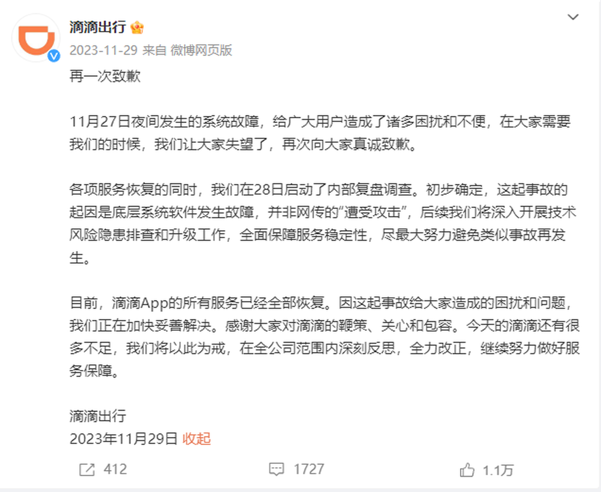
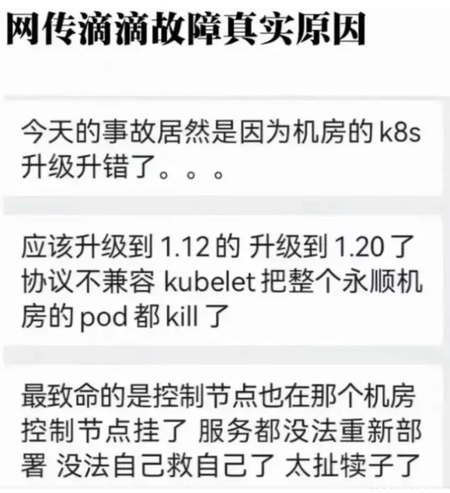
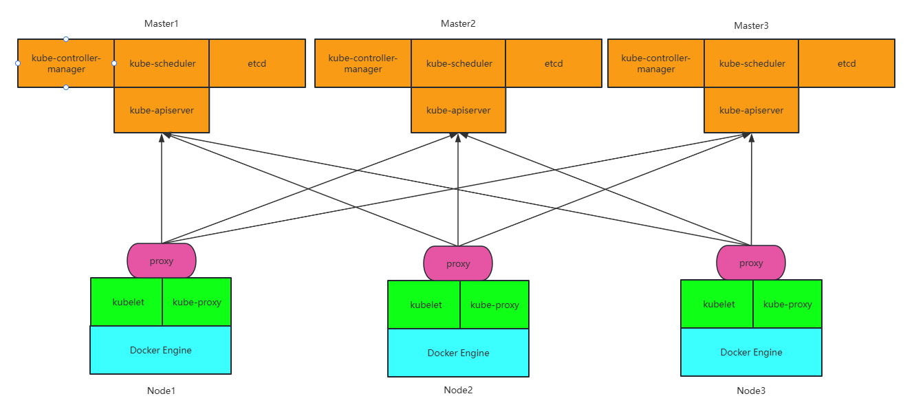

[← 返回 Kubernetes 目录]({{ '/subjects/Kubernetes/' | relative_url }})



# 36 版本升级与性能优化

集群升级不是单纯替换几个二进制文件：API 版本、控制平面、节点上的 kubelet、CNI/CSI、准入策略和业务可用性都有版本依赖。先制定升级窗口和回退方案，再依次升级控制平面与工作节点；集群规模较大时，应先在同构预生产环境演练。历史事故说明了变更影响面可能远超单个节点，因此不要把节点全部同时下线。





## 36.1 kubeadm 集群的升级路径

同一个次版本内可升级补丁版本；跨次版本须逐级升级，例如 1.33 → 1.34，不能从 1.32 直接跳到 1.34。具体允许的 kubeadm、API Server、kubelet 版本偏差以目标版本的[官方版本偏差策略](https://kubernetes.io/zh-cn/releases/version-skew-policy/)为准。下文针对 **kubeadm 管理的集群**；托管集群或其他部署工具应遵循其产品流程。

### 升级前的检查清单

1. 记录控制平面、节点、kubeadm、容器运行时及 CNI/CSI 版本；检查目标版本是否移除了现有资源 API。
2. 确认节点有足够余量、PodDisruptionBudget 允许逐节点腾空、业务有健康检查和维护窗口。
3. 备份 etcd 快照及恢复所需证书和配置，另行备份持久卷数据；把恢复过程在隔离环境验证一次。`kubectl get` 导出资源不能替代 etcd 与应用数据备份。
4. 锁定目标版本软件包与镜像来源，阅读目标版本发布说明，并验证升级后的 CNI、CSI、Ingress Controller 等扩展组件兼容性。

```bash
kubectl version
kubectl get nodes -o wide
kubectl get pods -A --field-selector=status.phase!=Running
kubectl get pdb -A
kubeadm version
sudo kubeadm upgrade plan
```

第 34 章介绍了 etcd 快照与 Velero；第 35 章介绍证书续期。备份、升级和证书更换不是同一操作，不能相互替代。

## 36.2 逐节点升级顺序

**第一台控制平面节点**：先安装目标次版本的 `kubeadm`，运行 `kubeadm upgrade plan` 并检查建议版本，再执行 `kubeadm upgrade apply vX.Y.Z`。随后腾空该节点，安装目标版本的 `kubelet` 与 `kubectl`，重启 kubelet，最后解除不可调度状态。软件包的完整版本号随发行版仓库变化，先用 `apt-cache madison` 或相应包管理器查询，不能直接复制另一年代的 `1.25.0-00`。

```bash
# 在第一台控制平面节点执行；下列变量先替换为实际节点与目标版本
NODE=control-plane-1
TARGET=vX.Y.Z
sudo kubeadm upgrade plan
sudo kubeadm upgrade apply "$TARGET"
kubectl drain "$NODE" --ignore-daemonsets --delete-emptydir-data
# 在该节点升级 kubelet/kubectl 包并重启 kubelet 后：
sudo systemctl daemon-reload
sudo systemctl restart kubelet
kubectl uncordon "$NODE"
```

升级第二台及之后的控制平面节点时，**每次只处理一台**：升级本机 kubeadm → `kubeadm upgrade node` → `kubectl drain` → 升级本机 kubelet/kubectl → 重启 kubelet → `kubectl uncordon`。执行顺序还应服从官方针对所用次版本的 kubeadm 升级文档。

**工作节点**同样逐台升级。先确认可驱逐工作负载，再执行以下流程；`drain` 可能因 PDB、裸 Pod、`emptyDir` 数据或存储挂载问题失败，不应通过盲目强制删除来掩盖原因。

```bash
NODE=worker-1
# 在 NODE 上升级 kubeadm 包，然后执行：
sudo kubeadm upgrade node
kubectl drain "$NODE" --ignore-daemonsets --delete-emptydir-data
# 在 NODE 上升级 kubelet/kubectl 包，然后执行：
sudo systemctl daemon-reload
sudo systemctl restart kubelet
kubectl uncordon "$NODE"
kubectl get node "$NODE" -o wide
```



### 每一步的验证与故障边界

完成一台后检查 `kubectl get nodes`、`kubectl get pods -A`、控制平面静态 Pod、CoreDNS、CNI/CSI Pod 与关键业务的服务端点，并用真实读写请求验证应用。若节点保持 `NotReady`，优先查看 `journalctl -u kubelet`、容器运行时、CNI 状态和证书；若 `drain` 卡住，先看 PDB 与 Pod 事件。

etcd 快照只能用于经过演练的集群恢复；**升级失败后直接把旧版本二进制覆盖新版本，不是通用回滚方法**，因为 etcd 数据格式和 API 对象可能已变。应按事先设计的恢复方案处理，必要时以备份重建集群并恢复工作负载。

## 36.3 性能优化：先定位瓶颈

优化前应记录 API 请求延迟、etcd fsync 延迟、调度等待时间、节点 CPU/内存/磁盘/网络与业务响应时间，明确瓶颈在控制平面、网络、存储还是业务本身。盲目增加控制平面副本或代理层可能只会扩大故障面。

- **API Server 与 etcd**：监测请求和存储延迟，给 etcd 使用可靠的低延迟磁盘；避免大量高频率 `list/watch` 客户端。
- **节点与工作负载**：合理设置 requests/limits、拓扑分布约束和 PodDisruptionBudget；结合 HPA 与 Cluster Autoscaler 调整容量，防止负载均衡把流量导向尚未 Ready 的 Pod。
- **网络与入口**：检查 CoreDNS、CNI、kube-proxy 或其替代数据平面，以及 Ingress Controller 的实际吞吐，按测量结果扩容。
- **存储**：区分共享文件存储与数据库所需的单写、高 IOPS 存储；观察 PVC 等待时间与应用实际读写延迟。

### 可选：节点本地 API 代理

如果测量证实中心化 API 负载均衡器已成为瓶颈，可在**每个工作节点**部署本地 TCP 代理，将 kubelet 连接分散到多个 API Server。原笔记中的做法是将 kubelet.conf 的 API 域名在本机解析为 `127.0.0.1`，由本机 HAProxy 监听 6443 并转发到各控制平面。采用该方案前，须确认 API Server 证书仍包含 kubelet.conf 所用域名、本地代理随系统启动并具备监控；本地代理故障会让该节点失去控制面连接。不要在未部署本地代理时就修改 `/etc/hosts`。

```text
frontend kube_apiserver
    bind 127.0.0.1:6443
    mode tcp
    default_backend kube_apiserver_nodes
backend kube_apiserver_nodes
    mode tcp
    balance roundrobin
    server cp1 192.0.2.11:6443 check
    server cp2 192.0.2.12:6443 check
    server cp3 192.0.2.13:6443 check
```

上例只是 HAProxy 配置片段，`192.0.2.0/24` 为文档示例地址；应与现有 HAProxy 配置合并，并先在单个测试节点验证端口监听、TLS 主机名、健康检查和失效切换，再逐节点推广。若中心代理本身可横向扩容，优先比较其运维成本与节点本地代理的复杂度。



<nav class="article-end" aria-label="章节导航">
  <a href="{{ '/subjects/Kubernetes/35-certificates.html' | relative_url }}">← 上一章：证书续期与故障处理</a>
  <a href="{{ '/subjects/Kubernetes/' | relative_url }}">返回 Kubernetes 目录</a>
</nav>
