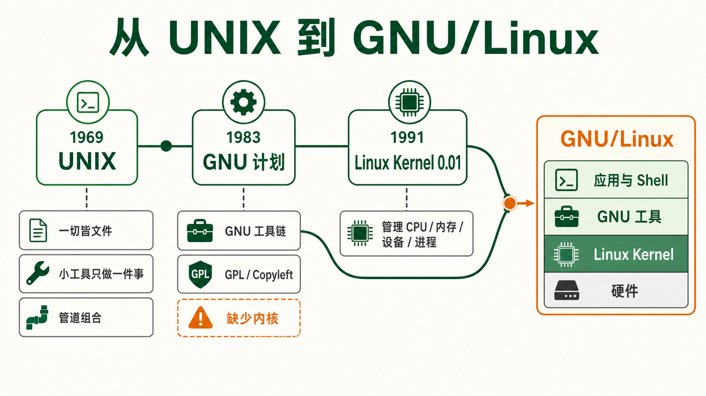
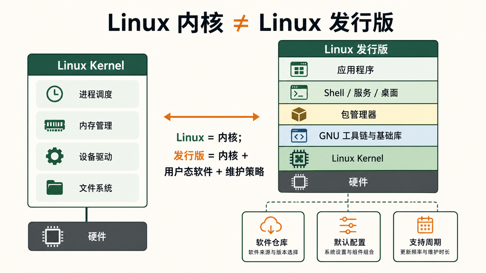
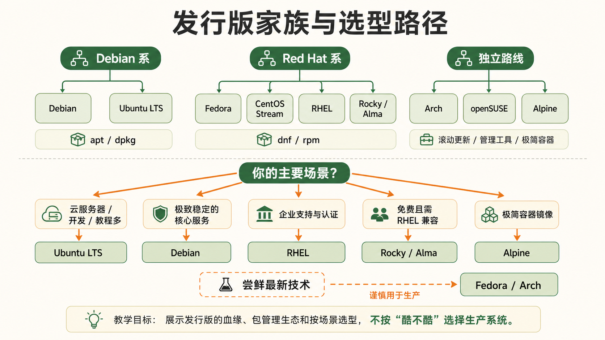
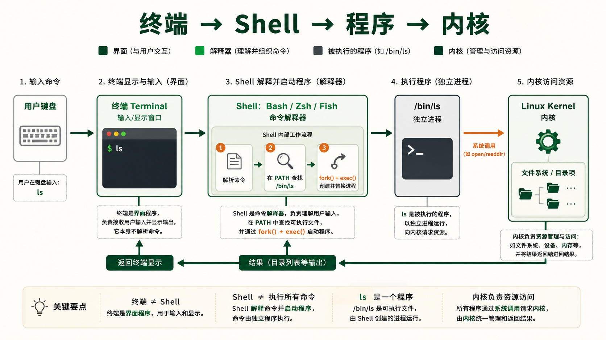

[← 返回 Linux 系统目录]({{ '/subjects/Linux/' | relative_url }})



# Linux 概述与发行版选择

## 1 Linux 的起源与哲学 {#sec01-1}

### 从 UNIX 到 GNU/Linux —— 一段关于自由的故事 · 核心 {#从-unix-到-gnulinux-一段关于自由的故事-核心}

#### 时间线：三股力量的汇合

1969 年，Ken Thompson 和 Dennis Ritchie 在贝尔实验室写下了 UNIX 的第一行代码。UNIX 的哲学简单到极致：<strong>一切皆文件</strong>、<strong>每个程序只做一件事并把它做好</strong>、<strong>程序的输出可以作为另一个程序的输入</strong>。这三条铁律至今仍是 Linux 系统设计的灵魂。

1983 年，Richard Stallman 发起 GNU (GNU's Not Unix) 计划，目标是打造自由的操作系统。自由软件强调用户运行、研究、修改和再分发软件的自由。GPL (通用公共许可证) 采用“著佐权”机制：分发受 GPL 约束的衍生作品时，需要遵守相应的源码提供和许可要求；它并不意味着任何与 GPL 程序一起运行的软件都必须采用 GPL。GNU 工具链与后来发布的 Linux 内核共同构成了许多发行版的基础。

1991 年，芬兰赫尔辛基大学的学生 Linus Torvalds 在 comp.os.minix 新闻组发了一封著名的帖子："我正在做一个（免费的）操作系统，只是个爱好，不会像 GNU 那样大和专业。" 这个"爱好"后来叫 Linux Kernel 0.01。Linux 内核填补了 GNU 计划的最后一块拼图——<strong>GNU + Linux = GNU/Linux，一个完整的自由操作系统</strong>。

<strong>关键区分</strong><br>
Linux = 内核（管理 CPU、内存、设备、进程的底层软件）<br>
GNU/Linux = 完整操作系统（内核 + GNU 工具链 + 包管理器 + 桌面环境...）<br>
开源 意味着任何人都能阅读、修改和分发源代码。你可以在 GitHub 上读到 Linux 内核的全部源码，逐行审查它在做什么。





#### "一切皆文件" —— Linux 最深刻的抽象 {#一切皆文件-linux-最深刻的抽象}

“一切皆文件”更准确地说是一种统一接口的设计方向，而不是所有资源都是磁盘上的普通文件：`/dev/sda` 是设备节点，`/proc/1234` 是进程信息目录，`/proc/net/tcp` 和 `/proc/meminfo` 是内核生成的虚拟文件。它们可以借助熟悉的文件读写工具观察或控制，但写入内核接口可能立即改变系统行为，须先核对文档与权限。

```bash
cat /proc/cpuinfo     # 直接读取 CPU 信息，就像读普通文件一样
cat /proc/meminfo     # 读取内存信息
echo "hello" > /dev/null  # 丢弃输出，/dev/null 是黑洞设备
```

UNIX 1969 Bell Labs GNU 1983 Richard Stallman Linux 1991 Linus Torvalds GPL Copyleft 协议

### 自由软件的四项基本自由 · 理念 {#自由软件的四项基本自由-理念}

为什么开源如此重要？Richard Stallman 定义了自由软件的四项基本自由。这不是关于钱——是 <strong>关于控制权</strong>：

| 自由       | 含义                     | 实际价值                         |
|------------|--------------------------|----------------------------------|
| <strong>自由 0</strong> | 为任何目的运行程序       | 不受厂商限制，你决定软件用途     |
| <strong>自由 1</strong> | 研究程序如何工作并修改它 | 源码可审计 → 无后门 → 可定制     |
| <strong>自由 2</strong> | 重新分发副本以帮助他人   | 免费分享 → 社区加速 → 零边际成本 |
| <strong>自由 3</strong> | 分发修改后的版本         | 分支衍生 → 适者生存 → 持续进化   |

这四项自由直接解释了为什么 Linux 统治了服务器世界：<strong>没有人可以撤销你的使用权</strong>。不会有一家公司突然宣布"下个版本要按核心数收费"。你的基础设施建立在你可以永远控制的代码之上。

## 2 Linux 对比 Windows Server {#sec01-2}

### 为什么 Linux 在许多服务器场景更常见 · 对比 {#为什么-linux-在许多服务器场景更常见-对比}

#### 核心维度逐条对比

| 维度 | Linux | Windows Server |
|----|----|----|
| <strong>费用</strong> | 可选社区发行版或付费订阅；仍需计算运维、支持与合规成本 | 许可模式随版本、核心数和使用权而异；需按合同核算 |
| <strong>更新与可用性</strong> | 更新策略由发行版和维护窗口决定；部分内核修复可用 livepatch，但不是所有更新都免重启 | 更新与重启要求取决于补丁类型、版本和部署方式；同样可规划维护窗口与高可用 |
| <strong>安全管理</strong> | 支持最小安装、权限、ACL 与 SELinux/AppArmor；是否安全取决于配置和补丁管理 | 支持 Server Core、ACL、AD 与策略管理；是否安全同样取决于配置和补丁管理 |
| <strong>资源消耗</strong> | 可选无桌面安装，实际内存取决于服务与发行版 | 可选 Server Core 等无完整桌面部署，资源需求同样随工作负载变化 |
| <strong>自动化</strong> | Shell、SSH、配置管理和 API 生态成熟；并非所有配置都适合直接纳入 Git | PowerShell、远程管理、声明式配置和 API 同样可实现可重复部署 |
| <strong>容器生态</strong> | Linux 容器和多数 Kubernetes 工作负载的主流平台 | 支持 Windows 容器与 Kubernetes Windows 节点，适合特定 Windows 应用 |
| <strong>选型依据</strong> | 适合 Linux 原生软件、常见云服务和多架构部署 | 适合依赖 AD、传统 .NET Framework 或 Windows 专有软件的工作负载 |

<strong>不要用单个份额数字决定选型</strong><br>
网站、云实例与企业服务器的统计口径不同，未经注明时间和样本的市场份额不宜直接比较。先列出应用依赖、团队技能、支持周期、许可和运维成本，再选择发行版或 Windows Server。

#### 什么时候 Windows Server 仍有意义

Windows Server 在 AD 域管理、传统 .NET Framework 应用、Windows 专有组件和既有企业管理体系中有明确适用场景。现代 .NET 和部分 SQL Server 工作负载也能在 Linux 上运行，但迁移需要验证功能、支持承诺与运行成本，不能仅按操作系统偏好决定。

## 3 主流发行版家族 —— 选择指南 {#sec01-3}

### Debian 系 —— 桌面与云服务器的王者 · 重点 {#debian-系-桌面与云服务器的王者-重点}

#### Ubuntu —— 最流行的云镜像 {#ubuntu-最流行的云镜像}

由 Canonical 维护。Ubuntu LTS 有明确的标准支持周期；扩展安全维护的范围、期限与费用取决于 Ubuntu Pro 订阅及具体版本，选型时应以官方生命周期表为准。APT 生态成熟，PPA 可补充软件版本，但第三方源需要单独评估维护者、签名和兼容性。

<strong>适用场景：</strong>云服务器首选镜像 (AWS/Google Cloud/Azure 官方推荐)、开发环境、中小型生产环境。有海量中文教程和 StackOverflow 答案。如果你不确定用哪个发行版——<strong>就选 Ubuntu LTS</strong>。

```bash
# Ubuntu 版本查看
lsb_release -a        # 查看版本代号和版本号
cat /etc/os-release   # 更详细的信息
uname -r              # 查看内核版本
```

#### Debian —— 稳定压倒一切 {#debian-稳定压倒一切}

Ubuntu 基于 Debian 发展，而 Debian 由社区治理。Debian Stable 优先控制版本变更并维护安全更新，因此适合重视可预测性的环境；“稳定”主要指接口和软件版本相对稳定，不保证每个软件绝无缺陷。选择前仍需核对硬件支持、所需软件版本和维护周期。

<strong>适用场景：</strong>核心数据库服务器、金融交易系统、电信基础设施、任何"绝对不能出问题"的关键服务。如果你需要极致稳定且愿意接受稍旧的软件版本——选 Debian。

<strong>Ubuntu vs Debian 决策速查</strong><br>
<strong>Ubuntu：</strong>更新更快、教程更多、云原生支持更好、PPA 生态丰富<br>
<strong>Debian：</strong>更稳定、更保守、社区驱动无商业利益、适合核心基础设施<br>
两者共享 apt/dpkg 包管理体系，切换成本极低。

### Red Hat 系 —— 企业 Linux 的标准 · 重点 {#red-hat-系-企业-linux-的标准-重点}

#### RHEL —— 付费获得商业支持 {#rhel-付费获得商业支持}

Red Hat Enterprise Linux 是企业 Linux 的标杆。你付的钱买的不是"软件许可"，而是<strong>生产级支持服务 + 认证硬件兼容性 + 法律保障 (专利 indemnification)</strong>。银行、政府、航空、电信——这些机构选择 RHEL 的原因不是技术本身，而是"有人负责"。RHEL 使用 RPM 包格式 + yum/dnf 包管理器。

#### RHEL 兼容替代品 (免费)

CentOS Linux 曾是 RHEL 最著名的免费克隆版 (RHEL 源代码 → 删 Logo → 重新编译 = CentOS)，但 Red Hat 在 2020 年宣布 CentOS 8 提前终止 (2021年底)，CentOS 7 在 2024 年 6 月结束生命周期。这一刀直接引发了社区的两个新分支：

| 发行版 | 定位 | 与 RHEL 的关系 |
|----|----|----|
| <strong>Rocky Linux</strong> | CentOS 原作者 Gregory Kurtzer 创建 | 100% bug-for-bug 兼容 RHEL |
| <strong>AlmaLinux</strong> | CloudLinux 公司发起 | 100% 兼容 RHEL，社区治理 |
| <strong>CentOS Stream</strong> | Red Hat 官方维护 | RHEL 的"上游预览版"——介于 Fedora 和 RHEL 之间 |
| <strong>Fedora</strong> | Red Hat 社区版 | 最新技术的前沿试验场 → 稳定后进入 RHEL |

<strong>决策速查：</strong>有钱买支持 → RHEL。免费但需要 RHEL 兼容性 → Rocky Linux 或 AlmaLinux。喜欢尝鲜 → Fedora。需要 RHEL 测试环境 → CentOS Stream。

### 其他重要发行版 —— 另一种选择 · 进阶 {#其他重要发行版-另一种选择-进阶}

##### Arch Linux

滚动更新 (rolling release)，没有"大版本"概念——系统持续更新到最新。pacman 包管理器 + AUR (Arch User Repository，用户维护的海量包仓库) 是极客天堂。安装过程需手动分区、chroot、配置引导。适用：想深入理解 Linux 的极客、需要最新内核/驱动的场景。不推荐用于生产服务器。

##### openSUSE

德国制造。最出名的是 YaST (Yet another Setup Tool)——一个集成的系统配置管理中心，可以管理磁盘、网络、软件、服务。RPM 包格式但使用 zypper 包管理器。Tumbleweed 分支是滚动更新的稳定版。适用：欧洲企业环境、喜欢图形化管理的管理员。

##### Alpine Linux

极致轻量——基础镜像仅 5 MB！使用 musl libc (而不是 glibc) + BusyBox (而不是 GNU coreutils)，完全不依赖 GNU 工具链。apk 包管理器。<strong>Docker 容器镜像的首选 base image。</strong>适用：容器化微服务、小型嵌入式设备、任何追求最小镜像体积的场景。



<strong>发行版选择的核心原则</strong><br>
不要因为"看起来很酷"而选择一个小众发行版用于生产环境。选择发行版的标准是： <strong>社区规模 × 文档丰富度 × 人才市场 × 厂商支持</strong>。据 Stack Overflow 2023 调查，专业开发者中使用 Linux 的超过 40%，其中 Ubuntu 占绝对主导地位。

```bash
# 快速查看当前发行版信息
cat /etc/os-release      # 所有现代 Linux 发行版都支持
hostnamectl              # systemd 系统，显示更丰富的信息
cat /etc/*-release       # 兼容老的发行版
```

## 4 Shell 与终端 —— 你与 Linux 对话的界面 {#sec01-4}

### Shell 是什么 —— 理解你每天敲命令的地方 · 基础 {#shell-是什么-理解你每天敲命令的地方-基础}

#### 三层关系：终端 → Shell → 内核 {#三层关系终端-shell-内核}

很多人分不清"终端"和"Shell"，这两个概念经常混用但本质不同：



| 概念 | 是什么 | 例子 |
|----|----|----|
| <strong>终端 (Terminal)</strong> | 一个图形程序，提供一个窗口让你输入和显示文本 | GNOME Terminal、Windows Terminal、iTerm2、Alacritty |
| <strong>终端模拟器</strong> | 通过 SSH 连接到远程 Linux 时，本地程序模拟一个物理终端 | PuTTY、ssh 命令本身、MobaXterm |
| <strong>Shell</strong> | 命令解释器——接收文本命令 → 翻译成系统调用 → 传给内核执行 | Bash、Zsh、Fish、sh、dash |

<strong>一句话：</strong>终端是你打开的那个窗口 (GUI 程序)。Shell 是在窗口里运行的那个解释器 (命令行程序)。你在终端里敲 `ls` → Shell 收到 "ls" → Shell 在 PATH 里找到 `/bin/ls` → 调用 `fork()` 创建子进程 → 调用 `exec()` 执行 `/bin/ls` → 系统调用通知内核读取目录 → 结果返回给 Shell → Shell 打印到终端。

```bash
echo $SHELL             # 查看当前使用的是什么 Shell
cat /etc/shells          # 查看系统安装了哪些 Shell
ps -p $$                 # 查看当前进程 ($$ 是当前 Shell 的 PID)
```

### 三大 Shell 对比：Bash / Zsh / Fish · 选择 {#三大-shell-对比bash-zsh-fish-选择}

| 特性 | Bash | Zsh | Fish |
|----|----|----|----|
| <strong>默认安装</strong> | 几乎所有 Linux 发行版的默认 Shell | 需手动安装，macOS 默认 | 需手动安装 |
| <strong>脚本兼容性</strong> | POSIX sh 兼容 + Bash 扩展 | 兼容 Bash 大部分语法 | <strong>不兼容 Bash 语法！</strong>脚本语法完全不同 |
| <strong>自动补全</strong> | 基本：Tab 补全文件/命令名 | 丰富：命令参数补全、大小写容错 | 智能：基于历史的模糊匹配，开箱即用 |
| <strong>生态</strong> | 最大最全，几乎所有脚本都用 \#!/bin/bash | oh-my-zsh 插件生态极强 (300+ 插件) | oh-my-fish / fisher 插件管理器 |
| <strong>语法高亮</strong> | 无原生支持 | 插件支持 (zsh-syntax-highlighting) | 内置！敲命令时实时高亮 |
| <strong>适用场景</strong> | 写脚本、服务器操作、面试 | 日常开发、交互式使用 | 纯交互式使用，不写脚本 |

<strong>选择的智慧</strong><br>
<strong>服务器上只用 Bash。</strong>不管你在本地用 Zsh 或 Fish 多顺手，你 SSH 到任何一台 Linux 服务器时，它默认的 Shell 就是 Bash。如果连 Bash 都不熟，你将在生产服务器前束手无策。<br>
<strong>本机开发装 Zsh + oh-my-zsh。</strong>自动补全、语法高亮、Git 状态显示能极大改善日常体验。<br>
<strong>Fish 适合初学者。</strong>开箱即用的体验最好，但不要用它写脚本——语法不同，可移植性为零。

```bash
# 安装 Zsh + oh-my-zsh (Ubuntu/Debian)
sudo apt install zsh
sh -c "$(curl -fsSL https://raw.githubusercontent.com/ohmyzsh/ohmyzsh/master/tools/install.sh)"

# 将默认 Shell 切换为 Zsh
chsh -s $(which zsh)

# 验证
echo $SHELL             # /usr/bin/zsh
```

## 注解

<strong>ACL</strong> · Access Control List 访问控制列表

<strong>CPU</strong> · Central Processing Unit 中央处理器

<strong>GUI</strong> · Graphical User Interface 图形用户界面

<strong>RAM</strong> · Random-Access Memory 随机存取存储器

<strong>SQL</strong> · Structured Query Language 结构化查询语言

<strong>SSH</strong> · Secure Shell 安全外壳协议



<nav class="article-end" aria-label="章节导航">
  <a href="{{ '/subjects/Linux/' | relative_url }}">返回 Linux 系统目录</a>
  <a href="{{ '/subjects/Linux/02-%E6%96%87%E4%BB%B6%E7%B3%BB%E7%BB%9F%E5%B1%82%E6%AC%A1%E7%BB%93%E6%9E%84.html' | relative_url }}">下一章：文件系统层次结构 →</a>
</nav>
