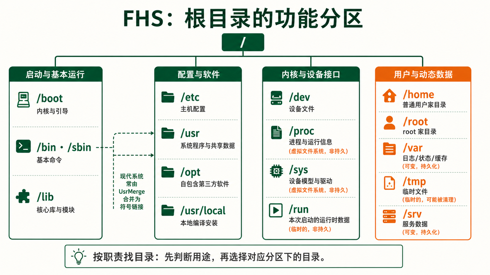
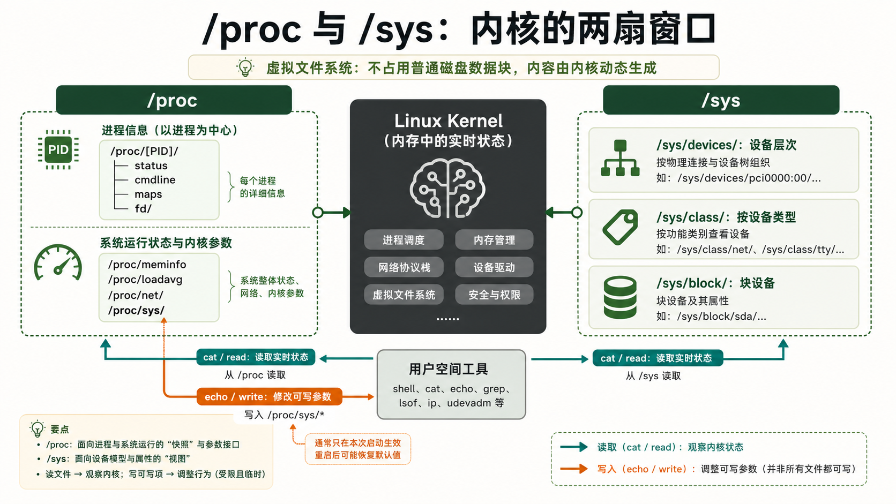
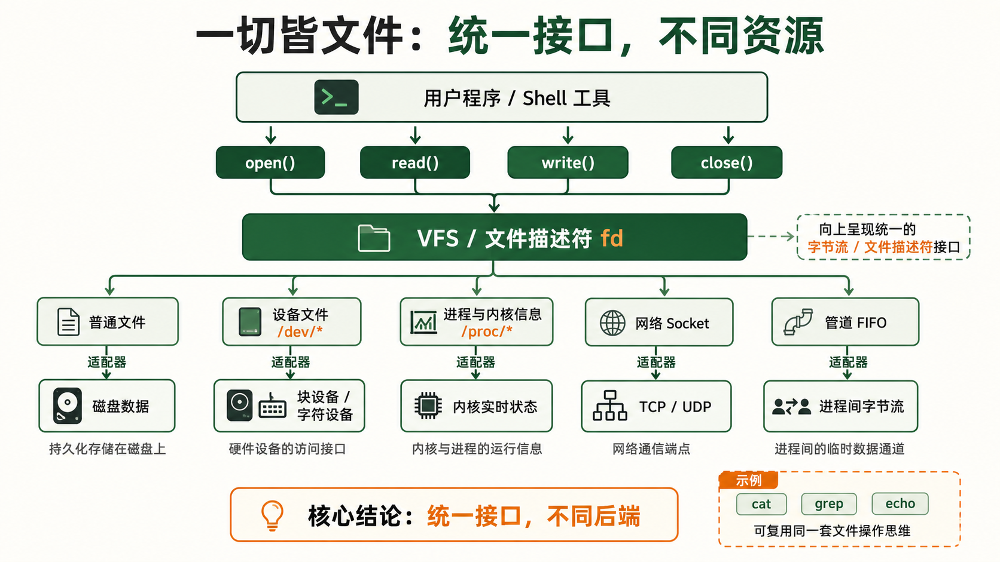

[← 返回 Linux 系统目录]({{ '/subjects/Linux/' | relative_url }})



# 文件系统层次结构

## 1 为什么需要 FHS 标准 {#sec02-1}

### 统一目录布局 —— 不是"约定俗成"，是"工业标准" · 核心 {#统一目录布局-不是约定俗成是工业标准-核心}

#### 没有标准的混乱世界

想象一个没有 FHS 的世界：发行版 A 把用户安装的程序放在 `/Programs`，发行版 B 放在 `/opt/userapps`，发行版 C 放在 `/usr/local/share/bin`。你写了一段自动化脚本，里面有个硬编码的路径 `/usr/bin/nginx`——然后换了一台服务器就找不到 Nginx 了。

统一约定能减少跨发行版学习和自动化脚本维护成本，但并不能消除所有路径差异：软件包、发行版策略和本地配置仍可能不同。写脚本时应优先使用可发现的配置与命令，而不是仅凭记忆硬编码路径。

#### FHS 解决了什么问题

<strong>FHS (Filesystem Hierarchy Standard)</strong> 规定常见目录的用途，为跨发行版查找程序、配置和可变数据提供起点。它不是 Linux 内核的一部分；各发行版会参考它，但也会因 `usrmerge`、容器布局或自身策略而有差异。因此应把下表看作定位线索，再以目标系统的实际目录为准：

- **配置文件一定在 `/etc`**——想改 Nginx？直接 `vim /etc/nginx/nginx.conf`
- **日志一定在 `/var/log`**——想查错误？直接 `tail -f /var/log/syslog`
- **可执行程序一定在 `/usr/bin` 或 `/bin`**——装了新工具？直接调用，它一定在 PATH 里
- **临时文件一定在 `/tmp`**——重启后自动清空，不需要手动清理

<strong>一份标准，全域通用</strong><br>
FHS 的规范文本由 Linux 基金会维护 (refspecs.linuxfoundation.org/fhs.shtml)。目前最新版本是 FHS 3.0 (2015年发布)。虽然不常更新—— <strong>因为它的设计太成功了，不需要改</strong>。大多数现代 Linux 发行版 (包括 systemd 系统) 在 FHS 基础上做了少量扩展 ( `/run` 目录就是例子)，但整体框架始终保持一致。

```bash
# 验证你的系统遵循 FHS
ls /                    # 根目录——这是所有路径的起点
man hier                # 很多系统内置了文件系统层次的手册页
man 7 file-hierarchy    # systemd 系统的文件层次文档
```



## 2 根目录逐层详解 —— 每个目录的"为什么" {#sec02-2}

### 核心系统目录 —— 没有它们系统无法启动 · 详解 {#核心系统目录-没有它们系统无法启动-详解}

#### /bin —— 基本用户命令 (现在多链接到 /usr/bin) {#bin-基本用户命令-现在多链接到-usrbin}

存放系统启动和维护所需的最基本命令，即使 `/usr` 没有挂载也能执行。传统上包括 `cat`、`ls`、`cp`、`mv`、`rm`、`sh`、`bash` 等。现代 Linux 发行版 (如 Ubuntu 20.04+) 已将 `/bin` 和 `/sbin` 合并为指向 `/usr/bin` 和 `/usr/sbin` 的符号链接——这是 <strong>UsrMerge</strong> 计划的结果。

```bash
ls -l /bin          # 输出类似: /bin -> usr/bin (这是一个符号链接)
ls -l /sbin         # 输出类似: /sbin -> usr/sbin
```

#### /boot —— 引导的命脉 {#boot-引导的命脉}

存放 Linux 内核文件 (`vmlinuz-*`)、初始 RAM 磁盘镜像 (`initrd.img-*` 或 `initramfs-*`)、GRUB 引导加载器配置文件 (`/boot/grub/`)。<strong>这个目录一般单独分区 (约 500MB~1GB)</strong>。如果 /boot 分区满了——系统将无法安装新内核更新。查看方式：`df -h /boot`。

```bash
ls /boot
# vmlinuz-5.15.0-91-generic    # 压缩后的内核镜像
# initrd.img-5.15.0-91-generic # 初始 RAM 磁盘
# grub/                         # GRUB 配置目录
# System.map-5.15.0-91-generic # 内核符号表 (调试用)
```

#### /dev —— 万物皆设备文件 {#dev-万物皆设备文件}

这是 Linux "一切皆文件"哲学最直观的体现。在 `/dev` 下，每个设备都以文件的形式存在：

| 设备文件       | 类型     | 说明                                       |
|----------------|----------|--------------------------------------------|
| `/dev/sda`     | 块设备   | 第一块 SCSI/SATA 磁盘 (sdb=第二块...)      |
| `/dev/sda1`    | 块设备   | 第一块磁盘的第一个分区                     |
| `/dev/nvme0n1` | 块设备   | 第一块 NVMe SSD (现代命名)                 |
| `/dev/tty`     | 字符设备 | 当前终端                                   |
| `/dev/null`    | 字符设备 | "黑洞"——写入的数据被丢弃，读取永远返回 EOF |
| `/dev/zero`    | 字符设备 | 无限提供 null 字节 (0x00)                  |
| `/dev/random`  | 字符设备 | 真随机数 (基于环境噪声，熵不够时阻塞)      |
| `/dev/urandom` | 字符设备 | 伪随机数 (非阻塞，适合大多数场景)          |

<strong>警告</strong><br>
不要直接对 `/dev/sda` 做操作！ `dd if=/dev/zero of=/dev/sda` 会 <strong>直接覆写磁盘数据，不可恢复</strong>。这不是"删除文件"——这是把磁盘上每一块数据都填充为零。

#### /lib —— 核心共享库和内核模块 {#lib-核心共享库和内核模块}

存放系统启动和 `/bin`、`/sbin` 中命令所需的共享库 (`.so` 文件)，以及内核模块 (`/lib/modules/内核版本/`)。类似 `/bin`，现代系统已将 `/lib` 链接到 `/usr/lib`。

```bash
# 查看命令依赖哪些共享库
ldd /bin/ls
# 输出各 .so 库的路径

# 查看已加载的内核模块
lsmod
ls /lib/modules/$(uname -r)/    # 所有可用内核模块
```

### 系统配置与守护目录 —— 运维的日常工作区 · 详解 {#系统配置与守护目录-运维的日常工作区-详解}

#### /etc —— 一切配置的归宿 {#etc-一切配置的归宿}

<strong>这是运维工程师最熟悉的目录。</strong>FHS 规定 `/etc` 存放"主机特定的系统配置"——每一台服务器的个性化设置都在这里。它不是"可执行文件"，不是"库文件"，不是"运行时数据"——<strong>它只放配置</strong>。

关键子目录和文件：

| 路径 | 内容 | 什么时候你会用到 |
|----|----|----|
| `/etc/nginx/nginx.conf` | Nginx 全局配置 | 配置 Web 服务器 |
| `/etc/ssh/sshd_config` | SSH 服务端配置 | 修改 SSH 端口、禁用密码登录 |
| `/etc/passwd` | 用户账户信息 | 查看所有用户 |
| `/etc/shadow` | 用户密码哈希 (仅 root 可读) | 密码策略 |
| `/etc/fstab` | 文件系统挂载表 | 配置开机自动挂载磁盘 |
| `/etc/crontab` | 系统级定时任务 | 设置定期执行的任务 |
| `/etc/hosts` | 静态主机名-IP 映射 | 本地 DNS 覆盖 |
| `/etc/resolv.conf` | DNS 解析器配置 | 设置 DNS 服务器 |
| `/etc/systemd/system/` | systemd 服务单元文件 | 管理自启动服务 |
| `/etc/apt/sources.list` | APT 软件源列表 (Debian系) | 修改软件源镜像 |
| `/etc/environment` | 系统级环境变量 | 全局代理/语言设置 |

<strong>配置版本管理的边界：</strong> `/etc` 中可能有私钥、令牌与机器专属配置，不要直接对整个目录执行 `git add .` 并推送远端。优先使用 etckeeper 或在单独的受控仓库中只跟踪经过筛选的配置文件；提交前核对差异、权限与敏感信息。

#### /opt —— 第三方软件的"独立别墅" {#opt-第三方软件的独立别墅}

为那些不遵循 FHS 目录结构的第三方软件保留。典型的用途：Google Chrome 装在 `/opt/google/chrome/`，手动下载的 JDK 解压到 `/opt/jdk-17/`。<strong>opt = optional，意为"可选的附加软件"</strong>。与 `/usr/local` 的区别：`/opt` 倾向于"供应商打包的、自包含的"软件，每个软件一个子目录；`/usr/local` 倾向于"从源码编译安装的"按传统 FHS 结构组织的软件。

#### /srv —— 服务数据目录 {#srv-服务数据目录}

存放系统提供服务的站点特定数据。比如 Web 服务器数据放在 `/srv/www/`，FTP 文件在 `/srv/ftp/`。不过很多运维习惯把网站放在 `/var/www/`——这是历史惯性，两者都常见。

### 虚拟文件系统 —— 内核在"说话" · 深入 {#虚拟文件系统-内核在说话-深入}

#### /proc —— 内核暴露的进程与系统信息 {#proc-内核暴露的进程与系统信息}

<strong>/proc 是伪文件系统</strong>：它不把这些条目作为普通文件写入磁盘，而由内核按需呈现信息。读取 `/proc/cpuinfo` 可以获得处理器信息；`/proc/[PID]/` 提供该进程的文件描述符 (`fd/`)、内存映射 (`maps`)、环境变量 (`environ`) 和命令行 (`cmdline`) 等接口。部分内容需要相应权限，且读取期间状态可能变化。

```bash
cat /proc/cpuinfo       # CPU 型号、核心数、缓存大小
cat /proc/meminfo       # 内存使用详情 (MemTotal/MemFree/MemAvailable)
cat /proc/version       # 内核版本字符串
cat /proc/uptime        # 系统运行时间 (秒) 和空闲时间
cat /proc/loadavg       # 系统负载 (1/5/15 分钟平均值)
cat /proc/filesystems   # 内核支持的文件系统类型

# 查看进程信息 (用当前 shell 的 PID 举例)
ls /proc/$$/            # 列出当前进程的所有属性
cat /proc/$$/status     # 进程状态、内存、线程数
cat /proc/$$/cmdline    # 进程的完整命令行
```

#### /sys —— 更结构化的内核接口 {#sys-更结构化的内核接口}

`/sys` 是 `/proc` 的"升级版"——比 `/proc` 更结构化、更专注于设备驱动模型。它把内核对象按类别组织为目录树：`/sys/class/` (按设备类型)、`/sys/block/` (块设备)、`/sys/devices/` (所有设备的底层层次结构)、`/sys/kernel/` (内核参数)。很多系统工具 (如 `lsblk`、`udevadm`) 的数据源就是 `/sys`。

```bash
ls /sys/class/net/      # 列出所有网络接口
cat /sys/class/net/eth0/address   # 查看网卡 MAC 地址
cat /sys/class/thermal/thermal_zone0/temp  # CPU 温度 (需除以1000)
ls /sys/block/           # 列出所有块设备
```



<strong>proc vs sys 的选择</strong><br>
<strong>/proc</strong>：进程信息 + 运行时系统信息，适合 shell 日常查看<br>
<strong>/sys</strong>：设备模型 + 驱动参数，适合程序读取和脚本自动化<br>
两者都是内核的"窗口"——修改其中的可写文件可以实时调整内核行为。例如 `echo 1 > /proc/sys/net/ipv4/ip_forward` 可以开启 IP 转发。

### 用户数据与动态数据 —— 你的"家"和日志"仓库" · 详解 {#用户数据与动态数据-你的家和日志仓库-详解}

#### /home —— 每个用户的家 {#home-每个用户的家}

每个普通用户在这里有自己的子目录 (`/home/alice`, `/home/bob`)。用户的所有个人文件、配置 (以 `.bashrc`、`.ssh/` 等形式)、下载都放在这里。<strong>目录名就是用户名。</strong>一个常见的最佳实践：把 `/home` 挂载到独立分区或网络存储——/home 里的数据需要备份，而系统文件 (/usr、/bin) 可以随时重装恢复。

#### /root —— root 用户的例外 {#root-root-用户的例外}

root 用户的家目录不在 `/home/root` (那太不"特殊"了)。它直接放在 `/root`，且权限为 `drwx------`——只有 root 自己能访问。为什么这么设计？因为早期 UNIX 系统可能在单用户模式下 `/home` 尚未挂载，但 root 需要可用的家目录。

#### /usr —— 用户级程序与数据 (最大的目录) {#usr-用户级程序与数据-最大的目录}

`/usr` 通常存放系统提供的程序、库和共享数据，是许多发行版中占用空间较大的目录。它的名称来源有不同历史解释，不必把某个缩写展开当作操作规则；更重要的是区分发行版管理的 `/usr` 与本地管理员安装软件常用的 `/usr/local`：

| 子目录 | 存放内容 | 示例 |
|----|----|----|
| `/usr/bin` | 绝大多数用户命令 | python3、node、vim、git |
| `/usr/sbin` | 系统管理命令 (非必需启动) | sshd、httpd、useradd |
| `/usr/lib` | 共享库和内部二进制 | libcrypto.so、systemd 组件 |
| `/usr/share` | 架构无关的共享数据 | man 手册、文档、图标、时区数据 |
| `/usr/local` | 本地编译安装的软件 <strong>(优先级高于 /usr)</strong> | 你从源码编译的 nginx、自行安装的 Go |
| `/usr/include` | C/C++ 头文件 | stdio.h、stdlib.h |
| `/usr/src` | 内核源码 (可选) | linux-headers-\* |

<strong>/usr/local 的特殊地位</strong><br>
`/usr/local` 的优先级高于 `/usr`——在 PATH 环境变量中， `/usr/local/bin` 通常排在 `/usr/bin` 前面。这意味着如果你从源码编译了 Nginx 放到 `/usr/local/bin/nginx`，当你敲 `nginx` 时会优先执行你编译的版本而不是系统自带的版本。 <strong>这是你"覆盖"系统命令的安全方式</strong>——系统包管理器 (apt/yum) 不会碰 `/usr/local` 里的任何东西。

#### /var —— 动态可变数据 {#var-动态可变数据}

<strong>var = variable。</strong>这里存放的是系统运行过程中<strong>不断变化</strong>的数据：日志、邮件队列、打印队列、数据库文件、网站内容。这是除 `/usr` 外另一个增长最快的目录。

| 路径 | 内容 | 运维关注点 |
|----|----|----|
| `/var/log/` | 系统日志 | syslog、auth.log、kern.log——排查问题的第一站 |
| `/var/log/nginx/` | Nginx 访问日志和错误日志 | access.log 分析流量，error.log 排查 502 |
| `/var/spool/` | 待处理数据 (邮件/打印等) | cron 任务、邮件队列 |
| `/var/lib/` | 应用状态数据 | MySQL 数据库文件、Docker 数据、dpkg 数据库 |
| `/var/cache/` | 应用缓存 | apt 下载的 .deb 包、字体缓存 |
| `/var/tmp/` | 持久临时文件 | 与 /tmp 不同——重启不会清空 |

```bash
# 查看日志的日常操作
tail -f /var/log/syslog                    # 实时追踪系统日志
journalctl -u nginx --since "10 min ago"   # systemd 日志 (二进制日志，比 syslog 更现代)
du -sh /var/log/*                          # 查看各日志文件大小
```

#### /tmp 和 /run —— 临时性的两种形态 {#tmp-和-run-临时性的两种形态}

| 目录 | 存储 | 生命周期 | 可靠性 |
|----|----|----|----|
| `/tmp` | 磁盘 (通常是 tmpfs 内存文件系统) | 系统重启后清空 (或超过 10 天未访问) | 任何用户可写，全球可读——<strong>不要放敏感文件</strong> |
| `/run` | tmpfs (纯内存) | 系统启动时创建，重启后完全消失 | root-only——PID 文件、锁文件、socket 文件 |

```bash
echo $TMPDIR            # 查看当前临时目录
mktemp -d               # 创建一个安全的临时目录 (推荐)
ls /run/                # systemd 和守护进程的运行时数据
```



## 3 "一切皆文件"—— Linux 最深刻的哲学实践 {#sec02-3}

### 用统一接口操作一切资源 · 哲学 {#用统一接口操作一切资源-哲学}

#### 这个哲学的威力

在 Linux 中，“文件”是一种重要抽象：普通文件、设备节点、管道、套接字及 `/proc` 中的虚拟文件都可以在某些场景使用文件描述符和通用读写接口。但各类资源支持的操作不同，网络套接字仍需要 `socket()`、`connect()` 等专用调用，不能把它们当成可随意 `cat` 的磁盘文件。这意味着：

- <strong>复用通用接口：</strong>许多进程状态和设备信息可通过 `open()`、`read()` 观察
- <strong>仍需理解资源语义：</strong>写入 `/proc/sys` 会改变内核参数，设备节点可能产生副作用
- <strong>与专用工具配合：</strong>文件工具适合读虚拟文件，网络连接状态通常用 `ss` 等工具更易解读

#### 实例一：设备即文件

```bash
dd if=/dev/zero of=testfile bs=1M count=100   # 从 zero 设备读取 100MB 空数据写入文件
cat testfile > /dev/null                       # 读取文件并丢弃——但底层经过了完整的文件→设备系统调用
ls -l /dev/sda                                 # brw-rw----  b=块设备
ls -l /dev/tty                                 # crw-rw-rw-  c=字符设备
```

#### 实例二：进程即目录

```bash
ls /proc/1/                # PID 1 (init/systemd) 的"文件夹"
cat /proc/1/status          # 进程状态 (相当于 process.read())
cat /proc/1/maps            # 内存映射 (进程的"地址空间地图")
cat /proc/1/cmdline         # 进程的完整命令行 (被 NUL 分隔)
ls -l /proc/1/fd/           # 进程打开的所有文件描述符
```

#### 实例三：网络即文件

```bash
cat /proc/net/tcp           # 当前所有 TCP 连接 (十六进制显示)
cat /proc/net/udp           # 当前所有 UDP 连接
cat /proc/net/dev           # 每个网络接口的收发包统计
```

▶ /proc/net/tcp 输出片段

```yaml
sl  local_address rem_address   st tx_queue rx_queue ...
 0: 00000000:0050 00000000:0000 0A 00000000:00000000 ...
 1: 0100007F:0016 00000000:0000 0A 00000000:00000000 ...
# local_address=0.0.0.0:80 (LISTENING)
# local_address=127.0.0.1:22 (LISTENING)
```

<strong>从一个操作到一切操作</strong><br>
Python 代码 `open('/proc/cpuinfo').read()` 和 `open('myfile.txt').read()` 使用了完全相同的调用。你的程序不需要"系统信息 API"和"文件 API"两套接口—— <strong>一个 open() 就解决了所有问题</strong>。这就是 Unix 哲学中的"统一的接口胜过专门的接口"。

#### 实例四：内核参数实时调整

某些 `/proc/sys/` 下的文件是可写的。用 `echo` 写入一个值，就能<strong>实时改变内核行为</strong>——不需要重启、不需要重新编译内核。

```bash
# 开启 IP 转发 (把 Linux 变成路由器)
echo 1 > /proc/sys/net/ipv4/ip_forward

# 禁用 ping 响应
echo 1 > /proc/sys/net/ipv4/icmp_echo_ignore_all

# 查看当前值
cat /proc/sys/net/ipv4/ip_forward
```

<strong>注意</strong><br>
通过 `/proc/sys/` 修改的内核参数在重启后会恢复默认值。要永久生效，需要写入 `/etc/sysctl.conf` 或 `/etc/sysctl.d/` 目录下的配置文件，然后执行 `sysctl -p`。 磁盘 /dev/sda 进程 /proc/PID/ 网络 /proc/net/ 内核参数 /proc/sys/ 驱动模型 /sys/

## 注解

<strong>API</strong> · Application Programming Interface 应用程序编程接口

<strong>DNS</strong> · Domain Name System 域名系统

<strong>FTP</strong> · File Transfer Protocol 文件传输协议

<strong>GRUB</strong> · GNU GRand Unified Bootloader GNU 统一引导加载器

<strong>IP</strong> · Internet Protocol 网际协议

<strong>PID</strong> · Process Identifier 进程标识符

<strong>TCP</strong> · Transmission Control Protocol 传输控制协议



<nav class="article-end" aria-label="章节导航">
  <a href="{{ '/subjects/Linux/01-Linux%E6%A6%82%E8%BF%B0%E4%B8%8E%E5%8F%91%E8%A1%8C%E7%89%88%E9%80%89%E6%8B%A9.html' | relative_url }}">← 上一章：Linux 概述与发行版选择</a>
  <a href="{{ '/subjects/Linux/' | relative_url }}">返回 Linux 系统目录</a>
  <a href="{{ '/subjects/Linux/03-%E6%96%87%E4%BB%B6%E4%B8%8E%E7%9B%AE%E5%BD%95%E6%93%8D%E4%BD%9C.html' | relative_url }}">下一章：文件与目录操作 →</a>
</nav>
