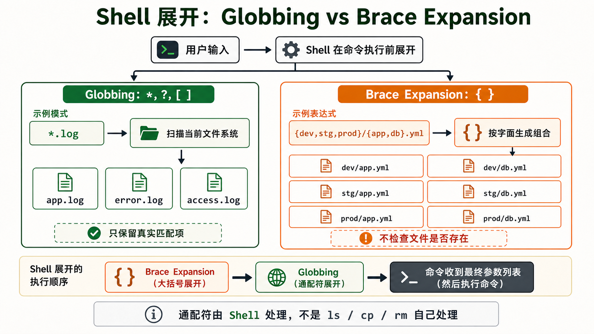
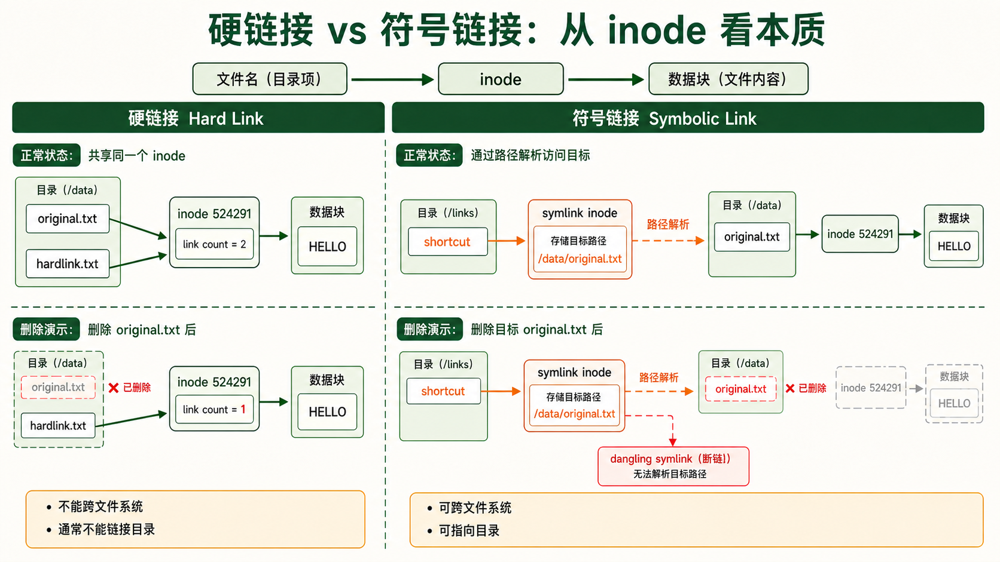
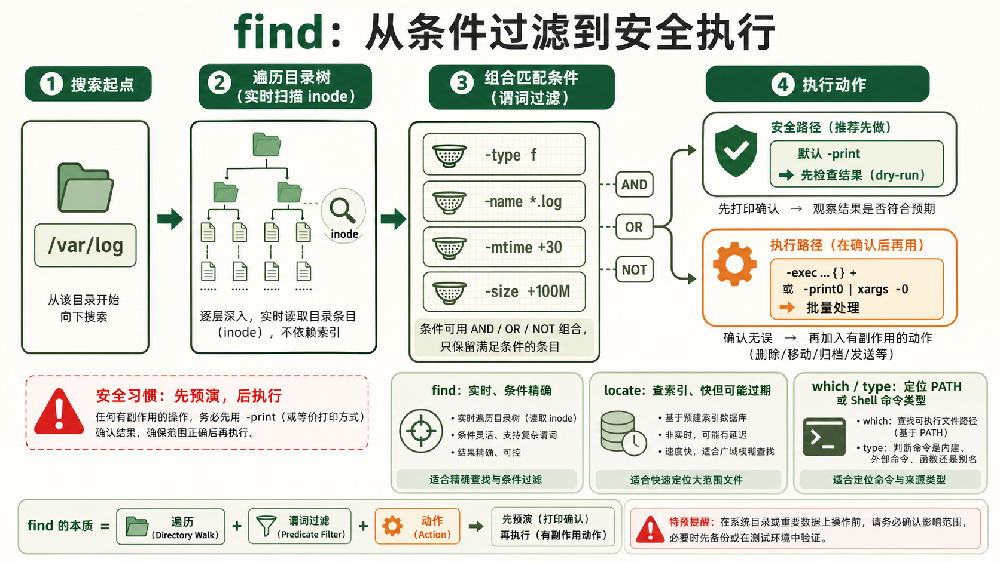

[← 返回 Linux 系统目录]({{ '/subjects/Linux/' | relative_url }})



# 文件与目录操作

## 1 文件类型识别 —— 不只是"普通文件"和"目录" {#sec03-1}

### ls -l 第一列的玄机 —— 7 种文件类型 · 基础 {#ls--l-第一列的玄机-7-种文件类型-基础}

#### 文件类型 = ls -l 输出的第一个字符 {#文件类型-ls--l-输出的第一个字符}

在 Linux 中，"文件"不只是一个存数据的容器。有 7 种不同类型的文件，每一种在 `ls -l` 输出的第一个字符就能识别。这第一个字符后面的 9 个字符才是权限位 (rwx for owner / group / other)。

| 字符 | 类型 | 本质 | 示例 | 常见位置 |
|----|----|----|----|----|
| **`-`** | 普通文件 (regular file) | 存储字节序列 | 文本、图片、二进制程序 | 所有目录 |
| **`d`** | 目录 (directory) | 文件名→inode 的映射表 | 任何文件夹 | 无处不在 |
| **`l`** | 符号链接 (symbolic link) | 存储目标路径的字符串 | 快捷方式、版本切换 | /usr/bin 中大量使用 |
| **`b`** | 块设备 (block device) | 支持随机访问的 I/O 设备 | 磁盘、USB 驱动器 | /dev/sda、/dev/sdb |
| **`c`** | 字符设备 (character device) | 流式 I/O 设备，按字节读写 | 终端、键盘、串口 | /dev/tty、/dev/null |
| **`p`** | 命名管道 (FIFO) | 进程间通信的"管" | mkfifo mypipe | /run/systemd/ 等 |
| **`s`** | Socket (套接字) | 进程间网络通信的端点 | UNIX domain socket | /var/run/、/tmp/ |

```bash

ls -l /bin/bash
# -rwxr-xr-x 1 root root 1396520 Jan  6  2025 /bin/bash
# ^
# - 表示这是普通文件

ls -ld /etc
# drwxr-xr-x 178 root root 12288 Jul 15 10:30 /etc
# ^
# d 表示这是目录

ls -l /dev/sda
# brw-rw---- 1 root disk 8, 0 Jul 15 10:30 /dev/sda
# ^
# b 表示块设备 (注意权限位前面的逗号：8,0 = major, minor 设备号)

ls -l /dev/null
# crw-rw-rw- 1 root root 1, 3 Jul 15 10:30 /dev/null
# ^
# c 表示字符设备
```

#### file 命令 —— 不看名字，看内容 {#file-命令-不看名字看内容}

扩展名不能保证内容格式。`file` 会综合魔术字节、文本特征等规则推测文件类型，适合作为第一步检查；它的结果不是安全性证明，也不能取代解析器或签名验证。

```bash

file /bin/ls
# /bin/ls: ELF 64-bit LSB pie executable, x86-64, dynamically linked, stripped
# ELF = Executable and Linkable Format，Linux 的可执行文件格式

file mydata.gz
# mydata.gz: gzip compressed data, max compression, from Unix

file document.pdf
# document.pdf: PDF document, version 1.4

file unknown_file
# unknown_file: data
# "data" 表示 file 不认识——可能是加密过的内容或损坏的文件
```

<strong>实战技巧</strong><br>
一个没有扩展名的文件 `mystery`，你不知道它是什么—— `file mystery` 就能告诉你它是 PNG 图片、Bash 脚本还是 ELF 可执行文件。 <strong>永远不要靠扩展名判断文件类型。</strong>这在日常使用和安全审计中都至关重要。

## 2 最常用文件操作命令大全 {#sec03-2}

### 查看与导航 —— 在文件系统中"走路"和"看路" · 必会 {#查看与导航-在文件系统中走路和看路-必会}

#### ls —— 你最常用的命令，但你只用到了它 10% 的功能 {#ls-你最常用的命令但你只用到了它-10-的功能}

`ls` 看似简单，但它的选项组合能让你用全新的方式理解目录。每个选项解决一个具体的"查看需求"：

| 选项 | 完整含义 | 使用场景 |
|----|----|----|
| `ls -l` | long format —— 详细列表 | 想看权限、所有者、大小、修改时间 |
| `ls -a` | all —— 包括隐藏文件 (以 . 开头) | 查看 .bashrc、.ssh、.gitignore |
| `ls -h` | human-readable —— 大小变为 K/M/G | 一眼看懂文件多大 (配合 -l 使用) |
| `ls -t` | time —— 按修改时间排序 | 看最近改动过哪些文件 |
| `ls -r` | reverse —— 反转排序 | 配合 -t：最新的在最后面 |
| `ls -S` | size —— 按文件大小排序 | 找哪个文件占空间最大 |
| `ls -d` | directory —— 只看目录本身而非内容 | 检查目录属性 (如权限) |
| `ls -i` | inode —— 显示 inode 编号 | 查看硬链接、判断两个文件是否指向同一数据 |

```bash
# 最常用的组合
ls -la           # 显示所有文件 (含隐藏) 的完整属性
ls -lh           # 人类可读的文件大小
ls -ltr          # 按时间排序，最新的在最后 (适合看"最近改了什么")
ls -lSrh         # 按大小排序，最小的在上面，大小人类可读

# 实战：查看 /var/log 下最近修改的日志
ls -ltr /var/log/ | tail -5
```

#### cd / pwd —— 切换和定位 {#cd-pwd-切换和定位}

`cd` 是 builtin 命令 (内建在 Shell 中，不是外部程序)，因为它必须改变当前 Shell 的工作目录——外部程序无法修改父进程的状态。

```bash

cd /etc/nginx                    # 绝对路径
cd ../conf.d                     # 相对路径 (.. = 上一级)
cd -                             # 回到上次的目录 (极其实用！)
cd ~                             # 回到用户家目录
cd ~alice                        # 进入 alice 用户的家目录
pwd                              # 打印当前工作目录 (print working directory)
```

#### stat —— 文件的"身份证" {#stat-文件的身份证}

`ls -l` 只显示了部分元数据。`stat` 展示文件的完整元数据：<strong>三个时间</strong>、inode 编号、设备号、链接数、权限的八进制表示、SELinux 上下文。对于排查文件修改、理解文件系统底层结构非常关键。

```plaintext
stat /etc/nginx/nginx.conf
```

▶ 参考输出

```yaml
  File: /etc/nginx/nginx.conf
  Size: 1615            Blocks: 8          IO Block: 4096   regular file
Device: 801h/2049d      Inode: 524289      Links: 1
Access: (0644/-rw-r--r--)  Uid: (    0/    root)   Gid: (    0/    root)
Access: 2026-07-15 10:30:00.123456789 +0800   # 最后访问时间
Modify: 2026-07-14 15:20:00.987654321 +0800   # 最后修改时间 (内容)
Change: 2026-07-14 15:20:00.987654321 +0800   # 最后变更时间 (元数据/权限)
```

<strong>三个时间的区别 (经常被问)</strong><br>
<strong>Access (atime)：</strong> 最后一次读取文件的时间<br>
<strong>Modify (mtime)：</strong> 最后一次修改文件 <strong>内容</strong>的时间 (最常用的"修改时间")<br>
<strong>Change (ctime)：</strong> 最后一次修改文件 <strong>元数据</strong> (权限/所有者) 的时间<br>
修改内容时 mtime 和 ctime 同时更新。只改权限时只有 ctime 更新。现代系统常通过 `noatime` 挂载选项禁用 access time 更新以提高性能。

### 创建、复制、移动与删除 —— 谨慎也是一种能力 · 实操 {#创建复制移动与删除-谨慎也是一种能力-实操}

#### mkdir —— 创建目录 {#mkdir-创建目录}

最常用的选项只有两个：`-p` (递归创建多层目录，即使中间层不存在) 和 `-m` (创建时直接指定权限，不用再 chmod 一次)。

```bash

mkdir projects                              # 创建单个目录
mkdir -p /data/backup/2026/07/15            # 一次性创建 5 层目录
mkdir -m 700 /secure/data                   # 创建并设权限为 rwx------
```

#### touch —— 创建空文件 or 更新时间戳 {#touch-创建空文件-or-更新时间戳}

虽然最常用于"创建空文件"，但 `touch` 的真正目的是<strong>更新文件的时间戳</strong>——如果文件不存在就创建，如果存在就把它的 access time 和 modify time 更新为"现在"。

```bash
touch newfile.txt                # 创建空文件 (或更新已存在文件的时间)
touch -t 202501011200 old.log     # 设置文件时间为 2025-01-01 12:00
touch -a file.log                 # 只更新 access time
touch -m file.log                 # 只更新 modify time
```

#### cp —— 复制文件的深层学问 {#cp-复制文件的深层学问}

`cp` 默认复制文件内容，而 `-a` 还尽量保留权限、时间戳和符号链接等属性。部分文件系统支持写时复制（reflink），可用 `--reflink=auto` 在支持时减少初始写入；这与编程语言对象的“浅拷贝/深拷贝”不是同一个概念。

```bash
cp file1 file2                    # 基本复制 (覆盖目标文件，不保留属性)
cp -r dir1/ dir2/                 # 递归复制目录 (-r = recursive)
cp -a src/ dst/                   # 归档模式 = -dR --preserve=all
# -a = 完全复制：保留权限、时间戳、所有权、符号链接本身 (不解引用)
# 日常备份和迁移时的唯一正确选项

cp -u src/*.conf /backup/        # --update：只复制源更新的文件 (比目标新)
cp -v file /backup/              # --verbose：显示复制过程
cp -n file /backup/              # --no-clobber：不覆盖已存在的文件
```

<strong>cp -a vs cp -r 的关键区别</strong><br>
`cp -r` 复制目录和普通文件，但符号链接会被解引用为实际文件。权限和所有权可能变成当前用户的。 `cp -a` 会保留 <strong>一切</strong>：符号链接还是符号链接、权限原样不动、时间戳保持原样。备份目录时永远用 `cp -a`。

#### mv —— 移动 = 改路径名 {#mv-移动-改路径名}

在同一文件系统中，`mv` 不是"剪切+粘贴"——它只是改变了目录项中文件名的指向，数据块本身不动。所以同分区内移动 GB 级文件是<strong>瞬时完成</strong>的。跨文件系统的 mv 才是真正的"复制+删除"。

```bash
mv oldname newname               # 重命名文件/目录
mv file.txt /backup/              # 移动文件到目标目录
mv -i file.txt /backup/           # 如果目标存在则询问是否覆盖
mv -n file.txt /backup/           # 不覆盖已存在的文件
mv -v *.log /archive/             # 显示移动过程

# 批量重命名：给所有 .txt 文件加 .bak 后缀
for f in *.txt; do mv "$f" "${f}.bak"; done
```

#### rm —— 最危险的命令，没有之一 {#rm-最危险的命令没有之一}

`rm` 默认不经过桌面回收站，而是移除目录项；当没有其他硬链接和进程继续持有文件时，文件系统可回收相应空间。误删后能否恢复取决于文件系统、快照、覆盖写入和设备特性，<strong>不能依赖现场恢复</strong>。执行递归删除前先核对路径与备份，尤其要避免通配符展开成超出预期的目标。

<strong>rm -rf 的绝对禁区</strong><br>
`rm -rf /` —— 删除整个系统<br>
`rm -rf *` —— 删除当前目录所有内容<br>
`rm -rf .*` —— 删除当前目录所有内容 <strong>包括 .. (父目录！)</strong><br>
`rm -rf "$DIR/"` —— 如果变量未定义就等于 rm -rf /！<br>
永远在 `rm -rf` 之前多看一秒钟路径。在脚本中使用 `rm -rf "${VAR:?}/"` 避免变量为空。

```bash
rm file.txt                      # 删除文件
rm -i *.log                      # 每删一个都确认 (安全模式)
rm -r old_project/               # 递归删除目录及其内容
rm -rf temp/                     # 强制递归删除，不确认 (极度危险！)
rm -- -f                         # 删除名为 -f 的文件 (-- 告诉 rm 后面不是选项)
```

### 内容查看与编辑辅助命令 · 常用 {#内容查看与编辑辅助命令-常用}

#### cat / head / tail —— 查看文件内容 {#cat-head-tail-查看文件内容}

```bash
cat file.txt                          # 打印整个文件
cat -n file.txt                        # 带行号输出
cat file1 file2 > combined.txt         # 拼接多个文件

head -n 20 file.txt                    # 显示文件前 20 行
head -c 1024 binary_file               # 显示文件前 1024 字节

tail -n 50 access.log                  # 显示文件最后 50 行
tail -f /var/log/nginx/access.log      # 实时追踪文件新增内容 (CTRL+C 退出)
tail -F /var/log/app.log               # 即使文件被轮转 (logrotate) 也会重新打开新文件
```

#### less —— 大型文件阅读器 {#less-大型文件阅读器}

`cat` 对 GB 级日志文件是灾难——终端会被填满。`less` 是大文件查看的标准工具。它不一次性加载整个文件到内存，而是按需分页。快捷键：`/` 搜索、`n` 下一匹配、`G` 跳到末尾、`g` 跳到开头、`q` 退出。

```bash
less /var/log/nginx/access.log        # 打开大文件
less -N file.txt                       # 显示行号
# 在 less 内部按 / 然后输入关键词搜索，按 n 跳到下一处
```

#### ln —— 创建链接 (详见第4节软硬链接详解) {#ln-创建链接-详见第4节软硬链接详解}

```bash
ln -s /usr/local/nginx-1.25.0 /usr/local/nginx   # 创建符号链接 (版本切换)
ln file.txt hardlink.txt                           # 创建硬链接
ln -sf /opt/app/v2.1 /opt/app/latest               # 强制覆盖已有符号链接
```

## 3 通配符与路径扩展 (Globbing) {#sec03-3}

### Shell 的文件名匹配魔法 —— 一行命令操作一百个文件 · 进阶 {#shell-的文件名匹配魔法-一行命令操作一百个文件-进阶}

#### Globbing = Shell 在命令执行前对通配符的展开 {#globbing-shell-在命令执行前对通配符的展开}

当你敲下 `ls *.log` 时，Shell (不是 `ls` 命令本身!) 会先在当前目录下找到所有匹配 `*.log` 的文件，然后把它们展开为一个列表传给 `ls`。这个过程叫 <strong>Globbing (文件名展开)</strong>。通配符由 Shell 处理，不是由命令处理。

| 通配符 | 匹配规则 | 示例 | 匹配结果 |
|----|----|----|----|
| **`*`** | 任意个任意字符 (包括零个) | `*.log` | app.log、error.log、access.log |
| **`?`** | 恰好一个任意字符 | `file?.txt` | file1.txt、fileA.txt 但不匹配 file10.txt |
| **`[abc]`** | 方括号内任一字符 | `[abc].txt` | a.txt、b.txt、c.txt |
| **`[a-z]`** | 范围内任一字符 | `data[0-9].csv` | data0.csv 到 data9.csv |
| **`[!abc]`** | 不在括号内的任一字符 | `[!0-9].txt` | 不以数字开头的 .txt 文件 |
| **`**`** | 递归匹配 (仅部分 Shell 支持) | `**/*.go` | 所有子目录下的 .go 文件 (需 shopt -s globstar) |

```bash
# Globbing 实战
ls *.conf                        # 所有 .conf 文件
cp /etc/nginx/sites-available/* /backup/nginx/   # 复制所有站点配置
rm data_2026-0[1-3]-*.bak       # 删除 2026年1-3月 的 .bak 文件
grep -r "ERROR" *.log            # 在所有 .log 文件中搜索 ERROR
```

#### 大括号展开 (Brace Expansion) —— 不是通配符，但更强大 {#大括号展开-brace-expansion-不是通配符但更强大}

<strong>大括号展开不是 Glob！</strong>展开发生在通配符之前，且不检查文件是否存在。它按字面生成所有组合：

```bash
echo {app,db,web}.conf
```

▶ 输出

```plaintext
app.conf db.conf web.conf
```

```bash
echo file_{a..e}.txt    # .. 表示范围
```

▶ 输出

```plaintext
file_a.txt file_b.txt file_c.txt file_d.txt file_e.txt
```

```bash
# 嵌套大括号展开
echo {dev,stg,prod}/{app,db}.yml
```

▶ 输出

```plaintext
dev/app.yml dev/db.yml stg/app.yml stg/db.yml prod/app.yml prod/db.yml
```

```bash
# 实际用途：批量创建目录结构
mkdir -p project/{src/{js,css,img},docs,tests/{unit,e2e}}
```



<strong>通配符 vs 大括号展开</strong><br>
**通配符 (\*, ?, \[ \])**：Shell 展开时检查文件系统——只有匹配实际存在的文件才会展开。文件不存在 → 原样保留。<br>
<strong>大括号展开 ({ })</strong>：Shell 展开时不检查文件系统——直接生成所有组合，不管文件是否存在。<br>
所以 `echo {a,b,c}` 一定输出 `a b c`，而 `echo [abc]` 只会在当前目录下存在 a、b 或 c 时才输出它们。

## 4 软硬链接的区别 —— 面试最爱问的"送分题" {#sec03-4}

### 硬链接 vs 符号链接 —— 从 inode 层面理解 · 深入 {#硬链接-vs-符号链接-从-inode-层面理解-深入}

#### 先理解 inode —— 文件系统的"身份证号码" {#先理解-inode-文件系统的身份证号码}

在 Linux 文件系统中，文件名 和 文件数据 是分离的。每个文件有一个 `inode` (索引节点)，存储了文件的元数据 (大小、权限、时间戳、数据块位置) 和指向实际数据块的指针。文件名只是指向 inode 的一个"标签"——删除文件名不等于删除数据，只有当<strong>没有任何文件名指向那个 inode</strong> (链接数为 0) 时，数据才真正被释放。

<strong>文件 = inode + 数据块 + 目录项</strong><br>
目录项 (dentry)：文件名 → inode 编号的映射<br>
inode：元数据 + 指向数据块的指针数组<br>
数据块：文件的实际内容

#### 硬链接 (Hard Link)

<strong>本质：</strong>两个文件名指向<strong>同一个 inode</strong>。创建硬链接只是在目录中多加了一个"标签"指向同一个 inode，inode 的链接计数 +1。删除其中一个文件名，数据仍然在——只要还有一个文件名指向它。只有当链接计数降到 0，inode 和数据块才被释放。



<strong>硬链接的限制：</strong>

- <strong>不能跨文件系统：</strong>inode 只在当前文件系统内唯一，到另一个文件系统找不到同一个 inode
- <strong>不能用于目录：</strong>大多数系统禁止 (会导致目录循环引用，文件系统遍历陷于死循环)
- <strong>无法区分：</strong>创建后，硬链接和原文件完全没有区别——它们是平等的关系

```bash
echo "hello" > original.txt
ln original.txt hardlink.txt          # 创建硬链接
ls -li original.txt hardlink.txt      # 第一列 (inode 编号) 相同！
```

▶ 输出

```plaintext
524291 -rw-r--r-- 2 user user 6 Jul 15 10:30 hardlink.txt
524291 -rw-r--r-- 2 user user 6 Jul 15 10:30 original.txt
#        ^ 链接计数 = 2
# 524291 = 同一个 inode
```

```bash
rm original.txt                        # 删除原文件
cat hardlink.txt                        # 数据仍然在！
# hello
```

#### 符号链接 (Symbolic Link / Soft Link) {#符号链接-symbolic-link-soft-link}

<strong>本质：</strong>一个独立的文件，有自己的 inode，存储的内容是<strong>目标文件的路径字符串</strong>。相当于 Windows 的快捷方式。访问符号链接时，内核发现它是符号链接，自动跳转到目标路径。

<strong>符号链接的灵活性：</strong>

- <strong>可以跨文件系统：</strong>链接可以指向任何路径，不管是否在同一分区
- <strong>可以指向目录：</strong>没有循环引用风险，ls -l 可以直接显示
- <strong>目标文件删除后：</strong>符号链接变成"断链" (dangling symlink)——`ls -l` 会以红色/闪烁显示

```bash
ln -s /usr/local/nginx-1.25.0 /usr/local/nginx    # 创建符号链接
ls -l /usr/local/nginx
```

▶ 输出

```plaintext
lrwxrwxrwx 1 root root 26 Jul 15 10:30 /usr/local/nginx -> /usr/local/nginx-1.25.0
# ^ 第一个字符是 l (符号链接)
# -> 显示目标路径
# 文件大小 26 字节 = 目标路径 "/usr/local/nginx-1.25.0" 的长度
```

#### 对比速查表

| 特性 | 硬链接 | 符号链接 (软链接) |
|----|----|----|
| inode | 共享同一个 inode | 独立的 inode |
| 删除原文件 | 数据仍然存在 | 链接断开 (红色显示) |
| 跨文件系统 | <strong>不可以</strong> | <strong>可以</strong> |
| 指向目录 | <strong>不可以</strong> | <strong>可以</strong> |
| 磁盘占用 | 不额外占空间 (只是一个目录项) | 占用一点空间 (存储路径字符串) |
| 文件系统检测 | ls -i 看 inode 编号是否相同 | ls -l 第一个字符是 l，有 -\> 箭头 |
| 典型用例 | 备份快照 (时间点文件保护) | 版本切换 (nginx → nginx-1.25.0) |

#### 版本切换的经典模式

```nginx
# 部署新版本
tar -xzf app-2.1.tar.gz -C /opt/app/
ln -sf /opt/app/app-2.1 /opt/app/current

# 回滚 (如果 2.1 有问题)
ln -sf /opt/app/app-2.0 /opt/app/current

# Nginx 指向 current
server { root /opt/app/current/public; }

# 切换版本 = 改一个符号链接 = 毫秒级完成 = 零停机
```

## 5 查找命令 —— 在海量文件中找到你要的 {#sec03-5}

### find —— 瑞士军刀级别的文件查找器 · 核心 {#find-瑞士军刀级别的文件查找器-核心}

#### find 的通用语法

`find 搜索起点 匹配条件 执行动作`

`find` 的威力在于它能组合<strong>无限个条件</strong>——按名称、大小、时间、权限、所有者、文件类型...条件之间可以用 `-a` (AND)、`-o` (OR)、`!` (NOT) 进行任意逻辑组合。默认动作是 `-print` (打印路径)，但你也可以用 `-exec` 对每个结果执行任何命令。

#### 按名称查找

```bash
find /var/log -name "*.log"                    # 精确匹配文件名 (区分大小写)
find /var/log -iname "ERROR*.log"               # 不区分大小写
find /etc -name "*.conf" -type f                # 只匹配普通文件 (排除目录)
find /var/log -name "*.gz" -type f -size +100M  # 大于 100MB 的 .gz 文件
```

#### 按时间查找 (运维最常用)

| 选项          | 含义                        | 数值             |
|---------------|-----------------------------|------------------|
| `-mtime n`    | 修改时间距今恰好 n 天       | n=24小时为单位   |
| `-mtime -n`   | 修改时间距今<strong>小于</strong> n 天   | 今天~n天前       |
| `-mmin n`     | 修改时间距今恰好 n 分钟     | 分钟级精确       |
| `-atime n`    | 访问时间距今恰好 n 天       |                  |
| `-ctime n`    | 元数据变更时间距今恰好 n 天 |                  |
| `-newer file` | 比某文件更新的文件          | 对比文件的时间戳 |

```bash
# 查找 7 天内修改过的 .log 文件
find /var/log -name "*.log" -mtime -7 -type f

# 查找 30 分钟内修改过的文件 (排查"现在发生了什么")
find /home -mmin -30 -type f

# 查找超过 30 天未修改的旧备份文件 (用于清理)
find /backup -name "*.tar.gz" -mtime +30 -type f

# 查找比 reference.txt 更新的所有文件
find . -newer reference.txt -type f
```

#### 按大小查找

```bash
find / -type f -size +1G                        # 查找大于 1GB 的文件 (排查磁盘占用)
find /var/log -name "*.log" -size +500M          # 大于 500MB 的日志文件
find /tmp -type f -size 0                        # 查找空文件 (0 字节)
find / -name "core" -type f -size +10M           # 查找大 core dump 文件
```

#### 按权限和所有者查找

```bash
find /home -type f -perm 777                    # 权限恰好为 777 的文件 (安全检查)
find /tmp -type f -perm -o+w                     # world-writable 的文件
find /var/www -type f ! -user www-data           # 不属于 www-data 用户的文件
find /home -type f -empty                        # 查找空文件
```

#### 对找到的文件执行操作 (-exec)

`{}` 是找到的文件名的占位符。`\;` (反斜杠+分号) 告诉 find `-exec` 参数到此结束。

下方删除、压缩命令只用于演示 `-exec` 语法。真实日志可能仍被进程打开，不能直接按年龄删除或压缩当前 `*.log`；应先确认轮转与归档规则，在专用归档目录中预览候选文件，再按需操作。

```bash
# 删除 30 天前的日志
find /var/log -name "*.log" -mtime +30 -exec rm -f {} \;

# 修改文件权限
find /var/www -type f -exec chmod 644 {} \;
find /var/www -type d -exec chmod 755 {} \;

# 批量 gzip 压缩
find /var/log -name "*.log" -mtime +7 -exec gzip {} \;

# 移动到归档目录
find /tmp -name "*.tmp" -mtime +1 -exec mv {} /archive/ \;

# 使用 + 替代 \; 可以减少 fork 次数 (把多个结果拼成一个命令)
find /var/log -name "*.log" -mtime +30 -exec rm -f {} +
```

<strong>find -exec 的最佳实践</strong><br>
在使用 `-exec rm` 或 `-exec mv` 之前， <strong>先用不带 -exec 的 find 命令预演 (dry-run)</strong>，确认结果是你想操作的文件。一个错位的 `find -exec rm` 可能是灾难性的——和 `rm -rf` 一样无法恢复。

#### find + xargs：另一种执行方式 {#find-xargs另一种执行方式}

`xargs` 从标准输入读取参数，可通过 `-P` 并行执行；它不是 `-exec` 的通用替代。文件名可能包含空格甚至换行，因此将 `find` 结果传给它时应成对使用 `-print0` 与 `xargs -0`；删除前先打印清单核对。

```bash
# 查找并删除 (等效于 find -exec rm)
find /var/log -type f -name "*.log" -mtime +30 -print0 | xargs -0 -r rm -f

# 并行压缩 (用 4 个进程同时执行，适合多核)
find /var/log -type f -name "*.log" -mtime +7 -print0 | xargs -0 -r -P 4 gzip

# 处理带空格的文件名 (用 NUL 分隔替代换行)
find . -name "*.txt" -print0 | xargs -0 grep "ERROR"
```

### locate / which —— 快速查找的捷径 · 常用 {#locate-which-快速查找的捷径-常用}

#### locate —— 通过索引快速找路径 {#locate-通过索引快速找路径}

`locate` 不扫描文件系统——它查的是一个预建的数据库 (`/var/lib/mlocate/mlocate.db`)，其中包含了系统所有文件的路径列表。所以 `locate nginx.conf` 能瞬间返回结果。代价是：<strong>数据库不是实时的</strong>——新创建的文件要等下一次 `updatedb` 运行后才能被找到。大多数系统的 cron 每天运行一次 `updatedb`。

```bash
locate nginx.conf                # 瞬间找到所有 nginx.conf 文件
locate -i NGINX                   # 不区分大小写
locate "*.sql"                    # 查找所有 .sql 文件
locate -c "*.log"                 # 只显示匹配数量

# 手动更新数据库以立即找到新文件
sudo updatedb
```

#### which —— 这个命令是从哪里执行的？ {#which-这个命令是从哪里执行的}

当你敲 `python` 时，系统从 `$PATH` 环境变量中的目录逐个查找，第一个匹配的就被执行。`which python` 告诉你它找到了哪一个。这对于理解"系统里装了多个 Python 版本，到底在用哪个"非常关键。

```bash
which python                     # /usr/bin/python
which -a python                   # 显示 PATH 中所有 python 的位置
which ls                          # /usr/bin/ls (内部命令如 cd 不会有输出——它内建在 Shell 中)
```

#### type —— Shell 内建命令 vs 外部命令 {#type-shell-内建命令-vs-外部命令}

`type` 比 `which` 更准确，因为它能识别 Shell 内建命令 (builtin)、别名 (alias)、函数、外部命令。它本身是 Shell 内建命令，不需要调用外部程序。

```bash
type ls                          # ls is aliased to 'ls --color=auto' (可能是别名)
type cd                           # cd is a shell builtin (内建命令，which 找不到它)
type type                         # type is a shell builtin
type find                         # find is /usr/bin/find (外部命令)
```

#### find / locate / which 对比 {#find-locate-which-对比}

| 命令 | 查找方式 | 速度 | 实时性 | 适用场景 |
|----|----|----|----|----|
| `find` | 实时扫描文件系统 | 慢 (遍历每个 inode) | 100% 实时 | 需要精确条件 (时间/大小/权限) |
| `locate` | 查询预建索引数据库 | 极快 (毫秒级) | 非实时 (依赖 updatedb) | 快速定位已知文件名 |
| `which` | 查找 PATH 中的可执行文件 | 快 | 实时 | "现在哪个 python 会被执行？" |






<nav class="article-end" aria-label="章节导航">
  <a href="{{ '/subjects/Linux/02-%E6%96%87%E4%BB%B6%E7%B3%BB%E7%BB%9F%E5%B1%82%E6%AC%A1%E7%BB%93%E6%9E%84.html' | relative_url }}">← 上一章：文件系统层次结构</a>
  <a href="{{ '/subjects/Linux/' | relative_url }}">返回 Linux 系统目录</a>
  <a href="{{ '/subjects/Linux/04-%E7%94%A8%E6%88%B7%E4%B8%8E%E6%9D%83%E9%99%90%E7%AE%A1%E7%90%86.html' | relative_url }}">下一章：用户与权限管理 →</a>
</nav>
