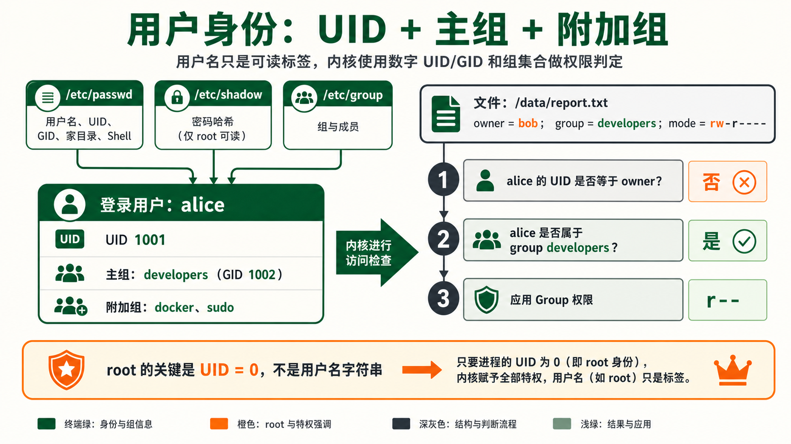
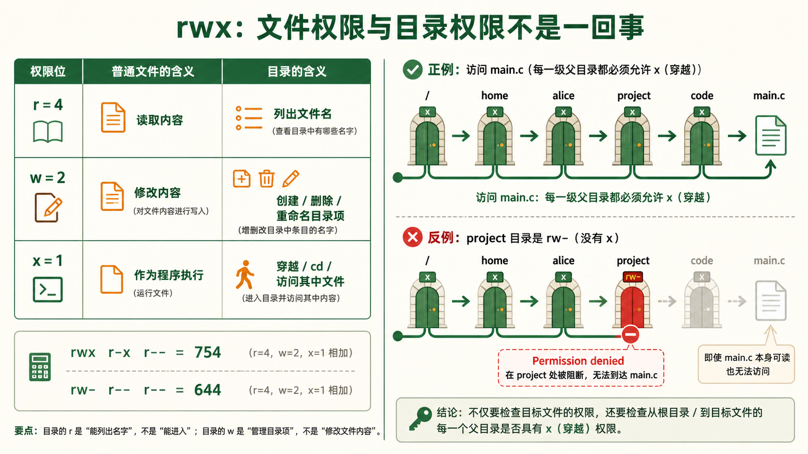
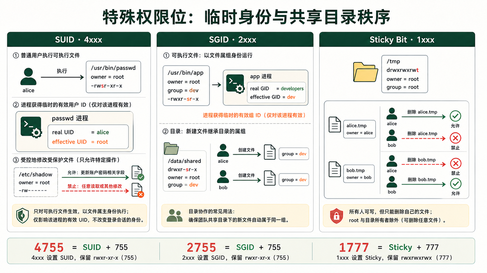
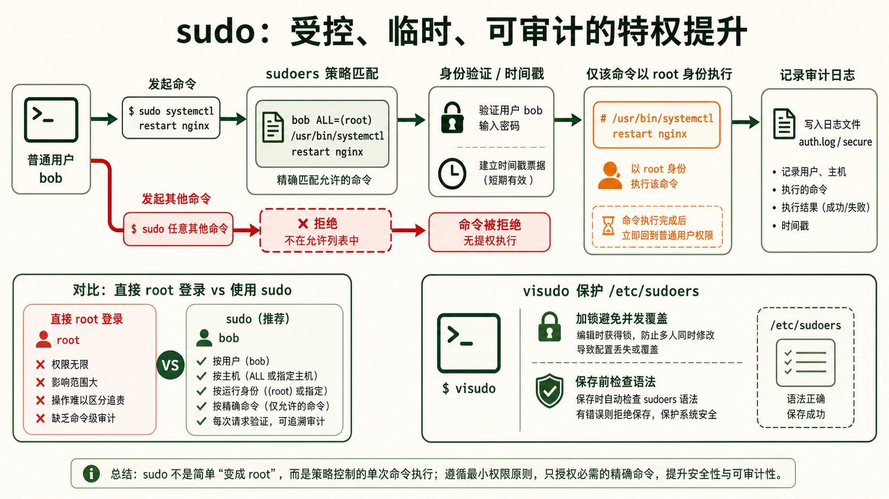
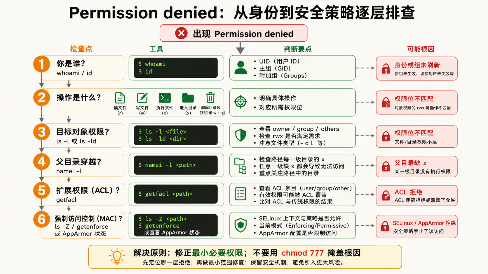

[← 返回 Linux 系统目录]({{ '/subjects/Linux/' | relative_url }})



# 用户与权限管理

## 1 用户与组概念 {#sec04-1}

### 为什么 Linux 是天生多用户系统？ · 核心 {#为什么-linux-是天生多用户系统-核心}

#### 问题：为什么要有"用户"这个概念？

Linux 从 UNIX 继承了多用户基因。最初一台 PDP-11 小型机要同时服务几十个终端，每个人登录后看到的是"自己的"环境，不能动别人的文件。这套机制的三个支柱是：<strong>隔离（每个人看到自己的文件）、权限分配（谁能读谁不能读）、分权制衡（root管系统，普通人用应用）</strong>。

每个用户有一个唯一的整数 UID（User ID）。UID=0 是 root——不是名字叫 root 所以是管理员，而是 UID 为 0 的那个实体拥有最高特权。你可以把 root 改名叫 superman，但只要 UID 还是 0，它就是管理员。

#### 核心文件速查

| 文件 | 存储内容 | 典型行示例 |
|----|----|----|
| `/etc/passwd` | 用户清单（7个字段，冒号分隔） | `alice:x:1001:1001:Alice:/home/alice:/bin/bash` |
| `/etc/shadow` | 密码哈希（仅 root 可读） | `alice:$6$salt$hashedpw:19000:0:99999:7:::` |
| `/etc/group` | 组清单 | `dev:x:1002:alice,bob,carol` |
| `/etc/gshadow` | 组密码哈希 | `dev:!::alice,bob` |

`/etc/passwd` 每行格式：`用户名:密码占位符x:UID:GID:GECOS描述:家目录:登录Shell`。注意密码字段现在固定为 `x`，实际密码哈希存在 `/etc/shadow` 中——这是安全性进化，因为 `/etc/passwd` 必须世界可读（所有程序都要查询用户信息），但密码哈希不能给所有人看。

#### 主组与附加组

每个用户属于<strong>一个主组</strong>（primary group，写在 /etc/passwd 的 GID 字段）和<strong>多个附加组</strong>（supplementary groups，写在 /etc/group 里把用户名加进去）。



```bash
# 创建用户时指定主组和附加组
useradd -m -g developers -G docker,sudo alice
# -g developers  → 主组是 developers
# -G docker,sudo → 附加组是 docker 和 sudo（用户同时属于这三个组）
```

<strong>为什么需要"附加组"？</strong> 实际场景：用户 alice 的主组是 developers（她创建的文件默认 belong to developers 组）。但她同时需要访问 Docker（需要加入 docker 组）和 sudo 权限。如果只有主组，她必须不停切换组。附加组解决了这个问题——一个用户可以同时拥有多个组的身份。

## 2 权限三要素 rwx {#sec04-2}

### Owner + Group + Others 三围权限模型 · 核心 {#owner-group-others-三围权限模型-核心}

#### 问题：ls -l 输出的那串神秘字符到底是什么？

```bash
$ ls -l script.sh
-rwxr-xr-- 1 alice dev 2048 Jul 31 10:00 script.sh
```

第一个字符是文件类型（`-` 普通文件、`d` 目录、`l` 符号链接）。后面 9 个字符分为三组，每组 3 位：

| 组位 | 字符  | 对象                | 含义                       |
|------|-------|---------------------|----------------------------|
| 1-3  | `rwx` | Owner (alice)       | 属主可读、可写、可执行     |
| 4-6  | `r-x` | Group (dev)         | 组成员可读、可执行，不可写 |
| 7-9  | `r--` | Others (其他所有人) | 其他人只能读               |

#### rwx 在文件和目录上的含义完全不同

| 权限 | 数字 | 对文件的意义 | 对目录的意义 |
|----|----|----|----|
| r (read) | 4 | 可以读取文件内容 (cat/more) | 可以列出目录下的文件名 (ls) |
| w (write) | 2 | 可以修改文件内容 (但删除文件要看目录的w) | 可以在目录中创建/删除/重命名文件 |
| x (execute) | 1 | 可以作为程序/脚本运行 | 可以 `cd` 进入该目录（成为当前工作目录） |



#### 权限的数字表示法——八进制加法

r=4, w=2, x=1。每一组权限值就是这三个数字的和。例如 rwx = 4+2+1 = 7，r-x = 4+0+1 = 5，r-- = 4+0+0 = 4。所以 `rwxr-xr--` = 754。

```plaintext
rwx r-x r--  →  7   5   4   →   权限值 754
rw- r-- r--  →  6   4   4   →   权限值 644
rwx rwx ---  →  7   7   0   →   权限值 770
```

<strong>经典的"不受欢迎的锁"陷阱</strong>：目录权限是 rw- (6)，但没有 x。你能 ls 看到文件名，但无法 cd 进去，也无法访问其中任何文件。很多新手看到 Permission denied 会反复检查文件权限，而忽略了 <strong>每一个父目录都需要 x 权限</strong>。比如要访问 `/home/alice/project/code/main.c`，从根开始， `/`、 `/home`、 `/home/alice`、 `/home/alice/project`、 `/home/alice/project/code` 这五个目录 <strong>全部要有 x 权限</strong>。

## 3 chmod / chown / chgrp {#sec04-3}

### 权限变更三大命令的完整语法与实战 · 实操 {#权限变更三大命令的完整语法与实战-实操}

#### chmod —— 改权限（change mode） {#chmod-改权限change-mode}

两种语法：数字法（直接设置）和符号法（增量修改）。

```bash
# === 数字法：精确设置（最常用） ===
chmod 755 script.sh     # rwxr-xr-x → 属主全权，其他人读+执行
chmod 644 config.txt    # rw-r--r-- → 属主可读写，其他人只读
chmod 600 id_rsa        # rw------- → 只有属主可读写（SSH私钥标准权限）
chmod 777 shared/       # ⚠️ 危险！所有人都能读、写、进入

# === 符号法：增量修改 ===
chmod u+x script.sh     # 给属主(user)添加执行权限
chmod g-w shared.txt    # 移除组(group)的写权限
chmod o=r report.txt    # 设置其他人(other)权限为只读
chmod a+r public.txt    # 所有人(all)添加读权限
chmod u+x,g+x bin/      # 属主和组都加执行权限
```

#### chown —— 改属主（change owner） {#chown-改属主change-owner}

```yaml
chown alice file.txt              # 只改属主为 alice
chown alice:dev file.txt           # 改属主为 alice，组改为 dev
chown :docker file.txt             # 只改组为 docker（冒号前面留空）
chown -R alice:dev /home/alice     # -R 递归修改整个目录树
```

<strong>注意：</strong>普通用户不能随便 chown 把文件送给别人（这是安全机制——防止你把自己的恶意文件伪装成 root 的文件）。只有 root 可以任意更改文件属主。

#### chgrp —— 改属组（change group） {#chgrp-改属组change-group}

```bash
chgrp developers project/          # 将目录的组改为 developers
chgrp -R docker /var/lib/docker    # 递归修改组
```

#### umask —— 新文件的默认权限掩码 {#umask-新文件的默认权限掩码}

`umask` 用来屏蔽新建对象的权限位。普通文件通常以 `0666`、目录以 `0777` 为基础，再按位清除 umask 指定的位；<strong>不是对八进制数字做普通减法</strong>。例如 umask 为 `0027` 时，新文件通常是 `0640`、新目录是 `0750`，具体结果还可能受 ACL 与创建程序指定模式影响。

```bash
$ umask
0022

# 计算：新文件权限 = 666 - 022 = 644 (rw-r--r--)
#       新目录权限 = 777 - 022 = 755 (rwxr-xr-x)

# 查看和设置 umask
$ umask           # 查看当前 umask
0022
$ umask 027       # 设置更严格的 umask（属主rwx，组rx，其他人无权限）
# 设置后：文件 = 666 - 027 = 640 (rw-r-----)
#         目录 = 777 - 027 = 750 (rwxr-x---)
```

<strong>生产环境最佳实践：</strong>Server 配置文件建议 umask 027 或 077，确保新创建的文件默认不被其他用户读取。Web 应用的上传目录需要 umask 002，保证 Web 服务器用户（如 www-data）和开发团队可以协同读写。

## 4 SUID / SGID / Sticky Bit {#sec04-4}

### 特殊权限位——让"不是你"的身份执行操作 · 进阶 {#特殊权限位让不是你的身份执行操作-进阶}

#### 问题：普通用户怎么能修改自己的密码？

用户的密码哈希存在 `/etc/shadow` 中，这个文件的权限是 `-rw-r----- 1 root shadow`——只有 root 能写。但 alice 这个普通用户在终端执行 `passwd` 修改自己密码时，确实写入了 /etc/shadow。怎么做到的？答案就是 <strong>SUID (Set User ID)</strong>。

```bash
$ ls -l /usr/bin/passwd
-rwsr-xr-x 1 root root 59976 Jul 15 2024 /usr/bin/passwd
#     ^
#     看这里：属主的 x 位变成了 s ——这就是 SUID 标志
```

<strong>SUID 的含义：</strong>当执行这个文件时，进程的实际 UID 不变（alice），但有效 UID 变成文件属主的 UID（root）。所以 passwd 进程以 root 身份运行，拥有写 /etc/shadow 的权限。

#### 三种特殊权限位详解

<table>
<colgroup>
<col style="width: 20%" />
<col style="width: 20%" />
<col style="width: 20%" />
<col style="width: 20%" />
<col style="width: 20%" />
</colgroup>
<thead>
<tr>
<th>权限位</th>
<th>数字</th>
<th>显示位置</th>
<th>效果</th>
<th>典型用例</th>
</tr>
</thead>
<tbody>
<tr>
<td>SUID</td>
<td>4</td>
<td>属主 x 位变 s<br />
<code>-rwsr-xr-x</code></td>
<td>以<strong>文件属主</strong>身份执行</td>
<td><code>/usr/bin/passwd</code>（临时root权限改密码）<br />
<code>/usr/bin/su</code>（切换用户）</td>
</tr>
<tr>
<td>SGID</td>
<td>2</td>
<td>组 x 位变 s<br />
<code>-rwxr-sr-x</code></td>
<td>以<strong>文件属组</strong>身份执行</td>
<td><code>/usr/bin/crontab</code></td>
</tr>
<tr>
<td>SGID(目录)</td>
<td>2</td>
<td>组 x 位变 s<br />
<code>drwxr-sr-x</code></td>
<td>目录中新建文件<strong>继承父目录的组</strong></td>
<td>项目共享目录：<code>chmod g+s /data/shared/</code></td>
</tr>
<tr>
<td>Sticky Bit</td>
<td>1</td>
<td>其他人 x 位变 t<br />
<code>drwxrwxrwt</code></td>
<td>只有<strong>文件所有者</strong>才能删除文件</td>
<td><code>/tmp</code>（所有人可写但只能删自己的）</td>
</tr>
</tbody>
</table>



#### 设置特殊权限

```bash
# 数字法：特殊权限位写在最前面（四位数字）
chmod 4755 /usr/local/bin/myadmin   # 4=SUID + 755 → -rwsr-xr-x
chmod 2755 /data/shared             # 2=SGID + 755 → drwxr-sr-x
chmod 1777 /tmp                     # 1=Sticky+ 777 → drwxrwxrwt

# 符号法
chmod u+s mybinary    # 设置 SUID
chmod g+s shared/     # 设置 SGID
chmod +t /tmp         # 设置 Sticky Bit
```

<strong>安全警告：</strong>SUID 是双刃剑。一个 SUID root 程序如果有漏洞（如缓冲区溢出），攻击者就拿到了 root shell。运维必须定期审计系统中的 SUID 文件： `find / -perm -4000 -type f -ls 2>/dev/null`

## 5 sudo 与 visudo {#sec04-5}

### 受控特权提升——不要以 root 登录 · 安全 {#受控特权提升不要以-root-登录-安全}

#### 问题：既然 root 能做任何事，为什么还要 sudo？

直接以 root 登录有三个致命缺陷：① <strong>没有审计——</strong>不知道谁在什么时候做了什么；② <strong>没有限制——</strong>敲错一条命令就可能删掉整个系统（`rm -rf /`）；③ <strong>无法撤销——</strong>root 权限一旦泄露，攻击者拥有全部控制权。

sudo 的设计哲学是<strong>"最小权限原则"</strong>：只给需要的用户、需要的命令、需要的参数组合。每次 sudo 操作都会记录日志（`/var/log/auth.log` 或 `/var/log/secure`），出问题可以追溯到人。

#### sudoers 文件结构与 visudo

<strong>必须用 visudo 编辑 /etc/sudoers！</strong>原因有二：visudo 会锁定文件防止多人同时编辑导致覆盖；visudo 在保存时会做语法检查，语法出错会拒绝保存并提示错误位置。如果用普通编辑器直接修改导致语法错误，整个 sudo 将无法工作——而你只能用 root 修复。

```bash
# /etc/sudoers 中的一条规则
# 用户  主机  =(以谁的身份运行)  可执行的命令
alice    ALL  =(ALL:ALL)        ALL
#  ↑      ↑        ↑              ↑
#  用户   任意主机  以任何人身份    任何命令 → 等同于root权限

# 更精细的控制——只允许特定命令
bob    ALL=(ALL)    /usr/bin/systemctl restart nginx, /usr/bin/systemctl status nginx
# bob 只能重启和查看 nginx，不能做其他事

# 不需要密码
carol  ALL=(ALL)    NOPASSWD: /usr/bin/docker
```



#### sudoers 规则语法详解

```bash
# 格式：who host=(runas) tag:commands
# 给 alice 授予管理员权限（标准做法）
alice ALL=(ALL:ALL) ALL

# 不要把 apt、journalctl 或带通配符的 systemctl 当作低权限只读规则
# 包管理器可运行安装脚本；交互式 pager 也可能打开 Shell
# 需要委派时，为具体操作编写受限工具，再用 visudo 精确授权

# 推荐：给运维团队加上 sudo 权限
usermod -aG sudo alice        # Debian/Ubuntu 系 → 加入 sudo 组
usermod -aG wheel bob         # Red Hat/CentOS 系 → 加入 wheel 组（需确保 wheel 在 sudoers 中已启用）
```

#### sudo 常用命令

```bash
sudo -l            # 列出当前用户可执行的 sudo 命令（知道自己有哪些权限）
sudo -v            # 刷新 sudo 时间戳（延长免密码时间，默认5分钟）
sudo -k            # 立即让 sudo 时间戳失效（下次必须输密码）
sudo -u www-data whoami    # 以 www-data 用户身份执行命令（不是必须切到root）
```

<strong>sudo 日志审计：</strong>所有 sudo 执行的命令都会记录在 `/var/log/auth.log`（Debian/Ubuntu）或 `/var/log/secure`（RHEL/CentOS）。查询某人用 sudo 做了什么： `grep 'alice.*COMMAND' /var/log/auth.log`。

## 6 权限排错实战 {#sec04-6}

### 遇到 Permission denied 不要慌——系统性排查流程 · 诊断 {#遇到-permission-denied-不要慌系统性排查流程-诊断}

#### 排查三步法



1.  <strong>确认"你是谁"：</strong>`whoami`、`id`（查看 UID、GID 和所有附加组）
2.  <strong>检查目标文件/目录的实际权限：</strong>`ls -la /path/to/file`，注意属主、属组、rwx 三组权限
3.  <strong>检查路径上每一个父目录的 x 权限：</strong>`namei -l /path/to/file`（namei 自动展开路径中的每一层并显示权限）

#### 经典排错场景

```bash
# 场景1：shell 脚本明明有执行权限但无法运行
$ ls -l script.sh
-rw-r--r-- 1 alice alice 512 Jul 31 10:00 script.sh
$ ./script.sh
-bash: ./script.sh: Permission denied

# 原因：没有执行权限。解决：
$ chmod u+x script.sh

# 场景2：脚本有执行权限，但还是 Permission denied
$ ls -l script.sh
-rwxr--r-- 1 root root 512 Jul 31 10:00 script.sh
$ ./script.sh          # alice 作为其他人，只有 r-- 权限
-bash: ./script.sh: Permission denied

# 原因：alice 是 other 组，只有 r，没有 x。

# 场景3：cd 目录失败
$ cd /var/log/private/
-bash: cd: /var/log/private/: Permission denied
$ ls -ld /var/log/private/
drwxr----- 2 root adm 4096 Jul 31 10:00 /var/log/private/
# alice 既不是 root 也不在 adm 组 → 没有 x 权限 → 无法 cd
```

#### 实用排查命令

```bash
# namei —— 查看路径上每一层的权限（最强大的权限排查工具）
$ namei -l /home/alice/project/data/file.txt
f: /home/alice/project/data/file.txt
drwxr-xr-x root  root  /
drwxr-xr-x root  root  home
drwx------ alice alice alice       ← 这里！其他人没有 x 权限
drwxr-xr-x alice alice project
drwxr-xr-x alice alice data
-rw-r--r-- alice alice file.txt

# find —— 查找某用户的所有文件
find /home -user alice -type f

# 查找权限不安全的文件
find / -perm -o+w -type f -ls 2>/dev/null    # 其他用户可写的文件
find / -perm -4000 -type f -ls 2>/dev/null   # SUID 文件
find / -perm -2000 -type d -ls 2>/dev/null   # SGID 目录
```

<strong>还有一个常见陷阱——SELinux / AppArmor：</strong>如果传统权限检查（rwx）全部正确但仍然 Permission denied，检查 SELinux 上下文（ `ls -Z` 或 `getenforce`）。SELinux 在传统权限之上叠加了一层强制访问控制。临时禁用确认问题： `setenforce 0`（不建议长期关闭）。



<nav class="article-end" aria-label="章节导航">
  <a href="{{ '/subjects/Linux/03-%E6%96%87%E4%BB%B6%E4%B8%8E%E7%9B%AE%E5%BD%95%E6%93%8D%E4%BD%9C.html' | relative_url }}">← 上一章：文件与目录操作</a>
  <a href="{{ '/subjects/Linux/' | relative_url }}">返回 Linux 系统目录</a>
  <a href="{{ '/subjects/Linux/05-%E8%BF%9B%E7%A8%8B%E7%AE%A1%E7%90%86%E4%B8%8E%E7%9B%91%E6%8E%A7.html' | relative_url }}">下一章：进程管理与监控 →</a>
</nav>
