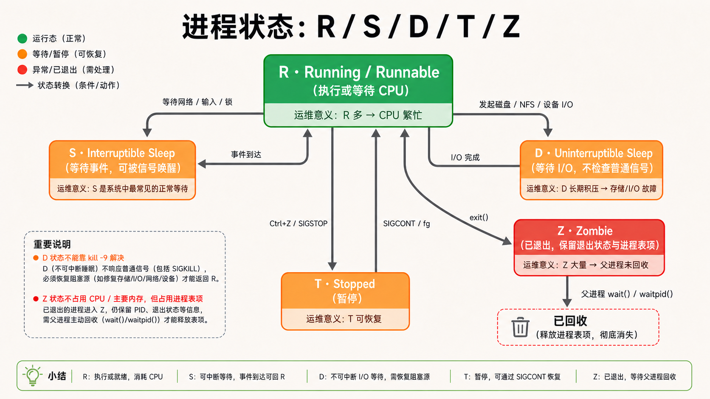
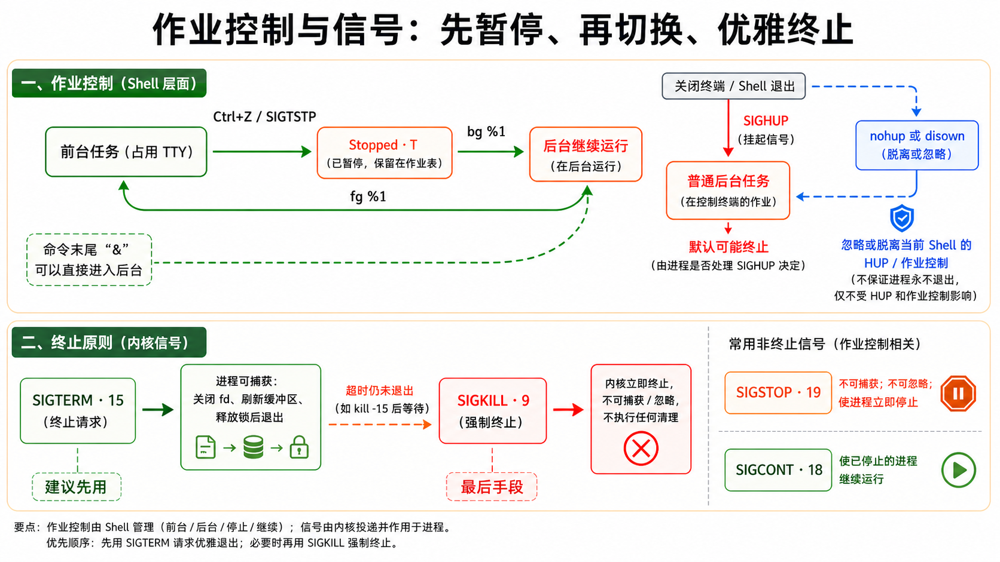
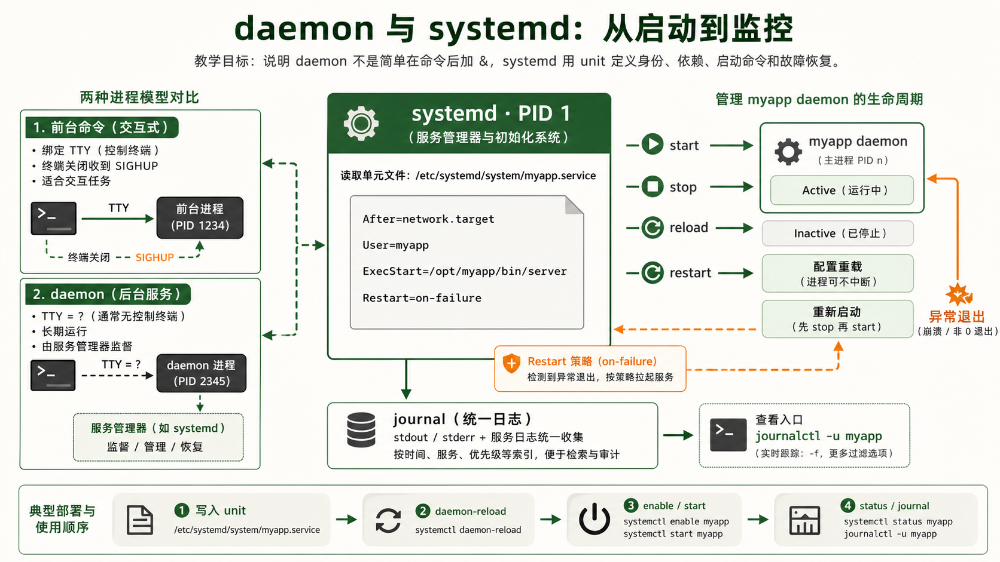
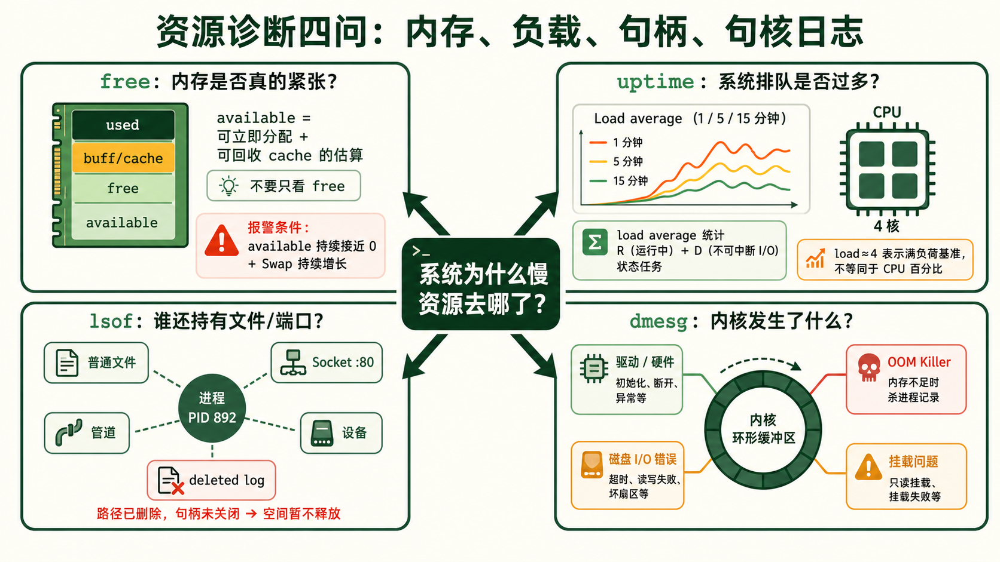

[← 返回 Linux 系统目录]({{ '/subjects/Linux/' | relative_url }})



# 进程管理与监控

## 1 进程状态 R / S / D / Z / T {#sec05-1}

### ps aux STAT 列每个字母背后的故事 · 核心 {#ps-aux-stat-列每个字母背后的故事-核心}

#### 问题：ps aux 输出的 STAT 列到底在说什么？

```bash
$ ps aux | head -5
USER       PID %CPU %MEM    VSZ   RSS TTY      STAT START   TIME COMMAND
root         1  0.0  0.1 169488 13568 ?        Ss   Jul30   0:05 /sbin/init
root        12  0.0  0.0      0     0 ?        I<   Jul30   0:00 [rcu_tasks_kthread]
root        23  0.0  0.0      0     0 ?        S    Jul30   0:00 [ksoftirqd/0]
root      2341  0.0  0.1  34876  8120 ?        D    Jul30   1:23 [jbd2/sda1-8]
```

STAT 列由一到多个字符组成。第一个字符是<strong>主状态码</strong>，后续是附加属性（小写字母表示特殊属性，大写字母表示关键特征）。

#### 五大主状态码：进程生命周期中的五种"身份"

| 状态 | 含义 | 正在做什么 | 你能做什么 |
|----|----|----|----|
| <strong>R</strong> | Running / Runnable | 正在 CPU 上执行，或在运行队列中等待 CPU（可运行状态）。两者都用 R 表示，因为对调度器来说"马上就能跑"和"正在跑"没区别。 | 属于正常状态，大量 R 进程说明 CPU 繁忙 |
| <strong>S</strong> | Sleeping (Interruptible) | 等待某个事件发生——等待网络数据到达、等待用户输入、等待锁释放。系统中绝大多数进程都在 S 状态。 | 可被信号唤醒（如 SIGTERM） |
| <strong>D</strong> | Uninterruptible Sleep | 正在等待 I/O 操作（磁盘读写、NFS 网络文件系统响应）。此时进程<strong>不接受任何信号</strong>——不能 kill，不能 Ctrl+C。 | 只能等待 I/O 完成；大量 D 状态积压 → 存储系统故障 |
| <strong>Z</strong> | Zombie (Defunct) | 进程已经死亡（调用了 exit），但父进程还没有调用 wait() 来回收它的退出状态。僵尸进程不占用内存、不占用 CPU，只占用进程表中一个 slot。 | 清理办法：杀掉父进程，让 init 收养并回收僵尸 |
| <strong>T</strong> | Stopped | 被 Ctrl+Z 或 SIGSTOP 信号暂停。进程还在内存中，只是停止执行——可以恢复。 | 用 fg 恢复到前台，或用 kill -CONT 继续运行 |



#### STAT 列的附加标志

| 标志 | 含义 | 示例 |
|----|----|----|
| `s` | 会话首进程（session leader） | `Ss` 表示该进程是会话领导者且处于睡眠状态 |
| `+` | 前台进程组中的进程 | `S+` 表示前台运行中的睡眠态进程 |
| `<` | 高优先级进程 | `S<` 表示睡眠中的高优先级进程 |
| `N` | 低优先级进程 | `SN` 表示睡眠中的低优先级进程 |
| `l` | 多线程（使用 clone 创建） | `Sl` 表示该进程是多线程的 |
| `L` | 内存页面被锁定（常驻内存） | `SLl` 常见于数据库进程 |

<strong>持续的 D 状态需要查 I/O 链路：</strong>不可中断睡眠常见于块设备或网络文件系统等待；单次短暂出现不等于故障。若进程长期停留，先查内核日志、存储延迟和挂载状态。此时发送 SIGKILL 通常不会立即生效，要等进程离开不可中断等待；排障重点是恢复其等待的底层资源。 <strong>Z 状态（僵尸）清理指南：</strong>僵尸不再运行，但仍占用进程表项。用 `ps -eo ppid,pid,stat,cmd | awk '$3 ~ /^Z/'` 找到其 PPID，再检查父进程为何没有调用 `wait` 回收子进程。不要把 `SIGHUP` 当作通用“回收信号”；是否重载或退出取决于程序实现。必要时按服务的正常重启流程处理父进程。

## 2 进程控制：前台后台 {#sec05-2}

### 前台后台切换 + 信号体系 —— 进程的"遥控器" · 实操 {#前台后台切换-信号体系-进程的遥控器-实操}

#### 问题：跑一个长时间的 tar 打包，按了 Ctrl+C 就全没了？

Shell 中的进程分为<strong>前台进程</strong>（foreground，占用终端，能接收键盘信号）和<strong>后台进程</strong>（background，不占用终端输入）。学会在前台后台之间自如切换，是运维的基本功。

#### 作业控制（Job Control）完整操作链条

```bash
# 1. 前台启动一个长时间任务
$ tar -czf /backup/data.tar.gz /data
# (正在运行，终端被占用...)

# 2. 按 Ctrl+Z 暂停它
^Z
[1]+  Stopped    tar -czf /backup/data.tar.gz /data

# 3. 查看暂停的任务
$ jobs -l
[1]+  34567 Stopped    tar -czf /backup/data.tar.gz /data

# 4. 把它放到后台继续运行
$ bg %1
[1]+ tar -czf /backup/data.tar.gz /data &

# 5. 临时回到前台看一眼
$ fg %1
# (回到前台，可以 Ctrl+Z 再次暂停)

# 6. 再次放到后台（这次加上 disown，关闭终端也不停）
$ bg %1
$ disown %1          # 脱离当前 shell 的控制
```

#### nohup —— 终端关了，进程继续跑 {#nohup-终端关了进程继续跑}

```bash
# nohup 让进程忽略 SIGHUP 信号（终端断开时发送的信号）
$ nohup long-running-command &
nohup: ignoring input and appending output to 'nohup.out'

# 标准用法：重定向输出 + 后台运行
$ nohup python train_model.py > training.log 2>&1 &
[1] 45678
# 现在可以安全关闭终端，进程继续运行

# 检查 nohup 进程
$ ps aux | grep train_model
$ tail -f training.log    # 查看输出
```

#### 信号体系 —— 进程间的通讯方式 {#信号体系-进程间的通讯方式}

信号是 Linux 内核向进程发送的"通知"。进程可以捕获信号并执行处理函数（如 SIGTERM），也可以忽略某些信号，或者按默认行为响应。

```bash
$ kill -l   # 列出所有信号（编号 1~64）
 1) SIGHUP      2) SIGINT      3) SIGQUIT     4) SIGILL
 5) SIGTRAP     6) SIGABRT     7) SIGBUS      8) SIGFPE
 9) SIGKILL    10) SIGUSR1    11) SIGSEGV    12) SIGUSR2
13) SIGPIPE    14) SIGALRM    15) SIGTERM    16) SIGSTKFLT
17) SIGCHLD    18) SIGCONT    19) SIGSTOP    20) SIGTSTP
...
```

| 信号 | 编号 | 触发方式 | 默认行为 | 可否捕获/忽略 |
|----|----|----|----|----|
| <strong>SIGINT</strong> | 2 | Ctrl+C | 终止进程 | 可捕获 |
| <strong>SIGQUIT</strong> | 3 | Ctrl+\\ | 终止进程 + core dump | 可捕获 |
| <strong>SIGKILL</strong> | 9 | `kill -9 PID` | 立即杀死（不可撤销） | <strong>不可捕获、不可忽略</strong> |
| <strong>SIGTERM</strong> | 15 | `kill PID`（默认） | 优雅终止 | 可捕获（进程可清理后退出） |
| <strong>SIGHUP</strong> | 1 | `kill -HUP PID` | 终端挂断 | 可捕获（常用于重载配置） |
| <strong>SIGSTOP</strong> | 19 | `kill -STOP PID` | 暂停进程 | <strong>不可捕获、不可忽略</strong> |
| <strong>SIGCONT</strong> | 18 | `kill -CONT PID` | 恢复暂停的进程 | 可捕获 |
| <strong>SIGUSR1</strong> | 10 | `kill -USR1 PID` | 用户自定义 | 由程序自由定义 |
| <strong>SIGUSR2</strong> | 12 | `kill -USR2 PID` | 用户自定义 | 由程序自由定义 |

<strong>SIGTERM vs SIGKILL 的关键区别：</strong>发送 SIGTERM(15) 时，进程收到通知可以执行清理工作——关闭文件描述符、刷新缓冲区、释放锁、通知下游服务——然后优雅退出。SIGKILL(9) 则是内核直接终止进程，不给任何反应时间。这可能导致文件数据只写了一半、数据库锁未释放。原则： <strong>先用 kill PID（SIGTERM），给它几秒时间优雅退出；仍然不退出再 kill -9（SIGKILL）作为终极手段。</strong>

#### 实战命令

```bash
kill 1234              # 发送 SIGTERM (15)——请优雅退出
kill -9 1234           # 发送 SIGKILL (9)——立刻杀死
kill -HUP 1234         # 发送 SIGHUP (1)——重新加载配置（nginx/supervisor 常用）
kill -STOP 1234        # 暂停进程
kill -CONT 1234        # 恢复进程

killall nginx          # 按名称杀死所有 nginx 进程（发送 SIGTERM）
killall -9 java        # 按名称强制杀死所有 java 进程（谨慎使用）

pkill -f "python.*train"  # 按命令行模式匹配杀进程
pkill -u alice             # 杀死某用户的所有进程
```



## 3 ps / top / htop 实战 {#sec05-3}

### 进程信息查看三位一体的武器库 · 实操 {#进程信息查看三位一体的武器库-实操}

#### ps —— 进程快照 {#ps-进程快照}

ps 是两个"流派"的命令合体：BSD 风格（不加 -）和 POSIX 风格（加 -）。日常工作中混用无妨，但要知道区别。

```bash
# === 最常用的三种 ps 命令 ===

# 1. BSD 风格全进程列表（最常用）
ps aux
# a = 显示所有用户进程（含其他终端）
# u = 以用户为导向的格式（显示 CPU/MEM/VSZ/RSS/STAT）
# x = 显示无控制终端的进程（daemon）

# 2. POSIX 风格完整格式
ps -elf
# -e = 显示所有进程
# -l = 长格式
# -f = 完整格式（包含 PPID、启动时间）

# 3. 自定义输出列（只取你要的信息）
ps -eo pid,ppid,user,%cpu,%mem,vsz,rss,stat,cmd --sort=-%cpu | head -20
# 按 CPU 使用率降序排列，只显示前 20 名
```

▶ ps aux 每列的含义

| 列      | 含义                                                       |
|---------|------------------------------------------------------------|
| USER    | 进程属于哪个用户                                           |
| PID     | 进程 ID                                                    |
| %CPU    | CPU 使用率（单核的百分比，多核可超 100%）                  |
| %MEM    | 物理内存使用百分比                                         |
| VSZ     | 虚拟内存大小（KB）——包含了共享库和未实际使用的虚拟地址空间 |
| RSS     | 常驻内存大小（KB）——物理内存中实际占用的部分               |
| TTY     | 绑定的终端，? 表示没有控制终端（daemon）                   |
| STAT    | 进程状态（见第一节）                                       |
| START   | 进程启动时间                                               |
| TIME    | 累计占用的 CPU 时间（不是墙钟时间）                        |
| COMMAND | 命令行（可能被截断）                                       |

#### top —— 实时交互式资源监控 {#top-实时交互式资源监控}

top 相当于终端里的"任务管理器"，每 3 秒刷新一次。

```bash
# top 的交互快捷键（运行时按对应键）

P       # 按 CPU 使用率排序（最常用）
M       # 按内存使用率排序
T       # 按运行时间排序
k       # 杀进程：输入 PID → 输入信号编号（默认15）
r       # renice 调整进程优先级：输入 PID → 输入 nice 值
u       # 只看指定用户的进程：输入用户名
1       # 显示每个 CPU 核心的使用率（多核 CPU 专用）
c       # 切换 COMMAND 列显示完整命令行 / 仅程序名
V       # 树形视图（显示父子关系）
E       # 切换内存单位
q       # 退出

# top 常用启动参数
top -u alice            # 只看 alice 的进程
top -p 1234,5678        # 只监控指定的 PID
top -d 1                # 每 1 秒刷新（默认 3 秒）
top -n 5 -b -o %CPU    # 批处理模式：取 5 次快照按 CPU 排序输出
```

#### htop —— top 的现代化替代品 {#htop-top-的现代化替代品}

htop 不是系统预装的，需要手动安装（`apt install htop` / `dnf install htop`）。它的优势：彩色输出、鼠标支持、树形视图、更直观的交互。

```bash
# htop 特色功能
F2      # 进入设置界面（自定义显示列、颜色主题）
F3      # 搜索进程（按名称/命令行走）
F4      # 按进程名过滤
F5      # 树形视图（显示父子进程关系）
F6      # 选择排序方式（CPU/MEM/TIME/PID 等）
F9      # 发送信号：选进程 → 按 F9 → 从列表选信号类型 → 回车
F10     # 退出

# 常用启动参数
htop -u alice         # 只看 alice 的进程
htop -p 1234          # 只监控 PID 1234
```

#### pgrep —— 按名称快速查 PID {#pgrep-按名称快速查-pid}

```bash
pgrep nginx               # 返回所有名为 nginx 的进程 PID
pgrep -u alice             # alice 的所有进程 PID
pgrep -f "python.*app"     # 匹配完整命令行（不只是进程名）
pgrep -l nginx             # 同时显示进程名
3321 nginx
3327 nginx

# 配合 kill 使用
kill $(pgrep nginx)        # 杀死所有 nginx 进程
pkill nginx                # 和上面等价，更简洁
```

## 4 daemon 守护进程 {#sec05-4}

### 后台服务 vs 前台命令 —— 两个世界的进程 · 运维 {#后台服务-vs-前台命令-两个世界的进程-运维}

#### 问题：为什么 nginx 重启后还能继续运行，而 Ctrl+C 会杀死我的脚本？

前台作业通常属于终端会话，终端退出可能使其收到 `SIGHUP`；能否继续运行还取决于 Shell、作业控制和进程自身处理。传统守护进程常通过 fork、脱离终端等步骤后台运行；现代 systemd 服务也可以让程序保持前台运行，由服务管理器负责启动、日志与重启。两种方式都不是“自动永不退出”。

#### daemon 的典型特征

```bash
# 看 ps aux 中 daemon 的特征
$ ps aux | grep nginx
root      892  0.0  0.1  55212  9808 ?        Ss   Jul30   0:00 nginx: master process
www-data  893  0.0  0.2  55680 14560 ?        S    Jul30   0:12 nginx: worker process
#         ↑                                 ↑
#     PID 892                           TTY=? （无控制终端）

# daemon 的特征总结：
# 1. TTY 列显示 ?（没有绑定终端）
# 2. PPID（父进程ID）通常是 1（init/systemd）
# 3. STAT 通常带 s（会话领导者）
```

#### systemd —— 现代 Linux 的服务管家 {#systemd-现代-linux-的服务管家}

systemd (PID=1) 是所有用户态进程的祖先，负责启动、停止、重启、监控 daemon。



```bash
# systemd 管理 daemon 的常用命令

systemctl start nginx      # 启动服务
systemctl stop nginx       # 停止服务
systemctl restart nginx    # 重启服务
systemctl reload nginx     # 重新加载配置（不停止服务，nginx 支持）
systemctl status nginx     # 查看服务状态（最近10行日志 + 进程树 + CGroup）
systemctl enable nginx     # 设置开机自启
systemctl disable nginx    # 取消开机自启
systemctl is-enabled nginx # 检查是否已设为开机自启

# 查看所有已启用的服务
systemctl list-unit-files --type=service --state=enabled

# 查看启动耗时分析
systemd-analyze blame       # 各个服务启动耗时排名
systemd-analyze critical-chain  # 启动关键路径
```

#### 写一个 systemd service 单元文件

```bash
# /etc/systemd/system/myapp.service
[Unit]
Description=My Custom Application
After=network.target          # 网络就绪后再启动

[Service]
Type=simple                   # simple / forking / oneshot / notify
User=myapp
Group=myapp
WorkingDirectory=/opt/myapp
ExecStart=/opt/myapp/bin/server
ExecStop=/bin/kill -TERM $MAINPID
Restart=on-failure            # 异常退出时自动重启
RestartSec=5                  # 重启前等待 5 秒
StandardOutput=journal        # 标准输出写入 systemd journal
StandardError=journal

[Install]
WantedBy=multi-user.target    # 系统进入多用户模式时启动

# 部署 service 文件后的操作
systemctl daemon-reload       # 重载 systemd 配置
systemctl enable --now myapp  # 启用并立即启动
```

<strong>journalctl —— systemd 的统一日志：</strong>daemon 的标准输出和错误被 systemd 捕获，统一存储在 journal 中（二进制格式）。常用命令： `journalctl -u nginx -f`（跟踪 nginx 日志）、 `journalctl -u nginx --since today`（今天的日志）、 `journalctl -u nginx -p err`（只看错误级别）、 `journalctl -xe`（查看最近的系统日志）。

## 5 资源查看 free / uptime / lsof {#sec05-5}

### 系统资源诊断三板斧 —— 内存、负载、文件句柄 · 诊断 {#系统资源诊断三板斧-内存负载文件句柄-诊断}

#### free —— 内存使用全貌 {#free-内存使用全貌}

`free` 的 `free` 列较小不一定表示内存紧张：Linux 会利用空闲内存做缓存。优先结合 `available`、交换区使用、回收压力与 OOM 日志判断；缓存也不是在所有负载下都能“立即、无成本”回收。



```bash
$ free -h
              total        used        free      shared  buff/cache   available
Mem:           15Gi       3.2Gi       1.5Gi       234Mi        10Gi        11Gi
Swap:         2.0Gi       512Mi       1.5Gi

# 关键理解：
# free (1.5Gi)       → 完全没有被使用的内存（"浪费"的内存）
# buff/cache (10Gi)  → 被用作文件系统缓存的内存（可随时回收给应用）
# available (11Gi)   → 真正可以分配给新进程的内存（free + 可回收的cache）
# used (3.2Gi)       → 进程实际占用的内存（不能轻易回收的）
```

<strong>什么时候应该担心内存？</strong>不看 free 列，看 <strong>available</strong> 列。当 available 持续接近 0 且 Swap 使用量持续增长时，说明内存真的不够了。如果 available 为 0 但 Swap 也不高，可能只是页面缓存被清零——不需要担心。

#### uptime —— 负载平均值 {#uptime-负载平均值}

```bash
$ uptime
 10:35:22 up 15 days, 3:12, 2 users, load average: 1.20, 0.85, 0.62
#                                                   ↑1min ↑5min ↑15min

# load average 含义：处于"可运行(R)"和"不可中断睡眠(D)"状态的平均进程数
# 可与逻辑 CPU 数对比，但 D 状态任务也会计入 load
# 高负载不一定是 CPU 饱和；继续结合 CPU 与 I/O 指标判断
```

<strong>解读负载：</strong>如果 1 分钟负载远高于 15 分钟负载，说明系统正在变忙（可能来了突发流量）。如果三者都很高，说明系统长期超负荷。如果 1 分钟远低于 15 分钟，说明负载高峰已经过去。

#### lsof —— 进程打开了什么 {#lsof-进程打开了什么}

在 Linux 中，"一切都是文件"——Socket 连接是文件、管道是文件、设备是文件、普通文件当然也是文件。lsof (List Open Files) 能告诉你任何进程打开的所有"文件"。

```bash
# 查看某个进程打开的所有文件
lsof -p 892
# 输出包括：FD（文件描述符号）、TYPE（REG/DIR/CHR/FIFO/IPv4）、NAME（路径/Socket地址/端口号）

# 查看谁在使用某个文件（比如文件删除后空间没释放）
lsof /var/log/app.log

# 查看某个端口被谁占用（比 netstat 更直观）
lsof -i :80
lsof -i :3306             # MySQL 端口
lsof -i tcp:8080          # 指定协议

# 查看某个用户打开的文件
lsof -u alice

# 查看所有网络连接
lsof -i -P -n             # -P 显示端口号而非服务名，-n 不解析 DNS 名

# 查看被删除但仍被进程持有的文件（删除后磁盘空间未释放的原因）
lsof +L1
```

#### dmesg —— 内核环形缓冲区 {#dmesg-内核环形缓冲区}

dmesg 是查看内核启动信息和运行时错误的第一窗口。硬件故障、驱动问题、OOM killer 日志都在这里。

```bash
# 查看最近的系统启动信息
dmesg | tail -50

# 查看 OOM（Out of Memory）Killer 日志
dmesg | grep -i 'killed process'

# 查看磁盘 I/O 错误
dmesg | grep -i 'i/o error'

# 查看 CPU 硬件错误
dmesg | grep -i 'hardware error'

# 查看挂载问题
dmesg | grep -i 'mount'

# 实时查看（需要 root）
dmesg -w         # 类似 tail -f，实时输出新日志
```

<strong>经典排错场景——删除大日志文件后 df 显示空间没释放：</strong>你用 rm 删掉了 10GB 的日志文件，但 df -h 显示磁盘使用率没变。原因是某个进程（如 nginx 或 java）仍然持有该文件的句柄打开着。Linux 只有在文件的所有句柄都被关闭后才会真正释放磁盘空间。用 `lsof +L1 | grep deleted` 找到持有已删除文件的进程，然后重启或 HUP 该进程即可释放空间。




<nav class="article-end" aria-label="章节导航">
  <a href="{{ '/subjects/Linux/04-%E7%94%A8%E6%88%B7%E4%B8%8E%E6%9D%83%E9%99%90%E7%AE%A1%E7%90%86.html' | relative_url }}">← 上一章：用户与权限管理</a>
  <a href="{{ '/subjects/Linux/' | relative_url }}">返回 Linux 系统目录</a>
  <a href="{{ '/subjects/Linux/06-%E8%BD%AF%E4%BB%B6%E5%8C%85%E7%AE%A1%E7%90%86.html' | relative_url }}">下一章：软件包管理 →</a>
</nav>
