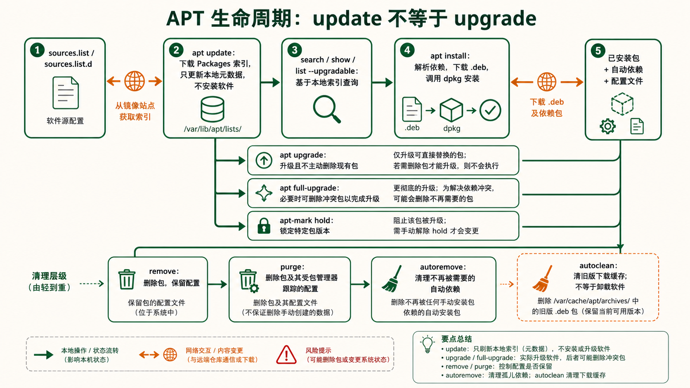
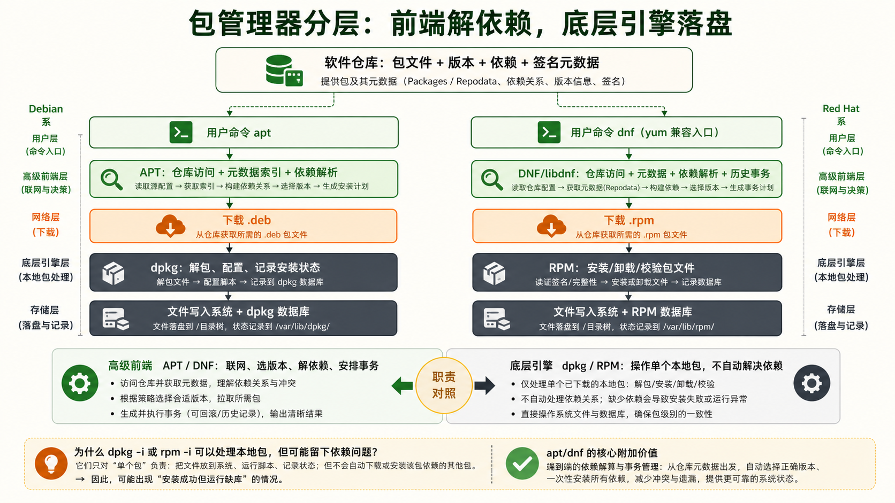
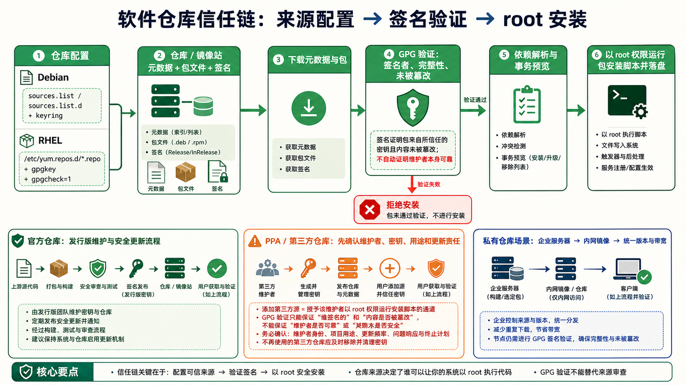
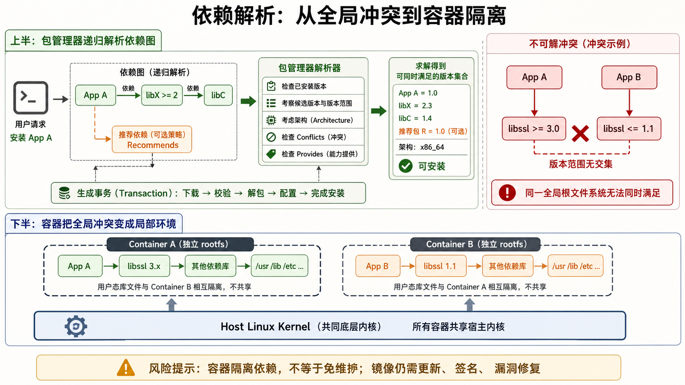

[← 返回 Linux 系统目录]({{ '/subjects/Linux/' | relative_url }})



# 软件包管理

## 1 APT 完整操作 {#sec06-1}

### Debian 系包管理全流程 —— update → install → purge → autoremove · 核心 {#debian-系包管理全流程-update-install-purge-autoremove-核心}

#### 问题：apt update 到底更新了什么？它和 apt upgrade 有什么区别？

这是 APT 新手最容易混淆的概念。<strong>apt update 不安装任何东西，只下载包的元数据索引。</strong>它从 `/etc/apt/sources.list` 中配置的仓库服务器下载一份"最新可用的包列表"——包括每个包的版本号、依赖关系、文件大小。apt upgrade 才真正去下载和安装更新。

打个比方：update 是去超市拿最新商品目录，upgrade 是把购物车里的东西买回来。

#### APT 日常工作流——从软件安装到彻底清理

##### 阶段1：刷新包索引

```bash
apt update
```

读取源列表，下载每个源的 Packages.gz 索引文件。执行完这一步，APT 才知道有哪些包可用、最新版本是多少。

##### 阶段2：搜索与查看

```bash
apt search nginx
apt show nginx
apt list --upgradable
```

search 在包名称和描述中搜索关键词；show 显示包的详细信息；list --upgradable 列出可升级的包。

##### 阶段3：安装

```bash
apt install nginx -y
```

-y 自动确认（生产环境脚本用）；不加 -y 会显示将要安装/升级/删除的包列表，让你手动确认。

##### 阶段4：升级

```bash
apt upgrade
apt full-upgrade
```

upgrade 不删除现有包；full-upgrade（旧称 dist-upgrade）在必要时会删除冲突包以完成升级。

#### 卸载的三种级别

```bash
# 级别1：删除软件包，保留配置文件
apt remove nginx
# 删除 nginx 二进制文件，但 /etc/nginx/ 配置文件保留
# 未来重新安装时会沿用这些配置

# 级别2：彻底删除，含配置文件
apt purge nginx
# 删除一切——二进制、配置、数据目录（如果有定义）
# 相当于"从头来过"，重新安装不会残留旧配置

# 级别3：删除不再需要的依赖
apt autoremove
# 当安装 nginx 时自动装了 libssl（作为依赖），
# 卸载 nginx 后 libssl 可能不再被任何包需要
# autoremove 会找出并清理这些"孤儿"依赖
```



#### dpkg —— APT 的底层引擎 {#dpkg-apt-的底层引擎}

APT 本质上是 dpkg 的前端。APT 负责解析依赖、从仓库下载 .deb 文件，然后调用 dpkg 进行实际的安装/卸载操作。

```bash
# dpkg 常用命令（底层操作，不处理依赖关系）

dpkg -l                      # 查看所有已安装的包（状态标志：ii=已安装 rc=已删除残留配置）
dpkg -l | grep nginx         # 过滤查看某个包

dpkg -s nginx                # 查看包的详细状态信息（版本、依赖、描述、配置文件列表）

dpkg -L nginx                # 列出一个包安装的所有文件（list files）
# 反向查询：某个文件属于哪个包
dpkg -S /usr/sbin/nginx      # 搜索——/usr/sbin/nginx 是哪个包安装的

dpkg -i package.deb          # 本地安装 .deb 文件（注意：不自动解决依赖）
dpkg -r nginx                # 移除包（保留配置）
dpkg -P nginx                # 彻底清除（含配置）

# 查看包的下载缓存
ls /var/cache/apt/archives/  # APT 下载的 .deb 包缓存在这里
```

#### 锁定包版本——防止自动升级

```bash
# 锁定某个包，阻止升级
apt-mark hold nginx          # 锁定 nginx，后续 upgrade 不会升级它
apt-mark unhold nginx        # 解锁
apt-mark showhold            # 查看所有被锁定的包
```

<strong>hold 锁定的应用场景：</strong>当某个关键软件的新版本与你系统不兼容时，先 hold 住旧版本，等验证新版本没问题后再 unhold。但 hold 有风险——如果其他包依赖了 nginx 的新版本而 nginx 被 hold， `apt full-upgrade` 可能会失败或产生依赖冲突。 <strong>APT 日常维护组合命令：</strong> `apt update && apt upgrade -y && apt autoremove -y && apt autoclean`。autoclean 清理本地缓存的旧版 .deb 包（只保留当前版本），释放磁盘空间。

## 2 YUM / DNF 完整操作 {#sec06-2}

### Red Hat 系包管理全流程 —— YUM 的历史与 DNF 的新生 · 核心 {#red-hat-系包管理全流程-yum-的历史与-dnf-的新生-核心}

#### 问题：DNF 和 YUM 是什么关系？用哪个？

YUM (Yellowdog Updater, Modified) 曾是 Red Hat / CentOS / Fedora 的默认包管理器，诞生于 2003 年。随着 RPM 生态膨胀，YUM 的性能瓶颈（Python 2 依赖、慢速解析依赖、内存占用大）日益突出。DNF (Dandified YUM) 从 Fedora 18 起步，用 C 语言重写核心库（libdnf），Python 3 编写 CLI，彻底解决了 YUM 的性能问题。从 RHEL 8 / CentOS 8 开始，DNF 正式取代 YUM。

<strong>好消息是：DNF 的命令行语法与 YUM 几乎完全兼容。</strong>你在 CentOS 7 上学的 yum 命令，在 CentOS 8+ 上把 yum 换成 dnf 即可。系统甚至保留了 `/usr/bin/yum` 指向 dnf 的符号链接。

#### DNF/YUM 日常工作流

##### 阶段1：检查更新

```bash
dnf check-update
```

检查哪些包有新版本可用（只查看、不安装）。类似 apt update + apt list --upgradable 的结合体。

##### 阶段2：搜索与查看

```bash
dnf search nginx
dnf info nginx
dnf list installed
```

search 搜索包名和描述；info 显示版本/架构/大小/仓库/描述；list installed 列出已安装的包。

##### 阶段3：安装与卸载

```bash
dnf install nginx -y
dnf remove nginx
```

DNF 会自动处理依赖：安装时拉取所有依赖，卸载时也会提示连带卸载哪些不再需要的包。

##### 阶段4：升级

```bash
dnf upgrade
dnf upgrade --security
```

upgrade 升级所有包；--security 只升级安全相关的更新（生产环境推荐）。

#### DNF 独有的强大功能

```bash
# === 历史操作管理（DNF 的杀手级功能）===

# 查看安装/卸载/升级的历史记录
dnf history
# 输出示例：
# ID  | Command line                  | Date and time    | Action(s)      | Altered
# ---------------------------------------------------|-------------------|----------------|--------
#  5  | install nginx                  | 2026-07-30 10:00 | Install        |   12
#  4  | remove vim                     | 2026-07-29 15:30 | Remove         |    1
#  3  | upgrade                        | 2026-07-28 09:00 | Upgrade        |   45

# 查看某次操作的详细信息
dnf history info 5              # 查看第5次操作具体装了什么包

# 回滚某次操作！！！
dnf history undo 5              # 撤销第5次操作（如果5是 install nginx，则卸载它和它的依赖）
dnf history rollback 4          # 回滚到第4次操作后的状态

# === 包组管理 ===
dnf group list                  # 列出所有包组（如 "Development Tools"、"Web Server"）
dnf group install "Development Tools"    # 一键安装开发工具组（gcc/make/git 等）
```

#### rpm —— YUM/DNF 的底层引擎 {#rpm-yumdnf-的底层引擎}

```bash
# rpm 常用命令（底层操作，不处理依赖关系）

rpm -qa                        # 查询所有已安装的包
rpm -qa | grep nginx           # 过滤查看

rpm -qi nginx                  # 查看包的详细信息（info）
rpm -ql nginx                  # 列出包安装的所有文件（list files）
rpm -qc nginx                  # 只看配置文件（config files）
rpm -qd nginx                  # 只看文档文件（documentation）

# 反向查询
rpm -qf /usr/sbin/nginx        # 这个文件属于哪个包（query file）

# 验证包的完整性
rpm -V nginx                   # 检查安装后的文件是否被修改
# 输出符号：S=大小变了 M=权限变了 5=MD5变了 D=设备号变了 L=链接路径变了
#          U=属主变了 G=属组变了 T=修改时间变了

# 本地安装/升级/卸载
rpm -ivh package.rpm           # install
rpm -Uvh package.rpm           # upgrade（如果未安装则安装）
rpm -e nginx                   # erase（卸载）
rpm -e --nodeps nginx          # 忽略依赖强制卸载（危险！）
```



<strong>dnf provides —— 查找"这个命令在哪个包里"：</strong>你执行一个命令但提示 command not found，不知道要安装哪个包。DNF 可以帮你查找： `dnf provides */nginx` 或 `dnf provides /usr/bin/htop`。它会搜索所有仓库的包内容，告诉你哪个包包含这个文件。APT 对应的命令是 `apt-file search nginx`（需要先 `apt install apt-file && apt-file update`）。

## 3 仓库管理 {#sec06-3}

### 软件包的"来源地"——仓库配置是包管理的根基 · 运维 {#软件包的来源地仓库配置是包管理的根基-运维}

#### 问题：apt install 怎么知道去哪里下载软件包？

APT 会读取 `/etc/apt/sources.list` 以及 `/etc/apt/sources.list.d/` 下的源配置。旧格式使用 `.list` 的 `deb` 行，新版 Ubuntu 也常用 `.sources` 的 deb822 格式；先查看本机现有文件，再按该发行版的格式修改，不要机械覆盖。

#### APT 仓库配置详解

```bash
# /etc/apt/sources.list 中的一行（Debian/Ubuntu）
deb https://archive.ubuntu.com/ubuntu/ noble main restricted universe multiverse
# ^   ^                                 ^       ^    ^
# |   |                                 |       |    仓库组件（component）
# |   |                                 |      发行版代号（noble = 24.04；以本机版本为准）
# |   仓库 URL                          |
# 类型（deb=二进制包, deb-src=源码包）

# 仓库组件（Component）含义：
# main       → Ubuntu 官方维护的开源软件（完全支持）
# restricted → 官方维护的专有驱动（如 NVIDIA 驱动）
# universe   → 社区维护的开源软件（不保证安全更新时效）
# multiverse → 非自由软件（许可证受限）
```

#### PPA —— 个人包仓库（Personal Package Archive） {#ppa-个人包仓库personal-package-archive}

PPA 是 Launchpad 平台提供的非官方仓库，由个人或小团队维护。当官方仓库没有你需要的软件或版本太旧时，通过 PPA 安装。

```bash
# 添加 PPA 并安装软件
add-apt-repository ppa:deadsnakes/ppa    # 添加 Python 新版本的 PPA
apt update                                # 更新包索引（让 APT 知道新源的包）
apt install python3.11                    # 安装 PPA 中的包

# 删除 PPA
add-apt-repository --remove ppa:deadsnakes/ppa

# 查看已添加的 PPA
ls /etc/apt/sources.list.d/               # 每个 PPA 对应一个 .list 文件
```

<strong>PPA 的安全考量：</strong>PPA 中的包没有经过 Ubuntu 安全团队的审核。添加 PPA 前确认来源可信。添加某人的 PPA 相当于"你信任这个人不会在软件包里放恶意代码"——因为安装时 APT 会以 root 权限执行包内的安装脚本。

#### YUM/DNF 仓库配置详解

```bash
# 仓库配置文件位于 /etc/yum.repos.d/*.repo

# /etc/yum.repos.d/nginx.repo 示例
[nginx-stable]
name=nginx stable repo
baseurl=https://nginx.org/packages/rhel/$releasever/$basearch/
gpgcheck=1
enabled=1
gpgkey=https://nginx.org/keys/nginx_signing.key
module_hotfixes=true

# 字段说明：
# [repo-id]   → 仓库的唯一标识符
# name        → 仓库的人类可读名称
# baseurl     → 包文件的下载 URL
# mirrorlist  → 镜像列表 URL（与 baseurl 二选一）
# gpgcheck=1  → 强制 GPG 签名验证（强烈建议启用）
# enabled=1   → 该仓库是否启用
# gpgkey      → GPG 公钥 URL 或本地路径
```



#### 添加仓库的实战操作

```bash
# === Debian/Ubuntu ===
# 第三方仓库示意：先从供应商文档确认 URL、密钥指纹和发行版代号
# 密钥放在专用 keyring，源条目用 signed-by 限定其信任范围
sudo install -d -m 0755 /etc/apt/keyrings
# 验证供应商密钥后保存为 /etc/apt/keyrings/vendor.gpg
# deb [signed-by=/etc/apt/keyrings/vendor.gpg] https://packages.example.com/ubuntu noble main
# 不再使用 apt-key，也不要把第三方密钥放进全局 trusted.gpg.d

# === RHEL/CentOS ===
# 方法1：yum-config-manager（需要 yum-utils）
yum install -y yum-utils
yum-config-manager --add-repo https://download.docker.com/linux/centos/docker-ce.repo

# 方法2：手动创建 .repo 文件
cat > /etc/yum.repos.d/example.repo << 'EOF'
[example]
name=Example Repository
baseurl=https://packages.example.com/rhel/$releasever/$basearch/
enabled=1
gpgcheck=1
gpgkey=https://packages.example.com/gpg.key
EOF
```

#### 仓库优先级管理

```bash
# 当同一个包在多个仓库中存在时，哪个优先？

# APT —— 使用 /etc/apt/preferences 设置优先级
# 格式：Pin-Priority 越大越优先（默认 500）

# DNF —— 在 .repo 文件中设置 priority
[nginx-stable]
priority=1     # 数字越小优先级越高（1-99，默认99）
# 需要 yum-plugin-priorities 插件
```

<strong>企业内网私有仓库：</strong>在离线或内网环境中，可以搭建私有 APT/YUM 仓库。APT 用 `apt-mirror` 或 `reprepro`，YUM/DNF 用 `createrepo` 创建仓库元数据。所有服务器指向内网仓库，统一管控软件版本，减少外网带宽消耗。

## 4 依赖解析与升级 {#sec06-4}

### 依赖地狱的成因与解法——包管理的"看不见的博弈" · 核心 {#依赖地狱的成因与解法包管理的看不见的博弈-核心}

#### 问题：为什么"apt install A"会自动装 B 和 C，而我根本没提它们？

因为 A 在它的包描述中声明了"我要用 B 提供的功能"和"C 提供的功能"。包管理器在安装前会递归解析整个依赖图——如果 B 又依赖 D，D 又依赖 E……这条链上的所有包都会被自动拉取。这就是包管理器最核心的价值：<strong>自动解决依赖关系。</strong>

如果脱离包管理器手工安装软件，就必须自己核对 libssl、libpcre、zlib 等依赖及其兼容版本。包管理器能自动求解并安装仓库中声明的依赖，但跨仓库版本冲突和运行时兼容问题仍需管理员判断。Windows 也有包管理工具，不能简单把它等同于“没有包管理器”。

#### 依赖关系的两种类型

| 依赖类型 | APT 术语 | RPM 术语 | 含义 |
|----|----|----|----|
| <strong>必须依赖</strong> | `Depends` | `Requires` | 没有这个依赖，包完全无法工作。安装时强制拉取。 |
| <strong>推荐依赖</strong> | `Recommends` | `Recommends` | 没有也能用，但功能会受限。默认会安装，但可以跳过。 |
| <strong>建议依赖</strong> | `Suggests` | `Suggests` | 锦上添花。默认不安装，纯粹是提示。 |
| <strong>冲突</strong> | `Conflicts` | `Conflicts` | 不能和某个包同时安装（如两个 MTA 邮件服务器不能共存）。 |
| <strong>替代</strong> | `Provides` | `Provides` | 声明"我能替代某个虚拟包"。如 sendmail 和 postfix 都 `Provides: mail-transport-agent`。 |

#### 依赖地狱（Dependency Hell）——包管理的阿克琉斯之踵

依赖地狱的根本原因是<strong>版本冲突</strong>：A 要求 libssl \>= 3.0，B 要求 libssl \<= 1.1。两者都声称需要 libssl，但版本范围不重叠——APT 和 DNF 都无力解决这种冲突。

```bash
# 依赖地狱的典型场景
$ apt install application-x
The following packages have unmet dependencies:
 application-x : Depends: libssl (>= 3.0) but 1.1.1f-1ubuntu2 is to be installed
E: Unable to correct problems, you have held broken packages.

# 为什么会出现这种情况？
# 1. 混用了不同发行版的仓库（如 Debian stable 加了 sid 的源）
# 2. 手动安装了不被系统仓库支持的 .deb 包
# 3. 长时间未更新，系统版本和上游仓库脱节
```

<strong>依赖地狱是"容器化"诞生的直接推手：</strong>Docker 和其他容器技术的核心价值之一，就是让每个应用拥有独立的文件系统。应用 A 可以在"它的世界"里用 libssl 3.0，应用 B 在"它的世界"里用 libssl 1.1——两者互不干扰。容器化把"整个系统解决依赖冲突"变成了"每个应用各自解决自己的依赖"，把全局冲突化解为局部自治。



#### 升级策略与最佳实践

```bash
# === 保守升级（生产环境推荐）===

# 1. 先查看有哪些更新
apt list --upgradable                        # APT
dnf check-update                             # DNF

# 2. 逐类升级（而不是一股脑全升）
apt install --only-upgrade nginx             # 只升级 nginx
dnf update nginx                             # 只升级 nginx

# 3. 安全更新优先（DNF）
dnf updateinfo list                          # 查看安全公告
dnf upgrade --security                       # 只升级安全相关更新

# 4. 内核升级后不要立即重启
# 使用 ksplice（Oracle）或 livepatch（Canonical）
# 或等待维护窗口统一重启
```

#### 排错：处理"已安装但损坏"的包

```bash
# 中断的安装导致后续操作全部失败时
apt --fix-broken install                     # APT：修复损坏的依赖关系
apt install -f                               # 同上（-f = --fix-broken）

dnf distro-sync                              # DNF：将系统同步到仓库状态（强制对齐版本）

# 清除本地缓存重建（APT）
apt clean                                    # 清除所有缓存
apt update                                   # 重新拉取元数据

# 清除 DNF 缓存
dnf clean all
dnf makecache
```

<strong>升级生产环境前的 Checklist：</strong>① 先在 staging 环境验证升级；② 做好快照/备份（虚拟机快照或 LVM snapshot）；③ 记录当前版本号 `dpkg -l > before-upgrade.txt`；④ 在 tmux/screen 会话中执行升级——防止 SSH 断开导致升级中断（中断的升级状态很难修复）；⑤ 升级后对比版本号 `diff before-upgrade.txt after-upgrade.txt`；⑥ 验证关键服务 `systemctl status nginx` `curl -I localhost`。

## 注解

<strong>CLI</strong> · Command-Line Interface 命令行界面



<nav class="article-end" aria-label="章节导航">
  <a href="{{ '/subjects/Linux/05-%E8%BF%9B%E7%A8%8B%E7%AE%A1%E7%90%86%E4%B8%8E%E7%9B%91%E6%8E%A7.html' | relative_url }}">← 上一章：进程管理与监控</a>
  <a href="{{ '/subjects/Linux/' | relative_url }}">返回 Linux 系统目录</a>
  <a href="{{ '/subjects/Linux/07-systemd%E6%9C%8D%E5%8A%A1%E7%AE%A1%E7%90%86.html' | relative_url }}">下一章：systemd 服务管理 →</a>
</nav>
