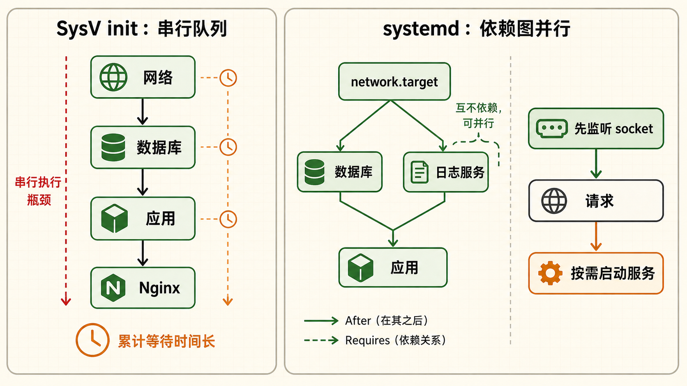
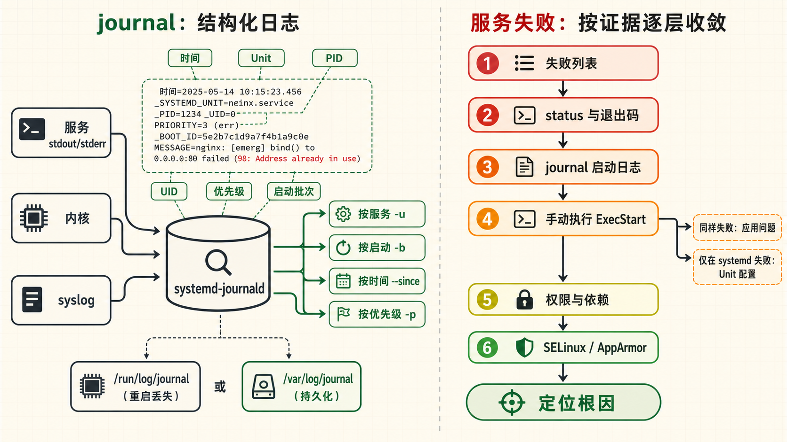
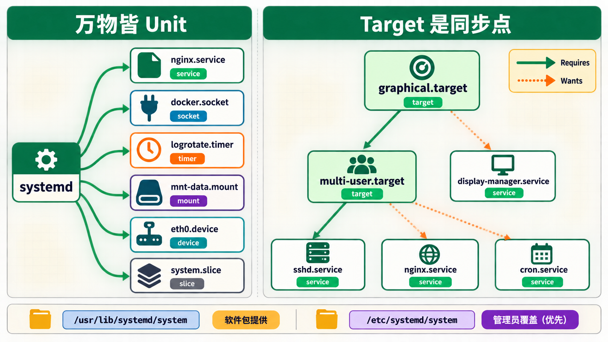
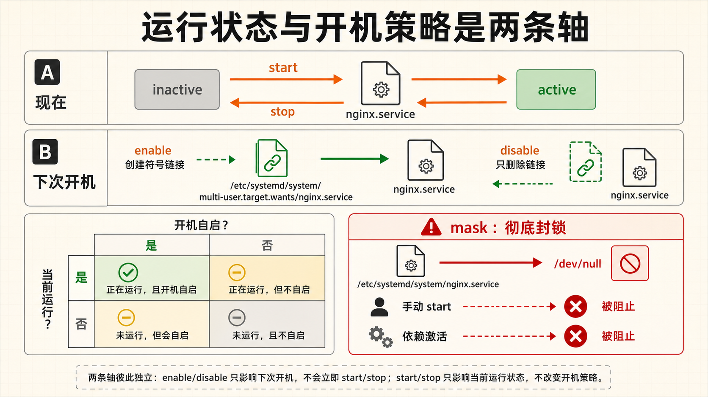
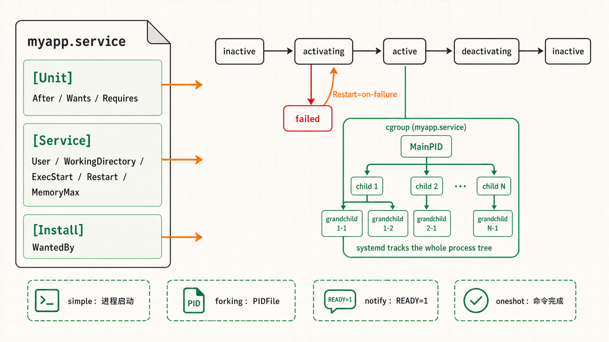

[← 返回 Linux 系统目录]({{ '/subjects/Linux/' | relative_url }})



# systemd 服务管理

## 1 systemd vs SysV init {#sec07-1}

### Linux 初始化系统为什么需要一次彻底的变革？ · 原理 {#linux-初始化系统为什么需要一次彻底的变革-原理}

#### 回顾 SysV init —— 老一代的启动方式 {#回顾-sysv-init-老一代的启动方式}

在 systemd 之前，绝大多数 Linux 发行版使用 <strong>SysV init</strong>（System V init）。它起源于古老的 Unix System V，核心是一个 PID=1 的 `/sbin/init` 进程。init 启动后读取 `/etc/inittab`，决定进入哪个运行级别（runlevel），然后依次执行 `/etc/rc.d/rc*.d/` 目录下的启动脚本。每个脚本都是一个 Bash 脚本，以 `S`（start）或 `K`（kill）开头加数字序号，数字决定启动顺序。

<strong>SysV init 的三大痛点</strong>

- <strong>串行启动</strong>：服务一个接一个启动，下一个必须等上一个完成。哪怕两个服务之间毫无依赖关系，也得排队。一台有上百个服务的服务器，开机可能要等几分钟。
- <strong>Bash 脚本质量不一</strong>：每个服务的管理脚本由不同开发者编写，质量参差不齐。有的脚本忘记处理 PID 文件、有的没有正确的 stop 逻辑。运维人员很难统一管理和排错。
- <strong>无原生依赖管理</strong>：init 只管按顺序跑，不检查前置依赖是否就绪。网络还没通就启动 Nginx——这种情况只能人工加 `sleep`，非常不可靠。

#### systemd 的革命性设计

systemd 由 Lennart Poettering 于 2010 年创建，它不是一个"加强版 init"，而是一套<strong>完整的系统管理平台</strong>。它重新思考了进程生命周期、依赖管理、日志存储、资源限制等全部环节，提供统一的管理接口。

| 对比维度 | SysV init | systemd |
|----|----|----|
| <strong>启动方式</strong> | 串行，按固定编号顺序 | 并行，根据依赖关系 DAG 调度 |
| <strong>启动脚本</strong> | Bash 脚本，质量不统一 | 声明式 Unit 文件（INI 格式），标准化 |
| <strong>依赖管理</strong> | 靠脚本中的顺序编号，不够可靠 | 显式声明 Requires/Wants/After，系统自动解析 |
| <strong>日志存储</strong> | 纯文本文件，需 logrotate 轮转 | 结构化二进制日志（journal），支持索引搜索 |
| <strong>进程管理</strong> | 仅靠 PID 文件追踪 | cgroup 集成，精确追踪进程树、限制资源 |
| <strong>按需激活</strong> | 不支持 | Socket Activation / Timer Activation |
| <strong>并发策略</strong> | 无 | Socket 激活：先建 socket，收到请求后才启动服务 |

#### Socket 激活 —— 为支持该机制的服务按需启动 {#socket-激活-为支持该机制的服务按需启动}

Socket 激活需要为具体服务配置配套的 `.socket` 与 `.service` Unit，且服务程序要能接收 systemd 传入的监听文件描述符。系统先监听相应的端口或 Unix socket，有连接到来时再启动服务并移交描述符；它不是给所有服务自动建立一个 socket 池，也不保证启动耗时减半。数据库等未适配的服务仍按自己的依赖关系启动。排查时先看 `systemctl status 服务名.socket`，再核对服务是否支持该协议。





#### 各发行版接入 systemd 的时间线

Fedora（2011）→ Arch Linux（2012）→ openSUSE（2012）→ RHEL 7（2014）→ Debian 8（2015）→ Ubuntu 15.04（2015），越来越多发行版把 systemd 作为默认 init。Ubuntu、Debian 与 RHEL 系发行版的常见服务管理接口都是 `systemctl`，但服务名、Unit 文件路径和包内配置可能不同；Alpine 等发行版则采用其他 init，操作前先确认环境。

<strong>一个直观对比</strong>在一个有 50 个服务的测试机上——SysV init 启动耗时约 45 秒；systemd 并行启动耗时约 12 秒。这不是"快一点点"，而是质的飞跃。

## 2 Unit 类型详解 {#sec07-2}

### systemd 中万物皆 Unit —— 统一管理的基石 · 核心概念 {#systemd-中万物皆-unit-统一管理的基石-核心概念}

#### 什么是 Unit？

在 systemd 的世界里，一切被管理的对象都叫 <strong>Unit</strong>。一个 Unit 就是一个带有 `.service`、`.socket`、`.timer` 等后缀的配置文件，用 INI 格式描述了这个对象的属性、依赖关系和启动方式。所有 Unit 文件放在 `/usr/lib/systemd/system/`（软件包安装的）或 `/etc/systemd/system/`（管理员自定义的）下，后者优先级更高。

#### 常见的 Unit 类型一览

| Unit 类型 | 后缀 | 用途 | 举例 |
|----|----|----|----|
| <strong>Service</strong> | `.service` | 管理后台服务进程（最常用） | nginx.service, sshd.service |
| <strong>Socket</strong> | `.socket` | 监听 TCP/UDP/Unix Socket，实现按需激活 | docker.socket, sshd.socket |
| <strong>Mount</strong> | `.mount` | 挂载点管理（替代 fstab 中的一部分场景） | mnt-data.mount |
| <strong>Timer</strong> | `.timer` | 定时任务触发器（替代 cron） | logrotate.timer |
| <strong>Target</strong> | `.target` | 运行级别 / 同步点 / 分组点 | multi-user.target, graphical.target |
| <strong>Device</strong> | `.device` | 硬件设备管理 | sys-subsystem-net-devices-eth0.device |
| <strong>Slice</strong> | `.slice` | cgroup 资源分组 | system.slice, user.slice |
| <strong>Scope</strong> | `.scope` | 外部创建的进程组 | session-1.scope |

#### Target —— 运行级别的现代化身 {#target-运行级别的现代化身}

在 SysV init 时代，运行级别（runlevel 0-6）定义了系统处于什么状态。systemd 用 <strong>Target</strong> 替代了 runlevel，但概念更灵活——Target 是一个逻辑分组点，一个 Target 可以"需求"（Requires）其他 Unit，形成依赖树。常见的对应关系：

| SysV Runlevel | systemd Target      | 说明                         |
|---------------|---------------------|------------------------------|
| runlevel 0    | `poweroff.target`   | 关机                         |
| runlevel 1    | `rescue.target`     | 单用户救援模式               |
| runlevel 3    | `multi-user.target` | 多用户文本模式（服务器常用） |
| runlevel 5    | `graphical.target`  | 多用户图形界面               |
| runlevel 6    | `reboot.target`     | 重启                         |

```bash
# 查看当前默认运行级别（默认启动到哪个 target）
systemctl get-default

# 切换为纯命令行模式（相当于 init 3）
systemctl set-default multi-user.target

# 查看当前 Target 的完整依赖树
systemctl list-dependencies multi-user.target
```

#### Timer —— 现代 cron 替代方案 {#timer-现代-cron-替代方案}

systemd Timer 可以替代 cron 做定时任务，而且有 cron 不具备的优势：<strong>精确到秒级</strong>（cron 最低到分钟）、<strong>可以记录每次执行日志</strong>（journalctl 统一查看）、<strong>支持随机延迟</strong>（避免惊群效应）、<strong>支持单调计时器</strong>（开机后 X 秒执行，不依赖系统时钟）。一个 Timer 通常和一个同名的 Service Unit 配套使用。

```bash
# 列出所有定时器，查看下次执行时间和上次执行状态
systemctl list-timers --all

# 典型输出示例：
# NEXT                        LEFT    LAST                        PASSED    UNIT
# Fri 2026-08-01 00:00:00 CST 4h      Thu 2026-07-31 00:00:00 CST 19h ago   logrotate.timer
# Fri 2026-08-01 06:00:00 CST 10h     Thu 2026-07-31 06:00:00 CST 13h ago   fstrim.timer
```



## 3 systemctl 命令大全 {#sec07-3}

### systemctl —— 运维日常使用频率最高的命令 · 实操 {#systemctl-运维日常使用频率最高的命令-实操}

#### 服务生命周期管理（start / stop / restart / reload） {#服务生命周期管理start-stop-restart-reload}

这是运维人员每天都要敲的命令。systemd 对服务定义了清晰的生命周期：<strong>inactive</strong>（未运行）→ <strong>activating</strong>（启动中）→ <strong>active</strong>（运行中）→ <strong>deactivating</strong>（停止中）→ <strong>failed</strong>（启动失败）。

```bash
# 启动服务
systemctl start nginx

# 停止服务
systemctl stop nginx

# 重启服务（先 stop 再 start，服务会有短暂中断）
systemctl restart nginx

# 重载配置（进程不重启，只重新读取配置文件——零中断）
# 只有支持 SIGHUP 信号的服务才有效，如 nginx、haproxy
systemctl reload nginx

# 尝试重载配置，如果服务不支持 reload 则执行 restart
systemctl reload-or-restart nginx

# 条件重启：只在服务已经在运行时才重启
systemctl try-restart nginx
```

#### 开机自启管理（enable / disable / mask） {#开机自启管理enable-disable-mask}

`enable` 和 `start` 是两个独立的操作：`start` 是"现在就启动"，`enable` 是"开机时自动启动"。二者互不影响。很多新手装了 Nginx 后 `systemctl start nginx` 发现重启后 Nginx 没起来——因为他们只做了 start 没做 enable。`enable` 的本质是创建一个从 `/etc/systemd/system/multi-user.target.wants/` 到 Unit 文件的符号链接。



```bash
# 设置开机自启
systemctl enable nginx

# 取消开机自启
systemctl disable nginx

# 查看是否已设置开机自启
systemctl is-enabled nginx

# 屏蔽服务（mask = 彻底禁止，连手动 start 都不行）
# 本质：将 Unit 文件符号链接到 /dev/null
systemctl mask nginx

# 取消屏蔽
systemctl unmask nginx
```

#### 状态查询命令

```bash
# 查看服务详细状态（最后10行日志、进程树、cgroup 信息）
systemctl status nginx

# 列出所有已加载的 Unit（默认只显示 active 的）
systemctl list-units

# 列出所有 Unit（包含 inactive 和 failed 的）
systemctl list-units --all

# 只列出 service 类型的 Unit
systemctl list-units --type=service

# 列出所有启动失败的 Unit——排错第一步！
systemctl list-units --failed

# 查看 Unit 之间的依赖关系
systemctl list-dependencies nginx

# 查看当前系统上所有已安装的 Unit 文件
systemctl list-unit-files
```

▶ 典型排查场景

```bash
$ systemctl list-units --failed
  UNIT          LOAD   ACTIVE SUB    DESCRIPTION
● nginx.service loaded failed failed A high performance web server

$ systemctl status nginx
  ... 直观显示进程退出码和最后几行错误日志 ...
```

#### Unit 文件管理命令

```bash
# 查看 Unit 文件的完整内容（包括所有包含的片段）
systemctl cat nginx

# 编辑 Unit 文件——创建一个 override 文件（推荐！不修改原始文件）
# 这会在 /etc/systemd/system/nginx.service.d/override.conf 创建覆盖配置
systemctl edit nginx

# 直接编辑原始 Unit 文件（不推荐，升级软件包时会丢失）
systemctl edit --full nginx

# 修改 Unit 文件后执行此命令，让 systemd 重新加载配置
systemctl daemon-reload

# 验证 Unit 文件的语法正确性
systemd-analyze verify /etc/systemd/system/myapp.service

# 查看服务的实时日志
journalctl -u nginx -f
```

<strong>systemctl edit 的 override 机制</strong>当你执行 `systemctl edit nginx` 时，systemd 创建一个 drop-in 目录和配置文件。原始 Unit 文件不会被修改，你的覆盖配置追加在末尾。升级软件包时原始文件可能被覆盖，但你的 override 文件安全留存。这是最佳实践。

## 4 自定义 Service Unit {#sec07-4}

### 从零编写生产级 Service Unit 文件 · 实战 {#从零编写生产级-service-unit-文件-实战}

#### Unit 文件的结构

一个 systemd Service Unit 文件由三个小节组成：<strong>\[Unit\]</strong>——描述基本信息与依赖；<strong>\[Service\]</strong>——定义如何启动、停止、重启进程；<strong>\[Install\]</strong>——定义在哪个 Target 下启用此服务（决定开机自启的位置）。

#### 完整示例：部署一个自定义 Go/Node/Python 应用

```bash
# 文件：/etc/systemd/system/myapp.service
[Unit]
Description=My Application Web Service
Documentation=https://docs.myapp.com
After=network-online.target       # 在网络完全就绪后启动
Wants=network-online.target        # 不强依赖网络，但有最好
Requires=postgresql.service        # 强依赖数据库，数据库没启则本服务不启动

[Service]
Type=simple                         # 进程类型（见下文详解）
User=myapp                         # 以非 root 用户运行——安全最佳实践
Group=myapp
WorkingDirectory=/opt/myapp         # 进程的工作目录
ExecStart=/opt/myapp/bin/myapp --config /etc/myapp/config.yaml
ExecStop=/bin/kill -s TERM $MAINPID # 停止时发送 TERM 信号
ExecReload=/bin/kill -s HUP $MAINPID # reload 时发送 HUP 信号
Restart=always                      # 无论什么原因退出都自动重启
RestartSec=10                       # 重启前等待 10 秒（防止频繁重启）
StandardOutput=journal              # 标准输出写入 journal
StandardError=journal               # 标准错误写入 journal
EnvironmentFile=-/etc/myapp/env     # 从环境变量文件加载（- 表示文件不存在不报错）
LimitNOFILE=65536                   # 最大文件描述符数
OOMScoreAdjust=-500                 # OOM Killer 调低 kill 优先级
CPUQuota=50%                        # 限制 CPU 使用率不超过 50%
MemoryMax=512M                      # 限制最大内存使用

[Install]
WantedBy=multi-user.target          # 开机自启的位置
```

#### Type= 的四种常见模式——必知必会

`Type=` 是 Service 文件中最重要的参数之一，它告诉 systemd 如何判断"服务已经启动成功"。

| Type | 启动判定 | 适用场景 |
|----|----|----|
| <strong>simple</strong> | 主进程启动即视为启动成功 | 大多数应用。（默认值） |
| <strong>forking</strong> | 主进程 fork 出子进程后退出——子进程成为守护进程，systemd 通过 PIDFile 追踪 | 传统 Unix 守护进程（如 nginx daemon on）。必须配合 `PIDFile=` |
| <strong>notify</strong> | 进程启动后通过 Unix socket 发送 `sd_notify("READY=1")` 通知系统已就绪 | 支持 systemd notify 协议的应用（最精确的启动通知） |
| <strong>oneshot</strong> | 主进程执行完退出即视为成功。通常配合 `RemainAfterExit=yes` 使用 | 一次性的初始化脚本、配置写入脚本 |

<strong>forking 类型的陷阱</strong>传统守护进程会 fork 两次让子进程脱离终端，然后父进程退出。systemd 需要知道哪个是真正的守护进程——所以必须通过 `PIDFile=` 指定 PID 文件路径，否则 systemd 将无法正确追踪服务状态，导致 start 超时。新开发的应用建议直接使用 `Type=simple`，不要 fork 到后台，让 systemd 管理进程生命周期。

#### Restart= 策略选择

```bash
# Restart=no         —— 永不自动重启（默认）
# Restart=always     —— 无论什么原因退出都重启（最常用）
# Restart=on-success —— 只在退出码为 0 时重启
# Restart=on-failure —— 只在退出码非 0、收到信号时重启（推荐！）
# Restart=on-abnormal—— 只在收到信号或超时时重启
# Restart=on-watchdog—— 看门狗超时时重启
```



#### 部署流程四步走

```bash
# 1. 创建 service 文件
sudo vim /etc/systemd/system/myapp.service

# 2. 重新加载 systemd 配置
sudo systemctl daemon-reload

# 3. 启用开机自启
sudo systemctl enable myapp

# 4. 启动服务并检查状态
sudo systemctl start myapp
sudo systemctl status myapp
```

## 5 journalctl 日志查询 {#sec07-5}

### journalctl —— 结构化日志查询引擎 · 实操 {#journalctl-结构化日志查询引擎-实操}

#### journal 日志与传统文本日志的本质区别

传统的 `/var/log/syslog`、`/var/log/nginx/access.log` 是纯文本文件——搜索必须按行扫描，效率低。systemd journal 是<strong>二进制结构化日志</strong>，每条日志都带有元数据：时间戳（微秒级精度）、UID/GID、进程名、主机名、syslog 标识符、优先级等。这意味着你可以像查数据库一样用结构化字段过滤日志，而不需要用 grep 逐行扫。

#### 最常用的查询命令

```bash
# 查看指定服务的全部日志
journalctl -u nginx

# 实时跟踪日志（相当于 tail -f）
journalctl -u nginx -f

# 查看本次启动以来的日志（-b = boot）
journalctl -b

# 查看上次启动的日志（排查重启前的问题）
journalctl -b -1

# 按时间过滤
journalctl --since "2026-07-31 10:00:00" --until "2026-07-31 12:00:00"
journalctl --since "1 hour ago"
journalctl --since "yesterday"
journalctl --since "30 minutes ago"

# 按优先级过滤（0=emerg, 1=alert, 2=crit, 3=err, 4=warning）
journalctl -p err       # 只看错误及以上
journalctl -p 3         # 等价于 -p err
journalctl -p warning
```

▶ 优先级速查

```bash
# 0 emerg   - 系统不可用
# 1 alert   - 必须立即处理
# 2 crit    - 严重错误
# 3 err     - 一般错误
# 4 warning - 警告
# 5 notice  - 一般但重要的通知
# 6 info    - 普通信息
# 7 debug   - 调试信息
```

#### 高级过滤与聚合

```bash
# 内核日志（相当于 dmesg）
journalctl -k

# 查看指定可执行文件的日志
journalctl /usr/bin/nginx

# 查看指定用户的日志
journalctl _UID=1000

# 多个条件组合
journalctl -u nginx -p err --since "1 hour ago"

# 输出最近的日志（按行数）
journalctl -u nginx -n 50        # 最后 50 行
journalctl -u nginx -n 50 --no-pager # 不分页，直接全量输出

# JSON 格式输出（供 logstash/filebeat 采集）
journalctl -u nginx -o json-pretty

# 简洁单行格式
journalctl -u nginx -o short-iso
```

#### 日志存储空间管理

journald 的 `Storage=auto` 会在存在 `/var/log/journal/` 时持久化，否则通常使用 `/run/log/journal/` 临时存储；发行版可能预先创建持久化目录。容量受 journald 默认配额及配置项约束，不应假定必然占满磁盘。先用下列命令检查现状，再按保留需求调整上限：

```bash
# 查看当前日志占用的磁盘空间
journalctl --disk-usage

# 限制日志最大占用 500MB（旧日志自动删除）
journalctl --vacuum-size=500M

# 删除 7 天前的日志
journalctl --vacuum-time=7d

# 永久修改存储上限（编辑配置文件）
# /etc/systemd/journald.conf
# SystemMaxUse=500M
# 修改后重启 journald：systemctl restart systemd-journald
```

<strong>journal 与 rsyslog/syslog-ng 的关系</strong>大多数发行版同时运行 journald 和 rsyslog。rsyslog 从 journald 读取日志，写入 `/var/log/syslog` 等传统文本文件。这意味着你不用在 journal 和 syslog 之间二选一——两个可以同时工作。如果磁盘空间敏感，可以考虑关闭 rsyslog 只保留 journald。

## 6 服务故障排查实战 {#sec07-6}

### 当服务启动失败时，按这套流程 5 分钟定位根因 · 故障排查 {#当服务启动失败时按这套流程-5-分钟定位根因-故障排查}

#### 标准排查流程——按序执行

1.  <strong>查失败列表</strong>：`systemctl list-units --failed`——哪些服务挂了？
2.  <strong>看详细状态</strong>：`systemctl status <服务名> -l`——退出码是多少？systemd 给出的错误描述是什么？
3.  <strong>看启动日志</strong>：`journalctl -u <服务名> --since "5 minutes ago"`——进程自己打印了什么错误消息？
4.  <strong>手动执行命令</strong>：复制 Unit 文件中的 `ExecStart=` 命令在终端手动执行一遍——如果也报错，说明不是 systemd 的问题，是应用本身的问题。
5.  <strong>检查文件权限</strong>：`ls -la <可执行文件>`、`ls -la <配置文件>`——运行 User 有没有读/执行权限？
6.  <strong>检查依赖服务</strong>：`systemctl list-dependencies <服务名>`——依赖的数据库/网络是否正常？
7.  <strong>检查 SELinux/AppArmor</strong>：`ausearch -m avc --start recent`——安全策略是否阻止了进程启动？

#### 实战案例：Nginx 无法启动

```bash
# 第一步：看失败列表
$ systemctl list-units --failed
  UNIT          LOAD   ACTIVE SUB    DESCRIPTION
● nginx.service loaded failed failed A high performance web server

# 第二步：看详细状态
$ systemctl status nginx -l
● nginx.service - A high performance web server
   Loaded: loaded (/lib/systemd/system/nginx.service; enabled)
   Active: failed (Result: exit-code) since Thu 2026-07-31 14:22:00 CST
  Process: 12345 ExecStartPre=/usr/sbin/nginx -t (code=exited, status=1/FAILURE)

# 这里清楚地显示 ExecStartPre (nginx -t 语法检查) 失败了
# 退出码为 1，说明配置文件有语法错误

# 第三步：手动验证
$ nginx -t
nginx: [emerg] unexpected "}" in /etc/nginx/nginx.conf:42
# 定位到问题：第 42 行多了一个花括号
```

#### 实战案例：服务启动了但无法访问

```bash
# 服务状态显示 active，但端口不通
$ systemctl status myapp
Active: active (running)  # 进程确实在跑

# 查看进程监听的端口
$ ss -tlnp | grep myapp
# 如果这里没有输出，说明进程没有绑定预期的端口

# 查看应用自己的日志
$ journalctl -u myapp --since "5 minutes ago" | grep -i error
# 常见原因：端口被占用（EADDRINUSE）、权限不足（EACCES）、
# 配置文件中的 bind 地址错误（127.0.0.1 而非 0.0.0.0）
```

#### systemd-analyze —— 诊断系统启动性能 {#systemd-analyze-诊断系统启动性能}

```bash
# 查看系统启动总耗时
systemd-analyze

# 查看 Unit 自身初始化耗时；并行启动时不能直接相加
systemd-analyze blame

# 查看实际影响启动目标的关键依赖链
systemd-analyze critical-chain

# 生成启动链的 SVG 图表（可视化依赖关系和时间线）
systemd-analyze plot > boot.svg

# 检查 Unit 文件是否有配置安全问题
systemd-analyze security nginx
```

▶ systemd-analyze blame 典型输出

```bash
$ systemd-analyze blame
15.234s mysql.service          # MySQL 自身耗时 15 秒；还需查关键链是否延迟启动
 4.567s docker.service
 3.210s networkd-dispatcher.service
 1.023s nginx.service
 892ms sshd.service
```




<nav class="article-end" aria-label="章节导航">
  <a href="{{ '/subjects/Linux/06-%E8%BD%AF%E4%BB%B6%E5%8C%85%E7%AE%A1%E7%90%86.html' | relative_url }}">← 上一章：软件包管理</a>
  <a href="{{ '/subjects/Linux/' | relative_url }}">返回 Linux 系统目录</a>
  <a href="{{ '/subjects/Linux/08-Shell%E8%84%9A%E6%9C%AC%E5%9F%BA%E7%A1%80.html' | relative_url }}">下一章：Shell 脚本基础 →</a>
</nav>
