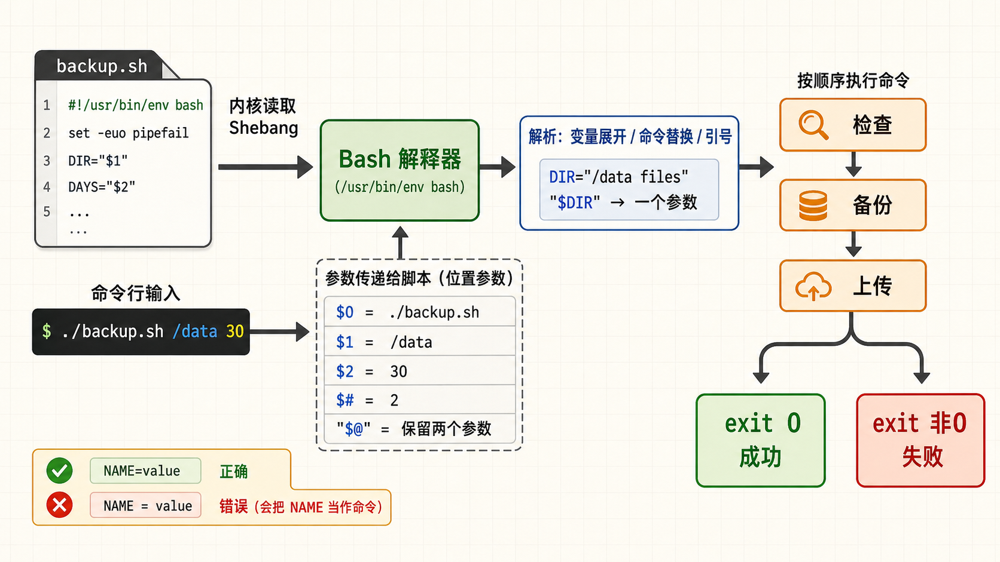
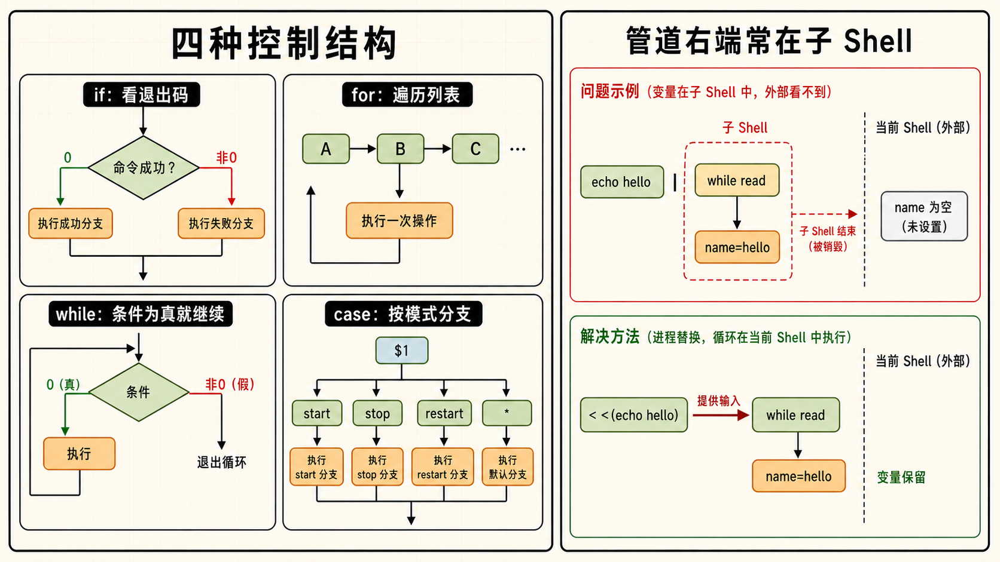
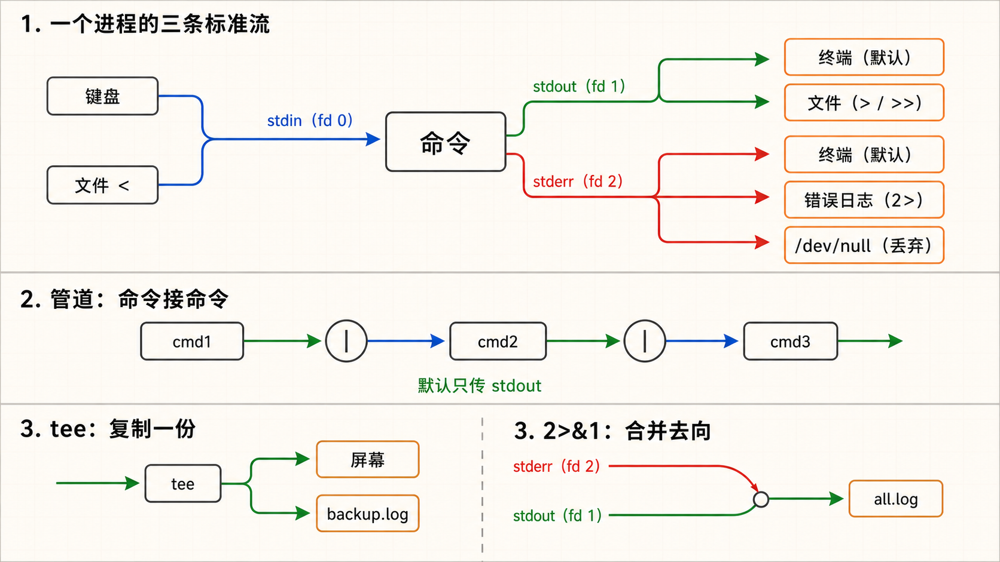
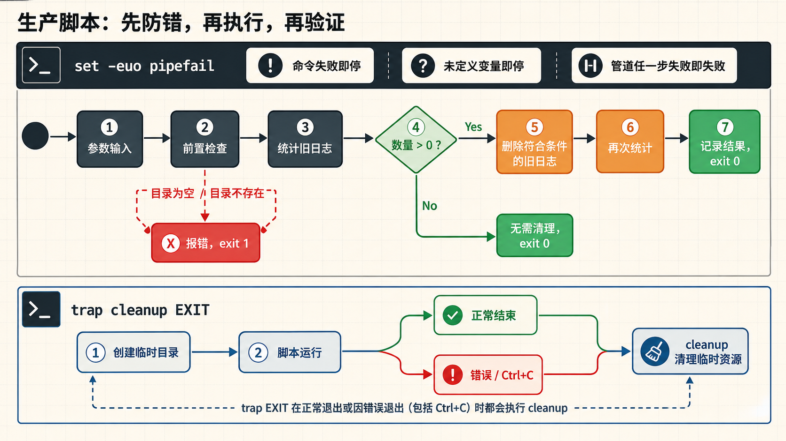

[← 返回 Linux 系统目录]({{ '/subjects/Linux/' | relative_url }})



# Shell 脚本基础

*从手工敲命令到自动化生产力工具——运维工程师的必修课*

Shell：Bash / POSIX sh · 风格：问题驱动 · 追本溯源 · 目标：从零写出生产级运维脚本

## 1 为什么需要脚本 {#sec08-1}

### 从"每天敲一百遍同样的命令"到"一次编写，无限复用" · 入门 {#从每天敲一百遍同样的命令到一次编写无限复用-入门}

#### Shell 脚本的本质

把你在终端里手动输入的命令按顺序写进一个文本文件，再加上一些条件判断、循环和变量——这个文件就是 <strong>Shell 脚本</strong>。它不需要安装任何运行时（Bash 解释器已经在你的系统里了），不需要编译，写完 `chmod +x` 加上可执行权限就能跑。它是运维自动化的基石——<strong>所有批量操作、定时任务、部署流程的第一站都是 Shell 脚本</strong>。

#### 一个场景，两种人生

<strong>需求：</strong>每天凌晨 3 点备份 MySQL 数据库，gzip 压缩，上传到远程备份服务器，删除 7 天前的旧备份，最后发邮件汇报结果。

<strong>没有脚本：</strong>你设了凌晨 2:55 的闹钟，爬起来依次敲 5 条命令。敲到第 3 条发现 mysqldump 报错——磁盘空间不足。排查到 4 点，发邮件给领导说备份失败。

<strong>有脚本：</strong>写一个 `backup.sh`，封装全部步骤，加上磁盘检查、错误处理、日志记录。<strong>cron 定时执行，你在睡觉</strong>。失败了自动发告警邮件，成功了给你发日报摘要。

```bash
#!/bin/bash
# 这就是一个最简脚本——把你要做的事逐行写出来
echo "===== 备份开始 ====="
BACKUP_FILE="/backup/mydb_$(date +%Y%m%d).sql.gz"
mysqldump -u root mydb | gzip > "$BACKUP_FILE"
echo "备份完成：$BACKUP_FILE"
scp "$BACKUP_FILE" backups@remote:/backups/
echo "远程上传完成"
# crontab: 0 3 * * * /opt/scripts/backup.sh >> /var/log/backup.log 2>&1
```

<strong>Shell 脚本的三大核心优势</strong>

- <strong>依赖较少</strong>：多数通用 Linux 发行版预装 Bash，但精简容器和嵌入式系统可能只有 POSIX `sh`；执行前用 `command -v bash` 确认。
- <strong>与系统深度集成</strong>：直接调用系统命令（ls、grep、awk、systemctl），不需要任何绑定库。
- <strong>天然管道思维</strong>：Shell 的设计哲学就是"小工具组合成大系统"——一个命令的输出就是下一个的输入，数据在管道中流动。

## 2 Shebang 与变量 {#sec08-2}

### 脚本的 DNA——第一行决定了脚本的命运 · 基础 {#脚本的-dna第一行决定了脚本的命运-基础}

#### Shebang —— \#! 不是注释 {#shebang-不是注释}

脚本第一行的 `#!/bin/bash` 称为 <strong>Shebang</strong>，直接执行文件时内核据此选择解释器；`#!/usr/bin/env bash` 则通过当前 `PATH` 查找 Bash。若直接执行的脚本缺少 Shebang，行为取决于调用它的 shell 或程序，不能假定使用登录 shell；而 `bash script.sh` 会明确由 Bash 解释。要让脚本可移植、可预测，请写明与语法相符的解释器，并检查目标机器是否安装。

```bash
#!/bin/bash
# #!/usr/bin/env bash     ← 可移植写法（在 PATH 中找 bash）
# #!/bin/sh               ← POSIX 兼容模式（功能少于 bash）
```

#### 变量 —— 给数据起个名字 {#变量-给数据起个名字}

变量就是给一个值取个名字，方便反复使用。定义变量时 `=` 两边<strong>不能有空格</strong>——这是新手最常犯的错误之一。

```bash
# 定义变量（等号两边不能有空格！）
NAME="production-server"
PORT=8080
TIMESTAMP=$(date +%Y%m%d_%H%M%S)    # 命令替换：把命令的输出赋给变量

# 使用变量：$NAME 或 ${NAME}（花括号不是必须但推荐）
echo "Server: $NAME"
echo "Port: ${PORT}"
echo "Backup file: backup_${TIMESTAMP}.tar.gz"
# 如果不用花括号：$TIMESTAMP.tar.gz 会被解释为变量 "TIMESTAMP.tar.gz"
```

▶ 执行结果

```plaintext
Server: production-server
Port: 8080
Backup file: backup_20260731_143000.tar.gz
```

#### 命令行参数（\$1, \$2, ...）与特殊变量 {#命令行参数1-2-...与特殊变量}

脚本可以通过参数接收外部输入，实现"一次编写、不同场景复用"。

| 变量      | 含义                           | 示例                             |
|-----------|--------------------------------|----------------------------------|
| `$0`      | 脚本自身的名字                 | `./backup.sh`                    |
| `$1`      | 第 1 个命令行参数              | `./backup.sh /data` → `$1=/data` |
| `$2 ~ $9` | 第 2 ~ 9 个参数                | 更多参数用 `${10}` `${11}`       |
| `$#`      | 参数总个数                     | `./script.sh a b c` → `$#=3`     |
| `$@`      | 所有参数（每个作为独立字符串） | `"$@"` 保留原始分隔              |
| `$*`      | 所有参数（合并为单个字符串）   | 通常不推荐使用                   |
| `$?`      | 上一条命令的退出码             | 0=成功，非0=失败                 |
| `$$`      | 当前 Shell 的 PID              | 用于创建唯一临时文件名           |

```bash
#!/bin/bash
# 使用参数和参数默认值
BACKUP_DIR="${1:-/backup}"       # 第1个参数，如果没传则默认 /backup
DAYS="${2:-7}"                    # 第2个参数，默认 7
echo "备份目录: $BACKUP_DIR"
echo "保留天数: $DAYS"
echo "参数总数: $#"
echo "脚本名: $0"

# 检查参数是否足够
if [[ $# -lt 1 ]]; then
    echo "用法: $0 <备份目录> [保留天数]"
    exit 1
fi
```

▶ 执行演示

```bash
$ ./script.sh /data/backup 30
备份目录: /data/backup
保留天数: 30
参数总数: 2
脚本名: ./script.sh

$ ./script.sh
备份目录: /backup
保留天数: 7
参数总数: 0
脚本名: ./script.sh
```

#### 退出码 —— 成功或失败，用数字说话 {#退出码-成功或失败用数字说话}

Linux 世界里每个命令执行完都要报告一个"状态"——<strong>退出码（Exit Code）</strong>。0 代表成功，非 0 代表失败。`$?` 能立刻读取上一个命令的退出码。

```bash
ls /tmp
echo $?  # 输出 0 —— 成功

ls /non_existent_dir
echo $?  # 输出 2 —— 失败（目录不存在）

# 在脚本里可以显式设置退出码
if [[ ! -f "$CONFIG_FILE" ]]; then
    echo "配置文件 $CONFIG_FILE 不存在！"
    exit 1   # 以失败状态退出
fi
exit 0       # 一切正常，正常退出
```

<strong>变量引用的坑：永远用双引号包裹变量！</strong>如果变量的值里有空格，不加引号 shell 会把空格分开的部分当成两个参数——导致命令行为异常。例如 `DIR="my files"`， `cd $DIR` 会变成 `cd my files`（两个参数），报错。正确的写法是 `cd "$DIR"`。养成习惯： <strong>除了极少数需要单词拆分（word splitting）的场景外，变量引用一律加双引号</strong>。



## 3 if / for / while / case {#sec08-3}

### 四种控制结构——让脚本有"判断力"和"循环力" · 核心 {#四种控制结构让脚本有判断力和循环力-核心}

#### if 判断 —— 条件成立才执行 {#if-判断-条件成立才执行}

Shell 的 `if` 和普通编程语言不一样——它判断的不是"表达式是 true 还是 false"，而是"命令是否执行成功（退出码是不是 0）"。因为 **`[` 本身就是一个命令（等价于 `test`）**，而 `[[ ]]` 是 Bash 内部关键字（更快、更安全、支持正则）。

```bash
#!/bin/bash
# 使用 [[ ]] 不用 [ ]——支持正则、不会因变量为空报错
DISK_USAGE=$(df / | awk 'NR==2 {print $5}' | sed 's/%//')

if [[ $DISK_USAGE -gt 80 ]]; then
    echo "磁盘使用率 ${DISK_USAGE}%，空间不足！"
    exit 1
elif [[ $DISK_USAGE -gt 60 ]]; then
    echo "磁盘使用率 ${DISK_USAGE}%，注意监控。"
else
    echo "磁盘空间充足。"
fi
```

#### 常用条件测试速查

| 测试表达式 | 什么时候为真 |
|----|----|
| `[[ -f file ]]` | file 存在且是普通文件 |
| `[[ -d dir ]]` | dir 存在且是目录 |
| `[[ -z "$str" ]]` | str 是空字符串 |
| `[[ -n "$str" ]]` | str 不是空字符串 |
| `[[ "$a" == "$b" ]]` | 两个字符串相等 |
| `[[ "$a" != "$b" ]]` | 两个字符串不相等 |
| `[[ "$a" =~ regex ]]` | 字符串匹配正则（Bash 特有） |
| `[[ -x file ]]` | file 有可执行权限 |
| `[[ $a -gt $b ]]` | a 数字大于 b（-ge大于等于，-lt小于，-le小于等于，-eq等于） |
| `[[ $a -gt $b ]]` | a 数字大于 b（-ge大于等于，-lt小于，-le小于等于，-eq等于） |

#### for 循环 —— 遍历列表逐一处理 {#for-循环-遍历列表逐一处理}

for 循环用于对一个列表中的每个元素执行相同的操作。这是批量处理的核心武器。

```bash
# 遍历文件列表
for logfile in /var/log/*.log; do
    echo "正在压缩: $logfile"
    gzip "$logfile"
done
echo "全部日志文件压缩完成"

# C 风格的三循环（精确控制循环次数）
for ((i=1; i<=10; i++)); do
    echo "第 ${i} 次尝试连接..."
    nc -z localhost 3306 && break
    sleep 2
done

# 花括号展开生成范围
for port in {8080..8085}; do
    echo "检查端口 $port ..."
    nc -z localhost "$port" && echo "  -> 已监听" || echo "  -> 未监听"
done
```

▶ 执行结果（端口检查）

```plaintext
检查端口 8080 ...
  -> 已监听
检查端口 8081 ...
  -> 未监听
检查端口 8082 ...
  -> 已监听
```

#### while 循环 —— 条件满足就一直执行 {#while-循环-条件满足就一直执行}

while 适合"持续等待直到某个条件满足"的场景。最经典的用法是<strong>逐行读取文件</strong>和<strong>等待服务就绪</strong>。

```bash
# 安全的逐行读取文件（IFS= 保留行首空白，-r 保留反斜杠）
while IFS= read -r line; do
    echo "读取到: $line"
done < /etc/hosts

# 等待数据库启好
echo "等待 MySQL 启动..."
while ! nc -z localhost 3306; do
    sleep 2
done
echo "MySQL 已就绪！"
```

#### case 多条件分支 —— 比 if-elif 更优雅 {#case-多条件分支-比-if-elif-更优雅}

case 适合"多种可能"的选择场景。最经典的用例是写服务管理脚本和参数解析。

```bash
#!/bin/bash
# 服务管理脚本模板
case "$1" in
    start)
        echo "启动服务..."
        systemctl start myapp
        ;;
    stop)
        echo "停止服务..."
        systemctl stop myapp
        ;;
    restart)
        echo "重启服务..."
        systemctl restart myapp
        ;;
    status)
        systemctl status myapp
        ;;
    *)
        echo "用法: $0 {start|stop|restart|status}"
        exit 1
        ;;
esac
```

<strong>管道中的 while 陷阱</strong>管道符右端的命令在子 Shell 中运行。所以在 `echo "hello" | while read line; do name=$line; done; echo $name` 中，最后的 echo 输出是空——因为 name 是在子 Shell 里赋值的，外面拿不到。解决办法：用进程替换 `while read line; do name=$line; done < <(echo "hello"); echo $name`。



## 4 函数 {#sec08-4}

### 把"套路"封装起来——重复逻辑一次写、到处用 · 结构化 {#把套路封装起来重复逻辑一次写到处用-结构化}

#### 为什么需要函数

写脚本时你会发现某些操作反复出现：打印带时间戳的日志、检查文件是否存在、发送告警通知。把这些操作写成一个函数，取名后直接调用——<strong>就像木匠把常用工具放在一个工具箱里，每次干活前拎出来就行</strong>。

#### 函数定义与调用

```bash
#!/bin/bash

# 函数定义——两种写法都可以
log() {
    local level="${1:-INFO}"    # local 声明局部变量，不影响外部
    local message="$2"
    echo "[$(date '+%Y-%m-%d %H:%M:%S')] [${level}] ${message}"
}

# 第二种写法（function 关键字可以省略）
function die() {
    log "FATAL" "$1"
    exit 1
}

# 调用函数（函数内 $1 $2 对应函数调用时的参数，不是脚本参数）
log "INFO" "备份任务开始"
log "WARN" "磁盘使用率偏高: 75%"

if [[ ! -d "/backup" ]]; then
    die "备份目录 /backup 不存在！"
fi
```

▶ 执行结果

```plaintext
[2026-07-31 14:30:00] [INFO] 备份任务开始
[2026-07-31 14:30:00] [WARN] 磁盘使用率偏高: 75%
[2026-07-31 14:30:00] [FATAL] 备份目录 /backup 不存在！
```

#### 函数的"返回值"——两种方式

```bash
# 方式1：return 退出码（只能是数字 0-255）
check_disk() {
    local usage=$(df "$1" | awk 'NR==2 {print $5}' | sed 's/%//')
    if [[ $usage -gt 80 ]]; then
        return 1    # 失败返回
    fi
    return 0        # 成功返回
}

# 方式2：echo 输出数据（调用者用 $(...) 捕获）
get_top_ip() {
    local logfile="$1"
    awk '{print $1}' "$logfile" | sort | uniq -c | sort -rn | head -1
}

top_ip=$(get_top_ip /var/log/nginx/access.log)
echo "访问最多的 IP: $top_ip"
```

#### source —— 把公共函数拆到独立文件 {#source-把公共函数拆到独立文件}

多个脚本都需要日志函数和错误处理——复制粘贴三份？改一处要改三处。把公共函数抽到一个 `lib/common.sh` 里，每个脚本 `source`（或 `.`）引入即可。

```bash
# lib/common.sh —— 公共函数库
#!/bin/bash

log()   { echo "[$(date '+%H:%M:%S')] $*"; }
fatal() { echo "[$(date '+%H:%M:%S')] FATAL: $*" >&2; exit 1; }

check_deps() {
    for cmd in "$@"; do
        command -v "$cmd" &>/dev/null || fatal "$cmd 未安装！"
    done
}

# main.sh —— 业务脚本
#!/bin/bash
source "$(dirname "$0")/lib/common.sh"   # 引入公共库

check_deps curl jq
log "依赖检查通过，开始执行主逻辑..."
```

## 5 重定向与管道 {#sec08-5}

### 数据流往哪走——Linux 最强大的设计理念 · 核心 {#数据流往哪走linux-最强大的设计理念-核心}

#### 三个标准流：stdin(0) / stdout(1) / stderr(2) {#三个标准流stdin0-stdout1-stderr2}

每个 Linux 进程启动时，内核自动给它分配三个"数据通道"：

- <strong>stdin（标准输入，fd=0）</strong>：数据从哪里来。默认是键盘，可以重定向从文件来。
- <strong>stdout（标准输出，fd=1）</strong>：正常数据往哪去。默认是终端屏幕，可以重定向到文件。
- <strong>stderr（标准错误，fd=2）</strong>：错误信息往哪去。默认也是终端屏幕，但可以单独处理。

<strong>重定向就是改变这些数据通道的指向</strong>——把输出从屏幕改到文件，把输入从键盘改到文件。

#### 输出重定向——把结果存下来

```bash
# >  覆盖重定向（清空目标文件，写入新内容）
ls /etc > etc_files.txt          # 清空 etc_files.txt，再写入

# >> 追加重定向（在目标文件末尾追加，不覆盖）
echo "--- $(date) ---" >> backup.log

# 2> 重定向错误输出
find / -name "*.log" 2> /dev/null   # 把 Permission denied 的错误丢掉

# &> 同时重定向 stdout + stderr 到同一个文件
./backup.sh &> backup_full.log

# 2>&1 把 stderr 合并到 stdout（写脚本时最常用的模式）
./backup.sh > backup.log 2>&1     # 正常和错误都进 backup.log
```

2\>&1 解读： 2 = stderr \> = 重定向到 &1 = 文件描述符 1（stdout） 最终效果：stderr 的输出和 stdout 走同一条路

#### /dev/null —— 黑洞 {#devnull-黑洞}

`/dev/null` 是一个特殊设备文件，写入它的任何内容都会被丢弃，读取它返回 EOF。需要"安静地执行命令，不管输出和错误"时就用它。

```bash
# 不关心命令输出，只关心退出码
curl -s "http://localhost/health" > /dev/null
if [[ $? -eq 0 ]]; then
    echo "健康检查通过"
fi

# 静默执行（stdout 和 stderr 都丢进黑洞）
some_noisy_command &>/dev/null
```

#### 管道（Pipe）—— 命令之间的"水管"

`cmd1 | cmd2`：将 cmd1 的 stdout 直接作为 cmd2 的 stdin。管道是 Unix 哲学的核心——"每个工具只做一件事，但可以组合成强大的流水线"。

```bash
# 真实案例：统计 Nginx 日志里访问次数最多的 10 个 IP
cat /var/log/nginx/access.log \
    | awk '{print $1}' \
    | sort \
    | uniq -c \
    | sort -rn \
    | head -n 10

# tee —— 管道上的"三通接口"
# tee 把数据同时写到文件和屏幕，不中断管道
./backup.sh | tee backup.log
# 既能在屏幕看到输出，又能在 backup.log 中保存一份
```

<strong>管道与重定向的区别</strong>管道把前一命令的标准输出接到后一命令的标准输入；重定向则改变命令与文件或其他文件描述符的连接方向。管道通常经过内核缓冲区，但不能据此断言整条命令一定更快，也不能忽略前后命令自身的磁盘 I/O。



## 6 日志清理实战 {#sec08-6}

### 把前面学的知识拧成一股绳——写一个日志清理练习脚本 · 实战 {#把前面学的知识拧成一股绳写一个日志清理练习脚本-实战}

#### 需求场景

先在专用测试目录演练清理 N 天前的日志文件，观察参数校验、统计与删除顺序。真实服务通常持续写入当前 `*.log`：不能仅凭修改时间删除正在使用的日志；生产环境优先配置 `logrotate` 或应用自身轮转机制，只清理明确识别为归档的文件，并保留审计记录。

#### 完整脚本

```bash
#!/bin/bash
set -euo pipefail

# ═══ 配置 ═══
LOG_DIR="${1:-}"             # 第一个参数可缺省，由下方用法检查处理
DAYS="${2:-7}"                # 第二个参数：保留天数，默认7天
LOG_PATTERN="*.log"           # 要清理的文件模式

# ═══ 前置检查 ═══
if [[ -z "$LOG_DIR" ]]; then
    echo "用法: $0 <日志目录> [保留天数]"
    echo "示例: $0 /var/log/app 30"
    exit 1
fi

# 天数必须是正整数；避免误将根目录或日志根目录作为清理范围
if [[ ! "$DAYS" =~ ^[1-9][0-9]*$ ]]; then
    echo "错误: 保留天数必须是正整数" >&2
    exit 1
fi

if [[ ! -d "$LOG_DIR" ]]; then
    echo "错误: 目录 $LOG_DIR 不存在"
    exit 1
fi

LOG_DIR=$(realpath "$LOG_DIR")
if [[ "$LOG_DIR" == / || "$LOG_DIR" == /var/log ]]; then
    echo "错误: 请指定具体应用的日志目录" >&2
    exit 1
fi
AGE_MINUTES=$((DAYS * 1440))  # 按实际经过的 24 小时计算

# ═══ 清理前统计 ═══
BEFORE_COUNT=$(find "$LOG_DIR" -type f -name "$LOG_PATTERN" -mmin +"$AGE_MINUTES" | wc -l)
BEFORE_SIZE=$(find "$LOG_DIR" -type f -name "$LOG_PATTERN" -mmin +"$AGE_MINUTES" -exec du -ch {} + 2>/dev/null | tail -1 | awk '{print $1}')

echo "[$(date)] 开始清理 $LOG_DIR 中 ${DAYS} 天前的 $LOG_PATTERN 文件..."
echo "  待清理文件数: $BEFORE_COUNT"
echo "  预计释放空间: ${BEFORE_SIZE:-0}"

if [[ $BEFORE_COUNT -eq 0 ]]; then
    echo "  没有需要清理的文件，退出。"
    exit 0
fi

# ═══ 执行清理 ═══
find "$LOG_DIR" -type f -name "$LOG_PATTERN" -mmin +"$AGE_MINUTES" -delete

# ═══ 清理后验证 ═══
AFTER_COUNT=$(find "$LOG_DIR" -type f -name "$LOG_PATTERN" -mmin +"$AGE_MINUTES" | wc -l)

echo "  清理后剩余旧文件数: $AFTER_COUNT"
echo "[$(date)] 清理完成：删除了 $BEFORE_COUNT 个文件，释放约 ${BEFORE_SIZE:-0} 空间"
```

▶ 执行示例

```bash
$ ./cleanup_logs.sh /var/log/myapp 30
[2026年07月31日 星期四 14:30:00 CST] 开始清理 /var/log/myapp 中 30 天前的 *.log 文件...
  待清理文件数: 156
  预计释放空间: 2.3G
  清理后剩余旧文件数: 0
[2026年07月31日 星期四 14:30:05 CST] 清理完成：删除了 156 个文件，释放约 2.3G 空间
```

#### 配置 cron 定时执行

```bash
# 每天凌晨 3 点自动清理
# crontab -e
0 3 * * * /opt/scripts/cleanup_logs.sh /var/log/myapp 30 >> /var/log/cleanup.log 2>&1
```

## 7 调试方法 {#sec08-7}

### 脚本出错了别靠猜——四招精准定位 bug · 排错 {#脚本出错了别靠猜四招精准定位-bug-排错}

#### 第一招：bash -x —— 让脚本"说出"它正在执行的每一行 {#第一招bash--x-让脚本说出它正在执行的每一行}

`bash -x` 会打印执行过的命令和展开后的变量值，适合定位分支、引用和参数问题。输出可能包含密码或令牌，因此不要直接在共享日志中开启；遇到外部命令或环境问题时，还要结合退出码和相关服务日志判断。

```bash
# 执行脚本时加 -x 参数
bash -x ./my_script.sh

# 或者在脚本内部局部开启
#!/bin/bash
echo "这段不打印调试信息"
set -x          # 开启调试
NAME="server01"
echo "Hello, $NAME"
set +x          # 关闭调试
echo "这段又不打印了"
```

▶ bash -x 输出示例

```bash
+ NAME=server01
+ echo 'Hello, server01'
Hello, server01
```

#### 第二招：set -e / set -u / set -o pipefail —— 严格模式三件套 {#第二招set--e-set--u-set--o-pipefail-严格模式三件套}

`set -u` 能帮助发现未定义变量，`pipefail` 使管道前段失败不被最后一段的成功掩盖；`set -e` 可用于适合“遇错即停”的脚本，但在 `if`、`&&`、管道及函数调用等上下文有例外。选择前先明确预期失败应如何处理，并对关键步骤显式检查退出码，而不是把这三项当作普适的安全保证。

```bash
#!/bin/bash
set -euo pipefail
# set -e          任何命令退出码非0就立即退出（别硬撑！）
# set -u          使用未定义变量就报错（别猜！）
# set -o pipefail 管道中任何一个命令失败，整条管道就失败
```

| 选项 | 默认行为 | 严格模式行为 |
|----|----|----|
| `set -e` | 命令失败了继续跑，可能雪崩 | 命令失败立即退出，防止雪崩 |
| `set -u` | 未定义变量当成空字符串，静默 | 引用未定义变量报错并退出 |
| `set -o pipefail` | 管道只关心最后一个命令的退出码 | 管道中任何一个命令失败就算失败 |

#### 第三招：trap —— 脚本的"意外保险" {#第三招trap-脚本的意外保险}

如果脚本中间被打断（Ctrl+C）或因错误退出，临时文件、锁文件可能留在磁盘上。trap 让你在退出前执行清理操作。

```bash
#!/bin/bash
set -euo pipefail

TEMP_DIR=$(mktemp -d)

cleanup() {
    echo "清理临时文件..."
    rm -rf "$TEMP_DIR"
    echo "清理完成"
}
trap cleanup EXIT      # 无论脚本怎样退出，都执行 cleanup

trap 'echo "收到 SIGINT，退出..." ; exit 130' INT   # 捕获 Ctrl+C
trap 'echo "收到 SIGTERM，退出..." ; exit 143' TERM  # 捕获 kill

# 脚本主逻辑在这里
echo "临时目录: $TEMP_DIR"
# ... 做一些操作 ...
```

#### 第四招：echo 大法和 grep 日志

虽然原始，但在复杂脚本中极其有效——在关键位置插入 `echo "DEBUG: 变量 X = $X"` 来观察运行状态。

```bash
# 调试日志函数
debug() {
    [[ "${DEBUG:-0}" == "1" ]] && echo "[DEBUG] $(date +%H:%M:%S) $*"
}

debug "当前目录: $(pwd)"
debug "参数: $*"
debug "用户: $(whoami)"

# 用的时候：DEBUG=1 ./script.sh —— 开启调试输出
# 正常使用：./script.sh —— 调试输出被隐藏
```

<strong>调试顺序建议</strong>遇到脚本报错：1. 先开 `bash -x` 跑一遍，看哪一行的输出不对；2. 如果在循环里，在循环体内加 `echo` 打印关键变量；3. 检查变量是否被意外覆盖（可能是管道的子 Shell 问题）；4. 检查是否忘了给变量加双引号。




