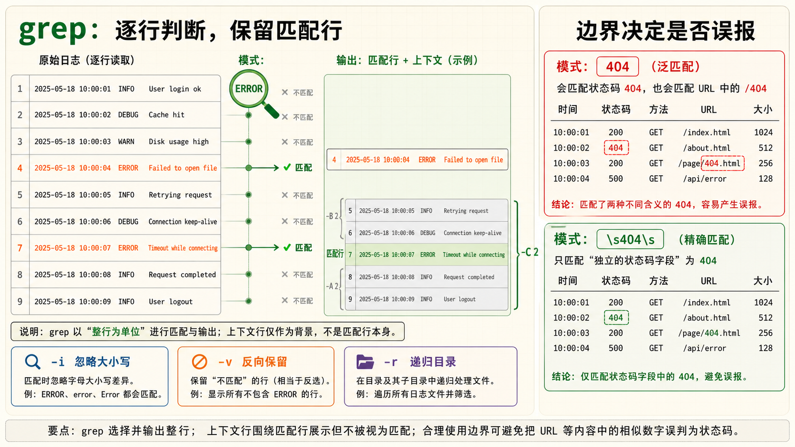
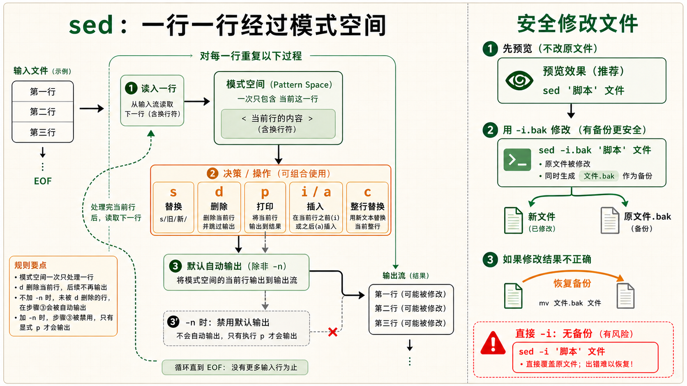
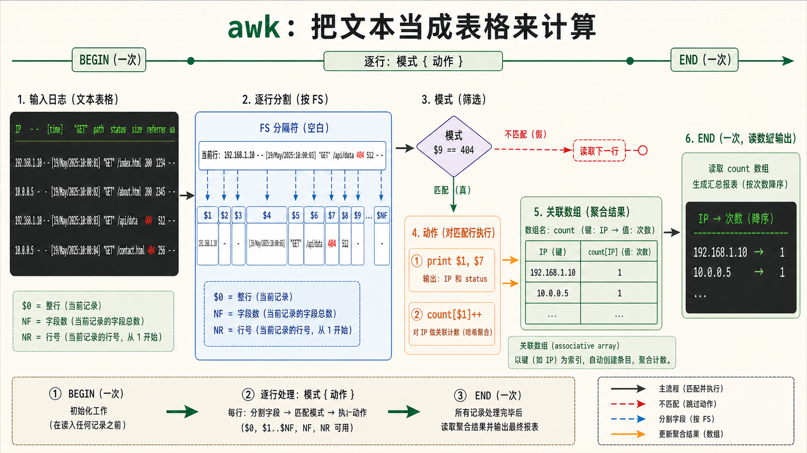
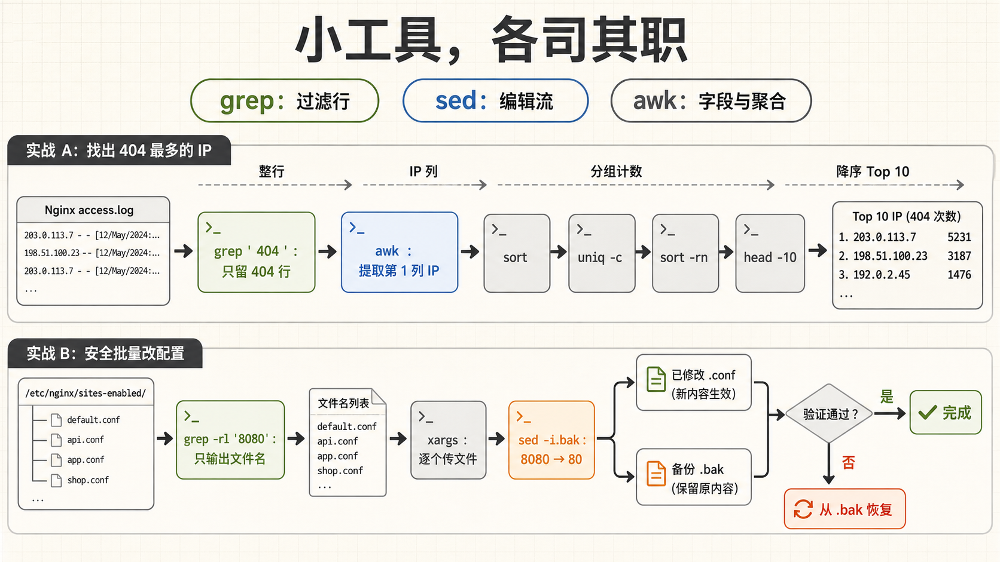

[← 返回 Linux 系统目录]({{ '/subjects/Linux/' | relative_url }})



# 文本处理三剑客

*grep · sed · awk —— Linux 终端下最锋利的文本处理武器*

工具：grep / sed / awk · 风格：问题驱动 · 追本溯源 · 目标：从"只会 grep 查日志"到"三剑客组合作战"

## 1 grep 搜索大师 {#sec09-1}

### grep —— 文本搜索之王，运维工程师使用频率最高的命令 · 基础 {#grep-文本搜索之王运维工程师使用频率最高的命令-基础}

#### grep 的本质

<strong>grep</strong>（Global Regular Expression Print）的功能说起来极其简单：从文本中找出包含指定模式的行，打印出来。但就是这么一个看似简单的操作，构成了运维日常工作的 30%。查日志、找配置、看进程——几乎每一件事都从 grep 开始。

```bash
# 最基础的用法：在文件中搜索包含指定字符串的行
grep "ERROR" /var/log/app.log

# 从管道接收数据（这才是 grep 最常见的用法！）
cat /var/log/nginx/access.log | grep "404"
ps aux | grep nginx
dmesg | grep -i error
```

#### 必知的 10 个参数——每个都能让你的效率翻倍

| 参数 | 作用 | 典型场景 |
|----|----|----|
| `-i` | 忽略大小写 | `grep -i "error" app.log`——连 Error 和 ERROR 一起匹配 |
| `-v` | 反转匹配（打印不匹配的行） | `grep -v "#" config.conf`——过滤掉注释行 |
| `-r` | 递归搜索目录 | `grep -r "TODO" src/`——在所有子目录中找 TODO |
| `-n` | 显示行号 | `grep -n "function" script.sh`——告诉我函数在第几行 |
| `-c` | 计数（输出匹配行数而非内容） | `grep -c "404" access.log`——今天有多少个 404 |
| `-l` | 只显示包含匹配的文件名 | `grep -rl "password" /etc/`——哪些配置文件里有 password |
| `-w` | 匹配整个单词 | `grep -w "is" file.txt`——只匹配单词 is，不匹配 this |
| `-A N` | 显示匹配行及之后 N 行（After） | `grep -A 5 "error" log`——看错误后的上下文 |
| `-B N` | 显示匹配行及之前 N 行（Before） | `grep -B 3 "error" log`——看错误前的上下文 |
| `-C N` | 显示匹配行前后各 N 行（Context） | `grep -C 5 "error" log`——看错误前后的完整上下文 |

#### -E —— 开启扩展正则的万能钥匙 {#e-开启扩展正则的万能钥匙}

默认 grep 使用<strong>基本正则（BRE）</strong>，需要转义 `+`、`?`、`|`、`{`、`}`、`(`、`)` 这些符号——非常麻烦。加上 `-E` 就启用<strong>扩展正则（ERE）</strong>，这些符号不用转义，写起来流畅很多。实际上 `egrep` 就是 `grep -E` 的别名。

```bash
# 不用 -E：每个特殊符号都要加反斜杠转义
grep "error\|fail\|warn" app.log         # 匹配 error 或 fail 或 warn

# 用了 -E：清爽很多
grep -E "error|fail|warn" app.log        # 等价于上面，但不需要转义

# 正则组合示例
grep -E "[0-9]{1,3}\.[0-9]{1,3}\.[0-9]{1,3}\.[0-9]{1,3}" access.log  # 找 IP
grep -E "2026-07-3[0-1] [0-2][0-9]:[0-5][0-9]" app.log                # 找特定时间段
grep -iE "^(error|fatal|critical)" app.log                            # 找日志开头是这些的
```

#### --include 和 --exclude —— 精确控制搜索范围 {#include-和---exclude-精确控制搜索范围}

```bash
# 只在 .log 文件中搜索
grep -r "ERROR" /var/log/ --include="*.log"

# 排除二进制文件和压缩包
grep -r "password" /etc/ --exclude="*.{gz,bz2,png}"

# 排除整个目录
grep -r "pattern" . --exclude-dir={node_modules,.git,.cache}
```

<strong>grep 性能提示</strong>在超大的日志文件（几十 GB）中 grep，记得加 `--binary-files=without-match` 跳过二进制文件，避免误匹配二进制数据。如果只需要"文件里有没有这个字符串"，用 `grep -l` 而不是 `grep -c`——前者找到第一个匹配就停止读文件，后者需要读完全文。

## 2 grep 高级实战 {#sec09-2}

### 查日志三板斧——每天都要用的 grep 组合技 · 实战 {#查日志三板斧每天都要用的-grep-组合技-实战}

#### 实战 1：在 Nginx 所有站点配置中找一个域名

```bash
# 在 /etc/nginx/ 下所有子目录的 .conf 文件中搜索 example.com
grep -r "example.com" /etc/nginx/ --include="*.conf" -n

# 输出示例：
# /etc/nginx/sites-enabled/myapp.conf:12:  server_name example.com www.example.com;
# /etc/nginx/sites-enabled/myapp.conf:45:  proxy_pass http://backend.example.com:8080;
# 直接告诉你文件、行号、内容——改哪里一目了然
```

#### 实战 2：从 Nginx 日志中统计各种错误

```bash
# 统计 404 错误的总次数
grep -c " 404 " /var/log/nginx/access.log

# 只看最近 1000 行里的 404
tail -1000 /var/log/nginx/access.log | grep -c " 404 "

# 找所有非 200 和 304 的请求（排除正常请求和缓存命中）
grep -vE " (200|304) " access.log | head -20

# 找出所有包含 "ERROR" 的日志行及其前后 2 行上下文
grep -C 2 "ERROR" /var/log/app.log --color=auto
```

#### 实战 3：过滤注释和空行——看"有效配置"

```bash
# 很多配置文件注释比有效行还多
# 只看真正起作用的配置行（排除注释和空行）
grep -vE '^\s*(#|$)' /etc/ssh/sshd_config

# 或者等价写法
grep -v '^#' /etc/ssh/sshd_config | grep -v '^$'
```

▶ 输出效果（原来 120 行的配置文件变成 30 行有效配置）

#### 实战 4：从系统日志中找出 OOM Killer 杀掉的进程

```bash
# 找出被 OOM Killer 杀掉的进程
dmesg | grep -i "killed process"

# 更详细的 OOM 分析
dmesg | grep -A 5 -B 2 -i "out of memory"
```

#### 实战 5：按时间范围搜索——配合 journalctl 或 syslog

```bash
# 从 syslog 中找出今天下午 2-4 点之间的 sshd 登录记录
grep "sshd.*Accepted" /var/log/auth.log | grep -E "Jul 31 (14|15|16):"

# 找出所有 root 用户执行的 sudo 命令
grep "sudo.*COMMAND" /var/log/auth.log | grep "USER=root"
```

<strong>grep 的常见误区</strong> `grep "404" access.log` 也会匹配 `/page/404.html` 这种 URL 路径中包含 404 的行，未必是真正的 404 状态码。更精确的写法是 `grep '" 404 '` 或 `grep -E '\s404\s'`，用空格限定边界。在日志分析中，精确匹配比泛匹配重要得多。



## 3 sed 流编辑器 {#sec09-3}

### sed —— 不是让你打开 vim 一行行改，是一口气改完百万行 · 基础 {#sed-不是让你打开-vim-一行行改是一口气改完百万行-基础}

#### sed 的设计哲学

<strong>sed</strong>（Stream Editor）名字里自带"流"——它处理的是流动的文本数据，一行一行地读入、加工、输出。它的设计哲学是：<strong>默认不修改原文件，把修改后的内容输出到屏幕上</strong>。只有加了 `-i` 参数才会原地修改。这个设计让你在改动生效前总能先看效果。

#### 最核心的操作：查找替换 s/old/new/

sed 最常用的模式是 `s/模式/替换内容/标志`。90% 的 sed 使用场景都是查找替换。

```bash
# 基本替换：将每行的第一个 old 替换为 new
sed 's/old/new/' file.txt

# 全局替换：将该行所有的 old 都替换（g = global）
sed 's/old/new/g' file.txt

# 查看效果（不修改文件），确认无误后再加 -i
sed 's/8080/80/g' nginx.conf     # 先看看改了什么
sed -i 's/8080/80/g' nginx.conf  # 确认无误，原地修改
```

#### 替换标志详解

| 标志 | 含义                               | 示例                        |
|------|------------------------------------|-----------------------------|
| `g`  | 全局替换（一行中所有匹配项都替换） | `s/a/b/g`                   |
| `2`  | 只替换每行的第 2 个匹配            | `s/a/b/2`                   |
| `i`  | 忽略大小写                         | `s/error/critical/i`        |
| `p`  | 打印被修改的行                     | `s/a/b/p`（常配合 -n 使用） |

#### sed -i 的三种安全用法

```bash
# 方式1：-i 加备份后缀（最安全！自动生成备份文件）
sed -i.bak 's/port 8080/port 80/g' nginx.conf
# 修改后原文件变成 nginx.conf.bak，nginx.conf 是新文件

# 方式2：-i 直接原地修改（无备份，谨慎！）
sed -i 's/port 8080/port 80/g' nginx.conf

# 方式3：先 dry-run 确认，再 -i
sed 's/port 8080/port 80/g' nginx.conf | grep --color "port 80"
# 确认替换结果符合预期，再执行
sed -i 's/port 8080/port 80/g' nginx.conf
```

#### 实战：批量修改 Nginx 所有站点配置的端口

```bash
# 将所有站点配置中的 8080 改为 80（先备份！）
sed -i.bak 's/8080/80/g' /etc/nginx/sites-enabled/*

# 如果改错了，用备份文件恢复
for f in /etc/nginx/sites-enabled/*.bak; do
    mv "$f" "${f%.bak}"
done
```

#### sed 正则替换——比基本替换更强大

```bash
# 使用 & 引用整个匹配到的文本
echo "Hello World" | sed 's/.*/[&]/'
# 输出: [Hello World]

# 使用 \1 \2 引用捕获组（用 \( \) 包裹分组）
echo "server=localhost port=3306" | sed 's/.*server=\([^ ]*\).*port=\([^ ]*\).*/\1:\2/'
# 输出: localhost:3306

# -E 启用扩展正则（更清晰）
echo "server=localhost port=3306" | sed -E 's/.*server=([^ ]*).*port=([^ ]*).*/\1:\2/'
# 输出: localhost:3306
```

<strong>sed 的默认行为</strong>sed 处理每一行时，默认会把它打印出来（称为"模式空间自动打印"）。如果你不想让修改后的行和原行同时出现，记得分情况处理：做替换时不需要加 `-n`；做过滤/范围选择时通常需要 `-n` + `p` 来抑制默认输出。

## 4 sed 进阶操作 {#sec09-4}

### 不止查找替换——sed 的 5 种高级操作模式 · 进阶 {#不止查找替换sed-的-5-种高级操作模式-进阶}

#### 操作 1：删除行 d（delete）

```bash
# 删除匹配 pattern 的行
sed '/DEBUG/d' app.log

# 删除第 5 到第 10 行
sed '5,10d' file.txt

# 删除空行
sed '/^$/d' config.conf

# 删除注释行（以 # 开头的行）
sed '/^#/d' config.conf

# 一行删除空行和注释（用 ; 或 -e 连接多条命令）
sed -e '/^$/d' -e '/^#/d' /etc/ssh/sshd_config
```

#### 操作 2：打印特定行 p（print）

用 `-n` 抑制 sed 的默认输出，再用 `p` 明确告诉 sed 打印哪些行。这其实是一种"精准行提取"操作。

```bash
# 打印第 20 到第 30 行
sed -n '20,30p' access.log

# 打印包含 "ERROR" 的行
sed -n '/ERROR/p' app.log

# 从 "START" 到 "END" 之间的所有行
sed -n '/START/,/END/p' file.txt

# 打印文件的最后 10 行（等价于 tail -10）
sed -n '$p; $p; N; 7,$D; $p' file.txt   # 这只是演示，实际用 tail 就行
```

#### 操作 3：在特定行前/后插入文本 i/a（insert/append）

```bash
# 在第 3 行之前插入一行
sed '3i\# === 这是新插入的注释 ===' file.txt

# 在最后一行之后追加内容
sed '$a\# 文件末尾' file.txt

# 在匹配 "Listen 80" 的行后面加一行
sed '/Listen 80/a\    # 这是新增的注释' httpd.conf
```

#### 操作 4：整行替换 c（change）

```bash
# 把包含 "Listen 80" 的行整行替换为新内容
sed '/Listen 80/c\Listen 443' httpd.conf
```

#### 操作 5：多条件组合——sed 脚本

用 `-e` 串联多条 sed 命令，或用 `;` 分隔，复杂操作可以写进一个文件当脚本用。

```bash
# 一条 sed 命令做三件事：删空行、删注释、替换端口
sed -e '/^$/d' -e '/^#/d' -e 's/8080/80/g' nginx.conf

# 将多条 sed 命令写进文件（sed 脚本）
cat > cleanup.sed << 'EOF'
/^$/d
/^#/d
s/ localhost / 0.0.0.0 /g
s/ 8080 / 80 /g
EOF

sed -f cleanup.sed nginx.conf
```

<strong>sed -i 的跨平台差异</strong>macOS 的 BSD sed 和 Linux 的 GNU sed 在 `-i` 的行为上不同。macOS 要求 `sed -i '' 's/a/b/g' file`（必须带备份后缀参数），Linux 可以 `sed -i 's/a/b/g' file`。如果你的脚本需要在 macOS 和 Linux 上通用，要么用 `sed -i.bak` 然后删掉 .bak，要么用 perl 替代 `perl -i -pe 's/a/b/g' file`。



## 5 awk 文本分析 {#sec09-5}

### awk —— 不只是"打印第 N 列"，是一台完整的文本数据分析引擎 · 核心 {#awk-不只是打印第-n-列是一台完整的文本数据分析引擎-核心}

#### awk 的本质：表格化数据处理

awk 的思维模型非常简单而强大：把每一行文本按分隔符切成若干个<strong>字段（field）</strong>，然后你可以像操作数据库表格一样处理这些字段——`$1` 是第一列，`$2` 是第二列，`$NF` 是最后一列，`$0` 是整行。它的默认分隔符是<strong>空白字符</strong>（空格和 Tab），所以处理日志（典型的是空格分隔的列）天然匹配。

```bash
# 最简单的 awk：打印每一行的第 1 和第 3 列
awk '{print $1, $3}' data.txt

# 从管道读取（最常用的方式）
ls -l | awk '{print $9, $5}'     # 打印文件名和大小
ps aux | awk '{print $1, $2, $11}' # 打印用户名、PID、命令
```

#### 核心语法：模式-动作 对

awk 的核心语法是 `模式 { 动作 }`：对匹配"模式"的每一行执行"动作"。模式可以是正则表达式、条件判断或特殊的 BEGIN/END；动作就是你想做的操作。

```bash
# 只有一个模式（没有动作）：默认动作是 print $0（打印整行）
awk '/ERROR/' app.log    # 等价于 awk '/ERROR/ {print $0}' app.log

# 只有动作（没有模式）：对每一行都执行
awk '{print $1}' access.log    # 打印每行的第一列

# 模式 + 动作：只处理包含 ERROR 的行
awk '/ERROR/ {print $1, $2, $3}' app.log
```

#### awk 的内置变量——你的数据分析工具箱

| 变量 | 含义 | 典型用途 |
|----|----|----|
| `$0` | 当前行的完整内容 | 打印整行、判断整行 |
| `$1, $2, ...` | 第 1 列、第 2 列... | 提取指定字段 |
| `$NF` | 最后一列 | 动态取最后一列，不管有多少列 |
| `NF` | 当前行的列数 | `awk 'NF>10'`——只打印超过 10 列的行 |
| `NR` | 当前行号（从 1 开始） | `awk 'NR>=10 && NR<=20'`——打印 10-20 行 |
| `FNR` | 当前文件内的行号 | 处理多文件时，NR 累积，FNR 每个文件重置 |
| `FS` | 输入字段分隔符（默认空格/Tab） | 用 `-F':'` 或 `FS=":"` 设置 |
| `OFS` | 输出字段分隔符（默认空格） | `OFS=","` 输出 CSV 格式 |
| `RS` | 输入记录分隔符（默认换行） | 设 `RS=""` 按段落分隔 |

#### -F 分隔符——处理 CSV、冒号分隔、等号分隔的文件 {#f-分隔符处理-csv冒号分隔等号分隔的文件}

用 `-F','` 切分只适合不含引号内逗号、转义与换行的简单数据；标准 CSV 请使用专门的 CSV 解析工具，不能把任意 CSV 当成简单分隔文本。

```bash
# 处理 /etc/passwd（冒号分隔）
awk -F':' '{print $1, $3, $7}' /etc/passwd
# 输出：root 0 /bin/bash

# 处理 CSV 文件（逗号分隔）
awk -F',' '{print $1, $3}' data.csv

# 处理空格和逗号混合的分隔符
awk -F'[, ]+' '{print $1, $2}' messy_data.txt
```

#### BEGIN 和 END —— 预处理和汇总 {#begin-和-end-预处理和汇总}

<strong>BEGIN</strong> 块在处理任何输入行<strong>之前</strong>执行一次（用于初始化），<strong>END</strong> 块在处理完所有输入行<strong>之后</strong>执行一次（用于输出汇总结果）。

```bash
# BEGIN：打印表头
printf 'a.txt 12 rw-r--r--\nb.txt 30 rw-------\n' | awk 'BEGIN {print "文件名\t大小\t权限"} {print $1, $2, $3}'

# END：计算总和和平均值
awk '{sum += $3} END {print "总和:", sum; if (NR) print "平均值:", sum/NR; else print "没有数据"}' data.txt

# BEGIN + END：完整的报告
awk '
BEGIN { print "===== 磁盘使用报告 =====" }
{ usage[$1] = $5 }
END {
    for (fs in usage) {
        print fs, usage[fs]
    }
    print "===== 报告结束 ====="
}
' < <(df -h)
```

## 6 awk 数据处理实战 {#sec09-6}

### 真正的生产力——awk 数据聚合、统计、格式化实战 · 实战 {#真正的生产力awk-数据聚合统计格式化实战-实战}

#### 实战 1：列求和与平均值

```bash
# 对第 3 列所有值求和，最后打印平均值（NR=总行数）
awk '{sum += $3} END {print "总和:", sum, "平均值:", sum/NR}' data.txt

# 只看第 5 列大于 1000 的行的第 3 列总和
awk '$5 > 1000 {sum += $3} END {print sum}' data.txt
```

▶ 示例数据 data.txt

```bash
John   80  1750
Alice  92  2100
Bob    65  1350
# awk '...' → 总和: 5200, 平均值: 1733.33
```

#### 实战 2：关联数组统计——IP 访问次数排行榜

这是 awk 最强大的功能：用<strong>关联数组</strong>（associative array）做数据聚合。数组的键可以是任何字符串，值可以是数字或字符串。每次遇到相同的键，就把值加上去——天然适合做频次统计。

```bash
# 统计每个 IP 的请求次数——Nginx 日志分析必用
awk '{ip[$1]++} END {for (i in ip) print ip[i], i}' access.log | sort -rn | head -10
```

▶ 输出

```bash
15234 10.0.0.100
 8921 10.0.0.200
 4567 10.0.0.50
 3120 192.168.1.1
# 10.0.0.100 发出了 15234 个请求——这个 IP 需要重点关注
```

#### 实战 3：统计 HTTP 状态码分布

```bash
# Nginx access.log 中，状态码通常是 $9
awk '{status[$9]++} END {for (s in status) printf "%s: %d\n", s, status[s]}' access.log | sort

# 带百分比
awk '{status[$9]++; total++} END {for (s in status) printf "%s: %d (%.1f%%)\n", s, status[s], status[s]/total*100}' access.log
```

▶ 输出

```bash
200: 48520 (92.3%)
301:  1230 (2.3%)
404:  2340 (4.5%)
500:   480 (0.9%)
# 一眼看出服务器状态——500 错误占 0.9%，需要排查
```

#### 实战 4：按时间段统计带宽——找出流量高峰

```bash
# access.log 格式：[31/Jul/2026:14:30:00 +0800]
# 提取小时，按小时统计字节数
awk '{
    split($4, a, ":")           # 切分时间戳字段
    hour = substr(a[1], length(a[1])-1)  # 提取小时
    bytes[hour] += $10          # 字节数通常是第 10 列
}
END {
    for (h in bytes) printf "%s:00 - %.2f MB 请求\n", h, bytes[h]/1024/1024
}' access.log | sort
```

#### 实战 5：awk 做计算——比 Excel 还快

```bash
# 计算第 3 列的最大值、最小值
awk 'NR==1{max=$3; min=$3}
     {if($3>max) max=$3; if($3<min) min=$3}
     END{print "最大:", max, "最小:", min}' data.txt

# 计算平均响应时间（第 10 列是响应时间，单位为微秒）
awk '{sum+=$10; count++} END {print "平均响应时间:", sum/count/1000, "ms"}' access.log

# 中位数（P50 响应时间）
awk '{a[NR]=$10} END {
    asort(a)
    if (NR%2) print a[int(NR/2)+1]
    else print (a[NR/2]+a[NR/2+1])/2
}' access.log
```

<strong>awk 的 printf 格式化</strong>awk 内置了 C 风格的 `printf` 函数： `printf "%-20s %10d\n", $1, $2`——左对齐 20 字符宽字符串，右对齐 10 字符宽整数。在处理数据报告时非常好用。格式占位符： `%s`（字符串）、 `%d`（整数）、 `%f`（浮点数）、 `%10.2f`（宽10字符，保留2位小数）。



## 7 三剑客管道组合 {#sec09-7}

### 一加一加一大于三 —— grep + sed + awk 协同作战 · 综合实战 {#一加一加一大于三-grep-sed-awk-协同作战-综合实战}

#### 组合哲学：每个工具只做自己最擅长的事

三剑客真正的威力不在于单独使用，而在于<strong>管道组合</strong>。grep 负责过滤（找到目标行），sed 负责编辑（查找替换），awk 负责分析（统计聚合）。三者各司其职，数据在管道中流转——这就是 Unix 哲学："小工具，大组合"。

#### 综合实战 1：找出产生 404 错误最多的前 10 个 IP

这是运维工作中最经典的三剑客协作案例——一条命令定位攻击者或爬虫。

```bash
# step1: grep 过滤出包含 404 的行
# step2: awk 提取 IP（第1列）
# step3: sort 排序（让 uniq 能正确统计）
# step4: uniq -c 统计每个 IP 出现的次数
# step5: sort -rn 按次数降序
# step6: head -10 取前 10 名
grep ' 404 ' /var/log/nginx/access.log \
    | awk '{print $1}' \
    | sort \
    | uniq -c \
    | sort -rn \
    | head -10
```

▶ 输出

```bash
  15234 10.0.0.100     # ← 这个 IP 有 15234 个 404 请求
    8921 10.0.0.200     #    很可能是扫描器或恶意爬虫
    4567 10.0.0.50
     234 192.168.1.10
      89 172.16.0.5
# 把 10.0.0.100 加入 Nginx 黑名单或防火墙拒绝列表
```

#### 综合实战 2：分析慢请求——哪些 URL 最慢

```bash
# 提取请求时间大于 1 秒的 URL（Nginx 日志中 $request_time 通常在第 10 列之后）
# step1: grep 不做过滤，用 awk 直接条件筛选
# step2: awk 条件 + 聚合
# step3: sort + head 取前 10
awk '$NF > 1 {url[$7]++; time[$7]+=$NF}
     END {
         for (u in url) printf "%.2fs %d次 %s\n", time[u]/url[u], url[u], u
     }' access.log \
    | sort -rn \
    | head -10

# 输出示例：
# 5.23s  45次  /api/users/search
# 3.14s 120次  /api/reports/generate
# 2.01s  67次  /dashboard
```

#### 综合实战 3：跨文件批量配置修改

```bash
# 场景：把 /etc/nginx/sites-enabled/ 下所有配置文件的 8080 改为 80
# step1: grep -rl 找出包含 8080 的所有文件
# step2: xargs 将文件名传给 sed
# step3: sed -i.bak 批量修改（先备份！）
grep -rlZ '8080' /etc/nginx/sites-enabled/ | xargs -0 -r sed -i.bak 's/8080/80/g'

# 确认修改内容
grep -r 'port.*80' /etc/nginx/sites-enabled/

# 如果改错了，恢复
ls /etc/nginx/sites-enabled/*.bak  # 确认备份存在
# 恢复一个文件：mv /etc/nginx/sites-enabled/myapp.conf.bak /etc/nginx/sites-enabled/myapp.conf
```

#### 综合实战 4：服务器安全审计——找 SSH 暴力破解

```bash
# 找出尝试登录失败超过 10 次的 IP（SSH 暴力破解检测）
grep "Failed password" /var/log/auth.log \
    | awk '{print $(NF-3)}' \
    | sort \
    | uniq -c \
    | sort -rn \
    | awk '$1 > 10 {print $2, "失败", $1, "次"}'
```

▶ 输出

```bash
203.0.113.50 失败 342 次    # ← 典型的暴力破解！封禁这个 IP
198.51.100.23 失败 156 次
192.0.2.99 失败 23 次
```

#### 三剑客协作黄金法则



##### grep → awk → sort → uniq → sort {#grep-awk-sort-uniq-sort}

经典的"查找-提取-统计-聚合"流水线：grep 过滤 → awk 提取字段 → sort 排序 → uniq -c 计数 → sort -rn 降序 → head 取 top N。

##### grep → xargs → sed {#grep-xargs-sed}

批量修改前先用 `grep -rl` 预览文件列表；实际传递文件名时使用 `grep -rlZ | xargs -0 -r`，避免空格、换行文件名被拆开，并让 `sed -i.bak` 保留可回退的副本。此例的替换会影响所有包含该数字的内容，生产配置应先缩小文件范围并检查 diff。

##### awk 一条就够了

简单的过滤、提取与计数可以用一条 `awk` 完成；需要按数值大小排序时，常仍需接 `sort -n`，因为可移植 awk 不保证数组遍历顺序。对可读性和数据规模权衡，没必要强制把所有步骤压成一条命令。

<strong>如何选工具</strong>只需查找匹配行时先考虑 `grep`；流式替换适合 `sed`；字段计算与聚合适合 `awk`。组合时优先保证结果正确、文件名处理安全和命令易读，再根据实测决定是否优化性能。

## 注解

<strong>HTTP</strong> · Hypertext Transfer Protocol 超文本传输协议

<strong>URL</strong> · Uniform Resource Locator 统一资源定位符


