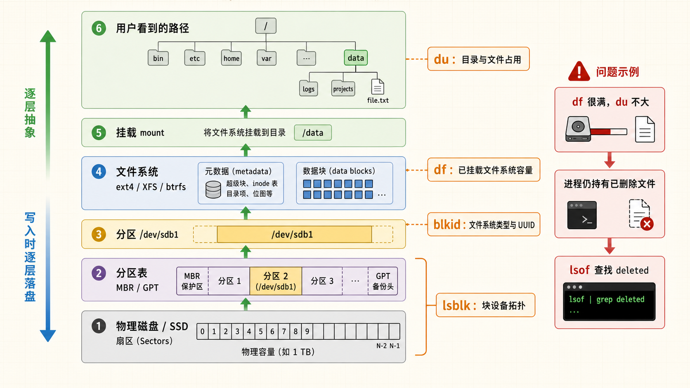
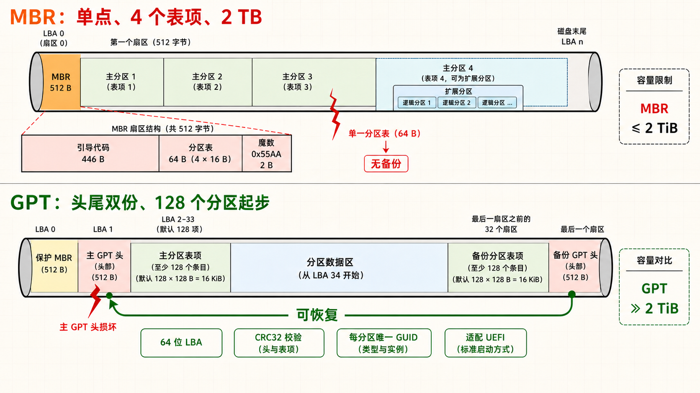
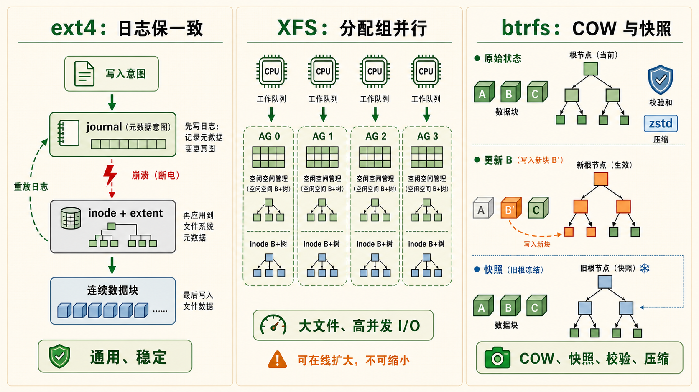
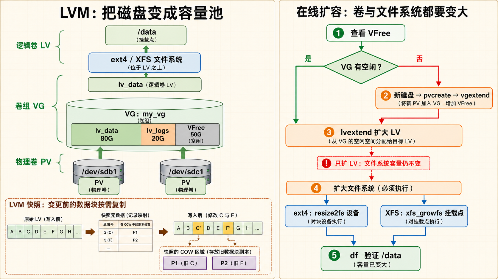
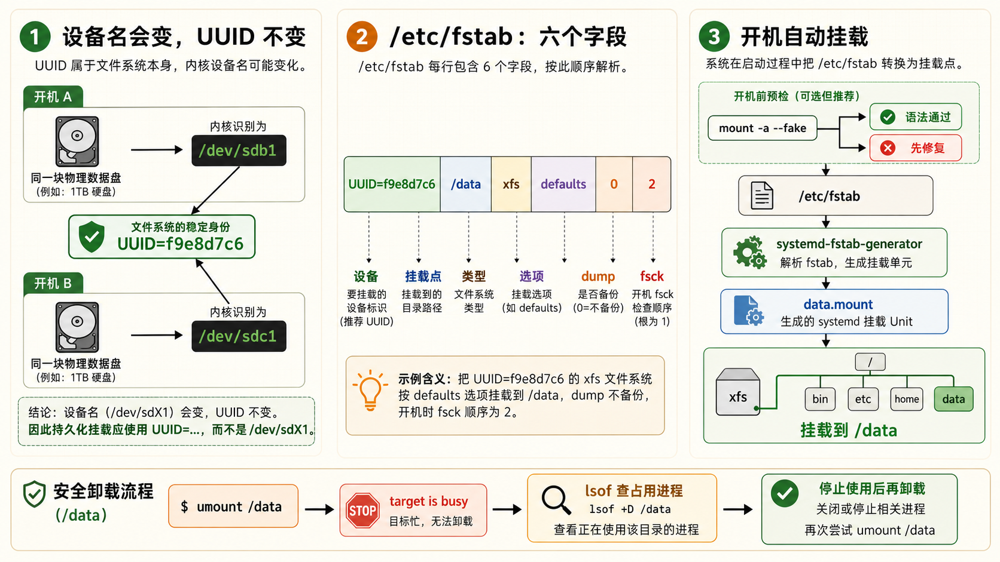

[← 返回 Linux 系统目录]({{ '/subjects/Linux/' | relative_url }})



# 磁盘与存储管理

## 1 分区与 MBR/GPT — 磁盘的第一层抽象 {#sec10-1}

### 分区表是磁盘的"目录"——没有它，操作系统不知道数据在哪里 · 必知 {#分区表是磁盘的目录没有它操作系统不知道数据在哪里-必知}

#### 问题驱动：为什么需要分区？



一块物理磁盘在操作系统眼中就是一长串连续的扇区（每个扇区通常 512 字节或 4K）。如果直接把整个盘当作一个文件系统，管理和故障隔离将极其困难——根目录和用户数据的磁盘空间会互相挤压，一个区域损坏可能导致全部数据丢失。<strong>分区就是把一整块物理磁盘切分成若干独立的逻辑区域，每个区域可以有不同的文件系统、不同的用途、甚至可以安装不同的操作系统。</strong>

#### MBR — 老旧但经典的守护者 {#mbr-老旧但经典的守护者}

MBR（Master Boot Record，主引导记录）是 1983 年随 IBM PC DOS 2.0 诞生的分区方案。它把磁盘的第一个扇区（512 字节）分为三段：前 446 字节存放引导代码，接着 64 字节存放<strong>4 个主分区表项</strong>（每个 16 字节），最后 2 字节是魔数 `0x55AA`。因为 4 个主分区的硬限制，<strong>扩展分区</strong> 应运而生——把其中一个主分区改为扩展分区，然后在扩展分区内再划出若干逻辑分区。

<strong>MBR 的致命限制</strong><br>
最大磁盘容量 2TB（32 位扇区地址 × 512 字节 = 2^32 × 512 = 2TB）。如果你给 MBR 磁盘插入一块 4TB 的盘，超出 2TB 的部分完全不可见——操作系统只能使用前 2TB。这就是分区表从 MBR 演进到 GPT 的根本驱动力。

#### GPT — 现代标准 {#gpt-现代标准}

GPT（GUID Partition Table）是 UEFI 规范的一部分，彻底消除了 MBR 的各项限制：

- <strong>容量上限显著提高</strong>：GPT 使用 64 位逻辑块地址；理论范围取决于逻辑扇区大小，实际还受操作系统和存储设备限制
- <strong>128 个分区</strong>：Windows 默认支持 128 个分区，Linux 可扩展更多
- <strong>冗余备份</strong>：GPT 在磁盘头部和尾部各保存一份完整的分区表，头部损坏可从尾部恢复
- <strong>CRC32 校验</strong>：分区表自带校验和，能检测到分区表是否被意外篡改
- <strong>每个分区有唯一 GUID</strong>：即使把磁盘插到另一台机器，分区的 GUID 不变
- <strong>UEFI 常与 GPT 配合</strong>：典型安装从 GPT 上的 EFI 系统分区启动，但 UEFI 固件也可能支持其他分区布局；是否可启动应以固件与安装方式为准

| 对比维度     | MBR                     | GPT                 |
|--------------|-------------------------|---------------------|
| 诞生年份     | 1983                    | 2010（UEFI 2.0）    |
| 最大磁盘容量 | 2TB                     | 9.4ZB（无实际限制） |
| 分区数量     | 4 主分区 / 3主+若干逻辑 | 最少 128            |
| 分区表冗余   | 无（头部损坏=全丢）     | 头尾双份备份        |
| 引导方式     | BIOS Legacy             | UEFI 原生           |
| 分区标识     | 1 字节类型码            | 128 位 GUID         |
| 校验机制     | 无                      | CRC32 校验和        |
| 适用场景     | 老旧系统 / 兼容性       | 新系统 / 大容量磁盘 |

#### lsblk — 一眼看清磁盘拓扑 {#lsblk-一眼看清磁盘拓扑}

`lsblk` 用树状结构列出系统中所有块设备（block device）——磁盘、分区、RAID 阵列、LVM 逻辑卷——以及它们之间的从属关系。它直接从 `/sys/devices/block` 读取内核数据，不需要 root 权限。

```bash
# 基本用法：列出所有块设备
lsblk

# 输出示例：
# NAME   MAJ:MIN RM  SIZE RO TYPE MOUNTPOINTS
# sda      8:0    0  500G  0 disk
# ├─sda1   8:1    0  512M  0 part /boot/efi
# ├─sda2   8:2    0   50G  0 part /
# └─sda3   8:3    0  449G  0 part /home
# sdb      8:16   0    2T  0 disk
# └─sdb1   8:17   0    2T  0 part /data

# 显示文件系统类型和 UUID
lsblk -f

# 显示设备信息（只读、可移动、所有者等）
lsblk -o NAME,SIZE,TYPE,MOUNTPOINT,FSTYPE,UUID,MODEL
```



▶ lsblk -f 输出解读

```plaintext
NAME   FSTYPE FSVER LABEL  UUID                                 FSAVAIL FSUSE% MOUNTPOINTS
sda
├─sda1 vfat   FAT32        1234-5678                              400M    22%   /boot/efi
├─sda2 ext4   1.0           a1b2c3d4-...                          15G     68%   /
└─sda3 xfs                  e5f6g7h8-...                         200G     55%   /home
```

#### fdisk — MBR 磁盘分区 {#fdisk-mbr-磁盘分区}

`fdisk` 是传统分区工具，对 MBR 磁盘最自然。进入交互模式后，按 `m` 查看所有子命令，`n` 新建分区，`p` 打印分区表，`w` 写入分区表到磁盘并退出。注意：<strong>只有按下 w 之后，分区变更才真正写入磁盘。</strong>

```bash
# 进入 fdisk 交互模式
sudo fdisk /dev/sdb

# 常见的交互流程（注释，不输入）：
# 键入 n → 新建分区
# 选择 p(主分区) 或 e(扩展分区)
# 输入分区编号（1-4）
# 输入起始扇区（通常按回车使用默认值）
# 输入结束扇区或大小（如 +50G 表示 50GB）
# 键入 t → 可修改分区类型代码
# 键入 p → 打印当前分区表（确认无误）
# 键入 w → 写入分区表并退出

# 非交互式：查看所有磁盘的分区表
sudo fdisk -l

# 只查看某块磁盘
sudo fdisk -l /dev/sda
```

#### parted — GPT 磁盘分区首选 {#parted-gpt-磁盘分区首选}

`parted` 支持 MBR 和 GPT，<strong>对 GPT 最为友好</strong>。它可以在命令行一行搞定分区（不需要交互模式），非常适合在脚本中使用。

```bash
# 将磁盘初始化为 GPT 分区表
sudo parted /dev/sdb mklabel gpt

# 创建分区：类型 → 文件系统 → 起始 → 结束
sudo parted /dev/sdb mkpart primary ext4 0% 100%
# 把整个盘建成一个 ext4 分区

# 创建指定大小的分区
sudo parted /dev/sdb mkpart primary xfs 1MiB 100GiB
sudo parted /dev/sdb mkpart primary xfs 100GiB 100%
# 分两个区：前 100G 给 sdb1，剩余给 sdb2

# 打印分区表
sudo parted /dev/sdb print
```

#### df — 已挂载文件系统的容量概览 {#df-已挂载文件系统的容量概览}

`df` 查看的是已挂载文件系统的空间使用情况——不是看磁盘有多少空闲扇区，而是看<strong>文件系统层面</strong>有多少可用空间。它能回答"根分区还剩多少空间"这种最直接的问题。

```bash
# 人类可读格式
df -h

# 输出示例：
# Filesystem      Size  Used Avail Use% Mounted on
# /dev/sda2        50G   34G   16G  68% /
# /dev/sda1       512M  112M  400M  22% /boot/efi
# /dev/sdb1       2.0T  800G  1.2T  40% /data

# 只看本地磁盘（排除 tmpfs、devtmpfs 等伪文件系统）
df -h -x tmpfs -x devtmpfs -x squashfs

# 显示文件系统类型
df -hT
# 输出中会多一列 "Type"（ext4, xfs, vfat 等）
```

#### du — 排查磁盘空间"黑洞" {#du-排查磁盘空间黑洞}

你是否遇到过这种情况：`df -h` 显示磁盘快满了，但你不知道是什么文件占用了空间。这时候 `du` 就是你的侦探工具。它从指定目录开始递归统计每个子目录的实际磁盘占用。

```bash
# 查看当前目录总大小
du -sh .

# 查看根目录下各一级子目录的大小（排查磁盘满的根源）
sudo du -h --max-depth=1 / 2>/dev/null | sort -rh | head -20
# 管道解释：
# --max-depth=1 → 只统计根目录的直接子目录
# 2>/dev/null  → 忽略无权限目录的错误输出
# sort -rh     → 按大小从大到小排序
# head -20     → 取前 20 名

# 按磁盘占用排序，找出最大的 10 个文件
find /var -type f -exec du -h {} + 2>/dev/null | sort -rh | head -10

# 标准工具 ncdu：命令行交互式磁盘分析
# ncdu /    （相当于交互式的 du，用键盘箭头导航）
```

df vs du 不同步 一个常见困惑：df 显示磁盘已满但 du 统计远没有那么多。原因通常是某个进程还在持有已删除文件的句柄——文件在目录中看不到了但磁盘空间未释放。用 `lsof | grep deleted` 找到这个进程。

## 2 文件系统 ext4 / XFS / btrfs — 数据如何落盘 {#sec10-2}

### 文件系统决定了数据在磁盘上的物理布局和可靠性保障机制 · 核心 {#文件系统决定了数据在磁盘上的物理布局和可靠性保障机制-核心}

#### 文件系统 = 组织规则 + 元数据 + 数据块 {#文件系统-组织规则-元数据-数据块}

分区只是在地图上画了边界，文件系统才是真正决定了"数据怎么存放、怎么检索、怎么保护"的那一层。你可以把分区想象成一块地皮，文件系统则是这块地上盖的房子——ext4 是砖混结构、XFS 是钢结构、btrfs 是带智能中控系统的现代化建筑。

#### ext4 — 稳定可靠的默认选择 {#ext4-稳定可靠的默认选择}

ext4（Fourth Extended Filesystem）是 Linux 世界最广泛使用的文件系统，是 ext3 的直接升级。它的核心特性：

- <strong>日志（Journaling）</strong>：在对元数据进行实际修改之前，先把修改意图写入日志区域。如果系统崩溃，重启后可以重放日志（replay journal）恢复一致性，避免文件系统损坏
- <strong>Extent（区段）</strong>：取代了 ext3 的间接块映射方式，用"起始块 + 连续块数量"描述一个文件的数据区域——对大文件性能更好，碎片更少
- <strong>延迟分配（Delayed Allocation）</strong>：写文件时先缓存在内存中，等积累了足够数据后再一次性分配磁盘块——减少碎片，提高连续写入性能
- <strong>最大文件系统 1EB（Exabyte）</strong>，单文件最大 16TB
- <strong>子目录可无限扩展</strong>：消除了 ext3 的 32000 个子目录限制

#### XFS — 大文件高并发的引擎 {#xfs-大文件高并发的引擎}

XFS 最初由 SGI 于 1994 年为 IRIX 操作系统开发，2001 年移植到 Linux。它是<strong>Red Hat Enterprise Linux 7+ 的默认文件系统</strong>。XFS 的设计从一开始就是针对大型服务器和大文件场景：

- <strong>分配组（Allocation Groups）</strong>：将文件系统划为多个分配组，以减少并发元数据操作的争用；实际吞吐仍受磁盘、队列和工作负载限制，不能保证线性扩展
- <strong>动态分配 inode</strong>：与格式化时确定 inode 数量的 ext4 不同，XFS 可随需求分配 inode，降低“空间尚有余量却耗尽预设 inode”的风险；仍可能因空间、配额或元数据限制而无法创建文件
- <strong>COW 文件系统快照</strong>：XFS 原生不支持快照，但配合 LVM 的快照功能可以做到
- <strong>支持超大文件系统</strong>：最大 8EB 文件系统，单文件最大 8EB
- <strong>预分配和延迟分配</strong>：减少碎片，提升顺序写入吞吐

<strong>ext4 vs XFS 选择策略</strong><br>
通用服务器、桌面系统 → ext4（稳定性、广泛兼容）。数据库服务器、大文件存储、高并发 IO → XFS（分配组并行、动态 inode）。XFS 的一个注意事项： <strong>XFS 文件系统创建后不能缩小</strong>（可以扩大用 xfs_growfs，但无法缩小），规划时需谨慎。

#### btrfs — 下一代文件系统 {#btrfs-下一代文件系统}

btrfs（B-tree Filesystem，读音"Butter FS"或"Better FS"）是 Oracle 于 2007 年启动的写时复制（COW）文件系统，目标是成为 Linux 的下一代默认文件系统。它把传统文件系统和卷管理器（LVM）的功能合二为一：

- <strong>写时复制（Copy-on-Write）</strong>：修改数据时，原数据不覆盖，新数据写到新位置，最后更新指针。这天然支持快照——快照就是冻结某个时刻的元数据指针，几乎不占额外空间
- <strong>快照与子卷（Subvolume）</strong>：子卷是可以独立快照、独立挂载的命名空间。可以像给目录拍快照一样轻量
- <strong>内置校验和</strong>：每个数据块和元数据块都有校验和，读取时自动校验——可以检测到静默数据损坏（silent corruption）
- <strong>内建压缩</strong>：支持 mount -o compress=zstd 实时压缩，对日志、文本等可压缩数据效果显著
- <strong>RAID 支持</strong>：btrfs 内置 RAID0（条带）、RAID1（镜像）、RAID10、RAID5/6 支持（RAID5/6 在某些内核版本中不推荐用于生产）
- <strong>自愈能力</strong>：在 RAID1 配置中，如果其中一个副本校验失败，btrfs 自动从另一份副本修复

```bash
# === 创建 btrfs 文件系统 ===
sudo mkfs.btrfs /dev/sdb1

# === 创建子卷 ===
sudo mount /dev/sdb1 /mnt
sudo btrfs subvolume create /mnt/@root
sudo btrfs subvolume create /mnt/@home
sudo btrfs subvolume create /mnt/@snapshots

# === 创建快照（原子操作，瞬间完成） ===
sudo btrfs subvolume snapshot /mnt/@root /mnt/@snapshots/root_$(date +%Y%m%d)

# === 查看子卷 ===
sudo btrfs subvolume list /mnt
```

#### ZFS — 企业级数据完整性引擎 {#zfs-企业级数据完整性引擎}

ZFS 由 Sun Microsystems 为 Solaris 开发（2005 年开源），是<strong>文件系统 + 卷管理器 + RAID 控制器</strong>三位一体的完整存储方案。由于许可证与 Linux 内核（GPL）不兼容，Linux 主要通过 OpenZFS（内核模块）方式使用：

- <strong>端到端校验和</strong>：所有数据、元数据、甚至校验和的校验和都有校验。任何层次的数据损坏都能检测并修复（在冗余配置下）
- <strong>快照与克隆</strong>：btrfs 快照的精神先驱。支持增量发送（zfs send），可高效远程备份
- <strong>内建压缩和去重</strong>：支持 lz4、zstd、gzip 等压缩算法，以及块级去重
- <strong>ZIL（ZFS Intent Log）和 ARC（自适应替换缓存）</strong>：用 RAM 做读写缓存，性能卓越
- <strong>RAID-Z</strong>：ZFS 独有的 RAID 方案（RAID-Z1 / Z2 / Z3），解决传统 RAID5 的"写洞"问题

```bash
# === ZFS 存储池 ===
# 创建镜像池
sudo zpool create -o ashift=12 mypool mirror /dev/sdb /dev/sdc

# 创建数据集
sudo zfs create mypool/data
sudo zfs create mypool/data/mysql

# 创建快照
sudo zfs snapshot mypool/data/mysql@before_upgrade

# 开启压缩
sudo zfs set compression=lz4 mypool/data

# 查看状态
sudo zpool status
sudo zfs list
```

#### mkfs — 格式化分区 {#mkfs-格式化分区}

分区划定后还不能直接存文件——必须先创建文件系统（格式化）。`mkfs` 是创建文件系统的统一入口。

```bash
# 格式化为 ext4
sudo mkfs.ext4 /dev/sdb1
# 等效于：sudo mkfs -t ext4 /dev/sdb1

# 格式化为 XFS
sudo mkfs.xfs /dev/sdb1
# 等效于：sudo mkfs -t xfs /dev/sdb1

# ext4 格式化时加标签
sudo mkfs.ext4 -L "DATA_DISK" /dev/sdb1

# XFS 格式化时指定扇区大小（通常让 mkfs 自动检测）
sudo mkfs.xfs -f /dev/sdb1   # -f 强制执行（分区上有旧文件系统）
```

<strong>格式化前再三确认</strong><br>
`mkfs` 执行后该分区上的所有数据将不可恢复（除非使用专业数据恢复工具）。执行前务必用 `lsblk` 确认设备名，用 `df -h` 确认没有挂载重要数据，记住 <strong>给 mkfs 加错设备名是运维中最不可逆的误操作之一</strong>。





## 3 挂载与 fstab — 将文件系统接入目录树 {#sec10-3}

### 挂载就是把磁盘分区"嫁接"到已有目录树上——让文件系统对用户可见 · 实操 {#挂载就是把磁盘分区嫁接到已有目录树上让文件系统对用户可见-实操}

#### mount — 临时挂载 {#mount-临时挂载}

Linux 的目录结构是单一根（/）的树。所有存储设备——硬盘、SSD、U 盘、网络存储——都必须挂载到这棵树的某个目录下才能被访问。`mount` 命令把这个"嫁接"操作执行一次，重启后失效。

```bash
# 基本挂载：设备 → 挂载点
sudo mount /dev/sdb1 /mnt/data

# 挂载前先创建挂载点目录
sudo mkdir -p /mnt/data

# 指定文件系统类型
sudo mount -t ext4 /dev/sdb1 /mnt/data

# 只读挂载（生产环境中推荐用于检查损坏的分区）
sudo mount -o ro /dev/sdb1 /mnt/recovery

# 性能相关选项
sudo mount -o noatime,nodiratime /dev/sdb1 /mnt/data
# noatime    → 读取文件时不更新访问时间（减少磁盘写操作）
# nodiratime → 读取目录时不更新访问时间

# 禁止执行程序
sudo mount -o noexec,nosuid /dev/sdb1 /mnt/secure

# 显示所有已挂载的文件系统
mount | grep "^/dev"

# 查看某个挂载点的信息
findmnt /boot
```

#### umount — 安全卸载 {#umount-安全卸载}

卸载操作把文件系统从目录树上"摘下来"。必须先 umount 才能拔出磁盘、修改分区表或重新格式化——否则文件系统元数据可能不一致，造成损坏。

```bash
# 通过挂载点卸载
sudo umount /mnt/data

# 通过设备名卸载
sudo umount /dev/sdb1

# 如果提示 "target is busy" —— 说明有进程在使用
# 先用这个命令查找是谁在占用
sudo lsof /mnt/data

# 强制卸载（lazy unmount，立即断开，后台完成）
sudo umount -l /mnt/data

# 强制卸载（force unmount，在 NFS 等场景可能有用）
sudo umount -f /mnt/data
```

#### UUID — 磁盘的"身份证号" {#uuid-磁盘的身份证号}

设备名 `/dev/sda`、`/dev/sdb` 会随设备发现顺序改变。文件系统 UUID 通常在格式化时生成，适合在 `fstab` 中稳定定位文件系统；但重新格式化、显式修改 UUID 或克隆磁盘后，它可能变化或重复。修改存储布局后请用 `lsblk -f` 重新确认。

```bash
# 查看所有块设备的 UUID
sudo blkid

# 输出示例：
# /dev/sda1: UUID="1234-5678" TYPE="vfat"
# /dev/sda2: UUID="a1b2c3d4-e5f6-7890-abcd-ef1234567890" TYPE="ext4"
# /dev/sdb1: UUID="f9e8d7c6-b5a4-3210-fedc-ba0987654321" TYPE="xfs"

# 只查看某个设备
sudo blkid /dev/sdb1

# 用 UUID 挂载（替代 /dev/sdb1）
sudo mount UUID="f9e8d7c6-b5a4-3210-fedc-ba0987654321" /mnt/data
```

#### /etc/fstab — 系统启动时自动挂载 {#etcfstab-系统启动时自动挂载}

`/etc/fstab`（File System Table）是永久挂载配置文件。系统启动时，`systemd-fstab-generator` 服务会读取此文件并自动挂载所有未标记为 `noauto` 的条目。fstab 的每一行由六个字段组成，空格或 Tab 分隔：

```bash
# /etc/fstab 文件格式：
# <设备/UUID>  <挂载点>  <文件系统类型>  <选项>        <dump>  <fsck顺序>
UUID=a1b2c3d4...  /          ext4    defaults      0      1
UUID=1234-5678    /boot/efi  vfat    umask=0077    0      1
UUID=f9e8d7c6...  /data      xfs     defaults      0      2
/dev/sr0          /mnt/cdrom iso9660 ro,noauto     0      0
//192.168.1.100/share /mnt/nas cifs credentials=/etc/smb.cred,uid=1000 0 0
```

| 字段  | 含义          | 示例                                            |
|-------|---------------|-------------------------------------------------|
| 第1栏 | 设备或 UUID   | `UUID=xxx` 或 `/dev/sdb1`                       |
| 第2栏 | 挂载点        | `/data`                                         |
| 第3栏 | 文件系统类型  | `ext4` / `xfs` / `vfat` / `ntfs`                |
| 第4栏 | 挂载选项      | `defaults` = rw,suid,dev,exec,auto,nouser,async |
| 第5栏 | dump 备份     | 0=不备份, 1=备份（一般设为0）                   |
| 第6栏 | fsck 检查顺序 | 0=不检查, 1=根分区, 2=其他                      |

```bash
# 测试 fstab 是否有语法错误（不实际挂载）
sudo mount -a --fake

# 立即执行 fstab 中的所有挂载（跳过已挂载的）
sudo mount -a

# 只重新挂载某个条目
sudo mount -o remount /
```

<strong>fstab 中的 defaults 包含哪些选项？</strong><br>
`defaults` = rw（读写）, suid（允许 SUID）, dev（解释设备文件）, exec（允许执行二进制）, auto（启动时自动挂载）, nouser（仅 root 可挂载）, async（异步写入——先回内存再异步落盘）。如果要添加额外选项而保留 defaults，写法为 `defaults,noatime,nodiratime`。



## 4 LVM 弹性扩展 — 存储即水池 {#sec10-4}

### 传统分区不可动态调整，LVM 把物理存储抽象成可按需伸缩的逻辑卷 · 实操 {#传统分区不可动态调整lvm-把物理存储抽象成可按需伸缩的逻辑卷-实操}

#### LVM 的三层架构

LVM（Logical Volume Manager）在物理磁盘和文件系统之间建立一个灵活的抽象层。它的架构自上而下分为三层：

- <strong>LV（Logical Volume，逻辑卷）</strong>——你创建文件系统和挂载使用的实际设备。就像一个"虚拟分区"，路径是 `/dev/vg_name/lv_name`。LV 可以从 VG 池中动态扩展（甚至在线扩展，无需卸载）
- <strong>VG（Volume Group，卷组）</strong>——一个存储池，由一个或多个 PV 组合而成。VG 是容量"蓄水池"的抽象——向其添加 PV 即可增加总容量，从池中划出 LV 即可分配给具体用途
- <strong>PV（Physical Volume，物理卷）</strong>——物理磁盘或分区经过 `pvcreate` 初始化后，成为 LVM 可识别的存储单元。一个 PV 上保存着 LVM 元数据（描述 VG 中包含哪些 PV、LV 在 VG 中的分布等）

```bash
# === 完整创建流程 ===

# 1. 准备物理磁盘，创建 LVM 分区（类型代码 8e00）
sudo parted /dev/sdb mklabel gpt
sudo parted /dev/sdb mkpart primary 0% 100%
sudo parted /dev/sdb set 1 lvm on   # 标记为 LVM 分区

# 2. 创建物理卷（PV）
sudo pvcreate /dev/sdb1

# 查看 PV
sudo pvdisplay
sudo pvs   # 简洁版

# 3. 创建卷组（VG）
sudo vgcreate my_vg /dev/sdb1
# 可以一次加入多个 PV
sudo vgcreate my_vg /dev/sdb1 /dev/sdc1

# 查看 VG
sudo vgdisplay
sudo vgs

# 4. 创建逻辑卷（LV）
# 固定大小
sudo lvcreate -L 50G -n my_lv my_vg

# 使用卷组百分比
sudo lvcreate -l 50%FREE -n my_lv my_vg

# 5. 在 LV 上创建文件系统
sudo mkfs.ext4 /dev/my_vg/my_lv
# 或
sudo mkfs.xfs /dev/my_vg/my_lv

# 6. 挂载
sudo mkdir -p /data
sudo mount /dev/my_vg/my_lv /data

# 7. 写入 fstab 以实现开机自动挂载
echo "UUID=$(sudo blkid -s UUID -o value /dev/my_vg/my_lv) /data ext4 defaults 0 2" | sudo tee -a /etc/fstab
```

#### 在线扩容（不停机）

这是 LVM 相比传统分区的核心优势：你不需要卸载文件系统、停掉应用、迁移数据——只需要扩 LV 然后扩文件系统即可，服务全程在线。

```bash
# === 场景：/data 分区空间不足，需要扩容 ===

# 查看当前 VG 是否有剩余空间
sudo vgs
# 输出示例：
# VG     #PV #LV #SN Attr   VSize   VFree
# my_vg    2   1   0 wz--n- 200.00g 50.00g

# VG 还有 50G 空闲空间，直接扩展 LV
sudo lvextend -L +30G /dev/my_vg/my_lv
# 或扩展到 LV 的某个绝对大小
sudo lvextend -L 80G /dev/my_vg/my_lv

# ext4 文件系统需要在线 resize（XFS 用 xfs_growfs）
sudo resize2fs /dev/my_vg/my_lv

# XFS 文件系统的在线扩容
sudo xfs_growfs /data

# 验证
df -h /data
```

```bash
# === 如果 VG 没有空闲空间了 ===
# 1. 添加一块新磁盘，创建 PV
sudo pvcreate /dev/sdc1

# 2. 将新 PV 加入已有 VG（扩展容量池）
sudo vgextend my_vg /dev/sdc1

# 3. 现在 VG 有空间了，可以继续 lvextend
sudo lvextend -L +50G /dev/my_vg/my_lv
sudo resize2fs /dev/my_vg/my_lv
```

#### LVM 快照

LVM 快照保留某个时间点的块设备视图，可让后续文件备份基于稳定的卷状态；但它只保证块级时间点，不自动保证运行中数据库的事务一致性。数据库备份应先按数据库文档完成备份锁、检查点或专用备份流程，再创建快照；同时监控快照空间，避免写入增多导致快照失效。快照也不能替代独立副本与恢复演练。

```bash
# 创建快照（大小需要可容纳快照期间的变更量）
sudo lvcreate -L 5G -s -n my_lv_snap_20260730 /dev/my_vg/my_lv

# 挂载快照进行备份
sudo mount -o ro /dev/my_vg/my_lv_snap_20260730 /mnt/snap

# 备份完成后卸载并删除快照
sudo umount /mnt/snap
sudo lvremove /dev/my_vg/my_lv_snap_20260730
```

#### 常用 LVM 管理命令速查

| 操作 | 命令 |
|----|----|
| 创建 PV | `sudo pvcreate /dev/sdb1` |
| 查看 PV | `sudo pvs` / `sudo pvdisplay` |
| 创建 VG | `sudo vgcreate vg_name /dev/sdb1` |
| 扩展 VG | `sudo vgextend vg_name /dev/sdc1` |
| 查看 VG | `sudo vgs` / `sudo vgdisplay` |
| 创建 LV | `sudo lvcreate -L 10G -n lv_name vg_name` |
| 扩展 LV | `sudo lvextend -L +5G /dev/vg_name/lv_name` |
| 扩展 ext4 | `sudo resize2fs /dev/vg_name/lv_name` |
| 扩展 XFS | `sudo xfs_growfs /mountpoint` |
| 重命名 LV | `sudo lvrename vg_name old_name new_name` |
| 删除 LV | `sudo lvremove /dev/vg_name/lv_name` |
| 缩小 ext4 LV | `sudo resize2fs /dev/vg_name/lv_name 5G` → `sudo lvreduce -L 5G /dev/vg_name/lv_name` |

## 5 磁盘性能测试与健康检查 {#sec10-5}

### 磁盘是系统最慢的组件——先知道它有多快，才知道瓶颈在哪里 · 常用 {#磁盘是系统最慢的组件先知道它有多快才知道瓶颈在哪里-常用}

#### dd — 顺序读写基准测试 {#dd-顺序读写基准测试}

`dd` 是最原始也最直接的磁盘性能测试工具。它按指定的块大小和计数，连续读写数据块，最后汇报吞吐量。

```bash
# 测试顺序写入速度（写入 1GB 数据）
dd if=/dev/zero of=./testfile bs=1M count=1024 oflag=direct conv=fdatasync
# 参数说明：
# bs=1M          → 每次读写 1MB
# count=1024     → 执行 1024 次 = 总共 1GB
# oflag=direct   → 绕过页缓存，测真实磁盘写入速度
# conv=fdatasync → 写入完成后同步文件数据到磁盘

# 输出：
# 1073741824 bytes (1.1 GB) copied, 2.3584 s, 455 MB/s

# 测试顺序读取速度
dd if=./testfile of=/dev/null bs=1M count=1024
# 执行前先清除缓存，确保测的是磁盘真实速度：
sudo sh -c "echo 3 > /proc/sys/vm/drop_caches"

# 清理测试文件
rm -f ./testfile
```

#### iostat — 实时磁盘 IO 监控 {#iostat-实时磁盘-io-监控}

`iostat`（包含在 `sysstat` 包中）是运维排查磁盘性能问题的主力工具。它不仅显示吞吐量（KB/s），还显示 IO 等待时间——而等待时间往往是真正决定用户体验的指标。

```bash
# 安装
sudo apt install sysstat   # Debian/Ubuntu
sudo yum install sysstat   # RHEL/CentOS

# 每秒刷新一次，显示详细 IO 统计
iostat -x 1

# 只显示磁盘设备（排除 CPU 信息）
iostat -d -x 1
```

▶ iostat -x 关键指标解读

```bash
Device   r/s    w/s     rkB/s   wkB/s   await  %util
sda      120.0  45.0   5000    2000    3.2    25.0
sdb      5.0    80.0   100     15000   15.0   6.8

# r/s, w/s       → 每秒读写请求数（IOPS）
# rkB/s, wkB/s   → 每秒读写吞吐量（KB）
# await          → 平均每个 IO 请求的等待时间（ms）
#                  await 高说明有 IO 排队等待
# %util          → 磁盘繁忙时间百分比
#                  对传统串行设备有参考价值；并行设备不能仅凭它判瓶颈
```

<strong>不要套用单一阈值：</strong>新版 sysstat 已不再提供不可靠的 `svctm`。 `await` 包含排队与服务时间，但合理值取决于设备、负载和请求类型； `%util` 对并行 NVMe 也不能直接解释为“100% 才饱和”。应结合延迟分布、吞吐、队列深度和业务基线判断。

#### hdparm — 磁盘读取性能 {#hdparm-磁盘读取性能}

```bash
# 测试缓冲读取（从内核缓存读，测试 CPU-内存-总线速度）
sudo hdparm -T /dev/sda

# 测试原始磁盘读取（绕过缓存，测试磁盘本身速度）
sudo hdparm -t /dev/sda

# 同时测试两者
sudo hdparm -Tt /dev/sda

# 写入测试（危险！会覆盖数据——只在空盘或测试盘上使用）
sudo hdparm -t --direct /dev/sda
```

#### fsck — 文件系统一致性检查与修复 {#fsck-文件系统一致性检查与修复}

文件系统在非正常关机（断电、内核崩溃）后可能出现不一致——有些数据块标记为已分配却未被任何文件引用，有些文件引用的数据块被标记为空闲。`fsck` 检查这些不一致并尝试修复。检查前<strong>务必 umount 该文件系统</strong>（除非以只读模式挂载），否则修复操作与正在写入的进程冲突会雪上加霜。

```bash
# 检查文件系统（仅检查，不修复）
sudo umount /dev/sdb1
sudo fsck /dev/sdb1

# ext4 专用命令：e2fsck
sudo e2fsck -f /dev/sdb1
# -f → 强制检查
# -p → 自动修复（不需要交互确认）
# -y → 对所有问题回答 "yes"

# XFS 专用命令：xfs_repair
sudo xfs_repair /dev/sdb1

# 查看 ext4 文件系统超级块信息
sudo dumpe2fs /dev/sdb1 | head -30

# 检查磁盘的健康状态（SMART 信息）
sudo smartctl -a /dev/sda
# 需要安装 smartmontools 包
```

## 注解

<strong>IO</strong> · Input/Output 输入／输出



<nav class="article-end" aria-label="章节导航">
  <a href="{{ '/subjects/Linux/09-%E6%96%87%E6%9C%AC%E5%A4%84%E7%90%86%E4%B8%89%E5%89%91%E5%AE%A2.html' | relative_url }}">← 上一章：文本处理三剑客</a>
  <a href="{{ '/subjects/Linux/' | relative_url }}">返回 Linux 系统目录</a>
  <a href="{{ '/subjects/Linux/11-%E5%86%85%E6%A0%B8%E6%A8%A1%E5%9D%97%E4%B8%8E%E7%BC%96%E8%AF%91.html' | relative_url }}">下一章：内核模块与编译 →</a>
</nav>
