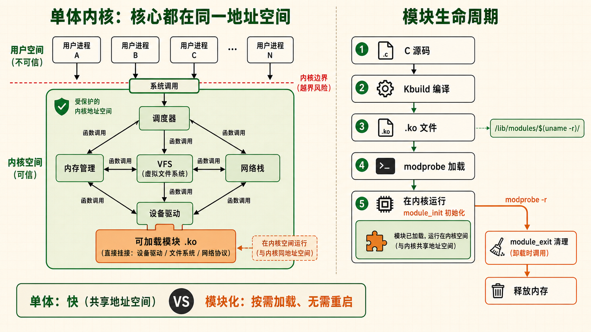
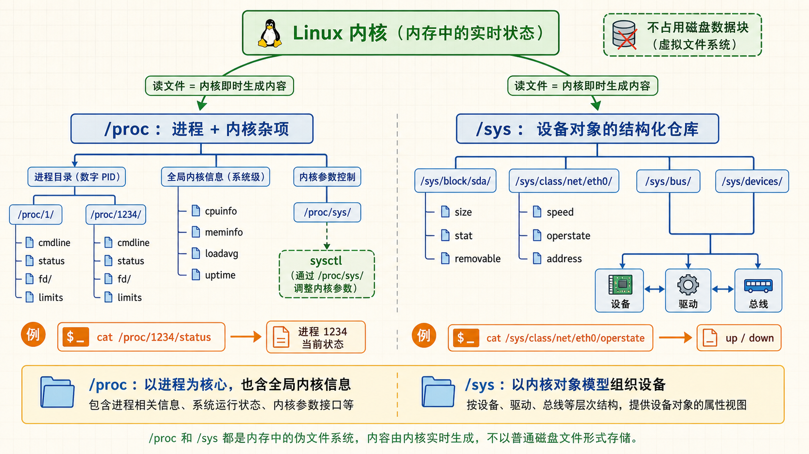
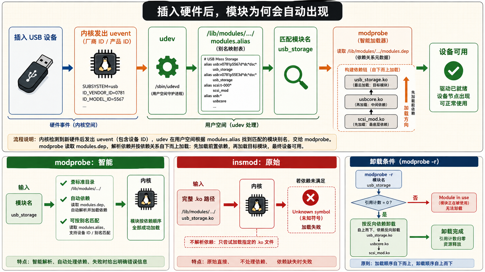
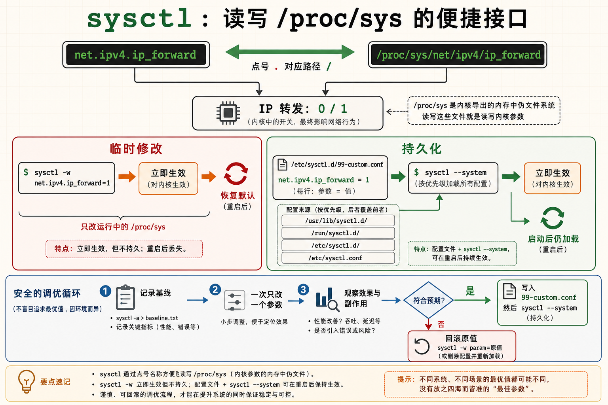

[← 返回 Linux 系统目录]({{ '/subjects/Linux/' | relative_url }})



# 内核模块与编译

## 1 内核与模块关系 — 单体但模块化的巨型程序 {#sec11-1}

### Linux 内核是单体架构——所有核心功能在同一个地址空间运行，但通过模块机制实现了灵活性 · 必知 {#linux-内核是单体架构所有核心功能在同一个地址空间运行但通过模块机制实现了灵活性-必知}

#### 问题驱动：内核为什么需要模块？

如果你要把所有能想象到的硬件驱动——每一款网卡、每一款显卡、每一种文件系统、每一种网络协议——都编译进内核镜像，那么内核文件将膨胀到几百 MB。每次添加一个新硬件就要重新编译、重新安装、重新启动整个内核，这在实际运维中完全不可接受。<strong>内核模块（Kernel Module，.ko 文件）就是解决这个问题的机制——它们是可以在内核运行时动态加载和卸载的目标代码，不需要重启系统。</strong>

Linux 内核的设计哲学是：<strong>单体内核（Monolithic Kernel），但模块化</strong>。与微内核（Microkernel，如 MINIX、QNX）不同，Linux 的所有核心子系统——进程调度、内存管理、VFS、网络栈——都在同一个内核地址空间中运行，共享内存空间，通过函数调用（而非 IPC 消息传递）通信，因此性能更高。但通过内核模块，它获得了微内核才有的动态扩展能力。

#### 模块的生命周期：从源码到运行

内核模块的完整生命周期分五步：

1.  <strong>源码编写</strong>：C 语言编写，包含 `module_init()` 和 `module_exit()` 两个入口
2.  <strong>编译</strong>：使用内核的构建系统（Kbuild），输出 `.ko`（Kernel Object）文件
3.  <strong>加载</strong>：通过 `insmod` 或 `modprobe` 将 .ko 文件加载到内核地址空间。内核执行 module_init 函数进行初始化
4.  <strong>运行</strong>：模块注册的功能（设备驱动、文件系统类型、网络协议等）开始工作
5.  <strong>卸载</strong>：通过 `rmmod` 或 `modprobe -r` 移除模块。内核执行 module_exit 函数清理资源，模块占用的内存被释放

#### 模块存放位置

内核模块文件（`.ko`）存放在 `/lib/modules/$(uname -r)/` 目录下，按功能分类到子目录中：

```bash
# 查看当前内核版本的模块目录
ls /lib/modules/$(uname -r)/

# 输出示例：
# build/       → 指向内核源码/头文件目录的符号链接（编译模块时需要）
# kernel/      → 模块的主体目录，按子系统分类
#   ├── arch/  → 架构特定模块（CPU 微码、KVM 等）
#   ├── drivers/ → 设备驱动（最大的分类）
#   ├── fs/    → 文件系统模块（ext4, xfs, btrfs, nfs, cifs...）
#   ├── net/   → 网络协议栈模块（tcp, nf_conntrack...）
#   └── sound/ → 声卡驱动
# modules.alias → 模块别名（供 modprobe 按硬件 ID 自动匹配）
# modules.dep   → 模块依赖关系表
```

#### 内核源码位置

内核头文件（编译模块时需要）通常位于：

- Debian/Ubuntu：`/usr/src/linux-headers-$(uname -r)/`
- RHEL/CentOS：`/usr/src/kernels/$(uname -r)/`
- 手动编译的内核：`/usr/src/linux/`（源码树）和 `/lib/modules/$(uname -r)/build`（符号链接指向源码树）

```bash
# 查看当前内核版本
uname -r
# 输出示例：5.15.0-91-generic

# 查看模块目录树的大小
du -sh /lib/modules/$(uname -r)
# 输出示例：350M   /lib/modules/5.15.0-91-generic

# 统计模块数量
find /lib/modules/$(uname -r)/kernel -name "*.ko" | wc -l

# 查看内核头文件是否安装（编译模块必备）
ls /lib/modules/$(uname -r)/build/include/linux/version.h
```

<strong>模块的热插拔自动加载</strong><br>
当你插入一个 USB 设备时，udev（用户空间设备管理器）会收到内核发出的 uevent，然后根据设备厂商 ID 和产品 ID 查询 `/lib/modules/$(uname -r)/modules.alias` 找到对应的模块名，调用 `modprobe` 自动加载。这就是为什么你插入 U 盘不需要手动运行任何命令——一切由 udev + modprobe 自动化完成。





## 2 lsmod / modprobe — 模块管理的核心命令 {#sec11-2}

### 管理员日常与内核模块打交道就靠这几个命令——查、装、卸、查 · 实操 {#管理员日常与内核模块打交道就靠这几个命令查装卸查-实操}

#### lsmod — 当前加载了哪些模块？ {#lsmod-当前加载了哪些模块}

`lsmod` 输出当前内核中已加载的所有模块及其相互依赖关系。它的数据来源于 `/proc/modules`，用表格展示：模块名、内存占用大小、被哪些模块依赖。

```bash
# 列出所有已加载模块
lsmod

# 输出示例（三列）：
# Module                  Size  Used by
# nf_conntrack          176128  1 nf_nat
# nf_nat                 57344  1 iptable_nat
# nfsd                  589824  13
# ext4                  942080  2
# overlay               151552  1

# 解读：
# Size    → 该模块占用的内存大小（字节）
# Used by → 后面跟着"依赖此模块的其他模块名"
#           nf_conntrack 被 nf_nat 所依赖——必须先加载 nf_conntrack 才能加载 nf_nat
#           如果为 0 或一个数字（如 nfsd 的 13），表示没有其他模块依赖它，
#           但数字表示引用计数（有 13 个 NFS 连接在使用它）
```

```bash
# 搜索特定模块（配合 grep）
lsmod | grep -E "ext4|xfs|btrfs"

# 列出各模块的大小（按大小排序）
lsmod | sort -k2 -rn | head -20

# 查看模块信息的底层手段：直接读 /proc/modules
cat /proc/modules | head -5
```

#### modinfo — 模块的说明书 {#modinfo-模块的说明书}

`modinfo` 读取模块 `.ko` 文件内部嵌入的详细信息——版本、作者、描述、所支持的设备和参数。

```bash
# 查看 ext4 模块的详细信息
modinfo ext4

# 输出示例（节选）：
# filename:       /lib/modules/5.15.0-91-generic/kernel/fs/ext4/ext4.ko
# description:    Fourth Extended Filesystem
# author:         Remy Card, Stephen Tweedie, ...
# license:        GPL
# depends:        mbcache, jbd2           ← 依赖哪些模块（加载前必须先加载它们）
# parm:           num_frontend_wq:Number of front-end workqueues (uint)
# parm:           no_journal:Disable ext4 journaling - not recommended (bool)

# 查看模块版本和许可证
modinfo -F version ext4
modinfo -F license ext4

# 查看模块有哪些可配置参数
modinfo -F parm ext4
```

#### modprobe — 智能加载与卸载（推荐） {#modprobe-智能加载与卸载推荐}

`modprobe` 是加载/卸载内核模块的推荐工具，因为它会<strong>自动解析并加载依赖模块</strong>。它通过读取 `/lib/modules/$(uname -r)/modules.dep` 了解依赖关系。例如，你要加载 `vfat` 模块，modprobe 会自动先加载 `fat` 模块（vfat 依赖 fat）。

```bash
# 加载模块（自动处理依赖）
sudo modprobe vfat

# 验证是否加载成功
lsmod | grep vfat
# 输出应包含 vfat 和 fat 两个模块

# 卸载模块（自动处理依赖——前提是没有其他模块依赖它）
sudo modprobe -r vfat

# 加载模块并传入参数
sudo modprobe zram num_devices=4

# 查看模块依赖关系
modprobe --show-depends ext4
# 输出：
# insmod /lib/modules/.../kernel/fs/mbcache.ko
# insmod /lib/modules/.../kernel/fs/jbd2/jbd2.ko
# insmod /lib/modules/.../kernel/fs/ext4/ext4.ko
# 说明 ext4 依赖 mbcache 和 jbd2，加载顺序由 modprobe 保证
```

#### insmod / rmmod — 原始工具（不处理依赖） {#insmod-rmmod-原始工具不处理依赖}

`insmod` 直接加载一个 `.ko` 文件到内核——不检查依赖、不解析别名。`rmmod` 卸载模块。这两个命令更底层，通常在开发调试模块时使用。

```bash
# insmod 需要指定 .ko 文件的完整路径
sudo insmod /path/to/my_driver.ko

# 传入参数
sudo insmod /path/to/my_driver.ko debug=1

# rmmod 卸载模块
sudo rmmod my_driver

# 强制卸载（即使模块被其他模块引用——危险操作！）
sudo rmmod -f my_driver
```

#### 强制加载/屏蔽模块

`blacklist` 主要阻止模块按别名自动加载，不等于禁止所有显式加载。网卡、存储或显示驱动可能参与启动；更改之前应先确认实际加载链、准备可恢复的控制台，并保留旧 initramfs 或救援介质。下面的模块名仅作示意，不要原样在生产主机运行。

```bash
# === 场景：系统错误地加载了错误的网卡驱动，需要屏蔽它 ===

# 1. 创建黑名单文件
sudo tee /etc/modprobe.d/blacklist-custom.conf << 'EOF'
# 屏蔽 nouveau 驱动（NVIDIA 开源驱动，通常在安装 NVIDIA 官方驱动时需要）
blacklist nouveau
# 屏蔽某个有问题的模块
blacklist faulty_module
EOF

# 2. 更新 initramfs（以便启动时也不加载该模块）
sudo update-initramfs -u   # Debian/Ubuntu
sudo dracut -f             # RHEL/CentOS/Fedora

# 3. 重启后验证该模块未被加载
lsmod | grep nouveau   # 应该没有输出

# === 强制加载模块（即使模块不在黑名单中） ===
# 编辑 /etc/modules-load.d/custom.conf
sudo tee /etc/modules-load.d/custom.conf << 'EOF'
# 启动时强制加载这些模块
loop
vhost_net
EOF
```

modprobe vs insmod 一句话区别 `modprobe` 按模块名加载（如 ext4），自动解析依赖，从标准模块目录加载。 `insmod` 按文件路径加载（如 /path/to/mod.ko），不解析依赖，需要你自己确保所有依赖模块已加载。



## 3 sysctl 内核参数调优 — 不停机调整系统行为 {#sec11-3}

### 内核暴露了数百个可调参数，sysctl 让你在运行时调整内核行为——不需要重新编译 · 核心 {#内核暴露了数百个可调参数sysctl-让你在运行时调整内核行为不需要重新编译-核心}

#### sysctl 的工作原理

Linux 内核在运行时会暴露大量可配置参数——这些参数存储在 `/proc/sys/` 虚拟文件系统中。`sysctl` 命令就是读写这些参数的便捷接口。修改即时生效（不需要重启），但如果不在配置文件中持久化，重启后参数会恢复默认值。**持久化配置文件是 `/etc/sysctl.conf`（系统级）和 `/etc/sysctl.d/*.conf`（模块化配置）。**

```bash
# 查看所有当前生效的内核参数
sysctl -a | head -30
# 输出中有数千行——几乎每个内核子系统都有可调参数

# 查看某个参数
sysctl net.ipv4.ip_forward
# 输出：net.ipv4.ip_forward = 0

# 临时修改一个参数（即时生效）
sudo sysctl -w net.ipv4.ip_forward=1

# 从配置文件加载所有参数
sudo sysctl -p

# 从指定配置文件加载
sudo sysctl -p /etc/sysctl.d/99-custom.conf

# 查看 sysctl 参数对应的 procfs 路径
# sysctl 中的 "." 对应 procfs 路径中的 "/"
# 例如 net.ipv4.ip_forward → /proc/sys/net/ipv4/ip_forward
```

#### 关键内核参数详解

##### net.ipv4.ip_forward {#net.ipv4.ip_forward}

<strong>IP 包转发开关</strong>。值为 0 时该主机仅作为普通主机（不转发非本地数据包）；值为 1 时内核将转发目的地址不是本机的 IP 包——变成路由器。

`sudo sysctl -w net.ipv4.ip_forward=1`

用途：NAT 网关、VPN 服务器、Docker 容器互通。

##### vm.swappiness {#vm.swappiness}

<strong>控制匿名页与文件页回收的相对倾向</strong>。常见配置在 0–100 之间，新内核还允许更高的值；低值不是“永不使用 swap”，实际交换行为仍取决于内存压力与工作负载。

`sudo sysctl -w vm.swappiness=10`

数据库服务器不要照抄单一推荐值；先观察交换活动、文件缓存命中和响应延迟，再在测试环境调整并记录前后指标。

##### fs.file-max {#fs.file-max}

<strong>系统级文件句柄上限</strong>。它不同于进程的 `ulimit -n` 与 systemd 的 `LimitNOFILE`；即使提高此值，单个服务也可能先碰到自身限制。

`sudo sysctl -w fs.file-max=2097152`

高并发 Web/数据库服务器需要调大此值。查看当前使用量：`cat /proc/sys/fs/file-nr`。

##### net.core.somaxconn {#net.core.somaxconn}

<strong>监听套接字的 accept 队列上限</strong>，控制已完成握手、等待应用接收的连接数量；SYN 半连接队列由其他参数管理。默认值依内核和发行版而异。

`sudo sysctl -w net.core.somaxconn=1024`

应用传给 `listen()` 的 backlog 还会受此值截断。先观察连接队列溢出与应用处理能力，再决定是否同时调整应用和内核配置。

##### kernel.pid_max {#kernel.pid_max}

<strong>PID 分配的数值上界</strong>，默认值依内核与发行版而异；它不等于可同时运行的进程数，后者还受内存、`threads-max` 和 cgroup PID 限制约束。

`cat /proc/sys/kernel/pid_max`

大量进程或线程启动失败时，先检查 `pids.current`、`pids.max` 与系统线程限制，而不是直接调高 PID 数值上界。

##### net.netfilter.nf_conntrack_max {#net.netfilter.nf_conntrack_max}

<strong>连接跟踪表的最大条目数</strong>。当连接跟踪表满时，新连接将被丢弃。

`sudo sysctl -w net.netfilter.nf_conntrack_max=262144`

高并发 NAT 网关/防火墙的关键参数，调大后需要同时考虑内存消耗。

#### sysctl.conf 持久化配置 {#sysctl.conf-持久化配置}



```bash
# 编辑主配置文件
sudo vi /etc/sysctl.conf

# 或使用模块化配置（推荐，不污染主文件）
sudo tee /etc/sysctl.d/99-server-tuning.conf << 'EOF'
# === 网络调优 ===
net.ipv4.ip_forward = 1
net.core.somaxconn = 1024
net.core.netdev_max_backlog = 5000

# === 内存调优 ===
vm.swappiness = 10
vm.vfs_cache_pressure = 50

# === 文件句柄 ===
fs.file-max = 2097152

# === 安全 ===
net.ipv4.tcp_syncookies = 1
net.ipv4.conf.all.rp_filter = 1
net.ipv4.conf.default.rp_filter = 1
EOF

# 立即应用配置
sudo sysctl --system
# --system 比 -p 更全面，它会加载：
# /etc/sysctl.d/*.conf
# /run/sysctl.d/*.conf
# /usr/lib/sysctl.d/*.conf
# /etc/sysctl.conf
```

<strong>永久生效 vs 临时生效</strong> `sysctl -w` 修改的参数立即生效但重启后丢失。写到 `/etc/sysctl.d/*.conf` 后运行 `sysctl --system` 才能持久化。很多运维事故就是在服务器正常运行了一年后重启，发现原来的内核参数都丢了。

## 4 procfs 与 sysfs — 窥探内核的窗口 {#sec11-4}

### 内核并不读配置文件——它通过伪文件系统向用户空间暴露运行状态和控制接口 · 必知 {#内核并不读配置文件它通过伪文件系统向用户空间暴露运行状态和控制接口-必知}

#### 伪文件系统：看起来像文件，读的是内核数据

`/proc` 和 `/sys` 是两种特殊的伪文件系统（pseudo filesystem）——它们不存储在任何物理磁盘上，而是内核在内存中动态生成的。当你 `cat /proc/cpuinfo` 时，看起来在读一个文件，实际上内核在那一刻实时生成了这些内容。<strong>它们是与内核通信的实时窗口。</strong>

#### /proc — 进程和内核信息 {#proc-进程和内核信息}

`/proc` 文件系统同时提供两方面的信息：以进程 ID 命名的子目录（每个进程一个目录），以及内核级别的全局信息文件。

```bash
# === 进程信息 ===
# 查看 PID 1（通常是 systemd 或 init）的详细信息
ls /proc/1/
# 输出：attr/ cmdline cwd/ environ exe fd/ limits maps mem mounts net/ root/ stat status task/
# cmdline → 进程启动时的完整命令行
# environ → 进程的环境变量（每个变量以 \0 分隔）
# fd/     → 进程打开的所有文件描述符（ls -l 可看到指向/符号链接）
# limits  → 进程的资源限制
# status  → 进程状态（比 ps 更详细）

# 查看某进程的命令行
cat /proc/1/cmdline | tr '\0' ' '

# === 硬件与系统信息 ===
cat /proc/cpuinfo    # CPU 型号、频率、核心数、缓存大小
cat /proc/meminfo    # 内存使用详细统计
cat /proc/version    # 内核版本和编译信息
cat /proc/uptime     # 系统运行时间（秒）和空闲时间（秒）
cat /proc/loadavg    # 系统负载（1分钟、5分钟、15分钟）
```

▶ /proc/meminfo 部分输出解读

```bash
MemTotal:       16384000 kB   # 物理内存总量
MemFree:         2048000 kB   # 完全空闲的内存
MemAvailable:    8192000 kB   # 可用于新进程的内存（包括可回收的缓存）
Buffers:          512000 kB   # 块设备缓冲区
Cached:          6144000 kB   # 页缓存（读取过的文件缓存在此）
SwapTotal:       8388608 kB   # Swap 总量
SwapFree:        8388608 kB   # Swap 空闲量
# 关键判断：如果 MemAvailable 经常很低，系统可能已经面临内存压力
```

#### /proc/sys — sysctl 参数的底层路径 {#procsys-sysctl-参数的底层路径}

`/proc/sys` 是 `sysctl` 命令所读写的底层。每个 `sysctl` 参数在 `/proc/sys/` 下都有一个对应的文件：

```bash
# 查看 IP 转发当前状态（等效于 sysctl net.ipv4.ip_forward）
cat /proc/sys/net/ipv4/ip_forward

# 临时修改（等效于 sysctl -w net.ipv4.ip_forward=1）
echo 1 | sudo tee /proc/sys/net/ipv4/ip_forward

# 查看可打开的最大文件数
cat /proc/sys/fs/file-max

# 查看当前已打开的文件数（三列：已分配 / 空闲 / 上限）
cat /proc/sys/fs/file-nr
```

#### /proc 中的网络信息

```bash
cat /proc/net/tcp        # 所有 TCP 连接的状态（十六进制格式）
cat /proc/net/udp        # UDP 连接
cat /proc/net/dev        # 网络接口的收发统计（字节数/包数/错误数）
cat /proc/net/arp        # ARP 缓存表
```

#### /sys — 设备和驱动信息 {#sys-设备和驱动信息}

`/sys`（sysfs）比 /proc 更新（Linux 2.6 引入），专门用于暴露内核对象（kobject）的结构化信息——主要是设备、驱动、总线。

```bash
# 查看磁盘 /dev/sda 的属性
ls /sys/block/sda/
# 输出：alignment_offset bdi/ capability dev device/ events_async...
# size → 磁盘扇区总数（512 字节扇区）
# stat → 磁盘 IO 统计

# 读磁盘大小（单位：512 字节扇区）
cat /sys/block/sda/size

# 磁盘是否可移除
cat /sys/block/sda/removable
# 0 = 固定磁盘，1 = 可移动（U盘/SD卡）

# 网络接口的速度和状态
cat /sys/class/net/eth0/speed       # 连接速率（Mbps）
cat /sys/class/net/eth0/operstate   # 接口状态（up/down）
cat /sys/class/net/eth0/address     # MAC 地址
```

/proc vs /sys 区别 `/proc` 是杂货铺——进程信息、内核统计、系统参数混在一起。 `/sys` 是正规仓库——严格按"设备 / 驱动 / 总线 / 类"分类，每个文件只包含一个值。在现代 Linux 中， `/sys` 是访问设备信息的推荐接口。

#### 实战：动态调整内核参数模拟故障

```bash
# 模拟内存紧张：提高 swap 压力，迫使内核尽早换出内存
sudo sysctl -w vm.swappiness=100
# 执行 cat /proc/meminfo 观察 SwapFree 变化

# 开启 IP 转发（将本机变成路由器）
sudo sysctl -w net.ipv4.ip_forward=1
cat /proc/sys/net/ipv4/ip_forward  # 验证：返回 1

# 禁用 IPv6（如果有不需要的场景）
sudo sysctl -w net.ipv6.conf.all.disable_ipv6=1

# 恢复默认：只需重启，或手动改回默认值
sudo sysctl -w vm.swappiness=60
sudo sysctl -w net.ipv4.ip_forward=0
```

## 注解

<strong>DB</strong> · Database 数据库

<strong>IPC</strong> · Inter-Process Communication 进程间通信

<strong>NAT</strong> · Network Address Translation 网络地址转换

<strong>VM</strong> · Virtual Machine 虚拟机

<strong>VPN</strong> · Virtual Private Network 虚拟专用网络



<nav class="article-end" aria-label="章节导航">
  <a href="{{ '/subjects/Linux/10-%E7%A3%81%E7%9B%98%E4%B8%8E%E5%AD%98%E5%82%A8%E7%AE%A1%E7%90%86.html' | relative_url }}">← 上一章：磁盘与存储管理</a>
  <a href="{{ '/subjects/Linux/' | relative_url }}">返回 Linux 系统目录</a>
  <a href="{{ '/subjects/Linux/12-%E5%90%AF%E5%8A%A8%E6%B5%81%E7%A8%8B%E4%B8%8EGRUB.html' | relative_url }}">下一章：启动流程与GRUB →</a>
</nav>
