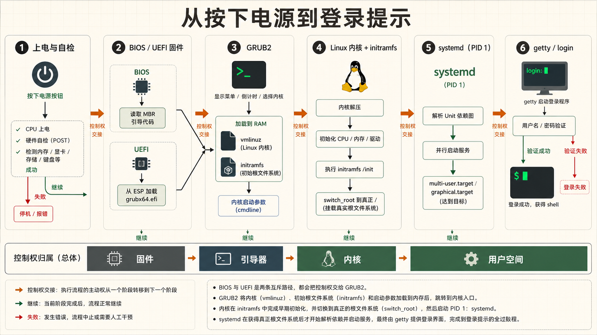
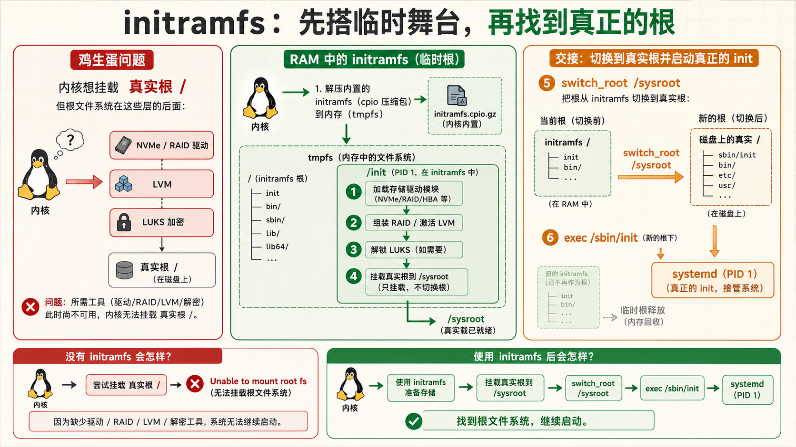
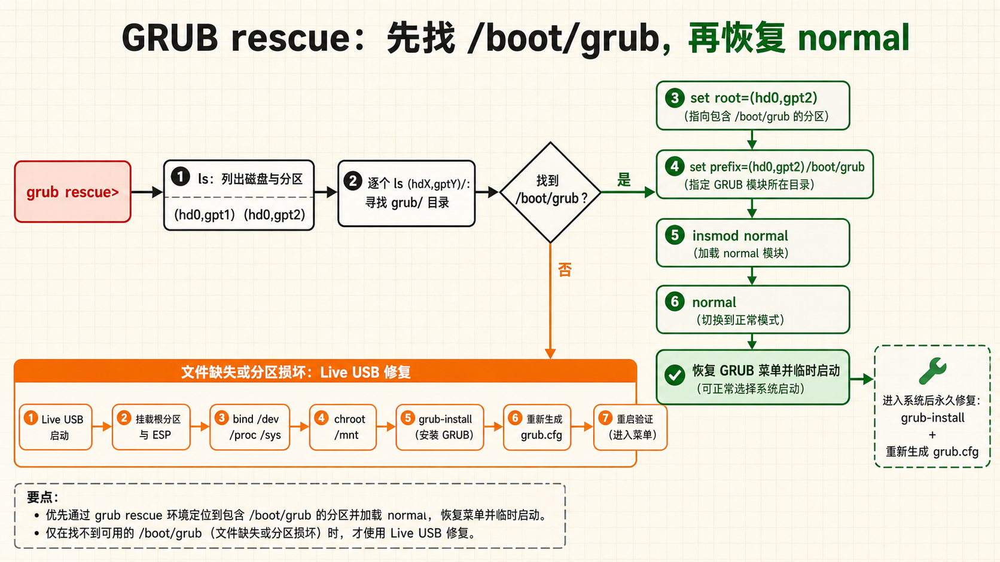
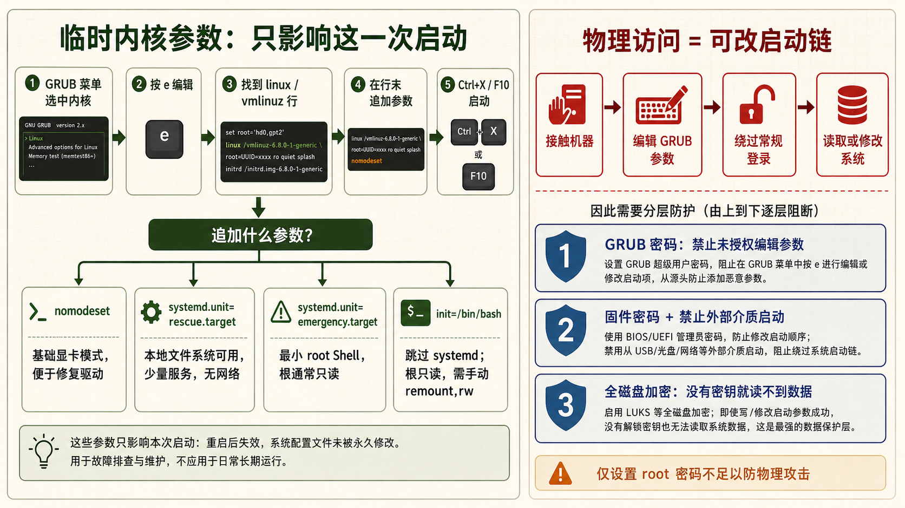
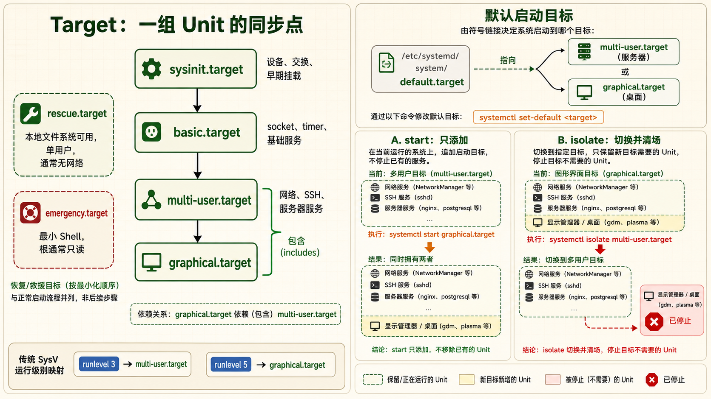

[← 返回 Linux 系统目录]({{ '/subjects/Linux/' | relative_url }})



# 启动流程与GRUB

*从按下电源到登录提示 —— Linux 启动的每一步、每一个关键角色*

固件：BIOS / UEFI · 引导器：GRUB2 · 进程1：systemd

## 1 启动流程6步走 — 从按下电源到登录提示 {#sec12-1}

### 一次完整的 Linux 启动涉及固件→引导器→内核→init进程四个阶段的精密协作 · 必知 {#一次完整的-linux-启动涉及固件引导器内核init进程四个阶段的精密协作-必知}

#### 问题驱动：按下电源按钮之后，到底发生了什么？

很多运维工程师在系统能正常启动的时候从不过问启动流程，直到某天服务器卡在"GRUB rescue\>"或黑屏光标闪烁时才发现自己对启动流程一无所知。理解整个启动链条，不仅是为了排错——更是为了掌握系统安全（单用户绕过密码）、定制内核参数（调优启动行为）、修复损坏的引导记录。

#### 第1步：BIOS / UEFI — 固件自检与设备初始化 {#第1步bios-uefi-固件自检与设备初始化}

<strong>BIOS（Basic Input/Output System）</strong> 是主板上的固件芯片，系统上电后 CPU 从固定地址（0xFFFFFFF0，BIOS 重置向量）开始执行 BIOS 代码：

- <strong>POST（Power-On Self-Test，上电自检）</strong>：检测 CPU、内存、键盘、显示器等基础硬件是否正常。如果检测到 RAM 故障或显卡未连接，通过蜂鸣声（beep code）报警
- <strong>枚举 PCI/PCIe 总线</strong>：扫描所有插槽上的设备，分配 IO 端口和内存映射地址
- <strong>确定启动设备</strong>：按 BIOS 设置的启动顺序（Boot Order），找到第一块可启动的磁盘——一般是硬盘、USB 或网络 PXE
- <strong>加载引导扇区</strong>：从启动设备的前 512 字节（MBR）中读取引导加载程序的第一阶段代码，将其加载到内存地址 0x7C00 并跳转执行。BIOS 的使命到这里就结束了

<strong>UEFI（Unified Extensible Firmware Interface）</strong> 是现代替代 BIOS 的固件标准：

- 不再有 16 位实模式和 1MB 地址空间的限制，直接在 32 位或 64 位保护模式下运行
- 从 EFI 系统分区（ESP，通常是 FAT32 格式）中查找 `.efi` 可执行文件作为引导加载程序
- 支持安全启动（Secure Boot）——只加载经过数字签名的引导程序，防止 rootkit 在系统启动前注入恶意代码
- 支持 GPT 分区表（MBR 时期 2TB 的限制不再存在）

| 对比         | BIOS (Legacy)              | UEFI                       |
|--------------|----------------------------|----------------------------|
| 运行模式     | 16 位实模式                | 32/64 位保护模式           |
| 分区表       | MBR（最大 2TB）            | GPT（无 2TB 限制）         |
| 启动文件位置 | 磁盘第一个扇区（512 字节） | EFI 系统分区中的 .efi 文件 |
| 安全启动     | 不支持                     | Secure Boot 可启用         |
| 启动速度     | 较慢（串行初始化）         | 快（并行初始化）           |
| GUI 支持     | 文本界面                   | 可显示图形                 |

#### 第2步：GRUB — 引导管理器接管 {#第2步grub-引导管理器接管}

GRUB（GRand Unified Bootloader）是目前 Linux 世界事实标准的引导加载器。它分为多个阶段：

- **BIOS 路径的第一阶段 `boot.img`**：驻留在 MBR 引导代码区域，定位并加载 `core.img`
- **`core.img`**：包含访问后续 GRUB 模块和文件系统所需的最小功能；菜单解析与内核加载由后续模块完成，不应把它和完整的“Stage 2”混为一体
- <strong>UEFI 中的 GRUB</strong>：固件直接加载 `grubx64.efi` 文件——不需要 Stage 1 和 Stage 2 的分段策略，因为 ESP 分区的 FAT 文件系统对 UEFI 固件天然可读

<strong>GRUB 做了什么：</strong>

- 读取发行版生成的 GRUB 配置；常见路径为 `/boot/grub/grub.cfg` 或 `/boot/grub2/grub.cfg`，UEFI 的 ESP 中也可能只有一个跳转用的小配置，不能单凭固件类型推断路径
- 显示内核选择菜单——如果有多个内核版本或操作系统
- 用户选择后（或超时后使用默认），加载内核镜像（`vmlinuz-*`）和 initramfs（`initrd.img-*`）到内存
- 设置内核命令行参数（从 GRUB_CMDLINE_LINUX 等变量获取）
- 将控制权交给内核——GRUB 的使命结束

#### 第3步：内核初始化

内核被加载到内存后开始执行。它的核心任务：

- <strong>解压自身</strong>：内核镜像（vmlinuz）是一个被 gzip/bzip2/lz4/zstd 压缩的 ELF 二进制文件，首先解压到内存
- <strong>初始化 CPU 和内存管理</strong>：设置页表、启用分页、初始化内核内存分配器（slab/slub）
- <strong>初始化硬件子系统</strong>：中断控制器（APIC）、定时器（HPET/TSC）、SMP（多核调度）
- <strong>加载 initramfs</strong>：initramfs 是一个压缩的 cpio 归档，包含内核需要的早期用户空间程序——特别是设备驱动模块（如 RAID/SATA/NVMe 驱动）和挂载根文件系统所需的工具（LVM、加密等）。内核将其解压到 `tmpfs` 并挂载为初始根文件系统
- **运行 initramfs 中的 `/init` 脚本**：这个脚本在临时根文件系统中执行——加载必要的内核模块、激活 LVM 卷、输入加密磁盘密码——最终挂载真正的根文件系统
- <strong>切换根文件系统（pivot_root / switch_root）</strong>：将根文件系统从 initramfs 的 tmpfs 切换到硬盘上的真正根分区，执行真正的 `/sbin/init`

#### 第4步：systemd — 用户空间的第一个进程 {#第4步systemd-用户空间的第一个进程}

`systemd` 是 PID 1——用户空间所有进程的最终祖先。它是现代 Linux 发行版的默认 init 系统（取代了传统的 SysVinit）。systemd 的启动过程：

- <strong>并行启动服务</strong>：解析所有 unit 文件的依赖关系，按照依赖图并行启动——不再像 SysVinit 那样串行执行 `/etc/rc.d/rc?.d/` 中的脚本，启动速度大幅提升
- <strong>激活必要的 target</strong>：target 是服务分组的抽象——`basic.target`（基础系统：挂载点、套接字、定时器、交换空间）→ `multi-user.target`（多用户文本模式）→ `graphical.target`（图形界面）
- <strong>套接字激活（Socket Activation）</strong>：systemd 可以提前监听服务所需的端口，在有连接进入时才真正启动服务——加速启动，节省内存
- <strong>激活终端（getty）</strong>：在 TTY1-6 上运行 `agetty` 进程，显示登录提示

#### 第5步：登录终端出现

当 `getty@tty1.service` 启动后，屏幕显示熟悉的登录提示：

```plaintext
Ubuntu 22.04 LTS hostname tty1
hostname login: _
```

输入用户名后，`login` 程序验证密码（通过 `/etc/passwd`、`/etc/shadow`、PAM 模块），验证通过后启动用户的默认 shell（一般为 `/bin/bash`）。至此，从按下电源到登录提示的完整启动流程结束。



#### 可视化：启动时间轴

```bash
# 分析启动时间——找到哪个环节最慢
systemd-analyze
# 输出示例：
# Startup finished in 2.345s (kernel) + 8.912s (userspace) = 11.257s

# 按服务排序——找出耗时最长的服务
systemd-analyze blame | head -20
# 输出示例：
# 3.245s NetworkManager-wait-online.service
# 2.112s docker.service
# 1.523s mysql.service
#  345ms systemd-journal-flush.service

# 绘制启动流程的 SVG 时间线图
systemd-analyze plot > boot-timeline.svg

# 查看关键链——哪些服务形成了最长的依赖链
systemd-analyze critical-chain
```

<strong>initramfs 为什么必不可少？</strong><br>
一个经典的"鸡生蛋"问题：根文件系统可能在 RAID 阵列上、在加密的 LUKS 分区上、在网络的 NFS 上——内核刚启动时没有这些功能的驱动，如何挂载根文件系统？initramfs 就是解药——它是一个微小但完整的临时根文件系统，包含所有需要的驱动和工具，先加载它来"搭建舞台"，然后才能切换到真正的根文件系统。



## 2 GRUB 配置与救援模式 — 系统启动的最后一道防线 {#sec12-2}

### GRUB 不仅选择启动哪个内核——它是你救援"启动不起来"系统的救命入口 · 实操 {#grub-不仅选择启动哪个内核它是你救援启动不起来系统的救命入口-实操}

#### /etc/default/grub — 主配置文件 {#etcdefaultgrub-主配置文件}

`/etc/default/grub` 是 GRUB 界面和默认行为的设置文件。修改这个文件后，需要重新生成 `grub.cfg` 才能生效。

```bash
# 查看 GRUB 主配置文件
cat /etc/default/grub
```

▶ 典型 /etc/default/grub 内容

```bash
# menu 显示菜单；hidden 或 countdown 的行为还受发行版配置影响
GRUB_TIMEOUT_STYLE=menu
# 菜单显示 5 秒后自动选择默认选项。0 表示不等待
GRUB_TIMEOUT=5
# 默认启动的内核。0 是第一个菜单项，1 是第二个，saved 表示使用上次选择的
GRUB_DEFAULT=0
# 正常启动时传递给内核的参数
GRUB_CMDLINE_LINUX_DEFAULT="quiet splash"
# 传递给所有启动项的内核参数（包括恢复模式）
GRUB_CMDLINE_LINUX=""
# 如果设置为 true，为每个内核生成一个恢复模式菜单项
GRUB_DISABLE_RECOVERY="false"
# 启动画面图片（对服务器通常不需要）
# GRUB_BACKGROUND="/boot/grub/custom-bg.png"
```

#### 更新 GRUB 配置使其生效

```bash
# === Debian / Ubuntu 系列 ===
sudo update-grub
# 本质上执行了：grub-mkconfig -o /boot/grub/grub.cfg

# === RHEL / CentOS / Fedora 系列 ===
# BIOS 模式
sudo grub2-mkconfig -o /boot/grub2/grub.cfg

# UEFI 模式
sudo grub2-mkconfig -o /boot/efi/EFI/redhat/grub.cfg
# 或用便捷命令
sudo grub2-mkconfig -o $(sudo find /boot -name grub.cfg 2>/dev/null)
```

#### 常用 GRUB 配置场景

##### 显示启动过程中的内核消息

去掉 `quiet splash` 参数即可看到内核的所有启动日志——这对排查"系统卡在启动的哪个阶段"至关重要。

`GRUB_CMDLINE_LINUX_DEFAULT=""`

然后运行 `sudo update-grub` 并重启。

##### 设置 GRUB 密码（防止物理访问者修改启动参数）

设置密码后，在 GRUB 菜单中按 e 编辑启动参数需要先输入密码——配合全磁盘加密，物理安全可以做到较高水平。

```bash
# 生成加密的密码哈希
grub-mkpasswd-pbkdf2
# 输入密码两次后得到哈希值...
# 在 /etc/grub.d/40_custom 中添加：
# set superusers="admin"
# password_pbkdf2 admin grub.pbkdf2.sha512.10000.XXX...
```

##### 修改默认启动内核

查看可用内核列表：

```bash
# 方法1：从 grub.cfg 中找
grep -E "^menuentry|submenu" /boot/grub/grub.cfg

# 方法2：用 awk 一行提取
awk -F\' '/menuentry / {print $2}' /boot/grub/grub.cfg
# 然后设置 GRUB_DEFAULT="Ubuntu, with Linux 5.15.0-76-generic"
```

#### GRUB 救援模式 — 启动不了的救命稻草 {#grub-救援模式-启动不了的救命稻草}

当你看到 `grub rescue>` 提示符而不是 GRUB 菜单时，意味着 GRUB 能找到 core.img 但找不到 `/boot/grub` 目录或其中的模块——通常是因为分区表被修改或 `/boot` 分区损坏。

```bash
# === 在 grub rescue> 提示符下的手动救援 ===

# 1. 列出所有磁盘和分区
grub rescue> ls
# 输出如：(hd0) (hd0,msdos1) (hd0,msdos2) (hd1) (hd1,gpt1) ...

# 2. 确定 /boot 分区是哪个——逐一尝试，找到包含 grub/ 目录的分区
grub rescue> ls (hd0,msdos1)/
# 如果能列出文件和目录，再用 ls 查看其中是否有 grub/
grub rescue> ls (hd0,msdos1)/grub/
# 有内容 → 这就是 /boot 分区或根分区

# 3. 设置 root 和 prefix 变量
grub rescue> set root=(hd0,msdos1)
grub rescue> set prefix=(hd0,msdos1)/grub

# 4. 加载 normal 模块（提供正常的菜单界面）
grub rescue> insmod normal
grub rescue> normal
# 如果成功，将出现正常 GRUB 菜单并可以启动系统

# 5. 如果以上步骤中 ls 找不到 grub/ —— 需要用 Live CD/USB 启动
# 然后 chroot 进入系统并重新安装 GRUB
```

#### 修复损坏的 GRUB（从 Live CD 环境）

```bash
# 1. 用 Ubuntu Live USB 启动，选择 "Try Ubuntu"
# 2. 打开终端，挂载系统分区
sudo mount /dev/sda2 /mnt          # 根分区
sudo mount /dev/sda1 /mnt/boot/efi # ESP 分区（UEFI）
# 或在 BIOS 模式下挂载 /boot
sudo mount /dev/sda1 /mnt/boot

# 3. 挂载必要的虚拟文件系统
sudo mount --bind /dev /mnt/dev
sudo mount --bind /proc /mnt/proc
sudo mount --bind /sys /mnt/sys

# 4. chroot 到系统中
sudo chroot /mnt

# 5. 重新安装 GRUB
# BIOS 模式：
grub-install /dev/sda
update-grub

# UEFI 模式：
grub-install --target=x86_64-efi --efi-directory=/boot/efi --bootloader-id=Ubuntu
update-grub

# 6. 退出 chroot，卸载并重启
exit
sudo umount -R /mnt
sudo reboot
```



## 3 内核启动参数 — 一行命令控制启动行为 {#sec12-3}

### 内核命令行参数让你能绕过系统安全、进入救援模式、调试硬件——能力强大到危险 · 核心 {#内核命令行参数让你能绕过系统安全进入救援模式调试硬件能力强大到危险-核心}

#### 内核参数从哪来

内核启动参数（Kernel Command Line）是在 GRUB 加载内核时传递给内核的字符串。它们有两个来源：

- <strong>持久化</strong>：`/etc/default/grub` 中的 `GRUB_CMDLINE_LINUX`（所有菜单项）和 `GRUB_CMDLINE_LINUX_DEFAULT`（仅正常启动项）
- <strong>临时</strong>：在 GRUB 菜单中按 `e` 键编辑当前启动项，在 `linux /boot/vmlinuz-*` 这一行的末尾手动添加参数

#### 在 GRUB 菜单中临时添加启动参数

编辑 GRUB 参数只影响本次启动，适合排查驱动和根文件系统问题；部分救援模式仍需 root 凭据，启用了 GRUB 密码或全盘加密的机器还要通过相应验证。修改前先记录原参数，以便下次启动恢复。

```bash
# === 操作步骤 ===
# 1. 系统启动到 GRUB 菜单时，用方向键选中要启动的内核
# 2. 按 e 键进入编辑模式（editing mode）
# 3. 找到以 "linux" 或 "linuxefi" 开头的那一行
#    例如：linux /boot/vmlinuz-5.15.0-91-generic root=UUID=xxx ro quiet splash
# 4. 将光标移到行末，添加你的参数
# 5. 按 Ctrl+X 或 F10 以修改后的参数启动
```

#### 关键启动参数详解

| 参数 | 作用 | 使用场景 |
|----|----|----|
| `single` 或 `1` | 进入单用户救援模式——仅启动最小系统，不启动网络，不挂载除 root 外的文件系统，以 root 身份进入 shell | 忘记 root 密码时重置密码、修复损坏的配置文件 |
| `init=/bin/bash` | 直接启动 bash 作为 init 进程——跳过 systemd 和所有服务，获得一个极简 root shell（根文件系统为只读） | systemd 本身损坏或 root 密码遗忘时最后的救援手段 |
| `quiet` | 隐藏大部分内核启动日志，只显示关键信息 | 正常启动时减少屏幕输出，提升"专业感" |
| `splash` | 显示图形化启动画面（Plymouth 启动动画） | 桌面发行版出厂默认 |
| `nomodeset` | 禁用内核模式设置（KMS）——显卡驱动不切换分辨率，使用最基本的 VESA 帧缓冲 | 显卡驱动问题导致黑屏时，添加此参数即可进入系统再安装正确驱动 |
| `root=UUID=xxx` | 指定根文件系统所在的设备（UUID 方式）。也可用 `root=/dev/sda2` | 内核挂载根文件系统的核心参数，由 GRUB 根据 fstab 自动添加 |
| `ro` | 以只读模式挂载根文件系统——内核先以 ro 挂载，然后 initramfs 中的 fsck 检查无误后，systemd 重新挂载为 rw | 标准启动流程——如果直接 rw 挂载，损坏的文件系统可能导致数据丢失 |
| `rw` | 以读写模式挂载根文件系统 | 某些最小化环境需要直接写入根文件系统 |
| `selinux=0` | 禁用 SELinux | SELinux 策略错误导致服务异常时的临时绕过 |
| `enforcing=0` | SELinux 进入许可模式（记录但不阻止） | 调试 SELinux 策略 |
| `systemd.unit=rescue.target` | 指定 systemd 启动的目标 target | 直接进入救援模式，等价于在 GRUB 中添加 systemd.unit=rescue.target |
| `systemd.unit=emergency.target` | 进入紧急模式——比救援更底层，根文件系统只读，几乎不启动任何服务 | systemd 调试、文件系统修复 |
| `memtest` | 运行内存测试程序（如果安装了 memtest86+） | 怀疑内存硬件故障时进行诊断 |

#### 实战：通过单用户模式重置 root 密码

这是展示"物理访问 = 彻底控制"的经典例子——也说明了为什么服务器机房要有物理门禁、笔记本电脑要全磁盘加密：

```bash
# 1. 启动到 GRUB 菜单
# 2. 按 e 键编辑菜单项
# 3. 找到 linux 开头的行，在行末添加（注意去掉 quiet splash）：
#    single
#    或者更彻底：
#    init=/bin/bash
# 4. 按 Ctrl+X 启动

# === 如果用的是 single 模式 ===
# 系统进入 root shell，不需要密码
passwd root
# 输入新密码两次
exec /sbin/init   # 正常启动系统
# 或 reboot

# === 如果用的是 init=/bin/bash ===
# 根文件系统是只读的，需要先重新挂载
mount -o remount,rw /
passwd root
# 输入新密码两次
mount -o remount,ro /
# 按 Ctrl+Alt+Del 或用硬件重启按钮重启
# 注意：不能用 reboot 命令，因为 systemd 没有被启动
```

<strong>物理安全不可忽视</strong><br>
任何人只要有物理访问权限，就能通过上述步骤绕过 root 密码获得系统的完全控制权。这是 Linux 设计的特性（而非漏洞）——系统假设物理访问者是受信任的。防御手段： <strong>设置 BIOS/UEFI 密码</strong>（阻止进入固件修改启动顺序）、 <strong>设置 GRUB 密码</strong>（阻止编辑启动参数）、 <strong>全磁盘加密（LUKS / BitLocker）</strong>（没有解密密码就无法读取数据）。

#### 持久化启动参数

```bash
# 编辑 /etc/default/grub
sudo vi /etc/default/grub

# 示例：去掉启动动画，显示所有内核消息，开启 IOMMU
GRUB_CMDLINE_LINUX_DEFAULT=""
GRUB_CMDLINE_LINUX="intel_iommu=on iommu=pt"

# 更新生效
sudo update-grub    # Debian/Ubuntu
# 或
sudo grub2-mkconfig -o /boot/grub2/grub.cfg   # RHEL/CentOS

# 查看当前内核用了哪些参数
cat /proc/cmdline
# 输出示例：
# BOOT_IMAGE=/boot/vmlinuz-5.15.0-91-generic root=UUID=a1b2c3d4-... ro quiet splash
```



## 4 systemd target — 运行级别的新名称 {#sec12-4}

### systemd 用 target 替代了 SysVinit 的 runlevel——更灵活、更语义化、更模块化 · 核心 {#systemd-用-target-替代了-sysvinit-的-runlevel更灵活更语义化更模块化-核心}

#### 从 runlevel 到 target 的演变

传统 SysVinit 使用 0–6 运行级别，但 2、3、4 的含义随发行版而异，不能统一解释成“2=多用户无网络”。systemd 的 <strong>target</strong> 是组织 Unit 的同步点，常用的 `multi-user.target` 与 `graphical.target` 大致对应文本和图形环境，但依赖关系仍由各发行版与管理员配置决定。

| SysVinit Runlevel | systemd Target | 含义 |
|----|----|----|
| runlevel 0 | `poweroff.target` | 关闭系统并切断电源 |
| runlevel 1 / S | `rescue.target` | 单用户救援模式——挂载本地文件系统但不启动网络 |
| runlevel 2 | `multi-user.target` | 多用户文本模式（无 NFS） |
| runlevel 3 | `multi-user.target` | 多用户文本模式（带网络和 NFS）——服务器最常用的运行级别 |
| runlevel 4 | （未定义/自定义） | 保留给用户自定义 |
| runlevel 5 | `graphical.target` | 图形界面多用户模式——桌面版默认 |
| runlevel 6 | `reboot.target` | 重启系统 |
| emergency | `emergency.target` | 紧急 Shell——根文件系统只读，系统最小化 |

#### 查看和切换 target

```bash
# 查看当前激活的 target
systemctl get-default
# 输出：multi-user.target（服务器）或 graphical.target（桌面）

# 查看所有激活的 target
systemctl list-units --type=target --state=active

# 临时切换到另一个 target
# 切换到文本模式（停止图形界面，但不是永久的）
sudo systemctl isolate multi-user.target

# 切换回图形模式
sudo systemctl isolate graphical.target

# 设置默认启动的目标（永久）
sudo systemctl set-default multi-user.target
# 服务器应该设这个

sudo systemctl set-default graphical.target
# 桌面版应该设这个
```

#### 关键 target 的区别与应用场景

##### multi-user.target {#multi-user.target}

<strong>标准服务器状态</strong>。网络已启动、NFS 可用、所有配置为多用户模式的服务已运行。SSH 可远程登录。这是生产服务器应该处于的状态。

`sudo systemctl set-default multi-user.target`

##### graphical.target {#graphical.target}

<strong>桌面用户状态</strong>。在 multi-user.target 的基础上加上显示管理器（GDM/LightDM/SDDM）和图形桌面环境（GNOME/KDE 等）。桌面版 Linux 将默认目标设为这个。

`sudo systemctl set-default graphical.target`

##### rescue.target {#rescue.target}

<strong>救援模式</strong>——挂载所有本地文件系统（读写），启动一些基础服务，但不启动网络。以 root 身份进入单用户 shell。用在系统配置文件错误导致无法正常启动的场景。

从 GRUB 进入：添加 `systemd.unit=rescue.target` 或 `single`

##### emergency.target {#emergency.target}

<strong>紧急模式</strong>——比 rescue 更精简。根文件系统以只读挂载，不挂载其他文件系统，不启动任何服务。提供一个最小的 root shell。用于最严重的系统损坏情况——连 rescue 都进不去时。

从 GRUB 进入：添加 `systemd.unit=emergency.target` 或 `emergency`

#### 显式的隔离（isolate）vs 切换

```bash
# isolate：启动目标 target 并停止所有与该 target 无关的服务
sudo systemctl isolate multi-user.target
# 如果用 isolate 从 graphical.target 切换到 multi-user.target
# → GDM 和 X11 将被停止，内存释放

# 而 start 一个已激活的 target 只是确保其服务在运行，不会停止不相关的服务
sudo systemctl start graphical.target
# 如果已经在 multi-user.target 下，这只会额外启动 GDM 和 X11

# 查看 target 之间的依赖关系
systemctl list-dependencies multi-user.target
# 输出：
# multi-user.target
# ● ├─anacron.service
# ● ├─cron.service
# ● ├─docker.service
# ● ├─networking.service
# ● ├─sshd.service
# ● └─systemd-user-sessions.service
```

#### 自定义 target 实现分组管理

你可以创建自定义 target，把一组相关的服务组合在一起统一启动/停止。比如为你的 Web 应用创建一个 `myapp.target`：

```bash
# 1. 创建自定义 target
sudo tee /etc/systemd/system/myapp.target << 'EOF'
[Unit]
Description=My Application Stack
Requires=multi-user.target
After=multi-user.target
Wants=nginx.service mysql.service redis.service
EOF

# 2. 启动自定义 target
sudo systemctl start myapp.target

# 3. 查看状态
sudo systemctl status myapp.target

# 4. 停止整个应用栈
sudo systemctl stop myapp.target
# 会同时停止 nginx、mysql 和 redis

# 5. 设置为默认 target（不推荐，仅示范）
# sudo systemctl set-default myapp.target
```

#### 系统状态诊断命令集

```bash
# 查看启动日志（上次启动的完整日志）
journalctl -b

# 查看上次启动的日志（比如系统崩溃重启后，查崩溃之前发生了什么）
journalctl -b -1

# 查看内核启动日志
journalctl -k
# 等价于 dmesg（但带时间戳和 systemd journal 的过滤能力）

# 查看启动过程中失败的 unit
systemctl --failed
# 输出：
# UNIT          LOAD   ACTIVE SUB    DESCRIPTION
# ● mysql.service loaded failed failed MySQL Community Server
# 上面有圆点表示启动失败

# 查看系统从启动到现在花了多久
systemd-analyze
systemd-analyze blame    # 最慢的服务
systemd-analyze critical-chain  # 最长依赖链
```




