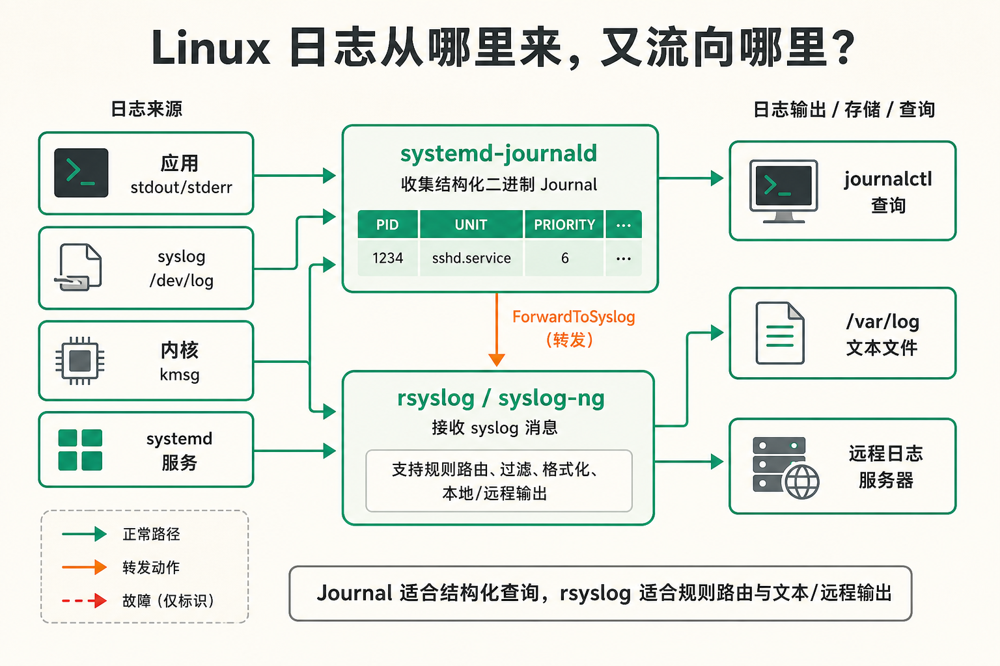
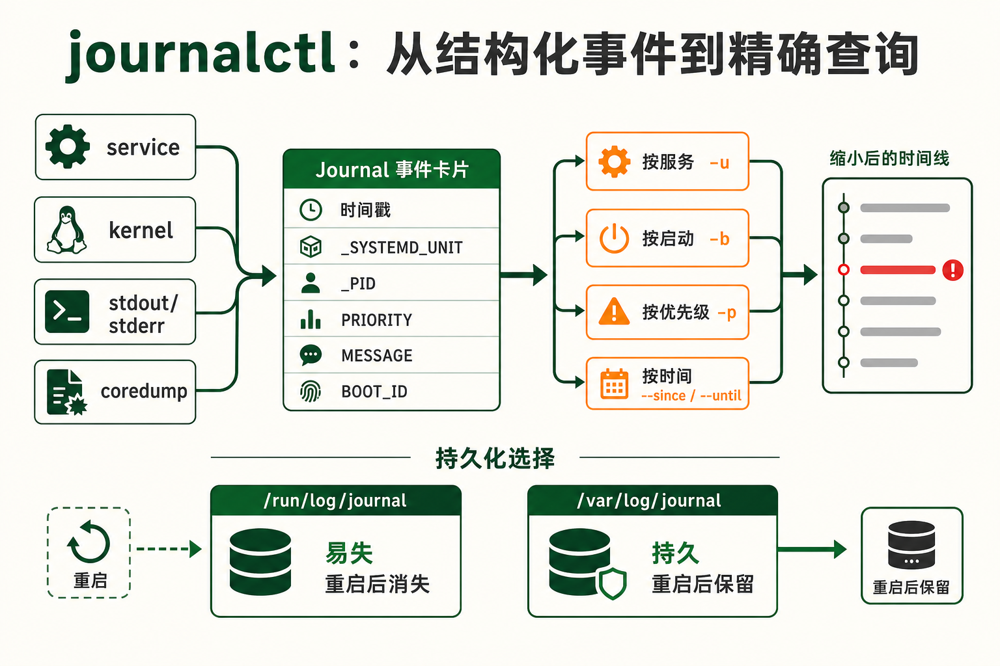
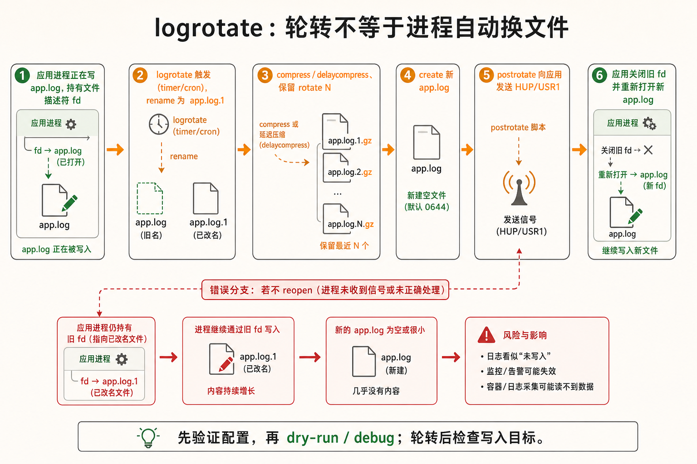
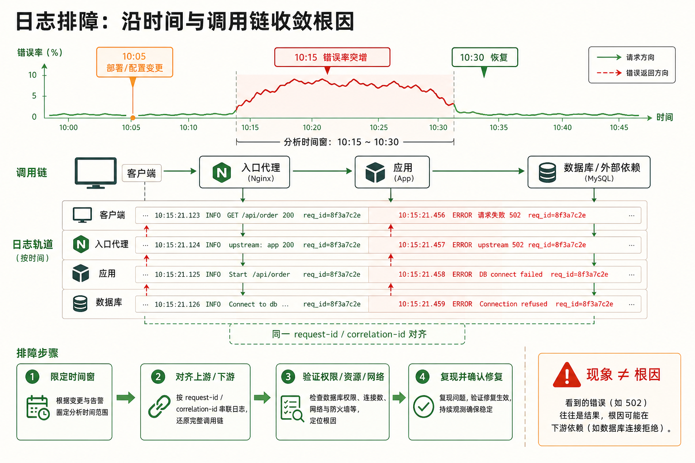

[← 返回 Linux 系统目录]({{ '/subjects/Linux/' | relative_url }})



# 日志管理

## 1 日志体系概述 {#sec13-1}

### 从 syslog 协议到二进制 journald —— 日志的三层架构 · 核心 {#从-syslog-协议到二进制-journald-日志的三层架构-核心}

#### 问题：程序写出的日志最终去了哪里？

先区分输出来源：交互式终端里的 `echo "error"` 只写到终端，不会自动进入 `/var/log/syslog`；systemd 服务的 stdout/stderr、程序调用 syslog API 或 `logger`、应用自行写文件，分别走不同路径。确认来源后再找收集器和存储位置：

<strong>产生者：应用程序或系统服务。</strong>程序可以调用 `syslog(3)` 按 facility 和 severity 投递消息，也可以写 stdout/stderr 或自行维护日志文件。Shell 中用 `logger "备份完成"` 可主动发出 syslog 消息；这些渠道不是同一件事。

<strong>收集者：journald、rsyslog 或 syslog-ng。</strong>在 systemd 系统上，journald 通常接收服务标准流、内核及 syslog 消息；rsyslog 可从 journal 或本地 socket 接收消息，按发行版规则写入 `/var/log/syslog`、`/var/log/messages` 等文本文件。远程设备若要经 UDP/514 或 TCP/TLS 集中投递，需要另外启用并保护相应监听配置，不能假定默认开放。

<strong>存储位置：journal 或应用/系统文本文件。</strong>journal 可能写在持久目录 `/var/log/journal/`，也可能写在重启即失的 `/run/log/journal/`；rsyslog 是否额外写文本文件取决于安装和规则。应用自己的 access/error 日志则可能完全不经过 journal。用 `journalctl -u 服务名`、`systemctl status rsyslog` 和应用配置逐项核对，不能预设一定存在两份日志。

<strong>一句总结</strong><br>
<strong>syslog 协议</strong> = 所有日志的统一投递格式（标准）<br>
<strong>rsyslog</strong> = 传统日志守护进程，把日志按规则分拣写入 /var/log（实现）<br>
<strong>journald</strong> = systemd 时代的二进制日志系统，更全面、更结构化（进化）

#### 为什么 journald 要用二进制？

文本日志易于直接阅读和加工；journal 则保存结构化字段，便于按时间、Unit、优先级及进程 ID 缩小范围。字段检索通常比反复扫描大文本文件更方便，但查询耗时取决于数据量、存储介质、过滤条件和缓存，不能笼统保证某个复杂度或速度。journal 还可附带 PID、UID、cgroup 等元数据；文本格式也能记录部分字段，只是结构化程度因格式而异。

```bash
# 查看当前系统日志收集架构
systemctl status rsyslog    # 传统 syslog 守护进程
systemctl status systemd-journald  # journald 守护进程

# 查看日志存储的磁盘占用
journalctl --disk-usage     # journald 二进制日志占了多少磁盘

# logger 命令：从 shell 投递一条日志（验证 syslog 链路）
logger -p auth.notice "admin logged into console at $(date)"
tail -1 /var/log/auth.log   # 立即在 auth.log 中看到这条日志
```

### 日志级别与 Facility —— syslog 的两维分类 · 必备 {#日志级别与-facility-syslog-的两维分类-必备}

#### 问题：什么日志值得看？什么只是噪音？

syslog 协议用了两个维度给每条日志打标签，就像图书馆把书按"主题"和"重要程度"分别编号：

<strong>Facility（设施类别）：</strong>日志来自哪个子系统。常见的有 `auth`（认证）、`cron`（定时任务）、`daemon`（守护进程）、`kern`（内核）、`mail`（邮件）、`local0`~`local7`（留给应用程序自定义）。Nginx 一般用 `local0`，数据库用 `local1`。

<strong>Severity（严重级别/优先级）：</strong>按严重程度从低到高依次为 `debug(7)` → `info(6)` → `notice(5)` → `warning(4)` → `err(3)` → `crit(2)` → `alert(1)` → `emerg(0)`。<strong>数字越小，级别越严重</strong>；例如 `journalctl -p err` 包含 err 及更严重的消息。

| 级别        | 数字 | 含义           | 典型场景                             |
|-------------|------|----------------|--------------------------------------|
| <strong>emerg</strong>   | 0    | 系统不可用     | 内核 panic，连登录提示符都打不出来了 |
| <strong>alert</strong>   | 1    | 立即需要处理   | 数据库崩了，不处理影响业务           |
| <strong>crit</strong>    | 2    | 严重错误       | 磁盘满了、CPU 过热                   |
| <strong>err</strong>     | 3    | 一般错误       | 服务启动失败、连接超时               |
| <strong>warning</strong> | 4    | 警告           | 磁盘使用率超过 80%、密码快过期       |
| <strong>notice</strong>  | 5    | 正常但值得注意 | 用户通过 SSH 登录成功                |
| <strong>info</strong>    | 6    | 一般信息       | 服务启动、配置重载                   |
| <strong>debug</strong>   | 7    | 调试信息       | 开发阶段用的详细输出                 |

在 rsyslog 配置中，用 `Facility.Severity` 来过滤。比如 `mail.warn` 表示"所有级别 \>= warning 的邮件相关日志"。星号 `*` 表示通配：`*.*` 是"所有类型所有级别的日志"。重定向优先级关键字 `none` 表示排除。



## 2 关键日志文件速查 {#sec13-2}

### /var/log 目录 —— 每个运维人必须背下来的文件清单 · 必修 {#varlog-目录-每个运维人必须背下来的文件清单-必修}

#### 问题：系统出问题了，应该先看哪个文件？

`/var/log` 是 Linux 的日志主目录。不同发行版路径略有差异（比如 Debian/Ubuntu 用 `syslog`，RHEL/CentOS 用 `messages`），但核心文件的用途是完全一致的。

| 文件路径 | 记录内容 | 何时查看 |
|----|----|----|
| `/var/log/syslog` | 系统全局日志，所有非内核服务的日志汇总池 | 不知道问题出在哪时先看它——它是最全的 |
| `/var/log/messages` | RHEL 系的 syslog 等价物，范围稍窄（不含 debug） | RHEL/CentOS 上替代 syslog |
| `/var/log/auth.log` | 认证日志：sudo 调用、SSH 登录/失败、su 切换 | 怀疑被入侵、查谁在 sudo、SSH 登录失败 |
| `/var/log/kern.log` | 内核消息（驱动加载、OOM killer、硬件错误） | 系统突然重启、硬件异常、内核 oops |
| `/var/log/dmesg` | 本次启动以来的内核环形缓冲区快照 | 刚启动时看驱动加载和设备识别情况 |
| `/var/log/boot.log` | 系统引导过程中各服务的启动日志 | 某个服务启动失败，排查启动脚本错误 |
| `/var/log/cron` | cron 定时任务执行记录 | 排查定时任务为什么没跑、为什么报错没有输出 |
| `/var/log/apt/history.log` | apt/dpkg 包安装与升级的完整历史记录 | 想知道昨天装了哪些包、谁升级了内核 |
| `/var/log/nginx/access.log` | Web 服务器访问日志（每行一个请求） | 分析流量、找爬虫 IP、检查 API 调用频率 |
| `/var/log/nginx/error.log` | Web 服务器错误日志 | 502/500 错误排查、PHP-FPM 连接失败 |
| `/var/log/mysql/error.log` | MySQL/MariaDB 数据库错误日志 | 数据库启动失败、查询错误、主从复制中断 |

#### last 命令 —— 查登录记录的秘密武器 {#last-命令-查登录记录的秘密武器}

`last` 命令可以列出所有用户的登录历史，包括登录时间、IP 地址和持续时间。它的数据来源不是普通文本文件，而是一个二进制数据库 `/var/log/wtmp`——这个文件记录了所有成功的登录和注销事件。`lastb` 命令对应 `/var/log/btmp`，记录所有失败的登录尝试。

```bash
# 查看最近的登录记录
last -n 20                     # 最近 20 次登录
last -a                        # 在行尾显示 IP 地址
last -F                        # 完整时间戳（精确到秒）

# 查看失败的登录尝试（暴力破解的特征）
lastb -n 50                    # 最近 50 次登录失败

# 查看特定用户的登录历史
last alice
```

▶ last 输出示例

```plaintext
alice    pts/0        192.168.1.100    Fri Jul 31 10:23   still logged in
bob      pts/1        10.0.0.55        Fri Jul 31 09:15 - 09:45  (00:30)
root     pts/0        :0               Thu Jul 30 18:02 - 18:05  (00:03)

wtmp begins Thu Jul 30 18:02:01 2026
```

### 应用日志与自定义日志 —— 别让 nginx 的错误淹没在 syslog 里 · 技巧 {#应用日志与自定义日志-别让-nginx-的错误淹没在-syslog-里-技巧}

#### 问题：为什么不能把所有日志都堆到 syslog？

把 Nginx、MySQL、Redis 的日志全写入 syslog 会有三个严重问题：一是 `/var/log/syslog` 会膨胀到几十 GB——rsyslog 的文本处理远不如应用自带的日志管理高效；二是无法按应用粒度轮转——syslog 的 logrotate 按大小切分，Nginx 的 access.log 需要按天切割以配合统计；三是性能影响——高流量的 Nginx 每秒产生数千行日志，全推给 rsyslog 的 UNIX socket 会成为瓶颈。

<strong>标准做法是：每个应用维护自己的日志目录，自己控制格式和轮转策略。</strong>rsyslog/journald 只看系统级事件。

```bash
# Nginx 配置中的日志路径（/etc/nginx/nginx.conf）
# access_log /var/log/nginx/access.log combined;
# error_log  /var/log/nginx/error.log warn;

# 实时监控 Nginx 访问日志——看谁在访问你的网站
tail -f /var/log/nginx/access.log

# 提取访问量最高的 10 个 IP
awk '{print $1}' /var/log/nginx/access.log | sort | uniq -c | sort -rn | head -10

# MySQL 的错误日志路径
grep log_error /etc/mysql/mysql.conf.d/mysqld.cnf
# 输出: log_error = /var/log/mysql/error.log
```

<strong>警惕：应用日志打满磁盘</strong><br>
曾有一个案例：Nginx 的 access.log 在没有设置轮转的情况下跑了 3 个月，单个文件达到 120GB，直接把根分区的可用空间从 40GB 压到 0。最后不只是 Nginx 挂了—— <strong>因为 /var 和根分区共享，系统连创建 SSH 连接所需的临时文件的空间都没有了</strong>。日志文件的管理与监控同样重要，永远不要假设"日志文件不会长到多离谱"。

## 3 journalctl 实战 {#sec13-3}

### journalctl —— systemd 时代的日志瑞士军刀 · 核心 {#journalctl-systemd-时代的日志瑞士军刀-核心}

#### 问题：journalctl 和 grep 查日志的根本区别在哪？

`grep` 适合在已知文本文件中搜索关键字；`journalctl` 适合在 journal 中组合时间、Unit 和优先级等结构化条件。先用 `journalctl -u 服务名 --since "1 hour ago" -p err` 缩小范围，再按需搜索消息正文。不要把示例耗时当成通用性能保证，也不要在只写文件的应用日志中期待 journal 能查到全部内容。

#### 基础查询：最常用的 10 个命令

```bash
# 1. 查看所有日志（从旧的开始）
journalctl

# 2. 查看本次启动以来的所有日志
journalctl -b

# 3. 查看前一次启动的日志（排查"为什么上次重启了"）
journalctl -b -1

# 4. 实时追踪最新日志（等同于 tail -f）
journalctl -f

# 5. 只看某个服务的日志（最常用的命令没有之一）
journalctl -u nginx.service
journalctl -u ssh.service

# 6. 按时间范围过滤
journalctl --since "2026-07-30 15:00:00" --until "2026-07-30 16:00:00"

# 7. 看最近的日志；-n 选取末尾 50 条，默认仍按时间正序显示
journalctl -n 50           # 最近 50 条；若需最新在最上，加 -r
journalctl -u nginx -n 20  # nginx 最近 20 条

# 8. 按优先级过滤：只看错误和更严重的
journalctl -p err          # err, crit, alert, emerg
journalctl -p warning      # warning + err + crit + alert + emerg

# 9. 查特定进程的日志
journalctl _PID=12345

# 10. 按可执行文件路径过滤
journalctl /usr/sbin/sshd
```

### journalctl 进阶 —— JSON 输出与日志持久化 · 进阶 {#journalctl-进阶-json-输出与日志持久化-进阶}

#### 问题：如何把 journald 日志导入 ELK / Grafana Loki？ {#问题如何把-journald-日志导入-elk-grafana-loki}

journald 的二进制格式虽然索引快，但不便于跨系统传输和可视化分析。幸运的是 journalctl 支持多种输出格式，其中最强大的是 JSON——每一条日志转成一个 JSON 对象，包含所有元数据：

```bash
# JSON 输出——每行一个完整的 JSON 对象，包含 __REALTIME_TIMESTAMP, MESSAGE, _PID, _UID 等
journalctl -o json            # 完整 JSON（一行，很长）
journalctl -o json-pretty     # 格式化 JSON（每个字段一行，供人阅读）

# 只输出 MESSAGE 字段（纯文本，类似传统 syslog）
journalctl -o cat             # 去掉了时间戳、主机名等前缀，只保留原始消息

# 带详细元数据的短格式（默认输出模式的扩展版）
journalctl -o verbose

# 导出为 JSON 并送给 jq 做进一步处理
journalctl -u nginx --since "1 hour ago" -o json | jq '.MESSAGE'
```

如果你需要把 JSON 日志批量导入 ELK，可以用 `journalctl -o json` 管道输出给 Filebeat 或 Logstash 的 stdin 输入。如果你用 Grafana Loki，可以用 `promtail` 的 journal 采集器直接读取 journald 的二进制文件——不需要额外导出步骤。

#### 日志持久化配置

journald 默认的 `Storage=auto` 根据 `/var/log/journal/` 是否存在决定是否持久化；不少发行版已预建该目录。先用 `journalctl --list-boots` 判断重启前日志是否可见，再决定是否创建目录和调整 `journald.conf`：

```bash
# 创建持久化目录
sudo mkdir -p /var/log/journal
sudo systemd-tmpfiles --create --prefix /var/log/journal

# 重启 journald 使其识别新目录
sudo systemctl restart systemd-journald

# 验证：journald 现在把日志写入磁盘而非 tmpfs
ls /var/log/journal/
# 输出: 一串机器 ID 命名的目录，里面是 *.journal 二进制文件

# 配置持久化和大小限制：编辑 /etc/systemd/journald.conf
# Storage=persistent     # 强制持久化
# SystemMaxUse=500M      # 日志最多占用 500MB 磁盘
# MaxRetentionSec=4week  # 最多保留 4 周
```

<strong>kernel 消息的另一种查看方式：dmesg</strong><br>
`dmesg` 读取的是内核环形缓冲区（ring buffer），不经过 journald。这是内核启动阶段最先输出的消息——在你看到登录提示符之前，驱动加载、PCI 设备枚举、文件系统挂载的信息都在这里。 `journalctl -k` 也可以查看内核消息（它同时从 journald 和内核环形缓冲区获取数据）。二者等价： `journalctl -k` 等同于 `journalctl -b _TRANSPORT=kernel` 再叠加 dmesg 的内容。



## 4 logrotate 日志轮转 {#sec13-4}

### 如果日志不轮转，磁盘迟早被吃光 —— logrotate 的完整配置 · 必修 {#如果日志不轮转磁盘迟早被吃光-logrotate-的完整配置-必修}

#### 问题：你设了 Nginx 的 access.log，三个月后半夜被磁盘满的告警惊醒 {#问题你设了-nginx-的-access.log三个月后半夜被磁盘满的告警惊醒}

logrotate 是 Linux 上最通用的日志轮转工具。它每隔一段时间（通常是每天）执行一次，根据配置文件把大的日志文件改名、压缩、或者在保留够一定数量后删除最老的那个。它的主配置文件是 `/etc/logrotate.conf`，每个服务的自定义配置放在 `/etc/logrotate.d/` 目录下——Nginx 的配置在 `/etc/logrotate.d/nginx`，rsyslog 的在 `/etc/logrotate.d/rsyslog`。

#### 核心配置参数解释

以下面这个 Nginx 的典型 logrotate 配置为例：

```bash
# /etc/logrotate.d/nginx
/var/log/nginx/*.log {      # 对 nginx 目录下所有 .log 文件执行轮转
    daily                   # 每天轮转一次（可选: weekly, monthly, yearly）
    missingok               # 如果日志文件不存在也不报错（避免第一次运行报错）
    rotate 14               # 最多保留 14 个历史文件（即 14 天的日志）
    compress                # 历史日志用 gzip 压缩（.gz 空间节省约 90%）
    delaycompress           # 延后一天压缩（让昨天的日志今天还能直接 grep，压缩的是前天的）
    notifempty              # 如果日志文件是空的就不轮转（避免创建一堆空日志）
    create 0640 www-data adm  # 轮转后自动创建新的空日志文件，权限 0640，属主 www-data:adm
    sharedscripts           # 所有日志轮转完后只执行一次 postrotate 脚本（而不是每个文件执行一次）
    postrotate              # 轮转完成后执行的命令
        [ -s /run/nginx.pid ] && kill -USR1 $(cat /run/nginx.pid)
                            # 向 Nginx 发送 USR1 信号，让它重新打开日志文件（不然 Nginx 还往旧文件写）
    endscript
    dateext                 # 历史存档的文件名加日期后缀（access.log-20260731 而不是 access.log.1）
    dateformat -%Y%m%d      # 日期格式（配合 dateext 使用）
    maxsize 100M            # 即使还没到轮转周期，单个文件超过 100M 就强制轮转
}
```

<strong>逐个参数拆解：</strong>

`rotate 14`——这条至关重要。它定义了保留的历史副本数量。设为 14 意味着你会保留 15 个文件：1 个当前活跃的 + 14 个历史归档。如果你每天轮转且保留 14 个，就是两周的日志历史。对于高频服务（比如每天 10G 的 Nginx 日志），保留 14 个可能还是太占空间，可以减到 7 甚至 3。

`compress` + `delaycompress` 是黄金组合。单独开 compress 会把昨天的日志立即压缩，导致你没法直接 grep 昨天的日志（grep 不认 .gz 文件）。加上 delaycompress 后：今天的轮转压缩的是前天的日志，昨天的日志还是纯文本可以直接 grep。如果你用 `zgrep` 可以直接搜索压缩日志，那就无所谓 delaycompress。

`postrotate`——被无数人遗忘的关键配置。很多应用（Nginx、Apache）打开日志文件后持有文件描述符一直往里面写。logrotate 把文件改名（mv access.log access.log.1）后，应用的文件描述符仍然指向那个被改了名的旧文件——它根本不知道 logrotate 做了改名操作，new access.log 是空的也没人往里面写。<strong>postrotate 脚本的作用就是通知应用"请关闭旧文件描述符，打开新文件"</strong>。Nginx 用 USR1 信号实现日志重开，Apache 用 `apachectl graceful`。

<strong>logrotate 不会魔法——你必须验证它真的在跑</strong><br>
不少人配完 logrotate 就忘了，几个月后才发现在手动执行 `logrotate -f /etc/logrotate.conf` 之前，它根本没自动运行过。logrotate 依赖 cron 或 systemd timer 来触发。检查方式： `systemctl status logrotate.timer`（systemd 系统）或 `cat /etc/cron.daily/logrotate`（传统 cron 系统）。如果 timer 状态是 inactive，你的日志就在悄悄长胖。

```bash
# 手动测试 logrotate 配置（不实际轮转，只演示）
sudo logrotate -d /etc/logrotate.conf

# 强制执行一次轮转（忽略周期判断，现在立刻就做）
sudo logrotate -f /etc/logrotate.conf

# 只对某个单独的配置做测试
sudo logrotate -d /etc/logrotate.d/nginx

# 查看 logrotate 的上次执行时间
cat /var/lib/logrotate/status   # 状态文件，记录每个日志最后一次轮转的时间
```



## 5 错误定位实战 {#sec13-5}

### 从"出问题了"到"找到原因"——日志驱动的三板斧排查法 · 实操 {#从出问题了到找到原因日志驱动的三板斧排查法-实操}

#### 问题：凌晨 3 点收到告警说 Web 服务 502，你只有 5 分钟定位

<strong>板斧一：查时间，定范围。</strong>先确认问题发生的时间窗口。告警说 3:05 开始 502——那就只看 3:00 到 3:10 这个时间段的日志，不要一上来把一整天的日志 grep 一遍。

```bash
# journalctl 按时间过滤（精确到秒）
journalctl --since "2026-07-31 03:00:00" --until "2026-07-31 03:10:00"

# 传统 syslog 文件用法——用 grep 的时间正则
grep 'Jul 31 03:0[0-9]' /var/log/syslog
```

<strong>板斧二：查错误，看上下游。</strong>502 表示网关未从上游获得有效响应，原因可能是连接失败、连接中断、协议错误或上游异常，不能据此断定已经成功连上。先查 Nginx 错误日志中的具体报错、上游地址与时间，再对照上游进程状态、监听端口和应用日志。

```bash
# 1. Nginx 错误日志——找上游连接失败的线索
grep 'upstream' /var/log/nginx/error.log | tail -50
# 典型输出: connect() to unix:/run/php/php8.1-fpm.sock failed (111: Connection refused)
# 说明 PHP-FPM 根本没有在监听！继续追查 PHP-FPM

# 2. 查上游服务的状态
systemctl status php8.1-fpm
# 输出: Active: failed (Result: signal) → PHP-FPM 挂了！

# 3. 看 PHP-FPM 的日志——为什么会挂
journalctl -u php8.1-fpm --since "03:00" --until "03:05"
# 输出: reached pm.max_children → 所有子进程被占满，新请求排队超时
```

<strong>板斧三：查认证，看入侵。</strong>如果异常日志里出现了大量 SSH 登录失败记录，或者 sudo 调用的时间在你不可能在线的时段——这些都是被入侵的迹象。

```bash
# 实时追踪 SSH 登录活动
tail -f /var/log/auth.log

# 找出今天的 SSH 登录失败记录（暴力破解的特征图）
grep "Failed password" /var/log/auth.log | awk '{print $(NF-3)}' | sort | uniq -c | sort -rn
# 输出示例：
# 1423 192.168.1.200   ← 这个 IP 在 24 小时内尝试了 1423 次，几乎肯定是爆破

# 查看所有 sudo 调用记录
grep "sudo" /var/log/auth.log

# 查看昨天所有的 failed 相关日志
grep -i "failed" /var/log/syslog | grep "Jul 30"
```

### 日志排查结构性问题 —— 不要满足于"找到报错了"，要"回答为什么" · 方法论 {#日志排查结构性问题-不要满足于找到报错了要回答为什么-方法论}

#### 问题：日志提示 "disk full" 你就清理磁盘，这是运维最需要避免的事

日志的价值不只是告诉你"磁盘满了"——而是告诉你<strong>为什么</strong>会满。是某个服务写了太多 debug？是 logrotate 没配置？是 /var 分区太小？排查要有层次和逻辑。

##### 现象 → 原因 → 修复（3 步闭环） {#现象-原因-修复3-步闭环}

1\. 现象：磁盘使用率 98%，系统报 No space left<br>
2. 原因：`du -sh /var/log/*` 发现某个应用的 debug.log 有 80G，原因是该应用以 debug 级别运行了 2 周<br>
3. 修复：先压缩/debug 归档；再把应用日志级别从 debug 改为 info；最后配置 logrotate（rotate 7 + compress）

##### 时间维度分析：对比法

`journalctl --since "2 days ago" -u mysql` vs `journalctl --since "today" -u mysql`——对比两个时间窗的日志量和 ERROR 数量。如果今天突然多了 10 倍的错误，那一定在某个时间点发生了变更（谁部署了代码？谁改了配置？）。日志的突变几乎一定对应着变更。

##### 日志告警阈值设计

不要只监控"磁盘满"。提前设置：/var/log 分区使用率 \> 70% 时发 Warning，\> 80% 时发 Alert。单个日志文件 \> 10GB 时告警。每条日志的 "ERROR" 关键词在 5 分钟内出现超过 100 次时告警。

#### 终极工具：组合 grep/sed/awk/jq 做日志分析

单条日志的价值有限。把日志作为结构数据做统计，才能找到隐藏的模式：

```bash
# 找出过去一周每天的错误日志数量趋势
for day in {1..7}; do
    d=$(date -d "-$day days" '+%b %d')
    echo "$d: $(journalctl --since "$(date -d "-$day days" '+%Y-%m-%d')" \
               --until "$(date -d "-$(($day-1)) days" '+%Y-%m-%d')" -p err -q | wc -l) errors"
done

# 从 Nginx access.log 统计 HTTP 状态码分布
awk '{print $9}' /var/log/nginx/access.log | sort | uniq -c | sort -rn
# 输出: 45230 200, 1230 301, 540 404, 89 502, 12 500

# 找出访问最慢的 URL（按响应时间排序，假设第 10 列是 request_time）
awk '{print $10, $7}' /var/log/nginx/access.log | sort -rn | head -20
```

<strong>一个真实的排错故事</strong><br>
某天网站的密码登录突然全部报 Internal Error。查 Nginx 日志：upstream timed out。查 PHP-FPM 日志：没有明显错误。查 auth.log：发现一天内有 50 万次 SSH 登录失败来自同一个 IP——不是针对 Web 的攻击，而是有人在爆破 SSH，产生了巨量的 PAM 认证日志写入 /var/log/auth.log，导致磁盘 I/O 被占满，PHP-FPM 的 session 文件写入超时。最终原因是：SSH 暴露在公网 + 无 Fail2ban + 日志放在根分区。结论： <strong>日志本身的写入就能成为性能瓶颈</strong>。



## 注解

<strong>JSON</strong> · JavaScript Object Notation JavaScript 对象表示法



<nav class="article-end" aria-label="章节导航">
  <a href="{{ '/subjects/Linux/12-%E5%90%AF%E5%8A%A8%E6%B5%81%E7%A8%8B%E4%B8%8EGRUB.html' | relative_url }}">← 上一章：启动流程与GRUB</a>
  <a href="{{ '/subjects/Linux/' | relative_url }}">返回 Linux 系统目录</a>
  <a href="{{ '/subjects/Linux/14-%E5%AE%89%E5%85%A8%E4%B8%8E%E9%98%B2%E7%81%AB%E5%A2%99.html' | relative_url }}">下一章：安全与防火墙 →</a>
</nav>
