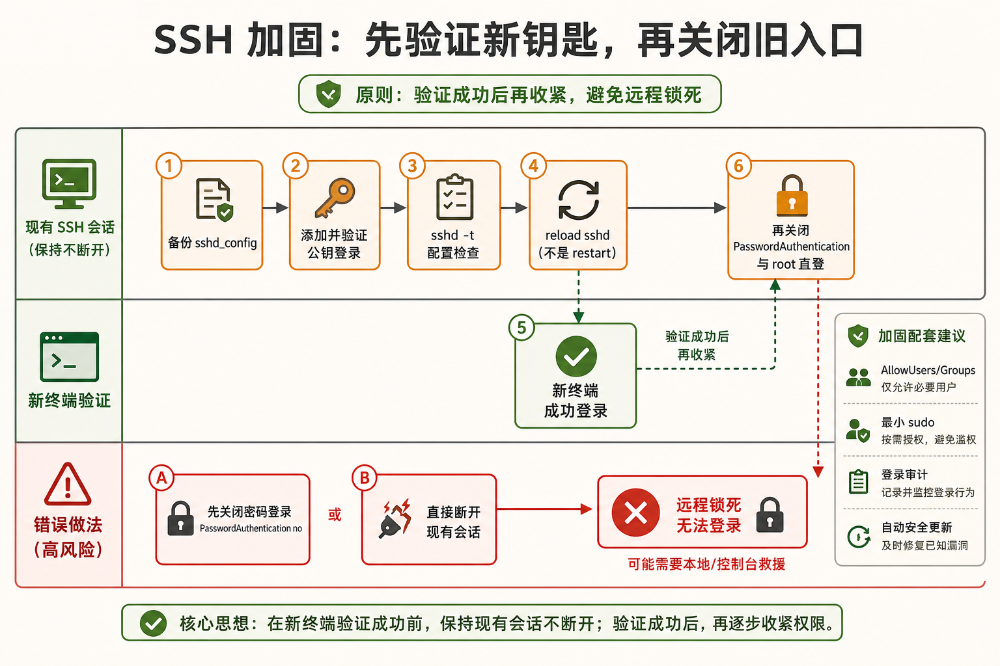
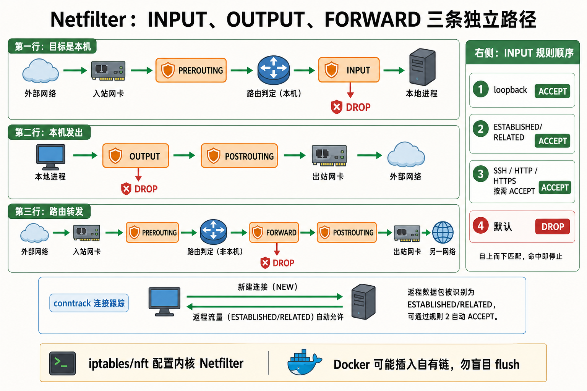
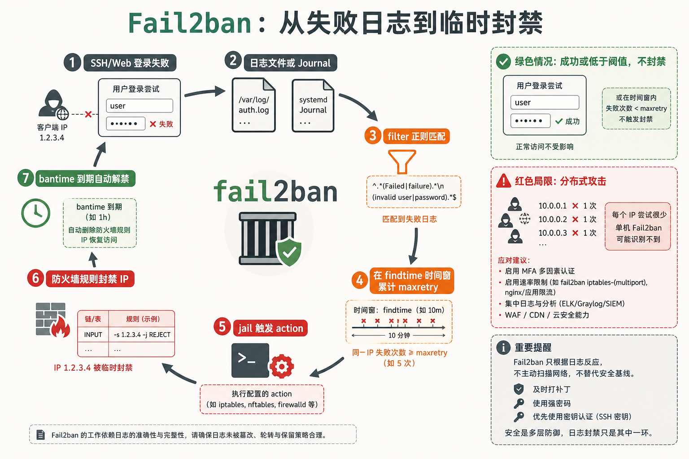
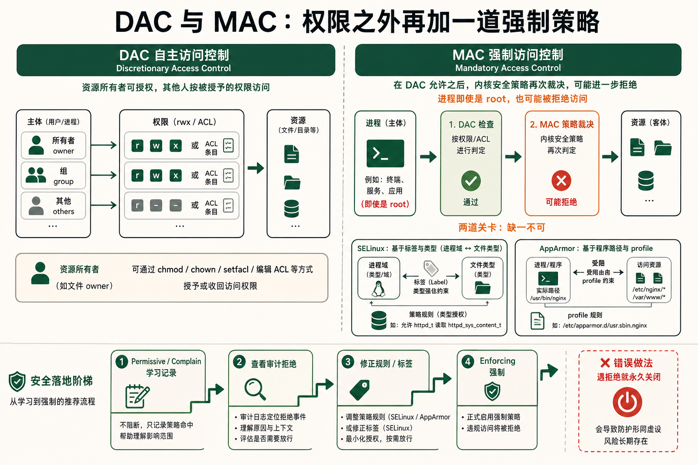

[← 返回 Linux 系统目录]({{ '/subjects/Linux/' | relative_url }})



# 安全与防火墙

## 1 安全加固清单 {#sec14-1}

### 一台刚装的 Ubuntu Server 距离"安全"还有多远 —— 10 步加固清单 · 必修 {#一台刚装的-ubuntu-server-距离安全还有多远-10-步加固清单-必修}

#### 问题：默认安装的 Linux 安全吗？

发行版的默认安全配置差异很大：root SSH 登录、密码认证和自动安全更新是否启用，都应以当前系统的有效配置为准，不能仅凭“默认安装”推断。开放公网访问前，先核对 `sshd -T`、更新策略、监听端口和防火墙规则，再按实际风险逐项加固。

下面十条是<strong>上公网的 Linux 必须执行的最低安全措施</strong>。这不是可选的"最佳实践"，而是"不做就是在赌运气"。

| 编号 | 加固项 | 配置位置 | 目的 |
|----|----|----|----|
| <strong>1</strong> | 禁用 root 直接 SSH 登录 | `/etc/ssh/sshd_config: PermitRootLogin no` | 防止暴力破解 root 密码。你只用普通用户登录，需要时 sudo |
| <strong>2</strong> | 启用 SSH 公钥认证，禁止密码登录 | `/etc/ssh/sshd_config: PasswordAuthentication no` + `PubkeyAuthentication yes` | 密码可以猜、可以撞库。4096 位 RSA 密钥不可暴力破解 |
| <strong>3</strong> | 修改 SSH 默认端口 (22 → 高位端口) | `/etc/ssh/sshd_config: Port 2222` | 不是真正的安全措施，但能过滤掉 99% 的自动扫描脚本 |
| <strong>4</strong> | 最小化安装原则 | 不安装不需要的包，用 `--no-install-recommends` | 减少攻击面。每个安装的包都是潜在的漏洞入口 |
| <strong>5</strong> | 启用自动安全更新 | `apt install unattended-upgrades` + 配置 | 已知漏洞的补丁安装不应依赖人工记忆 |
| <strong>6</strong> | 配置防火墙 (iptables/ufw)，默认拒绝入站 | `ufw default deny incoming` | 只开放你明确需要的端口，其余全部拒绝 |
| <strong>7</strong> | 安装 Fail2ban | `apt install fail2ban` | 检测暴力破解 → 自动封禁攻击 IP |
| <strong>8</strong> | 禁止 ICMP redirect / IP forwarding | `/etc/sysctl.conf` 中设置 net.ipv4 内核参数 | 防止中间人攻击和路由劫持 |
| <strong>9</strong> | 定期审计已安装包与监听端口 | `ss -tlnp` + `dpkg -l` 审计 | 确认没有意外开启的服务在监听公网端口 |
| <strong>10</strong> | 日志集中与监控告警 | rsyslog → 远程日志服务器 或 journald → ELK | 黑客第一件事是删日志。日志不在本地，他就删不掉 |

#### 第 1~3 条：SSH 加固的完整操作

```bash
# === 第一步：在修改 SSH 配置之前，先确认你可以用密钥登录（重要！）===
# 生成 SSH 密钥对（在本地工作机上执行，不是在服务器上）
ssh-keygen -t ed25519 -C "your_email@example.com"

# 把公钥复制到服务器
ssh-copy-id -i ~/.ssh/id_ed25519.pub user@your-server

# 验证：用密钥登录（不应要求输入密码）
ssh user@your-server

# === 第二步：修改 SSH 配置 ===
sudo cp /etc/ssh/sshd_config /etc/ssh/sshd_config.bak.$(date +%Y%m%d)
sudo vim /etc/ssh/sshd_config

# 修改以下配置项：
# PermitRootLogin no          ← 禁用 root 直接登录
# PubkeyAuthentication yes    ← 启用公钥认证
# PasswordAuthentication no   ← 禁用密码登录（确认密钥能用后再关！）
# Port 2222                   ← 可选：改端口（别忘了在防火墙放行新端口）

# 测试新配置的语法是否正确
sudo sshd -t

# 重载 SSH 配置（保持当前连接不断开！）
sudo systemctl reload sshd
```

<strong>致命错误警告</strong><br>
<strong>在禁用 PasswordAuthentication 之前，必须先用密钥成功登录一次！</strong>如果先把密码关掉、然后发现密钥复制失败了——你从这台机器上被彻底锁死了，只能通过 VNC 或云控制台恢复。<br>
<strong>重载 sshd 时用 reload 而不要用 restart。</strong>reload 会让 sshd 重新读取配置文件，但不会断开现有的 SSH 连接。restart 会杀掉所有当前连接——包括你自己的。

### 自动安全更新 —— 补丁比漏洞晚一天叫事故，同年叫灾难 · 核心 {#自动安全更新-补丁比漏洞晚一天叫事故同年叫灾难-核心}

#### 问题：手动执行 apt upgrade 的频率有多高？够不够快？

2021 年的 Log4Shell 漏洞在公开当天就出现了扫描 exploit。如果运维是第二天才手动更新——整个第一天，你的所有 Java 应用都在对着公网敞着大门。<strong>对于已知的 CVE，手动更新永远不够快。</strong>Debian/Ubuntu 提供 `unattended-upgrades` 这个包，可以把安全补丁的安装变成全自动的。

```bash
# 安装并启用自动安全更新
sudo apt install unattended-upgrades apt-listchanges
sudo dpkg-reconfigure -plow unattended-upgrades

# 编辑配置文件，控制哪些更新自动安装
sudo vim /etc/apt/apt.conf.d/50unattended-upgrades

# 核心配置段：
Unattended-Upgrade::Allowed-Origins {
    "${distro_id}:${distro_codename}-security";  # 只自动安装安全更新
    # 下面三行默认是注释掉的——不要打开，否则普通更新也自动安装了
    # "${distro_id}:${distro_codename}-updates";
};
# 自动移除不再需要的依赖包
Unattended-Upgrade::Remove-Unused-Dependencies "true";
# 自动重启（仅当需要重启时）
Unattended-Upgrade::Automatic-Reboot "true";
Unattended-Upgrade::Automatic-Reboot-Time "02:00";
# 邮件通知
Unattended-Upgrade::Mail "admin@example.com";

# 验证自动更新是否在正常工作
sudo systemctl status unattended-upgrades
cat /var/log/unattended-upgrades/unattended-upgrades.log | tail -20
```

<strong>自动更新 ≠ 盲目更新</strong><br>
`unattended-upgrades` 默认只安装来自 `-security` 通道的包——这些是 Debian 安全团队验证过的补丁，不会改变软件的行为版本号，只打漏洞补丁。它不会自动升级 MySQL 8.0 到 8.1，只会在 MySQL 8.0 出了安全漏洞时打补丁。对于数据库这样的核心服务，你仍然应该手动控制大版本升级的时间窗口。

#### 安全审计：看看你的安全有多"漏"

```bash
# 当前有哪些服务在监听端口（检查是否暴露了不该暴露的）
ss -tlnp | grep LISTEN
# 输出示例：22 (sshd), 3306 (mysql 绑在 0.0.0.0 上！), 80 (nginx)
# 3306 绑定 0.0.0.0 意味着 MySQL 直接暴露在公网——这是一个严重问题

# 修复：把 MySQL 绑定到 127.0.0.1（只允许本地连接）
sudo vim /etc/mysql/mysql.conf.d/mysqld.cnf
# 修改: bind-address = 127.0.0.1

# 查看所有已安装的包（审计不需要的包）
dpkg -l | grep -v '^ii'    # 已移除但仍留了配置的包
dpkg -l | wc -l            # 总包数——越多越不安全
```



## 2 iptables 基础 —— 内核级防火墙 {#sec14-2}

### iptables 三链五表 —— 每个数据包在 Linux 内核里的"过五关" · 核心 {#iptables-三链五表-每个数据包在-linux-内核里的过五关-核心}

#### 问题：ufw 一条 allow 命令背后，iptables 到底做了什么？

`iptables` 是配置 Linux Netfilter 规则的用户态工具，实际匹配在内核路径中发生。包会根据入站、转发或本机发出等路径经过相应钩子，而不是每个包都走同一条链。现代发行版可能使用 `iptables-nft` 兼容层或直接使用 nftables；先用 `iptables -V`、`nft list ruleset` 确认当前后端，再选择管理工具。

iptables 的核心概念只有三个：<strong>链</strong>（chain，数据包经过的位置）、<strong>表</strong>（table，做什么类型的处理）、<strong>规则</strong>（rule，匹配条件和动作）。一条规则的结构如下：`iptables -A 链名 -p 协议 --dport 端口 -j 动作`。

#### 三条默认链（Chain）——数据包的三个必经岗哨

| 链名 | 触发时机 | 用于什么场景 |
|----|----|----|
| <strong>INPUT</strong> | 数据包到达本机网络栈，目标 IP 是本机 | 保护本机：开放 SSH 端口、拒绝外部扫描 |
| <strong>OUTPUT</strong> | 本机进程发出的数据包 | 限制本机对外访问：禁止服务器连接外部未知地址 |
| <strong>FORWARD</strong> | 数据包不发给本机，需要经过本机转发到其他主机 | 服务器做路由器/NAT/堡垒机时使用。普通服务器这条链通常为空 |

<strong>INPUT 链的策略是关键：</strong>`-P INPUT DROP` 会拒绝未匹配到放行规则的入站包。远程主机上必须先确认 SSH 端口、现有连接和回滚通道，再添加放行规则，最后才切换默认策略；否则执行到一半就可能断开管理会话。下例仅用于说明顺序，实际还需结合 IPv6、当前规则集与发行版防火墙管理器。

```bash
# === 先核对现有规则和管理端口，再添加放行规则 ===
# 回环、已建立连接、SSH 和业务端口都要先加入规则
# 1. 允许回环接口（localhost 必须通——很多服务依赖它）
iptables -A INPUT -i lo -j ACCEPT

# 2. 允许已建立连接和相关的回复流量（最关键的一条规则）
iptables -A INPUT -m state --state ESTABLISHED,RELATED -j ACCEPT

# 3. 允许 SSH（端口 22）
iptables -A INPUT -p tcp --dport 22 -j ACCEPT

# 4. 允许 HTTP/HTTPS（如果你的服务器是 Web 服务器）
iptables -A INPUT -p tcp --dport 80 -j ACCEPT
iptables -A INPUT -p tcp --dport 443 -j ACCEPT

# 5. 允许 ICMP ping（方便排错，生产环境也建议保留）
iptables -A INPUT -p icmp --icmp-type echo-request -j ACCEPT

# 6. 核对放行规则及回滚通道后，最后收紧默认策略
iptables -P INPUT DROP
```

<strong>理解 ESTABLISHED,RELATED 这条规则的重要性。</strong>当你的服务器向外部发起了一个连接（比如 apt update 去连 Ubuntu 的仓库），回复的数据包进入你的服务器时，它不是"新的入站连接"——它是已经建立的出站连接的回复。如果没有 ESTABLISHED,RELATED 规则，INPUT 链默认 DROP 会把这部分合法的回包也丢掉，导致你的服务器无法访问外网。

### iptables 实用命令 —— 查看、保存、恢复 · 操作 {#iptables-实用命令-查看保存恢复-操作}

#### 问题：配了 iptables 规则，重启后全没了？

运行时规则由内核维护，若没有持久化服务，重启后不会自动恢复。Debian/Ubuntu 可按需使用 `iptables-persistent`；部分旧版 RHEL/CentOS 可用 `iptables-services`，新版系统通常由 firewalld/nftables 管理。避免让多个工具同时修改同一套规则，并在远程操作前确认保留 SSH 管理通道。

```bash
# === 查看规则 ===
iptables -L -n -v              # 详细列表（-n 不解析 DNS 加速, -v 显示计数器和流量）
iptables -L -n -v --line-numbers  # 带行号，方便删除

# === 删除规则 ===
iptables -D INPUT 3            # 删除 INPUT 链的第 3 条规则
iptables -F INPUT              # 清空 INPUT 链的所有规则（危险！配合默认 DROP 会断开所有连接）
iptables -F                    # 清空所有链的所有规则（更危险！）

# === 插入规则（在指定行号位置插入）===
iptables -I INPUT 1 -p tcp --dport 8080 -j ACCEPT  # 在 INPUT 链第 1 位插入

# === 保存与恢复（Debian/Ubuntu）===
sudo apt install iptables-persistent netfilter-persistent
sudo netfilter-persistent save     # 保存当前规则（重启后生效）
sudo netfilter-persistent reload   # 从配置文件重新加载规则
# 规则实际保存在: /etc/iptables/rules.v4 和 /etc/iptables/rules.v6

# === 保存与恢复（传统方式）===
sudo iptables-save > /etc/iptables.rules
sudo iptables-restore < /etc/iptables.rules
```

<strong>iptables 和 Docker 的冲突</strong><br>
Docker 会在 iptables 里添加自己的 FORWARD 和 NAT 规则来实现容器网络和端口映射。如果你执行 `iptables -F` 清空所有规则，Docker 的网络会直接崩掉——容器将无法访问外网。处理 Docker 规则时，只删除你自己添加的部分，不要动 Docker 自动生成的 `DOCKER` 链。



## 3 ufw —— iptables 的简化前端 {#sec14-3}

### ufw —— 如果你不想手写 iptables 规则，就用它 · 推荐 {#ufw-如果你不想手写-iptables-规则就用它-推荐}

#### 问题：iptables 的命令实在太难记了，有没有简化的办法？

ufw (Uncomplicated Firewall) 是 iptables 的一个"人性化前端"。你在 ufw 里敲一个 `ufw allow 22/tcp`，它会在底层生成相应的 iptables 规则并插入到合适的位置。ufw 最大的好处不是省键盘——而是<strong>规则的可读性</strong>。三个月后你回来看 iptables 规则，可能自己都看不懂；回来看 ufw 规则，一目了然。

```bash
# === 安装与启用 ===
sudo apt install ufw

# 启用前先确认 SSH 端口已放行！（否则你会把自己锁在外面）
sudo ufw allow 22/tcp        # 先放行 SSH

# 设置默认策略
sudo ufw default deny incoming   # 入站默认拒绝
sudo ufw default allow outgoing  # 出站默认允许

sudo ufw enable               # 启用防火墙
sudo ufw status verbose       # 查看详细状态和规则列表
```

▶ ufw status verbose 输出示例

```yaml
Status: active
Logging: on (low)
Default: deny (incoming), allow (outgoing), deny (routed)
New profiles: skip

To                         Action      From
--                         ------      ----
22/tcp                     ALLOW IN    Anywhere
80,443/tcp                 ALLOW IN    Anywhere
22/tcp (v6)                ALLOW IN    Anywhere (v6)
80,443/tcp (v6)            ALLOW IN    Anywhere (v6)
```

#### 日常操作：允许、拒绝、限制、删除

```bash
# === 基本放行规则 ===
ufw allow 22/tcp                    # 放行 TCP 22 端口
ufw allow 80,443/tcp                # 放行多个端口
ufw allow 3000:4000/tcp             # 放行一个端口范围
ufw allow from 192.168.1.0/24       # 放行来自某个内网的流量
ufw allow from 192.168.1.0/24 to any port 3306 proto tcp  # 指定来源+目标+端口+协议

# === 拒绝特定 IP（屏蔽内鬼）===
ufw deny from 192.168.1.100         # 拒绝该 IP 的所有流量
ufw deny from 10.0.0.0/8           # 拒绝整个网段
ufw deny out to 8.8.8.8            # 拒绝本机访问某个目标（出站限制）

# === 限制连接（比 deny 温和——限速但不完全封禁）===
ufw limit 22/tcp                    # SSH 端口限速，每个 IP 在 30 秒内最多新建 6 个连接
# 底层原理：ufw 添加了一条 iptables limit 规则，连接超过阈值后自动拒绝
# 这可以拦住暴力破解的基本流量而不影响正常使用

# === 删除规则 ===
ufw status numbered                 # 带编号查看
ufw delete 3                        # 删除编号为 3 的规则
ufw delete allow 8080/tcp           # 按规则内容精确删除

# === 日志设置 ===
ufw logging on                      # 开启日志（记录在 /var/log/ufw.log）
ufw logging medium                  # 中等详细度（默认 low）
ufw logging off                     # 关闭日志（不推荐——出问题时没有排查线索）
```

<strong>ufw 大忌：在 SSH 连接中调 ufw enable 之前不确认放行 SSH</strong><br>
这个错误几乎每个运维新手都会犯一次。SSH 到服务器 → 敲 `ufw enable` → 默认策略 DROP incoming → SSH 连接断开 → 你被锁在外面了。正确的顺序永远是： <strong>先放行 SSH → 再设置默认策略 → 最后 enable</strong>。云服务器可以通过 VNC 控制台救回来，物理服务器就只能跑机房了。

## 4 Fail2ban —— 防暴力破解神器 {#sec14-4}

### Fail2ban 的原理：监控日志 → 识别攻击模式 → 自动封 IP · 核心 {#fail2ban-的原理监控日志-识别攻击模式-自动封-ip-核心}

#### 问题：SSH 公网开放了，24 小时后 auth.log 里多了十万条登录失败 {#问题ssh-公网开放了24-小时后-auth.log-里多了十万条登录失败}

任何暴露在公网的 SSH 服务器都会在几分钟内被扫描到。攻击者不会手动尝试密码——他们用自动化工具（Hydra、Ncrack）对着字典轮番尝试。一天几十万次的尝试量，虽然密码足够复杂就不会被猜中，但持续的攻击会给系统带来持续的负载（每个 SSH 连接尝试都涉及加密握手）。

Fail2ban 的工作机制非常简单：它有一个<strong>filter</strong>（过滤器），用正则表达式去实时监控日志文件（如 `/var/log/auth.log`）；当发现某个 IP 在指定时间内（如 10 分钟）失败达到指定次数（如 5 次），它就在 iptables 中添加一条规则——把那个 IP 的流量全部 DROP 掉，持续一段时间（如 1 小时）；时间过后自动释放。这就是自愈式安全——不需要人介入，攻击自动被封堵。

```bash
# === 安装 ===
sudo apt install fail2ban

# 安装后默认就启用了 sshd jail，无需额外配置即可工作
# 但默认配置比较保守，建议定制

# === 创建本地配置文件（不要直接修改 /etc/fail2ban/jail.conf！）===
# jail.conf 是上游配置文件，升级 fail2ban 时会被覆盖
# 你的自定义配置应该写在 jail.local 里，它会覆盖 jail.conf 中的相同设置
sudo cp /etc/fail2ban/jail.conf /etc/fail2ban/jail.local
sudo vim /etc/fail2ban/jail.local
```

#### 核心配置项详解

```bash
# /etc/fail2ban/jail.local 中的关键配置
[DEFAULT]
# IP 被封禁的时间（秒）。默认 600（10分钟），生产建议 3600（1小时）
bantime = 3600

# 查找的时间窗口（秒）。在这个时间窗口内失败次数达到阈值就封禁
findtime = 600       # 10 分钟窗口

# 失败次数阈值。findtime 内失败 maxretry 次即触发封禁
maxretry = 5

# 动作：封禁时做什么。默认是 iptables-multiport——加到 iptables DROP
banaction = iptables-multiport
# 也可以用 ufw——会在 ufw 中添加拒绝规则
# banaction = ufw

# 忽略的 IP（永远不会被封禁的白名单）
ignoreip = 127.0.0.1/8 192.168.0.0/16 10.0.0.0/8

# === sshd jail 配置 ===
[sshd]
enabled = true
port    = ssh
logpath = %(sshd_log)s      # 自动识别 /var/log/auth.log
maxretry = 3                 # SSH 更严格：10分钟内失败3次即封

# === nginx-http-auth jail（保护有密码的 Web 目录）===
[nginx-http-auth]
enabled = true
port    = http,https
logpath = /var/log/nginx/error.log
maxretry = 5
```

#### 日常运维命令

```bash
# 重启 Fail2ban 使配置生效
sudo systemctl restart fail2ban

# 查看所有 jail 的状态
sudo fail2ban-client status

# 查看某个 jail 的详细状态——当前封禁了多少 IP
sudo fail2ban-client status sshd
# 输出示例：
# Status for the jail: sshd
# |- Filter
# |  |- Currently failed: 3          ← 当前有 3 个 IP 失败了但还没达到阈值
# |  `- Total failed: 15234          ← 历史总失败次数
# `- Actions
#    |- Currently banned: 28         ← 当前有 28 个 IP 被封了
#    `- Total banned: 1200           ← 历史总封禁数

# 手动解封某个 IP（需要解封时）
sudo fail2ban-client set sshd unbanip 192.168.1.100

# 手动添加封禁
sudo fail2ban-client set sshd banip 10.0.0.50

# 查看 Fail2ban 在 iptables 中添加了哪些规则
sudo iptables -L f2b-sshd -n -v
```

<strong>Fail2ban 不是万能的</strong><br>
Fail2ban 只能防暴力破解（同 IP 反复尝试）。对于分布式攻击——攻击者用一万个不同的 IP，每个 IP 只试一次——Fail2ban 无法拦截（因为没有一个 IP 达到次数阈值）。对于这种攻击，需要使用更高级的威胁情报服务（如 CrowdSec 或 Cloudflare WAF）或 VPN/跳板机来隐藏 SSH 端口。



## 5 SELinux / AppArmor —— 强制访问控制 {#sec14-5}

### DAC 不够 —— 为什么 root 也需要被限制 · 核心 {#dac-不够-为什么-root-也需要被限制-核心}

#### 问题：Linux 的 rwx 权限还不够安全吗？

传统的 Linux 权限模型叫 DAC（Discretionary Access Control，自主访问控制）——文件所有者可以自己决定谁能读、谁能写。这个模型有一个根本缺陷：<strong>如果某个进程以 root 身份运行，它可以访问任何文件。</strong>一个被远程代码执行漏洞攻陷的 Nginx 进程（以 www-data 运行）可以读写 `/var/www/html/`，理论上不应该能访问 `/etc/shadow`——但在 DAC 模型下，如果该进程能通过提权漏洞变成 root，它就可以访问一切。

<strong>MAC（Mandatory Access Control，强制访问控制）解决了这个问题。</strong>MAC 的规则不由用户设定，而是由系统管理员设定的全局策略——<strong>策略比用户权限更高</strong>。在 MAC 下，即使你拿到了 root 权限，只要策略说这个进程不能读那个文件，root 也读不了。这是纵深防御（Defense in Depth）的经典体现：防火墙是第一层，最小权限是第二层，MAC 是第三层——每一层被突破后，下一层继续保护系统。

#### SELinux 与 AppArmor —— 两大 MAC 阵营 {#selinux-与-apparmor-两大-mac-阵营}

| 特性 | SELinux | AppArmor |
|----|----|----|
| <strong>默认使用的发行版</strong> | RHEL / CentOS / Fedora / Rocky / Alma | Debian / Ubuntu / openSUSE |
| <strong>策略粒度</strong> | 文件路径 + inode + 进程标签（进程→文件映射，路径无关） | 文件路径（path-based） |
| <strong>配置方式</strong> | 标签系统（type enforcement）+ 丰富的布尔开关 | 每个应用一个 profile 文件（AA profile） |
| <strong>学习曲线</strong> | 陡峭——概念多（类型、域、角色、MLS） | 平缓——profile 像一种简单的配置语法 |
| <strong>排错工具</strong> | `audit2allow` 从审计日志生成策略，`sealert` 分析告警 | `aa-logprof` 交互式更新 profile |
| <strong>三模式</strong> | enforcing（强制执行）/ permissive（只记录不阻止）/ disabled | enforce（强制执行）/ complain（只记录不阻止） |

#### SELinux：强大的代价是复杂

```bash
# 查看 SELinux 状态
getenforce
# 输出: Enforcing（正在执行）/ Permissive（只记录）/ Disabled（关闭）

# 查看详细状态
sestatus
# 输出: SELinux status: enabled, SELinuxfs mount: /sys/fs/selinux,
#       Current mode: enforcing, Mode from config file: enforcing,
#       Policy version: 33, Policy from config file: targeted

# 临时切换模式（不需要重启）
sudo setenforce 0       # 改为 Permissive（调试用）
sudo setenforce 1       # 改回 Enforcing

# 永久修改：编辑 /etc/selinux/config
# SELINUX=enforcing → SELINUX=permissive

# 查看为何某个操作被 SELinux 拒绝了
sudo sealert -a /var/log/audit/audit.log
# 它会告诉你：什么进程访问什么文件被拒绝，并提供修复命令

# 从审计日志自动生成策略模块（排错神器）
sudo grep denied /var/log/audit/audit.log | audit2allow -M mypolicy
sudo semodule -i mypolicy.pp
```

<strong>SELinux 排错顺序：</strong>先用 `getenforce` 确认状态，再查看 AVC 审计事件，检查文件标签、布尔值和服务预期访问路径。优先用 `restorecon`、`semanage fcontext` 或已有布尔值解决配置问题；仅在短时诊断时考虑 permissive。`audit2allow` 会把日志中的拒绝转成策略，必须逐条审查权限范围，不能直接生成并加载，否则可能放宽超出预期的访问。

#### AppArmor：比 SELinux 简单得多

```bash
# 查看 AppArmor 状态
sudo aa-status
# 输出: apparmor module is loaded.
#   X profiles are loaded. X profiles are in enforce mode.

# 列出所有受 AppArmor 约束的进程
sudo aa-status | grep -A 100 "processes are in enforce"

# 查看某个 profile（例如 MySQL 的）
cat /etc/apparmor.d/usr.sbin.mysqld

# 切换某个 profile 为 complain 模式（调试用）
sudo aa-complain /usr/sbin/mysqld

# 切换回 enforce 模式
sudo aa-enforce /usr/sbin/mysqld

# 使用 aa-logprof 分析日志，交互式更新 profile（类似 SELinux 的 audit2allow）
sudo aa-logprof
```

<strong>生产环境中的 MAC 使用原则</strong><br>
1. <strong>不要在刚部署应用时开 enforcing 模式。</strong>先 permissive/complain，确认一切正常后再 enforce。<br>
2. <strong>不要因为"麻烦"就永久关闭 MAC。</strong>MAC 是防御内核/服务漏洞的最后一道屏障。历史上多次大规模 Linux 漏洞（如 Dirty Cow）在 SELinux enforcing 的系统上无法被利用。<br>
3. <strong>容器中 SELinux 尤其重要。</strong>Docker 容器共享宿主内核，如果一个容器逃逸到宿主机，SELinux 的标签机制能在内核层面阻止它访问宿主文件。



## 注解

<strong>DAC</strong> · Discretionary Access Control 自主访问控制

<strong>ICMP</strong> · Internet Control Message Protocol 互联网控制消息协议

<strong>MAC</strong> · Mandatory Access Control 强制访问控制

<strong>WAF</strong> · Web Application Firewall Web 应用防火墙



<nav class="article-end" aria-label="章节导航">
  <a href="{{ '/subjects/Linux/13-%E6%97%A5%E5%BF%97%E7%AE%A1%E7%90%86%E4%B8%8Ejournald.html' | relative_url }}">← 上一章：日志管理</a>
  <a href="{{ '/subjects/Linux/' | relative_url }}">返回 Linux 系统目录</a>
  <a href="{{ '/subjects/Linux/15-%E5%A4%87%E4%BB%BD%E4%B8%8E%E6%81%A2%E5%A4%8D%E7%AD%96%E7%95%A5.html' | relative_url }}">下一章：备份与恢复策略 →</a>
</nav>
