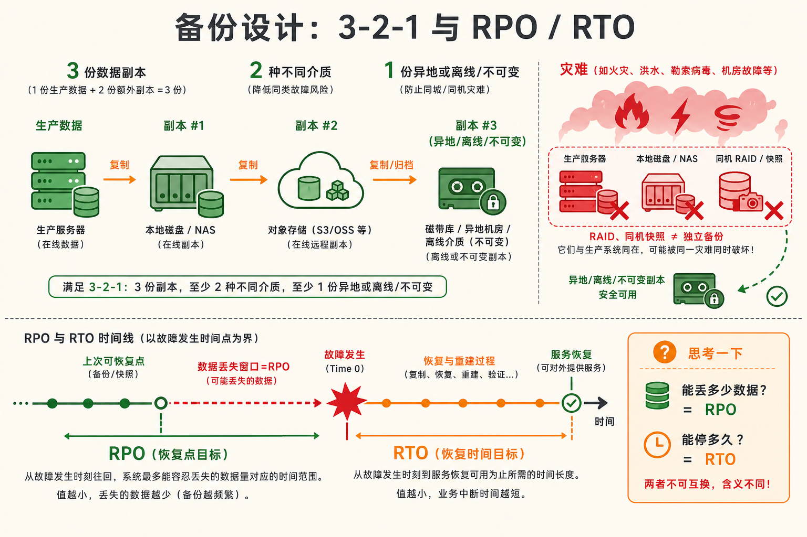
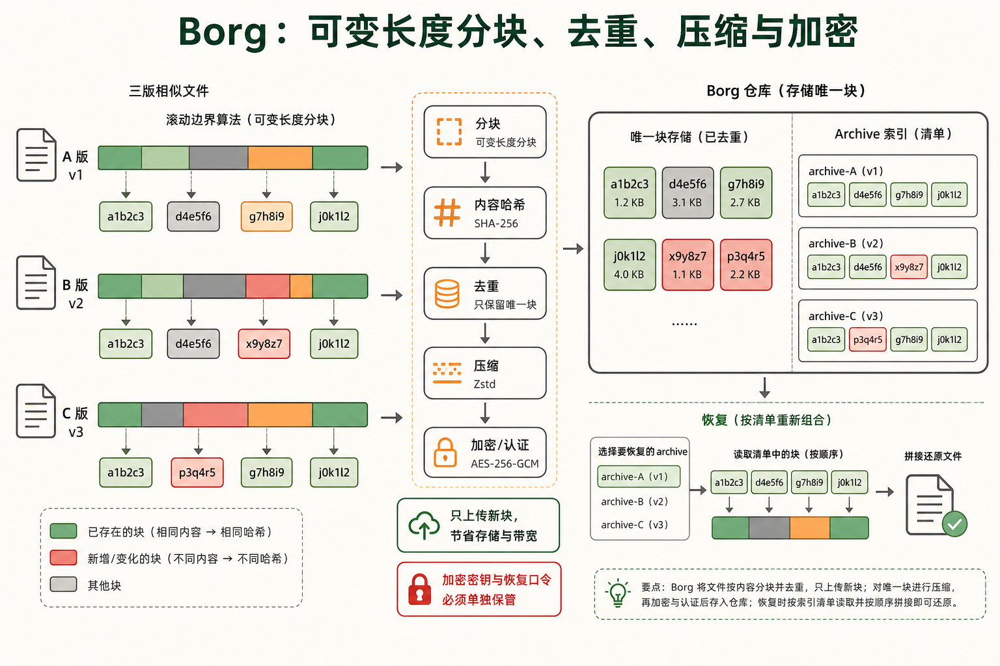
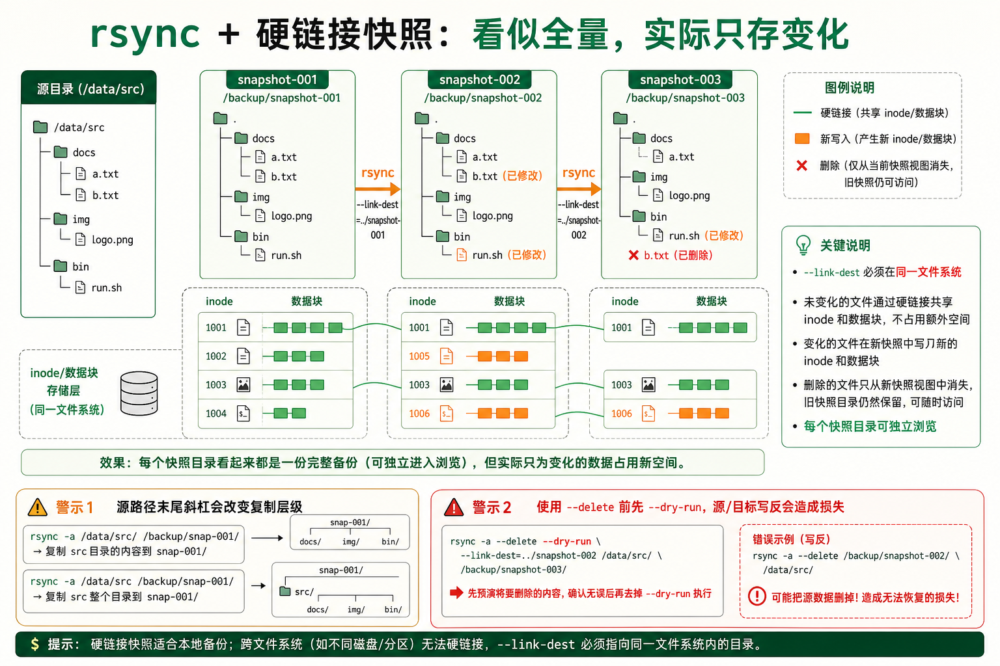
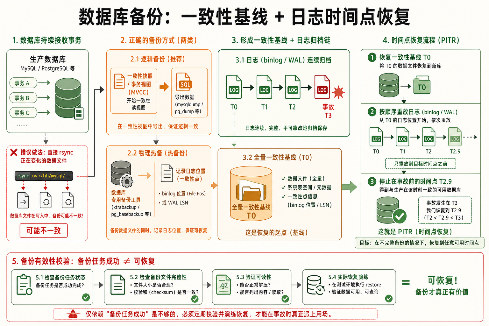
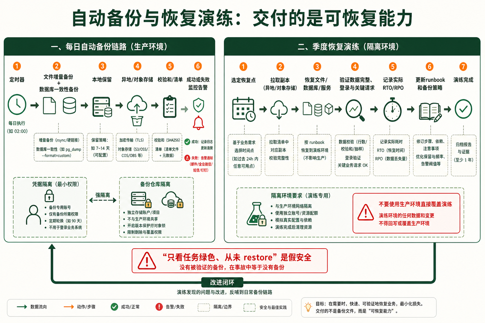

[← 返回 Linux 系统目录]({{ '/subjects/Linux/' | relative_url }})



# 备份与恢复策略

*数据安全的最后一道防线 —— 备份不是成本，恢复能力才是真正的资产*

操 / 安 / 实 · 风格：问题驱动 · 追本溯源 · 目标：建立可恢复的备份体系，把灾难降级为麻烦

## 1 3-2-1 备份原则 {#sec15-1}

### 3 份数据 x 2 种介质 x 1 份异地 —— 为什么这个公式值千金 · 核心 {#份数据-x-2-种介质-x-1-份异地-为什么这个公式值千金-核心}

#### 问题：只有一个备份文件就安全了吗？

假设你的服务器在阿里云华东1区，你设定每天凌晨3点在该服务器本地做一次全量备份，命名为 `/backup/mysql_daily.sql.gz`。某天下午2点华东1区的某个机房发生火灾，你的服务器和它上面的备份一起化为乌有——你失去了所有数据。

这就是 3-2-1 原则要解决的问题。<strong>备份不是存档——备份是"当灾难发生时你有能力恢复"的保障。</strong>3-2-1 原则是所有备份体系的基石：

##### 3：保存 3 份完整的数据 {#保存-3-份完整的数据}

1 份生产数据 + 2 份备份。两份备份在不同时间点、不同位置，提供交叉保护。如果第一份备份因静默损坏而失效，你还有第二份。

##### 2：使用 2 种不同的存储介质 {#使用-2-种不同的存储介质}

比如：本地磁盘 + 对象存储（S3/OSS），或本地 NAS + 异地磁带。不同介质有不同的故障模式——磁盘坏道和云存储权限误删不会同时发生。

##### 1：至少 1 份备份存放在异地 {#至少-1-份备份存放在异地}

"异地"意味着物理距离——至少 100 公里以上，或跨越云厂商的 Region。火灾、地震、洪水——异地备份是唯一对抗物理灾难的武器。

<strong>3-2-1 的关键是减少相关故障</strong><br>
只有在故障彼此独立时，才可以把单份损坏概率简单相乘。现实中误删、勒索软件、账号泄露和同机房故障会同时影响多份副本，所以“多份”还必须配合异地、隔离权限、不可变或离线副本及定期恢复演练；不能宣称丢失概率接近零。

#### 常见的三个备份误区

<strong>误区一：RAID 就是备份。</strong>RAID 保护的是磁盘物理故障。但如果有人执行了 `rm -rf /`，RAID 会忠实地在两个盘上同时删除那个目录。<strong>RAID 解决的是可用性（availability），备份解决的是恢复性（recoverability）。</strong>

<strong>误区二：云快照就是备份。</strong>云厂商的快照（Snapshot）不能替代完整的备份策略。快照和你的生产环境在同一个云账号下——账号被盗或被误删除，快照和 ECS 会一起消失。<strong>快照要复制到另一个账号或另一个 Region。</strong>

<strong>误区三：做了备份就等于安全。</strong>一个从没被恢复过的备份是薛定谔的备份——你无法确定它在需要时能否成功恢复。只有经过实际恢复演练的备份才是真正的保险。

### RTO 与 RPO —— 运维角度的两个核心指标 · 进阶 {#rto-与-rpo-运维角度的两个核心指标-进阶}

#### 问题：做备份要花多少钱？怎么回答老板？

备份的成本应该用两个指标来量化：

| 指标 | 全称 | 含义 | 影响成本 |
|----|----|----|----|
| <strong>RTO</strong> | Recovery Time Objective | 从灾难发生到服务恢复可用的<strong>最长可接受时间</strong> | RTO 越短 → 需热备/双活/自动切换 → 成本指数增长 |
| <strong>RPO</strong> | Recovery Point Objective | 允许丢失的数据量（以<strong>时间长度</strong>表示） | RPO 越小 → 备份频率越高 → 存储和带宽成本越高 |

举例：电商网站设定 RTO=4h、RPO=1h。如果下午 2:00 数据库崩溃，目标是在 6:00 前恢复服务，并让可恢复的数据点不早于 1:00。每小时备份是实现 RPO 的一种方式；连续归档事务日志或复制也可能提供更细的恢复点，但都要验证链路完整。RTO 还取决于数据量、传输、恢复步骤和演练结果，自动化脚本只是缩短恢复时间的手段之一。

<strong>老板问"备份要多少钱"时的回答框架：</strong>给出阶梯式方案——RPO=24h 方案成本 X 元/月，RPO=1h 方案成本 Y 元/月，RPO=5min 方案成本 Z 元/月。让业务方根据自身损失承受能力来选择。数据丢失 1 天的业务损失是多少？把这个数字和 Y 比较。



## 2 备份工具对比 {#sec15-2}

### 四大备份工具的适用场景 —— rsync / tar / dd / BorgBackup · 核心 {#四大备份工具的适用场景-rsync-tar-dd-borgbackup-核心}

#### 问题：备份工具这么多，该用哪个？

| 工具 | 本质 | 速度 | 空间占用 | 适用场景 |
|----|----|----|----|----|
| <strong>rsync</strong> | 文件级增量同步（只传差异） | 增量极快 | 快照完整 + 硬链接可去重 | 文件服务器、代码仓库、日志归档的日常同步 |
| <strong>tar</strong> | 完整归档（打包+压缩） | 全量慢 | 压缩后体积小 | 临时备份、迁移前打快照 |
| <strong>dd</strong> | 位级镜像（逐扇区复制） | 极慢 | 占满全盘空间 | 磁盘克隆、取证镜像（非日常备份用） |
| <strong>BorgBackup</strong> | 去重+压缩+加密增量备份 | 增量极快 | 去重后空间极小 | 现代生产环境首选推荐方案 |

#### tar —— 最简单直接的归档工具 {#tar-最简单直接的归档工具}

tar (Tape ARchive) 是 Linux 上最通用的打包工具。tar 本身只做打包（把多个文件拼成一个大文件，保留目录结构和权限），配合 gzip/bzip2/xz 来做压缩。

```bash
# 创建一个完整的 gzip 压缩备份
tar czf /backup/full_backup_$(date +%Y%m%d).tar.gz /etc /home /var/www
# c=创建归档, z=gzip压缩, f=指定文件名

# 列出归档内容（不解压查看）
tar tzf /backup/full_backup_20260731.tar.gz

# 解压到指定目录（恢复时用）
tar xzf /backup/full_backup_20260731.tar.gz -C /restore/path/
```

<strong>tar 的缺陷：</strong>每次备份都是全量——备份 100GB 的目录需要 100GB 的存储空间（压缩后 30-50GB）。每天备份，一个月需要 1.5TB。tar 没有去重能力，同样的文件在 30 个备份中存储了 30 份。

#### dd —— 位级磁盘镜像 {#dd-位级磁盘镜像}

```bash
# 全盘镜像（极度占用空间，只适合磁盘克隆场景）
dd if=/dev/sda of=/backup/disk_image.img bs=4M status=progress

# 恢复镜像到磁盘
dd if=/backup/disk_image.img of=/dev/sdb bs=4M status=progress
```

<strong>不要用 dd 做日常备份</strong><br>
dd 复制的是每一个扇区，包括空白的、已删除但未回收的空间。500GB 硬盘即使只用了 50GB 数据，dd 镜像仍是 500GB。dd 适用场景只有：磁盘克隆、取证镜像。日常备份绝不使用 dd。

### BorgBackup —— 现代备份工具的最佳选择 · 推荐 {#borgbackup-现代备份工具的最佳选择-推荐}

#### 有没有一个工具同时做到：增量、去重、压缩、加密、远程？

<strong>BorgBackup</strong> 与 <strong>Restic</strong> 是两个独立项目，不是同一个项目的语言改写版。两者都支持增量、去重、加密等能力，但仓库格式、哈希算法、压缩选项和存储后端不同：Borg 常经 SSH 访问仓库，Restic 原生支持多种本地与对象存储后端。选型时分别核对目标版本的后端、加密与恢复流程，不要把功能列表混用。

场景：服务器上有 500GB 网站文件，每天变化不到 100MB。使用 Borg：第一次全量耗时 2 小时，之后每天传输 100MB 左右，耗时不到 5 分钟。其中可能只有 20MB 是真正的新 chunk，另外 80MB 是已存在但被重新排列的 chunk。

```bash
# === 安装 Borg ===
sudo apt install borgbackup          # Debian/Ubuntu
sudo dnf install borgbackup          # RHEL/CentOS/Rocky

# === 初始化一个备份仓库 ===
borg init --encryption=repokey /backup/borg-repo

# === 创建第一次备份 ===
borg create /backup/borg-repo::backup-$(date +%Y%m%d) /etc /home /var/www

# === 后续增量备份（自动只处理变化部分）===
borg create /backup/borg-repo::backup-$(date +%Y%m%d) /etc /home /var/www

# === 查看备份列表 ===
borg list /backup/borg-repo

# === 查看备份的详细信息 ===
borg info /backup/borg-repo::backup-20260731
# 关键指标: Original size / Compressed size / Deduplicated size

# === 恢复某个备份 ===
mkdir /restore && cd /restore
borg extract /backup/borg-repo::backup-20260731

# === 清理旧备份 ===
borg prune --keep-daily=7 --keep-weekly=4 --keep-monthly=6 /backup/borg-repo
# 保留: 最近7天 + 最近4周 + 最近6个月

# === 远程备份 ===
borg init user@backup-server:/backup/borg-repo --encryption=repokey
borg create user@backup-server:/backup/borg-repo::backup-$(date +%Y%m%d) /etc /home
```

<strong>Borg 的去重原理（变长分块 content-defined chunking）</strong><br>
Borg 根据内容决定切割点（用滚动哈希找特征边界）。即使在文件中间插入了一条记录，只有插入点附近的 chunk 会变化，其余不变。这种算法在日志文件和 binlog 这种"追加写"场景下效果极显著——99% 内容不变，只有尾部 chunk 需要存储。



## 3 rsync 深度实战 {#sec15-3}

### rsync —— 增量同步的王牌，运维的日常工具 · 核心 {#rsync-增量同步的王牌运维的日常工具-核心}

#### 问题：rsync 和 scp 有什么区别？

`scp` 通常按文件传输；`rsync` 能先比较元数据，并在适当条件下利用滚动校验和传输文件内变化块。实际传输量还包括校验、协议开销和压缩影响；压缩数据库 dump 的少量逻辑变化也可能导致大量字节变化，不能保证“改 5MB 就只传 5MB”。应针对真实备份文件测量传输效果。

<strong>rsync 的另一个特性是可选择保留元数据。</strong>`-a` 会保留权限、时间戳、符号链接等常用属性；属主/属组的恢复受执行权限影响，ACL、扩展属性和硬链接还需 `-A`、`-X`、`-H` 等选项。`scp -p` 也能保留部分时间与权限，因此不要把两者说成“全部保留”与“全部丢失”。

#### rsync 常用参数速查

| 参数          | 含义                           | 何时使用             |
|---------------|--------------------------------|----------------------|
| `-a`          | 归档模式，保留权限/时间/所有者 | 备份时必用           |
| `-v`          | 详细输出                       | 首次测试时用         |
| `-z`          | 传输时压缩数据                 | 慢速网络             |
| `-P`          | 断点续传 + 进度条              | 传输大文件必用       |
| `-n`          | dry-run 只演示                 | 执行危险操作前先验证 |
| `--delete`    | 删除目标端多余文件             | 需完全镜像时慎用     |
| `--exclude`   | 排除指定模式的文件             | 跳过日志/缓存文件    |
| `--link-dest` | 硬链接增量去重                 | 定时快照式备份核心   |
| `--bwlimit`   | 限制带宽 (KB/s)                | 生产时间同步         |

```bash
# 1. 本地备份：把 /data 同步到 /backup/data
rsync -avzP /data/ /backup/data/
# 注意源路径结尾的 / —— 加 / 表示同步目录内容，不加 / 表示同步目录本身

# 2. 远程备份：本机 /data 同步到远程
rsync -avzP /data/ user@backup-server:/backup/data/

# 3. 从远程拉取
rsync -avzP user@server:/data/ /local/backup/

# 4. 完全镜像（删除目标多出的文件）
rsync -avzP --delete /source/ user@host:/dest/
# 执行前务必 dry-run 验证：
rsync -avzPn --delete /source/ user@host:/dest/
```

### rsync + 硬链接 —— 节省未变文件的快照空间 · 进阶 {#rsync-硬链接-节省未变文件的快照空间-进阶}

#### 问题：如何每天做全量快照，但磁盘只增长 100MB？

`--link-dest` 可让与上一份快照一致的普通文件复用硬链接。这样多个日期目录各自可浏览，但未变文件共享数据块；目录项、inode 和变更文件仍占空间，且硬链接要求快照位于同一文件系统。更重要的是，不要直接修改旧快照中的文件，否则硬链接共享的数据会一同变化；恢复演练仍需分别检查每份快照。

```bash
#!/bin/bash
# 每日增量快照脚本：每次生成完整目录树快照，空间零浪费
set -euo pipefail

BACKUP_ROOT="/backup/snapshots"
SOURCE="/data"
DATE=$(date +%Y%m%d)
TODAY="${BACKUP_ROOT}/${DATE}"

LATEST=$(ls -1 "${BACKUP_ROOT}" | grep '^[0-9]\{8\}$' | sort -n | tail -1)

if [[ -n "${LATEST}" ]]; then
    LINK_OPTION="--link-dest=${BACKUP_ROOT}/${LATEST}"
    echo "基准快照: ${BACKUP_ROOT}/${LATEST}"
else
    LINK_OPTION=""
    echo "首次备份，执行完整复制"
fi

mkdir -p "${TODAY}"

rsync -avz --delete --exclude=".cache" --exclude="*.log" \
    ${LINK_OPTION} "${SOURCE}/" "${TODAY}/"

echo "快照完成: ${TODAY}"

# 验证硬链接效果
du -sh ${BACKUP_ROOT}/2*
# 输出: 42G (第一天), 28K (第二天), 120M (第三天)
# 三个目录总共只占用约 42.2G —— du 统计的是逻辑大小非物理
```

<strong>硬链接的陷阱</strong><br>
硬链接不能跨文件系统——--link-dest 指向的目录和目标必须在同一个 mount point。用 `df -h /backup/snapshots` 查看实际文件系统使用量。



## 4 数据库备份 {#sec15-4}

### 为什么不能 rsync 数据库文件 —— 一致性问题 · 核心 {#为什么不能-rsync-数据库文件-一致性问题-核心}

#### 问题：rsync 那么强，直接把 /var/lib/mysql/ 同步到备份服务器？

<strong>绝对不行。</strong>运行中的 InnoDB 数据文件处于持续写入状态。rsync 读取这些文件时没有锁机制——它可能读到事务写到一半的不一致状态。恢复后 InnoDB 检测到 LSN 不匹配，最好的情况是丢失最近事务，最坏是数据文件无法打开。

```bash
# === 方法1：mysqldump 逻辑备份（中小型数据库）===

# 单个数据库备份
mysqldump -u root -p mydatabase | gzip > /backup/mydb_$(date +%Y%m%d).sql.gz

# 全部数据库备份
mysqldump -u root -p --all-databases | gzip > /backup/all_db_$(date +%Y%m%d).sql.gz

# 生产级备份（完整选项）
mysqldump -u root -p \
    --single-transaction \
    --routines --triggers --events \
    --all-databases \
    | gzip > /backup/full_dump_$(date +%Y%m%d_%H%M).sql.gz
# --single-transaction: 启动事务读到 InnoDB 一致快照，不锁表

# === 方法2：Percona XtraBackup 物理热备（大型数据库）===
sudo apt install percona-xtrabackup-84
sudo xtrabackup --backup --target-dir=/backup/mysql_hot_$(date +%Y%m%d) --user=root --password=xxx

# 准备（恢复前必须执行——回放 redo log）
sudo xtrabackup --prepare --target-dir=/backup/mysql_hot_20260731

# 恢复
sudo systemctl stop mysql
sudo rm -rf /var/lib/mysql/*
sudo xtrabackup --copy-back --target-dir=/backup/mysql_hot_20260731
sudo chown -R mysql:mysql /var/lib/mysql
sudo systemctl start mysql

# === 恢复 mysqldump 备份 ===
mysql -u root -p mydatabase < /backup/mydb_20260731.sql
# 或先解压:
gunzip -c /backup/mydb_20260731.sql.gz | mysql -u root -p mydatabase
```

### 数据库备份最佳实践清单 · 清单 {#数据库备份最佳实践清单-清单}

#### 数据库备份 ≠ 文件备份 —— 四个关键差异 {#数据库备份-文件备份-四个关键差异}

1.  <strong>不备份数据库的原始数据文件。</strong>MySQL 的 `/var/lib/mysql/`、PostgreSQL 的 `/var/lib/postgresql/`、MongoDB 的 `/var/lib/mongodb/`——都不要用 rsync/tar 直接对运行中的实例复制。
2.  <strong>备份前检查数据库是否在线。</strong>如果数据库没启动时执行 mysqldump，它会连接失败，但脚本如果没有检查退出码，可能创建一个内容为"Error: mysql not found"的假备份。
3.  <strong>备份文件应立即验证。</strong>文件大小可用于发现异常，但小型数据库确实可能只有几 KB。先检查备份命令退出码，再用 `gzip -t` 验证压缩流，并定期在隔离环境实际恢复和检查数据内容。
4.  <strong>binlog 持续备份（Point-in-Time Recovery）。</strong>mysqldump 的 --single-transaction 只保证备份开始瞬间的一致性。备份到下一次备份之间的变化只有 binlog 记录了。开启 log_bin 并定时备份 binlog。

```bash
# 验证备份文件完整性
gunzip -t /backup/mydb_20260731.sql.gz

# 检查备份文件大小（至少 > 1MB）
BACKUP_SIZE=$(stat -c%s /backup/mydb_20260731.sql.gz)
if [ $BACKUP_SIZE -lt 1024000 ]; then
    echo "ERROR: 备份文件异常小: ${BACKUP_SIZE} bytes"
    exit 1
fi
echo "备份验证通过: ${BACKUP_SIZE} bytes"
```



## 5 灾难恢复验证 {#sec15-5}

### 如果你的备份从未被恢复过，它就不存在 —— 恢复演练方法论 · 核心 {#如果你的备份从未被恢复过它就不存在-恢复演练方法论-核心}

#### 问题：备份脚本运行了三年从没报错，恢复时发现所有备份文件都是 0 字节

这不是虚构。很多公司的备份任务在 crontab 环境下某个环境变量缺失，导致 mysqldump 连接数据库前就失败，然后把错误信息写入了备份文件。<strong>备份脚本的"成功运行"完全不等于产生了有效的备份。</strong>

#### 恢复演练标准流程（每季度一次）

##### 第 1 步：准备演练环境

使用云上按需创建的临时实例。环境应接近生产——相同 OS 版本、数据库版本、中间件版本。绝不在生产服务器上做恢复演练。

##### 第 2 步：传输备份文件

从备份存储拉取最近的备份。记录传输耗时作为 RTO 基线的一部分。

##### 第 3 步：执行恢复

严格按照恢复手册操作数据库还原、文件恢复、服务启动。全程记录每一步耗时，标记任何偏差或遇到的问题。

##### 第 4 步：验证完整性

数据库：运行校验查询，检查关键表的行数和校验和。文件：对比恢复文件数量和大小。应用：访问关键页面和 API 端点。

##### 第 5 步：记录与复盘

记录总恢复时间，与 RTO 对比。找出瓶颈（网络传输慢？解压慢？数据库启动慢？）。更新恢复手册，修正在实战中发现的任何遗漏。

#### 恢复演练的自动化脚本框架

```bash
#!/bin/bash
# restore_drill.sh: 自动化恢复演练脚本
set -euo pipefail

LOG_FILE="/var/log/restore_drill_$(date +%Y%m%d_%H%M).log"
RESTORE_DIR="/tmp/restore_drill"
BACKUP_SERVER="backup-server"
BACKUP_PATH="/backup/latest"

log() { echo "[$(date '+%H:%M:%S')] $*" | tee -a "$LOG_FILE"; }
fatal() { log "FATAL: $*"; exit 1; }

START_TIME=$(date +%s)

# Step 1: 准备环境
log "Phase 1: 准备演练环境"
mkdir -p "$RESTORE_DIR"

# Step 2: 拉取备份
log "Phase 2: 拉取备份文件"
scp "${BACKUP_SERVER}:${BACKUP_PATH}/*" "$RESTORE_DIR/" || fatal "备份拉取失败"

# Step 3: 数据库恢复
log "Phase 3: 恢复数据库"
sudo systemctl stop mysql
sudo rm -rf /var/lib/mysql/*
# 解压并导入
gunzip -c "$RESTORE_DIR/mydb.sql.gz" | mysql -u root || fatal "数据库恢复失败"
sudo systemctl start mysql

# Step 4: 验证
log "Phase 4: 验证数据完整性"
ROW_COUNT=$(mysql -u root -N -e "SELECT COUNT(*) FROM mydb.orders")
log "orders 表行数: ${ROW_COUNT}"
if [ "$ROW_COUNT" -lt 1000 ]; then
    fatal "数据行数异常: ${ROW_COUNT}"
fi

# Step 5: 统计
END_TIME=$(date +%s)
ELAPSED=$(( (END_TIME - START_TIME) / 60 ))
log "恢复演练完成，总耗时: ${ELAPSED} 分钟"
log "RTO 目标: 240分钟，实际: ${ELAPSED}分钟，状态: $([ $ELAPSED -le 240 ] && echo PASS || echo FAIL)"
```

▶ 参考执行输出

```plaintext
[03:00:01] Phase 1: 准备演练环境
[03:00:01] Phase 2: 拉取备份文件
[03:15:42] Phase 3: 恢复数据库
[03:28:15] Phase 4: 验证数据完整性
[03:28:16] orders 表行数: 152340
[03:28:16] 恢复演练完成，总耗时: 28 分钟
[03:28:16] RTO 目标: 240分钟，实际: 28分钟，状态: PASS
```

<strong>恢复演练的三个铁律</strong><br>
1. <strong>演练环境必须和生产完全隔离。</strong>曾经有人把演练还原覆盖了生产数据库——不要犯这个错误。<br>
2. <strong>每季度至少一次。</strong>频率低于季度，备份环境的变化将超过恢复脚本的适应能力。<br>
3. <strong>演练结果要存档。</strong>如果出现审计或合规检查，这些记录证明你的备份策略不只是纸上谈兵。对 PCI-DSS、SOC2、ISO 27001 等合规框架，定期恢复演练是不可缺少的审计项。

### 备份体系的自动化架构 —— 把这一切串起来 · 总结 {#备份体系的自动化架构-把这一切串起来-总结}

#### 完整的每日备份流程

把本章所有知识点串成一个完整的 cron 驱动备份体系：

```bash
#!/bin/bash
# /usr/local/bin/daily_backup.sh —— 每日自动备份主控脚本
set -euo pipefail

BACKUP_BASE="/backup"
REMOTE="backup@offsite-server:/backup/$(hostname)"
LOG="/var/log/backup/$(date +%Y%m%d).log"
LOCK="/tmp/daily_backup.lock"

log() { echo "[$(date '+%Y-%m-%d %H:%M:%S')] $*" | tee -a "$LOG"; }
cleanup() { rm -f "$LOCK"; }
trap cleanup EXIT

# 防止并发运行
if [ -f "$LOCK" ]; then
    log "FATAL: 备份任务已在运行中"
    exit 1
fi
touch "$LOCK"

log "===== 每日备份开始 ====="

# 1. 数据库备份
log "Phase 1: 数据库备份"
mysqldump -u backup --single-transaction --all-databases \
    | gzip > "${BACKUP_BASE}/db/$(hostname)_db_$(date +%Y%m%d).sql.gz"
gunzip -t "${BACKUP_BASE}/db/$(hostname)_db_$(date +%Y%m%d).sql.gz"

# 2. 文件增量快照
log "Phase 2: 文件增量快照"
LATEST=$(ls -1 "${BACKUP_BASE}/files/" | grep '^[0-9]\{8\}$' | sort -n | tail -1)
LINK_DEST=""
[ -n "$LATEST" ] && LINK_DEST="--link-dest=../${LATEST}"
mkdir -p "${BACKUP_BASE}/files/$(date +%Y%m%d)"
rsync -az --delete $LINK_DEST /etc/ /home/ /var/www/ \
    "${BACKUP_BASE}/files/$(date +%Y%m%d)/"

# 3. 远程同步（异地备份）
log "Phase 3: 远程同步"
rsync -az --bwlimit=5000 "${BACKUP_BASE}/db/" "${REMOTE}/db/"
rsync -az --bwlimit=5000 "${BACKUP_BASE}/files/" "${REMOTE}/files/"

# 4. 清理旧备份
log "Phase 4: 清理"
find "${BACKUP_BASE}/db/" -name "*.sql.gz" -mtime +30 -delete
find "${BACKUP_BASE}/files/" -mindepth 1 -maxdepth 1 -type d -mtime +30 -exec rm -rf -- {} \;

log "===== 每日备份完成 ====="
```

把这个脚本加入 `crontab -e`：

```bash
# 每天凌晨 3 点执行完全备份
0 3 * * * /usr/local/bin/daily_backup.sh
```




