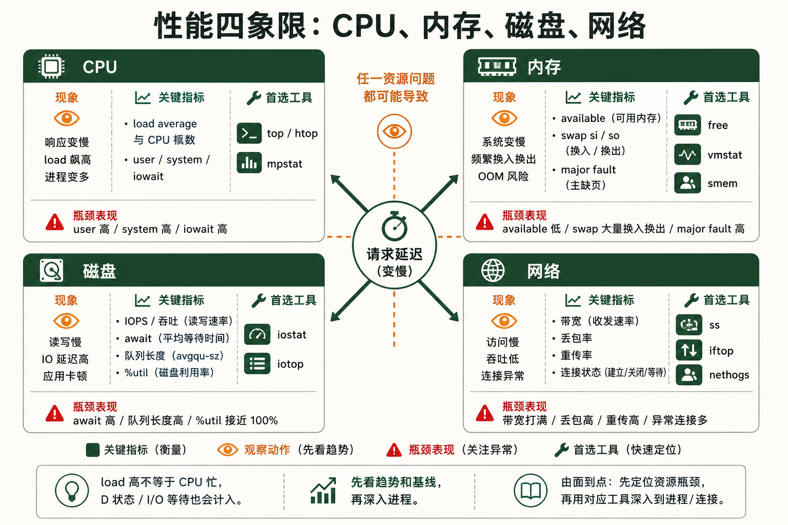
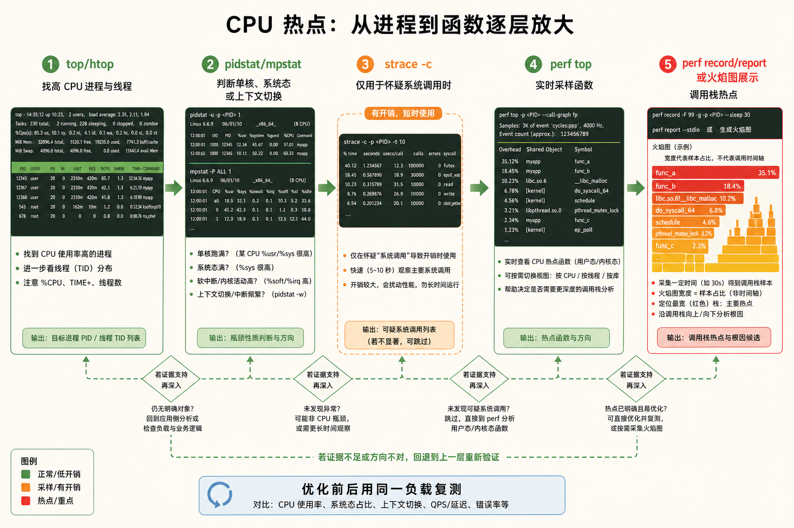
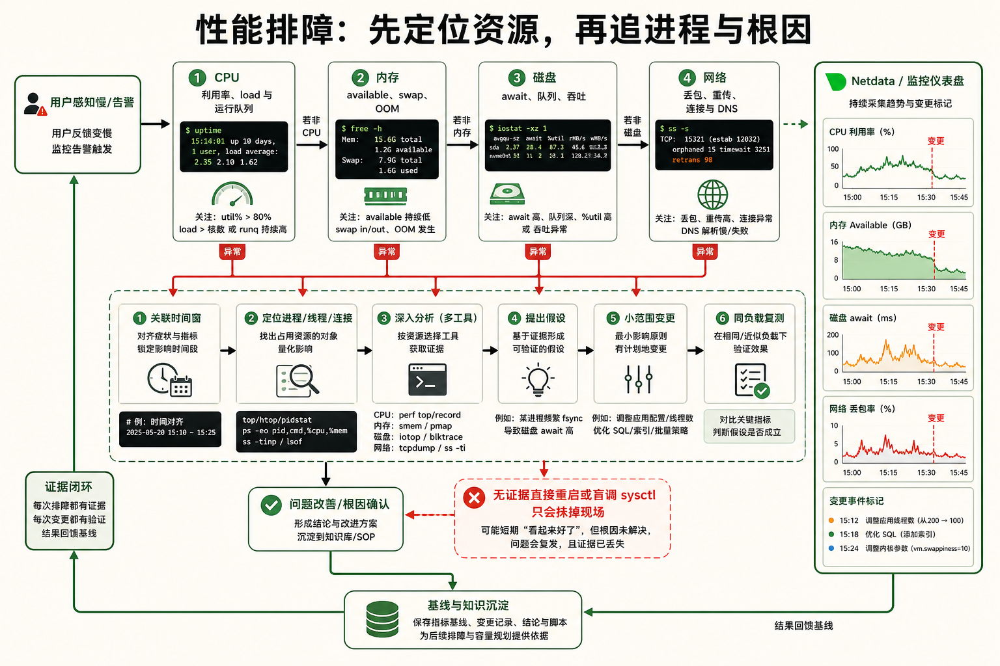

[← 返回 Linux 系统目录]({{ '/subjects/Linux/' | relative_url }})



# 性能调优与监控

*让系统跑得更快 —— 从 CPU 到磁盘的全栈性能分析*

工具链：top / perf / iostat / vmstat / netdata · 风格：问题驱动 · 追本溯源 · 目标：系统变慢了，你能找出根因

## 1 全栈性能分析工具链 {#sec16-1}

### 层级一：CPU —— 谁在消耗计算资源 · 基础 {#层级一cpu-谁在消耗计算资源-基础}

#### top —— 交互式进程监控 {#top-交互式进程监控}

`top` 是 Linux 性能分析的"第一面镜子"。启动后每 3 秒刷新一次，按 `1` 展开所有 CPU 核心，按 `P` 按 CPU 使用率排序，按 `M` 按内存排序。你盯着它看三分钟的 CPU 使用率曲线，就能知道系统是否满载。

关键指标解读：<strong>load average</strong>（右上角三个数字）——分别表示 1、5、15 分钟的平均负载。如果 1 分钟的值远大于 5 和 15 分钟的值，说明负载正在快速上升；如果三个值都很高，说明系统长期过载。

```bash
top
# 进入后按快捷键:
#   1   — 展开/折叠所有 CPU 核心
#   P   — 按 CPU 使用率降序排列
#   M   — 按内存使用率降序排列
#   c   — 显示进程的完整命令行
#   k   — 杀掉一个进程（输入 PID 和信号）
#   q   — 退出

# 非交互式快照（脚本中常用）
top -bn1 | head -20
```

▶ top 关键输出解读

```yaml
top - 14:32:18 up 45 days,  2:15,  3 users,  load average: 4.52, 2.10, 1.85
Tasks: 312 total,   2 running, 310 sleeping,   0 stopped,   0 zombie
%Cpu(s): 87.3 us,  5.1 sy,  0.0 ni,  6.8 id,  0.0 wa,  0.0 hi,  0.8 si
#        ^^^^^^^                                ^^^^^
#        用户态占比87%→某个应用吃满了CPU          空闲仅6.8%→CPU严重不足
```

#### htop —— 彩色增强版 top {#htop-彩色增强版-top}

`htop` 是 `top` 的现代化替代品：彩色柱状图显示 CPU、内存、Swap 使用情况，鼠标可点击，支持树状视图显示父子进程关系，F3 搜索、F9 杀进程，用户体验远好于 `top`。

```bash
# 安装
apt install htop        # Debian/Ubuntu
dnf install htop        # RHEL/Fedora

# 启动（彩色界面）
htop

# 常用快捷键:
#   F3   — 搜索进程
#   F4   — 过滤进程名
#   F5   — 树状视图（看父子关系）
#   F6   — 选择排序字段
#   F9   — 发送信号给进程
#   F10  — 退出
```

#### mpstat —— 每核 CPU 详细统计 {#mpstat-每核-cpu-详细统计}

`mpstat` 属于 `sysstat` 包，能看到每个 CPU 核心的使用率，包括用户态、内核态、IO 等待、软中断等细分。这个工具能回答"是哪个核心在工作，还是全都在工作"。

```bash
# 每秒输出一次，共 5 次
mpstat 1 5

# 只看特定核心
mpstat -P 0 1    # 只看 CPU0
```

▶ mpstat 输出解读

```yaml
Average:  CPU   %usr  %nice  %sys  %iowait  %irq  %soft  %steal  %idle
Average:  all  65.2   0.0   8.1     12.3    0.0   1.2     0.0    13.2
#                   ^^^^          ^^^^^^
#                  用户态65%       IO等待12.3%→磁盘拖慢了CPU!
```

<strong>bpytop —— 美观的终端看板</strong><br>
如果你想让监控变得赏心悦目， `bpytop`（Python 版）或 `btop`（C++ 版）提供炫酷的终端图形界面——CPU 实时折线图、网络吞吐曲线、磁盘 IO 柱状图、进程 CPU 排名，一个终端窗口看清全貌。安装： `apt install btop` 或 `pip install bpytop`。

### 层级二：内存 —— 系统还剩多少可用内存 · 基础 {#层级二内存-系统还剩多少可用内存-基础}

#### free —— 内存概览 {#free-内存概览}

`free -h` 是看内存的第一选择。`available` 列才是"真正可用的内存"——它包括了可以被回收的缓存和缓冲区。`free` 列是"完全未被使用的内存"，这个值小不一定是坏事，因为 Linux 会积极利用剩余内存做文件缓存。

```bash
free -h
#               total    used    free   shared  buff/cache   available
# Mem:           15Gi   3.2Gi   2.1Gi    1.1Gi       9.7Gi        11Gi
# Swap:         2.0Gi   1.5Gi   0.5Gi
#
# 关键判断:
#   available < 总内存的10%  → 内存紧张
#   Swap used > 0 且持续增长 → 内存不足，系统在用磁盘当内存
```

#### vmstat —— 虚拟内存统计 {#vmstat-虚拟内存统计}

`vmstat 1` 每秒输出一行虚拟内存统计，重点看 <strong>si</strong>（swap in）和 <strong>so</strong>（swap out）是否持续较高，并结合可用内存、应用延迟和磁盘活动判断。少量换入换出并不必然表示内存严重不足；第一行通常是自启动以来的平均值，不宜当作本秒瞬时采样。

```bash
vmstat 1 10
# procs -----------memory---------- ---swap-- -----io---- --system-- ----cpu----
#  r  b   swpd   free   buff  cache   si   so    bi    bo   in   cs  us sy id wa
#  2  0  512M  2.1G   1.2G   8.5G    0    0    12    45  500 1200  15  5 75  5
#                                      ^^  ^^
#                                      si持续>0 → 严重内存不足!
```

#### smem —— 更准确的内存统计 {#smem-更准确的内存统计}

传统工具用 RSS（驻留集大小）衡量进程内存，但 RSS 包含了共享库——两个进程使用同一个 `libc.so`，RSS 会重复计算。smem 给出 <strong>PSS（比例共享集）</strong>——共享内存按进程数均分，真正反映每个进程的"公平内存占用"。

```bash
apt install smem

# 按 PSS 排序显示进程内存
smem -rs pss

# 饼图显示内存分布（需要 --bar 样式）
smem --pie=name
```

### 层级三：磁盘 IO —— 存储是不是拖后腿了 · 进阶 {#层级三磁盘-io-存储是不是拖后腿了-进阶}

#### iostat —— IO 统计的瑞士军刀 {#iostat-io-统计的瑞士军刀}

`iostat -x 1` 显示设备扩展统计。<strong>%util</strong> 表示采样窗口内设备有 I/O 活动的时间占比，可作为线索；在并行 SSD、NVMe 和虚拟化存储上，接近 100% 也不能单独证明设备已饱和。应同时看吞吐、延迟、队列和应用响应。

<strong>await</strong> 是该采样段内 I/O 请求的平均完成时间，<strong>aqu-sz</strong>（旧版常显示 `avgqu-sz`）是平均在途请求数。合理范围随随机/顺序 I/O、硬盘类型和队列并行度而变，没有通用的 20 ms 或队列深度 1 的故障线；与业务基线对比，并区分读写指标才有意义。

```bash
# -x 扩展统计，1 每秒采样
iostat -x 1

# 只看某个磁盘
iostat -x sda 1

# 人类可读单位
iostat -xh 1
```

▶ iostat 关键指标解读

```plaintext
Device   r/s   w/s   rkB/s  wkB/s  await  r_await  w_await  %util
sda     45.0  120.0  1800   9600   18.5    8.2      22.3    98.5
#                                      ^^^^                      ^^^^
#                                    平均等待18ms               磁盘98.5%时间在忙→瓶颈!
```

#### iotop —— 哪个进程在大量读写磁盘 {#iotop-哪个进程在大量读写磁盘}

就像 `top` 看 CPU，`iotop` 看磁盘。它能实时显示每个进程的读写速率。当你发现磁盘 IO 飙升但不知道谁造成的，`iotop` 就是答案。

```bash
apt install iotop

# 只显示正在读写磁盘的进程
iotop -o

# 批处理模式（非交互，适合脚本）
iotop -bon 1
```

### 层级四：网络 —— 流量从哪来到哪去 · 进阶 {#层级四网络-流量从哪来到哪去-进阶}

#### iftop —— 实时网络带宽监控 {#iftop-实时网络带宽监控}

类似 `top` 的界面，但显示的是实时网络流量——每个连接的源/目标 IP 和端口、2秒/10秒/40秒的流量带宽。一眼就能看出谁在占用带宽。

```bash
apt install iftop

# 监控 eth0 网卡
iftop -i eth0

# 显示端口号（而非服务名）
iftop -i eth0 -P

# 快捷键: t 切换显示样式, p 暂停, q 退出
```

#### nethogs —— 按进程查看网络流量 {#nethogs-按进程查看网络流量}

`iftop` 按 IP 分组，`nethogs` 按进程分组。当你看到流量飙升但不知道是哪个程序在跑，`nethogs` 直接告诉你进程名和 PID。

```bash
apt install nethogs

# 监控 eth0，实时按进程显示
nethogs eth0

# 输出示例:
#  PID  USER   PROGRAM         DEV   SENT   RECEIVED
# 1234  www    nginx           eth0  5.2MB  120.3KB/sec
# 5678  root   sshd            eth0  0.8KB    0.5KB/sec
```

#### ss —— 替换 netstat 的现代工具 {#ss-替换-netstat-的现代工具}

`ss` 比 `netstat` 更快（直接从内核读取 socket 信息），是查看当前网络连接的首选。

```bash
ss -tlnp       # 所有监听的 TCP 端口 + 进程名
ss -antp       # 所有 TCP 连接（含状态）+ 进程
ss -s          # 汇总统计
ss -t state established  # 只看已建立的连接
```



## 2 CPU 分析与 perf —— 函数级热点采样 {#sec16-2}

### 场景：某个进程 CPU 使用率 100%，但不知道它在干什么 · 高级 {#场景某个进程-cpu-使用率-100但不知道它在干什么-高级}

#### 第一步：用 top 找到高 CPU 进程的 PID

```bash
top -c
# 按 P 排序，看到:
#   PID  USER   %CPU  COMMAND
#  1234  app    99.2  /usr/bin/myapp --config /etc/app.conf
#  → 目标是 PID 1234
```

#### 第二步：strace —— 追踪系统调用 {#第二步strace-追踪系统调用}

`strace` 附着到进程上，打印该进程发出的每一个系统调用。如果 CPU 高是因为程序在做无意义的循环（如重复 `read()` 失败、`poll()` 空转），strace 能直接暴露。

```bash
# 附着到运行中的进程
strace -p 1234

# 统计系统调用次数和耗时（这才是真正的分析）
strace -c -p 1234
# 运行 30 秒后 Ctrl+C，显示:
#   % time   seconds  calls    syscall
#   85.23    45.200   5000000  read       ← 85% 时间花在 read()!
#   10.12     5.370   1000000  write
#    3.15     1.670    500000  openat     ← openat 被调用了 50 万次?!

# 只追踪特定的系统调用
strace -e trace=read,write -p 1234
```

▶ strace -c 输出解读

```bash
strace -c -p 1234
^Cstrace: Process 1234 detached
% time     seconds  usecs/call     calls    errors syscall
------ ----------- ----------- --------- --------- ----------------
 89.45    12.345678        1234     10000           read
  6.23     0.860234         860      1000           write
  4.32     0.596432          59     10000           poll
------ ----------- ----------- --------- --------- ----------------
100.00    13.802344                 21000           total
# 结论: read() 消耗了 89% 的时间 → 去查读的文件或 socket</code>
```

<strong>strace 的性能开销</strong><br>
`strace` 会显著拖慢目标进程——每个系统调用都要经过 ptrace 拦截。在生产环境的繁忙进程上不要长时间使用 `strace -p`。先用 `-c` 统计模式跑 10 秒，拿到系统调用分布就够了。

#### 第三步：perf top —— 函数级别的实时热点 {#第三步perf-top-函数级别的实时热点}

`strace` 告诉你"进程发起了什么系统调用"，`perf top` 告诉你"CPU 时间花在了哪些函数上"——深入到代码行级别甚至汇编指令级别。`perf` 利用内核的硬件性能计数器（PMU）进行采样，开销远小于 strace。

```bash
# 系统级实时采样（看所有进程的函数热点）
perf top

# 只看特定进程
perf top -p 1234

# 输出示例:
#   Samples: 450K of event 'cycles', Event count: 123456789012
#   Overhead  Shared Object        Symbol
#     42.15%  libcrypto.so.3       [.] sha256_block_data_order  ← 42% CPU 在计算 SHA256!
#     18.32%  myapp                [.] process_request
#     10.56%  [kernel]             [k] copy_user_enhanced_fast_string
#      7.21%  libc.so.6            [.] __memcpy_avx_unaligned
```

#### perf record + perf report —— 离线采样分析 {#perf-record-perf-report-离线采样分析}

`perf top` 是实时看，`perf record` 是录下来再分析。录制 30 秒的采样数据，然后用 `perf report` 交互式浏览。

```bash
# 录制某个进程 30 秒
perf record -p 1234 -g -- sleep 30

# 交互式查看报告
perf report

# 火焰图风格（需要 FlameGraph 脚本）
perf script | stackcollapse-perf.pl | flamegraph.pl > flame.svg
# 火焰图: 横轴=函数占比，纵轴=调用栈深度
#         宽的函数条=CPU 时间最多的函数
```

#### 解码 /proc/stat —— 内核级 CPU 计数 {#解码-procstat-内核级-cpu-计数}

```bash
cat /proc/stat | head -5
# cpu  用户态时间 user  低优先级 nice  内核态 system  idle  iowait  irq  softirq  steal
# cpu  1234567 12345   67890      234567    1234567890 45678   0     1234    0
#      ^^^^^^                    ^^^^^^^^^
#      用户态 cpu 时间            空闲时间

# 计算 CPU 使用率
# 从 /proc/stat 读数后，过 1 秒再读，差值即 1 秒内 CPU 在各状态的时间
# CPU 使用率 = 100 - (idle差值 / 总差值 * 100)
```



## 3 内存分析与 OOM Killer 调优 {#sec16-3}

### 场景：应用莫名其妙被杀了，日志里什么都没有 · 高级 {#场景应用莫名其妙被杀了日志里什么都没有-高级}

#### OOM Killer 是什么

当系统内存（RAM + Swap）全部耗尽，内核无法分配新的内存页时，OOM Killer（Out-Of-Memory Killer）会被唤醒。它根据一套评分规则选择一个进程杀掉，释放其内存，让系统继续运行。这就像沉船时扔掉最不重要的货物——但有时它会扔掉你最重要那个。

#### 查 OOM 日志 —— 确认 OOM Killer 是否触发过 {#查-oom-日志-确认-oom-killer-是否触发过}

```bash
# 查看内核日志中的 OOM 记录
dmesg | grep -i "killed process"

# 或者（systemd 系统）
journalctl -k | grep -i oom

# 查看系统日志
grep -i "out of memory" /var/log/syslog
grep -i "killed process" /var/log/syslog

# 典型 OOM 日志片段:
# Out of memory: Killed process 12345 (java) total-vm:8589934592kB,
# anon-rss:4194304kB, file-rss:0kB, shmem-rss:0kB, UID:1000
#                      ^^^^^^^^                    ^^^^^^^^^^
#                      程序名                       实际使用物理内存 4GB
```

#### OOM Score 机制

每个进程都有一个 `oom_score`（分值越高，越优先被杀）和一个 `oom_score_adj`（管理员可调的偏移量）。最终评分 = 内核计算的基础分 + `oom_score_adj`。

```bash
# 查看某个进程的 OOM 评分
cat /proc/1234/oom_score        # 当前评分
cat /proc/1234/oom_score_adj    # 手动调整的偏移

# 查看系统的 OOM 阈值
cat /proc/sys/vm/overcommit_memory     # 0/1/2
cat /proc/sys/vm/overcommit_ratio      # overcommit_memory=2 时的百分比

# 保护重要进程不被 OOM Killer 杀掉（设置低分值）
echo -1000 > /proc/1234/oom_score_adj   # 完全免疫
echo -500  > /proc/1234/oom_score_adj   # 降低被杀优先级

# 标记进程"优先被杀"（测试用）
echo 1000  > /proc/1234/oom_score_adj   # 最容易被杀
```

<strong>oom_score_adj 取值范围</strong><br>
范围是 -1000 到 1000；数值越高，被 OOM Killer 选中的倾向越大。它不是“必定被杀”的开关，容器内存限制、cgroup 和进程可用内存也会影响结果。不要给业务进程一律设置负值，否则可能把内存压力转嫁给系统关键进程；先核实 OOM 日志和实际内存使用。

#### 验证 OOM 行为时先隔离测试范围

不要在共享或生产主机上通过 `/proc/sysrq-trigger` 强制调用系统级 OOM Killer；它会选择真实进程终止，也不等价于自然内存耗尽。需要演练时，在独立测试机或设置了内存上限的 cgroup / 容器中运行可控负载，观察 `memory.events`、`journalctl -k` 与应用恢复行为。

#### 找出内存消耗大户的具体文件

```bash
# /proc/pid/smaps 显示进程的详细内存映射
cat /proc/1234/smaps | grep -E "^(Rss|Pss|Swap):"

# 进程的内存各部分分别来自哪些文件
pmap -x 1234

# 谁在用最多的物理内存
ps aux --sort=-%mem | head -11
```


## 4 磁盘 IO 优化 —— 让磁盘不再拖后腿 {#sec16-4}

### 场景：数据库写入慢，发现磁盘 IO 等待高达 40% · 进阶 {#场景数据库写入慢发现磁盘-io-等待高达-40-进阶}

#### noatime 挂载 —— 零成本的性能提升 {#noatime-挂载-零成本的性能提升}

现代 Linux 通常使用 `relatime`，不会在每次读取后都写入 atime。`noatime` 可进一步减少部分元数据更新，但会改变依赖访问时间的程序行为；先测量实际写入与应用需求，再决定是否调整挂载选项，不能把它当作零成本的通用优化。

```bash
# 查看当前挂载选项
mount | grep "^/dev"
# /dev/sda1 on / type ext4 (rw,relatime,errors=remount-ro)
#                        ^^^^^^^^ relatime 是折中方案（仅在 atime < mtime 时更新）

# 临时改为 noatime
mount -o remount,noatime /

# 永久修改（/etc/fstab）
# 修改前:
#   UUID=xxx  /  ext4  defaults  0  1
# 修改后:
#   UUID=xxx  /  ext4  defaults,noatime  0  1
```

#### I/O Scheduler —— 磁盘调度策略选择 {#io-scheduler-磁盘调度策略选择}

I/O Scheduler 决定了多个 IO 请求的排队和执行顺序。不同的调度器适用于不同硬件：

- <strong>none (multiqueue)</strong>：适合 NVMe SSD。硬件自己处理排队，内核不应干预
- <strong>mq-deadline</strong>：适合 SATA SSD。保证读写请求的延迟上限，简单高效
- <strong>bfq</strong>：适合桌面系统或 HDD。按进程分配带宽，保证交互式应用的响应速度
- <strong>kyber</strong>：适合低延迟场景。根据完成时间动态调整队列深度

```bash
# 查看当前调度器
cat /sys/block/sda/queue/scheduler
# [mq-deadline] none
#   ↑当前生效      ↑可选

# 临时切换
echo none > /sys/block/nvme0n1/queue/scheduler

# 永久设置（通过内核启动参数）
# 编辑 /etc/default/grub
# GRUB_CMDLINE_LINUX="elevator=none"
# update-grub
```

#### XFS 文件系统 + 读写优化组合 {#xfs-文件系统-读写优化组合}

数据库存储选型应先遵循数据库与发行版支持矩阵，再对真实读写模型测试 ext4、XFS 等候选方案。提高队列深度可能提升吞吐，也可能拉高尾延迟；挂载选项同样需要验证。记录基线、一次只改一个变量，再以事务吞吐与 P95/P99 延迟判断效果。

```bash
# 格式化为 XFS
mkfs.xfs -f /dev/sdb1

# 挂载时的优化选项
mount -o noatime,nodiratime,logbsize=256k,logbufs=8,inode64 /dev/sdb1 /data

# fstab 永久挂载:
# /dev/sdb1  /data  xfs  defaults,noatime,nodiratime,inode64  0  2

# 增加磁盘队列深度（提高并发处理能力）
cat /sys/block/sda/queue/nr_requests    # 查看当前值（通常 128）
echo 1024 > /sys/block/sda/queue/nr_requests  # 增大到 1024
```

#### 文件系统基准测试

```bash
# fio —— 灵活的 IO 基准测试
fio --name=test --rw=randread --bs=4k --size=1G \
    --numjobs=4 --runtime=60 --time_based \
    --ioengine=libaio --direct=1 --filename=/data/testfile

# 输出:
#   read: IOPS=125k, BW=489MiB/s (513MB/s)
#   lat (usec): min=15, max=1500, avg=32.45
#           ^^^^                    ^^^^^
#           125K 随机读 IOPS         平均延迟 32 微秒
```

#### 检查磁盘健康状态 —— SMART {#检查磁盘健康状态-smart}

```bash
apt install smartmontools

# 查看磁盘 SMART 信息
smartctl -a /dev/sda

# 重点看:
#   Reallocated_Sector_Ct  → 重映射扇区数（>0 就要警惕）
#   Current_Pending_Sector → 待处理坏扇区（>0 说明有读写失败）
#   Power_On_Hours         → 磁盘已运行时间
#   Wear_Leveling_Count    → SSD 磨损计数（越低越好）

# 短期自检
smartctl -t short /dev/sda
smartctl -l selftest /dev/sda  # 查看自检结果
```

## 5 netdata 实时监控仪表盘 {#sec16-5}

### 场景：需要一个开箱即用的监控面板，不想配 Prometheus + Grafana · 进阶 {#场景需要一个开箱即用的监控面板不想配-prometheus-grafana-进阶}

#### netdata 是什么

netdata 是一款轻量级实时监控工具，安装后自动发现 CPU、内存、磁盘、网络、进程、Nginx、MySQL 等 200+ 数据源，在 `http://localhost:19999` 提供 Web 仪表盘。它开箱即用、零配置、实时更新（每秒刷新）、资源占用极低（~1% CPU，几十 MB 内存）。

netdata 的核心价值：让系统管理员 <strong>30 秒内</strong> 拥有一个全功能监控仪表盘，而不需要部署 Prometheus、Grafana、Node Exporter 等一整套组件。

#### 一键安装

```bash
# 官方一键安装脚本
wget -O /tmp/netdata-kickstart.sh https://get.netdata.cloud/kickstart.sh
sh /tmp/netdata-kickstart.sh --no-updates --stable-channel

# 安装完成后:
#   Web 仪表盘: http://服务器IP:19999
#   后台服务:   systemctl status netdata

# 或者用包管理器（版本可能较旧）
apt install netdata        # Debian/Ubuntu
dnf install netdata        # Fedora
```

#### netdata 的核心视图

- <strong>系统概览</strong>：CPU 利用率、负载、磁盘 IO、网络流量 —— 一张总览图看清全局

- <strong>CPU 详情</strong>：每个核心的使用率曲线、中断分布、软中断、上下文切换率

- <strong>内存详情</strong>：RAM + Swap 使用趋势、内核内存类型（Slab/KernelStack/PageTables）拆分

- <strong>磁盘详情</strong>：每个磁盘的 IOPS、吞吐量、延迟、积压（backlog）—— 一眼定位慢盘

- <strong>网络详情</strong>：每个网卡的流量、丢包率、错误计数 —— 发现网卡故障

- <strong>进程监控</strong>：按应用的 CPU / 内存 / IO / 网络分组统计

  

- <strong>Nginx / MySQL / Redis 等</strong>：自动发现，提供服务专属仪表盘（如 MySQL 的 QPS、慢查询、连接数）

#### 配置告警

```bash
# netdata 自带 200 多个预设告警规则
# 配置文件在 /etc/netdata/health.d/

# 查看当前告警状态
curl http://localhost:19999/api/v1/alarms

# 自定义告警（如磁盘使用超过 90%）
# 编辑 /etc/netdata/health.d/disk.conf
# alarm: disk_space_90
#    on: disk_space._used_percent
#   calc: $used
#  units: %
#  every: 1m
#   warn: $this > 80
#   crit: $this > 90
```

<strong>netdata vs Prometheus + Grafana</strong><br>
netdata 适合单机或少量服务器的快速监控，部署成本几乎为零。Prometheus + Grafana 适合大规模集群、需要长期存储和复杂查询的场景。两者可以互补：netdata 提供实时视图，Prometheus 从 netdata 拉取指标做长期存储和聚合。

## 6 性能排查思路速查 —— 找瓶颈的四步法 {#sec16-6}

### 场景：用户反馈"网站好慢"，你怎么排查？ · 实战 {#场景用户反馈网站好慢你怎么排查-实战}

#### 四步排查法（USE 方法的实战版）

CPU、内存、磁盘、网络是常见的四类资源入口，但“网站慢”也可能来自锁争用、数据库查询、外部依赖或应用逻辑。先明确慢请求的时间段和 P95/P99 延迟，再按症状选择观察层次；下面的四步清单用于快速排查，不是必须逐项执行的固定顺序。

##### 第一步：看 CPU

命令：`top`、`htop`、`mpstat 1`

查什么：load average 是否 \> CPU 核心数？`%idle` 是否 \< 10%？哪个进程 `%CPU` 最高？

常见根因：应用程序死循环、正则回溯、JSON 大解析、无限递归

工具链：`top` 找到 PID → `strace -c -p PID` 看系统调用 → `perf top -p PID` 看函数热点

##### 第二步：看内存

命令：`free -h`、`vmstat 1`、`ps aux --sort=-%mem`

查什么：`available` 是否 \< 10%？`si/so` 是否 \> 0？是否触发了 OOM Killer？

常见根因：内存泄漏、缓存未释放、Java 堆设置过大、管道阻塞

工具链：`free -h` 看全局 → `vmstat 1` 看交换 → `smem -rs pss` 找进程

##### 第三步：看磁盘 IO

命令：`iostat -x 1`、`iotop`

查什么：`%util` 是否 \> 90%？`await` 是否 \> 20ms？`avgqu-sz` 是否 \> 1？

常见根因：大量日志写入、swap 频繁、数据库全表扫描、备份任务

工具链：`iostat -x` 看磁盘 → `iotop -o` 找进程 → 优化挂载选项、调度器


##### 第四步：看网络

命令：`iftop`、`nethogs`、`ss -s`、`ping -c 50`

查什么：带宽是否打满？连接数是否异常？丢包率是否 \> 1%？延迟是否飙升？

常见根因：DDoS 攻击、上游 API 的超时重试风暴、慢客户端占用连接池

工具链：`iftop` 看流量 → `nethogs` 找程序 → `mtr` 追踪路由丢包

#### 性能排查黄金命令组合

```bash
# 一次性运行所有关键指标检查（复制粘贴到终端即可）
echo "=== CPU ===" && top -bn1 | head -5 && echo
echo "=== 内存 ===" && free -h && echo
echo "=== 磁盘 IO ===" && iostat -x 1 2 | tail -n +4 && echo
echo "=== 网络 ===" && ss -s && echo
echo "=== 进程 TOP5 ===" && ps aux --sort=-%cpu | head -6 && echo
echo "=== OOM 事件 ===" && dmesg | grep -i oom | tail -3 && echo
echo "=== 磁盘使用 ===" && df -h | grep -v tmpfs
```

#### CPU 上下文切换 —— 容易被忽略的瓶颈 {#cpu-上下文切换-容易被忽略的瓶颈}

高 CPU 可能包含调度开销，但每秒上下文切换次数没有适用于所有机器的固定警戒线。将 `vmstat` 的 `cs` 与 CPU 核数、线程数及平时基线对比，再用性能采样确认时间是否确实花在调度路径上。

```bash
vmstat 1 5
# 关注 cs (context switches) 列:
# procs  -----------memory---------- ---swap-- -----io---- -system-- ----cpu----
#  r  b   swpd   free  buff  cache   si   so    bi    bo   in    cs  us sy id wa
#  3  0      0  1024M  256M  4096M    0    0    12    32  800 15000  15  5 75  5
#                                                          ^^^^^^
#                                                         15000次上下文切换/秒 → 偏高!
```

<strong>避免做"二传手"</strong><br>
排查性能问题时最常见的错误是：用 A 命令看了一下，拿不准，又用 B 命令看了一下，还是拿不准——然后重启系统了事。正确的做法是： <strong>每一个异常指标都要追问为什么</strong>。IO 高 → 是哪个程序在读写 → 在读写什么文件 → 为什么读那么多 → 能不能缓存？CPU 高 → 是哪种 CPU（用户态/内核态/IO等待）→ 哪个进程 → 哪个函数 → 能不能优化？一路追问到代码层面，才叫"排障"。

## 注解

<strong>MQ</strong> · Message Queue 消息队列


