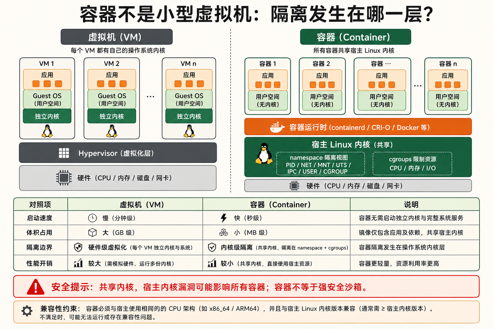
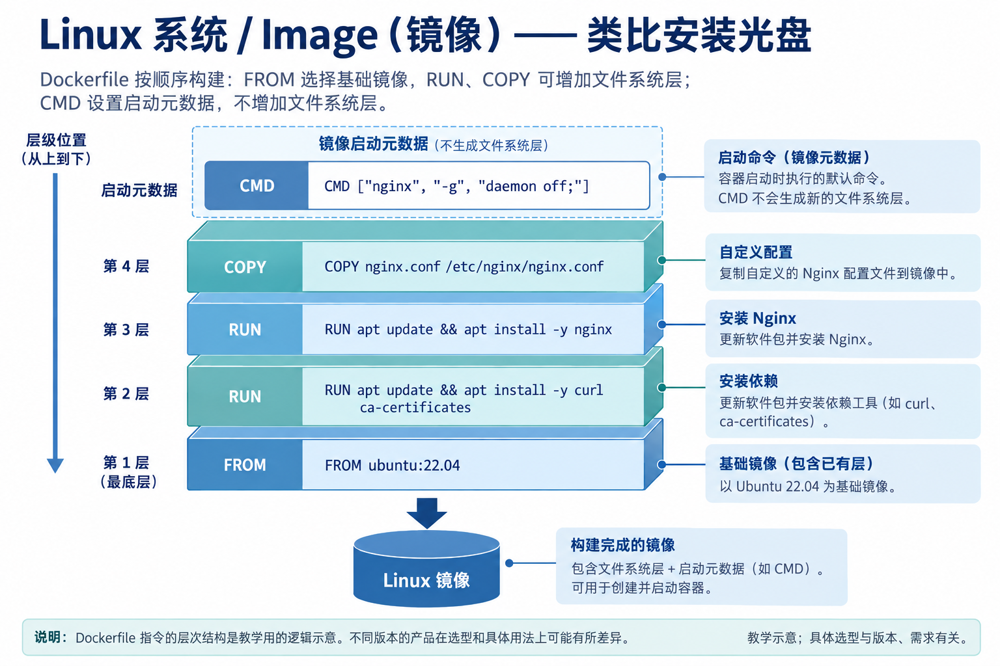
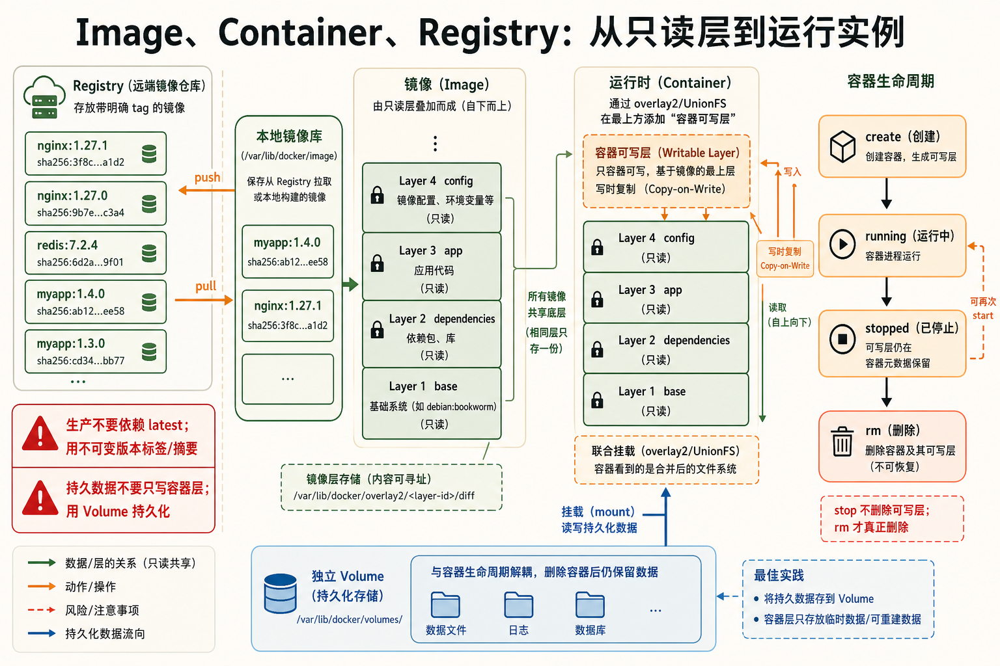
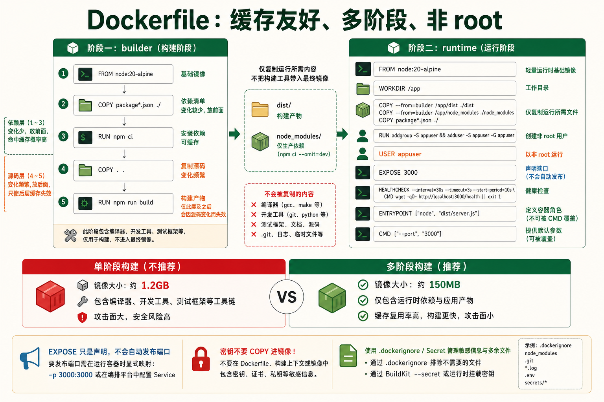
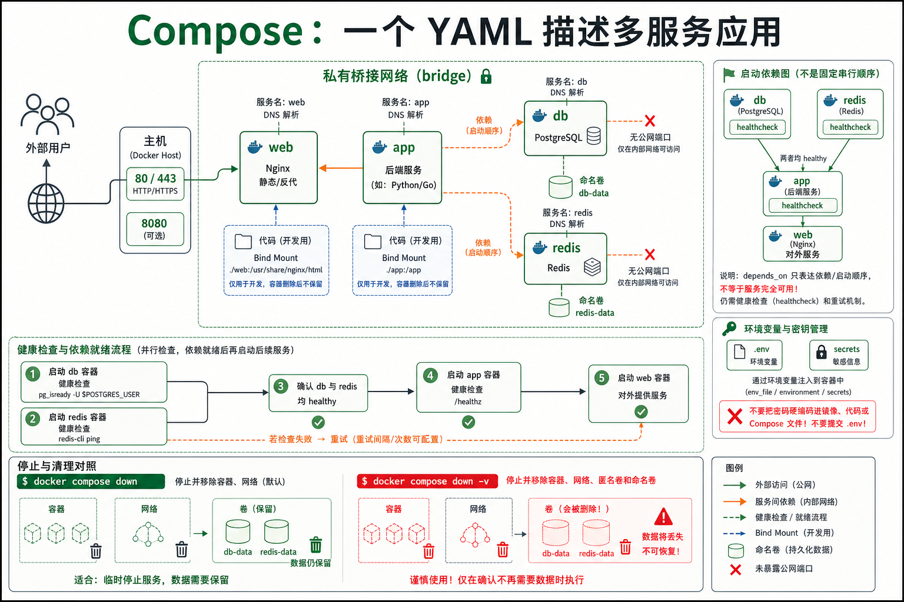
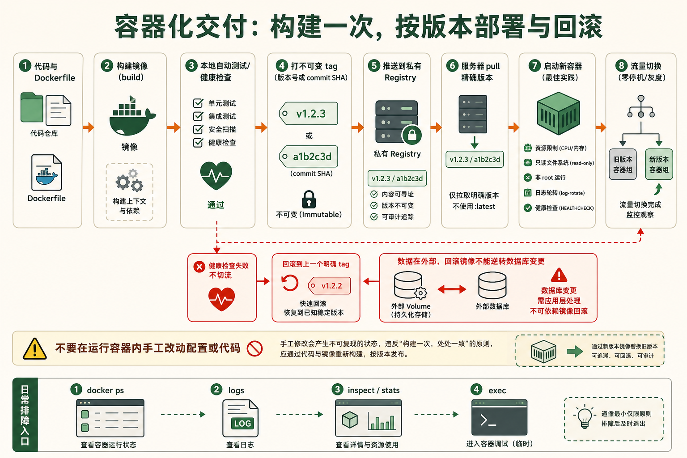

[← 返回 Linux 系统目录]({{ '/subjects/Linux/' | relative_url }})



# 容器基础Docker

*下一代应用交付 —— 从虚拟机的重量到容器的轻量*

引擎：Docker / containerd · 风格：问题驱动 · 追本溯源 · 目标：从零构建和编排容器化应用

## 1 容器 vs 虚拟机的本质区别 {#sec17-1}

### 场景：为什么说容器"不是轻量级虚拟机" · 基础 {#场景为什么说容器不是轻量级虚拟机-基础}

#### 从硬件虚拟化到操作系统虚拟化

<strong>虚拟机（VM）</strong> 通过 Hypervisor（如 KVM、VMware）在物理硬件上模拟出完整的虚拟硬件——虚拟 CPU、虚拟内存、虚拟磁盘、虚拟网卡——然后在这个虚拟硬件上安装一个完整的 Guest OS。每个 VM 运行自己的内核，拥有独立的 init 进程、驱动、系统调用接口。隔离性极强但资源开销巨大：每个 VM 至少要几百 MB 内存来跑操作系统本身。

<strong>容器</strong> 不模拟硬件，不运行独立内核。它利用 Linux 内核的两个特性实现隔离：<strong>namespace</strong>（命名空间，让进程看到自己独立的 PID、网络、挂载、用户等视图）和 <strong>cgroups</strong>（控制组，限制进程能使用的 CPU、内存、IO 等资源）。容器里的进程和宿主机的其他进程共享同一个内核，只是被 namespace "隔离了视野"，被 cgroups "限制了资源"。

| 维度 | 虚拟机 (VM) | 容器 (Container) |
|----|----|----|
| 虚拟化层级 | 硬件层（Hypervisor） | 操作系统层（内核 namespace + cgroups） |
| 内核 | 每个 VM 独立内核 | 所有容器共享宿主机内核 |
| 启动速度 | 分钟级（引导 OS + 服务） | 秒级甚至毫秒级（只需 fork 进程） |
| 镜像大小 | GB 级（含完整 OS） | MB 级（alpine 基础镜像仅 5MB） |
| 性能损耗 | ~5-15%（虚拟化开销） | 几乎无损耗（原生进程，仅多了 namespace 查表） |
| 内存开销 | 每个 VM 数百 MB 起 | 每个容器仅进程本身的内存 |
| 隔离性 | 强（独立内核 → 安全边界） | 弱（共享内核 → 逃逸风险） |
| 密度 | 一台物理机跑十几到几十个 VM | 一台物理机跑数百到数千个容器 |
| 典型工具 | KVM / VMware / VirtualBox | Docker / containerd / Podman / LXC |

#### 容器和宿主机共享内核的深层含义

<strong>共享内核意味着什么？</strong>

- 容器里运行的二进制文件必须是和宿主机内核兼容的 ELF 格式（x86_64 主机上可以跑 x86_64 容器，但不能跑 ARM 容器，除非有 qemu 模拟）
- 容器的"Linux 发行版"只是用户空间文件系统的差异——`ubuntu:22.04` 镜像只是 Ubuntu 的目录结构和库文件，里面没有内核
- 容器可以调用宿主机的内核模块（如 iptables、overlayfs），但无法加载自己的内核模块
- 宿主机的内核漏洞可能被容器利用来逃逸——所以容器不能替代真正的安全沙箱

#### 容器的资源限制 —— cgroups 的实操 {#容器的资源限制-cgroups-的实操}

```bash
# 启动一个内存限制为 512MB 的容器
docker run -d --memory="512m" --name limited-app nginx

# 限制 CPU 使用（只能使用 1.5 个核心）
docker run -d --cpus="1.5" --name cpu-limited nginx

# 查看容器的资源限制
docker inspect limited-app | grep -A 10 '"Memory"'

# 在宿主机上查看 cgroup 配置（systemd cgroup v1 为例）
cat /sys/fs/cgroup/memory/docker/$(docker inspect -f '{{.Id}}' limited-app)/memory.limit_in_bytes
# 输出: 536870912  (= 512MB)
```

<strong>namespace 的 7 种类型</strong><br>
PID namespace（进程隔离）、NET namespace（网络隔离）、MNT namespace（挂载点隔离）、UTS namespace（主机名/域名隔离）、IPC namespace（进程间通信隔离）、USER namespace（用户/组 ID 隔离）、CGROUP namespace（cgroup 视图隔离）。Docker 默认启用 PID、NET、MNT、UTS、IPC 五种。



## 2 Docker 核心三概念 {#sec17-2}

### Image · Container · Registry —— 三个概念撑起整个容器生态 · 基础 {#image-container-registry-三个概念撑起整个容器生态-基础}

#### Image（镜像）—— 类比安装光盘

镜像包含分层的文件系统内容以及启动配置等元数据。Dockerfile 的部分指令会形成文件系统层，部分只改变镜像配置，因此不能机械地理解成“一条指令必定一层文件”。镜像在仓库中可作为压缩层传输，运行时由存储驱动组合为容器可见的文件系统。

比如一个 Nginx 镜像的底层结构：

[](assets/generated-diagrams/n070-v2.webp "查看原尺寸图片"){target="_blank" rel="noopener"}

#### 查看原始图示文字

```plaintext
Layer 5 (最上层): CMD ["nginx", "-g", "daemon off;"]    ← 启动命令
Layer 4: COPY nginx.conf /etc/nginx/nginx.conf           ← 自定义配置
Layer 3: RUN apt update && apt install -y nginx           ← 安装 Nginx
Layer 2: RUN apt update && apt install -y curl ca-certificates  ← 安装依赖
Layer 1 (最底层): FROM ubuntu:22.04                       ← 基础 OS 层
```

每一层都是一个独立的文件系统快照。拉取镜像时如果两层相同（同一个 base image），Docker 只下载一次——这就是层共享机制。

#### Container（容器）—— 镜像的运行实例

容器 = 镜像 + 一个<strong>可写层（Container Layer）</strong>。镜像的所有层都是只读的，Docker 使用 <strong>UnionFS（联合文件系统）</strong>（通常是 overlay2）把只读层和可写层合并成一个统一视图。进程在容器内写入文件时，数据实际写到可写层；读取文件时，从最上层往下逐层查找——这就是写时复制（Copy-on-Write）。

容器的生命周期：创建 → 运行 → 暂停 → 停止 → 删除。停止的容器数据还在（可写层未被删除），`docker start` 能恢复运行。删除容器（`docker rm`）才会丢失可写层的数据——这就是为什么持久化数据必须用 Volume。

#### Registry（镜像仓库）—— 类比 GitHub

Registry 是镜像的存储和分发中心。<strong>Docker Hub</strong> 是最大公开 Registry（类似 GitHub）。企业内部通常搭建私有 Registry（如 Harbor）来管理内部镜像。

镜像的完整名称格式：`registry.example.com:5000/namespace/image:tag`。不写 registry 默认指向 Docker Hub；不写 tag 默认 `:latest`。

```bash
# 镜像命名的完整形式拆解
docker pull nginx:1.25
#         ^^^^  ^^^^
#         镜像名  标签
# 完整等价于: docker pull docker.io/library/nginx:1.25
#                  ^^^^^^^^^^^^^^^^^^
#                  registry      namespace
```

<strong>latest 标签的陷阱</strong><br>
`:latest` 只是默认标签名，不是"最新版本"。如果推送镜像时不指定 tag，Docker Hub 不会自动打上 latest——它只是拉取时的默认缺省值。 <strong>生产环境永远使用明确的版本号标签（如 nginx:1.25.3）</strong>，否则某天 docker pull 可能拉到一个不兼容的大版本更新，引发生产事故。



## 3 Docker 基础命令大全 {#sec17-3}

### 镜像操作 —— 拉取、查看、构建、推送 · 必备 {#镜像操作-拉取查看构建推送-必备}

| 命令 | 作用 | 常用示例 |
|----|----|----|
| `docker pull` | 从 Registry 拉取镜像 | `docker pull nginx:1.25` |
| `docker push` | 推送镜像到 Registry | `docker push myrepo/app:v1.0` |
| `docker images` | 列出本地所有镜像 | `docker images --filter dangling=true` |
| `docker tag` | 给镜像打标签 | `docker tag app:v1 myrepo/app:v1` |
| `docker rmi` | 删除本地镜像 | `docker rmi nginx:1.25` |
| `docker build` | 从 Dockerfile 构建镜像 | `docker build -t myapp:v1 .` |
| `docker save` | 导出镜像为 tar 文件 | `docker save -o nginx.tar nginx:1.25` |
| `docker load` | 从 tar 文件导入镜像 | `docker load -i nginx.tar` |
| `docker history` | 查看镜像的层历史 | `docker history nginx:1.25` |
| `docker inspect` | 查看镜像/容器详细 JSON | `docker inspect nginx:1.25` |

#### 清理 Docker 占用的磁盘空间

```bash
# 一键清理（删除停止的容器、未使用的网络、悬空镜像、构建缓存）
docker system prune -a

# 分别查看各部分占用
docker system df
# TYPE            TOTAL     ACTIVE    SIZE      RECLAIMABLE
# Images          15        3         12.5GB    10.2GB (81%)
# Containers      20        2         2.1GB     1.9GB (90%)
# Local Volumes   8         2         3.5GB     2.8GB (80%)
# Build Cache     45        0         4.2GB     4.2GB (100%)
```

### 容器操作 —— 启动、停止、进入、排错 · 必备 {#容器操作-启动停止进入排错-必备}

| 命令 | 作用 | 常用示例 |
|----|----|----|
| `docker run` | 创建并启动容器 | `docker run -d -p 80:80 --name web nginx` |
| `docker ps` | 列出运行中的容器 | `docker ps -a`（含已停止） |
| `docker stop` | 优雅停止容器（SIGTERM → SIGKILL） | `docker stop web` |
| `docker start` | 启动已停止的容器 | `docker start web` |
| `docker restart` | 重启容器 | `docker restart web` |
| `docker rm` | 删除容器 | `docker rm web`；`docker rm -f web`（强制） |
| `docker exec` | 在运行中容器内执行命令 | `docker exec -it web bash` |
| `docker logs` | 查看容器日志 | `docker logs -f --tail 100 web` |
| `docker cp` | 容器和宿主机之间拷贝文件 | `docker cp web:/etc/nginx/nginx.conf ./` |
| `docker stats` | 实时查看容器资源使用 | `docker stats web` |
| `docker top` | 查看容器内进程列表 | `docker top web` |
| `docker diff` | 查看容器文件系统的变更 | `docker diff web` |
| `docker commit` | 将容器保存为新镜像 | `docker commit web myapp:debug` |

#### docker run 常用参数速查

```bash
# 最完整的启动示例
docker run \
  -d \                        # 后台运行
  --name myapp \              # 容器名称
  --restart unless-stopped \  # 重启策略（Docker 启动时自动恢复）
  -p 8080:80 \                # 端口映射（宿主机:容器）
  -p 127.0.0.1:3306:3306 \   # 只绑定本地 IP
  -v /data:/app/data \        # 挂载卷（宿主机路径:容器路径）
  -v app-config:/etc/app \    # 挂载命名卷
  -e DATABASE_URL=postgres://... \   # 环境变量
  -e TZ=Asia/Shanghai \       # 时区
  --memory="512m" \           # 内存限制
  --cpus="1.5" \             # CPU 限制
  --log-driver json-file \    # 日志驱动
  --log-opt max-size=10m \    # 日志轮转大小
  --log-opt max-file=3 \      # 日志保留份数
  --network mynet \           # 加入自定义网络
  --dns 8.8.8.8 \            # DNS 服务器
  --health-cmd="curl -f http://localhost/" \  # 健康检查
  --health-interval=30s \
  --health-retries=3 \
  myimage:v1.0
```

#### docker exec 排错必备

```bash
# 进入容器内部（排错第一手段）
docker exec -it container_name bash
# -i 保持标准输入打开
# -t 分配伪终端
# 如果容器没有 bash，用 sh:
docker exec -it container_name sh

# 不进入容器，直接执行单条命令
docker exec container_name cat /etc/nginx/nginx.conf
docker exec container_name nginx -t       # 测试 Nginx 配置
docker exec container_name ps aux         # 查看进程
docker exec container_name df -h          # 查看磁盘
docker exec container_name env            # 查看环境变量
```

#### docker logs —— 日志查看与跟踪 {#docker-logs-日志查看与跟踪}

```bash
# 查看最近 100 行日志
docker logs --tail 100 web

# 实时跟踪（等同于 tail -f）
docker logs -f web

# 显示时间戳
docker logs -t web

# 查看最近 30 分钟的日志
docker logs --since 30m web

# 查看特定时间段
docker logs --since 2026-07-01T00:00:00 --until 2026-07-31T23:59:59 web

# 组合拳：跟踪+时间戳+最近 200 行
docker logs -ft --tail 200 web
```

## 4 编写 Dockerfile —— 构建你自己的镜像 {#sec17-4}

### 场景：我要把 Node.js 应用打包成镜像，能在任何地方跑 · 必备 {#场景我要把-node.js-应用打包成镜像能在任何地方跑-必备}

#### 关键指令速查

| 指令 | 作用 | 是否会创建新层 |
|----|----|----|
| `FROM` | 指定基础镜像（每个 Dockerfile 必须以此开头） | 否（引用已有层） |
| `RUN` | 在镜像构建时执行命令（如安装软件包） | 是 |
| `COPY` | 从构建上下文复制文件到镜像（纯文件拷贝） | 是 |
| `ADD` | 类似 COPY 但支持 URL 下载和自动解压 tar | 是 |
| `WORKDIR` | 设置工作目录（后续指令的相对路径基准） | 否 |
| `ENV` | 设置环境变量（构建时和运行时都生效） | 是 |
| `ARG` | 构建参数（仅在构建时可用，运行时不可见） | 否 |
| `EXPOSE` | 声明容器监听的端口（文档性质，不实际映射） | 否 |
| `CMD` | 容器启动时的默认命令（可被 docker run 参数覆盖） | 否 |
| `ENTRYPOINT` | 容器启动时的入口程序（CMD 作为参数追加其后） | 否 |
| `USER` | 切换运行用户（安全最佳实践：不要用 root） | 否 |
| `VOLUME` | 声明匿名卷挂载点 | 否 |

#### COPY vs ADD —— 什么时候用哪个 {#copy-vs-add-什么时候用哪个}

普通文件复制优先使用 `COPY`，语义直观。`ADD` 能自动解压构建上下文中的本地 tar 归档，也支持获取远程 URL；远程归档不会因来自 URL 就自动解压。需要远程下载时还应考虑校验、缓存和版本固定，不能把“远程下载并解压”当作 `ADD` 的单步默认行为。

#### CMD vs ENTRYPOINT —— 执行模型的两层设计 {#cmd-vs-entrypoint-执行模型的两层设计}

```bash
# 只有 CMD（默认执行，可被覆盖）
CMD ["python", "app.py"]
# docker run myimg           → python app.py
# docker run myimg bash      → bash（CMD 被覆盖）

# 只有 ENTRYPOINT（不能被覆盖，参数追加到后面）
ENTRYPOINT ["python", "app.py"]
# docker run myimg           → python app.py
# docker run myimg --debug   → python app.py --debug（参数追加）
# docker run myimg bash      → python app.py bash（bash 成了 app.py 的参数！）

# 组合使用（最佳实践：ENTRYPOINT 定容器角色，CMD 定默认参数）
ENTRYPOINT ["nginx"]
CMD ["-g", "daemon off;"]
# docker run myimg           → nginx -g 'daemon off;'
# docker run myimg -t        → nginx -t（覆盖 CMD 但保留 ENTRYPOINT）
```

#### 完整 Dockerfile 示例：多阶段构建 Node.js 应用 {#完整-dockerfile-示例多阶段构建-node.js-应用}

```dockerfile
# ===== 第一阶段：构建 =====
FROM node:20-alpine AS builder
WORKDIR /app
COPY package*.json ./
RUN npm ci --only=production
COPY . .
RUN npm run build

# ===== 第二阶段：运行（最终镜像） =====
FROM node:20-alpine
WORKDIR /app
RUN addgroup -g 1001 -S appgroup && adduser -S appuser -G appgroup -u 1001

# 从构建阶段复制产物
COPY --from=builder /app/dist ./dist
COPY --from=builder /app/node_modules ./node_modules
COPY --from=builder /app/package.json ./

# 安全：切换到非 root 用户
USER appuser

EXPOSE 3000
ENV NODE_ENV=production

CMD ["node", "dist/server.js"]
```

#### 层缓存优化 —— 让构建快 10 倍 {#层缓存优化-让构建快-10-倍}

Docker 构建镜像时，每条指令生成一层。如果某层的内容没变（包括上下文文件的内容和指令文本），Docker 就复用缓存的层，跳过执行。<strong>关键策略：把变化频率最低的指令放在前面。</strong>

```dockerfile
# ❌ 不好的顺序（每次改代码都要重新 npm install）
FROM node:20
WORKDIR /app
COPY . .
RUN npm install        # ← 代码改了，这一层缓存失效，要重跑

# ✅ 好的顺序（不频繁变的依赖先装，经常变的代码后复制）
FROM node:20
WORKDIR /app
COPY package*.json ./   # ← 只有改了 package.json 才会重装依赖
RUN npm ci
COPY . .                # ← 改了代码只要重新 COPY，复用 npm ci 的缓存
```

<strong>多阶段构建的价值</strong><br>
传统 Dockerfile 中，构建工具（如 GCC、Maven、npm devDependencies）会留在最终镜像里。多阶段构建让你在第一阶段用完整工具链编译，第二阶段只复制运行时需要的产物——最终镜像不包含任何构建工具，体积从 1.2GB 降到 150MB。这就是为什么 Go 应用的 Docker 镜像可以做到十几 MB：第一阶段用 `golang:1.21` 编译，第二阶段用 `scratch`（空镜像）只复制编译好的二进制文件。



## 5 Docker Compose —— 编排多个容器 {#sec17-5}

### 场景：一个应用需要 Web 服务器 + 应用 + 数据库 + 缓存，怎么一键启动？ · 进阶 {#场景一个应用需要-web-服务器-应用-数据库-缓存怎么一键启动-进阶}

#### Docker Compose 解决什么问题

一个 `docker run` 调用创建并启动一个容器；多服务应用若逐个调用，需要自行维护网络、卷和启动顺序。Docker Compose 用 YAML 文件声明服务及其依赖，当前示例统一使用 Compose V2 的 `docker compose` 命令；旧版独立工具写作 `docker-compose`。Compose 的依赖关系不自动等于服务就绪，需要健康检查与相应的 `depends_on` 条件。

#### 完整 compose 文件示例：LAMP 栈

运行前先创建 `html/` 和 `init.sql`，并通过未入库的环境配置提供 `DB_ROOT_PASSWORD`、`DB_PASSWORD`。下例只演示本地 HTTP 服务，未配置 TLS，因此不映射 443；phpMyAdmin 仅绑定本机环回地址。公开部署时还需准备 HTTPS 入口、密钥管理与明确的镜像版本。

```yaml

services:
  # Apache + PHP
  web:
    image: php:8.2-apache
    container_name: lamp-web
    ports:
      - "127.0.0.1:8088:80"
    volumes:
      - ./html:/var/www/html
    depends_on:
      db:
        condition: service_healthy
      redis:
        condition: service_started
    networks:
      - lamp-net
    restart: unless-stopped

  # MySQL 数据库
  db:
    image: mysql:8.0
    container_name: lamp-db
    environment:
      MYSQL_ROOT_PASSWORD: ${DB_ROOT_PASSWORD}
      MYSQL_DATABASE: myapp
      MYSQL_USER: myapp
      MYSQL_PASSWORD: ${DB_PASSWORD}
    volumes:
      - db-data:/var/lib/mysql
      - ./init.sql:/docker-entrypoint-initdb.d/init.sql
    networks:
      - lamp-net
    restart: unless-stopped
    healthcheck:
      test: ["CMD", "mysqladmin", "ping", "-h", "localhost"]
      interval: 10s
      timeout: 5s
      retries: 3

  # Redis 缓存
  redis:
    image: redis:7-alpine
    container_name: lamp-redis
    command: redis-server --appendonly yes --maxmemory 256mb
    volumes:
      - redis-data:/data
    networks:
      - lamp-net
    restart: unless-stopped

  # phpMyAdmin（可选，调试用）
  phpmyadmin:
    image: phpmyadmin:latest
    container_name: lamp-pma
    environment:
      PMA_HOST: db
    ports:
      - "127.0.0.1:8080:80"
    depends_on:
      - db
    networks:
      - lamp-net
    profiles:
      - debug          # 默认不启动，需要时: docker compose --profile debug up

volumes:
  db-data:
  redis-data:

networks:
  lamp-net:
    driver: bridge
```



#### docker compose 常用命令

```bash
# 启动所有服务（后台）
docker compose up -d

# 启动特定服务
docker compose up -d web db

# 查看所有服务状态
docker compose ps

# 查看日志（所有服务）
docker compose logs -f --tail 50

# 查看特定服务日志
docker compose logs -f web

# 停止所有服务（保留数据卷）
docker compose down

# 停止并删除数据卷（彻底清理）
docker compose down -v

# 重新构建并启动（代码改了）
docker compose up -d --build

# 在运行的服务中执行命令
docker compose exec web bash
docker compose exec db mysql -u root -p

# 本例 web 指定 container_name 且绑定固定主机端口，不能直接 --scale web=3
# 扩容前需移除固定容器名、解决端口冲突并配置负载均衡
```

<strong>.env 文件管理敏感信息</strong><br>
compose 文件中的 `${DB_PASSWORD}` 变量来自同目录下的 `.env` 文件。不要把密码硬编码在 compose 文件里——把 `.env` 加入 `.gitignore`，用 `.env.example` 提供模板。

## 6 实用场景与最佳实践 {#sec17-6}

### 场景一：用 Docker 快速测试新软件 · 进阶 {#场景一用-docker-快速测试新软件-进阶}

#### 5 秒进入 Ubuntu 环境 —— 用完即弃 {#秒进入-ubuntu-环境-用完即弃}

```bash
# 快速进入一个干净 Ubuntu 环境测试，退出自动删除（不留痕迹）
docker run -it --rm ubuntu:22.04 bash

# 带工具链的开发环境
docker run -it --rm -v $(pwd):/workspace -w /workspace ubuntu:22.04 bash

# 测试特定版本软件
docker run -it --rm python:3.9 python -c "print('Hello')"
docker run -it --rm node:18 node -e "console.log(process.version)"
```

#### 运行一个临时数据库实例

```bash
# 启动 PostgreSQL 实例（5 秒可用）
docker run -d --name pg-temp \
  -e POSTGRES_PASSWORD=temp123 \
  -p 5432:5432 \
  postgres:16-alpine

# 连上去测试
psql -h localhost -U postgres

# 测试完毕删除
docker rm -f pg-temp
```

### 场景二：容器化部署你的应用（完整流程） · 必备 {#场景二容器化部署你的应用完整流程-必备}

#### 从代码到运行的完整步骤

```bash
# 1. 克隆代码
git clone https://github.com/yourname/myapp.git && cd myapp

# 2. 检查 Dockerfile（如果不存在，写一个）
cat Dockerfile

# 3. 构建镜像
docker build -t myapp:$(git rev-parse --short HEAD) .

# 4. 本地运行测试
docker run -d -p 3000:3000 --name myapp-test myapp:latest
curl http://localhost:3000/health

# 5. 测试通过，打上版本标签
docker tag myapp:latest myrepo/myapp:v1.2.0

# 6. 推送到 Registry
docker login myrepo.example.com
docker push myrepo/myapp:v1.2.0

# 7. 在服务器上部署
ssh deploy@server "docker pull myrepo/myapp:v1.2.0 && \
  docker stop myapp && docker rm myapp && \
  docker run -d --name myapp --restart unless-stopped -p 3000:3000 myrepo/myapp:v1.2.0"

# 8. 验证部署
curl http://server:3000/health
```

#### Dockerfile 最佳实践清单

- <strong>使用 .dockerignore</strong>——排除 node_modules、.git、日志等，减小构建上下文
- <strong>使用特定版本的基础镜像</strong>——`node:20.11-alpine` 而非 `node:latest`
- <strong>合并 RUN 指令</strong>——`RUN apt update && apt install -y pkg && rm -rf /var/lib/apt/lists/*`，减少层数
- <strong>使用非 root 用户运行</strong>——`USER 1000`
- <strong>设置默认的资源限制</strong>——compose 文件中指定 `mem_limit` 和 `cpus`
- <strong>不要把密码构建进镜像</strong>——用环境变量或 secrets，运行时传入
- <strong>一个容器一个进程</strong>——不要在一个容器里跑 Nginx + PHP-FPM + Cron，用 compose 拆开

<strong>容器退出后数据去哪了？</strong><br>
容器停止后，可写层的数据还在磁盘上。容器被 `docker rm` 删除后，可写层被彻底删除，数据永久丢失。 <strong>任何需要持久化的数据必须写入 Volume 或绑定挂载的宿主机目录。</strong>临时文件、缓存、会话数据可以放在容器内——丢了无所谓。




