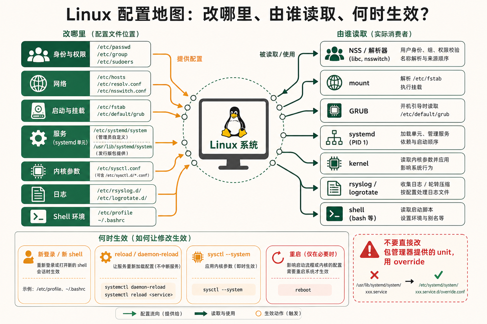
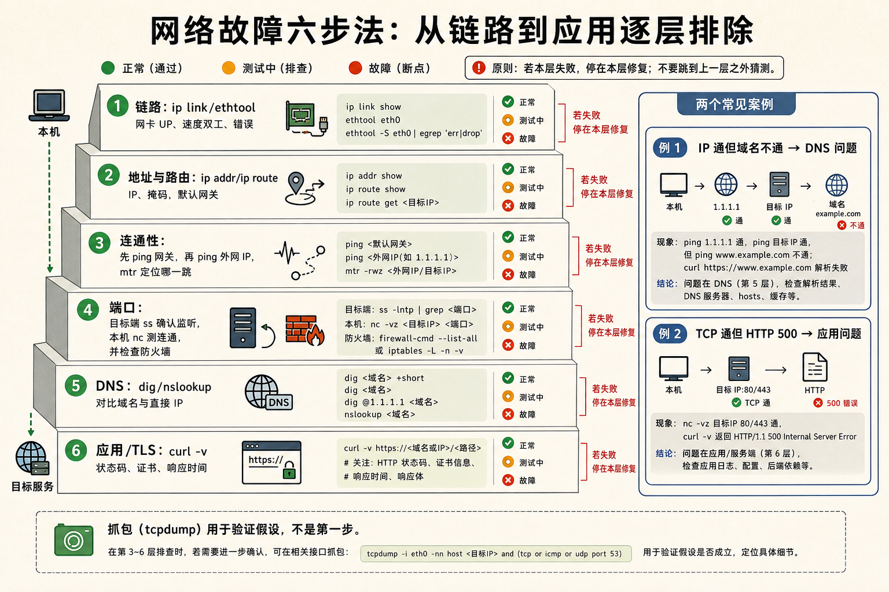
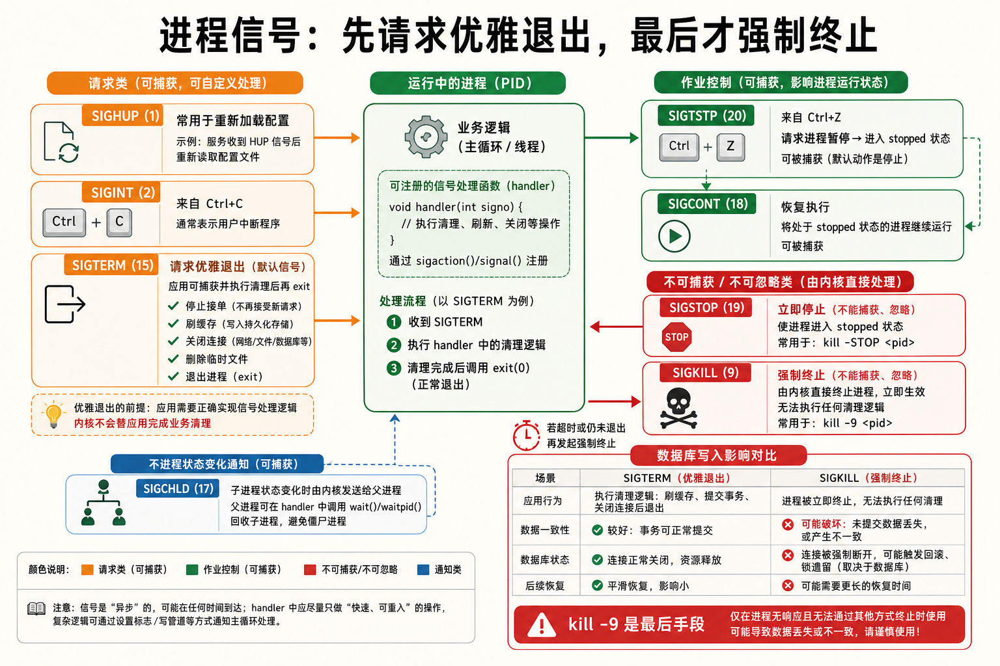

[← 返回 Linux 系统目录]({{ '/subjects/Linux/' | relative_url }})



# Linux实战速查手册

*你的随身命令行参考 —— 覆盖前 17 章常用场景；执行前先替换设备名、路径、主机与服务名*

涵盖：命令 / 配置 / 快捷键 / 信号 / 排障 / 网络 · 风格：表格式速查 · 即查即用 · 目标：所有运维必备命令一页打尽

## 1 命令分类速查表 {#sec18-1}

### 文件操作 —— ls / cp / mv / rm / find / ln / tar · 核心 {#文件操作-ls-cp-mv-rm-find-ln-tar-核心}

| 命令 | 常用选项 | 说明 |
|----|----|----|
| `ls -lah` | `-l`长格式 `-a`含隐藏 `-h`人类可读 `-t`按时间 `-S`按大小 `-r`倒序 | 列出目录内容。最常用：`ls -lah` |
| `ls -l --time=atime` | 显示访问时间而非修改时间 | 排查文件读取问题 |
| `cp -a src dst` | `-a`归档模式(保留权限/时间) `-r`递归 `-v`显示过程 `-u`仅更新 `-n`不覆盖 | 复制文件或目录 |
| `cp -p` | 保留权限、时间戳、所有者 | 备份时保持元数据一致 |
| `mv -i src dst` | `-i`覆盖前确认 `-n`不覆盖 `-v`显示过程 `-b`备份目标 | 移动或重命名（同文件系统内是改 inode 指针，几乎瞬间完成） |
| `rm -rf dir` | `-r`递归 `-f`强制 `-i`确认 `-v`显示过程 `-d`删空目录 | 危险！生产环境切勿 `rm -rf /` 或 `rm -rf *` |
| `find /path -name "*.log" -mtime +7 -delete` | `-name`按名称 `-type f/d/l`按类型 `-mtime n`修改时间 `-size +100M`按大小 `-user`按所有者 `-perm`按权限 `-exec cmd {} \;`执行命令 `-delete`删除 | 搜索文件（Linux 最强文件查找工具） |
| `find . -type f -empty` | 查找空文件 | 清理无用的空文件 |
| `find . -type f -perm 0777` | 查找权限为 777 的文件 | 安全检查 |
| `ln -s target linkname` | `-s`符号链接 `-f`强制覆盖 `-n`不跟随已有链接 | 创建软链接（类似 Windows 快捷方式） |
| `ln target hardlink` | 不加 `-s` 即硬链接 | 硬链接：同一 inode 的多个目录入口，删除原文件不影响硬链接 |
| `tar -czvf archive.tar.gz dir/` | `-c`创建 `-x`解压 `-t`查看 `-z`gzip `-j`bzip2 `-J`xz `-v`详细 `-f`指定文件 `-C`指定目录 `--exclude`排除 | 打包/压缩（tape archive 的历史命名） |
| `tar -xzvf archive.tar.gz -C /dest/` | 解压到指定目录 | `-C` 必须在目标路径前加上 |
| `stat filename` | 查看 inode 详细信息 | 显示文件大小、权限、时间戳、inode 号、链接数 |
| `file filename` | 检测文件类型 | 不依赖扩展名——检测文件头魔数 |
| `du -sh dir/` | `-s`汇总 `-h`人类可读 `--max-depth=N`深度 | 查看目录占用磁盘空间 |
| `du -h --max-depth=1 / \| sort -hr \| head -10` | 找出根目录下最大的 10 个目录 | 磁盘清理第一步 |
| `head -n 20 file` / `tail -n 20 file` | `-n`行数 `-f`跟踪（tail 专用） | 查看文件头/尾部 |
| `less file` | 分页查看，`/`搜索 `n/N`跳转 `g/G`首尾 | 大文件查看利器，比 more 强大 |

<strong>硬链接 vs 软链接</strong><br>
硬链接（同一 inode）：删原文件不影响它，不能跨文件系统，不能链接目录。<br>
软链接（符号链接，独立 inode 指向路径）：删原文件就断链（悬空链接），能跨文件系统和链接目录。

### 用户与权限 —— useradd / passwd / chmod / chown / umask · 核心 {#用户与权限-useradd-passwd-chmod-chown-umask-核心}

| 命令 | 常用选项 | 说明 |
|----|----|----|
| `useradd -m -s /bin/bash username` | `-m`创建家目录 `-s`指定 shell `-G`附加组 `-u`指定 UID `-d`指定家目录 `-e`过期日期 | 添加用户 |
| `useradd -M -s /usr/sbin/nologin appuser` | 创建无家目录、不能登录的系统用户 | 为服务创建专用账户 |
| `userdel -r username` | `-r`同时删除家目录和邮件 | 删除用户 |
| `usermod -aG docker username` | `-aG`追加到附加组（不用 `-a` 会覆盖已有组！） | 修改用户属性 |
| `passwd username` | `-l`锁定 `-u`解锁 `-e`强制下次改密 `-S`状态 | 设置/修改密码（root 可改他人密码，普通用户只能改自己） |
| `groupadd groupname` | `-g`指定 GID | 添加组 |
| `chmod 755 file` | 数字模式：4读+2写+1执行。三位=所有者/组/其他。或 `u/g/o/a +/- r/w/x` | 修改文件权限 |
| `chmod u+x script.sh` | 给所有者加执行权限 | 使脚本可执行 |
| `chmod -R 755 dir/` | 递归修改目录及其下所有文件 | 批量授权 |
| `chmod 1777 /tmp` | 黏滞位（t）：只有文件所有者能删除 | 共享目录的安全设置 |
| `chmod u+s /usr/bin/passwd` | SETUID（s）：执行时以文件所有者权限运行 | 普通用户改密码时临时获得 root 权限 |
| `chmod g+s dir/` | SETGID（s）：目录下新文件继承目录的组 | 共享工作目录 |
| `chown user:group file` | `-R`递归 | 修改文件所有者和组 |
| `chown -R user:group dir/` | 递归修改整个目录树 | 批量改所有者 |
| `umask 022` | 默认值 022 → 新文件权限 644，新目录 755 | 控制新文件的默认权限掩码 |
| `getfacl file` / `setfacl -m u:user:rwx file` | ACL 扩展权限：突破"所有者-组-其他"三级限制 | 给特定用户额外权限 |
| `su - username` | `-`/`-l`/`--login` 完整登录环境 | 切换用户 |
| `sudo -u username cmd` | `-u`指定用户 `-i`模拟初始登录 | 以其他用户身份执行命令 |
| `visudo` | 安全编辑 /etc/sudoers（带语法校验） | 配置 sudo 权限 |
| `id username` | 查看 UID、GID、所有组 | 验证用户身份 |

<strong>chmod 777 是大忌</strong><br>
任何需要 `chmod 777` 才能跑的程序都是在掩盖错误。权限问题应该通过正确设置所有者和组来解决，不是给全世界开放。

### 进程管理 —— ps / top / htop / kill / nohup / jobs · 核心 {#进程管理-ps-top-htop-kill-nohup-jobs-核心}

| 命令 | 常用选项 | 说明 |
|----|----|----|
| `ps aux` | `a`所有用户 `u`用户格式 `x`含无终端的 `-e`所有进程 `-f`完整格式 `-o`自定义列 `--sort=-%cpu`排序 | 查看所有进程（BSD 风格） |
| `ps -ef` | Unix 风格显示所有进程 | 显示 PID/PPID 父子关系 |
| `ps auxf` | 树状显示进程关系 | 看清谁启动了谁 |
| `ps -eo pid,ppid,cmd,%mem,%cpu --sort=-%mem \| head` | 自定义列输出，按内存排序 | 脚本化进程查询 |
| `pstree -p` | `-p`显示 PID `-u`显示用户 | 进程树（直观看到 fork 关系） |
| `top` | 交互式：`P`按CPU `M`按内存 `k`杀进程 `c`显命令 `1`展开核心 | 实时进程监控 |
| `htop` | 彩色 top：`F3`搜索 `F5`树状 `F9`杀 `/`搜索 | top 的现代化替代品 |
| `kill PID` | 默认发送 SIGTERM(15) 优雅终止。信号：`-9`SIGKILL `-1`SIGHUP `-19`SIGSTOP `-18`SIGCONT | 向进程发送信号 |
| `kill -9 PID` | 强制杀死（不留给进程清理机会） | 最后手段，先用 `kill -15` 尝试 |
| `killall -9 processname` | 按进程名发信号 | 杀所有同名进程 |
| `pkill -f "pattern"` | 按命令行模式匹配发信号 | 模糊匹配杀进程 |
| `nohup command &` | `nohup`忽略 SIGHUP（终端关闭不影响） `&`放后台 | 脱机运行长时间任务 |
| `nohup command > output.log 2>&1 &` | 后台运行并重定向所有输出 | 生产环境常见模式 |
| `jobs` | 列出当前 shell 的后台任务 | 管理 `&` 启动的进程 |
| `fg %1` / `bg %1` | `fg`前台 `bg`后台继续 | 前后台切换 |
| `pgrep -u username` | 按用户筛选进程 PID | 脚本中查找进程 |
| `lsof -p PID` | 列出进程打开的所有文件（含 socket、pipe） | 排错：看进程打开了哪些文件 |
| `lsof -i :80` | 查看哪个进程占用了 80 端口 | 端口冲突排查 |
| `fuser -v 80/tcp` | 查看使用 80 端口的进程 | 比 lsof 更快，内建于 util-linux |

### 网络 —— ip / ss / ping / nmap / traceroute / curl / scp · 核心 {#网络-ip-ss-ping-nmap-traceroute-curl-scp-核心}

| 命令 | 常用选项 | 说明 |
|----|----|----|
| `ip addr show` | `a` 简写，显示所有接口的 IP 地址/MAC/状态 | 替代 `ifconfig`（已被废弃） |
| `ip link set eth0 up/down` | 启用/禁用网卡 | 管理网络接口状态 |
| `ip route show` | 显示路由表 | 替代 `route -n` |
| `ip neigh show` | 显示 ARP 表（IP→MAC 映射） | 替代 `arp -a` |
| `ss -tlnp` | `-t`TCP `-l`监听 `-n`数字格式 `-p`进程 `-u`UDP `-a`所有 `-s`统计 `-e`扩展 | 查看监听端口（替代 netstat） |
| `ss -antp state established` | 只看已建立的 TCP 连接 | 查看活跃连接 |
| `ss -antp state time-wait` | 查看 TIME_WAIT 状态的连接 | 排查端口耗尽问题 |
| `ping -c 4 host` | `-c`发送次数 `-i`间隔 `-s`包大小 `-W`超时 | ICMP 连通性测试 |
| `ping -c 100 -i 0.2 host \| grep loss` | 快速发 100 个包看丢包率 | 网络质量快速评估 |
| `nmap -sS -p 1-65535 host` | `-sS`半开扫描 `-p`端口范围 `-sV`服务版本 `-O`OS探测 `-A`全面 | 端口扫描与网络发现 |
| `nmap -sn 192.168.1.0/24` | Ping 扫描（存活主机发现） | 局域网设备发现 |
| `traceroute host` | `-n`不解析域名 `-m`最大跳数 `-p`端口(默认UDP) `-I`ICMP模式 | 追踪数据包路径 |
| `mtr host` | traceroute + ping 组合，实时更新每跳延迟/丢包率 | 网络延迟排查最佳工具 |
| `curl -I https://example.com` | `-I`只取响应头 `-o`输出到文件 `-O`远程文件名 `-L`跟随重定向 `-k`忽略SSL证书 `-v`详细 `-X`指定方法 `-H`自定义头 `-d`POST数据 `-u`认证 `-s`静默 | HTTP/HTTPS 请求和下载 |
| `curl -s -o /dev/null -w "%{http_code}\n" url` | 只输出 HTTP 状态码 | 健康检查脚本 |
| `curl -X POST -H "Content-Type: application/json" -d '{"key":"val"}' url` | 发送 JSON POST 请求 | API 测试 |
| `wget -c url` | `-c`断点续传 `-r`递归 `-np`不追父目录 `-b`后台 | 文件下载（支持递归抓站） |
| `scp file user@host:/path/` | `-r`递归 `-P`端口 `-C`压缩 `-i`密钥 `-l`限速 | 基于 SSH 的安全文件传输 |
| `rsync -avzP src/ user@host:dst/` | `-a`归档 `-v`详细 `-z`压缩 `-P`进度+断点续传 `--delete`删除目标多余文件 `--exclude`排除 | 增量同步（比 scp 智能得多） |
| `tcpdump -i eth0 port 80 -w capture.pcap` | `-i`接口 `port`端口 `host`主机 `-w`写文件 `-r`读文件 `-n`不解析 `-c`个数 | 网络抓包 |
| `tcpdump -i any -nn 'tcp[tcpflags] & tcp-syn != 0'` | 只抓 SYN 包（连接建立请求） | 分析连接尝试 |

### 磁盘与存储 —— lsblk / df / du / fdisk / mkfs / mount · 核心 {#磁盘与存储-lsblk-df-du-fdisk-mkfs-mount-核心}

| 命令 | 常用选项 | 说明 |
|----|----|----|
| `lsblk -f` | `-f`显示文件系统/UUID `-o`自定义列 `-a`含空设备 `-m`权限 | 列出所有块设备（磁盘、分区）的树状结构 |
| `lsblk -o NAME,SIZE,TYPE,MOUNTPOINT,FSTYPE` | 自定义显示列 | 快速了解磁盘布局 |
| `df -h` | `-h`人类可读 `-T`显示类型 `-i`inode使用 `-x tmpfs`排除 | 查看文件系统磁盘空间使用 |
| `df -hT /data` | 查看特定挂载点的文件系统类型和空间 | 确认挂载的文件系统类型 |
| `du -sh dir/* \| sort -hr \| head` | 找出目录下最大的子项 | 磁盘清理的核心命令 |
| `du -ah / --max-depth=1 --exclude=/proc --exclude=/sys 2>/dev/null \| sort -hr \| head` | 找根目录下最大的目录（排除虚拟文件系统） | 磁盘满了，先跑这个 |
| `fdisk -l /dev/sda` | 查看磁盘分区表 | 确认分区布局 |
| `fdisk /dev/sdb` | 交互式：`n`新建 `d`删除 `p`打印 `w`写入 `q`退出 | MBR 分区工具 |
| `parted /dev/sdb print` | 查看分区（支持 GPT） | GPT 分区管理（\> 2TB 磁盘必须用 GPT） |
| `mkfs.ext4 -L mydata /dev/sdb1` | `-L`标签 `-m`保留块百分比 `-b`块大小 | 格式化为 ext4 |
| `mkfs.xfs -f /dev/sdb1` | `-f`强制覆盖 `-L`标签 | 格式化为 XFS（数据库推荐） |
| `mount /dev/sdb1 /mnt/data` | `-t`指定类型 `-o`选项 `-a`挂载 fstab 中所有 | 挂载文件系统 |
| `mount -o remount,noatime /` | 不卸载就修改挂载选项 | 在线调整挂载参数 |
| `umount -l /mnt/data` | `-l`懒卸载（先断开，等不忙了再完成） `-f`强制 | 卸载文件系统（支持强制） |
| `blkid` | 查看所有设备的 UUID 和文件系统 | 写 fstab 时需要 UUID |
| `swapon --show` | 查看 swap 使用情况 | 确认哪些设备做了 swap |
| `dd if=/dev/sda of=/backup/sda.img bs=4M status=progress` | `if`输入 `of`输出 `bs`块大小 `count`块数 `status=progress`进度 | 底层磁盘拷贝（裸设备备份/恢复） |
| `dd if=/dev/zero of=/swapfile bs=1M count=2048` | 创建 2GB 的 swap 文件 | `mkswap /swapfile && swapon /swapfile` 激活 |

### 系统信息 —— uname / uptime / free / hostname / dmesg / journalctl · 核心 {#系统信息-uname-uptime-free-hostname-dmesg-journalctl-核心}

| 命令 | 常用选项 | 说明 |
|----|----|----|
| `uname -a` | `-a`全部 `-r`内核版本 `-m`架构 `-n`主机名 | 查看系统基本信息 |
| `hostnamectl` | `set-hostname name` 设置 `set-icon-name` 设置图标 | 查看和设置主机名（systemd 系统） |
| `uptime` | 运行时间 + 用户数 + 平均负载 | 快速了解系统是否过载 |
| `free -h` | `-h`人类可读 `-m/-g`MB/GB `-s N`每N秒刷新 | 内存使用概览 |
| `dmesg -T` | `-T`人类可读时间戳 `-H`人类可读+彩色 `-w`跟踪 | 内核环形缓冲区（启动日志、驱动加载、错误） |
| `dmesg -T \| grep -i error` | 只看错误信息 | 快速排查硬件/驱动故障 |
| `journalctl -xe` | `-x`扩展说明 `-e`跳到末尾 `-f`跟踪 `-u service`按服务 `-b`本次启动 `--since today`时间 `-k`内核 `-p err`优先级 | 查看 systemd journal 日志（现代 Linux 的标准日志工具） |
| `journalctl -u nginx -f` | 实时跟踪 nginx 的日志 | 服务排错 |
| `journalctl -b -1 -p err` | 查看上次启动的所有错误 | 排查为什么上次重启了 |
| `journalctl --disk-usage` | 查看日志占用磁盘空间 | 日志轮转检查 |
| `lscpu` | CPU 架构、核心数、缓存、频率 | 了解 CPU 能力 |
| `lspci -v` | 列出 PCI 设备（显卡、网卡、磁盘控制器） | 硬件清单 |
| `lsusb` | 列出 USB 设备 | 排查外设问题 |
| `lshw -short` | `-short`简洁 `-class disk`按类别 | 硬件完整信息 |
| `timedatectl` | `set-timezone Asia/Shanghai` `set-ntp true` | 时间和时区管理 |
| `localectl` | `set-locale LANG=zh_CN.UTF-8` | 语言和区域设置 |
| `cat /proc/cpuinfo` / `cat /proc/meminfo` | 详细的 CPU/内存信息 | 比 `free` 输出更详细 |
| `cat /proc/loadavg` | 1/5/15分钟平均负载 + 运行进程/总进程 | 脚本读取负载 |

### 包管理 —— apt / dnf / snap / 源码编译 · 核心 {#包管理-apt-dnf-snap-源码编译-核心}

| 操作 | Debian/Ubuntu (apt) | RHEL/Fedora (dnf) |
|----|----|----|
| 更新包索引 | `apt update` | `dnf check-update` |
| 升级所有包 | `apt upgrade` / `apt full-upgrade` | `dnf upgrade` |
| 搜索包 | `apt search keyword` | `dnf search keyword` |
| 安装包 | `apt install pkg` | `dnf install pkg` |
| 删除包 | `apt remove pkg` / `apt purge pkg`（含配置） | `dnf remove pkg` |
| 查看包信息 | `apt show pkg` | `dnf info pkg` |
| 列出已安装 | `apt list --installed` | `dnf list installed` |
| 查看包提供的文件 | `dpkg -L pkg` | `rpm -ql pkg` |
| 文件属于哪个包 | `dpkg -S /path/file` | `rpm -qf /path/file` |
| 查找提供命令的包 | `apt-file search bin/cmd` | `dnf provides */bin/cmd` |
| 清理缓存 | `apt clean` / `apt autoremove` | `dnf clean all` / `dnf autoremove` |
| 添加仓库 | `add-apt-repository ppa:...` | `dnf config-manager --add-repo url` |
| 安装本地 .deb/.rpm | `dpkg -i pkg.deb && apt install -f` | `dnf localinstall pkg.rpm` |

```bash
# 源码编译安装三步骤
./configure --prefix=/usr/local/myapp   # 检测环境，生成 Makefile
make -j$(nproc)                         # 编译（-j 使用所有核心并行）
make install                            # 安装到 --prefix 指定的目录

# 常用 configure 选项
--prefix=PATH         # 安装路径
--enable-FEATURE      # 启用可选功能
--disable-FEATURE     # 禁用功能
--with-PACKAGE        # 使用外部库
--without-PACKAGE     # 不使用外部库
CFLAGS="-O2 -march=native"  # 优化编译参数
```

## 2 核心配置文件速查表 {#sec18-2}

### 各子系统核心配置文件 —— 位置、用途、关键字段 · 必备 {#各子系统核心配置文件-位置用途关键字段-必备}

| 配置文件 | 用途 | 关键字段/格式 |
|----|----|----|
| `/etc/passwd` | 用户账户信息 | `username:x:UID:GID:comment:home:shell`（密码显示 x，实际在 shadow） |
| `/etc/shadow` | 加密密码和过期策略 | `username:$encrypted$:lastch:min:max:warn:inactive:expire` |
| `/etc/group` | 组信息 | `groupname:x:GID:member1,member2` |
| `/etc/sudoers` | sudo 权限配置（必须用 visudo 编辑） | `user ALL=(ALL:ALL) NOPASSWD:ALL` |
| `/etc/ssh/sshd_config` | SSH 服务端配置 | `Port 22` `PermitRootLogin no` `PasswordAuthentication no` `PubkeyAuthentication yes` |
| `/etc/ssh/ssh_config` | SSH 客户端配置 | `Host *` `ServerAliveInterval 60` |
| `/etc/fstab` | 文件系统挂载表（开机自动挂载） | `UUID=xxx /mnt ext4 defaults,noatime 0 2`（最后两列：dump 备份 / fsck 顺序） |
| `/etc/hosts` | 本地 DNS 解析（优先于 DNS 服务器） | `192.168.1.100 myserver.local myserver` |
| `/etc/resolv.conf` | DNS 解析器配置 | `nameserver 8.8.8.8` `search example.com`（systemd 系统由 systemd-resolved 管理） |
| `/etc/crontab` | 系统级 cron 任务表 | `分 时 日 月 星期 用户 命令`（外加 `/etc/cron.d/` `/etc/cron.{daily,hourly,weekly,monthly}/`） |
| `/etc/systemd/system/` | systemd 服务单元文件（自定义） | `[Unit]` `[Service]` `[Install]` 三段式 |
| `/usr/lib/systemd/system/` | 包管理器安装的 systemd 单元（不要直接修改） | 用 `systemctl edit unit` 创建 override |
| `/etc/hostname` | 主机名文件 | 单行文本，或通过 `hostnamectl set-hostname` 设置 |
| `/etc/sysctl.conf` | 内核运行时参数（开机加载） | `net.ipv4.ip_forward=1` `vm.swappiness=10` |
| `/etc/security/limits.conf` | 用户/组的资源限制 | `username soft nofile 65536` `username hard nofile 65536` |
| `/etc/default/grub` | GRUB 引导器配置 | `GRUB_CMDLINE_LINUX="quiet splash"` 修改后须 `update-grub` |
| `/etc/nsswitch.conf` | 名称服务切换顺序 | `hosts: files dns` 决定了先用 /etc/hosts 还是 DNS |
| `/etc/profile` `~/.bashrc` `~/.profile` | Shell 环境配置 | 登录 shell 用 profile，交互非登录用 bashrc |
| `/etc/environment` | 系统级环境变量 | `PATH=/usr/local/bin:/usr/bin:/bin`（所有用户全局生效） |
| `/etc/rsyslog.conf` `/etc/rsyslog.d/` | 系统日志守护进程配置 | 决定日志写入哪个文件 |
| `/etc/logrotate.conf` `/etc/logrotate.d/` | 日志轮转策略 | `daily` `rotate 7` `compress` `missingok` |

#### systemd 服务单元模板

```bash
# /etc/systemd/system/myapp.service
[Unit]
Description=My Application
After=network.target

[Service]
Type=simple
User=appuser
Group=appgroup
WorkingDirectory=/opt/myapp
ExecStart=/opt/myapp/bin/myapp --config /etc/myapp/config.yml
ExecReload=/bin/kill -HUP $MAINPID
Restart=on-failure
RestartSec=5
LimitNOFILE=65536
EnvironmentFile=-/etc/myapp/env
# 安全加固
PrivateTmp=yes
NoNewPrivileges=yes
ProtectSystem=strict
ReadWritePaths=/var/log/myapp /var/lib/myapp
ProtectHome=yes

[Install]
WantedBy=multi-user.target

# 启用服务:
# systemctl daemon-reload    # 重读单元
# systemctl enable --now myapp   # 开机启动 + 立即运行
```





## 3 快捷键速查表 {#sec18-3}

### 终端与 Shell 快捷键 —— 让你的手不离开键盘 · 核心 {#终端与-shell-快捷键-让你的手不离开键盘-核心}

| 快捷键 | 作用 | 使用场景 |
|----|----|----|
| `Ctrl + C` | 发送 SIGINT(2) 中断信号 | 终止正在运行的命令（最常用的快捷键） |
| `Ctrl + D` | 发送 EOF（文件结束符） | 退出当前 shell / 退出交互式程序（如 python repl） |
| `Ctrl + Z` | 发送 SIGTSTP(20) 暂停信号 | 暂停前台进程（用 `fg` 恢复，`bg` 放后台继续） |
| `Ctrl + L` | 清屏 | 等同于 `clear` 命令，但保留滚动缓冲区（终端上为 Ctrl+Shift+L） |
| `Ctrl + R` | 反向搜索历史命令 | 输入关键词查找以前执行过的命令，再按 Ctrl+R 继续往前搜 |
| `Ctrl + R`（再次） | 继续向前（更早的历史）搜索 | 多次按键循环查找 |
| `Ctrl + S` | 正向搜索历史（默认被终端流控占用） | 需先在终端禁用流控：`stty -ixon` |
| `Ctrl + A` | 光标跳到行首 | 修改一长串命令的开关位置 |
| `Ctrl + E` | 光标跳到行尾 | 在命令末尾添加内容 |
| `Ctrl + U` | 删除光标前的内容 | 快速清空当前行 |
| `Ctrl + K` | 删除光标后的内容 | 删除命令的后半截 |
| `Ctrl + W` | 删除光标前的一个词 | 快速修改参数 |
| `Alt + Backspace` | 删除光标前的一个词（另一方式） | 等同于 Ctrl+W |
| `Alt + F` / `Alt + B` | 向前/向后移动一个词 | 在长命令中快速跳转 |
| `Ctrl + T` | 交换光标前后的两个字符 | 修正手误（如 `sl` → `ls`） |
| `Alt + T` | 交换光标前后的两个词 | 调整命令参数顺序 |
| `Ctrl + _`（或 `Ctrl + /`） | 撤销上一次编辑 | 撤销误操作 |
| `Ctrl + X + E` | 在编辑器中打开当前命令行 | 打开 `$EDITOR` 编辑长命令，保存退出后自动执行 |
| `!!` | 执行上一条命令 | `sudo !!` —— 以 sudo 重新执行上一条命令（超级常用） |
| `!$` | 上一条命令的最后一个参数 | `mkdir /long/path/name` → `cd !$` 进入刚创建的目录 |
| `!*` | 上一条命令的所有参数（不含命令本身） | 重用上一条命令的参数 |
| `!string` | 执行最近一条以 string 开头的命令 | `!ssh` 重新执行最近一条 `ssh` 命令 |
| `Ctrl + P` / `Ctrl + N` | 上一条/下一条历史命令（等同于上下箭头） | 浏览历史 |
| `Alt + .` | 插入上一条命令的最后一个参数 | 快速复用路径名或文件名 |

#### vim / vi 基本操作速查 {#vim-vi-基本操作速查}

| 操作 | 命令 | 说明 |
|----|----|----|
| 进入插入模式 | `i`(光标前) `a`(光标后) `o`(新行) `I`(行首) `A`(行尾) | 按 Esc 返回普通模式 |
| 移动光标 | `h/j/k/l` 左/下/上/右 `w/b` 下/上一个词 `0/$` 行首/尾 `gg/G` 文件首/尾 | 强迫自己不用方向键 |
| 删除 | `x`删字符 `dd`删行 `dw`删词 `d$`删到行尾 `D`同上 | 删除的内容默认存入剪贴板（寄存器） |
| 复制/粘贴 | `yy`复制行 `yw`复制词 `p/P`粘贴到后/前 | 用 `"+y` 复制到系统剪贴板 |
| 撤销/重做 | `u`撤销 `Ctrl+r`重做 | 支持多级撤销 |
| 查找/替换 | `/pattern`搜索 `n/N`下一个 `:%s/old/new/g`全局替换 `:%s/old/new/gc`确认替换 | 搜索大小写敏感，`\c` 加在模式后忽略大小写 |
| 保存/退出 | `:w`保存 `:q`退出 `:wq`保存退出 `:q!`强制不保存退出 | `ZZ` 等同于 `:wq` |
| 可视模式 | `v`字符选择 `V`行选择 `Ctrl+v`块选择 | 选择后可按 `d`删除 `y`复制 |

<strong>Ctrl+S 冻结终端的坑</strong><br>
在终端中不小心按下 Ctrl+S，终端会停止输出——看起来像"卡死了"。这其实是 XON/XOFF 流控机制的历史遗留：Ctrl+S = 暂停输出，Ctrl+Q = 恢复输出。按 `Ctrl+Q` 即可恢复。在 `.bashrc` 中添加 `stty -ixon` 可永久禁用它。

## 4 进程信号速查表 {#sec18-4}

### Linux 信号 —— 通知进程的常用机制 · 必备 {#linux-信号-通知进程的常用机制-必备}

信号是 Linux 内核与进程、进程与进程之间通信的"通知机制"。每个信号有一个编号和一个名称。进程可以注册信号处理器（handler），也可以选择忽略（SIGKILL 和 SIGSTOP 除外——这两者不可被捕获或忽略）。

| 编号 | 信号名 | 默认行为 | 触发方式 | 典型用途 |
|----|----|----|----|----|
| 1 | `SIGHUP` | 终止 | 终端挂断 / `kill -1 PID` | <strong>重新加载配置</strong>（Nginx、systemd 等服务用此信号触发 reload） |
| 2 | `SIGINT` | 终止 | 键盘 Ctrl+C | 中断前台进程（用户主动停止） |
| 3 | `SIGQUIT` | 终止 + core dump | 键盘 Ctrl+\\ | 退出并生成 core dump（调试用） |
| 9 | `SIGKILL` | 终止 | `kill -9 PID` | <strong>内核强制杀死</strong>——进程无任何机会反抗或清理 |
| 10 | `SIGUSR1` | 终止 | `kill -10 PID` | 用户自定义信号 1（如 Nginx 用 USR1 重新打开日志文件） |
| 11 | `SIGSEGV` | 终止 + core dump | 无效内存访问（段错误） | 程序 bug：访问 NULL 指针、栈溢出、缓冲区溢出 |
| 12 | `SIGUSR2` | 终止 | `kill -12 PID` | 用户自定义信号 2（如 Nginx 用 USR2 平滑升级） |
| 15 | `SIGTERM` | 终止 | `kill PID`（默认） | <strong>优雅终止</strong>——给进程清理资源的机会（关闭连接、写回数据） |
| 17 | `SIGCHLD` | 忽略 | 子进程状态改变 | 父进程被告知子进程退出了（避免僵尸进程） |
| 18 | `SIGCONT` | 继续运行 | `kill -18 PID` | 恢复被 SIGSTOP/SIGTSTP 暂停的进程 |
| 19 | `SIGSTOP` | 暂停 | `kill -19 PID` | <strong>暂停进程</strong>（不可被捕获/忽略，只能等 SIGCONT） |
| 20 | `SIGTSTP` | 暂停 | 键盘 Ctrl+Z | 终端暂停信号（可被捕获，vim 就捕获了它） |

#### 信号的使用场景

```bash
# 优雅停止（让进程自己清理）
kill 1234                    # 等同于 kill -15 1234
# 等价于:
kill -TERM 1234

# 强制杀死（最后手段）
kill -9 1234                 # SIGKILL —— 内核直接销毁进程

# 重新加载配置（很多守护进程支持）
kill -HUP $(pgrep nginx)      # SIGHUP(1)
# 等价于:
systemctl reload nginx
nginx -s reload

# 暂停/恢复进程
kill -STOP 1234              # 暂停
kill -CONT 1234              # 恢复

# Nginx 平滑升级（USR2 启动新 master，WINCH 优雅关闭旧 worker）
kill -USR2 $(cat /var/run/nginx.pid)   # 启动新版本的 master
kill -WINCH $(cat /var/run/nginx.pid.oldbin)  # 关闭旧 worker
```

<strong>SIGKILL(9) vs SIGTERM(15)</strong><br>
`kill -9` 是暴力手段——内核直接回收进程的内存、关闭文件描述符、释放锁，进程完全不知情。数据库可能在写入一半时被杀，导致数据损坏。<br>
`kill -15` (SIGTERM) 是礼貌做法——通知进程"请你自己退出"，进程可以在信号处理器中关闭连接、刷写缓存、删除临时文件。 <strong>永远先用 kill -15，等几秒无效后再用 kill -9。</strong> core dump 进程崩溃时内核将其内存镜像写入磁盘文件，用于 gdb 事后分析。 不可捕获 SIGKILL(9) 和 SIGSTOP(19) 由内核直接处理，进程无法安装 handler。



## 5 系统启动与登录问题排障清单 {#sec18-5}

### 场景一：忘了 root 密码 —— 进入单用户模式重置 · 必备 {#场景一忘了-root-密码-进入单用户模式重置-必备}

#### GRUB 单用户模式重置密码（传统 init 系统）

```bash
# 1. 重启系统，在 GRUB 菜单出现时按 'e' 编辑启动项
# 2. 找到 linux 开头的行，在行尾添加:
#    single   (或 init=/bin/bash)
# 3. 按 Ctrl+X 或 F10 启动
# 4. 进入 root shell 后:
mount -o remount,rw /
passwd root
# 输入新密码
reboot

# 如果加了 init=/bin/bash:
mount -o remount,rw /
passwd root
exec /sbin/init   # 继续正常启动
```

#### systemd 系统重置 root 密码

```bash
# 1. GRUB 菜单按 'e'，找到 linux 行，行尾添加:
#    rd.break     (RHEL/Fedora/CentOS)
#    init=/bin/bash  (Debian/Ubuntu)

# RHEL 方式 (rd.break):
# 2. 启动后进入 emergency shell
mount -o remount,rw /sysroot
chroot /sysroot
passwd root
touch /.autorelabel      # SELinux 需要重新打标签
exit
reboot

# Debian/Ubuntu 方式 (init=/bin/bash):
mount -o remount,rw /
passwd root
sync
reboot -f                # -f 跳过可能卡住的 systemd 关机流程
```

### 场景二：磁盘满了 —— 无法登录或服务异常 · 必备 {#场景二磁盘满了-无法登录或服务异常-必备}

#### 一步步找出占满磁盘的元凶

```bash
# 第一步：全局概览
df -h
# 找 Use% 接近 100% 的分区

# 第二步：定位大目录
du -h --max-depth=1 / | sort -hr | head -10

# 第三步：进入最大的目录，继续深入
du -h --max-depth=1 /var | sort -hr | head -10

# 第四步：找最大的 20 个文件（全局扫描，可能较慢）
find /var -type f -size +100M -exec ls -lh {} \; 2>/dev/null | sort -k5 -hr | head -20

# 常见占满磁盘的元凶:
# - /var/log/ 下的超大日志（syslog、kern.log、journal/）
# - /tmp 下的临时文件
# - Docker overlay2 目录（/var/lib/docker/overlay2/）
# - 未清理的旧内核（/boot/）
# - 数据库的 binlog（MySQL）/ WAL（PostgreSQL）
# - 未轮转的日志（对 logrotate 配置不当）
```

#### 快速的磁盘清理策略

```bash
# 清理日志
journalctl --vacuum-size=500M        # systemd journal 只保留 500MB
find /var/log -type f -name "*.log" -mtime +30 -delete  # 删 30 天前的日志
: > /var/log/syslog                   # 清空文件但不删除（保持 fd 有效）

# 清理包缓存
apt clean                            # Debian/Ubuntu
dnf clean all                        # RHEL/Fedora

# 清理 Docker
docker system prune -a -f

# 清理旧内核
apt autoremove --purge               # Debian/Ubuntu
dnf remove $(dnf repoquery --installonly --latest-limit=-2)  # RHEL/Fedora

# 清理临时文件
find /tmp -type f -atime +7 -delete
rm -rf /tmp/*

# 查看被删除但仍被进程占用的文件（lsof 显示的 deleted 文件）
lsof +L1 | grep deleted
# 这些文件虽然被 rm 了，但进程还持有 fd → 磁盘空间不释放！
# 解决方法: 重启该进程或截断 fd (truncate -s 0 /proc/PID/fd/N)
```

### 场景三：服务启动失败 —— systemctl 排错流程 · 必备 {#场景三服务启动失败-systemctl-排错流程-必备}

#### 标准的服务排错三步法

```bash
# 第一步：查看服务状态
systemctl status nginx
# 输出示例:
# ● nginx.service - A high performance web server
#   Loaded: loaded (/lib/systemd/system/nginx.service; enabled)
#   Active: failed (Result: exit-code) since Mon 2026-07-31 10:30:00 CST; 2min ago
#     ^^^^  ^^^^^^^^^^^^^^^^^^^^^^^^^^
#     状态    失败原因（退出码非零）
#   Process: 12345 ExecStart=/usr/sbin/nginx (code=exited, status=1/FAILURE)
#                                               ^^^^^^^^^^^^^^^^^^^^^^^^^^^^^^
#                                               退出码 1 → 配置文件可能有错误

# 第二步：查看详细日志
journalctl -u nginx -xe         # 最近的服务日志，扩展说明
journalctl -u nginx --since "5 minutes ago"  # 最近 5 分钟的日志

# 第三步：手动运行启动命令（看原始错误）
# 从 systemctl status 输出中找到 ExecStart 的命令
sudo -u www-data nginx -t       # 测试配置文件
sudo -u www-data nginx          # 前台运行（直接看到错误输出）
```

#### 常见服务启动失败原因速查

| 症状 | 可能原因 | 排查命令 |
|----|----|----|
| Active: failed (exit-code) | 配置文件语法错误 | 用服务的配置测试命令（如 `nginx -t`、`sshd -t`） |
| Active: failed (timeout) | 服务启动超时 | 看 startup.log，可能等待资源（如数据库连接） |
| Active: failed (core-dump) | 程序崩溃（段错误） | `coredumpctl list` 查看 core dump |
| Active: activating (start) | 卡在启动阶段 | `strace -p PID` 看卡在哪个系统调用 |
| 权限错误 Permission denied | 用户/组不对，或文件权限错误 | `ls -la` 检查文件所有者，`id serviceuser` 检查用户 |
| 端口已占用 Address already in use | 其他进程在用同一个端口 | `ss -tlnp \| grep PORT` 或 `lsof -i :PORT` |
| 依赖服务未启动 | 数据库/缓存/消息队列没起来 | `systemctl status dependency-service` |
| 磁盘空间不足 No space left on device | 磁盘满或 inode 耗尽 | `df -h` 和 `df -i` 检查 |

#### 用 strace 跟踪启动失败的进程

```bash
# 有时日志信息不够——用 strace 跟踪进程的系统调用
# 先修改 service 的 ExecStart，在前面加上 strace:
# ExecStart=/usr/bin/strace -f -o /tmp/nginx.strace /usr/sbin/nginx

# 或者手动前台运行:
strace -f -o /tmp/debug.strace nginx -g "daemon off;"

# 分析 strace 输出，找最后一个失败的系统调用:
grep -E "= -1 E" /tmp/debug.strace | tail -20
# 例如:
# open("/etc/nginx/sites-enabled/missing.conf", O_RDONLY) = -1 ENOENT
#  → 你 include 了一个不存在的配置文件
```


## 6 网络故障排查速查表 {#sec18-6}

### 从链路层到应用层的完整排查链 · 必备 {#从链路层到应用层的完整排查链-必备}

#### 网络排障六步法（自底向上，逐层排查）

##### 第一步：链路层 —— 网线/网卡是否正常 {#第一步链路层-网线网卡是否正常}

先用 `ip link show` 找到真实接口名，再将示例中的 `eth0` 换成该名称运行 `ethtool eth0`；驱动报错可从 `dmesg` 辅助查看。

查：LINK 状态是否为 UP？速度/双工是否正确？是否有 CRC 错误？

有线接口可查看 `ethtool eth0 | grep "Link detected"`：若为 `no`，先查物理链路；虚拟接口及无线接口不应直接套用这个判断。

##### 第二步：IP 层 —— 地址和路由是否正确 {#第二步ip-层-地址和路由是否正确}

先用 `ip addr show` 确认地址与掩码，再用 `ip route show` 看访问目标所匹配的路由。

查：IP 地址是否配置？子网掩码是否对？默认网关是否有？

访问外网通常需要默认路由；只访问本地子网或通过专用路由到目标时不一定需要。可用 `ip route get 目标IP` 验证具体目标的出站路径。

##### 第三步：连通性 —— 能不能到达目标 {#第三步连通性-能不能到达目标}

将 `target` 换成目标地址，先试 `ping -c 4 target`；若需观察路径，再用 `mtr target`。ICMP 被禁时，ping 失败不等于应用端口不可达。

查：丢包率？延迟是否正常？哪一跳开始不通？

先 ping 网关，再 ping 外网——逐步缩小范围

##### 第四步：端口 —— 目标服务是否在监听 {#第四步端口-目标服务是否在监听}

把 `host` 和 `port` 替换为目标，用 `nc -zv host port` 检查 TCP 建连；`telnet` 和 `nmap` 是不同场景的备选工具，不是要连成一条命令。

查：端口是否可达？防火墙/安全组是否拦截？

`ss -tlnp | grep port` 先在目标机器上确认服务在监听

##### 第五步：DNS —— 域名能否解析 {#第五步dns-域名能否解析}

将 `domain` 换成域名，任选 `dig domain`、`nslookup domain` 或 `host domain` 查询，再与应用实际使用的解析器结果对比。

查：A 记录是否正确？DNS 服务器是否可达？缓存是否过期？

`dig +short domain @8.8.8.8` 绕过本地 DNS 测试

##### 第六步：应用层 —— HTTP 返回是否符合预期 {#第六步应用层-http-返回是否符合预期}

将 `host` 换成实际站点，先用 `curl -v https://host` 看连接、证书与响应；只需响应头时可用 `curl -I https://host`，但部分应用对 HEAD 的处理与 GET 不同。

查：HTTP 状态码？响应头？响应体内容？SSL 证书是否有效？

`curl -w "\nhttp_code:%{http_code}\ntime_total:%{time_total}s\n" host`

#### 常用网络诊断命令速查

| 场景 | 命令 | 说明 |
|----|----|----|
| Ping 看通不通 | `ping -c 4 -W 2 host` | 发送 4 个包，等待 2 秒超时 |
| 追踪路由路径 | `traceroute -n host` | 查看数据包每一跳（-n 不解析域名） |
| 路由可视化 | `mtr -n host` | 实时刷新每跳延迟和丢包率（结合 ping + traceroute 优点） |
| 检测端口是否开放 | `nc -zv host 80` 或 `nc -zv host 22` | 不发送数据，仅测试 TCP 连接（-z 不发送数据，-v 详细） |
| 检测端口（传统方式） | `telnet host 80` | 连接端口（如一直 Connecting，说明不通） |
| 端口扫描 | `nmap -p 1-1000 host` | 扫前 1000 个端口 |
| DNS 正向解析 | `nslookup example.com` | Windows/Linux 通用，简单直接 |
| DNS 详细查询 | `dig example.com` `dig +short example.com` `dig -x 8.8.8.8`（反向解析） | 比 nslookup 输出更详细（Linux 首选） |
| HTTP 状态码 | `curl -s -o /dev/null -w "%{http_code}" host` | 脚本中检查服务健康 |
| HTTP 完整响应 | `curl -v https://host` | 显示 SSL 握手、请求头、响应头、响应体 |
| 测量请求耗时 | `curl -w "\ntime_namelookup:%{time_namelookup}\ntime_connect:%{time_connect}\ntime_total:%{time_total}\n" -o /dev/null -s host` | DNS 解析时间、TCP 连接时间、总时间 |
| 看端口监听 | `ss -tlnp` | TCP 监听端口 + 进程名 |
| 看所有连接 | `ss -antp` | 所有 TCP socket 状态 |
| 看连接统计 | `ss -s` | TCP/UDP/RAW 各状态的汇总计数 |
| 查看 IP 配置 | `ip addr show` | 每个网卡的 IP 地址、MAC、状态 |
| 查看 ARP 表 | `ip neigh show` | IP-MAC 映射（局域网内谁是谁） |
| 查看路由表 | `ip route show` | 系统如何选择出口 |
| 抓包分析 | `tcpdump -i any -nn host 10.0.0.1 and port 80` | 在终端实时显示匹配包；如需保存 pcap，额外使用 `-w capture.pcap` |
| 查看网卡错误 | `ip -s link show eth0` | RX/TX 的 error、dropped、overrun 计数 |
| 测试带宽 | `iperf3 -s`（服务端）`iperf3 -c host`（客户端） | 两台机器间实际网络吞吐测试 |
| 持续 Ping 看稳定性 | `ping -i 0.2 -c 200 host` | 每秒 5 个包发 200 个，统计丢包率和延迟抖动 |

#### 网络排障的黄金命令组合

```bash
# 网络检查示例：先按环境确认网关、探测目标和防火墙管理器
echo "=== 网卡状态 ===" && ip link show && echo
echo "=== IP 地址 ===" && ip addr show | grep -E "inet " && echo
echo "=== 路由表 ===" && ip route show && echo
echo "=== DNS 配置 ===" && cat /etc/resolv.conf && echo
echo "=== 监听端口 ===" && ss -tlnp && echo
echo "=== 防火墙规则 ===" && iptables -L -n -v --line-numbers 2>/dev/null || echo "需要 root"
echo "=== 网关 Ping ===" && GATEWAY=$(ip route | grep default | awk '{print $3}')
ping -c 3 -W 1 "$GATEWAY" 2>/dev/null && echo "网关有 ICMP 回复" || echo "网关未回复 ICMP，继续查路由和策略"
echo "=== 示例公网地址 ICMP 探测 ===" && ping -c 3 -W 1 8.8.8.8 2>/dev/null && echo "探测地址有 ICMP 回复" || echo "探测地址未回复 ICMP，不能直接判定断网"
echo "=== 系统解析器测试 ===" && getent ahosts example.com || echo "当前系统解析器未返回结果"
```

<strong>网络排障的心法：按层定位，但不要把单次探测当作结论</strong><br>
先核对链路、地址与路由，再探测本环境允许访问的网关或目标地址，之后查询系统实际使用的解析器，最后用 `curl` 验证目标应用。ICMP 可能被禁用，公网探测地址也可能被策略阻断；Ping 失败不能单独证明网络中断，DNS 成功也不能证明应用可用。

## 注解

<strong>ARP</strong> · Address Resolution Protocol 地址解析协议

<strong>GDB</strong> · GNU Debugger GNU 调试器

<strong>HTTPS</strong> · Hypertext Transfer Protocol Secure 安全超文本传输协议

<strong>SSL</strong> · Secure Sockets Layer 安全套接层


