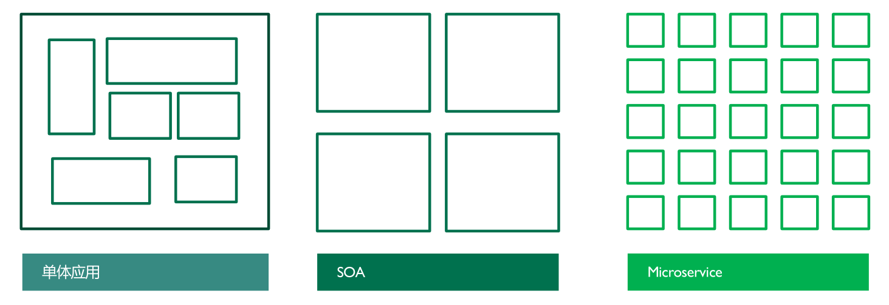
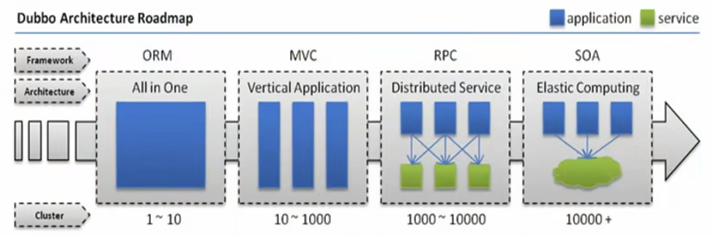
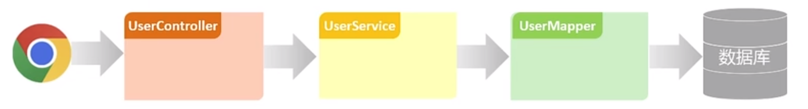

[← 返回微服务架构目录]({{ '/subjects/Microservices/' | relative_url }})



# 01 软件架构演变
## 1 微服务

### 1.1 软件架构演变



<nav class="article-end" aria-label="章节导航">
  <a href="{{ '/subjects/Microservices/' | relative_url }}">Back to Microservices Index</a>
  <a href="{{ '/subjects/Microservices/02-monolithic-architecture.html' | relative_url }}">Next: Monolithic Architecture →</a>
</nav>
