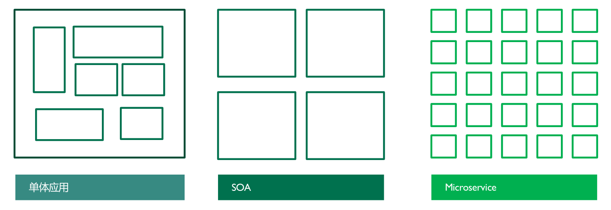
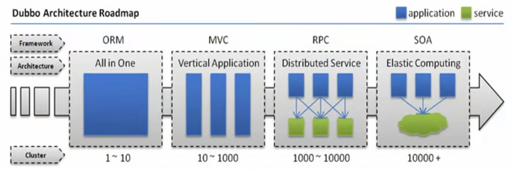

[← 返回微服务架构目录]({{ '/subjects/Microservices/' | relative_url }})



# 01 软件架构演变
## 1 微服务

### 1.1 软件架构为什么演变

软件架构不是按“单体 → SOA → 微服务 → 服务网格 → Serverless”的顺序自动升级。各方案解决不同约束：业务边界是否清晰、团队是否需要独立交付、负载是否需要分别扩容，以及组织能否承担分布式系统的运维成本。下面的插图用于回顾形态变化，不能把时间先后理解成优劣排名。

| 形态 | 核心做法 | 收益与代价 |
| --- | --- | --- |
| 模块化单体 | 在一个部署单元内划清业务模块 | 开发和事务路径较直接，但发布通常仍需整体协调 |
| SOA | 通过服务契约集成多个系统 | 促进复用，同时增加接口治理与集成成本 |
| 微服务 | 按业务边界拆分可独立部署的服务 | 独立交付和扩容更灵活，但引入远程调用与数据一致性问题 |
| 服务网格 | 在基础设施层处理部分服务间通信治理 | 减少应用侧重复逻辑，也增加控制平面和代理的复杂度 |
| Serverless | 使用托管函数与后端服务 | 降低部分基础设施维护工作，但需管理平台限制、冷启动和费用 |

**判断顺序**：先找当前瓶颈，再考虑最小的架构变化。代码耦合可以先通过模块边界和测试改善；只有独立发布、独立扩容或明确的数据归属带来可验证收益时，才值得试点拆分。架构没有通用终点，稳定满足业务需求并控制总成本才是目标。



<nav class="article-end" aria-label="章节导航">
  <a href="{{ '/subjects/Microservices/' | relative_url }}">返回微服务架构目录</a>
  <a href="{{ '/subjects/Microservices/02-monolithic-architecture.html' | relative_url }}">下一篇：单体(巨石)架构 →</a>
</nav>
