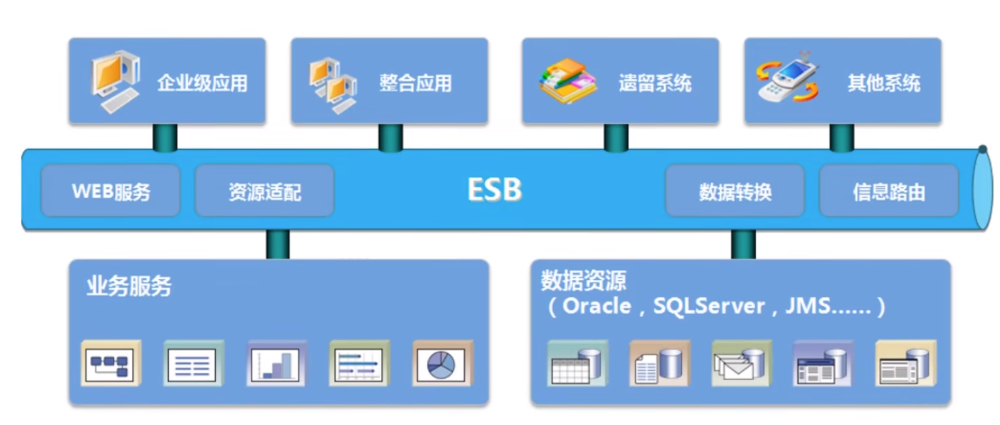

[← 返回微服务架构目录]({{ '/subjects/Microservices/' | relative_url }})



# 04 SOA 面向服务架构
### 1.4 SOA

SOA（面向服务架构）通过明确的服务契约，把订单、客户或结算等业务能力提供给其他系统使用。重点不只是“拆成多个进程”，而是跨系统约定接口、消息格式、身份认证和版本演进。它常见于多套异构系统需要共享能力的企业环境。

企业服务总线 **ESB** 是一种集成方式，可集中处理路由、协议转换和消息编排，但 SOA 并不要求所有服务都经过 ESB，也不意味着只能购买商业产品。集中集成逻辑能够减少系统间的两两对接，同时也需要高可用部署、容量规划和清晰的变更治理，否则可能成为性能瓶颈或单点故障。

与下一篇的微服务相比，SOA 更关注跨系统复用与集成治理；微服务更强调按业务边界形成可独立交付的服务。两者有交集，不能简单理解为“SOA 1.0、微服务 2.0”的线性替代。



<nav class="article-end" aria-label="章节导航">
  <a href="{{ '/subjects/Microservices/03-model-view-controller-mvc.html' | relative_url }}">← 上一篇：MVC 模型—视图—控制器</a>
  <a href="{{ '/subjects/Microservices/' | relative_url }}">返回微服务架构目录</a>
  <a href="{{ '/subjects/Microservices/05-microservices.html' | relative_url }}">下一篇：微服务 →</a>
</nav>
