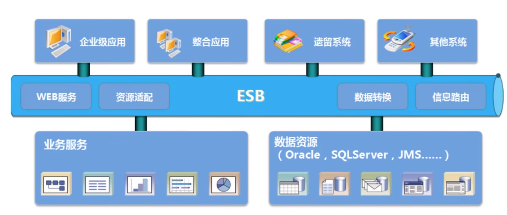

[← Back to Microservices Index]({{ '/subjects/Microservices/' | relative_url }})



# 04 Service-Oriented Architecture (SOA)
### 1.4 SOA

SOA（Service Oriented Architecture）是由多个服务组成的分布式系统

各个子系统之间没有采用统一的通信标准,导致系统间通信与数据交互变得异常复杂各个服务之间通过ESB(Enterprise Service Bus)进行通信,ESB是一个由大量规则和原则集成的软件架构，可以将一系列不同的应用程序集成到单个基础架构中，由于没有好的开源方案，只能使用商业公司的产品,因此成本很高

此外ESB属于重量级产品，部署规划异常笨重

ESB的单点依赖和商业ESB的费用问题反而成为了所有服务的瓶颈

特点:  降低服务耦合度,有利于升级扩展,服务相互访问复杂



<nav class="article-end" aria-label="章节导航">
  <a href="{{ '/subjects/Microservices/03-model-view-controller-mvc.html' | relative_url }}">← Previous: Model-View-Controller (MVC)</a>
  <a href="{{ '/subjects/Microservices/' | relative_url }}">Back to Microservices Index</a>
  <a href="{{ '/subjects/Microservices/05-microservices.html' | relative_url }}">Next: Microservices →</a>
</nav>
