[← 返回微服务架构目录]({{ '/subjects/Microservices/' | relative_url }})



# 05 微服务
### 1.5 微服务

### 微服务介绍

<https://www.martinfowler.com/microservices/>

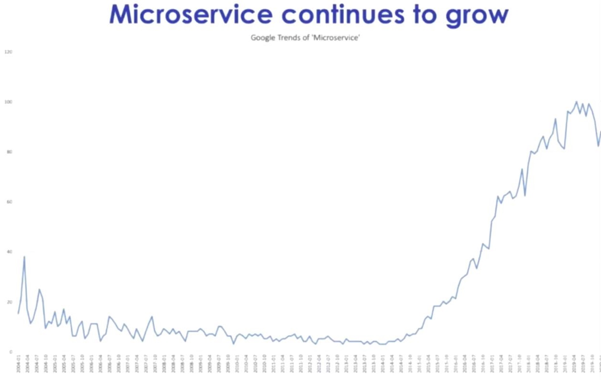

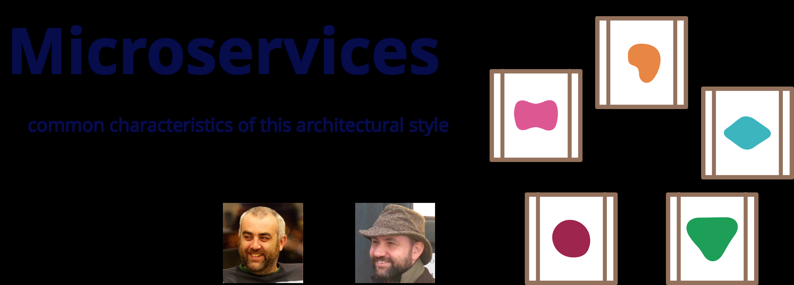

```text
In short, the microservice architectural style is an approach to developing a single application as a suite of
small services, each running in its own process and communicating with lightweight mechanisms, often an HTTP
resource API. These services are built around business capabilities and independently deployable by fully
automated deployment machinery. There is a bare minimum of centralized management of these services, which may
be written in different programming languages and use different data storage technologies.
简而言之，微服务架构风格是一种将单个应用程序开发为一套小型服务的方法，每个服务都在自己的进程中运行并与轻量级机制（通常是 HTTP 资源
API）进行通信。这些服务围绕业务功能构建，并可通过全自动部署机制独立部署。对这些服务进行最低限度的集中管理，这些服务可能用不同的编程
语言编写并使用不同的数据存储技术。
-- James Lewis and Martin Fowler (2014)
亚马逊创始人 Jeff Bezos 说过一句话：“一个最好的团队用两个披萨可以喂饱”。 订单99.99%，库存99.99%
一个团队控制到6-10人左右
https://wiki.mbalib.com/wiki/%E4%B8%A4%E4%B8%AA%E6%8A%AB%E8%90%A8%E5%8E%9F%E5%88%99
```

微服务是围绕业务能力划分的服务架构：每个服务有清楚的责任、独立的部署生命周期，并通过明确的接口协作。服务不必“小到只有一个函数”，也不保证拆分后彻底消除耦合；关键是让变更主要留在本服务边界内。通信可以采用 HTTP、RPC 或消息，数据是否独立存储要结合一致性与团队责任设计。

“两个披萨团队”强调可沟通、可负责的小团队，并不是固定人数的规定。微服务也不必强制每个服务选不同语言或数据库；过多技术栈反而增加维护成本。SOA 与微服务有共同的服务化思想，但不存在必然的 1.0/2.0 替代关系。

微服务特点

微服务的价值可从四个边界理解：

- **业务边界**：服务围绕一项相对完整的业务能力，而不是简单按表、控制器或代码行数拆分。
- **接口边界**：其他服务通过稳定契约访问能力，避免直接依赖其内部表结构。
- **交付边界**：服务可独立构建和发布，但仍须考虑兼容性、回滚和跨服务变更。
- **故障边界**：超时、限流、重试和幂等可限制故障传播；独立部署并不自动带来高可用。

SOA 和 微服务比较

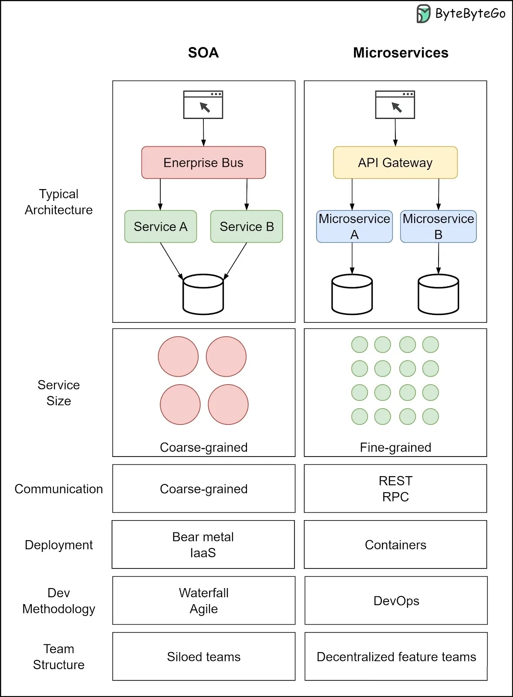

### 单体架构和微服务比较

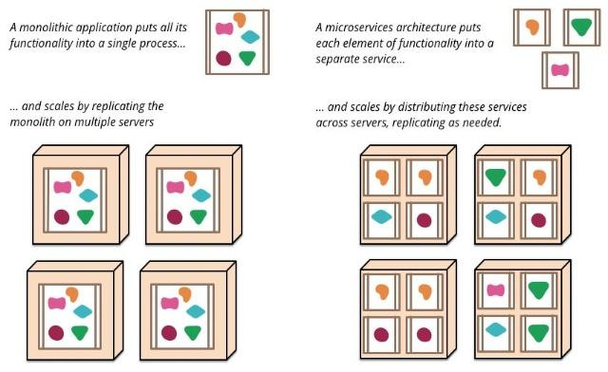


### 微服务的优缺点

微服务优点：

**可能的收益**：当边界划分合理时，小团队可专注于一项业务能力，热点服务可以分别扩容，局部变更不必总是发布整个系统。服务接口明确后，也更容易为不同业务选择合适实现。不过“小”本身不会自动让代码简单：跨服务的调用链和数据流可能比单体更难理解。

**前提条件**：自动化测试、持续交付、监控与告警、统一身份和配置管理都要跟上。服务有独立数据所有权时，其他服务应通过接口或事件获取所需信息；技术上共用一个数据库并非不可能，但若直接跨服务改表，独立演进的收益会明显下降。

微服务缺点：

**主要代价**：原本的进程内调用变成网络调用，需要处理超时、重试、限流和部分失败；跨服务数据更新需要明确一致性目标，可能使用事件、补偿或流程编排，而不是默认引入“分布式事务”。此外，测试环境、日志追踪、配置与发布流水线都会增多。若业务规模与团队协作尚未暴露这些瓶颈，模块化单体通常更省成本。

### 微服务技术栈

架构并不是“发明”出来的，是持续进化的结果。

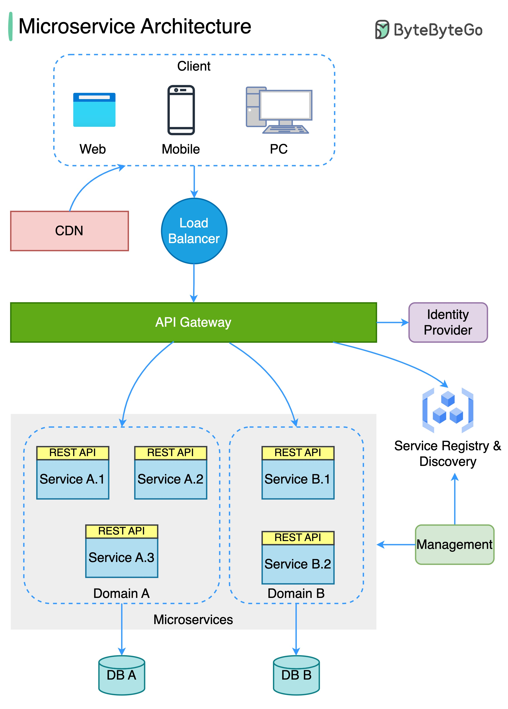

只要选择了分布式架构，无论是 SOA、微服务、服务网格或者其他架构风格，都会涉及与到和远程服务交互

而服务的注册发现、跟踪治理、负载均衡、故障隔离、认证授权、伸缩扩展、传输通讯、事务处理，等等，这一系列问题都是无可避免的。

不同的架构风格，其区别是到底要在技术规范上提供统一的解决方案，还是由应用系统自行去解决，又或者在基础设施层面将一类问题隔离掉

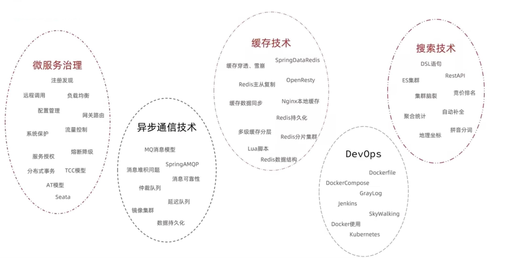

### 常见的微服务框架

在多种编程语言中，有许多专门设计用来开发微服务的框架。以下是一些主流的微服务开发框架：

可把技术组件按问题分组：服务实现框架（Spring Boot、Go Kit、ASP.NET Core 等）、通信（HTTP API、gRPC、消息队列）、治理（服务发现、网关、配置、限流）、交付与观测（CI/CD、指标、日志、追踪）。Django、Flask、Express 可用来实现服务，但本身不定义微服务架构；gRPC 是通信框架，不是完整的服务治理平台。选择时以团队熟悉度和实际需求为先，不必一次引入整套组件。

这些框架都有各自的特点和优点，选择哪种框架取决于你的项目需求以及团队对某种语言或框架的熟悉度。

### Spring Cloud

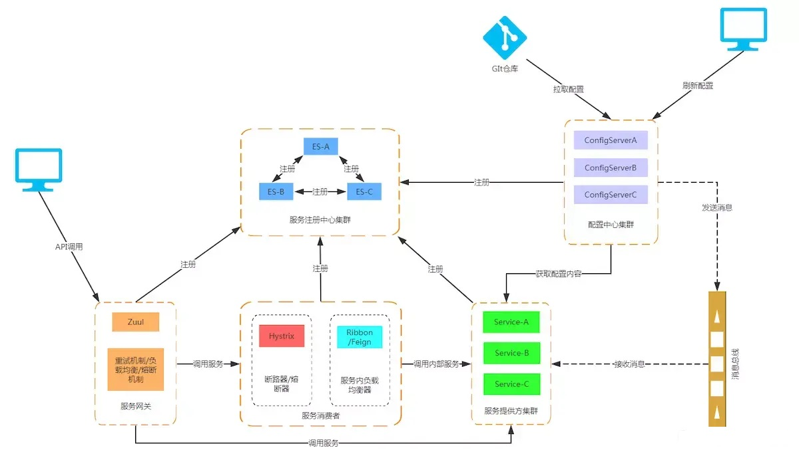

在 Java 生态中，Apache Dubbo 主要提供服务调用及相关治理能力，Spring Cloud 提供配置、服务发现、网关、负载均衡等分布式应用模式的项目组合，Spring Cloud Alibaba 则整合 Nacos、Sentinel、Seata 等组件。三者解决的问题有交叉，不能把 Spring Cloud 简单称为 Dubbo 的“超集”，也不必在一个项目里全部引入。

| 需求 | 常见方案示例 | 选择时要问的问题 |
| --- | --- | --- |
| 远程调用 | HTTP API、Dubbo、OpenFeign、gRPC | 是否需要跨语言、流式通信或兼容已有协议？ |
| 注册与发现 | Kubernetes Service、Nacos、Eureka、Consul | 部署平台是否已提供服务发现？ |
| 配置管理 | Spring Cloud Config、Nacos、平台配置服务 | 如何控制版本、权限与回滚？ |
| 边缘路由 | Spring Cloud Gateway、其他 API 网关 | 是否需要统一认证、限流与流量治理？ |
| 容错与观测 | Sentinel、Resilience4j、OpenTelemetry | 超时、指标和调用链如何协同？ |

组件兼容性与维护状态随版本变化。落地前核对 Spring Boot、Spring Cloud 和第三方组件的官方兼容矩阵，不把历史表格中的日期当作当前结论。

<https://cn.dubbo.apache.org/zh-cn/index.html>

<https://spring.io/projects/spring-cloud>

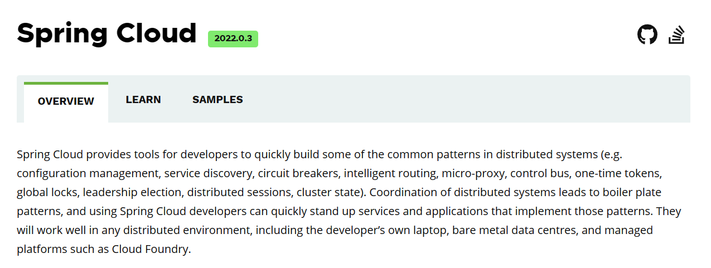

#### Spring Boot 与 Spring Cloud 如何分工

Spring Boot 帮助构建可独立运行的 Spring 应用，提供自动配置、起步依赖和运行时管理能力；既可以用于单体，也可以用于微服务。Spring Cloud 是围绕分布式应用常见问题的一组项目，按需选择服务发现、配置、网关和调用等能力，并非一条“开启微服务”的总开关。

例如，订单服务可先用 Spring Boot 实现业务 API；当确有跨服务调用时，再决定是否引入声明式客户端、服务发现与配置管理。新增组件前先明确责任边界、故障处理和运维负责人，而不是把所有组件一起装进“全家桶”。

<https://spring.io/projects/spring-cloud#overview>

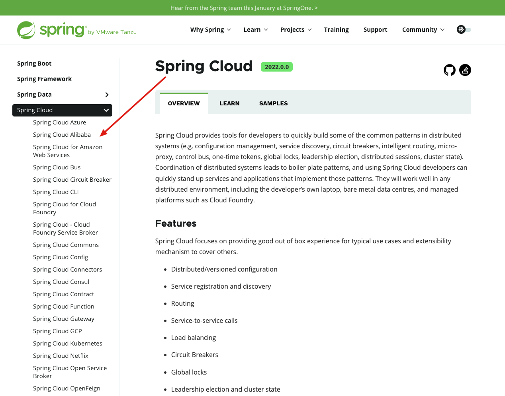

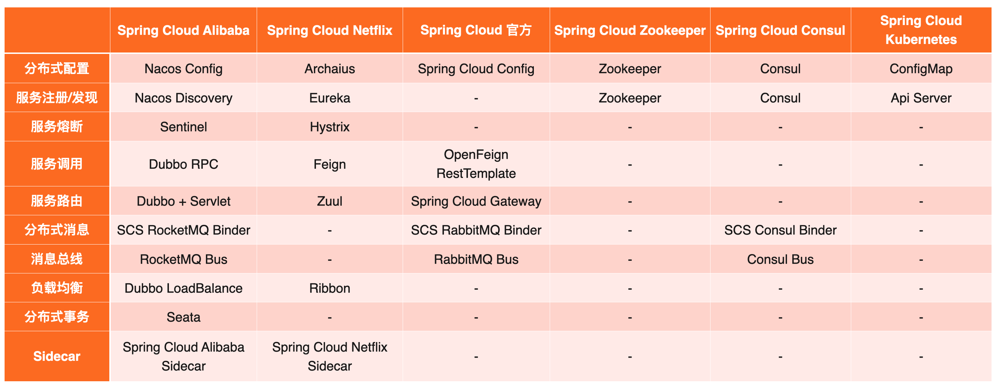

#### Spring Cloud Netflix 中的常见名称

| 名称 | 作用 | 阅读旧教程时的注意点 |
| --- | --- | --- |
| Eureka | 服务注册与发现 | 它不是配置中心；是否采用需看现有平台和版本 |
| Ribbon | 早期客户端负载均衡 | 新项目核对 Spring Cloud LoadBalancer 等替代方案 |
| Feign / OpenFeign | 声明式 HTTP 客户端 | 区分 Netflix Feign 与 Spring Cloud OpenFeign 的版本及维护状态 |
| Hystrix | 早期断路器方案 | 新项目优先核对仍受支持的容错组件 |
| Zuul | API 网关 | 具体版本与 Spring Cloud 集成状态需要分别核对 |

不要根据一次“最后更新日期”判断所有组件已停更或可直接升级；以正在使用的版本与官方发布说明为准。

Spring Cloud Alibaba

<https://github.com/alibaba/spring-cloud-alibaba>

<https://github.com/alibaba/spring-cloud-alibaba/wiki>

<https://gitee.com/mirrors/Spring-Cloud-Alibaba/>

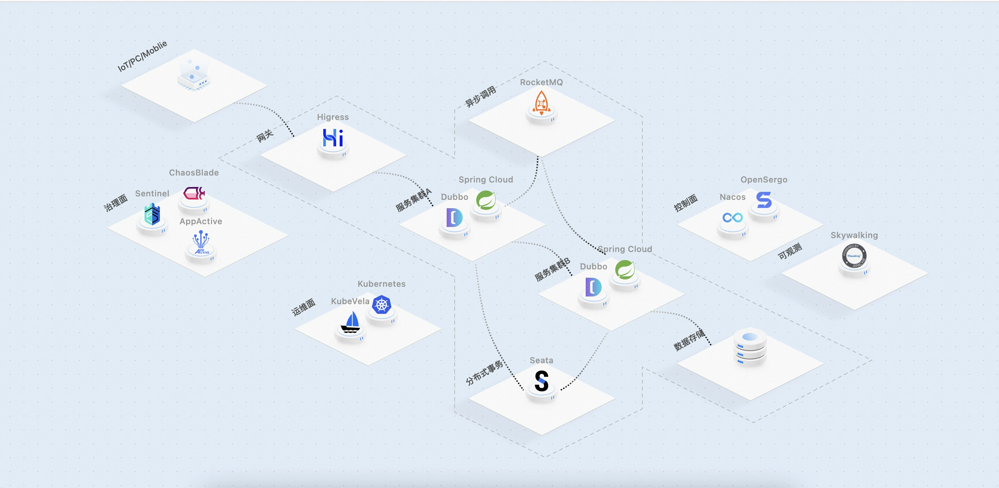

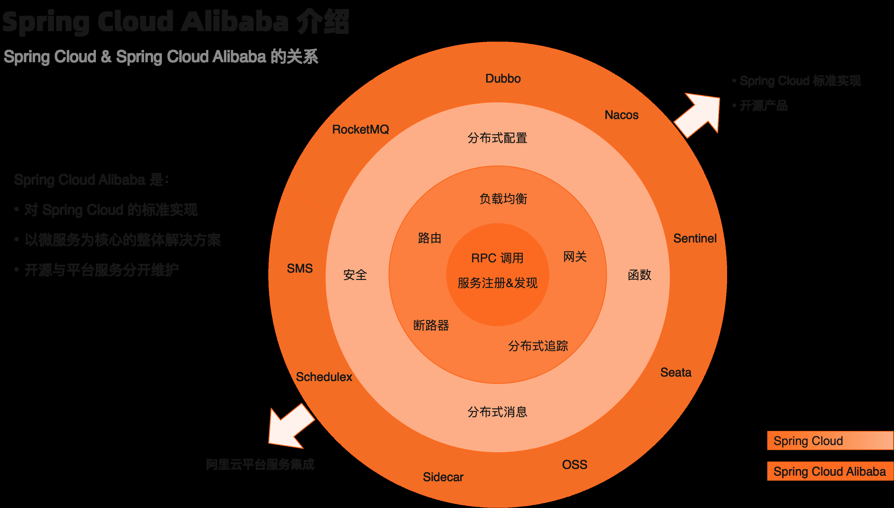

| 组件 | 主要职责 |
| --- | --- |
| Nacos | 服务发现与配置管理 |
| Sentinel | 流量控制与容错 |
| Dubbo | RPC 通信与服务治理 |
| Seata | 分布式事务协调，需结合业务一致性需求决定是否引入 |
| RocketMQ | 异步消息与事件传递 |

云厂商的对象存储、短信、调度等是可选外部服务，不是构建微服务必备的 Spring Cloud Alibaba 组件。服务发现、配置和网关也可以由 Kubernetes 或其他平台提供；避免把产品清单误读为固定技术栈。



<nav class="article-end" aria-label="章节导航">
  <a href="{{ '/subjects/Microservices/04-service-oriented-architecture-soa.html' | relative_url }}">← 上一篇：SOA 面向服务架构</a>
  <a href="{{ '/subjects/Microservices/' | relative_url }}">返回微服务架构目录</a>
  <a href="{{ '/subjects/Microservices/06-service-mesh.html' | relative_url }}">下一篇：服务网格 Mesh →</a>
</nav>
