[← Back to Microservices Index]({{ '/subjects/Microservices/' | relative_url }})



# 05 Microservices
### 1.5 微服务

### 微服务介绍

<https://www.martinfowler.com/microservices/>

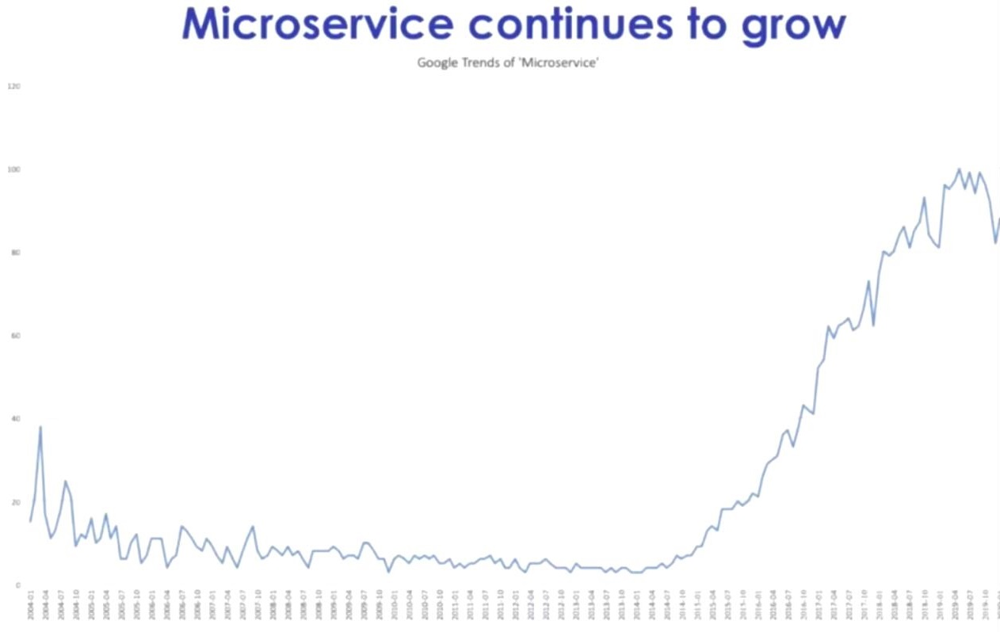

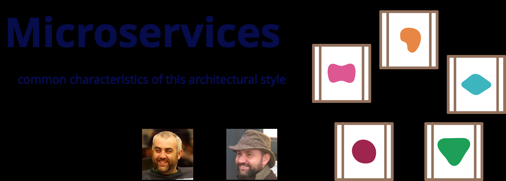

```text
In short, the microservice architectural style is an approach to developing a single application as a suite of
small services, each running in its own process and communicating with lightweight mechanisms, often an HTTP
resource API. These services are built around business capabilities and independently deployable by fully
automated deployment machinery. There is a bare minimum of centralized management of these services, which may
be written in different programming languages and use different data storage technologies.
简而言之，微服务架构风格是一种将单个应用程序开发为一套小型服务的方法，每个服务都在自己的进程中运行并与轻量级机制（通常是 HTTP 资源
API）进行通信。这些服务围绕业务功能构建，并可通过全自动部署机制独立部署。对这些服务进行最低限度的集中管理，这些服务可能用不同的编程
语言编写并使用不同的数据存储技术。
-- James Lewis and Martin Fowler (2014)
亚马逊创始人 Jeff Bezos 说过一句话：“一个最好的团队用两个披萨可以喂饱”。 订单99.99%，库存99.99%
一个团队控制到6-10人左右
https://wiki.mbalib.com/wiki/%E4%B8%A4%E4%B8%AA%E6%8A%AB%E8%90%A8%E5%8E%9F%E5%88%99
```

微服务属于SOA的子集,SOA可以认为面向服务的1.0版本,微服务可以认为是面向服务的2.0版本微服务架构“分而治之”的手段将大型系统按业务分割成多个互相协作的微服务，每个微服务关注于自身业务职责可以独立开发、部署和维护，从而更好地应对频繁需求变更和迭代微服务化的核心就是将传统的一站式应用，根据业务拆分成一个一个的服务，彻底消除强耦合，每一个微服务提供单个业务功能，一个服务只做一件事。每个服务都围绕着具体业务进行构建，并且能够被独立地部署到生产环境、类生产环境等从技术角度讲每个微服务就是一种小而独立的处理过程，类似与进程的概念，能够自行单独启动或销毁微服务架构（分布式系统），各个模块/服务，各自独立出来，"让专业的人干专业的事"，独立部署。分布式系统中，不同的服务可以使用各自独立的数据库。 服务之间采用轻量级的标准的通信机制,通常是基于HTTP的RESTful (Representational State Transfer 表述性状态转移）API 微服务设计的思想改变了原有的企业研发团队组织架构。传统的研发组织架构是水平架构，前端、后端、DBA、测试分别有自己对应的团队，属于水平团队组织架构。而微服务的设计思想对团队的划分有着一定的影响，使得团队组织架构的划分更倾向于垂直架构，比如用户业务是一个团队来负责，支付业务是一个团队来负责。但实际上在企业中并不会把团队组织架构拆分得这么绝对，垂直架构只是一种理想的架构微服务的实现框架有多种，不同的应用架构，部署方式也有不同

微服务特点

功能单一职责: 微服务拆分粒度更小，每一个服务都对应唯一的业务能力，做到单一职责，避免重复业务开发访问面向服务:微服务对外暴露业务接口,通过接口实现服务的访问,而不能直接访问服务内的数据和功能独立自治: 团队独立、技术独立、数据独立、部署独立安全性: 服务调用需要实现隔离,容错,降级等安全保护,防止级联故障

SOA 和 微服务比较

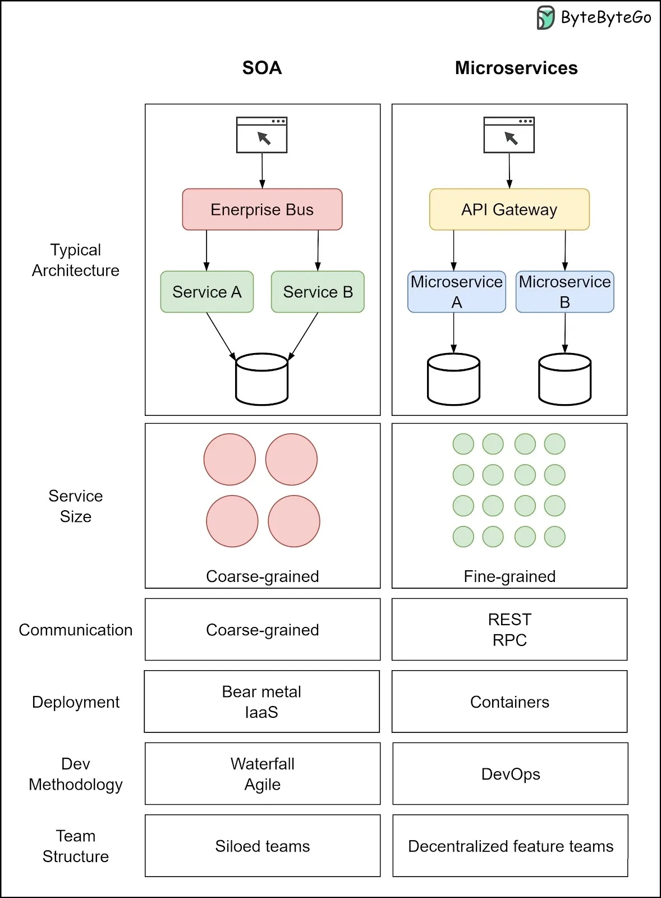

### 单体架构和微服务比较

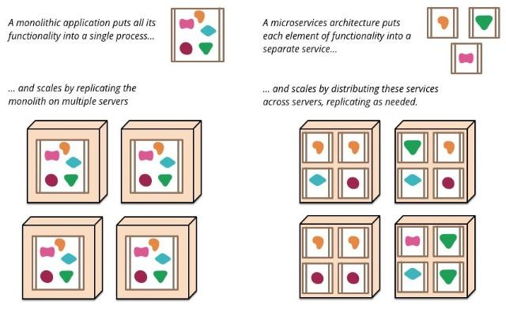

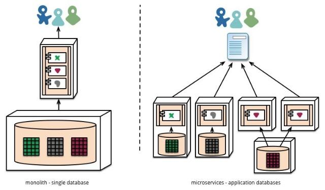

### 微服务的优缺点

微服务优点：

每个服务足够内聚，足够小，代码容易理解。这样能聚焦一个简单唯一的业务功能或业务需求。 开发简单、开发效率提高，一个服务可能就是专业的只干一件事，所以它业务清晰，代码量较少,易于开发和维护,微服务能够被小团队单独开发，这个小团队可以是2到5人的开发人员组成微服务易于被一个开发人员理解、修改和维护，这样小团队能够更关注自己的工作成果，无需通过合作才能体现价值灵活部署、独立扩展,微服务是松耦合的，是有功能意义的服务，无论是在开发阶段或部署阶段都是独立的。传统的单体架构是以整个系统为单位进行部署，而微服务则是以每一个独立组件为单位进行部署。 相对于传统的单体式应用，基于微服务的应用更加模块化且小巧，且易于部署。 去中心化治理，在整个微服务架构，通过采用轻量级的契约定义接口，使得我们对服务本身的具体技术平台不再那么敏感，这样整个微服务架构系统中的各个组件就能针对不同的业务特点选择不同的技术平台。 局部修改容易部署,单体应用只要有修改，就得重新部署整个应用，微服务解决了这样的问题。 微服务允许你利用融合最新技术。在微服务架构中，可以结合项目业务及团队的特点，合理地选择技术栈。微服务只是业务逻辑的代码，不会和HTML/CSS或其他界面组件混合，即前后端分离易于和第三方集成，微服务运行容易且灵活的方式集成自动部署，通过持续集成工具，如: Jenkins、Hudson、Bamboo 资源的有效隔离，每一个微服务拥有独立的数据源，假如微服务A 想要读写微服务B 的数据库，只能调用微服务B 对外暴露的接口来完成。这样有效避免了服务之间争用数据库，每个微服务都有自己的存储能力，一般都有自己的独立的数据库，也可以有统一数据库

微服务缺点：

微服务把原有的一个项目拆分成多个独立工程，增加了开发、测试、运维、监控等的复杂度微服务架构需要保证不同服务之间的数据一致性，引入了分布式事务和异步补偿机制，为设计和开发带来一定挑战在微服务架构中，快速检测出故障源并尽可能地自动恢复服务是必须被设计考虑的，通常我们都希望在每个服务中实现监控和日志记录。比如对服务状态、断路器状态、吞吐量、网络延迟等关键数据进行可视化展示。 开发人员和运维需要处理分布式系统的复杂性，需要更强的技术能力微服务适用于复杂的大系统，对于小型应用使用微服务，进行盲目的拆分只会增加其维护和开发成本

### 微服务技术栈

架构并不是“发明”出来的，是持续进化的结果。

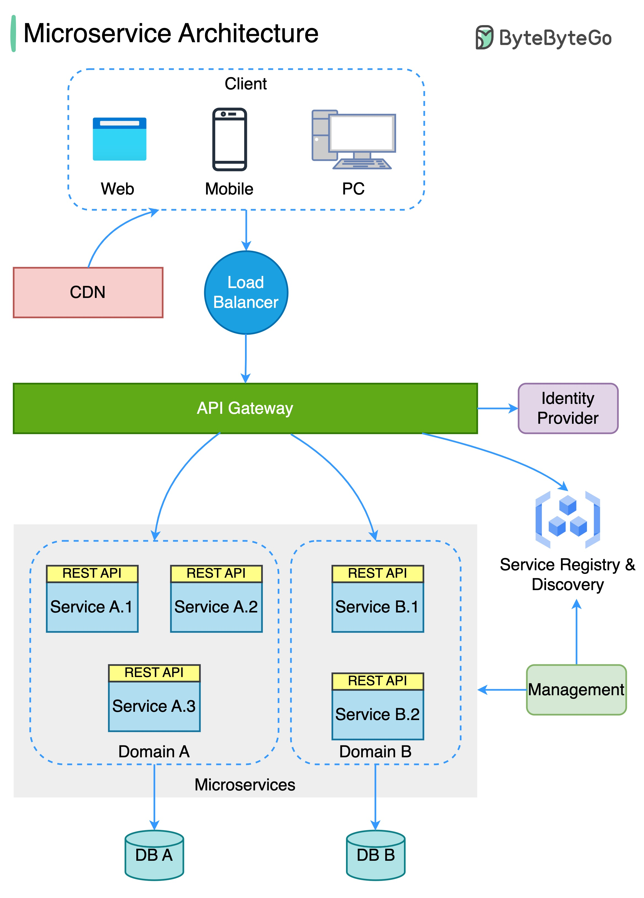

只要选择了分布式架构，无论是 SOA、微服务、服务网格或者其他架构风格，都会涉及与到和远程服务交互

而服务的注册发现、跟踪治理、负载均衡、故障隔离、认证授权、伸缩扩展、传输通讯、事务处理，等等，这一系列问题都是无可避免的。

不同的架构风格，其区别是到底要在技术规范上提供统一的解决方案，还是由应用系统自行去解决，又或者在基础设施层面将一类问题隔离掉

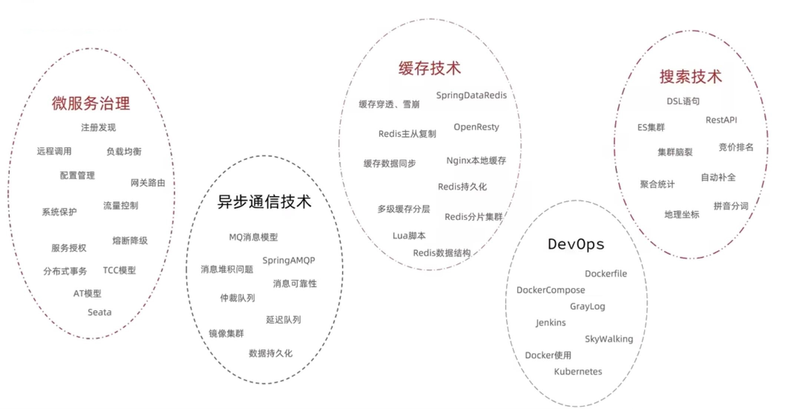

### 常见的微服务框架

在多种编程语言中，有许多专门设计用来开发微服务的框架。以下是一些主流的微服务开发框架：

Spring Boot & Spring Cloud：对于Java来说，Spring Boot是一个用来创建独立、基于Spring的生产级应用的框架。Spring Cloud则是一套基于Spring Boot的工具，专门用于构建分布式的、云原生的系统，包括配置管理、服务发现、断路器、路由、微代理、事件总线、全局锁、决策竞选、分布式会话等。 Go Kit & Micro：对于Go来说，Go Kit和Go Micro都是专门设计用来创建微服务的工具集，提供了服务发现、负载均衡、同步调用、 异步消息等功能。 Django & Flask：对于Python来说，Django和Flask都是非常流行的框架，虽然它们原本并不专为微服务设计，但通过扩展和一些良好的设计实践，可以在这些框架上构建微服务。 Express.js：对于JavaScript和Node.js来说，Express.js是一个非常流行的web应用框架，常被用来创建RESTful API服务。 .NET Core：对于.NET来说，.NET Core是一个跨平台的、开源的框架，用于构建云应用和微服务。 Lagom：Lagom是Lightbend公司为Scala和Java设计的一种用于创建响应式微服务的开源框架。 Akka：Akka是一个用Scala和Java编写的开源工具包和运行时，用于构建并发和分布式应用。 gRPC：gRPC是一个高性能、开源的通用远程过程调用（RPC）框架，由Google开发并开源，适合构建微服务。

这些框架都有各自的特点和优点，选择哪种框架取决于你的项目需求以及团队对某种语言或框架的熟悉度。

### Spring Cloud

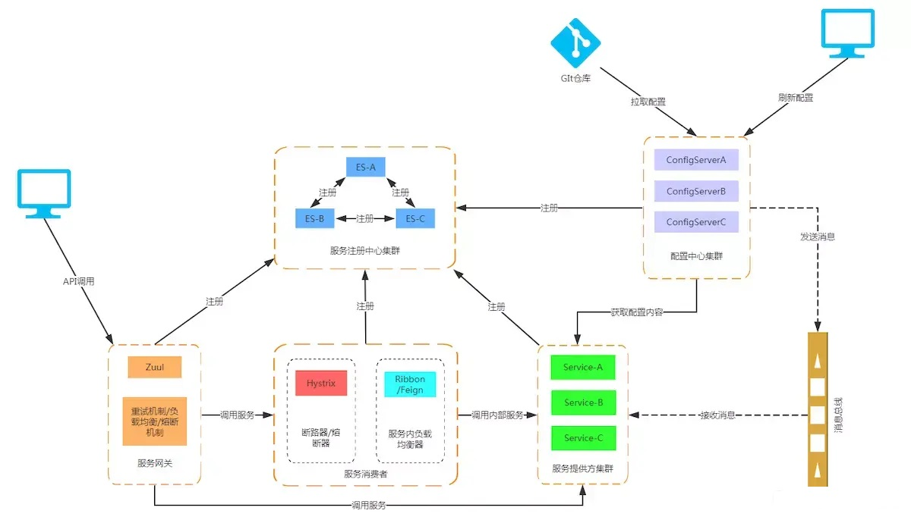

2008年以后，国内互联网行业飞速发展，企业对软件系统的需求已经不再是过去”能用就行”这种很低的档次了，像抢红包、双十一这样的活动不断逼迫技术人员去突破软件系统的性能上限，传统的IT企业”能用就行”的开发思想已经不能满足互联网高并发、大流量的性能要求。系统架构走向分布式已经是服务器开发领域解决该问题唯一的出路，然而分布式系统由于天生的复杂度，并不像开发单体应用一样把框架一堆就能搞定，因此各大互联网公司都在投入技术力量研发自己的基础设施。这里面JAVA技术中比较有名的如阿里的开源项目dubbo, Netflix开发的一系列服务框架。

JAVA 微服务技术

Dubbo SpringCloud Netflix SpringCloudAlibaba

注册中心 zookeeper,Redis Eureka、Consul Nacos、Eureka

服务远程调用 Dubbo 协议 Feign (http协议) Dubbo、Feign

配置中心无 SpringCloudConfig Nacos、SpringCloudConfig

服务网关无 SpringCloudGateway、Zuul SpringCloudGateway、zuul

服务监控安全 dubbo-admin 功能少 Hystrix Sentinel

Dubbo

阿里开源贡献给了ASF，目前已经是Apache的顶级项目一款高性能的Java RPC服务框架，微服务生态体系中的一个重要组件将单体程序分解成多个功能服务模块，模块间使用Dubbo框架提供的高性能RPC通信内部协调使用 Zookeeper，实现服务注册、服务发现和服务治理

Spring cloud

一个完整的微服务解决方案，相当于Dubbo的超集微服务框架，将单体应用拆分为粒度更小的单一功能服务基于HTTP协议的REST风格实现模块间通信 Spring Cloud Alibaba中的Spring Cloud Alibaba Dubbo项目则是将Dubbo与Spring Cloud进行集成，使得开发者可以在Spring Cloud环境中使用Dubbo的RPC能力。

Spring Cloud

官网地址: https://spring.io/projects/spring-cloud

在这种“百花齐放”、重复造轮子的状况下，必然要出现一种统一的标准来简化分布式系统的开发，Spring Cloud应运而生。

SpringCloud是目前国内使用最广泛的Java微服务框架。

SpringCloud集成了各种微服务功能组件，并基于SpringBoot实现了这些组件的自动装配，从而提供了良好的开箱即用体验:

Spring Cloud是一系列框架的有序集合。它利用Spring Boot的开发便利性巧妙地简化了分布式系统基础设施的开发，如服务发现注册、配置中心、消息总线、负载均衡、断路器、数据监控等，都可以用Spring Boot的开发风格做到一键启动和部署。Spring并没有重复制造轮子，它只是将目前各家公司开发的比较成熟、经得起实际考验的服务框架组合起来，通过Spring Boot风格进行再封装屏蔽掉了复杂的配置和实现原理，最终给开发者留出了一套简单易懂、易部署和易维护的分布式系统开发工具包。

Spring Cloud正是对Netflix的多个开源组件进一步的封装而成，同时又实现了和云端平台，和Spring Boot开发框架很好的集成。

Spring Cloud是一个相对比较新的微服务框架，2016年才推出1.0的release版本. 虽然Spring Cloud时间最短, 但是相比Dubbo等RPC框架, Spring Cloud提供的全套的分布式系统解决方案。 Spring Cloud 为开发者提供了在分布式系统（配置管理，服务发现，熔断，路由，微代理，控制总线，一次性token，全居琐，leader选举，分布式session，集群状态）中快速构建的工具，使用Spring Cloud的开发者可以快速的启动服务或构建应用、同时能够快速和云平台资源进行对接。

Spring Cloud从设计之初就考虑了绝大多数互联网公司架构演化所需的功能，如服务发现注册、配置中心、消息总线、负载均衡、断路器、 数据监控等。这些功能都是以插拔的形式提供出来，方便我们系统架构演进的过程中，可以合理的选择需要的组件进行集成，从而在架构演进的过程中会更加平滑、顺利。

微服务架构是一种趋势，Spring Cloud提供了标准化的、全站式的技术方案，意义可能会堪比当前Servlet规范的诞生，有效推进服务端软件系统技术水平的进步。

Spring Cloud 是基于 Spring Boot 的一种微服务架构开发工具，用于简化分布式系统中的常见模式，例如配置管理、服务发现、断路器、智能路由、微代理、控制总线等。以下是 Spring Cloud 的主要发展历程：

2015年：Spring Cloud 项目正式启动。这个项目的目标是简化构建在分布式系统中运行的应用程序的开发过程。其早期的版本提供了诸如配置管理、服务发现等功能，并且与 Netflix 开源工具集（如 Eureka、Hystrix 和 Zuul）的整合非常紧密。

2016年-2018年：在这段时间里，Spring Cloud 在企业中得到了广泛的应用，并且持续引入了新的特性，比如分布式跟踪（Spring Cloud Sleuth 和 Zipkin 的整合）、消息驱动的微服务（Spring Cloud Stream）、基于路由的服务调用（Spring Cloud Gateway）等。

2019年：Pivotal（Spring Cloud 的背后公司）被 VMware 收购，但这并没有阻止 Spring Cloud 的发展。Spring Cloud 还在继续发布新的版本，提供更多的功能，比如 Spring Cloud Function（用于简化函数式编程）和 Spring Cloud Config Server（用于集中式的配置管理） 等。

2020年-2021年：Spring Cloud 进行了一些重要的更新，例如支持新的服务发现工具，如 Kubernetes 服务发现，更好地支持云原生应用的构建和部署。

<https://cn.dubbo.apache.org/zh-cn/index.html>

<https://spring.io/projects/spring-cloud>

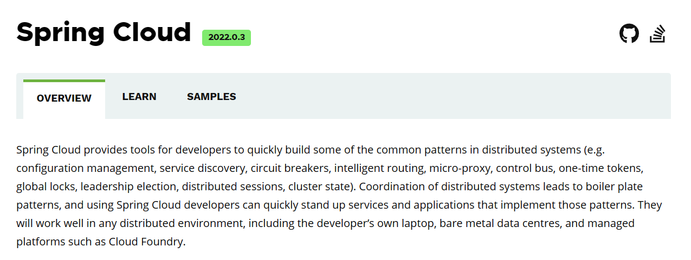

Spring Boot 和 Spring cloud

Spring Boot和Spring Cloud是两个相互关联但又独立的项目。它们都属于Spring生态系统，用于简化和加速Java应用程序的开发过程。

Spring Boot

Spring Boot是一个用于简化和加速Java应用程序开发的框架。它是由Spring团队开发的，基于Spring框架构建的一个轻量级、开箱即用的框架。 Spring Boot旨在简化传统的Spring应用程序开发过程，通过自动配置和约定优于配置的原则，使得开发人员能够更快地构建独立的、生产级别的Spring应用程序。它提供了许多开箱即用的特性和功能，包括：

自动配置：Spring Boot根据应用程序的依赖和配置自动配置应用程序的各种组件，如数据源、Web服务器、安全性等。这大大简化了配置的过程。 起步依赖：Spring Boot提供了一系列的"起步依赖"，它们是预配置的依赖项集合，可以快速启动特定类型的应用程序。例如，使用"spring-boot-starter-web"起步依赖可以快速构建一个基于Web的应用程序。 嵌入式服务器：Spring Boot内置了常见的嵌入式服务器，如Tomcat、Jetty和Undertow，使得应用程序可以独立运行，无需额外安装和配置外部服务器。 简化的配置：Spring Boot使用约定优于配置的原则，通过提供合理的默认配置来简化应用程序的配置。开发人员只需关注需要修改的配置部分，而不必处理繁琐的全局配置。 Spring Boot提供了Actuator模块，可以通过HTTP或JMX暴露应用程序的健康状况、指标和其他运行时信息，便于监控和管理应用程序。

总的来说，Spring Boot使得Java开发人员能够更快速、更简单地构建独立的、生产级别的单体应用程序。它提供了许多便利的功能和特性， 使得开发人员可以专注于业务逻辑的实现，而不必花费过多时间和精力在繁琐的配置和集成上。

Spring Boot是构建独立、自包含的、可以立即运行的Spring应用程序的框架。它通过提供自动配置、约定优于配置和简化的开发体验，简化了Spring应用程序的搭建和配置过程。Spring Boot减少了繁琐的配置，使得开发者可以更专注于业务逻辑的实现。Spring Boot可以独立使用，也可以与其他Spring项目一起使用。

Spring Cloud

Spring Cloud是一系列框架的有序集合。它利用Spring Boot的开发便利性巧妙地简化了分布式系统基础设施的开发，如服务发现注册、配置中心、消息总线、负载均衡、断路器、数据监控等，都可以用Spring Boot的开发风格做到一键启动和部署。Spring Cloud并没有重复制造轮子，它只是将目前各家公司开发的比较成熟、经得起实际考验的服务框架组合起来，通过Spring Boot风格进行再封装屏蔽掉了复杂的配置和实现原理，最终给开发者留出了一套简单易懂、易部署和易维护的分布式系统开发工具包。 Spring Cloud是用于构建分布式系统和微服务架构的工具集合。它提供了一系列的功能和库，用于解决分布式系统中的常见问题，如服务注册与发现、负载均衡、断路器、配置管理等。Spring Cloud构建在Spring Boot之上，并使用Spring Boot的自动配置机制来简化微服务的开发和部署。Spring Cloud提供了许多用于构建可伸缩、弹性和可靠的分布式系统的库和工具。

因此，可以说Spring Cloud是建立在Spring Boot之上的一个框架，它利用了Spring Boot的简化开发和配置的能力，为构建分布式系统提供了额外的功能和工具。使用Spring Boot和Spring Cloud可以帮助开发者更轻松地构建和部署微服务架构，并解决分布式系统开发中的常见挑战。

Spring Cloud的本质是在Spring Boot 的基础上，增加了一堆微服务相关的规范，并对应用上下文( Application Context )进行了功能增强。 既然Spring Cloud是规范那么就需要去实现

目前Spring Cloud规范已有Spring官方，Spring Cloud Netflix，Spring Cloud Alibaba等实现。通过组件化的方式，Spring Cloud将这些实现整合到一起构成全家桶式的微服务技术栈。

<https://spring.io/projects/spring-cloud#overview>

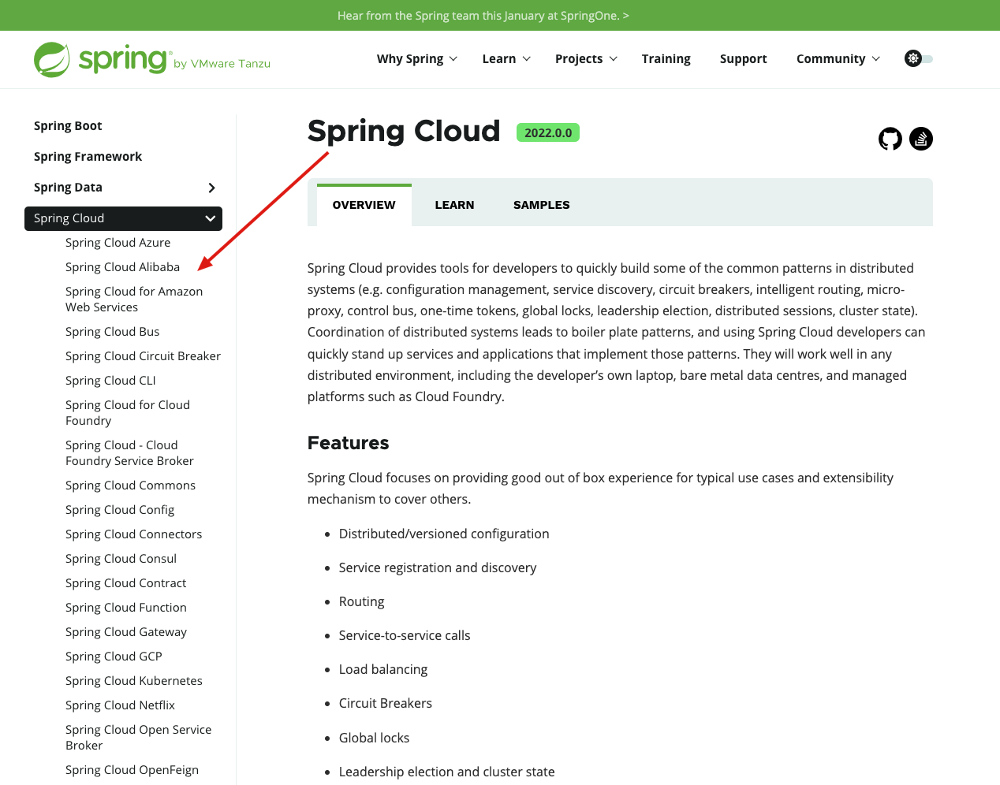

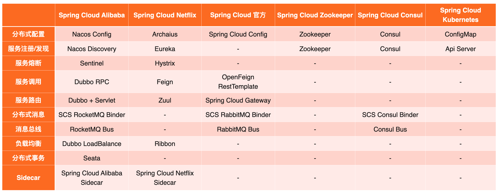

Spring Cloud Netflix

<https://github.com/Netflix>

组件名称作用说明

Eureka 服务注册中心 2023-06-22目前已停更，和其它业务微服务一样，不做为配置中心，其自身也需要做为微服务程序员自

行开发和部署

Ribbon 客户端负载均

衡 2021-08-06最后更新

Feign 声明式服务调

用 2019年后不再更新，已经被 OpenFeign取代

Hystrix 客户端容错保

护 2018-11-17最后更新

Zuul API服务网关 2024-06-26最后更新,当前持续更新中

Spring Cloud Alibaba

<https://github.com/alibaba/spring-cloud-alibaba>

<https://github.com/alibaba/spring-cloud-alibaba/wiki>

<https://gitee.com/mirrors/Spring-Cloud-Alibaba/>

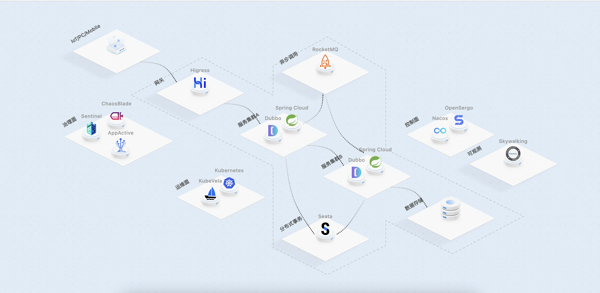

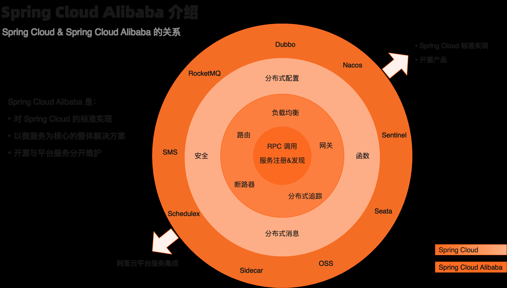

组件名称作用

Nacos 服务注册和配置中心

Sentinel 客户端容错保护

Dubbo 远程调用

Seata 分布式事务

RocketMQ 消息队列

Alibaba Cloud SchedulerX 分布式任务调度产品(商用)

Alibaba Cloud OSS 阿里云对象存储服务（Object Storage Service)(商用)

Alibaba Cloud SMS 阿里云短信服务(商用)

Alibaba Cloud ACM 应用配置中心产品Application Configuration Management(商用)

Spring Cloud原生及其他组件

组件名称作用

consul 服务注册中心

config 分布式配置中心

Gateway API服务网关

Sleuth/Zipkin 分布式链路追踪



<nav class="article-end" aria-label="章节导航">
  <a href="{{ '/subjects/Microservices/04-service-oriented-architecture-soa.html' | relative_url }}">← Previous: Service-Oriented Architecture (SOA)</a>
  <a href="{{ '/subjects/Microservices/' | relative_url }}">Back to Microservices Index</a>
  <a href="{{ '/subjects/Microservices/06-service-mesh.html' | relative_url }}">Next: Service Mesh →</a>
</nav>
