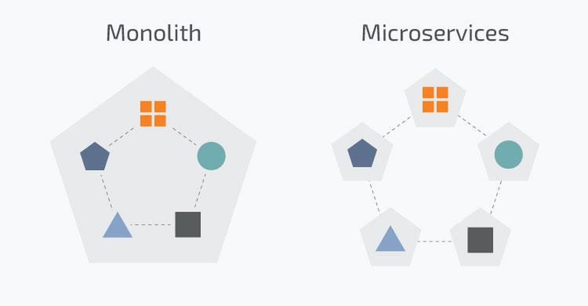
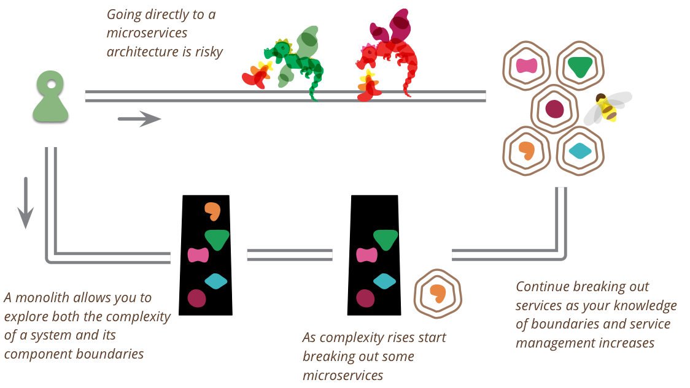

[← 返回微服务架构目录]({{ '/subjects/Microservices/' | relative_url }})



# 08 微服务还是单体
### 1.8 先识别约束，再选择部署边界

Martin Fowler 的“单体优先”讨论提醒我们：在业务边界尚未清晰时，过早拆成多个服务，会把本可在代码内调整的接口变成跨网络、跨团队的契约。它不是“所有项目都必须先做单体”的定律；如果组织已具备成熟平台、团队边界和明确的独立交付需求，直接采用少量服务也可能合理。

参考阅读：<https://martinfowler.com/bliki/MonolithFirst.html>

### 为什么先做模块化单体

单体内也可以划分订单、库存、支付等清晰模块，通过接口和测试限制直接访问彼此的数据。这样既能快速探索业务边界，也能收集真正的拆分信号：是否存在不同发布节奏、独立扩容需求或明确的团队责任。等这些信号稳定后再拆，通常比一开始猜测服务粒度更可靠。

微服务的“附加费”包括网络失败处理、接口版本兼容、分布式追踪、跨服务数据一致性与多套发布流水线。如果新服务的独立交付收益不足以覆盖这些成本，继续保持模块化单体更合适。

### 四种演进路径

1. **持续模块化**：模块接口、所有权和测试都能维持清晰时，不必为了追求架构名称而拆分。
2. **边缘剥离**：把变更频繁且边界清楚的能力先独立出去；核心单体仍负责其余业务，逐步验证跨服务协作成本。
3. **整体替换**：旧系统难以改动时，可并行建设新系统并分阶段切流，但迁移、双写与回退风险往往高于预期。
4. **粗粒度起步**：若从一开始就需要多个服务，先按稳定业务域建立少量较大的边界，避免按表或功能按钮过细拆分。

选择时比较需求变更频率、团队数量、发布周期、热点容量和现有运维能力，并记录决策依据。无论选单体还是微服务，都应先保证自动化测试、可观测性与可回退发布；两者可以长期共存。



<nav class="article-end" aria-label="章节导航">
  <a href="{{ '/subjects/Microservices/07-serverless-architecture.html' | relative_url }}">← 上一篇：Serverless 架构</a>
  <a href="{{ '/subjects/Microservices/' | relative_url }}">返回微服务架构目录</a>
  <a href="{{ '/subjects/Microservices/09-introduction-to-zookeeper.html' | relative_url }}">下一篇：ZooKeeper 介绍 →</a>
</nav>
