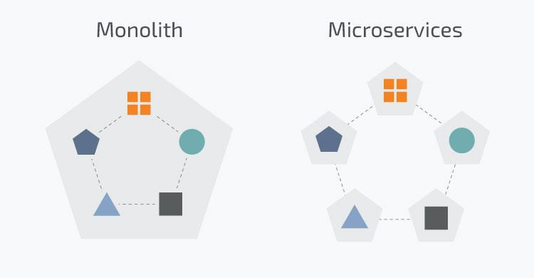
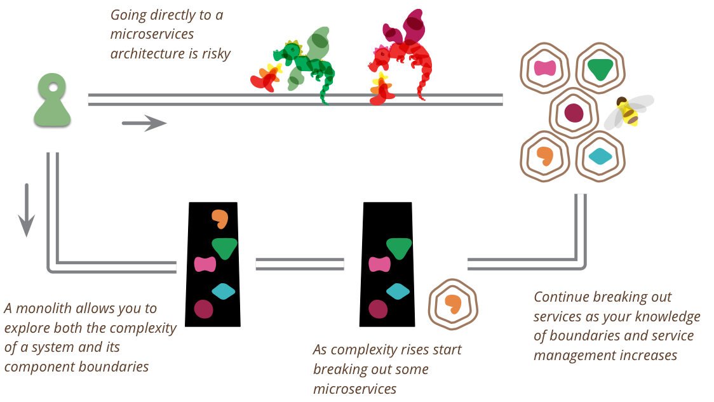

[← 返回微服务架构目录]({{ '/subjects/Microservices/' | relative_url }})



# 08 微服务还是单体
### 1.8 微服务还是单体

<https://martinfowler.com/bliki/MonolithFirst.html>

<https://www.toutiao.com/article/7173261841408360990/?log_from=c8d3dfbf573b3_1670416613668>

单体在绝大部分时候是更好的选择，即单体优先

在微服务大行其道的今天，其实已经有很多大师或者有务实的研发者已经意识到微服务在研发过程中，可能不是你想要的银弹，很多时候起到了反作用。

软件大师“Martin Fowler”在2015年就提出的“单体优先”（Monolith First）的思想。

Martin Fowler发现所有成功的微服务都遵循了通用的模式：

几乎所有成功的微服务故事，都是从一个变得太大而被分解的单体开始的。 几乎所有我听说过的从头开始构建为微服务系统的系统都以严重的麻烦告终。

这种模式导致Martin Fowler的许多同事认为：“你不应该用微服务开始一个新的项目，即使你确信你的应用程序将足够大，值得这么做...”

单体优先：

单体允许你探索系统的复杂性和组件的边界；

当复杂性增加时裂变出微服务；

当你边界和服务管理的业务知识增加时裂变出更多的微服务。

直接微服务:

直接使用微服务架构风险太大。

微服务是一种有用的架构，但即使是它们的拥护者也说使用它们会产生显著的“微服务附加费”，这意味着它们只对更复杂的系统有用。

这种附加费，本质上是管理一套服务的成本，将拖慢团队的速度，让使用单体应用成为更简单的选择。

这成为了“单体优先”策略的有力论证，即使你认为它可能会在以后从微服务架构中受益，你也应该在最初使用单体来构建应用。

通过先建立一个单体，你可以在使用微服务设计之前弄清楚什么是正确的边界。这也给了你时间来开发更好粒度的微服务。

单体优先策略一：模块化单体

合乎逻辑的方法是仔细设计一个单体应用，注意软件内部的模块化，包括 API 边界和数据存储方式。

做好这一点之后，从单体应用转向微服务是一件相对简单的事情。

单体优先策略二：边缘剥离

一种更常见的方法是从单体开始，逐渐剥离边缘的微服务。

这种方法可以在微服务架构的核心留下一个实质性的单体。 大多数新的开发都发生在微服务中，而单体是相对静止的。

单体优先策略三：整体替换

很少有人把这种做法看成是一种值得骄傲的做法，然而把单体作为一种牺牲性的架构来建造是有好处的。

不要害怕建造一个你会丢弃的单体应用，特别是如果一个单体应用能让你快速进入市场。

单体优先策略四：粗粒度服务

从几个粗粒度的服务开始，这些服务比你最终得到的微服务要大。

使用这些粗粒度的服务来习惯与多个服务一起工作。

同时享受这样一个事实，即这种粗粒度减少了你必须做的服务间重构的数量。

然后，随着边界的稳定，分解为更细粒度的服务。

“单体优先”的思想，目前已逐渐开始成为是业界普遍共识。现在已经属于后微服务时代!

在一个人数不多、资金不是无限充裕，需要快速将产品推向市场的团队，建议使用“单体优先”的实现方式。

在很多团队中，使用微服务其实是一种Hype Driven Development（炒作/简历驱动开发），不是为了真正为了解决业务问题。

使用“单体优先”，是一个务实的选择！试想如果是你自己创业，你会是选择“单体”还是“微服务”，那么请为你的企业进行务实的选择。



<nav class="article-end" aria-label="章节导航">
  <a href="{{ '/subjects/Microservices/07-serverless-architecture.html' | relative_url }}">← Previous: Serverless Architecture</a>
  <a href="{{ '/subjects/Microservices/' | relative_url }}">Back to Microservices Index</a>
  <a href="{{ '/subjects/Microservices/09-introduction-to-zookeeper.html' | relative_url }}">Next: Introduction to ZooKeeper →</a>
</nav>
