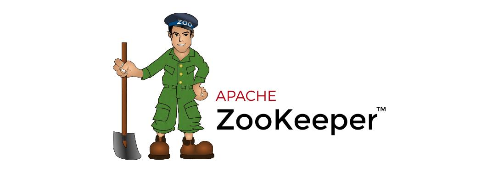

[← 返回微服务架构目录]({{ '/subjects/Microservices/' | relative_url }})



# 09 ZooKeeper 介绍
## 2 ZooKeeper

### 2.1 ZooKeeper 介绍

### 用少量协调数据支持分布式系统

ZooKeeper 最早由 Yahoo! 团队开发，现为 Apache 项目。它是一个复制的协调服务，为应用提供层次化的 znode、版本号、会话、临时节点和事件通知。它适合保存规模较小但需要一致性和顺序保证的协调元数据，不是通用数据库，也不承担大批量业务消息传输。

### 典型用途

- **服务发现**：提供者在约定路径创建临时节点并写入地址；消费者读取子节点列表并监听变化。会话失效后临时节点被清理，消费者再刷新列表。Dubbo 等框架可以用 ZooKeeper 承担注册中心职责。
- **主节点选举与锁**：通常用临时顺序节点协调竞争，并处理会话过期和重试；不能只靠“创建一个节点成功”就宣称获得永久锁。
- **配置与成员信息**：通过版本检查避免盲目覆盖，Watcher 提醒客户端重新读取；Watcher 是通知，不是保证每次变更都完整送达的消息队列。

ZooKeeper 集群通过法定多数派维持写入可用性：例如 3 节点集群通常可容忍 1 节点故障。客户端要正确处理连接中断、会话过期和重试，否则底层集群可靠并不等于应用状态永远正确。

项目入口：<https://zookeeper.apache.org/>；版本对应的文档从 <https://zookeeper.apache.org/doc/> 查阅。



<nav class="article-end" aria-label="章节导航">
  <a href="{{ '/subjects/Microservices/08-microservices-vs-monoliths.html' | relative_url }}">← 上一篇：微服务还是单体</a>
  <a href="{{ '/subjects/Microservices/' | relative_url }}">返回微服务架构目录</a>
  <a href="{{ '/subjects/Microservices/10-how-zookeeper-works.html' | relative_url }}">下一篇：ZooKeeper 工作原理 →</a>
</nav>
