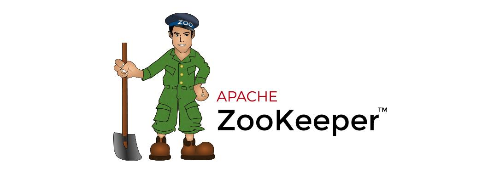

[← Back to Microservices Index]({{ '/subjects/Microservices/' | relative_url }})



# 09 Introduction to ZooKeeper
## 2 ZooKeeper

### 2.1 ZooKeeper 介绍

ZooKeeper 的由来

下面这段内容摘自《从Paxos到Zookeeper 》第四章第一节的某段内容：

Zookeeper最早起源于雅虎研究院的一个研究小组。在当时，研究人员发现，在雅虎内部很多大型系统基本都需要依赖一个类似的系统来进行分布式协调，但是这些系统往往都存在分布式单点问题。所以，雅虎的开发人员就试图开发一个通用的无单点问题的分布式协调框架，以便让开发人员将精力集中在处理业务逻辑上。

关于“ZooKeeper”这个项目的名字，其实也有一段趣闻。在立项初期，考虑到之前内部很多项目都是使用动物的名字来命名的（例如著名的Pig项目),雅虎的工程师希望给这个项目也取一个动物的名字。时任研究院的首席科学家RaghuRamakrishnan开玩笑地说：“在这样下去，我们这儿就变成动物园了！”此话一出，大家纷纷表示就叫动物园管理员吧一一一因为各个以动物命名的分布式组件放在一起，雅虎的整个分布式系统看上去就像一个大型的动物园了，而Zookeeper正好要用来进行分布式环境的协调一一于是，Zookeeper 的名字也就由此诞生了。

ZooKeeper 是一个开源的分布式协调服务，ZooKeeper框架最初是在“Yahoo!"上构建的，用于以简单而稳健的方式访问他们的应用程序。 后来，Apache ZooKeeper成为Hadoop，HBase和其他分布式框架使用的有组织服务的标准。 例如，Apache HBase使用ZooKeeper跟踪分布式数据的状态。ZooKeeper 的设计目标是将那些复杂且容易出错的分布式一致性服务封装起来，构成一个高效可靠的原语集，并以一系列简单易用的接口提供给用户使用。

ZooKeeper 是一个典型的分布式数据一致性解决方案，分布式应用程序可以基于 ZooKeeper 实现诸如数据发布/订阅、负载均衡、命名服务、分布式协调/通知、集群管理、Master 选举、分布式锁和分布式队列等功能。

Zookeeper 一个最常用的使用场景就是用于担任服务生产者和服务消费者的注册中心(提供发布订阅服务)。 服务生产者将自己提供的服务注册到Zookeeper中心，服务的消费者在进行服务调用的时候先到Zookeeper中查找服务，获取到服务生产者的详细信息之后，再去调用服务生产者的内容与数据。在 Dubbo架构中 Zookeeper 就担任了注册中心这一角色。

官网:

<https://zookeeper.apache.org/>

官方文档:

<https://zookeeper.apache.org/doc/>



<nav class="article-end" aria-label="章节导航">
  <a href="{{ '/subjects/Microservices/08-microservices-vs-monoliths.html' | relative_url }}">← Previous: Microservices还是单体</a>
  <a href="{{ '/subjects/Microservices/' | relative_url }}">Back to Microservices Index</a>
  <a href="{{ '/subjects/Microservices/10-how-zookeeper-works.html' | relative_url }}">Next: How ZooKeeper Works →</a>
</nav>
