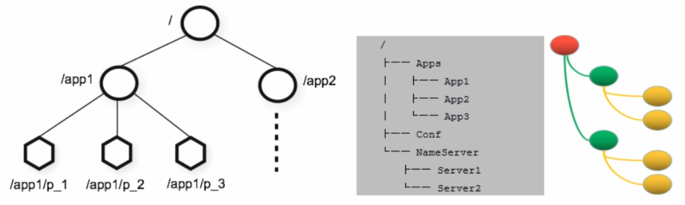
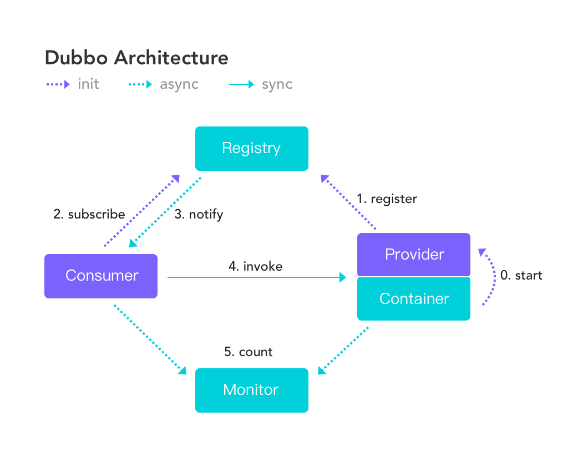
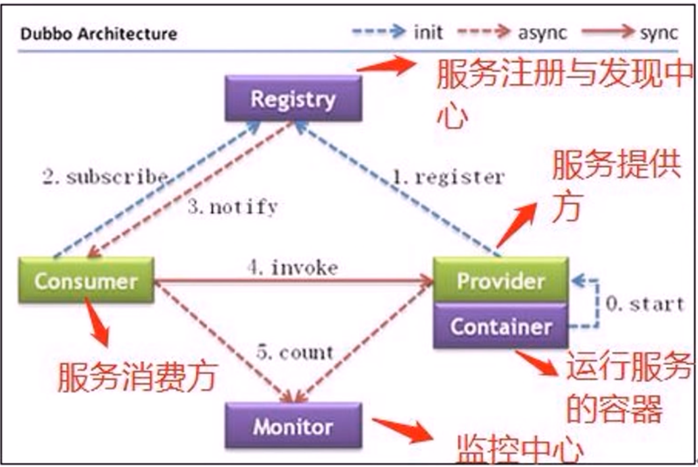

[← 返回微服务架构目录]({{ '/subjects/Microservices/' | relative_url }})



# 10 ZooKeeper 工作原理
### 2.2 数据、会话与通知怎样配合

ZooKeeper 集群保存一棵以 / 为根的 znode 树。**服务器节点**是运行 ZooKeeper 的进程；**znode** 是树中的数据单元，两者不是同一类“节点”。znode 可带少量数据、版本号和子节点；路径如 /services/order/instance-1。它类似文件系统的层级命名，但不支持普通文件系统的全部操作，也不适合存放大文件。

客户端连接集群后建立会话。临时 znode 与会话绑定：会话过期后它会被删除，因此常用于表示服务实例存活；短暂断线不等于会话立即过期。持久 znode 则不会随会话结束自动消失。写入由集群按顺序协调，客户端读取时还需留意连接与一致性选项。

### Watcher 与服务发现

客户端可以对节点数据或子节点列表注册 Watcher。发生对应变化时，ZooKeeper 发出事件提醒，客户端随后**重新读取**最新状态；传统 Watcher 通常是一次性的，处理事件后需要重新注册。通知不能代替消息队列，也不能仅靠它维护完整状态：连接中断或会话过期后应重新查询。

以服务发现为例：服务提供者在 /services/order 下创建带地址的临时节点；消费者读取该路径的子节点并监听列表变化，更新本地地址缓存，再直接向提供者发起业务请求。ZooKeeper 不转发每一次业务请求。

### 配置与集群成员

把小型配置放入 znode 时，更新方可用版本号做条件写入，客户端接通知后重新获取内容。大配置文件、密钥治理与灰度发布通常需要专门的配置系统。集群成员管理则结合临时节点、Watcher 和应用自己的健康检查，不能把“节点还在”直接等同于业务服务健康。

图中的注册与发现流程可按以下顺序理解：提供者建立会话并注册临时节点；消费者获取实例列表并注册监听；列表变化时消费者重新读取；业务调用由消费者直连提供者。若提供者的会话过期，临时节点被清理，消费者更新缓存。监控系统可另行收集指标，不是 ZooKeeper 完成服务调用的必经环节。



<nav class="article-end" aria-label="章节导航">
  <a href="{{ '/subjects/Microservices/09-introduction-to-zookeeper.html' | relative_url }}">← 上一篇：ZooKeeper 介绍</a>
  <a href="{{ '/subjects/Microservices/' | relative_url }}">返回微服务架构目录</a>
  <a href="{{ '/subjects/Microservices/11-installing-zookeeper.html' | relative_url }}">下一篇：ZooKeeper 安装 →</a>
</nav>
