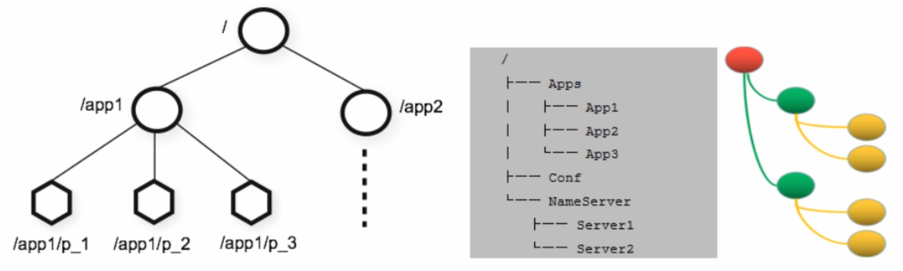
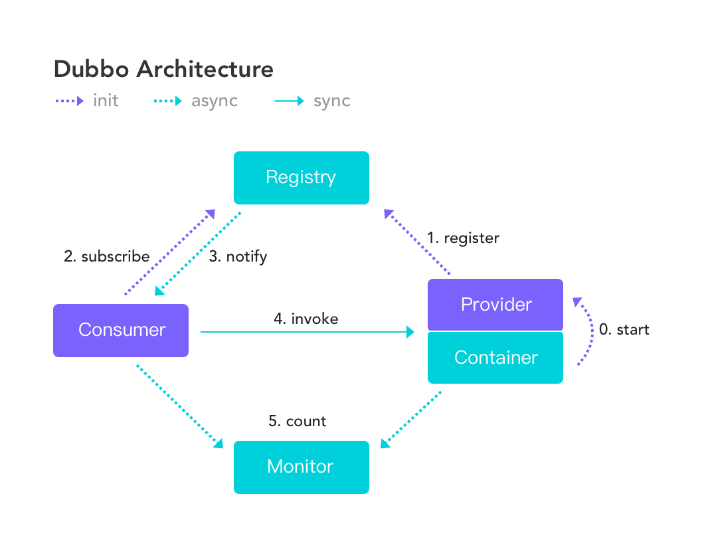
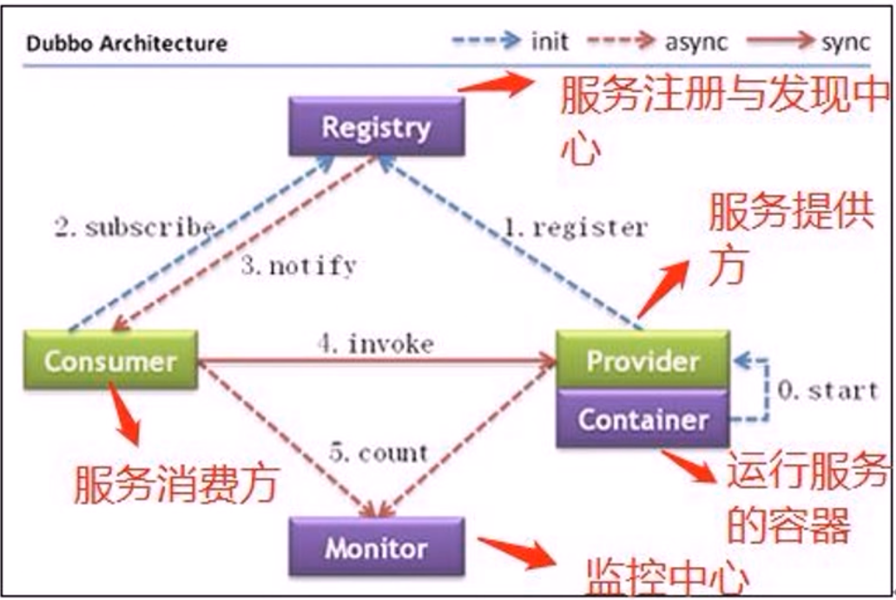

[← Back to Microservices Index]({{ '/subjects/Microservices/' | relative_url }})



# 10 How ZooKeeper Works
### 2.2 ZooKeeper 工作原理

ZooKeeper 是一个分布式服务框架，它主要是用来解决分布式应用中经常遇到的一些数据管理问题，如：命名服务、状态同步、配置中心、 集群管理等。

### ZooKeeper 功能

### 命名服务

命名服务是分布式系统中比较常见的一类场景。命名服务是分布式系统最基本的公共服务之一。在分布式系统中，被命名的实体通常可以是集群中的机器、提供的服务地址或远程对象等——这些我们都可以统称它们为名字（Name），其中较为常见的就是一些分布式服务框架 （如RPC、RMI）中的服务地址列表，通过使用命名服务，客户端应用能够根据指定名字来获取资源的实体、服务地址和提供者的信息等。

Zookeeper 数据模型

```text
在 Zookeeper 中，节点分为两类
第一类是指构成Zookeeper集群的主机，称之为主机节点
第二类则是指内存中zookeeper数据模型中的数据单元，用来存储各种数据内容，称之为数据节点 ZNode。
Zookeeper内部维护了一个层次关系(树状结构)的数据模型，它的表现形式类似于Linux的文件系统，甚至操作的种类都一致。
Zookeeper数据模型中有自己的根目录(/)，根目录下有多个子目录，每个子目录后面有若干个文件,由斜杠(/)进行分割的路径，就是一个ZNode,每
个 ZNode上都会保存自己的数据内容和一系列属性信息.
```



### 状态同步

每个节点除了存储数据内容和 node 节点状态信息之外，还存储了已经注册的APP 的状态信息，当有些节点或APP 不可用，就将当前状态同步给其他服务。

### 配置中心

现在我们大多数应用都是采用的是分布式开发的应用，搭建到不同的服务器上，我们的配置文件，同一个应用程序的配置文件一样，还有就是多个程序存在相同的配置，当我们配置文件中有个配置属性需要改变，需要改变每个程序的配置属性，这样会很麻烦的去修改配置，那么可用使用ZooKeeper 来实现配置中心

ZooKeeper 采用的是推拉相结合的方式：客户端向服务端注册自己需要关注的节点，一旦该节点的数据发生变更，那么服务端就会向相应的客户端发送Watcher事件通知，客户端接收到这个消息通知后，需要主动到服务端获取最新的数据。

Apollo（阿波罗）是携程框架部门研发的开源配置管理中心,此应用比较流行

### 集群管理

所谓集群管理，包括集群监控与集群控制两大块，前者侧重对集群运行时状态的收集，后者则是对集群进行操作与控制，在日常开发和运维过程中，我们经常会有类似于如下的需求：

希望知道当前集群中究竟有多少机器在工作。 对集群中每台机器的运行时状态进行数据收集。对集群中机器进行上下线操作。

ZooKeeper 具有以下两大特性:

客户端如果对ZooKeeper 的一个数据节点注册 Watcher监听，那么当该数据节点的内容或是其子节点列表发生变更时，ZooKeeper 服务器就会向已注册订阅的客户端发送变更通知。 对在ZooKeeper上创建的临时节点，一旦客户端与服务器之间的会话失效，那么该临时节点也就被自动清除。

Watcher（事件监听器）是 Zookeeper 中的一个很重要的特性。Zookeeper 允许用户在指定节点上注册一些 Watcher，并且在一些特定事件触发的时候， ZooKeeper 服务端会将事件通知到感兴趣的客户端上去，该机制是 Zookeeper 实现分布式协调服务的重要特性。

### ZooKeeper 服务流程





1. 生产者启动

2. 生产者注册至zookeeper

3. 消费者启动并订阅频道

4. zookeeper 通知消费者事件

5. 消费者调用生产者

6. 监控中心负责统计和监控服务状态



<nav class="article-end" aria-label="章节导航">
  <a href="{{ '/subjects/Microservices/09-introduction-to-zookeeper.html' | relative_url }}">← Previous: Introduction to ZooKeeper</a>
  <a href="{{ '/subjects/Microservices/' | relative_url }}">Back to Microservices Index</a>
  <a href="{{ '/subjects/Microservices/11-installing-zookeeper.html' | relative_url }}">Next: Installing ZooKeeper →</a>
</nav>
