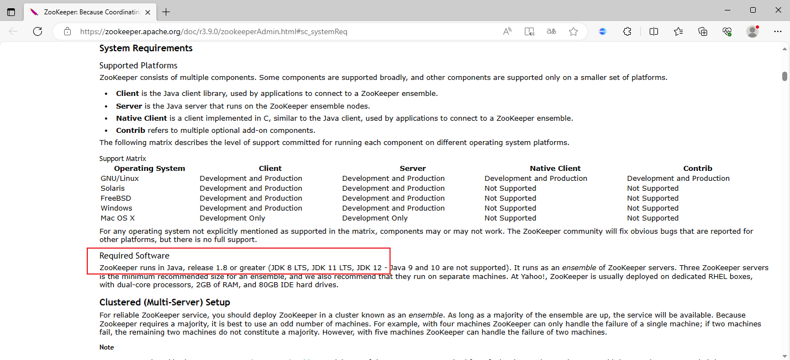
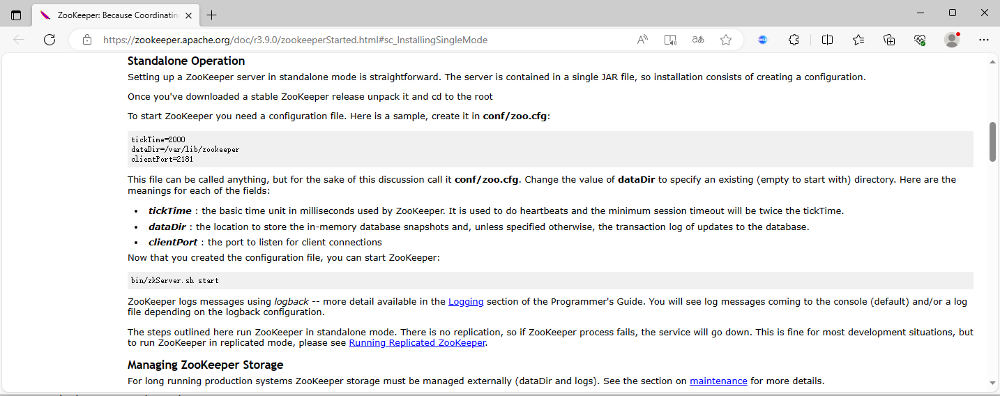
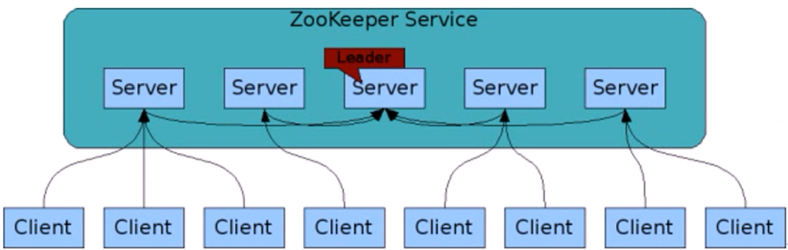
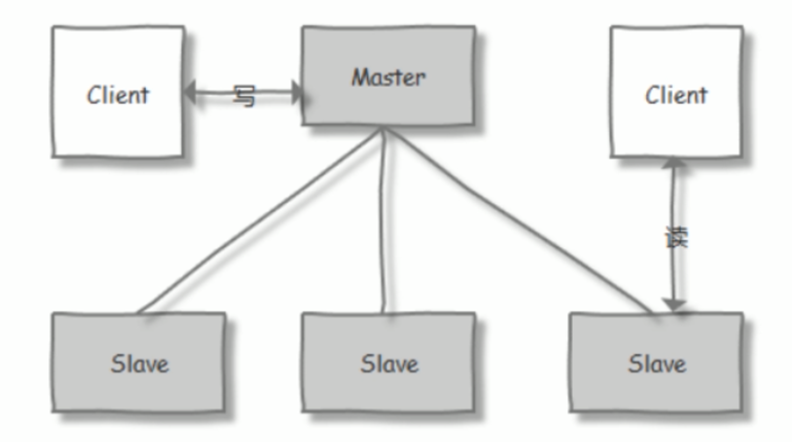
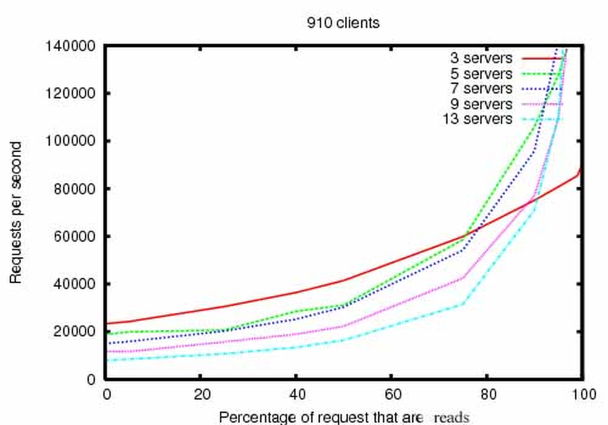
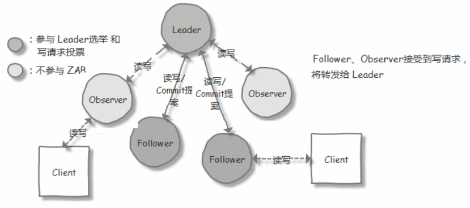
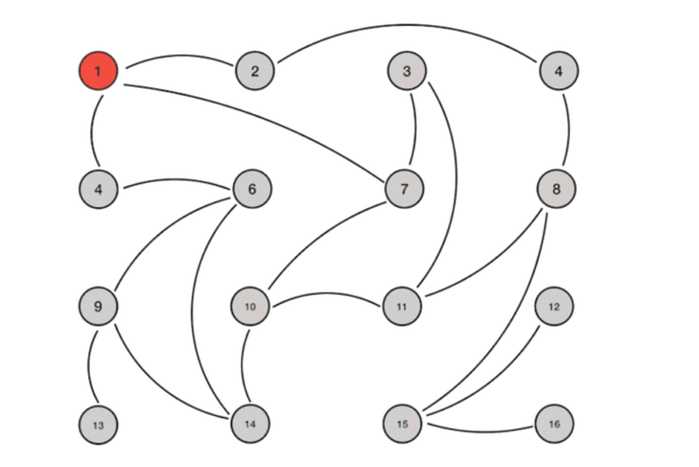

[← 返回微服务架构目录]({{ '/subjects/Microservices/' | relative_url }})



# 11 ZooKeeper 安装

本篇先用单机实例验证程序和客户端，再部署三节点集群。**单机只能用于学习或不要求高可用的环境**；三节点中的任意两节点组成写入法定多数。发行版软件包、Apache 二进制包与容器镜像是三条替代路径，不应把它们的目录和启动方式混用。以下以 ZooKeeper 3.9.3 二进制包为例；实际部署前核对[发行页](https://zookeeper.apache.org/releases.html)、校验文件及目标版本的 Java 要求。



## 单机：安装、配置、验证

以下命令以 Ubuntu 24.04 和具有 `sudo` 权限的用户为例。若通过 `apt install zookeeper` 安装，则应使用软件包提供的配置路径和 systemd 服务，而不是继续执行二进制包命令。

```bash
sudo apt update
sudo apt install -y openjdk-17-jre-headless curl tar
java -version
ZK_VERSION=3.9.3
curl -fLO "https://archive.apache.org/dist/zookeeper/zookeeper-${ZK_VERSION}/apache-zookeeper-${ZK_VERSION}-bin.tar.gz"
# 对照 Apache 发布的 SHA512 文件校验下载结果，然后解压
tar -xzf "apache-zookeeper-${ZK_VERSION}-bin.tar.gz"
sudo mv "apache-zookeeper-${ZK_VERSION}-bin" /opt/zookeeper
sudo mkdir -p /var/lib/zookeeper /var/log/zookeeper
```



在 `/opt/zookeeper/conf/zoo.cfg` 写入如下配置。`dataDir` 保存快照，`dataLogDir` 保存事务日志；生产环境可为日志准备独立磁盘。`autopurge` 清理由 ZooKeeper 管理的旧快照及对应日志，不代替备份。

```properties
tickTime=2000
dataDir=/var/lib/zookeeper
dataLogDir=/var/log/zookeeper
clientPort=2181
autopurge.snapRetainCount=3
autopurge.purgeInterval=24
```

前台启动能直接看到错误；另开终端检查状态并做一次读写。单机的状态输出应为 `Mode: standalone`。

```bash
sudo /opt/zookeeper/bin/zkServer.sh start-foreground
# 另一个终端：
/opt/zookeeper/bin/zkServer.sh status
/opt/zookeeper/bin/zkCli.sh -server 127.0.0.1:2181
```

在 `zkCli.sh` 中输入 `create /demo hello`、`get /demo` 和 `delete /demo`。若启动失败，先检查 Java 版本、目录权限、2181 端口占用及日志。不要把终端提示符、输出或不同版本的配置样例一起复制到 shell。需要后台运行时应选择**一种**服务管理方式：若交给 systemd，就不再同时用 `zkServer.sh start` 管理同一实例。

## 三节点：角色与部署

集群由 Leader、Follower，以及可选的 Observer 组成。写入由 Leader 协调，在法定多数个**投票节点**确认后提交；Follower 可服务读取，但客户端读到的数据可能暂时落后于另一客户端刚完成的写入。Observer 同步状态和提供读取，却不参与选举和多数派计数。三个投票节点可容忍一个节点故障；四个投票节点仍只能容忍一个，因此常以奇数个投票节点规划。





Leader 选举要考虑已提交事务历史和选举轮次，不能仅凭“`myid` 最大”预测结果。ZAB 负责事务的顺序广播与故障恢复；它不意味着每次本地读取都自动成为线性一致的读取。需要跨客户端确认读取顺序时，应结合 `sync`、版本号及应用协议设计。





### 节点与端口

假设三台服务器的私有地址分别为 `10.0.0.101`、`10.0.0.102`、`10.0.0.103`。三台机器安装**同一版本**，并配置互相可解析和连通的地址。2181 是客户端端口，2888 用于成员同步，3888 用于选举；只向可信网络开放。线上还要规划 TLS、认证、独立账号、磁盘容量、备份和监控。

三台机器完成前述 JDK、二进制包和目录准备后，使用相同的 `/opt/zookeeper/conf/zoo.cfg`：

```properties
tickTime=2000
initLimit=10
syncLimit=5
dataDir=/var/lib/zookeeper
dataLogDir=/var/log/zookeeper
clientPort=2181
autopurge.snapRetainCount=3
autopurge.purgeInterval=24
server.1=10.0.0.101:2888:3888
server.2=10.0.0.102:2888:3888
server.3=10.0.0.103:2888:3888
```

每台机器在 `dataDir` 写入与 `server.N` 对应的**唯一** ID，不能把同一个 `myid` 复制到所有节点：

```bash
# 分别在 10.0.0.101、10.0.0.102、10.0.0.103 执行：
echo 1 | sudo tee /var/lib/zookeeper/myid  # 仅节点 1
echo 2 | sudo tee /var/lib/zookeeper/myid  # 仅节点 2
echo 3 | sudo tee /var/lib/zookeeper/myid  # 仅节点 3
```

分别启动三台机器，待至少两个投票节点连通后检查角色；第一台单独启动时暂时没有 Leader，并不一定代表配置失败。

```bash
sudo /opt/zookeeper/bin/zkServer.sh start
/opt/zookeeper/bin/zkServer.sh status
/opt/zookeeper/bin/zkCli.sh -server 10.0.0.101:2181,10.0.0.102:2181,10.0.0.103:2181
```

预期状态为一个 `leader`、两个 `follower`，客户端可创建和读取测试节点。停止一台节点后应仍可读写；再停止第二台，法定多数丢失，写入不可用。不要在已有数据目录中随意更换 `myid` 或直接复制旧节点的数据目录给新节点。动态增删成员及升级应按目标版本的官方管理文档执行，先备份再逐节点验证。

事务日志和快照是恢复数据所需的持久化材料。旧课件中的“每 10 万次固定快照”等表述只能用于解释机制；具体触发阈值由版本与配置决定。下面的 Gossip 图属于**对比材料**：Gossip 并非 ZooKeeper 的成员复制协议，不应据此配置本集群。



## 容器试验与生产边界

本地学习可运行一个固定版本的容器，并将数据持久化。映射到宿主机的 2181 端口会暴露客户端接口，须限制访问。

```bash
docker run --name zk-demo -d \
  -p 127.0.0.1:2181:2181 \
  -v zk-data:/data -v zk-datalog:/datalog \
  zookeeper:3.9.3
docker exec zk-demo zkServer.sh status
```

三容器实验还必须给每个实例独立卷和 `ZOO_MY_ID`，把完整 `ZOO_SERVERS` 配置保持一致，并处理稳定主机名、网络与健康检查。单机 Docker Compose 上的三个容器不能抵御宿主机故障。生产部署参考[官方管理指南](https://zookeeper.apache.org/doc/current/zookeeperAdmin.html)，验证持久化和恢复流程后再承载协调数据。



<nav class="article-end" aria-label="章节导航">
  <a href="{{ '/subjects/Microservices/10-how-zookeeper-works.html' | relative_url }}">← 上一篇：ZooKeeper 工作原理</a>
  <a href="{{ '/subjects/Microservices/' | relative_url }}">返回微服务架构目录</a>
  <a href="{{ '/subjects/Microservices/12-accessing-zookeeper-clients.html' | relative_url }}">下一篇：ZooKeeper 客户端访问 →</a>
</nav>
