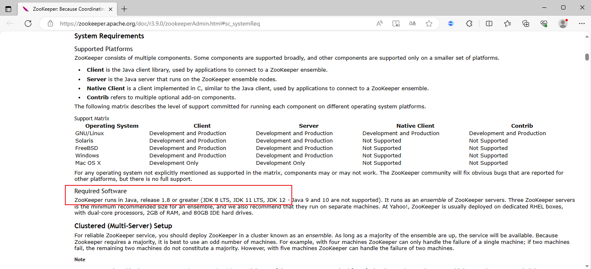
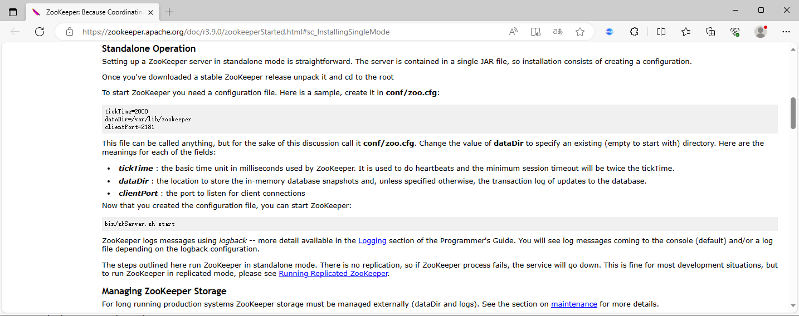
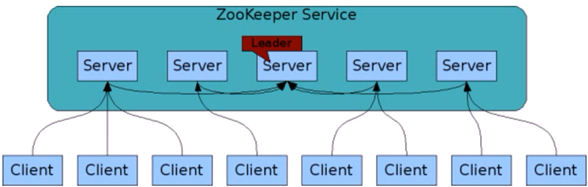
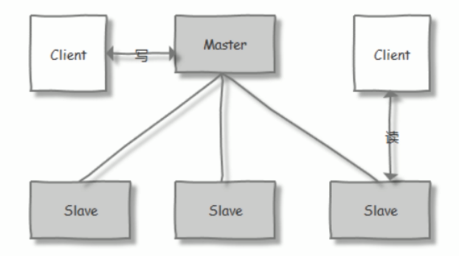
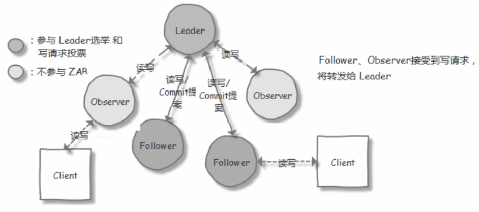
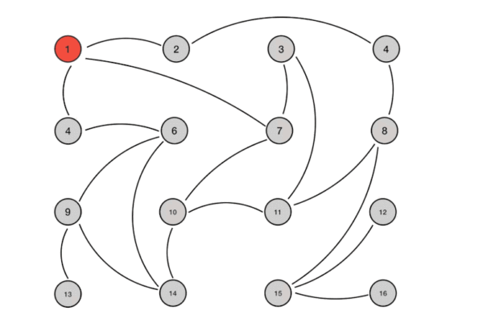

[← 返回微服务架构目录]({{ '/subjects/Microservices/' | relative_url }})



# 11 ZooKeeper 安装
### 2.3 ZooKeeper 安装

Zookeeper 支持多种安装方法

包二进制容器

<https://hub.docker.com/_/zookeeper>

### ZooKeeper 单机部署

单机版的 ZooKeeper 安装

官方文档:

<https://zookeeper.apache.org/doc/r3.6.2/zookeeperStarted.html#sc_InstallingSingleMode>

### 配置 Java 环境

官方依赖介绍

<https://zookeeper.apache.org/doc/r3.9.0/zookeeperAdmin.html#sc_systemReq>

<https://zookeeper.apache.org/doc/r3.8.0/zookeeperAdmin.html#sc_systemReq>

<https://zookeeper.apache.org/doc/r3.6.2/zookeeperAdmin.html#sc_requiredSoftware>



范例: ubuntu2404安装 JDK-21

```bash
[root@ubuntu2404 ~]#apt update && apt -y install openjdk-21-jdk
[root@ubuntu2404 ~]#java -version
openjdk version "21.0.7" 2025-04-15
OpenJDK Runtime Environment (build 21.0.7+6-Ubuntu-0ubuntu124.04)
OpenJDK 64-Bit Server VM (build 21.0.7+6-Ubuntu-0ubuntu124.04, mixed mode, sharing)
```

范例：ubuntu2204安装 JDK-11,17

```bash
[root@ubuntu2204 ~]#apt update && apt -y install openjdk-17-jdk
[root@ubuntu2204 ~]#apt update && apt -y install openjdk-11-jdk
[root@ubuntu2204 ~]#java -version
openjdk version "11.0.18" 2023-01-17
OpenJDK Runtime Environment (build 11.0.18+10-post-Ubuntu-0ubuntu122.04)
OpenJDK 64-Bit Server VM (build 11.0.18+10-post-Ubuntu-0ubuntu122.04, mixed mode, sharing)
```

范例：ubuntu2004安装 JDK-11

```bash
[root@ubuntu2004 ~]#apt update && apt -y install openjdk-11-jdk
[root@ubuntu2004 ~]#java -version
openjdk version "11.0.9.1" 2020-11-04
OpenJDK Runtime Environment (build 11.0.9.1+1-Ubuntu-0ubuntu1.20.04)
OpenJDK 64-Bit Server VM (build 11.0.9.1+1-Ubuntu-0ubuntu1.20.04, mixed mode, sharing)
```

范例:  ubuntu1804安装 JDK-8

```bash
[root@ubuntu1804 ~]#apt update && apt -y install openjdk-8-jdk
[root@ubuntu1804 ~]#Java -version
openjdk version "1.8.0_282"
OpenJDK Runtime Environment (build 1.8.0_282-8u282-b08-0ubuntu1~18.04-b08)
OpenJDK 64-Bit Server VM (build 25.282-b08, mixed mode)
```

### 部署 ZooKeeper

2.3.1.2.1 包安装

范例：系统内置包安装

```bash
[root@ubuntu2404 ~]#apt list zookeeper
Listing... Done
zookeeper/noble,noble 3.9.1-1build2 all
[root@ubuntu2404 ~]#apt update && apt -y install zookeeper
```

范例：系统内置包安装

```bash
[root@ubuntu2204 ~]#apt list zookeeper
正在列表... 完成
zookeeper/jammy 3.4.13-6ubuntu4 all
[root@ubuntu2204 ~]#apt -y install zookeeper
[root@ubuntu2204 ~]#grep -Ev "#|^$" /etc/zookeeper/conf/zoo.cfg
tickTime=2000  #服务器与服务器之间的单次心跳检测时间间隔，单位为毫秒
initLimit=10    #集群中leader 服务器与follower服务器初始连接心跳次数，即多少个 2000 毫秒
syncLimit=5    #leader 与follower之间检测发送和应答的心跳次数，如果该follower在时间段5*2000不能与leader进行通信，此
follower将不可用
dataDir=/var/lib/zookeeper  #自定义的zookeeper保存数据的目录
clientPort=2181   #客户端连接 Zookeeper 服务器的端口，Zookeeper会监听这个端口，接受客户端的访问请求
[root@ubuntu2204 ~]#ls /usr/share/zookeeper/bin/
zkCleanup.sh  zkCli.sh  zkEnv.sh  zkServer.sh
[root@ubuntu2204 ~]#/usr/share/zookeeper/bin/zkServer.sh start
ZooKeeper JMX enabled by default
Using config: /etc/zookeeper/conf/zoo.cfg
Starting zookeeper ... STARTED
[root@ubuntu2204 ~]#/usr/share/zookeeper/bin/zkServer.sh status
ZooKeeper JMX enabled by default
Using config: /etc/zookeeper/conf/zoo.cfg
Mode: standalone
```

2.3.1.2.2 二进制安装

<https://zookeeper.apache.org/>



历史版本下载

<https://archive.apache.org/dist/zookeeper/>

版本： stable 和 current ，生产建议使用stable版本

范例: 安装单机 zookeeper

```bash
#安装JAVA
[root@ubuntu2404 ~]#apt update && apt -y install openjdk-21-jre
[root@ubuntu2004 ~]#apt update && apt -y install openjdk-11-jdk
[root@ubuntu2204 ~]#java -version
openjdk version "11.0.18" 2023-01-17
OpenJDK Runtime Environment (build 11.0.18+10-post-Ubuntu-0ubuntu122.04)
OpenJDK 64-Bit Server VM (build 11.0.18+10-post-Ubuntu-0ubuntu122.04, mixed mode, sharing)
#官方下载
[root@ubuntu1804 ~]#wget -P /usr/local/src  https://downloads.apache.org/zookeeper/stable/apache-zookeeper-
3.6.3-bin.tar.gz
#国内镜像下载
[root@ubuntu1804 ~]#wget -P /usr/local/src
https://mirrors.tuna.tsinghua.edu.cn/apache/zookeeper/stable/apache-zookeeper-3.6.3-bin.tar.gz
[root@ubuntu1804 ~]#tar xf /usr/local/src/apache-zookeeper-3.6.3-bin.tar.gz  -C /usr/local/
[root@ubuntu1804 ~]#ln -s /usr/local/apache-zookeeper-3.6.3-bin /usr/local/zookeeper
#注意：不支持软链接到/usr/local/bin 目录，此方法会导致配置文件无法找到，无法启动
#支持修改PATH变量
[root@ubuntu1804 ~]#echo 'PATH=/usr/local/zookeeper/bin:$PATH' >  /etc/profile.d/zookeeper.sh
[root@ubuntu1804 ~]#. /etc/profile.d/zookeeper.sh
[root@ubuntu1804 ~]#ll /usr/local/zookeeper/
total 48
drwxr-xr-x  6 root root  4096 Feb 15 19:19 ./
drwxr-xr-x 11 root root  4096 Feb 15 19:20 ../
drwxr-xr-x  2 bowen bowen  4096 Sep  4 20:43 bin/
drwxr-xr-x  2 bowen bowen  4096 Sep  4 20:43 conf/
drwxr-xr-x  5 bowen bowen  4096 Sep  4 20:44 docs/
drwxr-xr-x  2 root root  4096 Feb 15 19:19 lib/
-rw-r--r--  1 bowen bowen 11358 Sep  4 20:43 LICENSE.txt
-rw-r--r--  1 bowen bowen   432 Sep  4 20:43 NOTICE.txt
-rw-r--r--  1 bowen bowen  1963 Sep  4 20:43 README.md
-rw-r--r--  1 bowen bowen  3166 Sep  4 20:43 README_packaging.md
[root@ubuntu1804 ~]#ls /usr/local/zookeeper/bin/
README.txt    zkCli.cmd  zkEnv.cmd  zkServer.cmd            zkServer.sh            zkSnapShotToolkit.sh
zkTxnLogToolkit.sh
zkCleanup.sh  zkCli.sh   zkEnv.sh   zkServer-initialize.sh  zkSnapShotToolkit.cmd  zkTxnLogToolkit.cmd
[root@ubuntu1804 ~]#ls /usr/local/zookeeper/conf/
configuration.xsl  log4j.properties   zoo_sample.cfg
#准备配置文件
[root@ubuntu1804 ~]#cp /usr/local/zookeeper/conf/zoo_sample.cfg /usr/local/zookeeper/conf/zoo.cfg
#默认配置可不做修改
[root@ubuntu1804 ~]#grep -v "#" /usr/local/zookeeper/conf/zoo.cfg
tickTime=2000  #"滴答时间"，用于配置Zookeeper中最小的时间单元长度，单位毫秒，是其它时间配置的基础
initLimit=10   #初始化时间，包含启动和数据同步，其值是tickTime的倍数
syncLimit=5    #正常工作，心跳监测的时间间隔，其值是tickTime的倍数
dataDir=/tmp/zookeeper #配置Zookeeper服务存储数据快照的目录,可以自动创建,可以修改为 dataDir=/usr/local/zookeeper/data
dataLogDir=/usr/local/zookeeper/logs  #指定日志路径，默认与 dataDir 一致,事务日志对性能影响非常大，强烈建议事务日志目录和
数据目录分开，如果后续修改路径，需要先删除中dataDir中旧的事务日志，否则可能无法启动，此目录可以自动创建,
clientPort=2181 #配置当前Zookeeper服务对外暴露的端口，用户客户端和服务端建立连接会话
preAllocSize：#为事务日志预先开辟磁盘空间。默认是64M，意味着每个事务日志初始大小64M。如果ZooKeeper产生快照频率较大，可以考虑减
小这个参数，因为每次快照后都会切换到新的事务日志，即使前面的64M没有写满。
snapCount：#该配置项指定ZooKeeper在将内存数据库保存为快照之前，需要先写多少次事务日志，即，每写几次事务日志就快照一次。默认值为
100000。为了防止所有的ZooKeeper服务器节点同时生成快照(一般情况下，所有集群的实例的配置文件是完全相同的)，当某节点的先写事务数量在
(snapCount/2+1,snapCount)范围内时挑选一个随机值做为该节点拍快照的时机。
autopurge.snapRetainCount=3 #3.4.0中的新增功能：启用后，ZooKeeper 自动清除功能,会将只保留此最新3个快照和相应的事务日志,并分
别保留在dataDir 和dataLogDir中，删除其余部分，默认值为3,最小值为3
autopurge.purgeInterval=24  #3.4.0及之后版本，ZK提供了自动清理日志和快照文件的功能，这个参数指定了清理频率，单位是小时，需要
配置一个1或更大的整数，默认是 0，表示不开启自动清理功能
#通过prometheus监控的相关配置,需要stop再start，restart可能会失败
## Metrics Providers
#
# https://prometheus.io Metrics Exporter
#提供prometheus监控功能
metricsProvider.className=org.apache.zookeeper.metrics.prometheus.PrometheusMetricsProvider
metricsProvider.httpHost=0.0.0.0
metricsProvider.httpPort=7000
metricsProvider.exportJvmInfo=true
```

### 启动 ZooKeeper

```bash
#查看选项
[root@ubuntu1804 ~]#zkServer.sh --help
[root@ubuntu2404 ~]#zkServer.sh  version
/usr/bin/java
ZooKeeper JMX enabled by default
Using config: /usr/local/zookeeper/bin/../conf/zoo.cfg
Apache ZooKeeper, version 3.9.3 2024-10-17 23:21 UTC
#前台启动观察启动过程
[root@ubuntu1804 ~]#zkServer.sh start-foreground
[root@ubuntu2404 ~]#curl 127.0.0.1:7000/metrics
global_sessions 0.0
# HELP connection_rejected connection_rejected
# TYPE connection_rejected counter
connection_rejected 0.0
# HELP read_commitproc_time_ms read_commitproc_time_ms
# TYPE read_commitproc_time_ms summary
read_commitproc_time_ms{quantile="0.5",} NaN
read_commitproc_time_ms{quantile="0.9",} NaN
#后台启动
[root@ubuntu1804 ~]#zkServer.sh start
/usr/bin/java
ZooKeeper JMX enabled by default
Using config: /usr/local/zookeeper/bin/../conf/zoo.cfg
Starting zookeeper ... STARTED
#注意:如果配置service,zkServer.sh和systemctl不要混用,否则无法启动
```

### 验证 ZooKeeper

```bash
[root@ubuntu1804 ~]#zkServer.sh status
/usr/bin/java
ZooKeeper JMX enabled by default
Using config: /usr/local/zookeeper/bin/../conf/zoo.cfg
Client port found: 2181. Client address: localhost. Client SSL: false.
Mode: standalone
[root@ubuntu1804 ~]#ss -ntpl|grep 2181
LISTEN   0    50        *:2181       *:*     users:(("java",pid=1041,fd=70))
[root@ubuntu1804 ~]#pstree -p 1041
java(1041)─┬─{java}(1044)
├─{java}(1045)
├─{java}(1046)
├─{java}(1047)
├─{java}(1048)
├─{java}(1049)
├─{java}(1050)
├─{java}(1051)
├─{java}(1052)
├─{java}(1053)
├─{java}(1054)
├─{java}(1055)
```

### service 文件

```bash
[root@ubuntu2204 ~]#cat > /lib/systemd/system/zookeeper.service <<EOF
[Unit]
Description=zookeeper.service
After=network.target
[Service]
Type=forking
ExecStart=/usr/local/zookeeper/bin/zkServer.sh start
ExecStop=/usr/local/zookeeper/bin/zkServer.sh stop
ExecReload=/usr/local/zookeeper/bin/zkServer.sh restart
[Install]
WantedBy=multi-user.target
EOF
[root@ubuntu2204 ~]#systemctl daemon-reload
[root@ubuntu2204 ~]#systemctl enable --now zookeeper.service
[root@ubuntu2204 ~]#systemctl status zookeeper.service
```

● zookeeper.service

```text
Loaded: loaded (/lib/systemd/system/zookeeper.service; enabled; vendor preset: enabled)
Active: active (running) since Wed 2023-09-13 15:00:59 CST; 18s ago
Process: 6413 ExecStart=/usr/local/zookeeper/bin/zkServer.sh start (code=exited, status=0/SUCCESS)
Main PID: 6428 (java)
Tasks: 36 (limit: 2196)
Memory: 55.0M
CPU: 2.033s
CGroup: /system.slice/zookeeper.service
└─6428 java -Dzookeeper.log.dir=/usr/local/zookeeper/bin/../logs -Dzookeeper.log.file=zookeeper--
server-ubuntu2204.bowen.org.log -XX:+HeapDumpOnOutOfMemoryErro>
9月 13 15:00:58 ubuntu2204.bowen.org systemd[1]: Starting zookeeper.service...
9月 13 15:00:58 ubuntu2204.bowen.org zkServer.sh[6413]: /usr/bin/java
9月 13 15:00:58 ubuntu2204.bowen.org zkServer.sh[6413]: ZooKeeper JMX enabled by default
9月 13 15:00:58 ubuntu2204.bowen.org zkServer.sh[6413]: Using config: /usr/local/zookeeper/bin/../conf/zoo.cfg
9月 13 15:00:59 ubuntu2204.bowen.org zkServer.sh[6413]: Starting zookeeper ... STARTED
9月 13 15:00:59 ubuntu2204.bowen.org systemd[1]: Started zookeeper.service.
```

### 一键安装 ZooKeeper 脚本

```bash
#!/bin/bash
#
#FileName:          install_zookeeper.sh
#Description:       The test script
ZK_VERSION=3.8.0
#ZK_VERSION=3.6.3
#ZK_VERSION=3.7.1
ZK_URL=https://mirrors.tuna.tsinghua.edu.cn/apache/zookeeper/zookeeper-${ZK_VERSION}/apache-
zookeeper-${ZK_VERSION}-bin.tar.gz
#ZK_URL="https://mirrors.tuna.tsinghua.edu.cn/apache/zookeeper/stable/apache-zookeeper-${ZK_VERSION}-
bin.tar.gz"
#ZK_URL="https://downloads.apache.org/zookeeper/stable/apache-zookeeper-${ZK_VERSION}-bin.tar.gz"
INSTALL_DIR=/usr/local/zookeeper
HOST=`hostname -I|awk '{print $1}'`
.  /etc/os-release
color () {
RES_COL=60
MOVE_TO_COL="echo -en \\033[${RES_COL}G"
SETCOLOR_SUCCESS="echo -en \\033[1;32m"
SETCOLOR_FAILURE="echo -en \\033[1;31m"
SETCOLOR_WARNING="echo -en \\033[1;33m"
SETCOLOR_NORMAL="echo -en \E[0m"
echo -n "$1" && $MOVE_TO_COL
echo -n "["
if [ $2 = "success" -o $2 = "0" ] ;then
${SETCOLOR_SUCCESS}
echo -n $"  OK  "
elif [ $2 = "failure" -o $2 = "1"  ] ;then
${SETCOLOR_FAILURE}
echo -n $"FAILED"
else
${SETCOLOR_WARNING}
echo -n $"WARNING"
fi
${SETCOLOR_NORMAL}
echo -n "]"
echo
}
install_jdk() {
if [ $ID = 'centos' -o  $ID = 'rocky' ];then
yum -y install java-1.8.0-openjdk-devel || { color "安装JDK失败!" 1; exit 1; }
else
apt update
apt install openjdk-11-jdk -y || { color "安装JDK失败!" 1; exit 1; }
#apt install openjdk-8-jdk -y || { color "安装JDK失败!" 1; exit 1; }
fi
java -version
}
install_zookeeper() {
wget -P /usr/local/src/ --no-check-certificate $ZK_URL || { color  "下载失败!" 1 ;exit ; }
tar xf /usr/local/src/${ZK_URL##*/} -C /usr/local
ln -s /usr/local/apache-zookeeper-*-bin/ ${INSTALL_DIR}
echo "PATH=${INSTALL_DIR}/bin:$PATH" >  /etc/profile.d/zookeeper.sh
.  /etc/profile.d/zookeeper.sh
mkdir -p ${INSTALL_DIR}/data
cat > ${INSTALL_DIR}/conf/zoo.cfg <<EOF
tickTime=2000
initLimit=10
syncLimit=5
dataDir=${INSTALL_DIR}/data
datalogDir=${INSTALL_DIR}/logs
clientPort=2181
maxClientCnxns=128
autopurge.snapRetainCount=3
autopurge.purgeInterval=24
EOF
cat > /lib/systemd/system/zookeeper.service <<EOF
[Unit]
Description=zookeeper.service
After=network.target
[Service]
Type=forking
#Environment=${INSTALL_DIR}
ExecStart=${INSTALL_DIR}/bin/zkServer.sh start
ExecStop=${INSTALL_DIR}/bin/zkServer.sh stop
ExecReload=${INSTALL_DIR}/bin/zkServer.sh restart
[Install]
WantedBy=multi-user.target
EOF
systemctl daemon-reload
systemctl enable --now  zookeeper.service
systemctl is-active zookeeper.service
if [ $? -eq 0 ] ;then
color "zookeeper 安装成功!" 0
else
color "zookeeper 安装失败!" 1
exit 1
fi
}
install_jdk
install_zookeeper
```

### ZooKeeper 集群部署

### ZooKeeper 集群介绍

ZooKeeper集群用于解决单点和单机性能及数据高可用等问题。

2.3.2.1.1 集群结构





Zookeeper集群基于Master/Slave的模型

处于主要地位负责处理写操作)的主机称为Leader节点，处于次要地位主要负责处理读操作的主机称为 follower 节点

Zookeeper的读写机制

1. 写操作：在Zookeeper中，写操作（如创建、删除、更新节点等）通常由Leader节点处理。当客户端发送写请求时，Leader会先将其

写入本地日志，并尝试将其同步到集群中的其他Follower节点。一旦大多数在总数过半的节点成功应用了这个写操作，Leader就会认为这次写操作是成功的，并返回结果给客户端。

2. 读操作：读操作可以由Leader或Follower节点处理。为了提高读取性能，Zookeeper通常会采用异步复制的方式，即Follower节点会异

步地从Leader节点复制最新的数据。这样，即使Follower节点的数据不是最新的，它仍然可以处理读请求，并在后续从Leader节点获取更新的数据。生产中读取的方式在提高性能和容错性方面具有显著优势，同时也在一定程度上牺牲了数据的一致性。然而，对于大多数应用场景来说，这种折衷是合理的。

对于n台server,每个server都知道彼此的存在。只要有>n/2台server节点可用，整个zookeeper系统保持可用。因此zookeeper集群通常由奇数台Server节点组成

官方链接: 下图表示读的比例越高,性能越好

<http://zookeeper.apache.org/doc/r3.7.0/zookeeperOver.html>

集群中节点数越多，写性能越差，读性能越好


2.3.2.1.2 集群角色



序号角色职责描述

1 领导者(Leader) 负责处理写入请求的，事务请求的唯一调度和处理者,负责进行投票发起和决议，更新系统状态

2 跟随者(Follower) 接收客户请求并向客户端返回结果，在选Leader过程中参与投票

3 观察者(Observer) 转交客户端写请求给leader节点，和同步leader状态

和Follower唯一区别就是不参与Leader投票,也不参与写操作的"过半写成功"策略

4 学习者(Learner) 和leader进行状态同步的节点统称Learner，包括:Follower和Observer

5 客户端(client) 请求发起方

2.3.2.1.3 选举过程

节点角色状态：

LOOKING：寻找 Leader 状态，处于该状态需要进入选举流程 LEADING：领导者状态，处于该状态的节点说明是角色已经是Leader FOLLOWING：跟随者状态，表示 Leader已经选举出来，当前节点角色是follower OBSERVER：观察者状态，表明当前节点角色是 observer

选举 ID：

ZXID（zookeeper transaction id）：每个改变 Zookeeper状态的操作都会自动生成一个对应的zxid。ZXID最大的节点优先选为Leader myid：服务器的唯一标识(SID)，通过配置 myid 文件指定，集群中唯一,当ZXID一样时,myid大的节点优先选为Leader

ZooKeeper 集群选举过程：

当集群中的 zookeeper 节点启动以后，会根据配置文件中指定的 zookeeper节点地址进行leader 选择操作，过程如下：

每个zookeeper 都会发出投票，由于是第一次选举leader，因此每个节点都会把自己当做leader 角色进行选举，每个zookeeper 的投票中都会包含自己的myid和zxid，此时zookeeper 1 的投票为myid 为 1，初始zxid有一个初始值0x0，后期会随着数据更新而自动变化，zookeeper 2 的投票为myid 为2，初始zxid 为初始生成的值。 每个节点接受并检查对方的投票信息，比如投票时间、是否状态为LOOKING状态的投票。 对比投票，优先检查zxid，如果zxid 不一样则 zxid 大的为leader，如果zxid相同则继续对比myid，myid 大的一方为 leader 成为 Leader 的必要条件： Leader 要具有最高的zxid；当集群的规模是 n 时，集群中大多数的机器（至少n/2+1）得到响应并从 follower 中选出的 Leader。

心跳机制：Leader 与 Follower 利用 PING 来感知对方的是否存活，当 Leader无法响应PING 时，将重新发起 Leader 选举。

当 Leader 服务器出现网络中断、崩溃退出与重启等异常情况时，ZAB(Zookeeper Atomic Broadcast) 协议就会进入恢复模式并选举产生新的Leader服务器。这个过程大致如下：

Leader Election（选举阶段）：节点在一开始都处于选举阶段，只要有一个节点得到超半数节点的票数，它就可以当选准 leader。 Discovery（发现阶段）：在这个阶段，followers 跟准 leader 进行通信，同步 followers 最近接收的事务提议。 Synchronization（同步阶段）:同步阶段主要是利用 leader 前一阶段获得的最新提议历史，同步集群中所有的副本。同步完成之后 准 leader 才会成为真正的 leader。 Broadcast（广播阶段） ：到了这个阶段，Zookeeper 集群才能正式对外提供事务服务，并且 leader 可以进行消息广播。同时如果有新的节点加入，还需要对新节点进行同步

在分布式系统中，有多种协议被设计来解决一致性问题，Paxos、Raft、ZAB 等分布式算法经常会被称作是“强一致性”的分布式共识协议

强一致指的是尽管系统内部节点可以存在不一致的状态，但从系统外部看来，不一致的情况并不会被观察到，所以整体上看系统是强一致性的,对于CAP模型，实现的CP。

ZAB（ZooKeeper Atomic Broadcast 原子广播）：Zab协议是由Apache ZooKeeper项目提出的一种原子广播协议，是为分布式协调服务 ZooKeeper 专门设计的一种支持崩溃恢复的原子广播协议。 在 ZooKeeper 中，主要依赖 ZAB 协议来实现分布式数据一致性，基于该协议，ZooKeeper 实现了一种主备模式的系统架构来保持集群中各个副本之间的数据一致性。 它主要用于构建一个高可用、高性能的分布式协调服务。Zab协议保证了分布式过程中的消息顺序一致性和崩溃恢复能力。它主要用在主-备模式的系统中，例如Kafka在2.8.0版本之前依赖ZooKeeper作为其元数据的存储，并使用Zab协议来保证数据的一致性。 Paxos：Paxos（帕克索斯）是Leslie Lamport( 在2013 年获得计算界的最高奖图灵奖) 早在1990年提出的分布式一致性算法之一，它能解决分布式环境中的一致性问题。Paxos算法可以保证在非同步和非可靠的分布式系统中，节点间可以达成一致的决定。不过， Paxos的描述和实现被公认为相对复杂，这也是Raft等其他一致性算法出现的原因。 使用Paxos或其变体协议的有如下应用 Google Chubby(Google的一个锁服务),Apache Cassandra(度可扩展的分布式数据库),Microsoft Azure Cosmos DB(Microsoft Azure 提供的一个全球分布式、多模型的数据库服务),Riak(Microsoft Azure提供的一个全球分布式、多模型的数据库服务) Raft：Raft协议由Diego Ongaro和John Ousterhout在2013年提出的。他们在斯坦福大学就读博士期间设计并研究了Raft。他们的主要目标是创建一个与Paxos功能相同，但更容易理解和实现的一致性算法。Raft 是一个为分布式系统提供一致性的算法。与Paxos相比，Raft的主要目标是提供一种更加易于理解和实现的一致性算法。Raft通过选举算法确保了分布式系统中的领导者唯一性。所有的写操作都通过领导者完成，这样就可以确保所有复制节点上的数据一致性。一些知名的分布式系统，如：kafka，etcd，nacos和 Consul，都采用了Raft算法。

Gossip 谣言协议

与上面的协义相对的，还有另一类被冠以“最终一致性”的分布式共识协议，这表明系统中不一致的状态有可能会在一定时间内被外部直接观察到。一种典型且极为常见的最终一致的分布式系统就是DNS 系统，在各节点缓存的 TTL 到期之前，都有可能与真实的域名翻译结果存在不一致。有一种具有代表性的“最终一致性”的分布式共识协议：Gossip 协议。

Gossip 最早由施乐公司Xerox(计算机许多关键技术的鼻祖，图形界面的发明者、以太网的发明者、激光打印机的发明者、MVC 架构的提出者、RPC 的提出者、BMP 格式的提出者……） Palo Alto 研究中心在论文《Epidemic Algorithms for Replicated Database Maintenance》 中提出的一种用于分布式数据库在多节点间复制同步数据的算法。从论文题目中可以看出，最初它是被称作“流行病算法”（Epidemic Algorithm）的，今天 Gossip 这个名字已经用得更为普遍了，除此以外，它还有“流言算法”、“八卦算法”、“瘟疫算法”等别名，这些名字都是很形象化的描述，反应了 Gossip 的特点：要同步的信息如同流言一般传播、病毒一般扩散。

相比 Paxos、Raft 等算法，Gossip 的过程十分简单，它可以看作是以下两个步骤的简单循环：

如果有某一项信息需要在整个网络中所有节点中传播，那从信息源开始，选择一个固定的传播周期（譬如 1 秒），随机选择它相连接的 k 个节点（称为 Fan-Out）来传播消息。 每一个节点收到消息后，如果这个消息是它之前没有收到过的，将在下一个周期内，选择除了发送消息给它的那个节点外的其他相邻 k 个节点发送相同的消息，直到最终网络中所有节点都收到了消息，尽管这个过程需要一定时间，但是理论上最终网络的所有节点都会拥有相同的消息。



上图是 Gossip 传播过程的示意图，根据示意图和 Gossip 的过程描述，我们很容易发现 Gossip 对网络节点的连通性和稳定性几乎没有任何要求，它一开始就将网络某些节点只能与一部分节点[部分连通Partially Connected Network而不是以全连通网络Fully Connected Network）作为前提；能够容忍网络上节点的随意地增加或者减少，随意地宕机或者重启，新增加或者重启的节点的状态最终会与其他节点同步达成一致。Gossip 把网络上所有节点都视为平等而普通的一员，没有任何中心化节点或者主节点的概念，这些特点使得 Gossip 具有极强的鲁棒性Robust，而且非常适合在公众互联网中应用。

同时我们也很容易找到 Gossip 的缺点，消息最终是通过多个轮次的散播而到达全网的，因此它必然会存在全网各节点状态不一致的情况， 而且由于是随机选取发送消息的节点，所以尽管可以在整体上测算出统计学意义上的传播速率，但对于个体消息来说，无法准确地预计到需要多长时间才能达成全网一致。另外一个缺点是消息的冗余，同样是由于随机选取发送消息的节点，也就不可避免的存在消息重复发送给同一节点的情况，增加了网络的传输的压力，也给消息节点带来额外的处理负载。

2.3.2.1.4 ZooKeeper 集群特性

整个集群中只要有超过集群数量一半的 zookeeper工作是正常的，那么整个集群对外就是可用的

假如有 2 台服务器做了一个 Zookeeper 集群，只要有任何一台故障或宕机，那么这个 ZooKeeper集群就不可用了，因为剩下的一台没有超过集群一半的数量，但是假如有三台zookeeper 组成一个集群， 那么损坏一台就还剩两台，大于 3台的一半，所以损坏一台还是可以正常运行的，但是再损坏一台就只剩一台集群就不可用了。那么要是 4 台组成一个zookeeper集群，损坏一台集群肯定是正常的，那么损坏两台就还剩两台，那么2台不大于集群数量的一半，所以 3 台的 zookeeper 集群和 4 台的 zookeeper集群损坏两台的结果都是集群不可用，以此类推 5 台和 6 台以及 7 台和 8台都是同理

2.3.2.1.5 Zookeeper 事务日志和快照

ZooKeeper集群中的每个服务器节点每次接收到写操作请求时，都会先将这次请求发送给leader

leader将这次写操作转换为带有状态的事务，然后leader会对这次写操作广播出去以便进行协调。

当协调通过(大多数节点允许这次写)后，leader通知所有的服务器节点，让它们将这次写操作应用到内存数据库中，并将其记录到事务日志中。

当事务日志记录的次数达到一定数量后(默认10W次)，就会将内存数据库序列化一次，使其持久化保存到磁盘上，序列化后的文件称为"快照文件"。

每次拍快照都会生成新的事务日志。

### ZooKeeper 集群部署

官方文档:

<https://zookeeper.apache.org/doc/r3.6.2/zookeeperAdmin.html#sc_zkMulitServerSetup>

2.3.2.2.1 环境准备

```bash
#三台ubuntu18.04,20.04,22.04
zookeeper-node1.bowen.org 10.0.0.101
zookeeper-node2.bowen.org 10.0.0.102
zookeeper-node3.bowen.org 10.0.0.103
#在三个节点都安装JDK8或JDK11,JDK21
[root@zookeeper-node1 ~]#apt update && apt -y install openjdk-21-jdk
[root@zookeeper-node1 ~]#apt update && apt -y install openjdk-11-jdk
[root@zookeeper-node1 ~]#apt update && apt -y install openjdk-8-jdk
[root@zookeeper-node2 ~]#apt update && apt -y install openjdk-8-jdk
[root@zookeeper-node3 ~]#apt update && apt -y install openjdk-8-jdk
```

2.3.2.2.2 在所有节点下载并解压缩 ZooKeeper 包文件

```bash
[root@zookeeper-node1 ~]#wget -P /usr/local/src  https://downloads.apache.org/zookeeper/stable/apache-
zookeeper-3.6.3-bin.tar.gz
[root@zookeeper-node1 ~]#tar xf /usr/local/src/apache-zookeeper-3.6.3-bin.tar.gz  -C /usr/local/
[root@zookeeper-node1 ~]#ln -s /usr/local/apache-zookeeper-3.6.3-bin /usr/local/zookeeper
[root@zookeeper-node1 ~]#echo 'PATH=/usr/local/zookeeper/bin:$PATH' >  /etc/profile.d/zookeeper.sh
[root@zookeeper-node1 ~]#. /etc/profile.d/zookeeper.sh
```

2.3.2.2.3 准备配置文件

```bash
#三个节点都要创建数据目录
[root@zookeeper-node1 ~]#mkdir /usr/local/zookeeper/data
#基于模板配置文件生成配置文件
[root@zookeeper-node1 ~]#cp /usr/local/zookeeper/conf/zoo_sample.cfg /usr/local/zookeeper/conf/zoo.cfg
#修改配置文件
[root@zookeeper-node1 ~]#vim /usr/local/zookeeper/conf/zoo.cfg
#配置文件内容
[root@zookeeper-node1 ~]#grep -v "\^\#" /usr/local/zookeeper/conf/zoo.cfg
tickTime=2000  #服务器与服务器之间的单次心跳检测时间间隔，单位为毫秒
initLimit=10  #集群中leader 服务器与follower服务器初始连接心跳次数，即多少个 2000 毫秒
syncLimit=5  #leader 与follower之间连接完成之后，后期检测发送和应答的心跳次数，如果该follower在设置的时间内(5*2000)不能与
leader 进行通信，那么此 follower将被视为不可用。
dataDir=/usr/local/zookeeper/data #自定义的zookeeper保存数据的目录
dataLogDir=/usr/local/zookeeper/logs  #指定日志路径，默认与 dataDir 一致,事务日志对性能影响非常大，强烈建议事务日志目录和
数据目录分开，如果后续修改路径，需要先删除中dataDir中旧的事务日志，否则可能无法启动
clientPort=2181 #客户端连接 Zookeeper 服务器的端口，Zookeeper会监听这个端口，接受客户端的访问请求
maxClientCnxns=128 #单个客户端IP 可以和zookeeper保持的连接数
autopurge.snapRetainCount=3 #3.4.0中的新增功能：启用后，ZooKeeper 自动清除功能,会将只保留此最新3个快照和相应的事务日志,并分
别保留在dataDir 和dataLogDir中，删除其余部分，默认值为3,最小值为3
autopurge.purgeInterval=24  #3.4.0及之后版本，ZK提供了自动清理日志和快照文件的功能，这个参数指定了清理频率，单位是小时，需要
配置一个1或更大的整数，默认是 0，表示不开启自动清理功能
#格式: server.MyID服务器唯一编号=服务器IP:Leader和Follower的数据同步端口(只有leader才会打开):Leader和Follower选举端口(L和
F都有)
server.1=10.0.0.101:2888:3888
server.2=10.0.0.102:2888:3888
server.3=10.0.0.103:2888:3888
#如果添加节点,只需要在所有节点上添加新节点的上面形式的配置行,在新节点创建myid文件,并重启所有节点服务即可
[root@zookeeper-node1 ~]#scp /usr/local/zookeeper/conf/zoo.cfg  10.0.0.102:/usr/local/zookeeper/conf/
[root@zookeeper-node1 ~]#scp /usr/local/zookeeper/conf/zoo.cfg  10.0.0.103:/usr/local/zookeeper/conf/
```

2.3.2.2.4 在各个节点生成ID文件

注意: 各个myid文件的内容要和zoo.cfg文件相匹配

```bash
[root@zookeeper-node1 ~]#mkdir /usr/local/zookeeper/data; echo 1 > /usr/local/zookeeper/data/myid
[root@zookeeper-node2 ~]#mkdir /usr/local/zookeeper/data; echo 2 > /usr/local/zookeeper/data/myid
[root@zookeeper-node3 ~]#mkdir /usr/local/zookeeper/data; echo 3 > /usr/local/zookeeper/data/myid
```

2.3.2.2.5 各服务器启动 Zookeeper

```bash
#注意:在所有三个节点快速启动服务,否则会造成集群失败
[root@zookeeper-node1 ~]#zkServer.sh start
[root@zookeeper-node2 ~]#zkServer.sh start
[root@zookeeper-node3 ~]#zkServer.sh start
#注意:如果无法启动查看日志
[root@zookeeper-node1 ~]#cat /usr/local/zookeeper/logs/zookeeper-root-server-zookeeper-node1.bowen.org.out
```

2.3.2.5.6 查看集群状态

```bash
#follower会监听3888/tcp端口
[root@zookeeper-node1 ~]#zkServer.sh status
/usr/bin/java
ZooKeeper JMX enabled by default
Using config: /usr/local/zookeeper/bin/../conf/zoo.cfg
Client port found: 2181. Client address: localhost. Client SSL: false.
Mode: follower
[root@zookeeper-node1 ~]#ss -ntl |grep 888
LISTEN  0        50          [::ffff:10.0.0.101]:3888                  *:*
#只有leader监听2888/tcp端口
[root@zookeeper-node2 ~]#zkServer.sh status
/usr/bin/java
ZooKeeper JMX enabled by default
Using config: /usr/local/zookeeper/bin/../conf/zoo.cfg
Client port found: 2181. Client address: localhost. Client SSL: false.
Mode: leader
[root@zookeeper-node2 ~]#ss -ntl|grep 888
LISTEN  0        50          [::ffff:10.0.0.102]:3888                  *:*
LISTEN  0        50          [::ffff:10.0.0.102]:2888                  *:*
[root@zookeeper-node3 ~]#zkServer.sh status
/usr/bin/java
ZooKeeper JMX enabled by default
Using config: /usr/local/zookeeper/bin/../conf/zoo.cfg
Client port found: 2181. Client address: localhost. Client SSL: false.
Mode: follower
[root@zookeeper-node3 ~]#ss -ntl|grep 888
LISTEN  0        50          [::ffff:10.0.0.103:3888                  *:*
```

### 容器化部署

范例: 单实例

```text
docker run --name some-zookeeper -p 2181:2181 --restart always -d zookeeper
```

范例: 集群部署

```yaml
#基于docker-compose部署集群
version: '3.1'
services:
zoo1:
image: zookeeper
restart: always
hostname: zoo1
ports:
- 2181:2181
environment:
ZOO_MY_ID: 1
ZOO_SERVERS: server.1=zoo1:2888:3888;2181 server.2=zoo2:2888:3888;2181 server.3=zoo3:2888:3888;2181
zoo2:
image: zookeeper
restart: always
hostname: zoo2
ports:
- 2182:2181
environment:
ZOO_MY_ID: 2
ZOO_SERVERS: server.1=zoo1:2888:3888;2181 server.2=zoo2:2888:3888;2181 server.3=zoo3:2888:3888;2181
zoo3:
image: zookeeper
restart: always
hostname: zoo3
ports:
- 2183:2181
environment:
ZOO_MY_ID: 3
ZOO_SERVERS: server.1=zoo1:2888:3888;2181 server.2=zoo2:2888:3888;2181 server.3=zoo3:2888:3888;2181
```



<nav class="article-end" aria-label="章节导航">
  <a href="{{ '/subjects/Microservices/10-how-zookeeper-works.html' | relative_url }}">← Previous: How ZooKeeper Works</a>
  <a href="{{ '/subjects/Microservices/' | relative_url }}">Back to Microservices Index</a>
  <a href="{{ '/subjects/Microservices/12-accessing-zookeeper-clients.html' | relative_url }}">Next: Accessing ZooKeeper Clients →</a>
</nav>
