[← 返回微服务架构目录]({{ '/subjects/Microservices/' | relative_url }})



# 12 ZooKeeper 客户端访问
### 2.4 ZooKeeper 客户端访问

本篇分别演示 CLI、四字命令、图形工具和语言客户端。下方终端记录中的主机名、IP、提示符与运行输出只是示例；选择一种客户端后，先确认服务端版本、连接地址与 ACL，再执行对应命令。四字命令属于运维接口，若服务端白名单未开启，不能仅凭连接成功就推断命令可用。

### 命令行客户端访问 ZooKeeper

```bash
#可连接至zookeeper 集群中的任意一台zookeeper 节点进行以下操作,zkCli.sh 默认连接本机
[root@zookeeper-node1 ~]#zkCli.sh -server 10.0.0.103:2181
[zk: 10.0.0.103:2181(CONNECTED) 0] ls /
[zookeeper]
[zk: 10.0.0.103:2181(CONNECTED) 1]    #输入TAB键可以列出所有支持命令
addWatch        addauth    close          config  connect        create
delete          deleteall  delquota       get     getAcl         getAllChildrenNumber
getEphemerals   history    listquota      ls      printwatches   quit
reconfig        redo       removewatches  set     setAcl         setquota
stat            sync       version
[zk: 10.0.0.103:2181(CONNECTED) 1] version
ZooKeeper CLI version: 3.6.2--803c7f1a12f85978cb049af5e4ef23bd8b688715, built on 09/04/2020 12:44 GMT
#默认创建持久节点,即退出不丢失,create -e 可以创建临时节点(退出就丢失)
#持久节点才支持创建子节点,临时节点不支持,如: create /app1/subapp1 "subdata" ，不能递归创建
[zk: 10.0.0.103:2181(CONNECTED) 2] create /app1 "hello,zookeeper"
Created /app1
[zk: 10.0.0.103:2181(CONNECTED) 3] ls /
[app1, zookeeper]
#get -s /app1可以查看更详细的信息
[zk: 10.0.0.103:2181(CONNECTED) 4] get /app1
hello,zookeeper
#修改已有节点的值
[zk: 10.0.0.103:2181(CONNECTED) 5] set /app1 "hello,linux"
[zk: 10.0.0.103:2181(CONNECTED) 6] get /app1
hello,linux
#删除不包含子节点的节点(相当于rmdir),如果想删除所有节点内的数据,使用deleteall /path(相当于rm -rf)
[zk: 10.0.0.103:2181(CONNECTED) 7] delete /app1
[zk: 10.0.0.103:2181(CONNECTED) 8] ls /
[zookeeper]
#查看已知节点元数据
[zk: 10.0.0.103:2181(CONNECTED) 9] stat /zookeeper
zxid = Ox0                              #节点创建时的zxid
ctime = Thu Jan 01 08:00:00 CST 1970    #节点创建时间
mzxid = Ox0                             #节点最近一次更新时的zxid
mtime = Thu Jan 01 08:00:00 cST 1970    #节点最近一次更新的时间
pzxid = Ox0                             #父节点创建时的zxid
cversion = -1                           #子节点数据更新次数
dataversion = 0                         #本节点数据更新次数
aclversion = o                          #节点ACL(授权信息)的更新次数
ephemera10wner = Ox0                    #持久节点值为0，临时节点值为sessionid
dataLength = 0                          #节点数据长度
numchi1dren = 1                         #子节点个数
[zk: localhost:2181(CONNECTED) 10] get /zookeeper/config
server.1=10.0.0.201:2888:3888:participant
server.2=10.0.0.202:2888:3888:participant
server.3=10.0.0.203:2888:3888:participant
version=0
[zk: 10.0.0.103:2181(CONNECTED) 10] quit #退出
```

### nc 访问 ZooKeeper 管理

ZooKeeper支持某些特定的四字命令字母与其的交互。它们大多是查询命令，用来获取 ZooKeeper服务的当前状态及相关信息。

用户在客户端可以通过 netcat 或telnet向zookeeper发送下面命令

常见命令列表

```text
conf #输出相关服务配置的详细信息
cons #列出所有连接到服务器的客户端的完全的连接/会话的详细信息
envi #输出关于服务环境的详细信息
dump #列出未经处理的会话和临时节点
stat #查看哪个节点被选择作为Follower或者Leader
ruok #测试是否启动了该Server，若回复imok表示已经启动
mntr #输出一些运行时信息
reqs #列出未经处理的请求
wchs #列出服务器watch的简要信息
wchc #通过session列出服务器watch的详细信息
wchp #通过路径列出服务器watch的详细信息
srvr #输出服务的所有信息
srst #重置服务器统计信息
kill #关掉Server，当前版本无法关闭
isro #查看该服务的节点权限信息
```

命令的安全限制

```text
#默认情况下，这些4字命令有可能会被拒绝，提示如下报错
xxxx is not executed because it is not in the whitelist.
#解决办法:在 zoo.cfg文件中添加如下配置,如果是集群需要在所有节点上添加下面配置
# vim conf/zoo.cfg
4lw.commands.whitelist=*
#在服务状态查看命令中有很多存在隐患的命令，为了避免生产中的安全隐患，要对这些"危险"命令进行一些安全限制，只需要编辑服务的zoo.cfg文
件即可
# vim conf/zoo.cfg
4lw.commands.whitelist=conf,stat,ruok,isro
```

范例:

```bash
#ubuntu18.04安装netcat
apt update && apt -y install netcat-traditional 或者 netcat-openbsd
#查看节点服务状态
echo stat | nc 127.0.0.1 2181
#如果不显式写入白名单，默认提示stat is not executed because it is not in the whitelist.
#查看节点服务配置
echo conf | nc 127.0.0.1 2181
#查看节点服务环境
echo envi | nc 127.0.0.1 2181
#查看节点服务会话
echo cons | nc 127.0.0.1 2181
echo dump | nc 127.0.0.1 2181
#也支持 telnet,但不能用 | telnet 形式
[root@ubuntu1804 ~]#telnet 127.0.0.1 2181
Trying 10.0.0.8...
Connected to 10.0.0.8.
Escape character is '^]'.
cons
/10.0.0.100:52154[0](queued=0,recved=1,sent=0)
/127.0.0.1:59566[1]
(queued=0,recved=8,sent=8,sid=0x100004b74080001,lop=PING,est=1635560454029,to=30000,lcxid=0x0,lzxid=0x9,lresp=
5205692,llat=0,minlat=0,avglat=0,maxlat=2)
Connection closed by foreign host.
```

### 图形化客户端 ZooInspector

github链接

<https://github.com/zzhang5/zooinspector>

<https://gitee.com/lbtooth/zooinspector.git>

### Linux 客户端

2.4.3.1.1 编译 zooinspector

注意：此软件因年代久远不再更新，只支持 JAVA-8，且不支持Ubuntu20.04,但支持Ubuntu22.04和Rocky8

```bash
#https://github.com/zzhang5/zooinspector
Build
$git clone https://github.com/zzhang5/zooinspector.git
$cd zooinspector/
$mvn clean package -Dmaven.test.skip=true
Run
$chmod +x target/zooinspector-pkg/bin/zooinspector.sh
$target/zooinspector-pkg/bin/zooinspector.sh
```

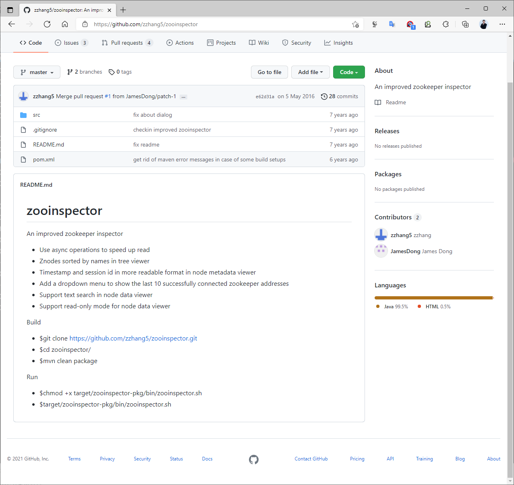

范例： Ubuntu24.04 编译 zooinspector

```xml
#注意：只支持JAVA-8，不支持JAVA-11以上版本
[root@ubuntu2404 ~]#apt update && apt -y install openjdk-8-jdk
[root@ubuntu2404 ~]#apt update && apt -y install maven
[root@ubuntu2404 ~]#mvn -v
Apache Maven 3.8.7
Maven home: /usr/share/maven
Java version: 1.8.0_442, vendor: Private Build, runtime: /usr/lib/jvm/java-8-openjdk-amd64/jre
Default locale: en_US, platform encoding: UTF-8
OS name: "linux", version: "6.8.0-48-generic", arch: "amd64", family: "unix"
[root@ubuntu2404 ~]#vim /etc/maven/settings.xml
<mirrors>
<!--阿里云镜像-->
<mirror>
<id>nexus-aliyun</id>
<mirrorOf>*</mirrorOf>
<name>Nexus aliyun</name>
<url>http://maven.aliyun.com/nexus/content/groups/public</url>
</mirror>
</mirrors>
[root@ubuntu2404 ~]#git clone https://gitee.com/lbtooth/zooinspector.git
[root@ubuntu2404 ~]#git clone https://github.com/zzhang5/zooinspector.git
[root@ubuntu2404 ~]#git clone https://mirror.ghproxy.com/https://github.com/zzhang5/zooinspector.git
[root@ubuntu2404 ~]#cd zooinspector/
[root@ubuntu2404 zooinspector]#ls
pom.xml  README.md  src  target
[root@ubuntu2404 zooinspector]#mvn clean package -Dmaven.test.skip=true
......
[WARNING] Entry: zooinspector-1.0-SNAPSHOT/repo/org/apache/zookeeper/zooinspector/1.0-SNAPSHOT/zooinspector-
1.0-SNAPSHOT.jar longer than 100 characters.
[WARNING] Resulting tar file can only be processed successfully by GNU compatible tar commands
[INFO] ------------------------------------------------------------------------
[INFO] BUILD SUCCESS
[INFO] ------------------------------------------------------------------------
[INFO] Total time:  44.276 s
[INFO] Finished at: 2025-03-07T16:09:33+08:00
[INFO] ------------------------------------------------------------------------
[root@ubuntu2404 zooinspector]#chmod +x zooinspector-pkg/bin/zooinspector.sh
[root@ubuntu2404 zooinspector]#./target/zooinspector-pkg/bin/zooinspector.sh
#将此文件传到windows上，解开运行zooinspector.bat
[root@ubuntu2404 zooinspector]#sz target/zooinspector-1.0-SNAPSHOT-pkg.tar
```

范例： Ubuntu22.04 编译 zooinspector

```xml
#注意：只支持JAVA-8，不支持JAVA-11以上版本
[root@ubuntu2204 ~]#apt update && apt -y install openjdk-8-jdk -y
[root@ubuntu2204 ~]#apt update && apt -y install maven
[root@ubuntu2204 ~]#mvn -v
Apache Maven 3.6.3
Maven home: /usr/share/maven
Java version: 1.8.0_422, vendor: Private Build, runtime: /usr/lib/jvm/java-8-openjdk-amd64/jre
Default locale: zh_CN, platform encoding: UTF-8
OS name: "linux", version: "5.15.0-52-generic", arch: "amd64", family: "unix"
[root@ubuntu2204 ~]#vim /etc/maven/settings.xml
<mirrors>
<!--阿里云镜像-->
<mirror>
<id>nexus-aliyun</id>
<mirrorOf>*</mirrorOf>
<name>Nexus aliyun</name>
<url>http://maven.aliyun.com/nexus/content/groups/public</url>
</mirror>
</mirrors>
[root@ubuntu2204 ~]#git clone https://github.com/zzhang5/zooinspector.git
[root@ubuntu2204 ~]#git clone https://mirror.ghproxy.com/https://github.com/zzhang5/zooinspector.git
[root@ubuntu2204 ~]#cd zooinspector/
[root@ubuntu2204 zooinspector]#ls
pom.xml  README.md  src  target
[root@ubuntu2204 zooinspector]#mvn clean package -Dmaven.test.skip=true
......
[WARNING] Resulting tar file can only be processed successfully by GNU compatible tar commands
[INFO] ------------------------------------------------------------------------
[INFO] BUILD SUCCESS
[INFO] ------------------------------------------------------------------------
[INFO] Total time:  01:00 min
[INFO] Finished at: 2024-10-16T16:49:04+08:00
[INFO] ------------------------------------------------------------------------
[root@ubuntu2204 zooinspector]#chmod +x zooinspector-pkg/bin/zooinspector.sh
[root@ubuntu2204 zooinspector]#./zooinspector-pkg/bin/zooinspector.sh
```

范例: rocky8 编译 zooinspector

```xml
#注意：只支持JDK8，不支持JDK11
[root@rocky8 ~]#yum  -y install java-1.8.0-openjdk maven git
#github
[root@zookeeper-node1 ~]#git clone https://github.com/zzhang5/zooinspector.git
#国内镜像
[root@zookeeper-node1 ~]#git clone https://gitee.com/lbtooth/zooinspector.git
[root@zookeeper-node1 ~]#cd zooinspector/
[root@zookeeper-node1 zooinspector]#apt install maven -y
#镜像加速
[root@zookeeper-node1 zooinspector]#vim /etc/maven/settings.xml
<mirrors>
<!--阿里云镜像-->
<mirror>
<id>nexus-aliyun</id>
<mirrorOf>*</mirrorOf>
<name>Nexus aliyun</name>
<url>http://maven.aliyun.com/nexus/content/groups/public</url>
</mirror>
</mirrors>
#编译,此步骤需要较长时间下载,可能数分钟
[root@zookeeper-node1 zooinspector]#mvn clean package -Dmaven.test.skip=true
```

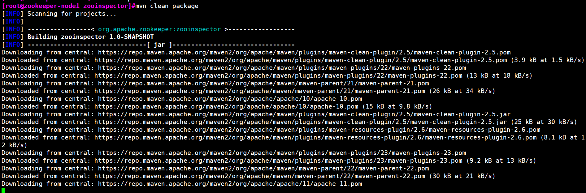

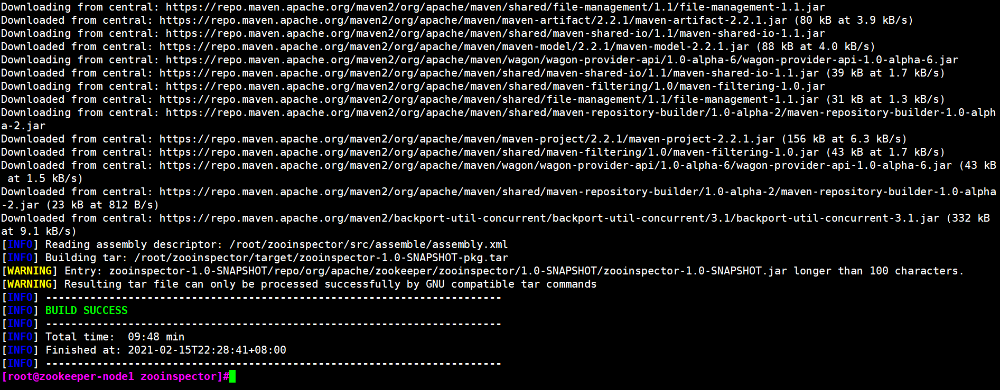

2.4.3.1.2 客户端使用

```bash
[root@zookeeper-node1 zooinspector]#ls
pom.xml  README.md  src  target
[root@zookeeper-node1 zooinspector]#ll target/ -h
total 1.4M
drwxr-xr-x 7 root root 4.0K May 11 18:08 ./
drwxr-xr-x 5 root root 4.0K May 11 18:08 ../
drwxr-xr-x 4 root root 4.0K May 11 18:08 archive-tmp/
drwxr-xr-x 4 root root 4.0K May 11 18:08 classes/
drwxr-xr-x 2 root root 4.0K May 11 18:08 maven-archiver/
drwxr-xr-x 3 root root 4.0K May 11 18:08 maven-status/
-rw-r--r-- 1 root root 134K May 11 18:08 zooinspector-1.0-SNAPSHOT.jar
-rw-r--r-- 1 root root 1.2M May 11 18:08 zooinspector-1.0-SNAPSHOT-pkg.tar
drwxr-xr-x 5 root root 4.0K May 11 18:08 zooinspector-pkg/
[root@zookeeper-node1 zooinspector]#du -sh .
7.3M    .
[root@zookeeper-node1 zooinspector]#chmod +x target/zooinspector-pkg/bin/zooinspector.sh
#如果是Rocky，需要提前在windows打开Xmanager类似的软件，并执行下面命令
[root@zookeeper-node1 zooinspector]#export DISPLAY=10.0.0.1:0.0
#启动zooinspector
[root@zookeeper-node1 zooinspector]#target/zooinspector-pkg/bin/zooinspector.sh
#自动打开下面图形界面
```

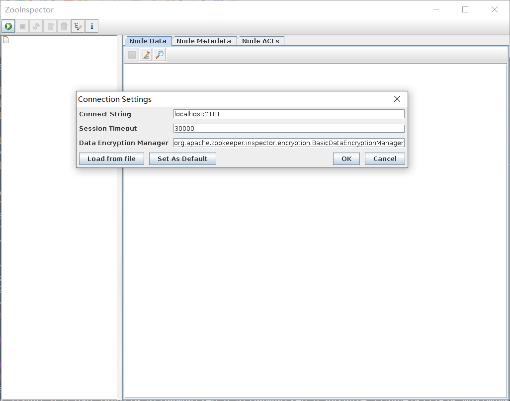

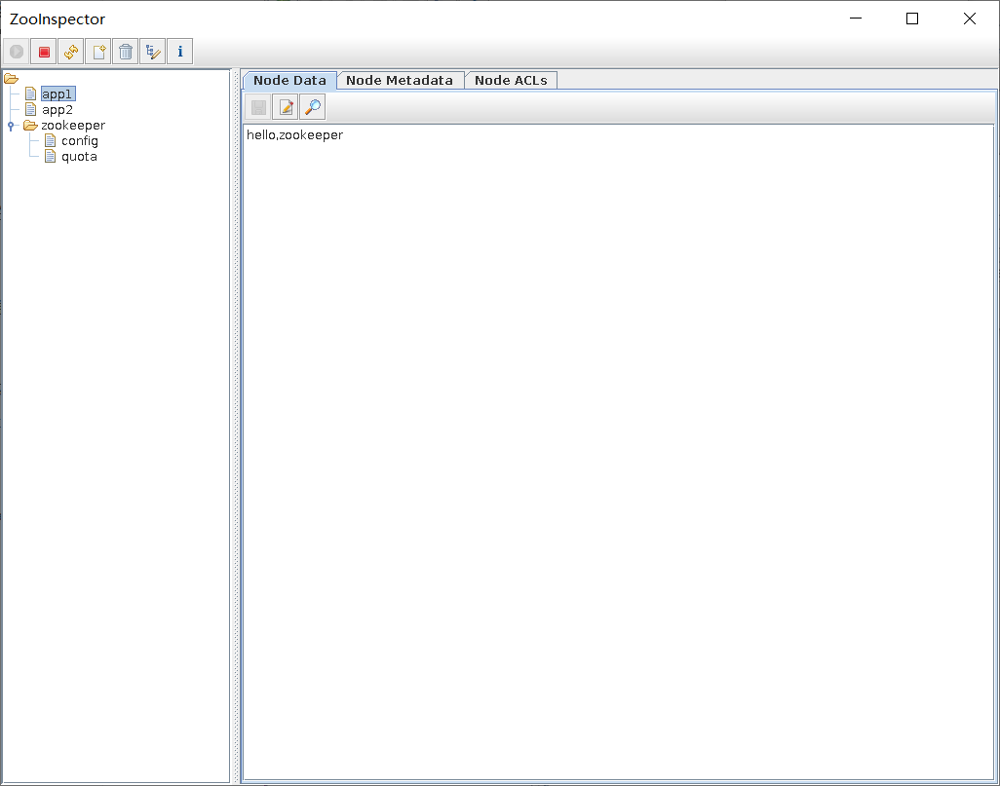

### Windows 客户端使用

先下载并安装 JDK

注意: Oracle官网需要登录才能下载

<https://www.oracle.com/java/technologies/javase/javase-jdk8-downloads.html>

运行下面命令

```bash
#方法1
D:\技术\上课文件\消息队列与微服务文件\ZooInspector\build>java -jar zookeeper-dev-ZooInspector.jar
#方法2:
只复制tagets目录中的zooinspector-pkg目录和zooinspector-1.0-SNAPSHOT-pkg.tar文件，运行zooinspector-
pkg\bin\zooinspector.bat文件
#方法3
[root@ubuntu2404 zooinspector]#sz target/zooinspector-1.0-SNAPSHOT-pkg.tar
#直接使用Linux上面编译生成的文件zookinspector-1.0-SNAPSHOT-pkg.tar在Windows中解压缩,直接运行里的zooinspector.bat
```

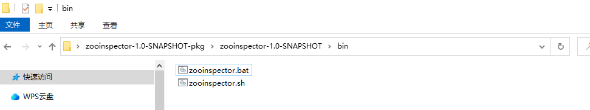

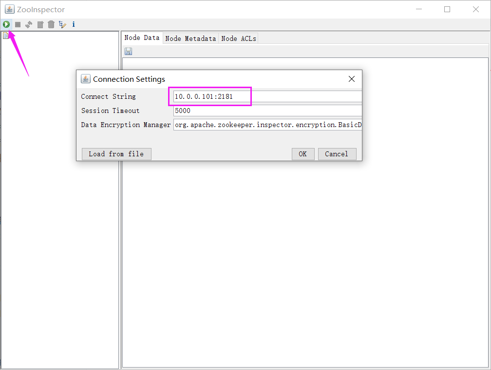

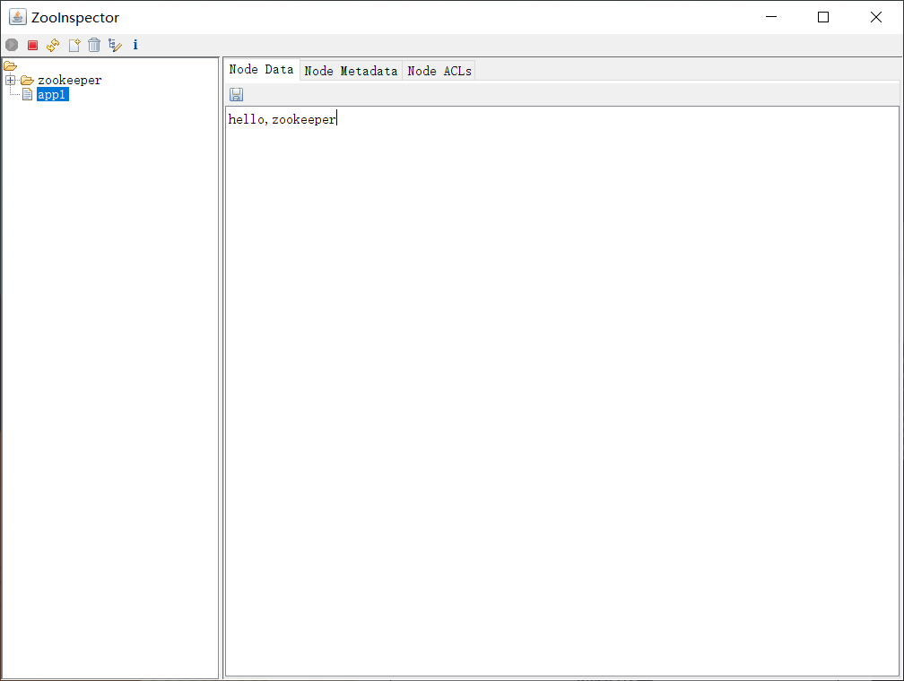

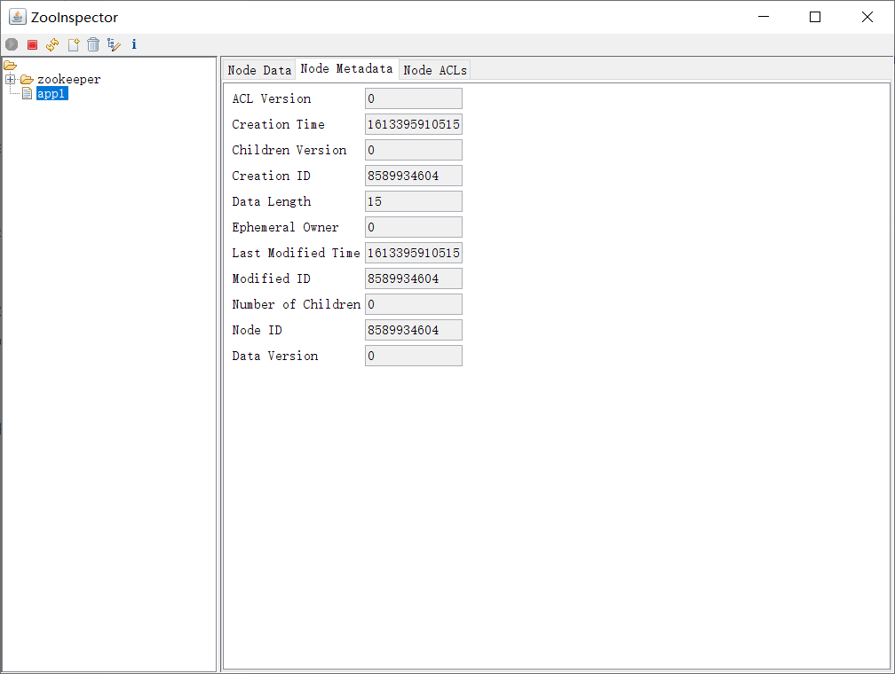

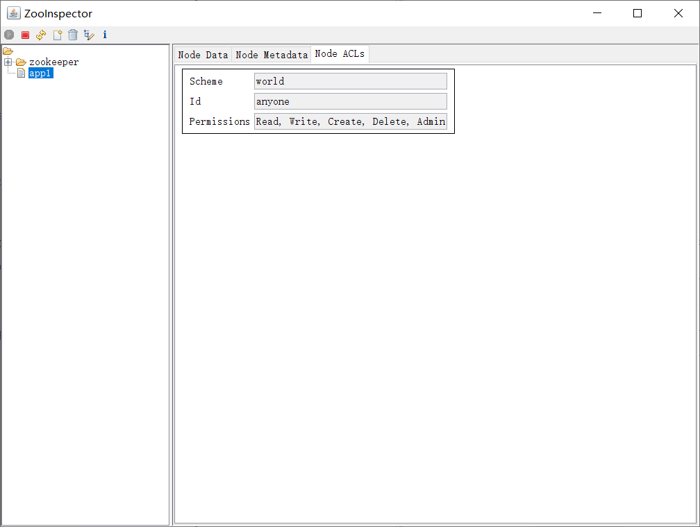

删除

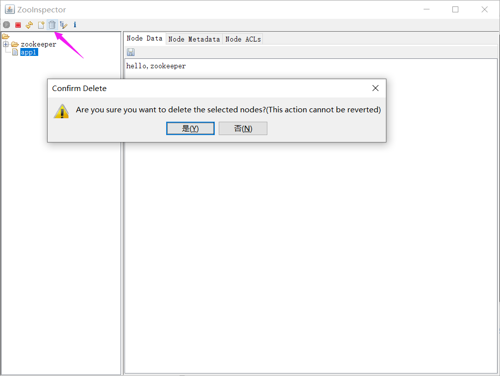

### Python 访问 ZooKeeper

```bash
[root@zookeeper-node1 ~]#apt update && apt -y install python3 python3-kazoo
[root@zookeeper-node1 ~]#cat zookeepe_test.py
#!/usr/bin/python3
from kazoo.client import KazooClient
zk = KazooClient(hosts='10.0.0.101:2181')
zk.start()
# 创建节点：makepath 设置为 True ，父节点不存在则创建，其他参数不填均为默认
zk.create('/zkapp/test',b'this is a test',makepath=True)
# 操作完后关闭zk连接
data=zk.get('/zkapp/test')
print(data)
zk.stop()
[root@zookeeper-node1 ~]#chmod +x ./zookeepe_test.py
[root@zookeeper-node1 ~]#./zookeepe_test.py
```

### Golang 访问 ZooKeeper

```go
package main
import (
"fmt"
"time"
"github.com/samuel/go-zookeeper/zk"
)
func main() {
hosts := []string{"localhost:2181"}
conn, _, err := zk.Connect(hosts, time.Second*5)
if err != nil {
panic(err)
}
defer conn.Close()
// 创建节点
path := "/test"
data := []byte("hello world")
flags := int32(0)
acl := zk.WorldACL(zk.PermAll)
_, err = conn.Create(path, data, flags, acl)
if err != nil {
panic(err)
}
// 获取节点数据
d, _, err := conn.Get(path)
if err != nil {
panic(err)
}
fmt.Printf("Get node %s data: %s\n", path, string(d))
// 设置节点数据
newData := []byte("new data")
_, err = conn.Set(path, newData, -1)
if err != nil {
panic(err)
}
d, _, err = conn.Get(path)
if err != nil {
panic(err)
}
fmt.Printf("Get node %s data after set: %s\n", path, string(d))
// 删除节点
err = conn.Delete(path, -1)
if err != nil {
panic(err)
}
fmt.Printf("Delete node %s successfully\n", path)
}
```

这段 Go 代码依次连接、创建、读取、更新和删除一个 znode。`WorldACL(zk.PermAll)` 会赋予所有客户端读写权限，仅适合隔离的演示环境；实际部署应按服务身份配置 ACL。示例里的 `Set(..., -1)` 和 `Delete(..., -1)` 跳过版本检查，多客户端同时修改时可能覆盖他人的更新；需要并发控制时先读取 `Stat.Version` 并将其传入写操作。重复运行会遇到节点已存在，使用前应清理测试节点或显式处理 `ErrNodeExists`。



<nav class="article-end" aria-label="章节导航">
  <a href="{{ '/subjects/Microservices/11-installing-zookeeper.html' | relative_url }}">← 上一篇：ZooKeeper 安装</a>
  <a href="{{ '/subjects/Microservices/' | relative_url }}">返回微服务架构目录</a>
  <a href="{{ '/subjects/Microservices/13-introduction-to-message-queues.html' | relative_url }}">下一篇：消息队列简介 →</a>
</nav>
