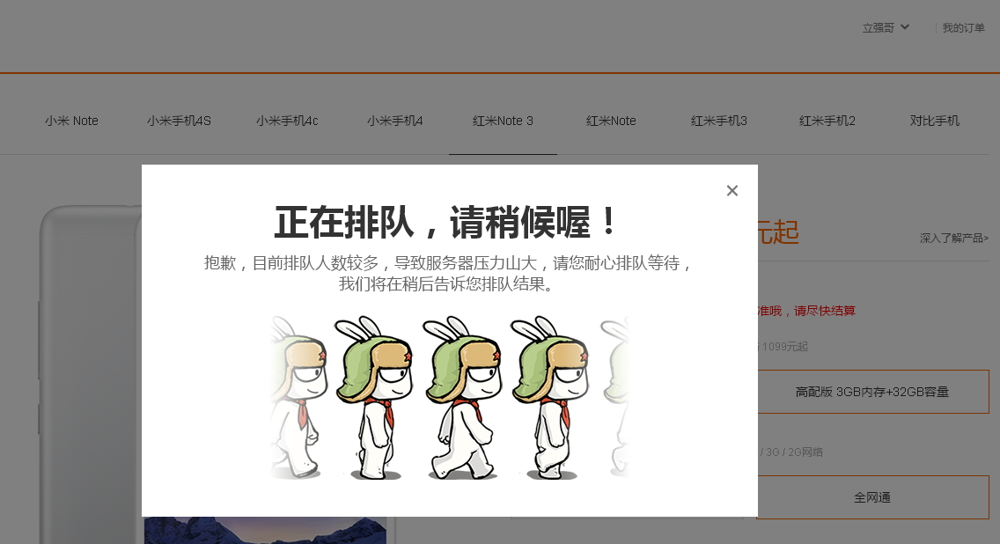
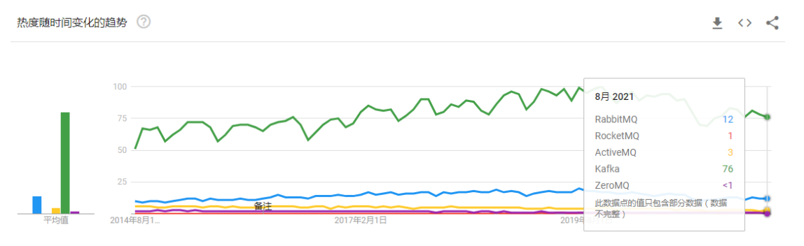

[← 返回微服务架构目录]({{ '/subjects/Microservices/' | relative_url }})



# 13 消息队列简介
## 3 Kafka
### 3.1 为什么在服务之间加入消息中间件

同步调用要求双方在同一时间可用；消息中间件允许生产者先发布事件，由消费者稍后处理。它常用于异步解耦、缓冲短时流量高峰、向多个下游分发事件及构建流式数据管道。但消息队列不会自动提高系统可用性：还要处理积压、重复投递、顺序、重试和故障恢复。

**队列与发布订阅不是同一种消费语义。** 在一个消费者组内，一条消息通常由其中一个成员处理；不同消费者组可以各自处理同一条消息。消息是否在消费后立即删除、能否重放、保存多久，取决于具体产品。Kafka 使用保留期和消费位点，不是“读完即删除”的传统队列。

### 标准与产品的关系

JMS 是 Java 消息 API 规范，AMQP 是跨语言的消息协议；两者不意味着所有 MQ 产品共享完全相同的功能。RabbitMQ、ActiveMQ、RocketMQ 与 Kafka 的路由、持久化和消费模型不同。选择产品时先明确吞吐、延迟、顺序范围、重放和运维要求，而不是按年代或流行程度决定。

### 常见应用场景与边界

| 场景 | 消息的作用 | 必须额外设计 |
| --- | --- | --- |
| 削峰 | 接受短时请求，把非即时任务排队 | 队列容量、积压告警、背压与过载拒绝 |
| 业务事件 | 订单完成后通知积分、物流等下游 | 事件版本、幂等消费与失败补偿 |
| 数据流 | 把变更交给实时计算或审计系统 | 延迟目标、保留期、位点管理 |
| 缓存更新 | 广播数据变更通知 | 丢通知后的全量校准与最终一致性 |

消息投递不等于业务事务成功。例如订单写入数据库后发布事件，若两步之间故障，需要用事务性发件箱等机制保证事件最终可见；消费者还要能安全处理重复消息。严格顺序通常只在同一队列或分区的约定范围内成立，不应承诺全系统 FIFO。

下文以 Kafka 为重点。RabbitMQ 更侧重灵活路由和任务投递；Kafka 的分区日志适合高吞吐、保留和重放；RocketMQ、ActiveMQ 等也各有应用场景。图示用于认识产品类型，具体能力应以目标版本文档和实测为准。



<nav class="article-end" aria-label="章节导航">
  <a href="{{ '/subjects/Microservices/12-accessing-zookeeper-clients.html' | relative_url }}">← 上一篇：ZooKeeper 客户端访问</a>
  <a href="{{ '/subjects/Microservices/' | relative_url }}">返回微服务架构目录</a>
  <a href="{{ '/subjects/Microservices/14-introduction-to-kafka.html' | relative_url }}">下一篇：Kafka 介绍 →</a>
</nav>
