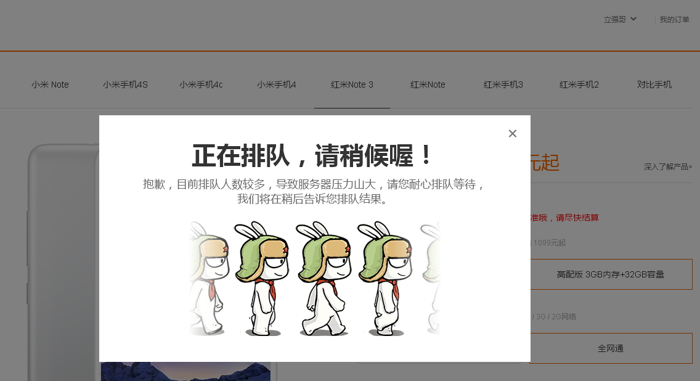
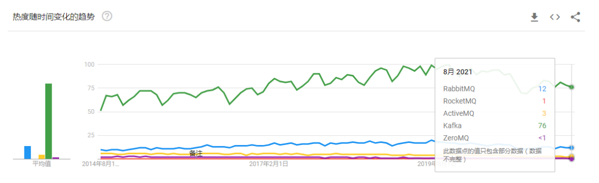

[← Back to Microservices Index]({{ '/subjects/Microservices/' | relative_url }})



# 13 Introduction to Message Queues
## 3 Kafka

### 3.1 消息队列简介

### 消息队列历史

1983 年在MIT 工作的26岁的印度小伙 Vivek Ranadive突发奇想，以前我们的软件相互通信，都是点对点的，而且要实现相同的协议，能不能有一种专门用来通信的中间件，就像主板（BUS）一样，把不同的软件集成起来呢？于是他搞了一家公司（Teknekron），开发了世界上第一个消息队列软件The Information Bus(TIB)。最开始的时候，它被高盛这些公司用在金融交易里面。因为TIB 实现了发布订阅 (Publish/Subscribe)模型，信息的生产者和消费者可以完全解耦，这个特性引起了电信行业特别是新闻机构的注意。1994年路透社收购了 Teknekron。

TIB 的成功马上引起了业界大佬IBM 的注意，他们研发了自己的IBM MQ（IBMWesphere）。后面微软也加入了这场竟争，研发了MSMQ。 这个时候，每个厂商的产品是孤立的，大家都有自己的技术壁垒。比如一个应用订阅了IBM MQ 的消息，如果有要订阅MSMQ 的消息，因为协议、API 不同，又要重复去实现。。

J2EE 制定了JDBC 的规范，那么那么各个数据库厂商自己去实现协议，提供jar 包，在Java 里面就可以使用相同的API 做操作不同的数据库了。MQ 产品的问题也是一样的

2001 年的时候，SUN 公司发布了 JMS 规范，JMS 即 Java 消息服务（Java Message Service）应用程序接口，是一个 Java 平台中关于面向消息中间件（MOM，message oriented middleware）的API

JMS 想要在各大厂商的MQ 上面统一包装一层Java 的规范，大家都只需要针对API 编程就可以了，不需要关注使用了什么样的消息中间件， 只要选择合适的MQ 驱动。可以用于在两个应用程序之间，或分布式系统中发送消息，进行异步通信。

但是JMS 只适用于Java 语言，它是跟语言绑定的，没有从根本上解决这个问题（只是一个API）。

所以在2006 年的时候，AMQP (Advanced Message Queuing Protocol)规范发布了。它是跨语言和跨平台的，真正地促进了消息队列的繁荣发展。

2007 年的时候，Rabbit 技术公司基于Erlang语言开发了符合AMQP 规范RabbitMQ 1.0。从最开始用在金融行业里面，现在RabbitMQ 已经在世界各地的公司中遍地开花。国内的绝大部分大厂都在用RabbitMQ，包括头条，美团，滴滴（TMD），去哪儿，艺龙，淘宝也有用。

### MQ 定义

```text
#阿里云消息队列
https://www.aliyun.com/product/ons?spm=5176.234368.h2v3icoap.427.2620db25lcHi1Q&amp;aly_as=Tz_Lue_o
```

在分布式场景中，相对于大量的用户请求来说，内部的功能主机之间、功能模块之间等，数据传递的数据量是无法想象的，因为一个用户请求，会涉及到各种内部的业务逻辑跳转等操作。那么，在大量用户的业务场景中，如何保证所有的内部业务逻辑请求都处于稳定而且快捷的数据传递呢? 消息队列(Message Queue)技术可以满足此需求

消息队列（Message Queue，简称 MQ）是构建分布式互联网应用的基础设施，通过 MQ 实现的松耦合架构设计可以提高系统可用性以及可扩展性，是适用于现代应用的最佳设计方案。

消息队列是一种异步的服务间通信方式，适用于无服务器和微服务架构。消息在被处理和删除之前一直存储在队列上。每条消息仅可被一位用户处理一次。消息队列可被用于分离重量级处理、缓冲或批处理工作以及缓解高峰期工作负载。

### MQ 使用场合



消息队列作为高并发系统的核心组件之一，能够帮助业务系统结构提升开发效率和系统稳定性

消息队列主要有以下应用场景

削峰填谷诸如电商业务中的秒杀、抢红包、企业开门红等大型活动时皆会带来较高的流量脉冲，或因没做相应的保护而导致系统超负荷甚至崩溃，或因限制太过导致请求大量失败而影响用户体验，消息队列可提供削峰填谷的服务来解决该问题。

异步解耦交易系统作为淘宝等电商的最核心的系统，每笔交易订单数据的产生会引起几百个下游业务系统的关注，包括物流、购物车、积分、流计算分析等等，整体业务系统庞大而且复杂，消息队列可实现异步通信和应用解耦，确保主站业务的连续性。

顺序收发细数日常中需要保证顺序的应用场景非常多，例如证券交易过程时间优先原则，交易系统中的订单创建、支付、退款等流程，航班中的旅客登机消息处理等等。与先进先出FIFO（First In First Out）原理类似，消息队列提供的顺序消息即保证消息FIFO。 分布式事务一致性交易系统、支付红包等场景需要确保数据的最终一致性，大量引入消息队列的分布式事务，既可以实现系统之间的解耦，又可以保证最终的数据一致性。 大数据分析

数据在“流动”中产生价值，传统数据分析大多是基于批量计算模型，而无法做到实时的数据分析，利用消息队列与流式计算引擎相结合，可以很方便的实现业务数据的实时分析。 分布式缓存同步

电商的大促，各个分会场琳琅满目的商品需要实时感知价格变化，大量并发访问数据库导致会场页面响应时间长，集中式缓存因带宽瓶颈，限制了商品变更的访问流量，通过消息队列构建分布式缓存，实时通知商品数据的变化蓄流压测

线上有些链路不方便做压力测试，可以通过堆积一定量消息再放开来压测

### 主流 MQ

目前主流的消息队列软件有 Kafka、RabbitMQ、ActiveMQ、RocketMQ等，还有相对小众的消息队列软件如ZeroMQ、Apache Qpid 等。





<nav class="article-end" aria-label="章节导航">
  <a href="{{ '/subjects/Microservices/12-accessing-zookeeper-clients.html' | relative_url }}">← Previous: Accessing ZooKeeper Clients</a>
  <a href="{{ '/subjects/Microservices/' | relative_url }}">Back to Microservices Index</a>
  <a href="{{ '/subjects/Microservices/14-introduction-to-kafka.html' | relative_url }}">Next: Introduction to Kafka →</a>
</nav>
