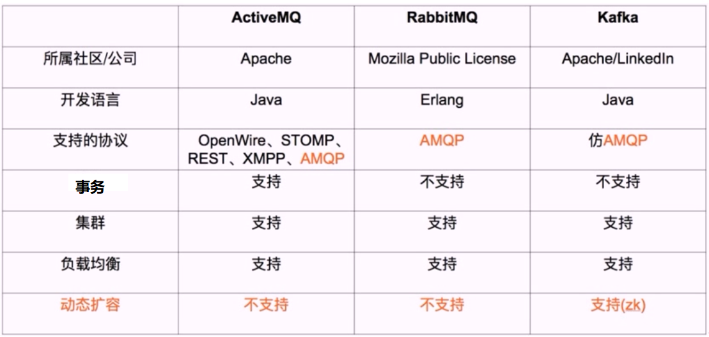

[← 返回微服务架构目录]({{ '/subjects/Microservices/' | relative_url }})



# 15 常用消息队列对比
### 3.3 常用消息队列对比

kafka 最主要的优势是其具备分布式功能、并可以结合 zookeeper 可以实现动态扩容，Kafka 是一种高吞吐量的分布式发布订阅消息系统。



<nav class="article-end" aria-label="章节导航">
  <a href="{{ '/subjects/Microservices/14-introduction-to-kafka.html' | relative_url }}">← Previous: Introduction to Kafka</a>
  <a href="{{ '/subjects/Microservices/' | relative_url }}">Back to Microservices Index</a>
  <a href="{{ '/subjects/Microservices/16-kafka-features-and-benefits.html' | relative_url }}">Next: Kafka Features and Benefits →</a>
</nav>
