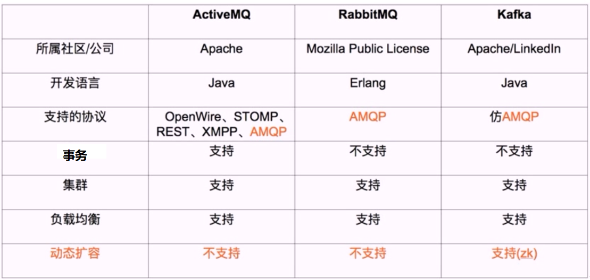

[← 返回微服务架构目录]({{ '/subjects/Microservices/' | relative_url }})



# 15 常用消息队列对比
### 3.3 常用消息队列对比

不能仅凭“是否分布式”区分消息系统：RabbitMQ、RocketMQ 和 Kafka 都能部署为集群。Kafka 新版使用 KRaft 管理元数据，不应把 ZooKeeper 写成扩容的必要条件。选型应从消息消费语义出发：

| 需求 | Kafka | RabbitMQ | RocketMQ |
| --- | --- | --- | --- |
| 长时间保留与按位点重放 | 分区日志是核心能力 | 传统队列通常以确认后移除为主，另有流式能力 | 依版本和主题类型支持重放、回溯 |
| 路由方式 | 主题、分区、消费者组 | Exchange 与 Binding 灵活路由 | 主题、标签和消费者组等机制 |
| 顺序范围 | 同一分区内有序 | 与单队列、并发消费及重投递方式有关 | 与消息组/队列及消费方式有关 |
| 优先验证 | 分区规划、位点和保留期 | 路由、确认和队列积压 | 主题类型、消费模式和版本兼容 |

此表是阅读入口，不是性能排名。吞吐、延迟和可靠性要在相同硬件、消息大小、持久化及确认配置下实测。



<nav class="article-end" aria-label="章节导航">
  <a href="{{ '/subjects/Microservices/14-introduction-to-kafka.html' | relative_url }}">← 上一篇：Kafka 介绍</a>
  <a href="{{ '/subjects/Microservices/' | relative_url }}">返回微服务架构目录</a>
  <a href="{{ '/subjects/Microservices/16-kafka-features-and-benefits.html' | relative_url }}">下一篇：Kafka 特点和优势 →</a>
</nav>
