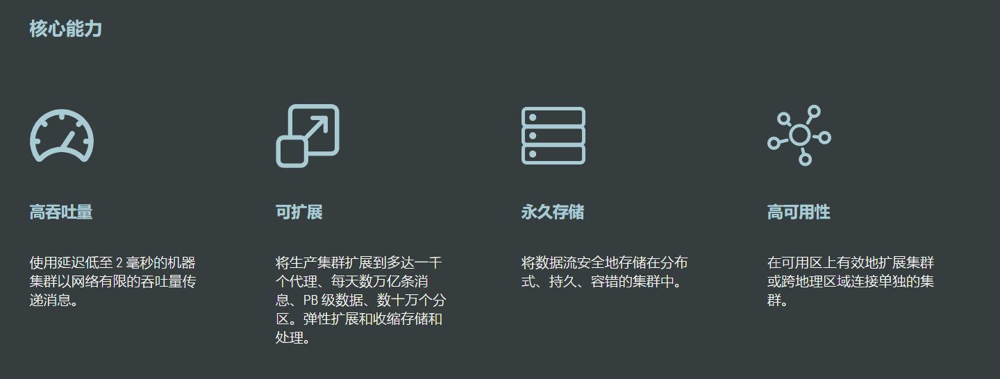

[← Back to Microservices Index]({{ '/subjects/Microservices/' | relative_url }})



# 16 Kafka Features and Benefits
### 3.4 Kafka 特点和优势



特点

分布式:  支持分布式多主机部署实现分区: 一个消息.可以拆分出多个，分别存储在多个位置多副本: 防止信息丢失，可以多来几个备份多订阅者: 可以有很多应用连接kafka Zookeeper: 早期版本的Kafka依赖于zookeeper， 2021年4月19日Kafka 2.8.0正式发布，此版本包括了很多重要改动，最主要的是 kafka通过自我管理的仲裁来替代ZooKeeper，即Kafka将不再需要ZooKeeper！

优势

Kafka 通过 O(1)的磁盘数据结构提供消息的持久化，这种结构对于即使数以 TB 级别以上的消息存储也能够保持长时间的稳定性能。 高吞吐量：即使是非常普通的硬件Kafka也可以支持每秒数百万的消息。支持通过Kafka 服务器分区消息。 分布式： Kafka 基于分布式集群实现高可用的容错机制，可以实现自动的故障转移顺序保证：在大多数使用场景下，数据处理的顺序都很重要。大部分消息队列本来就是排序的，并且能保证数据会按照特定的顺序来处理。 Kafka保证一个Partiton内的消息的有序性（分区间数据是无序的，如果对数据的顺序有要求，应将在创建主题时将分区数 partitions设置为1） 支持 Hadoop 并行数据加载通常用于大数据场合,传递单条消息比较大，而Rabbitmq 消息主要是传输业务的指令数据,单条数据较小

随机和顺序IO比较


```text
O(1)就是最低的时空复杂度，也就是耗时/耗空间与输入数据大小无关，无论输入数据增大多少倍，耗时/耗空间都不变，哈希算法就是典型的O(1)时
间复杂度，无论数据规模多大，都可以在一次计算后找到目标
```



<nav class="article-end" aria-label="章节导航">
  <a href="{{ '/subjects/Microservices/15-comparing-message-queues.html' | relative_url }}">← Previous: Comparing Message Queues</a>
  <a href="{{ '/subjects/Microservices/' | relative_url }}">Back to Microservices Index</a>
  <a href="{{ '/subjects/Microservices/17-kafka-roles-and-workflow.html' | relative_url }}">Next: Kafka Roles and Workflow →</a>
</nav>
