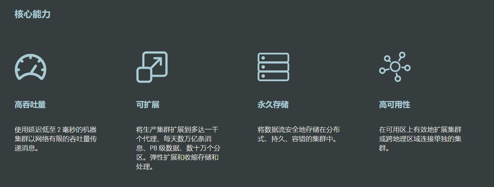
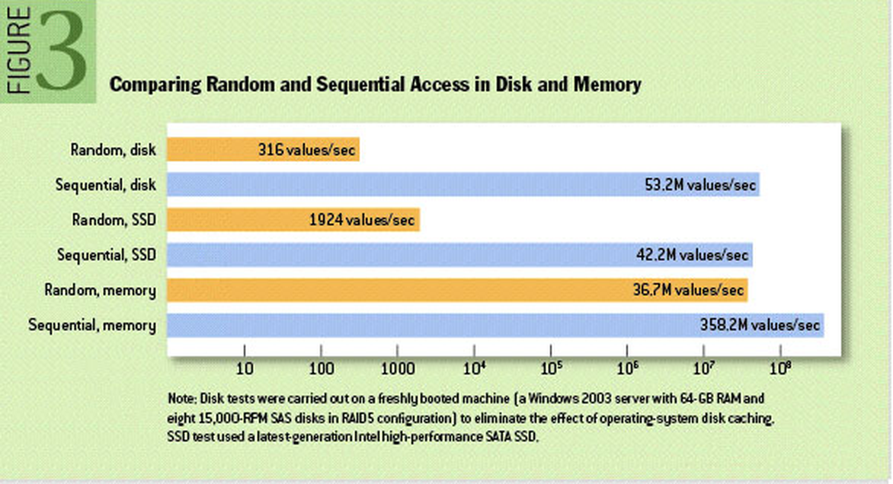

[← 返回微服务架构目录]({{ '/subjects/Microservices/' | relative_url }})



# 16 Kafka 特点和优势
### 3.4 Kafka 特点和优势

### 特点与适用边界

- **分区扩展**：一个 Topic 包含多个分区，**一条记录只写入其中一个分区**，不是把一条消息拆成多份。不同分区可以分布到不同 Broker，提高并行度。
- **副本容错**：分区可配置副本因子，Leader 接收读写，Follower 复制日志。是否能承受故障还取决于 ISR、生产者 `acks` 与 `min.insync.replicas`，不是“多几个备份”就必定无损。
- **保留与重放**：消费位点独立于消息保留期；消费者可以在可用数据范围内重新处理。这适合事件流与数据管道，也要求管理存储容量和位点。
- **顺序范围**：同一分区内的记录有顺序，不同分区没有全局顺序。若只要求同一订单的事件有序，可使用稳定的订单键把相关事件路由到同一分区，不必把整个 Topic 缩为一个分区。
- **元数据管理**：旧集群使用 ZooKeeper；新部署应核对目标 Kafka 版本的 KRaft 支持与迁移要求，不能认为 Kafka 2.8 发布后所有旧集群就自动不再依赖 ZooKeeper。

高吞吐来自顺序追加、批量、压缩和并行分区等机制的组合，实际数字由负载和硬件决定。大消息会影响网络、内存及复制延迟，Kafka 也不适合作为大文件传输通道。下图帮助理解顺序与随机 I/O，但不能由此推出所有 Kafka 操作都是常数时间。

复杂度符号 `O(1)` 只描述特定操作相对输入规模的增长趋势，不等于固定耗时，更不能概括 Kafka 的全部写入、复制、读取和恢复过程。评估系统应观察实际吞吐、尾延迟、积压与故障恢复时间。



<nav class="article-end" aria-label="章节导航">
  <a href="{{ '/subjects/Microservices/15-comparing-message-queues.html' | relative_url }}">← 上一篇：常用消息队列对比</a>
  <a href="{{ '/subjects/Microservices/' | relative_url }}">返回微服务架构目录</a>
  <a href="{{ '/subjects/Microservices/17-kafka-roles-and-workflow.html' | relative_url }}">下一篇：Kafka 角色和流程 →</a>
</nav>
