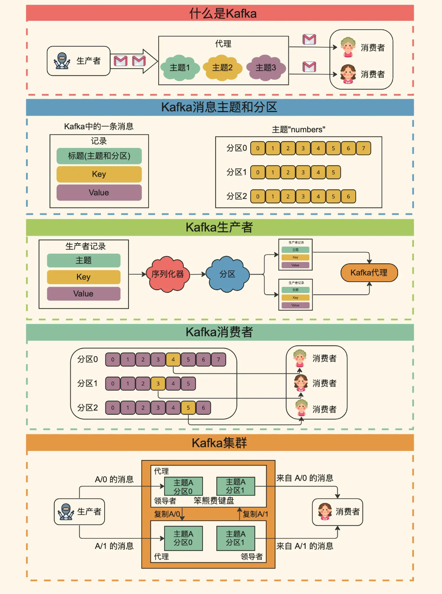
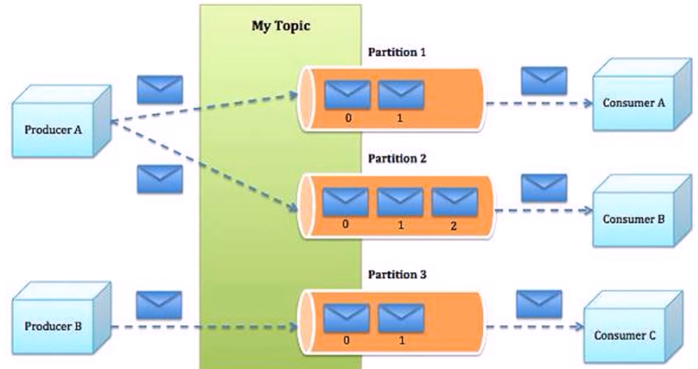
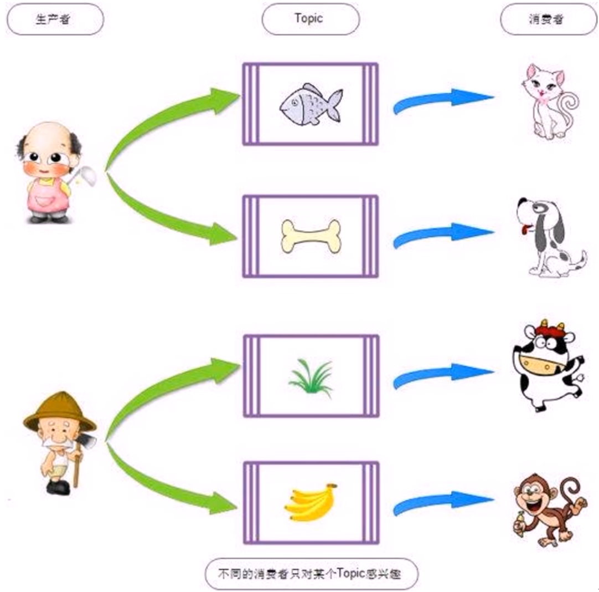
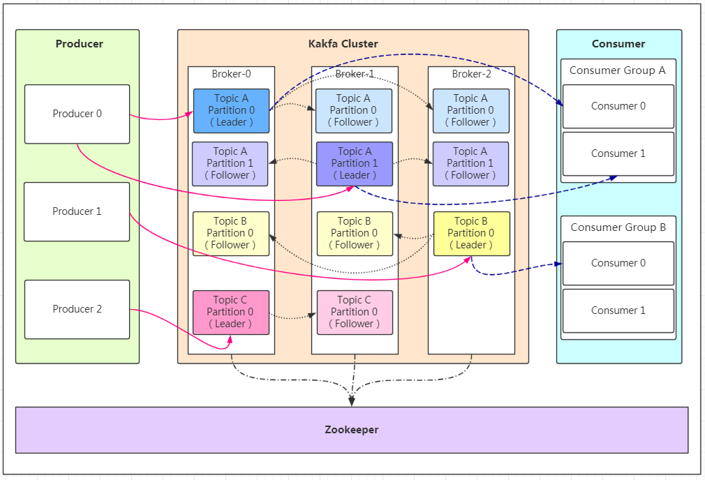
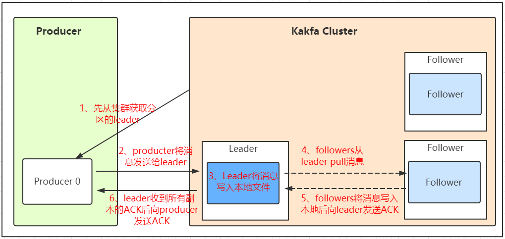

[← 返回微服务架构目录]({{ '/subjects/Microservices/' | relative_url }})



# 17 Kafka 角色和流程
### 3.5 Kafka 角色和流程

### Kafka 概念

Producer：Producer即生产者，消息的产生者，是消息的入口。负责发布消息到Kafka broker。

Consumer：消费者，用于消费消息，即处理消息

Broker：Broker是kafka实例，每个服务器上可以有一个或多个kafka的实例，假设每个broker对应一台服务器。每个kafka集群内的broker 都有一个不重复的编号，如: broker-0、broker-1等……

Controller：是整个 Kafka 集群的管理者角色，任何集群范围内的状态变更都需要通过 Controller 进行，在整个集群中是个单点的服务，可以通过选举协议进行故障转移，负责集群范围内的一些关键操作：主题的新建和删除，主题分区的新建、重新分配，Broker 的加入、退出， 触发分区 Leader 选举等，每个 Broker 里都有一个 Controller 实例，多个 Broker 的集群同时最多只有一个 Controller 可以对外提供集群管理服务，Controller 可以在 Broker 之间进行故障转移，Kafka 集群管理的工作主要是由 Controller 来完成的，而 Controller 又通过监听 Zookeeper 节点的变动来进行监听集群变化事件，Controller 进行集群管理需要保存集群元数据，监听集群状态变化情况并进行处理，以及处理集群中修改集群元数据的请求，这些主要都是利用 Zookeeper 来实现

Topic ：消息的主题，可以理解为消息的分类，一个Topic相当于数据库中的一张表,一条消息相当于关系数据库的一条记录，或者一个Topic 相当于Redis中列表数据类型的一个Key，一条消息即为列表中的一个元素。kafka的数据就保存在topic。在每个broker上都可以创建多个 topic。

虽然一个 topic的消息保存于一个或多个broker 上同一个目录内, 物理上不同 topic 的消息分开存储在不同的文件夹，但用户只需指定消息的 topic即可生产或消费数据而不必关心数据存于何处，topic 在逻辑上对record(记录、日志)进行分组保存，消费者需要订阅相应的topic 才能消费topic中的消息。

Consumer group: 每个consumer 属于一个特定的consumer group（可为每个consumer 指定 group name，若不指定 group name 则属于默认的group），同一topic的一条消息只能被同一个consumer group 内的一个consumer 消费，类似于一对一的单播机制，但多个 consumer group 可同时消费这一消息，类似于一对多的多播机制，默认消费组的多个消费者是共享消息

Partition ：是物理上的概念，每个 topic 分割为一个或多个partition，即一个topic切分为多份, 当创建 topic 时可指定 partition 数量， partition的表现形式就是一个一个的文件夹,该文件夹下存储该partition的数据和索引文件，分区的作用还可以实现负载均衡，提高kafka的吞吐量。同一个topic在不同的分区的数据是不重复的,一般Partition数不要超过节点数，注意同一个partition数据是有顺序的，但不同的 partition则是无序的。

Replication: 同样数据的副本，包括leader和follower的副本数,基本于数据安全,建议至少2个,是Kafka的高可靠性的保障，和ES的副本有所不同，Kafka中的副(leader+follower）数包括主分片数,而Elasticsearch中的副本数(follower)不包括主分片数

为了实现数据的高可用，比如将分区 0 的数据分散到不同的kafka 节点，每一个分区都有一个 broker 作为 Leader 和一个 broker 作为 Follower，类似于ES中的主分片和副本分片， 假设分区为 3, 即分三个分区0-2，副本为3，即每个分区都有一个 leader，再加两个follower，分区 0 的leader为服务器A，则服务器 B 和服务器 C 为 A 的follower，而分区 1 的leader为服务器B，则服务器 A 和C 为服务器B 的follower，而分区 2 的leader 为C，则服务器A 和 B 为 C 的follower。

副本数不能超过集群节点的数量

AR： Assigned Replicas，分区中的所有副本的统称，包括leader和 follower，AR= lSR+ OSR

lSR：ln Sync Replicas，所有与leader副本保持同步的副本 follower和leader本身组成的集合，包括leader和 follower，是AR的子集

OSR：out-of-Sync Replied，所有与leader副本同步不能同步的 follower的集合，是AR的子集

分区和副本的优势：

实现存储空间的横向扩容，即将多个kafka服务器的空间组合利用提升性能，多服务器并行读写实区即 leader 分布在不同的kafka 服务器，并且有对应follower 分布在和leader不同的服务器上

### Kafka 工作机制

Apache Kafka的选举机制涉及到其使用的分区复制模式（partition replication）。

每个Kafka Topic 的分区都有一个领导者（leader）和零个或多个追随者（follower）。

领导者负责所有客户端请求的读写操作，而追随者则复制领导者的数据(kafka2.4新版本后，也支持读)

Kafka的领导者选举过程发生在以下情况中：

1. 当新的分区创建时，Kafka选择ISR（In-Sync Replica）列表中的第一个副本作为领导者。

2. 当领导者失败或无法与ZooKeeper通信时，会重新选举新的领导者。这个过程被称为领导者故障转移（leader failover）。

Kafka领导者选举的详细步骤：

1. 当领导者发生故障，ZooKeeper将会检测到它的会话过期。

2. ZooKeeper接着将通知所有的副本进行领导者选举。

3. 副本们会查看它们在ZooKeeper中存储的元数据并确定新的领导者，选择规则是选取副本集合（ISR）中最新的副本。

4. 一旦新的领导者被选出，ZooKeeper将通知所有的副本更新它们的元数据。

注意：Kafka 2.8.0版本开始，增加了KRaft（KRaft是Kafka Raft协议模式的简称）模式，这个模式下Kafka不再需要ZooKeeper，而是使用内置的Raft协议来进行元数据的管理和领导者选举。Raft协议是一种为分布式系统提供一致性的算法，它更易于理解和实施，同时也保证了系统的可用性和数据的一致性。

Apache Kafka可以配置为提供强一致性的语义，但这是以牺牲一定的性能为代价的。

在Kafka中，数据被分布在各个分区上，每个分区都有一个领导者（leader）和若干个追随者（follower）。领导者负责处理所有读写请求， 而追随者则复制领导者的数据。这种设计确保了数据的高可用性和容错性。

然而，为了保证高性能和低延迟，Kafka允许领导者在数据还未被所有的追随者复制之前就将写操作确认为成功。这就带来了一种可能的情况，即在领导者确认写操作成功后、新数据还未被所有追随者复制完成之前，领导者发生故障，此时新数据可能会丢失，从而造成一致性问题。

要实现强一致性，你需要将Kafka的min.insync.replicas 参数设置为大于1，这样可以确保至少有N个副本确认数据写入才认为写操作成功。并且需要设置acks 为all 或者-1 ，表示领导者需要等待所有的ISR（In-Sync Replicas）确认接收到消息后，才向生产者返回ack。这样，即使领导者发生故障，由于至少有一个追随者已经复制了数据，新的领导者仍然可以提供所有的数据，从而保证了强一致性。

总的来说，Kafka可以配置为提供强一致性，但这可能会影响其性能和吞吐量。在实际使用中，你需要根据自己的业务需求在一致性和性能之间进行权衡。

Kafka的复制配置

Kafka的复制方式可以通过acks（acknowledgments）配置来实现：

1. acks=0：生产者发送消息后不等确认即认为成功。这种方式相当于没有复制，只有单个副本存储在Leader上。

2. acks=1：消息发送到Leader即认为成功，相当于异步复制。在这种情况下，生产者只需要等待Leader的确认，而不需要等待ISR（In-

Sync Replicas，同步副本集）中其他副本的确认。

3. acks=all：需要等待ISR列表中所有同步的Slave都确认才认为成功，相当于同步复制。这种方式下，生产者需要等待ISR中所有副本都

写入成功后才认为消息发送成功。



<nav class="article-end" aria-label="章节导航">
  <a href="{{ '/subjects/Microservices/16-kafka-features-and-benefits.html' | relative_url }}">← Previous: Kafka Features and Benefits</a>
  <a href="{{ '/subjects/Microservices/' | relative_url }}">Back to Microservices Index</a>
  <a href="{{ '/subjects/Microservices/18-deploying-kafka.html' | relative_url }}">Next: Deploying Kafka →</a>
</nav>
