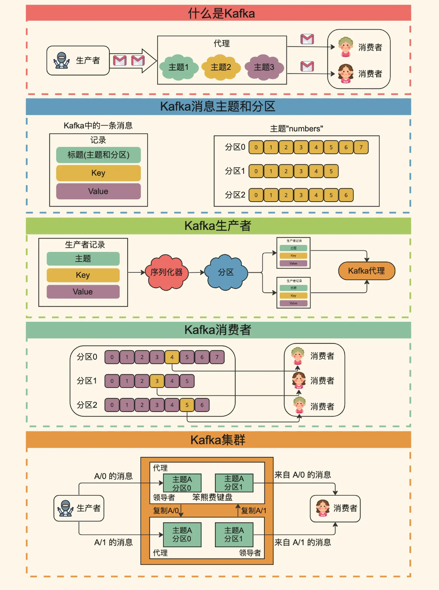
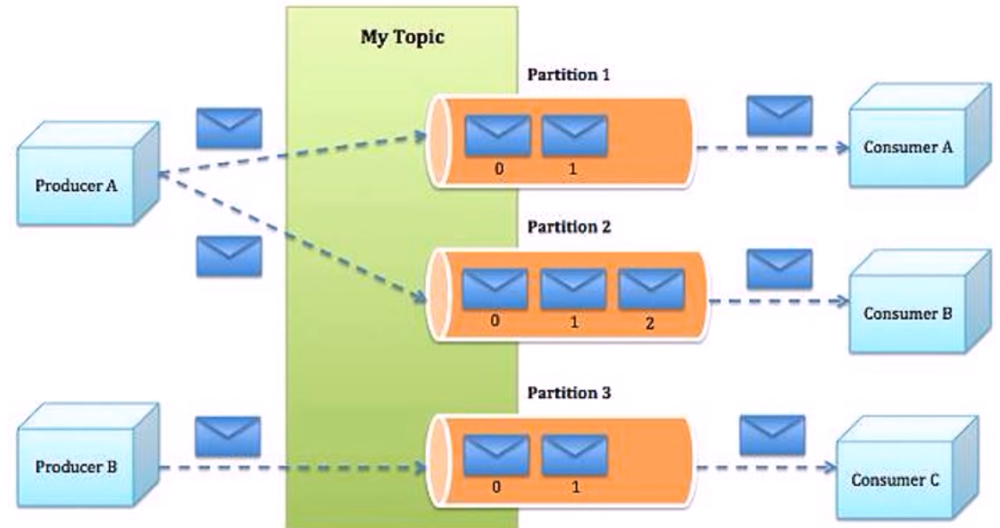
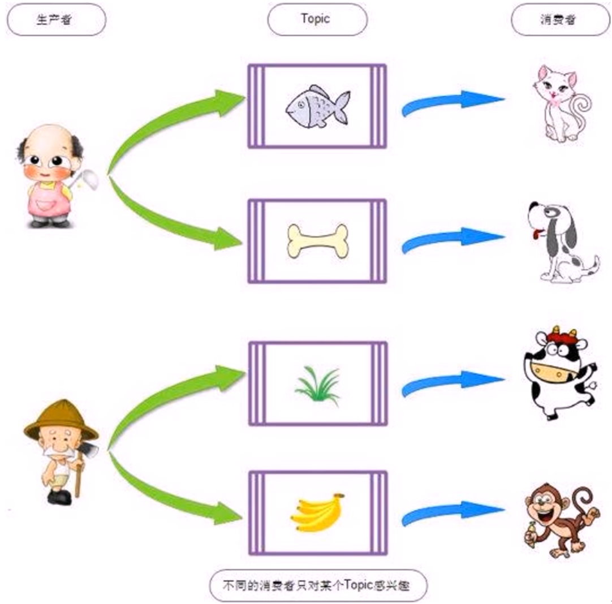
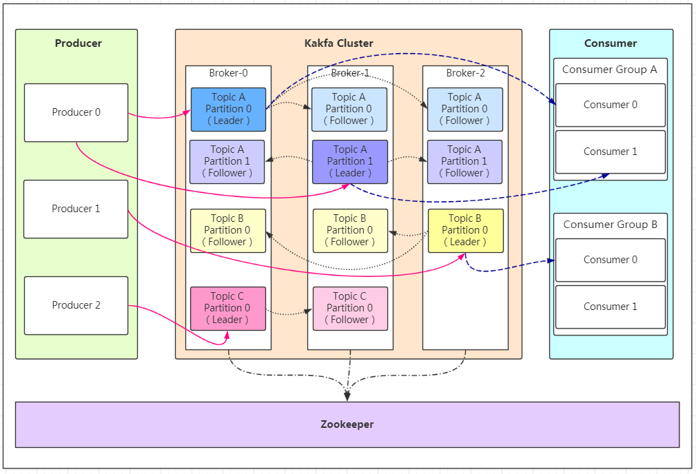
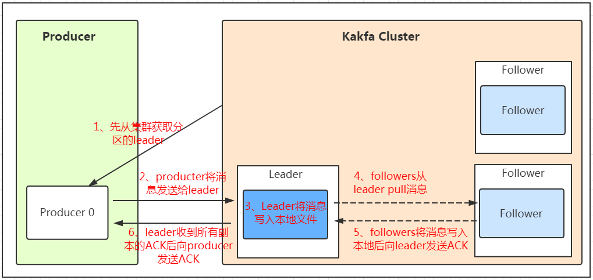

[← 返回微服务架构目录]({{ '/subjects/Microservices/' | relative_url }})



# 17 Kafka 角色和流程
### 3.5 Kafka 角色和流程

### Kafka 概念

### 从生产者到消费者

- **Producer** 将一条记录（键、值及可选头部）发送到 Topic 的一个分区。键常用于让同一业务实体的记录落在同一分区。
- **Broker** 是承载分区日志和副本的 Kafka 服务器；一个 Topic 的不同分区可分布在多个 Broker 上，Topic 不是“在每台 Broker 各创建一份”。
- **Topic 与 Partition**：Topic 是逻辑分类，分区是追加有序的日志。记录在一个分区中有 offset，不同分区的 offset 互不比较。
- **Consumer Group**：同一组内，一个分区在某个时刻通常分配给一个消费者实例；不同组可以各自读取同一批记录。消费者位点需提交并管理，不能假定未指定 group.id 时自动加入某个通用默认组。
- **Controller** 管理集群元数据和分区领导者变更。ZooKeeper 模式由选出的 Broker Controller 协调；KRaft 模式由 Controller 角色的法定多数派管理元数据，两种模式不能混写为“ZooKeeper 通知每个副本自行选举”。

### 分区与副本怎样配合

一个分区有一个 Leader 副本和零个或多个 Follower 副本。副本因子包含 Leader，例如副本因子 3 表示一主两从；不同副本应分布在不同 Broker，因而副本因子不能大于可用 Broker 数。ISR 是当前与 Leader 保持同步的副本集合，通常包含 Leader；AR 是该分区分配的全部副本，OSR 为不在 ISR 的已分配副本。通常 AR = ISR ∪ OSR，而不是把副本数和分区数相加。

分区数可以大于 Broker 数，每台 Broker 可承载多个分区；增加分区有利于并行，但也增加元数据、文件句柄与再均衡成本。顺序保证限于单分区；想让同一订单事件有序，应使用稳定的订单键，而非一律把 Topic 设成单分区。

### 从写入到消费的流程

1. Producer 根据分区器或键选择分区，向该分区 Leader 发送记录。
2. Leader 追加日志，Follower 从 Leader 拉取并复制；生产者何时得到确认由 acks、ISR 和最小同步副本数共同决定。
3. Consumer 从分配到的分区拉取记录，处理后提交 offset。处理成功与提交位点不是原子操作时，故障后可能重复处理，因此业务应设计幂等。
4. 若分区 Leader 故障，Controller 在符合条件的副本中协调新 Leader，并更新元数据。恢复能力取决于副本健康状态与故障时的配置。

KRaft 自 Kafka 2.8 引入并逐步成熟，具体部署与迁移方案要以目标版本文档为准；旧 ZooKeeper 集群不会因升级阅读材料而自动迁移。

### acks 与可靠性边界

| 配置 | 生产者何时得到确认 | 风险 |
| --- | --- | --- |
| acks=0 | 不等待 Broker 确认 | 发送失败也可能不被生产者获知；这不表示副本被关闭 |
| acks=1 | Leader 完成本地写入后确认 | Leader 故障时，尚未复制的记录可能丢失 |
| acks=all | 等待当前 ISR 满足确认条件 | 配合 min.insync.replicas 才能约束至少有多少同步副本参与 |

例如副本因子 3、min.insync.replicas=2、acks=all 可降低单节点故障下已确认记录丢失的风险，但仍需考虑故障域、刷盘、非干净选举、生产者重试及端到端处理。它不是“绝对强一致、永不丢失”的开关。应用若需避免重复写入，还应了解幂等生产者和事务语义。



<nav class="article-end" aria-label="章节导航">
  <a href="{{ '/subjects/Microservices/16-kafka-features-and-benefits.html' | relative_url }}">← 上一篇：Kafka 特点和优势</a>
  <a href="{{ '/subjects/Microservices/' | relative_url }}">返回微服务架构目录</a>
  <a href="{{ '/subjects/Microservices/18-deploying-kafka.html' | relative_url }}">下一篇：Kafka 部署 →</a>
</nav>
