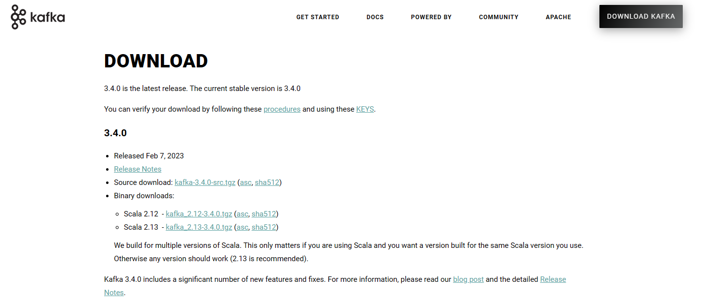
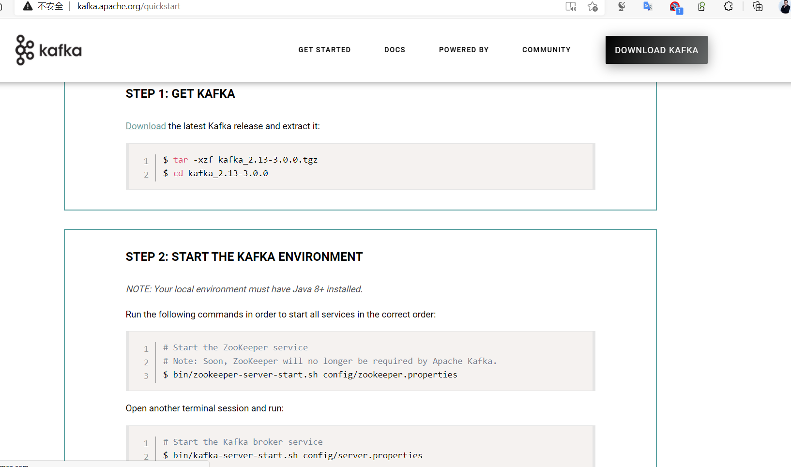
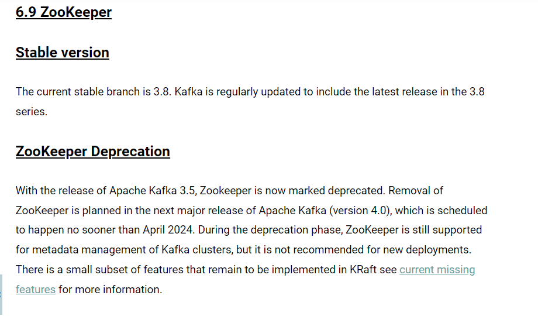
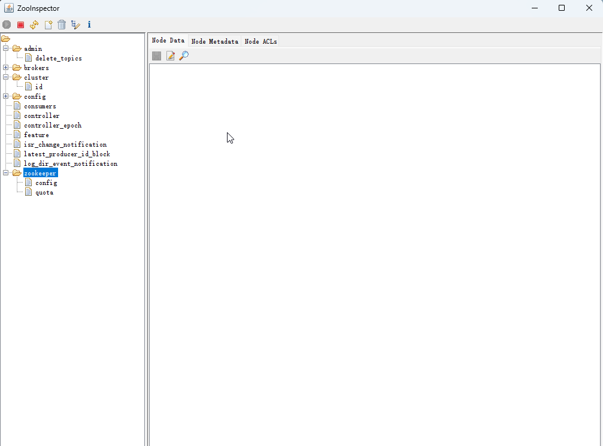
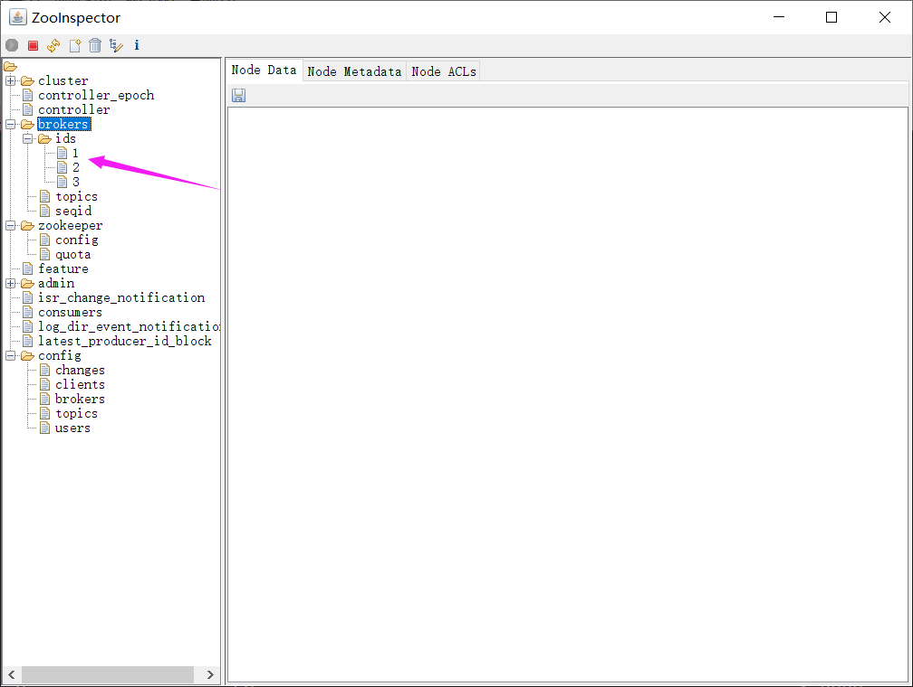
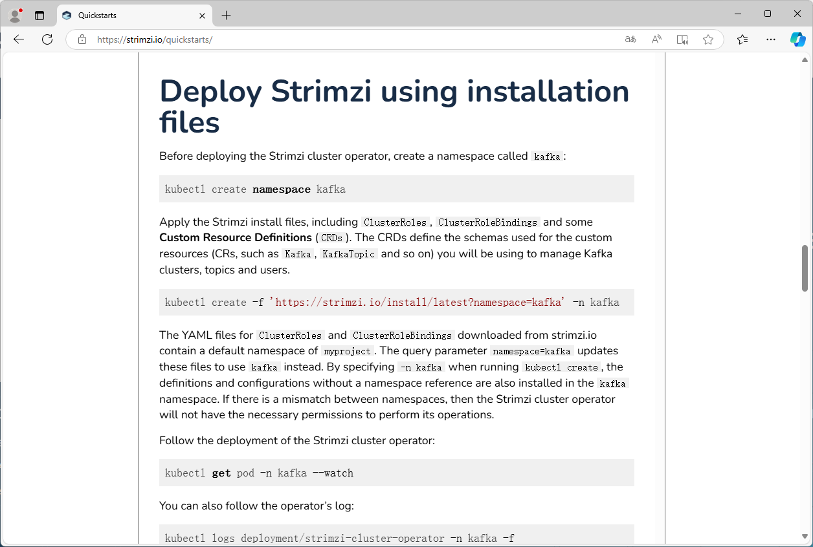

[← 返回微服务架构目录]({{ '/subjects/Microservices/' | relative_url }})



# 18 Kafka 部署
### 3.6 Kafka 部署

### Kafka 部署说明

kafka 版本选择

Kafka 发布包名称包含 Scala 二进制版本与 Kafka 版本，例如 `kafka_2.13-3.9.0.tgz`。运行服务器时应先核对 Kafka 版本与 Java 要求；只有编写 Scala 客户端或插件时，Scala 二进制兼容性才需要额外关注。下文同时保留旧 ZooKeeper 模式记录与 KRaft 示例，请先选一种模式，不能把两个模式的配置和数据目录混用。

kafka下载链接

<http://kafka.apache.org/downloads>

kafka版本格式

```text
kafka_<scala 版本>_<kafka 版本>
#示例:
kafka_2.13-2.7.0.tgz
kafka_2.12-3.9.0.tgz
```



scala 语言官网: https://www.scala-lang.org/

scale 与 java关系:https://baike.baidu.com/item/Scala/2462287?fr=aladdin

Kafka 支持单机和集群部署，生产通常为集群模式

官方文档:

<http://kafka.apache.org/quickstart>



### 单机部署

### 安装说明

注意：Kafka提供的脚本不支持创建软链接到/usr/local/bin/路径，只支持绝对路径或相对径执行

Download the latest Kafka release and extract it:

```bash
$ apt update && apt -y install openjdk-8-jdk
$ tar -xzf kafka_2.13-3.4.0.tgz
$ cd kafka_2.13-3.4.0
```

NOTE: Your local environment must have Java 8+ installed.

Apache Kafka can be started using ZooKeeper or KRaft. To get started with either configuration follow one the sections below but not both.

Kafka with ZooKeeper

Kafka-v4.0开始即将不再支持Zookeeper



Run the following commands in order to start all services in the correct order:

```text
# Start the ZooKeeper service
$ bin/zookeeper-server-start.sh config/zookeeper.properties
```

Open another terminal session and run:

```bash
#默认kafka配置文件，指定zookeeper服务器地址信息（可选）
[root@ubuntu2204 ~]#grep zookeeper /usr/local/kafka/config/server.properties
# Zookeeper connection string (see zookeeper docs for details).
zookeeper.connect=localhost:2181
# Timeout in ms for connecting to zookeeper
zookeeper.connection.timeout.ms=18000
#启动单机kafka
$ bin/kafka-server-start.sh config/server.properties
```

### 旧版基于 zookeeper 部署 kafka单机

注意：Kafka-4.0.0 版本不再支持Zookeeper

范例：基于 zookeeper 部署 kafka单机

```bash
#注意主机名解析,默认主机名称反向解析IP进行访问
[root@ubuntu2404 ~]#hostname
ubuntu2404.bowen.org
[root@ubuntu2404 ~]#vim /etc/hosts
10.0.0.201 ubuntu2404.bowen.org
#支持多个JAVA版本
[root@ubuntu2404 ~]#apt update && apt install -y openjdk-21-jdk
[root@ubuntu2204 ~]#apt update && apt install -y openjdk-8-jdk
[root@ubuntu2204 ~]#wget https://mirrors.tuna.tsinghua.edu.cn/apache/kafka/3.9.0/kafka_2.13-3.9.1.tgz
[root@ubuntu2204 ~]#wget https://mirrors.tuna.tsinghua.edu.cn/apache/kafka/3.9.0/kafka_2.13-3.9.0.tgz
[root@ubuntu2204 ~]#wget https://mirrors.tuna.tsinghua.edu.cn/apache/kafka/3.8.0/kafka_2.13-3.8.0.tgz
[root@ubuntu2204 ~]#tar xf kafka_2.13-3.8.0.tgz  -C /usr/local/
[root@ubuntu2204 ~]#cd /usr/local/
[root@ubuntu2204 local]#ls
bin  etc  games  include  kafka_2.13-3.8.0  lib  man  sbin  share  src
[root@ubuntu2204 local]#ln -s kafka_2.13-3.8.0/ kafka
[root@ubuntu2204 local]#ls kafka
bin  config  libs  LICENSE  licenses  NOTICE  site-docs
[root@ubuntu2204 local]#cd kafka
[root@ubuntu2204 kafka]#ls
bin  config  libs  LICENSE  licenses  NOTICE  site-docs
[root@ubuntu2204 kafka]#ls bin/
connect-distributed.sh        kafka-console-consumer.sh    kafka-get-offsets.sh          kafka-replica-
verification.sh       kafka-verifiable-producer.sh
connect-mirror-maker.sh       kafka-console-producer.sh    kafka-jmx.sh                  kafka-run-class.sh
trogdor.sh
connect-plugin-path.sh        kafka-consumer-groups.sh     kafka-leader-election.sh      kafka-server-start.sh
windows
connect-standalone.sh         kafka-consumer-perf-test.sh  kafka-log-dirs.sh             kafka-server-stop.sh
zookeeper-security-migration.sh
kafka-acls.sh                 kafka-delegation-tokens.sh   kafka-metadata-quorum.sh      kafka-storage.sh
zookeeper-server-start.sh
kafka-broker-api-versions.sh  kafka-delete-records.sh      kafka-metadata-shell.sh       kafka-streams-
application-reset.sh  zookeeper-server-stop.sh
kafka-client-metrics.sh       kafka-dump-log.sh            kafka-mirror-maker.sh         kafka-topics.sh
zookeeper-shell.sh
kafka-cluster.sh              kafka-e2e-latency.sh         kafka-producer-perf-test.sh   kafka-transactions.sh
kafka-configs.sh              kafka-features.sh            kafka-reassign-partitions.sh  kafka-verifiable-
consumer.sh
[root@ubuntu2204 kafka]#ls config/
connect-console-sink.properties    connect-file-sink.properties    connect-mirror-maker.properties  kraft
server.properties       zookeeper.properties
connect-console-source.properties  connect-file-source.properties  connect-standalone.properties
log4j.properties     tools-log4j.properties
connect-distributed.properties     connect-log4j.properties        consumer.properties
producer.properties  trogdor.conf
#修改配置文件
[root@ubuntu2204 kafka]#vim config/zookeeper.properties
dataDir=/data/zookeeper #此目录无需手动创建，启动会自动创建
[root@ubuntu2204 kafka]#bin/zookeeper-server-start.sh config/zookeeper.properties
#修改配置文件
[root@ubuntu2204 kafka]#vim config/server.properties
log.dirs=/data/kafka-logs
[root@ubuntu2204 kafka]#bin/kafka-server-start.sh config/server.properties
[root@ubuntu2204 ~]#ss -ntlp
State           Recv-Q          Send-Q                   Local Address:Port                    Peer
Address:Port         Process
LISTEN          0               128                          127.0.0.1:6010                         0.0.0.0:*
users:(("sshd",pid=1055,fd=7))
LISTEN          0               128                          127.0.0.1:6011                         0.0.0.0:*
users:(("sshd",pid=1568,fd=7))
LISTEN          0               128                          127.0.0.1:6012                         0.0.0.0:*
users:(("sshd",pid=4986,fd=7))
LISTEN          0               128                          127.0.0.1:6013                         0.0.0.0:*
users:(("sshd",pid=5554,fd=7))
LISTEN          0               4096                     127.0.0.53%lo:53                           0.0.0.0:*
users:(("systemd-resolve",pid=794,fd=14))
LISTEN          0               128                            0.0.0.0:22                           0.0.0.0:*
users:(("sshd",pid=839,fd=3))
LISTEN          0               128                              [::1]:6010                            [::]:*
users:(("sshd",pid=1055,fd=5))
LISTEN          0               128                              [::1]:6011                            [::]:*
users:(("sshd",pid=1568,fd=5))
LISTEN          0               128                              [::1]:6012                            [::]:*
users:(("sshd",pid=4986,fd=5))
LISTEN          0               128                              [::1]:6013                            [::]:*
users:(("sshd",pid=5554,fd=5))
LISTEN          0               50                                   *:42243                              *:*
users:(("java",pid=5088,fd=147))
LISTEN          0               50                                   *:9092                               *:*
users:(("java",pid=5088,fd=187))
LISTEN          0               50                                   *:2181                               *:*
users:(("java",pid=4556,fd=157))
LISTEN          0               50                                   *:45197                              *:*
users:(("java",pid=4556,fd=147))
LISTEN          0               128                               [::]:22                              [::]:*
users:(("sshd",pid=839,fd=4))
```

#### 关于旧版“一键安装”记录

原脚本把下载 URL 拆成两行、关闭 TLS 证书校验，并混用了 Java 与 Kafka 版本；复制执行会失败或绕过下载校验。实际安装应先确定 Kafka 版本及对应 Java 要求，再按上面的手动步骤逐项验证下载、解压、配置和端口。新部署优先参考后面的 KRaft 示例；只有维护既有 ZooKeeper 集群时才继续使用旧模式，并应先做配置与数据备份。



### KRaft 单机试验：固定版本与路径

新集群可采用 KRaft 管理元数据；本例沿用下一节的 Kafka 3.9.0 和 config/kraft/server.properties。单机只有一个 Broker/Controller，适合学习，不具备节点故障容忍。旧版 ZooKeeper 数据目录不能直接用于 KRaft 格式化；迁移现有集群须按目标版本的官方流程另行规划。

~~~bash
# 在测试机安装目标版本要求的 Java 后执行
VERSION=3.9.0
curl -fLO "https://archive.apache.org/dist/kafka/$VERSION/kafka_2.13-$VERSION.tgz"
tar -xf "kafka_2.13-$VERSION.tgz"
cd "kafka_2.13-$VERSION"
# 核对 config/kraft/server.properties 中的 node.id、监听地址和 log.dirs
CLUSTER_ID="$(bin/kafka-storage.sh random-uuid)"
bin/kafka-storage.sh format -t "$CLUSTER_ID" -c config/kraft/server.properties
bin/kafka-server-start.sh config/kraft/server.properties
~~~

格式化只对新的空数据目录执行一次。另开终端用 bin/kafka-topics.sh --bootstrap-server localhost:9092 --list 验证服务。要对外提供访问，还需设置客户端可解析的 advertised.listeners，并做好认证和网络隔离。

### 集群部署

### 基于 ZooKeeper 模式的集群（旧环境维护）

3.6.3.1.1 环境准备

3.6.3.1.1.1 主机名解析

注意：每个kafka节点的主机名称解析需要提前准备，否则会导致失败

```bash
#修改每个kafka节点的主机名
[root@ubuntu2204 ~]#hostnamectl hostname node1
[root@ubuntu2204 ~]#hostnamectl hostname node2
[root@ubuntu2204 ~]#hostnamectl hostname node3
#在所有kafka节点上实现主机名称解析
[root@ubuntu2204 ~]#cat /etc/hosts
10.0.0.201 node1
10.0.0.202 node2
10.0.0.203 node3
```

3.6.3.1.1.2 安装 JAVA

```bash
[root@ubuntu24.04-node1 ~]#apt update && apt  -y install openjdk-21-jre
[root@ubuntu24.04-node1 ~]#java -version
openjdk version "21.0.6" 2025-01-21
OpenJDK Runtime Environment (build 21.0.6+7-Ubuntu-124.04.1)
OpenJDK 64-Bit Server VM (build 21.0.6+7-Ubuntu-124.04.1, mixed mode, sharing)
[root@node1 ~]#apt update && apt install openjdk-8-jdk -y
```

3.6.3.1.1.3 安装 ZooKeeper

4.0以前版本 Kafka 依赖 Zookeeper 服务,但以后将不再依赖

```text
http://kafka.apache.org/quickstart
# Note: Soon, ZooKeeper will no longer be required by Apache Kafka.
```

环境说明

```text
#在三个Ubuntu18.04节点提前部署zookeeper和kafka三个节点复用
node1:10.0.0.201
node2:10.0.0.202
node3:10.0.0.203
#注意:生产中zookeeper和kafka一般是分开独立部署的,kafka安装前需要安装java环境
```

确保三个节点的zookeeper启动

```bash
[root@node1 ~]#zkServer.sh status
/usr/bin/java
ZooKeeper JMX enabled by default
Using config: /usr/local/zookeeper/bin/../conf/zoo.cfg
Client port found: 2181. Client address: localhost. Client SSL: false.
Mode: follower
[root@node2 ~]#zkServer.sh status
/usr/bin/java
ZooKeeper JMX enabled by default
Using config: /usr/local/zookeeper/bin/../conf/zoo.cfg
Client port found: 2181. Client address: localhost. Client SSL: false.
Mode: leader
[root@node3 ~]#zkServer.sh status
/usr/bin/java
ZooKeeper JMX enabled by default
Using config: /usr/local/zookeeper/bin/../conf/zoo.cfg
Client port found: 2181. Client address: localhost. Client SSL: false.
Mode: follower
```

注意:如果使用kafka自带的zookeeper，需要修改配置文件,如下示例

范例：

```bash
#注意如果使用kafka自带的zookeeper，需要修改配置文件
[root@ubuntu24.04-node1 ~]#apt update && apt  -y install openjdk-21-jre
[root@node1 ~]#apt update && apt install openjdk-8-jdk -y
[root@node1 ~]#wget https://mirrors.tuna.tsinghua.edu.cn/apache/kafka/3.8.0/kafka_2.13-3.8.0.tgz
[root@node1 ~]#tar xf kafka_2.13-3.8.0.tgz  -C /usr/local
[root@node1 ~]#ln -s /usr/local/kafka_2.13-3.8.0/ /usr/local/kafka
[root@node1 ~]#ls /usr/local/kafka
bin  config  libs  LICENSE  licenses  NOTICE  site-docs
#集群配置必须配置时间相关
[root@node1 ~]#vim /usr/local/kafka/config/zookeeper.properties
#必须添加时间相关配置
tickTime=2000
# The number of ticks that the initial
# synchronization phase can take
initLimit=10
# The number of ticks that can pass between
# sending a request and getting an acknowledgement
syncLimit=5
#保留下面内容
clientPort=2181
maxClientCnxns=0
admin.enableServer=false
#添加下面集群配置
dataDir=/usr/local/kafka/data/
server.1=10.0.0.201:2888:3888
server.2=10.0.0.202:2888:3888
server.3=10.0.0.203:2888:3888
[root@node1 ~]#mkdir /usr/local/kafka/data
[root@node1 ~]#echo 1 > /usr/local/kafka/data/myid
[root@node1 ~]#rsync -av /usr/local/kafka* 10.0.0.202|203:/usr/local
#修改各个节点的MyID
[root@node2 ~]#echo 2 > /usr/local/kafka/data/myid
[root@node3 ~]#echo 3 > /usr/local/kafka/data/myid
#在所有节点上启动
[root@node1 ~]#/usr/local/kafka/bin/zookeeper-server-start.sh /usr/local/kafka/config/zookeeper.properties
```

3.6.3.1.2 各节点部署 Kafka

3.6.3.1.2.1 Kafka 节点配置

配置文件说明

```text
#配置文件 ./conf/server.properties内容说明
############################# Server Basics###############################
# broker的id，值为整数，且必须唯一，在一个集群中不能重复，此行必须修改
broker.id=1
############################# Socket ServerSettings ######################
# kafka监听端口，默认9092
listeners=PLAINTEXT://10.0.0.101:9092
# 处理网络请求的线程数量，默认为3个
num.network.threads=3
# 执行磁盘IO操作的线程数量，默认为8个
num.io.threads=8
# socket服务发送数据的缓冲区大小，默认100KB
socket.send.buffer.bytes=102400
# socket服务接受数据的缓冲区大小，默认100KB
socket.receive.buffer.bytes=102400
# socket服务所能接受的一个请求的最大大小，默认为100M
socket.request.max.bytes=104857600
############################# Log Basics###################################
# kafka存储消息数据的目录
log.dirs=/usr/local/kafka/data
# 每个topic默认的partition
num.partitions=1
# 设置副本数量为3,当Leader的Replication故障，会进行故障自动转移。
default.replication.factor=3
# 在启动时恢复数据和关闭时刷新数据时每个数据目录的线程数量
num.recovery.threads.per.data.dir=1
############################# Log FlushPolicy #############################
# 消息刷新到磁盘中的消息条数阈值
log.flush.interval.messages=10000
# 消息刷新到磁盘中的最大时间间隔1s,单位是ms
log.flush.interval.ms=1000
############################# Log RetentionPolicy #########################
# 日志保留小时数，超时会自动删除，默认为7天
log.retention.hours=168
# 日志保留大小，超出大小会自动删除，默认为1G
#log.retention.bytes=1073741824
# 日志分片策略，单个日志文件的大小最大为1G，超出后则创建一个新的日志文件
log.segment.bytes=1073741824
# 每隔多长时间检测数据是否达到删除条件,300s
log.retention.check.interval.ms=300000
############################# Zookeeper ####################################
# Zookeeper连接信息，如果是zookeeper集群，则以逗号隔开，此行必须修改
zookeeper.connect=10.0.0.101:2181,10.0.0.102:2181,10.0.0.103:2181
# 连接zookeeper的超时时间,6s
zookeeper.connection.timeout.ms=6000
# 是否允许删除topic，默认为false，topic只会标记为marked for deletion
delete.topic.enable=true
```

范例：配置kafka_2.13-3.9.1

```bash
[root@node1 ~]#vim /usr/local/kafka/config/server.properties
#修改下面五行
broker.id=0 #每个节点不同
listeners=PLAINTEXT://10.0.0.201:9092 #每个节点不同
log.dirs=/usr/local/kafka/data
zookeeper.connect=10.0.0.201:2181,10.0.0.202:2181,10.0.0.203:2181
zookeeper.connect=10.0.0.201:2181,10.0.0.202:2181,10.0.0.203:2181
```

范例：

```bash
#在所有节点上执行安装java
[root@node1 ~]#apt install openjdk-8-jdk -y
#在所有节点上执行下载，官方下载
[root@node1 ~]#wget https://downloads.apache.org/kafka/3.3.1/kafka_2.13-3.3.1.tgz
[root@node1 ~]#wget https://archive.apache.org/dist/kafka/2.7.0/kafka_2.13-2.7.0.tgz
#国内镜像下载
[root@node1 ~]#wget https://mirrors.tuna.tsinghua.edu.cn/apache/kafka/3.3.1/kafka_2.13-3.3.1.tgz
[root@node1 ~]#wget https://mirrors.tuna.tsinghua.edu.cn/apache/kafka/3.0.0/kafka_2.13-3.0.0.tgz
[root@node1 ~]#wget https://mirror.bit.edu.cn/apache/kafka/2.7.0/kafka_2.13-2.7.0.tgz
#解压缩
[root@node1 ~]#tar xf kafka_2.13-2.7.0.tgz  -C /usr/local/
[root@node1 ~]#ln -s /usr/local/kafka_2.13-2.7.0/ /usr/local/kafka
#配置PATH变量
[root@node1 ~]#echo 'PATH=/usr/local/kafka/bin:$PATH' > /etc/profile.d/kafka.sh
[root@node1 ~]#. /etc/profile.d/kafka.sh
#修改配置文件
[root@node1 ~]#vim /usr/local/kafka/config/server.properties
broker.id=1 #每个broker在集群中每个节点的正整数唯一标识，此值保存在log.dirs下的meta.properties文件，修改此行
listeners=PLAINTEXT://10.0.0.101:9092 #指定当前主机的IP做为监听地址,注意:不支持0.0.0.0
log.dirs=/usr/local/kafka/data #kakfa用于保存数据的目录，所有的消息都会存储在该目录当中，修改此行
num.partitions=1 #设置创建新的topic时默认分区数量,建议和kafka的节点数量一致
default.replication.factor=3 #指定默认的副本数为3，可以实现故障的自动转移
log.retention.hours=168 #设置kafka中消息保留时间，默认为168小时即7天
zookeeper.connect=10.0.0.101:2181,10.0.0.102:2181,10.0.0.103:2181 #指定连接的zk的地址,zk中存储了broker的元数据信息，
修改此行
zookeeper.connection.timeout.ms=6000 #设置连接zookeeper的超时时间，单位为ms,默认6秒钟
#准备数据目录
[root@node1 ~]#mkdir /usr/local/kafka/data
[root@node1 ~]#scp /usr/local/kafka/config/server.properties 10.0.0.102:/usr/local/kafka/config
[root@node1 ~]#scp /usr/local/kafka/config/server.properties 10.0.0.103:/usr/local/kafka/config
#修改第2个节点配置
[root@node2 ~]#vim /usr/local/kafka/config/server.properties
broker.id=2 #每个broker 在集群中的唯一标识，正整数。
listeners=PLAINTEXT://10.0.0.102:9092 #指定当前主机的IP做为监听地址,注意:不支持0.0.0.0
#修改第3个节点配置
[root@node3 ~]#vim /usr/local/kafka/config/server.properties
broker.id=3  #每个broker 在集群中的唯一标识，正整数。
listeners=PLAINTEXT://10.0.0.103:9092 #指定当前主机的IP做为监听地址,注意:不支持0.0.0.0
#可以调整内存
[root@node1 ~]#vim /usr/local/kafka/bin/kafka-server-start.sh
......
if[ " x$KAFKA_HEAP_OPTS"="x"] ; then
export KAFKA_HEAP_OPTS=" -Xmx1G -Xms1G"
fi
......
```

3.6.3.1.2.2 启动服务

在所有kafka节点执行下面操作

```bash
#前台启动
[root@node1 ~]#/usr/local/kafka/bin/kafka-server-start.sh  /usr/local/kafka/config/server.properties
#后台启动
[root@node1 ~]#/usr/local/kafka/bin/kafka-server-start.sh -daemon /usr/local/kafka/config/server.properties
```

3.6.3.1.2.3 确保服务启动状态

```bash
[root@node1 ~]#ss -ntl|grep 9092
LISTEN  0        50          [::ffff:10.0.0.101]:9092                  *:*
[root@node1 ~]#tail /usr/local/kafka/logs/server.log
[2021-02-16 12:10:01,276] INFO [ExpirationReaper-1-AlterAcls]: Starting
(kafka.server.DelayedOperationPurgatory$ExpiredOperationReaper)
[2021-02-16 12:10:01,311] INFO [/config/changes-event-process-thread]: Starting
(kafka.common.ZkNodeChangeNotificationListener$ChangeEventProcessThread)
[2021-02-16 12:10:01,332] INFO [SocketServer brokerId=1] Starting socket server acceptors and processors
(kafka.network.SocketServer)
[2021-02-16 12:10:01,339] INFO [SocketServer brokerId=1] Started data-plane acceptor and processor(s) for
endpoint : ListenerName(PLAINTEXT) (kafka.network.SocketServer)
[2021-02-16 12:10:01,340] INFO [SocketServer brokerId=1] Started socket server acceptors and processors
(kafka.network.SocketServer)
[2021-02-16 12:10:01,344] INFO Kafka version: 2.7.0 (org.apache.kafka.common.utils.AppInfoParser)
[2021-02-16 12:10:01,344] INFO Kafka commitId: 448719dc99a19793 (org.apache.kafka.common.utils.AppInfoParser)
[2021-02-16 12:10:01,344] INFO Kafka startTimeMs: 1613448601340 (org.apache.kafka.common.utils.AppInfoParser)
[2021-02-16 12:10:01,346] INFO [KafkaServer id=1] started (kafka.server.KafkaServer)
[2021-02-16 12:10:01,391] INFO [broker-1-to-controller-send-thread]: Recorded new controller, from now on will
use broker 1 (kafka.server.BrokerToControllerRequestThread)
#如果使用id,还需要修改/usr/local/kafka/data/meta.properties
#打开zooinspector可以看到三个id
```



Broker 依赖于 Zookeeper，每个Broker 的id 和 Topic、Partition这些元数据信息都会写入Zookeeper 的 ZNode 节点中 consumer 依赖于Zookeeper，Consumer 在消费消息时，每消费完一条消息，会将产生的offset 保存到 Zookeeper 中，下次消费在当前offset往后继续消费.kafka0.9 之前Consumer 的offset 存储在 Zookeeper 中，kafka0.9 以后offset存储在本地。 Partition 依赖于 Zookeeper，Partition 完成Replication 备份后，选举出一个Leader，这个是依托于 Zookeeper 的选举机制实现的

3.6.3.1.2.4 准备Kafka的service文件

```bash
[root@node1 ~]#cat /lib/systemd/system/kafka.service
[unit]
Description=Apache kafka
After=network.target
[service]
Type=simple
#Environment=JAVA_HOME=/data/server/java
PIDFile=/usr/local/kafka/kafka.pid
Execstart=/usr/local/kafka/bin/kafka-server-start.sh  /usr/local/kafka/config/server. properties
Execstop=/bin/kill  -TERM ${MAINPID}
Restart=always
RestartSec=20
[Install]
wantedBy=multi-user.target
[root@node1 ~]#systemctl daemon-load
[root@node1 ~]#systemctl restart kafka.service
```

#### 旧版 ZooKeeper 集群操作回顾

前面的集群记录适用于维护已有 ZooKeeper 模式部署。为避免覆盖各节点的 broker.id、zookeeper.connect 或已有 log.dirs，不应把同一份“自动安装脚本”在三台机器上直接运行。核对每台节点的唯一 Broker ID、广告地址、数据目录和 ZooKeeper 连接串，确认副本布局与磁盘空间后，再分节点变更并观察 ISR。下节给出独立的 KRaft 三节点示例；两种元数据模式不能共用一份数据目录。
### KRaft 三节点集群：选定一个版本再执行

本节以 Kafka 3.9.0、三个节点同时承担 Broker 和 Controller 角色为例。前面的 ZooKeeper 模式是旧环境维护记录，不要把两种模式的配置文件或格式化命令混在同一数据目录。生产部署需另行设计节点故障域、认证加密、磁盘容量与备份策略。

| 节点 | 主机名 | node.id | Broker 地址 | Controller 地址 |
| --- | --- | ---: | --- | --- |
| 1 | kafka01 | 1 | kafka01:9092 | kafka01:9093 |
| 2 | kafka02 | 2 | kafka02:9092 | kafka02:9093 |
| 3 | kafka03 | 3 | kafka03:9092 | kafka03:9093 |

三台机器先确认主机名相互可解析、9092/9093 端口互通，并安装目标版本要求的 Java。下载版本与配置路径必须保持一致；此处只展示一次固定版本，不交替执行 3.9 和 4.0 的命令。

~~~bash
# 在每台机器执行；下载后按 Apache 官方校验文件核对完整性
VERSION=3.9.0
curl -fLO "https://archive.apache.org/dist/kafka/$VERSION/kafka_2.13-$VERSION.tgz"
tar -xf "kafka_2.13-$VERSION.tgz" -C /usr/local/
ln -sfn "/usr/local/kafka_2.13-$VERSION" /usr/local/kafka
cd /usr/local/kafka
mkdir -p /data/kafka-logs
~~~

以下是 **kafka01** 的核心配置，写入 config/kraft/server.properties；kafka02、kafka03 使用同一 voters 列表，但分别设置 node.id=2/3 和自己的 advertised.listeners。正式环境不要直接开放 PLAINTEXT 到不可信网络。

~~~properties
process.roles=broker,controller
node.id=1
controller.quorum.voters=1@kafka01:9093,2@kafka02:9093,3@kafka03:9093
listeners=PLAINTEXT://0.0.0.0:9092,CONTROLLER://0.0.0.0:9093
advertised.listeners=PLAINTEXT://kafka01:9092
listener.security.protocol.map=PLAINTEXT:PLAINTEXT,CONTROLLER:PLAINTEXT
inter.broker.listener.name=PLAINTEXT
controller.listener.names=CONTROLLER
log.dirs=/data/kafka-logs
offsets.topic.replication.factor=3
transaction.state.log.replication.factor=3
transaction.state.log.min.isr=2
~~~

advertised.listeners 只公布客户端/Broker 可访问的 Broker 端点，不应把 CONTROLLER 监听器放进去。所有节点共用**同一个** Cluster ID，但 node.id 必须唯一。仅对尚未格式化的空数据目录执行一次 format；重复格式化会破坏原有集群元数据。

~~~bash
# 在 kafka01 生成一次，并把输出值安全地传给另外两台
bin/kafka-storage.sh random-uuid
# 在每台节点用同一个 Cluster ID 替换下方占位符
bin/kafka-storage.sh format -t CLUSTER_ID -c config/kraft/server.properties
bin/kafka-server-start.sh -daemon config/kraft/server.properties
~~~

待三台节点启动并完成选举后，在任一可访问 Broker 的机器上验证元数据与读写。创建 Topic 之前确认集群有 3 台健康 Broker，否则副本因子 3 会失败。

~~~bash
bin/kafka-topics.sh --bootstrap-server kafka01:9092 --create --topic demo-events --partitions 3 --replication-factor 3
bin/kafka-topics.sh --bootstrap-server kafka01:9092 --describe --topic demo-events
bin/kafka-console-producer.sh --bootstrap-server kafka01:9092 --topic demo-events
# 在另一终端执行消费者，再在生产者终端输入一行测试消息
bin/kafka-console-consumer.sh --bootstrap-server kafka01:9092 --topic demo-events --from-beginning --group demo-check
~~~

若创建失败，先检查 Broker 日志、主机名解析、Controller 法定多数派和 advertised.listeners；不要直接清空 log.dirs 重新格式化。

### Kubernetes 部署 Kafka

基于Kubernetes的 Operator 安装 Kafka 集群

<https://strimzi.io/quickstarts/>

<https://operatorhub.io/operator/strimzi-kafka-operator>



```yaml
apiVersion: kafka.strimzi.io/v1beta2
kind: Kafka
metadata:
name: my-cluster
spec:
kafka:
version: 3.8.0
replicas: 3
listeners:
- name: plain
port: 9092
type: internal
tls: false
- name: tls
port: 9093
type: internal
tls: true
config:
offsets.topic.replication.factor: 3
transaction.state.log.replication.factor: 3
transaction.state.log.min.isr: 2
default.replication.factor: 3
min.insync.replicas: 2
inter.broker.protocol.version: '3.8'
storage:
type: ephemeral
zookeeper:
replicas: 3
storage:
type: ephemeral
entityOperator:
topicOperator: {}
userOperator: {}
```



<nav class="article-end" aria-label="章节导航">
  <a href="{{ '/subjects/Microservices/17-kafka-roles-and-workflow.html' | relative_url }}">← 上一篇：Kafka 角色和流程</a>
  <a href="{{ '/subjects/Microservices/' | relative_url }}">返回微服务架构目录</a>
  <a href="{{ '/subjects/Microservices/19-reading-and-writing-kafka-data.html' | relative_url }}">下一篇：Kafka 读写数据 →</a>
</nav>
