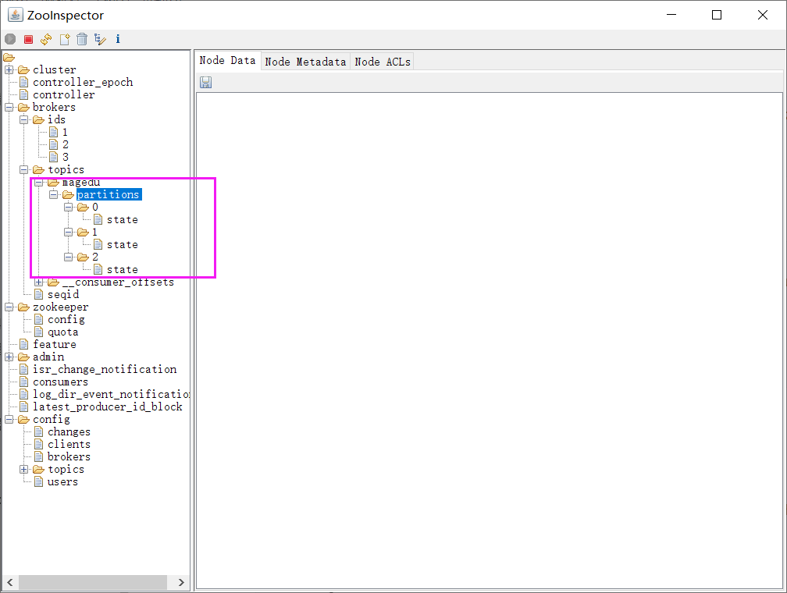

[← 返回微服务架构目录]({{ '/subjects/Microservices/' | relative_url }})



# 19 Kafka 读写数据
### 3.7 从 Topic 到消费位点的完整练习

以下命令假定本机已有 Kafka Broker 监听 localhost:9092，并使用 Kafka 安装目录下的 bin 工具；若使用第 18 篇三节点集群，替换 BOOTSTRAP，且可把副本因子提高到不超过健康 Broker 数。命令中的注释和交互输出不要与命令一起复制。

~~~bash
BOOTSTRAP=localhost:9092
bin/kafka-topics.sh --bootstrap-server "$BOOTSTRAP" --create --topic demo-events --partitions 3 --replication-factor 1
bin/kafka-topics.sh --bootstrap-server "$BOOTSTRAP" --list
bin/kafka-topics.sh --bootstrap-server "$BOOTSTRAP" --describe --topic demo-events
~~~

描述输出中的 Partition 是分区编号，Leader 是当前主副本所在 Broker ID，Replicas 是已分配副本，Isr 是当前同步副本。一个分区内的 offset 有序，不同分区没有统一的消息先后次序。

### 生产与消费

先在终端 A 启动生产者，输入几行文本后按 Ctrl+C；再在终端 B 启动消费者。每输入一行会生成一条记录，实际生产应用还应设置键、确认和错误处理。

~~~bash
bin/kafka-console-producer.sh --bootstrap-server localhost:9092 --topic demo-events
~~~

~~~bash
bin/kafka-console-consumer.sh --bootstrap-server localhost:9092 --topic demo-events --group demo-reader --from-beginning
~~~

--from-beginning 只在该消费者组**没有已提交位点**时从可用数据的最早处开始；若组已有位点，会继续按位点消费。要重放历史数据，使用新的组名或在停止该组后按需要重置位点。同一消费者组内，一个分区同一时刻通常分配给一个消费者；它不会保证三分区的记录平均分到两个消费者，也不保证跨分区全局顺序。不同组可以各自读取同一 Topic。

### 查看积压：先量化再处理

Consumer Lag 大致是分区日志末端位点与该组已提交位点的差值，表示还未被该组确认推进的记录数；它不是“磁盘目录中未消费文件数”。用下面命令按分区查看 CURRENT-OFFSET、LOG-END-OFFSET 和 LAG：

~~~bash
bin/kafka-consumer-groups.sh --bootstrap-server localhost:9092 --describe --group demo-reader
~~~

若 LAG 持续增长，先检查消费者是否存活、是否反复报错或再均衡，以及生产速率和消费处理耗时。增加同组消费者最多只能利用已有分区的并行度；分区热点要先核对消息键和分区分布。不要靠删除 Topic、直接清理日志目录或随意缩短保留期来“解决”积压，那会造成数据丢失。

### 删除练习 Topic

确认已不需要演示数据后再删除；这会影响所有消费者组。不要到 ZooKeeper 手动删除 /brokers/topics 下的节点来代替 Kafka 管理命令。

~~~bash
bin/kafka-topics.sh --bootstrap-server localhost:9092 --delete --topic demo-events
~~~

旧版 --zookeeper 参数只适用于对应旧集群和工具版本；新部署统一使用 --bootstrap-server。



<nav class="article-end" aria-label="章节导航">
  <a href="{{ '/subjects/Microservices/18-deploying-kafka.html' | relative_url }}">← 上一篇：Kafka 部署</a>
  <a href="{{ '/subjects/Microservices/' | relative_url }}">返回微服务架构目录</a>
  <a href="{{ '/subjects/Microservices/20-kafka-data-structures-in-zookeeper.html' | relative_url }}">下一篇：Kafka 在 ZooKeeper 里面的存储结构 →</a>
</nav>
