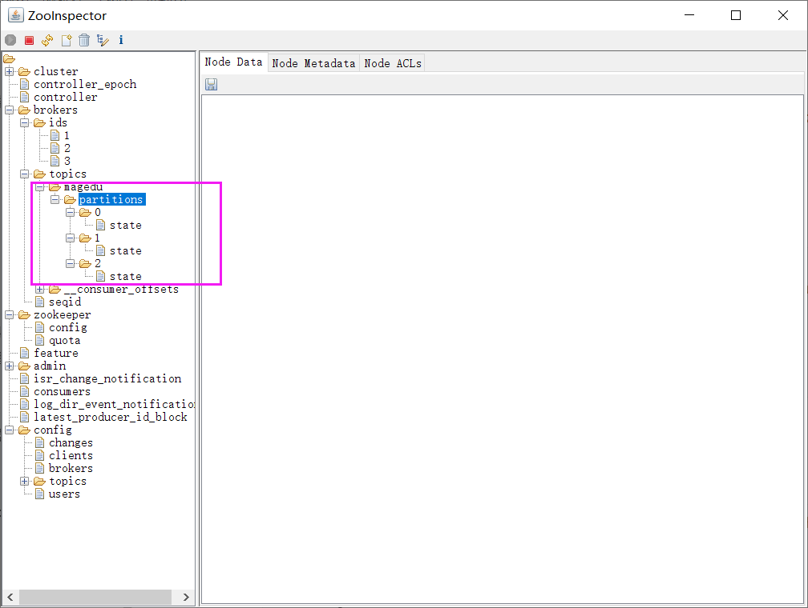

[← Back to Microservices Index]({{ '/subjects/Microservices/' | relative_url }})



# 19 Reading and Writing Kafka Data
### 3.7 Kafka 读写数据

参考文档

<http://kafka.apache.org/quickstart>

常见命令

```text
kafka-topics.sh             #消息的管理命令
kafka-console-producer.sh   #生产者的模拟命令
kafka-console-consumer.sh   #消费者的模拟命令
```

### 创建 Topic

创建topic名为 bowen，partitions(分区)为3，replication(每个分区的副本数/每个分区的分区因子)为 2

```bash
#新版命令,通过--bootstrap-server指定kafka的地址
[root@node1 ~]#/usr/local/kafka/bin/kafka-topics.sh --create --topic bowen --bootstrap-server 10.0.0.101:9092 -
-partitions 3 --replication-factor 2
#在各节点上观察生成的相关数据
[root@node1 ~]#ls /usr/local/kafka/data/
[root@node2 ~]#ls /usr/local/kafka/data/
[root@node3 ~]#ls /usr/local/kafka/data/
#旧版命令，通过--zookeeper指定zookeeper的地址
[root@node1 ~]#/usr/local/kafka/bin/kafka-topics.sh --create --zookeeper
10.0.0.101:2181,10.0.0.102:2181,10.0.0.103:2181 --partitions 3 --replication-factor 2 --topic bowen
Created topic bowen.
```

### 获取所有 Topic

```bash
#新版命令
[root@node1 ~]#/usr/local/kafka/bin/kafka-topics.sh --list --bootstrap-server 10.0.0.101:9092
#旧版命令
[root@node1 ~]#/usr/local/kafka/bin/kafka-topics.sh --list --zookeeper
10.0.0.101:2181,10.0.0.102:2181,10.0.0.103:2181
bowen
```



### 查看 Topic 详情

状态说明：bowen 有三个分区分别为0、1、2，分区0的leader是3 （broker.id），分区 0 有2 个副本，并且状态都为 lsr（ln-sync，表示可以参加选举成为 leader）。

```bash
#新版命令
[root@node1 ~]#/usr/local/kafka/bin/kafka-topics.sh --describe --bootstrap-server 10.0.0.101:9092  --topic
bowen
Topic: bowen TopicId: beg6bPXwToW1yp7cuv7F8w PartitionCount: 3   ReplicationFactor: 2    Configs:
Topic: bowen Partition: 0    Leader: 3   Replicas: 3,1   Isr: 3,1
Topic: bowen Partition: 1    Leader: 1   Replicas: 1,2   Isr: 1,2
Topic: bowen Partition: 2    Leader: 2   Replicas: 2,3   Isr: 2,3
#旧版命令
[root@node1 ~]#/usr/local/kafka/bin/kafka-topics.sh --describe --zookeeper
10.0.0.101:2181,10.0.0.102:2181,10.0.0.103:2181 --topic bowen
Topic: bowen PartitionCount: 3   ReplicationFactor: 2    Configs:
Topic: bowen Partition: 0    Leader: 3   Replicas: 3,2   Isr: 3,2
Topic: bowen Partition: 1    Leader: 1   Replicas: 1,3   Isr: 1,3
Topic: bowen Partition: 2    Leader: 2   Replicas: 2,1   Isr: 2,1
```

### 生产 Topic

kafka-console-producer.sh 格式

```text
#发送消息命令格式:
kafka-console-producer.sh --broker-list <kafkaIP1>:<端口>,<kafkaIP2>:<端口> --topic <topic名称> --producer-
property group.id=<组名>
```

范例：

```bash
#交互式输入消息,按Ctrl+C退出
[root@node1 ~]#/usr/local/kafka/bin/kafka-console-producer.sh --broker-list
10.0.0.101:9092,10.0.0.102:9092,10.0.0.103:9092 --topic bowen
>message1
>message2
>message3
>
#或者下面方式
[root@node1 ~]#/usr/local/kafka/bin/kafka-console-producer.sh --topic bowen --bootstrap-server 10.0.0.101:9092
```

### 消费 Topic

kafka-console-consumer.sh 格式

```text
#接收消息命令格式:
kafka-console-consumer.sh --bootstrap-server <host>:<post> --topic <topic名称> --from-beginning --consumer-
property group.id=<组名称>
```

注意：

消息者先生产消息，消费者后续启动，也能收到之前生产的消息同一个消息在同一个group内的消费者只有被一个消费者消费，比如：共100条消息，在一个group内有A，B两个消费者，其中A消费 50条，B消费另外的50条消息。从而实现负载均衡，不同group内的消费者则可以同时消费同一个消息 --from-beginning 表示消费前发布的消息也能收到，默认只能收到消费后发布的新消息

范例：

```bash
#交互式持续接收消息,按Ctrl+C退出
[root@node1 ~]#/usr/local/kafka/bin/kafka-console-consumer.sh --topic bowen --bootstrap-server 10.0.0.102:9092
--from-beginning
message1
message3
message2
#一个消息同时只能被同一个组内一个消费者消费（单播机制），实现负载均衡，而不能组可以同时消费同一个消息（多播机制）
[root@node2 ~]#/usr/local/kafka/bin/kafka-console-consumer.sh --topic bowen --bootstrap-server 10.0.0.102:9092
--from-beginning --consumer-property group.id=group1
[root@node2 ~]#/usr/local/kafka/bin/kafka-console-consumer.sh --topic bowen --bootstrap-server 10.0.0.102:9092
--from-beginning --consumer-property group.id=group1
```

### 删除 Topic

范例：

```bash
#注意：需要修改配置文件server.properties中的delete.topic.enable=true并重启
#新版本
[root@node3 ~]#/usr/local/kafka/bin/kafka-topics.sh --delete --bootstrap-server
10.0.0.101:9092,10.0.0.102:9092,10.0.0.103:9092 --topic bowen
#旧版本
[root@node3 ~]#/usr/local/kafka/bin/kafka-topics.sh --delete --zookeeper
10.0.0.101:2181,10.0.0.102:2181,10.0.0.103:2181 --topic bowen
Topic bowen is marked for deletion.
Note: This will have no impact if delete.topic.enable is not set to true.
```

范例：删除zk下面 topic test

```bash
#无需修改配置文件server.properties，此方法很危险
[root@zookeeper-node1 ~]#zkCli.sh -server 10.0.0.103:2181
[zk: 10.0.0.103:2181(CONNECTED) 0] ls /brokers/topics
[zk: 10.0.0.103:2181(CONNECTED) 0] deleteall /brokers/topics/test
[zk: 10.0.0.103:2181(CONNECTED) 0] ls /brokers/topics
```

### 消息积压

消息积压是指在消息传递系统中，积累了大量未被处理或未被消费的消息

Kafka 消息积压可能由多种原因引起，以下是一些可能的原因：

1. 消费者处理速度慢： 如果消费者处理消息的速度不足以跟上生产者的速度，就会导致消息积压。这可能是因为消费者逻辑复杂、消费

者数量不足、消费者宕机或者网络延迟等原因引起的。

2. 消费者宕机： 如果某个消费者宕机，其负责处理的分区将没有消费者来消费消息，导致消息在该分区上积压

3. 网络问题： 网络故障可能导致生产者和消费者之间的通信延迟或中断，从而影响消息的传递速度

4. 硬件资源不足： Kafka 集群所在的机器，包括生产者、消费者和 Broker 所在的机器，可能由于 CPU、内存或磁盘等资源不足，导致消

息处理速度变慢

5. 分区不均匀： 如果某些分区的负载比其他分区更高，可能导致这些分区上的消息积压。这可能是由于分区数量设置不合理、数据分布

不均匀等原因引起的

6. 生产者速度过快： 如果生产者生产消息的速度过快，而消费者无法及时处理，就会导致消息积压

7. 配置不当： Kafka 的一些配置参数，如副本数、分区数、消费者数量等，需要根据实际情况进行合理的配置。如果配置不当，可能导致

消息积压问题。

8. 异常情况： 突发性的异常情况，如硬件故障、网络故障、软件 bug 等，都可能导致消息积压

Kafka 消息积压可能的解决方案：

1. 增加消费者数量：如果消费者处理速度不足导致消息积压，可以增加消费者的数量来提高处理速度。

2. 扩展Kafka集群：如果消息积压是由于Kafka集群的吞吐量达到极限导致的，考虑扩展Kafka集群的规模来增加其处理能力。

3. 数据分区：合理划分数据分区可以提高并行处理能力，从而减少消息积压。

4. 数据清理：定期清理过期的数据和日志文件，以释放磁盘空间并提高性能。

5. 优化消费者代码：检查消费者代码，确保它们是高效的。可能存在一些性能瓶颈或不必要的延迟。

6. 调整Kafka配置：根据需要调整Kafka的配置参数，例如增加分区数量、调整副本数量、调整日志清理策略等。

7. 监控和警报：设置监控系统，及时发现消息积压问题并发送警报。这样可以在问题出现之前采取行动。

8. 故障排除：检查系统日志，查找可能的问题源，并采取相应的措施解决问题。

kafka 要发现消息积压，可以考虑以下方法：

1. 监控工具： Kafka 提供了一些监控工具，例如 Kafka Manager、Burrow、Kafka Offset Monitor 等。这些工具可以帮助你监控每个分

区的偏移量（offset）和消费者组的状态。通过检查偏移量的增长速度，你可以判断是否有消息积压

2. Consumer Lag： Consumer Lag 是指消费者组相对于生产者的消息偏移量的差异。通过监控 Consumer Lag，你可以了解消费者是

否跟上了生产者的速度。如果 Consumer Lag 增长较快，可能表示消息积压

3. Kafka Logs 目录： Kafka 的每个分区都有一个日志目录，其中包含了该分区的消息数据。可以检查每个分区的日志目录，查看是否有

大量的未消费的消息

4. Kafka Broker Metrics： Kafka 提供了一系列的 broker metrics，包括消息入队速率、出队速率等。通过监控这些指标，可以了解

Kafka 集群的负载状况

5. 操作系统资源： 如果 Kafka 所在的机器资源不足，可能导致消息积压。监控 CPU、内存、磁盘等系统资源，确保它们没有达到极限

6. 警报系统： 设置警报系统，当某些指标达到预定的阈值时触发警报，通知运维人员或相关团队及时处理

通过Kafka提供的工具查看格式：

```text
#发现当前消费的offset和最后一条的offset差距很大,说明有大量的数据积压
kafka-consumer-groups.sh --bootstrap-server {kafka连接地址} --describe --group {消费组} | --all-groups
```

范例：

```bash
#模拟生产者生产大量消息
[root@ubuntu2204 ~]#( while true; do echo $i;let i++;done ) | /usr/local/kafka/bin/kafka-console-producer.sh -
-broker-list 10.0.0.201:9092,10.0.0.202:9092,10.0.0.203:9092 --topic mytopic
#下面命令查看消费组中每个Topic的堆积消息数。“LAG”表示每个Topic的总堆积数
[root@ubuntu2204 ~]#/usr/local/kafka/bin/kafka-consumer-groups.sh --bootstrap-server 10.0.0.101:9092 --
describe --all-groups
GROUP           TOPIC           PARTITION  CURRENT-OFFSET  LOG-END-OFFSET  LAG             CONSUMER-ID
HOST            CLIENT-ID
group1          bowen            0          3               3               0               -               -
-
group1          test            0          4               11              7               -               -
-
```



<nav class="article-end" aria-label="章节导航">
  <a href="{{ '/subjects/Microservices/18-deploying-kafka.html' | relative_url }}">← Previous: Deploying Kafka</a>
  <a href="{{ '/subjects/Microservices/' | relative_url }}">Back to Microservices Index</a>
  <a href="{{ '/subjects/Microservices/20-kafka-data-structures-in-zookeeper.html' | relative_url }}">Next: Kafka Data Structures in ZooKeeper →</a>
</nav>
